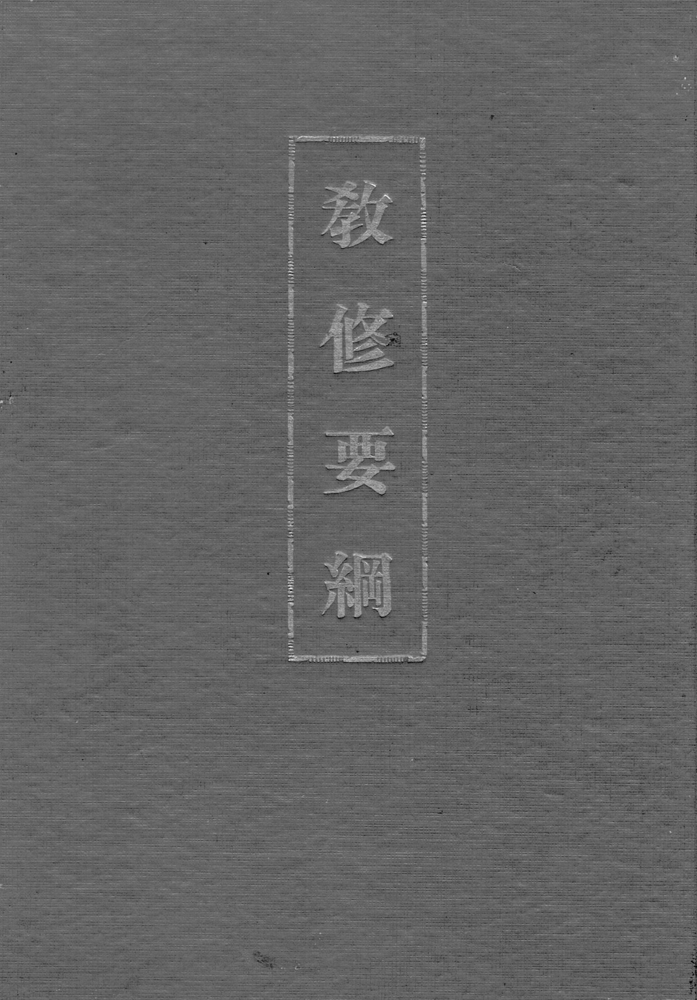
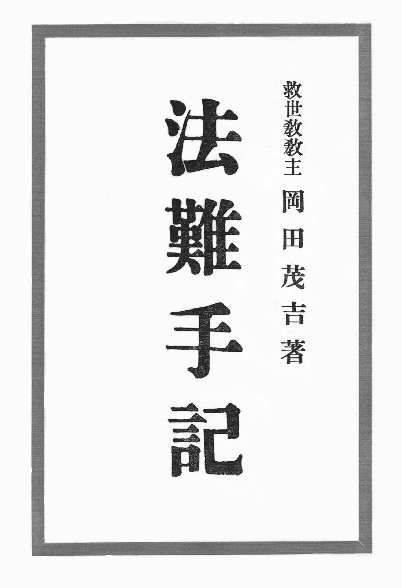

# A difusão na época de Meishu-Sama

*Volume único*

---

## 1. O período e as fontes

Este estudo trata da difusão religiosa na época de Meishu-Sama, de outubro de 1934
a fevereiro de 1955, com atenção especial ao período que se abre com a liberdade
religiosa de 1945. Não é uma história da instituição, nem uma exposição da
doutrina: é a reconstrução de **como a difusão funcionava** — por que meios as
pessoas eram alcançadas, que unidades se abriam, quem as dirigia, como se
formavam os que dirigiam, e como tudo isso se sustentava materialmente.

![Meishu-Sama, cerca de 1950. [Fotografia da época; a data é a que consta da legenda original, por aproximação.]](fotografias/retrato_1950.jpg)

As fontes são de três naturezas. A primeira é o **escrito de Meishu-Sama**: os
artigos e ensaios que ele publicou. A segunda é a **palavra oral registrada**:
as palestras e, sobretudo, as respostas a perguntas de fiéis e de dirigentes,
publicadas periodicamente e em grande número. A terceira são os **documentos
oficiais da época** — regulamentos, comunicados da direção, censos internos,
atas de reuniões de dirigentes, periódicos institucionais e relatos de fiéis.
São documentos públicos, conservados por diversas instituições messiânicas, e
aqui se citam pela indicação do veículo, do número e da data.

Essa composição explica a forma do estudo. Os documentos normativos do período
são poucos e preciosos: o censo de unidades e ministros de outubro de 1950, o
regulamento da pessoa jurídica de 1951, o comunicado de reorganização de março
de 1951, as atas das reuniões de dirigentes. Os relatos de fiéis são abundantes
e, por natureza, parciais. Sempre que possível, uma afirmação estrutural está
ancorada num documento institucional; as palavras de Meishu-Sama servem para
explicar a **doutrina** que orientava a estrutura, não para provar números.

### 1.1 O que Meishu-Sama diz do que escreve

Antes de qualquer convenção de leitura, é preciso estabelecer o estatuto do texto
que este volume cita em cada página. Não se trata de opinião de um fundador sobre
assuntos religiosos. O próprio autor o declara em termos que não admitem leitura
branda:

> 「ところがいよいよ時期到来、神は真理を解明すべく、私をして普く人類に知らしめ
> 給うのである。それが我メシヤ教出現の理由であるから、**私のかく文章は、万人に
> 解り得るよう神が神示され給うのである。**」

*"Chegando finalmente o tempo, Deus, para deslindar a verdade, faz que eu a dê a
conhecer amplamente à humanidade. É essa a razão do aparecimento da nossa Igreja
Messiânica; por isso **os textos que escrevo são o que Deus revela, para que todos
possam entender**."*
— 「私は真理を書く」, 『地上天国』 (Paraíso Terrestre) 28号, 25 de setembro de 1951

E, no mesmo artigo, sem atenuar:

> 「右のごとくであるとしたら、**私の今までかいたものはことごとく真理であって**、
> 真理の鏡に照らして偽真理の欠陥を晒け出し、改善する方法を諭ゆるので」

*"Sendo assim, **tudo o que escrevi até hoje é integralmente verdade**, e, à luz do
espelho da verdade, expõe as falhas da falsa verdade e ensina o modo de
corrigi-las."*

A capacidade de escrever assim não lhe é própria. Ele relata o espanto de um
jornalista — que a produção de qualquer articulista se esgota por volta do
quinquagésimo número, e que a dele não se esgotava — e responde que a origem do
texto não está nele:

> 「ところがこの困難を絶対的に打ち破り得る能力を、**私は神から与えられた**ので
> ある。すなわち**学ばずして知るという神智**であって」

*"Ora, a capacidade de romper absolutamente essa dificuldade **foi-me dada por
Deus**: é o que se chama 神智 (Sabedoria Divina), o saber sem ter aprendido."*
— 「私の文章とその他」, 『栄光』 (Eikō) 238号, 9 de dezembro de 1953

A clareza da escrita, por sua vez, não é estilo: é decisão contra a interpretação.
Ele diagnostica nas escrituras anteriores exatamente o vício que este volume não
pode repetir:

> 「どれもこれも一種の悪く言えば宗教臭味があり、よく言えば何かしら神秘的で、判る
> ような判らないようなところに、反って魅力があるのではないかとも思えるのである。
> と言って**解釈が難しいから、その人次第で色々にとれるから、どうしても分派が
> 出来易い。**」

*"Todos eles, falando mal, têm um quê de religiosismo; falando bem, algo de
misterioso, e talvez seja justamente no ponto em que se entende e não se entende
que esteja seu encanto. E porque **a interpretação é difícil, e cada um pode
tomá-los de modo diverso, acabam surgindo inevitavelmente as ramificações**."*
— idem

O escrito é, portanto, revelação, é integral, e é deliberadamente inequívoco. A
consequência para quem lê é imediata: onde o texto afirma, não há margem para
"uma leitura entre outras".

Uma advertência, porém, impede que essa premissa se converta no que ela não é.
Meishu-Sama não faz do escrito o instrumento primeiro da salvação:

> 「宗教とは読んで字のごとく、宗祖の教えであって、教えによって人心を済度するのが
> 建前となっているが、前記のごとく**本教は教えは第二第三で、浄霊によって人を善化
> する**のである」

*"E 'religião', como dizem os caracteres, é a doutrina do fundador, e o pressuposto é
salvar as pessoas pela doutrina; mas, como se disse, **nesta religião o ensino é
segundo e terceiro, e é pelo Johrei que se torna boa a pessoa**."*
— 「御説教」, 『地上天国』39号, 25 de agosto de 1952

O Escrito não é um ídolo de papel: é palavra divina, e a salvação opera pelo
Johrei. É por isso que a documentação do período tem a forma que tem — respostas,
perguntas, registros de audiência — e não a de tratados. Quem procurar aqui um
sistema fechado não o encontrará; encontrará a doutrina em funcionamento.

### 1.2 O que ele diz de quem altera

A alteração do ensinamento tem, nos escritos, um lugar preciso: é a causa
declarada da decadência das religiões.

> 「しかも**大抵の宗教は中途において、幾人かの学者や賢哲がその時代に適応すべく
> 改竄（かいざん）し歪（ゆが）められた点も相当ある**にはある、かような訳で、
> 現存せる宗教自体、現世を救うべき力の大半は失われてしまったといってもよかろう」

*"Ademais, **na maior parte das religiões, no meio do caminho, alguns estudiosos e
sábios as falsificaram e distorceram para adaptá-las à sua época**, e não em poucos
pontos; por isso se pode dizer que as religiões existentes já perderam a maior parte
da força de salvar o mundo presente."*
— 「真理を説く」, 『救世』 (Salvação do Mundo) 58号, 15 de abril de 1950

O mecanismo é nomeado, e é o mesmo em toda parte: primeiro a adaptação ao tempo,
depois a divisão, depois a esterilidade. E o critério que permite reconhecê-lo
está formulado como lei:

> 「何事についても**偽理は数年、数十年、数百年にして崩壊するが、真理は永久不変で
> ある。**」

*"Em qualquer matéria, **a falsa verdade desmorona em alguns anos, dezenas ou
centenas de anos; a verdade, porém, é permanente e imutável.**"*
— 「真理と非真理」, 『地上天国』6号, 20 de julho de 1949

A advertência não se dirige aos inimigos da religião, e sim a quem já recebeu o
conhecimento — isto é, a quem transmite:

> 「この事を霊感によって知識し得た吾らは、**常に偉大なる神意を曲解せざるよう戒意
> し**、正しい神観をもって」

*"Nós, que por inspiração pudemos conhecer isso, **acautelamo-nos sempre para não
torcer a grande vontade divina**, e com reta visão de Deus…"*
— 「五六七世界の建設」, 『光』 (Luz) 18号, 16 de julho de 1949

Daí decorre o dever de quem ensina, formulado sem rodeios. A resposta já está nos
Escritos; inventá-la é falta, e mentir é falta maior:

> 「**仮にも神の信徒として嘘を吐くなどは許されない**、知らない事は知らないと
> 正直に言えばいいのである」
>
> 「それから私に質問する場合、**御神書の中にチャンとかいてある事柄がよくある**が、
> これらは平素全く御神書を読むのを怠っているからである」

*"**Nem como fiel de Deus é permitido mentir.** O que não se sabe, basta dizer com
honestidade que não se sabe."*

*"E quando me perguntam, **muitas vezes a coisa está escrita com clareza nos
Escritos**; é porque habitualmente negligenciam a leitura dos Escritos."*
— 「大いに神書を読むべし」, 『栄光』80号, 29 de novembro de 1950

E a negligência tem custo declarado: 「御神書の拝読を疎かにするものは力が段々減る
ものである」 — "quem descuida a leitura reverente dos Escritos vai perdendo força
aos poucos" (idem). Não é exortação moral: é mecanismo — a força acompanha a
fidelidade ao texto.

### 1.3 Por que este volume cita tanto e interpreta tão pouco

Estabelecido isso, a economia interna do volume se explica sozinha.

**Porque a matéria já está dita.** O que a instituição fez, e o que deixou de
fazer, aparece nos documentos com data, número e assinatura. O que Meishu-Sama
determinou aparece nos Escritos, e aparece com clareza que ele próprio declara
deliberada. Entre uma coisa e outra não há lacuna que exija a interpretação de
quem escreve este estudo: há justaposição. O volume aproxima os dois lados e
deixa que se leiam.

**Porque interpretar é o começo da dispersão.** Se a ambiguidade das escrituras
anteriores produziu as seitas, como ele afirma, então um estudo que "interpretasse"
Meishu-Sama faria exatamente o que ele aponta como causa da decadência. O volume,
por isso, cita na língua original, traduz, e se detém.

**Porque o objeto do estudo não é a doutrina.** Este é um levantamento sobre o
funcionamento da difusão: que unidades se abriam, quem as dirigia, como se
formavam, como se sustentavam. A doutrina entra como o que orientava a estrutura —
citada, não reformulada.

**Porque a história é falível e o ensinamento não é.** Aqui os dois regimes do
volume se separam, e não se misturam. O conteúdo doutrinário — o mundo espiritual,
a salvação, a Imagem da Luz Divina, a Agricultura Natural, a doença e a pobreza — é
exposto como é: afirma-se, não se relativiza, não se contrasta com a ciência da
época, não se atribui a contexto histórico. O fato histórico — datas, números,
cargos, normas, o que a instituição fez — é apurado e conferido, e traz sempre
declarado **o viés da fonte**: quando o número vem de texto de divulgação, diz-se
que é declaração da instituição; quando vem de censo interno, diz-se que é censo.
A hierarquia da prova é explícita em cada caso.

Isso não é contradição, e o próprio volume o demonstra: a instituição histórica é
falível, e é dela que o estudo trata; o ensinamento não é.

### 1.4 A declaração de método

O estudo reconstrói o funcionamento da difusão a partir dos documentos. Onde o
documento fala, o volume cita: veículo, número, data. Onde o documento é silencioso,
**o volume cala** — e diz que cala, em vez de preencher a lacuna com conjectura
plausível. As passagens em que isso ocorre estão assinaladas no texto, e não
disfarçadas.

É por isso que o leitor encontrará, ao longo de todo o volume, mais citações do
que teses. Não é modéstia do autor: é o método que a natureza das fontes impõe, e
que o estatuto do Escrito exige. Quem lê deve poder conferir cada afirmação e
chegar sozinho à conclusão.

Três convenções valem para todo o volume.

**As citações** indicam veículo, número e data. Quando o documento de origem
declara apenas mês e ano, também aqui se declara apenas mês e ano — não se
atribui dia que a fonte não informa.

**O japonês** aparece em caracteres apenas onde a palavra original importa, e
vem sempre acompanhado de tradução. Quando um caractere não pôde ser lido com
segurança na fonte, ele aparece entre colchetes — por exemplo `教修が終ら〔れ〕た`
—, e o texto original não é alterado. Os termos de organização, de culto e de
qualificação estão reunidos no **Glossário**, e os títulos dos ensinamentos e
dos periódicos, na lista de **Títulos citados**, ambos no fim do volume.

**Os números** são tratados conforme a natureza do documento. O censo de
unidades e ministros é documento administrativo e sustenta as contas
estruturais. Os totais de fiéis aparecem em textos de divulgação e de defesa
institucional, e são registrados como declarações da instituição, sem que se
lhes atribua natureza estatística.

## 2. A cronologia da institucionalização (1934–1955)

A história institucional do movimento começa em outubro de 1934, quando Meishu-Sama
inicia o que chama de **movimento Kannon** sob o nome de **大日本観音会** (Dai-Nippon Kannon-kai, Associação Kannon do Grande Japão), a partir do 応神堂 (Ōjin-dō, "santuário de Ōjin"). O que ele próprio dirá depois sobre esse começo é revelador do modo como
entendia a relação entre carisma e instituição:

> 「顧みれば昭和九年一〇月私は大日本観音会なる名称のもとに、観音運動を始め、その
> 目的は病貧争絶無の世界をつくるというにある。しかるにそのころの当局の方針としては、
> 類似宗教を無差別的に弾圧の方針であったから、当大日本観音会もそれに漏れず、徹底的の
> 弾圧をされたのである。従って、爾来ぜんぜん宗教から離れ、治療専門によって発展しつつ
> 今日に至った」

*"Rememorando: em outubro do nono ano de Shōwa (1934), sob o nome de Dai-Nippon
Kannon-kai, iniciei o movimento Kannon, cujo propósito é criar um mundo sem doença,
pobreza e conflito. Sucede que a orientação das autoridades da época era a de reprimir
indiscriminadamente as religiões análogas; por isso a Dai-Nippon Kannon-kai não escapou
e sofreu repressão radical. Desde então, afastado por completo da religião, cheguei até
hoje desenvolvendo-me exclusivamente como terapeuta."*
— Discurso na fundação da 日本観音教団 (Igreja Kannon do Japão)

![大日本観音会の仮発会式, 23 de dezembro de 1934, no 応神堂 — a cerimônia que antecede em nove dias a fundação oficial de 1º de janeiro de 1935. [Fotografia da época; data e local conforme a legenda original.]](fotografias/karihakkai_1934.jpg)

Três meses depois vem a fundação oficial, em 1º de janeiro de 1935, em Kōjimachi
Hanzōmon, num 分所 (subsede) do Oomoto que ele utilizava. A década
seguinte é a da repressão: em novembro de 1941 encerra-se a atividade religiosa e o
movimento passa formalmente à terapia, com a proibição da cura "sem tocar". É essa passagem pela medicina não-oficial que explica
um traço persistente de toda a estrutura posterior — o **Johrei como porta de entrada**,
e não a doutrina.

A reorganização pós-guerra é rápida e se faz por camadas. Em 1946 constitui-se a
**日本浄化療法普及会** (Nihon Jōka Ryōhō Fukyū-kai, "Associação de Difusão da Terapêutica de Purificação"), associação civil com estatuto próprio. Em 1º de julho de 1947 aparece o **日本観音教団講習要項 (Programa do Curso da Igreja Kannon do Japão)**,
primeiro currículo de formação do movimento. Em agosto de
1947 vem a personalidade jurídica religiosa:

> 「それから間もなく終戦となり、信教の自由ともなったので、二十二年八月法人となり、
> 漸く大腕振って歩けるようになったのである。」

*"Pouco depois veio o fim da guerra e, com a liberdade de crença, em agosto do vigésimo
segundo ano [1947] obtivemos a personalidade jurídica e finalmente pudemos andar de
cabeça erguida."*
— 「私とサタンとの闘争史」 (História da minha luta com Satanás)

Em 11 de novembro de 1947 celebra-se a cerimônia de fundação da **日本観音教団** (Nihon Kannon Kyōdan, "Igreja Kannon do Japão"). No ano seguinte há a cisão interna que leva à
denominação **五六七教会 (Igreja Miroku)**, em 1º de novembro de 1948, seguida em 1º de dezembro pela criação da sede em
Odawara, com Tóquio (Kaminoge) passando a sede regional de Kantō. Em 8 de dezembro de 1948, Meishu-Sama enuncia a
**primeira grade organizacional completa** — documento que veremos em detalhe no
capítulo 19, porque é o mais explícito de toda a documentação sobre como se subia na estrutura.

O auge institucional do período vem depois. Em 8 de março de 1949 sai o primeiro número
do jornal **『光』**, com cem mil fiéis declarados. Em
fevereiro de 1950 a instituição (教団) passa por **発展的解消 (dissolução por desenvolvimento)** e renasce como
**世界救世教会** (Igreja Messiânica Mundial). Em outubro de 1950 temos o
**censo oficial** que serve de base a todas as contas deste levantamento: 4 Igrejas
Grandes, 78 Igrejas Médias, 710 igrejas, com 56, 430 e 2.244 Ministros respectivamente.

1951 é o ano da grande reforma. Em 5 de fevereiro Meishu-Sama ordena a reestruturação
que extingue as quatro Igrejas Grandes existentes e cria dezessete Sedes Regionais,
conforme o comunicado do Superintendente Ōkusa Naoyoshi.
Em 10 de outubro publica-se o **Regulamento da pessoa jurídica religiosa「世界救世教」 (Igreja Messiânica Mundial)**,
o documento legal mais completo do período, cujos capítulos sobre administração e
finanças serão examinados no capítulo 23.

Os últimos anos são de obras e de tensão. Em 16 de dezembro de 1953 realiza-se a
cerimônia de fundação do Templo Messiânico, no Zuiunkyo.
Em 15 de junho de 1954, a cerimônia provisória do advento de Messias, no Messias
Kaidō — ocasião em que o Superintendente Ōkusa comunicou aos fiéis que, a partir
daquele culto, passariam a tratá-lo por **Messias-Sama** (『栄光』263号, 30 de junho de 1954). Em outubro sai a terceira edição do **教修要綱 (Manual do Curso)**,
o manual de formação. Em 11 de dezembro de 1954, a entronização no Palácio de Cristal
(水晶殿御遷座), quando Meishu-Sama anuncia que "o Trabalho Divino finalmente entrou no
eixo principal" (『栄光』289号, 1º de janeiro de 1955). Em
fevereiro de 1955, sua morte (『地上天国』68号, 15 de
março de 1955).

| Data | Fato |
|---|---|
| 1934-10 | Movimento Kannon inicia como **大日本観音会 (Associação Kannon do Grande Japão)** |
| 1935-01-01 | Fundação oficial em Kōjimachi Hanzōmon |
| 1941-11 | Encerramento da atividade religiosa; passagem à terapia |
| 1946 | **日本浄化療法普及会 (Associação de Difusão da Terapêutica de Purificação)** — associação civil |
| 1947-07-01 | **日本観音教団講習要項 (Programa do Curso da Igreja Kannon do Japão)** — primeiro currículo |
| 1947-08 | Personalidade jurídica religiosa |
| 1947-11-11 | **日本観音教団 (Igreja Kannon do Japão)** — cerimônia de fundação |
| 1948-11-01 | **五六七教会 (Igreja Miroku)** — cisão interna |
| 1948-12-01 | Sede em Odawara; Tóquio passa a sede regional |
| 1948-12-08 | **Primeira grade organizacional completa** (v. capítulo 19) |
| 1949-03-08 | Primeiro número do jornal **『光』** |
| 1950-02 | **世界救世教会 (Igreja Messiânica Mundial)** — 発展的解消 (dissolução por desenvolvimento) da 教団 (comunidade religiosa) |
| 1950-10 | **Censo oficial** (v. §15.1) |
| 1951-02-05 | **Reforma**; nasce a **世界救世教** (Kyūseikyō) |
| 1951-10-10 | **Regulamento da pessoa jurídica** |
| 1953-12-16 | Fundação do Templo Messiânico (Zuiunkyo) |
| 1954-06-15 | Cerimônia provisória do advento de Messias |
| 1954-10 | 3ª edição do **教修要綱 (Manual do Curso)** |
| 1954-12-11 | Entronização no Palácio de Cristal (水晶殿御遷座) |
| 1955-02 | Falecimento de Meishu-Sama |

Vale sublinhar o que essa cronologia revela sobre o ritmo da instituição. Entre 1947 e
1951, ou seja, em quatro anos, o movimento obtém personalidade jurídica, funda uma
denominação, cinde-se, renomeia-se duas vezes, produz um censo, reforma-se por decreto
e promulga um regulamento. Não se trata de crescimento orgânico, mas de **reorganização
por decisão**, em que cada crise produz imediatamente uma nova forma institucional. O
período áureo de produção documental acompanha esse movimento: nos documentos, 1948 tem 64
textos, 1949 salta para 348, 1950 tem 158, 1951 tem 172, 1952 chega a 203, e depois
declina — 134 em 1953 e 42 em 1954. O pico de 1949 corresponde ao ciclo 五六七教会; o
de 1952, ao programa de construção dos Paraísos Terrestres.

---

## 3. As Imagens da Luz Divina e os Ohikari

Esta seção é a mais delicada do levantamento, porque exige distinguir **duas escalas**
que a linguagem corrente confunde. A primeira é a dos **cargos administrativos** — quem
preside uma igreja, quem chefia uma sede regional. A segunda é a das **Imagens da Luz
Divina e dos amuletos** — que Imagem cada pessoa pode entronizar em casa, que Ohikari
pode portar. A segunda era
o eixo real da vida religiosa dos fiéis, e é por ela que se deve começar.

### 3.1 O axioma: a hierarquia não é democrática

Meishu-Sama enunciou o princípio de forma direta, ao decidir a quem se podia entregar
uma determinada Imagem:

> 「【明主様】特別に書いたんです。**教導師には上げてもいいが、一般会員はいけません。
> 神様のことには民主的でない点がある。階級的ですから。**」

*"[Meishu-Sama] Foi escrito especialmente. Pode-se entregar ao Ministro Responsável, mas
não a um membro comum. Nas coisas de Deus há um ponto que não é democrático. Porque é
hierárquico."*
— 18 de maio de 1948

O princípio reaparece, com o mesmo rigor, na distribuição dos amuletos:

> 「【質問者】一般の方でもよろしいのでしょうか。
> 【明主様】ええ、いいですよ。**御守りの「大光明」 (Daikōmyō)のほうは資格者だけですがね。**
> 【質問者】「大光明」の御守りは教導師補の方でもよろしいでしょうか。
> 【明主様】**師補でもいいですよ。**ただ、一般の人はいけませんがね……」

*"— [Pergunta] Qualquer pessoa serve? — [Meishu-Sama] Sim, serve. **O Ohikari
'Dai-Kōmyō' é só para portadores de qualificação.** — [Pergunta] O Ohikari 'Dai-Kōmyō'
pode ser dado também a um Assistente de Ministro? — [Meishu-Sama] **Assistente também
pode.** Apenas pessoa comum, não…"*

— 『御光話録』 (Gokōwa-roku) 12号, 21 de setembro de 1949

A escala, portanto, não era honorífica. Controlava **acesso às Imagens e aos amuletos**,
e esse acesso era escalonado com precisão.

### 3.2 As duas escadas: o Ohikari e a Imagem

Reunindo as evidências dispersas, a documentação permite reconstruir não uma, mas **duas
progressões paralelas**, que a linguagem corrente confunde porque ambas usam os mesmos
nomes divinos. A primeira é a do **Ohikari**, a caligrafia portátil que se leva ao
pescoço; a segunda é a da **Imagem da Luz Divina**, o pergaminho que se entroniza no
tokonoma. Elas não são o mesmo objeto, não se recebem no mesmo ato e não seguem a mesma
ordem.

**Primeira escada — o Ohikari.** Há três graus, e a ordem é fixa: primeiro o 「光」
(Hikari), que é *o* Ohikari propriamente dito; depois o 「光明」 (Kōmyō); por último o
「大光明」 (Daikōmyō). A sequência é a que Meishu-Sama enuncia ao descrever as três
caligrafias, e é a que os relatos confirmam: ninguém recebe o Kōmyō antes do Hikari.

| Grau | Ohikari | Quem recebe |
|---|---|---|
| 1 | **「光」 (Hikari)** — o Ohikari | todo convertido, no ato da conversão ou ao fim do Kyoshu |
| 2 | **「光明」 (Luz) (Kōmyō)** — o Ohikari Kōmyō | o fiel, quando a fé amadurece |
| 3 | **「大光明」 (Daikōmyō)** — o Ohikari Daikōmyō | **apenas portadores de qualificação** |

**Segunda escada — a Imagem entronizada.** Também tem três degraus, mas o critério não
é a qualificação do portador, e sim a **casa** que recebe a Imagem:

| Degrau | Imagem | Quem recebe |
|---|---|---|
| 1 | **御屏風観音 (Byōbu Kannon)** — a Kannon do biombo | o fiel, quando a fé amadurece |
| 2 | **Imagem da Luz Divina 「Kōmyō Nyorai」** | idem — **não** no ato da conversão |
| 3 | **Imagem da Luz Divina 「Daikōmyō Nyorai」** | membro comum, com critério de casa |
| — | **Imagem 「Daikōmyō Nyorai」 nova**, escrita à mão por Meishu-Sama | **apenas Ministro Responsável** |

O degrau 4 tem um critério explícito de adequação à casa, que é simultaneamente
doutrinário e prático:

> 「【明主様】大光明如来様は一般の人でもいいですよ。しかし、御神体はね、**家によって
> 祀るべきで、大きな立派な家には、大光明如来様をお祀りし、田舎なんかの小ちゃな家には、
> 光明如来様をお祀りすればいい**んです。」

*"[Meishu-Sama] O Daikōmyō Nyorai pode ser para pessoa comum. Mas a Imagem da Luz Divina,
bem, deve ser entronizada conforme a casa: em casas grandes e imponentes, entroniza-se o
Daikōmyō Nyorai; em casas pequenas, no interior, entroniza-se a Komyo-Nyorai."*
— 

E o princípio que rege tudo isso é o de **相応の理 (princípio da correspondência)**, a correspondência entre o objeto e
o continente:

> 「つり合わないのはいけませんよ……**小さな床の間に大きい掛軸はいけないんです。**
> やっばり"相応の理"って言ってね、相応してなけりゃいけないんです。」

*"Não se deve ter desproporção… num tokonoma pequeno não cabe um pergaminho grande.
Afinal é a 'razão da correspondência'; é preciso que haja correspondência."*
— 「質問応答 御光話」

O ponto decisivo é que **a ordem dos degraus é doutrina pastoral, não logística**. Não se
trata de racionar objetos escassos, mas de respeitar o ritmo de amadurecimento do fiel:

> 「また**入信してすぐに光明如来様を祀らせたりせず**、だんだん本人が判って信仰が進み、
> 拝みたくなり、ぜひというときになってから祀るべきである。すべて物事は漸次進んで
> ゆくことがよくそれが順序である。突然に変わるのは本当でない。」

*"E também não se deve mandar entronizar a Komyo-Nyorai logo após a conversão; só se deve
entronizar quando a própria pessoa aos poucos compreende, a fé avança, ela passa a querer
reverenciar e chega ao ponto de dizer 'de todo modo'. Em todas as coisas, o avanço gradual
é que é bom — essa é a ordem. Aquilo que muda abruptamente não é verdadeiro."*
— 

A isso soma-se uma regra de unicidade que organiza o espaço doméstico:

> 「【明主様】**御神体は一軒の中に二ヵ所はいけない。一ヵ所でなければならない。**」

*"[Meishu-Sama] A Imagem da Luz Divina não pode estar em dois lugares de uma mesma casa.
Tem de ser em um só lugar."*
— 『御垂示録』 (Gosuiji-roku) 6号, 25 de janeiro de 1952


### 3.3 O Ohikari

O Ohikari é uma **caligrafia de punho de Meishu-Sama**, dobrada e usada ao
pescoço. A documentação descreve sua natureza e sua função com precisão:

> 「まず私は一枚の紙片に「光」という文字を書き、それを畳んで**御守**として
> 入信者に渡すと、それを懐に入れて手を翳（かざ）すや、たちまち掌から光が放射
> され、霊の曇りは解消し病は治るのである。」
> — 「浄霊とは何か」

*"Primeiro escrevo o caractere 「光」 (Hikari) numa folha de papel, dobro-o e o entrego ao
convertido como **Ohikari**; quando ele o põe no peito e ergue a mão, da palma
irradia-se luz, a mácula do espírito se desfaz e a doença se cura."*

Havia **três graus** de Ohikari, conforme a caligrafia nele traçada:

> 「この御守というのは私が書いた文字で、**光、光明、大光明の三種ある**が、これこそ
> 主の神（エホバ）の神霊が、私の霊体を中継として御守に伝達され、御守から信者の
> 掌を透して放射されるのである。」
> — 「黴菌の発生」

*"Esse Ohikari é a caligrafia que eu escrevi, e há **três espécies: Hikari, Kōmyō e
Dai-Kōmyō**; o espírito divino do Deus Senhor (Jeová) transmite-se ao Ohikari
tendo meu corpo espiritual como intermediário, e do Ohikari irradia-se através
da palma do fiel."*

Isso estabelece uma **hierarquia própria do Ohikari**, que é preciso ler na ordem
certa, porque é aqui que a terminologia corrente mais se confunde. **O primeiro
Ohikari que a pessoa recebe é o Ohikari propriamente dito — a caligrafia 「光」
(Hikari)**; o 「光明」 (Kōmyō) vem depois, e é a ele que corresponde a designação
**Ohikari Kōmyō**; o 「大光明」 (Daikōmyō) é o terceiro, e é o único reservado a
portadores de qualificação. Dizer que «o Ohikari Kōmyō é recebido quando a pessoa
ingressa na fé» é, portanto, duplo erro: o que se recebe no ingresso é o Ohikari
「光」, e o Kōmyō não é o primeiro, e sim o segundo grau.

Essa hierarquia do Ohikari é **distinta** da hierarquia das Imagens entronizadas
(大光明如来 › 光明如来 › お姿 — Daikōmyō Nyorai › Kōmyō Nyorai › a figura), que
o capítulo 3.2 examina: são dois objetos
diferentes, com duas escadas diferentes. E o grau do Ohikari não é apenas
honorífico — ele mede proteção, como Meishu-Sama responde a quem perguntou se um
portador do Ohikari comum podia fazer Johrei em um portador do Daikōmyō:

> 「――弟子が先生を、またふつうの御守りの人が「大光明」の御守りの人を御浄め
> してもよろしいでしょうか。
> **差し支えありません。されるほうが霊的に変わってしまう。御浄めするほうが
> 御守護が上になるのです。**それからいかなる場合でも御守りを外してはいけませんよ。」
> — 『御光話録』, 8 de julho de 1948

*"— Um discípulo pode fazer Johrei no mestre, ou quem tem o Ohikari comum pode
fazer Johrei em quem tem o Ohikari 'Daikōmyō'? — **Não há impedimento. O que
recebe é que muda espiritualmente. Quem faz o Johrei é que fica com a proteção
maior.** E, em qualquer caso, não se deve tirar o Ohikari."*

## 4. As imagens da Luz Divina e o critério de proporção

A documentação não descreve um desenho diferente para cada tipo de unidade. O que ele
documenta é um critério de **escala**, e a razão disso é doutrinária antes de ser
estética. Numa prédica de 1935, Meishu-Sama foi questionado sobre por que a Imagem
da Luz Divina existia em três tamanhos — grande, médio e pequeno — e não em um só.
A resposta é uma regra de correspondência (*sōō* 相応, "proporção adequada") entre a
Imagem e o nicho que a recebe:

> 「御神体に大中小とあるが、あれは一つにしてもいいじゃないかと言われることが
> よくあります。……すべてのことは**相当ということが肝腎**で、その家に相当した
> のがいい。大きな床の間に小さい御神体をおかけしても相応しない。大中小と、
> **その床に相応したものでなければならぬ**。ちょうど、大人が子供の着物を着てる
> ようなものではいかぬ。……大きい家に小さいのを、小さい家に大きな御神体を祭る
> のもいけない。ちょうど百燭の電灯を四畳半に点けるようなものです。
> **部屋や家の大きさによって大中小を決めるのです。**」

Na tradução: *"Pergunta-se com frequência por que a Imagem da Luz Divina tem tamanho
grande, médio e pequeno — não bastaria uma? Isso é absurdo. Em todas as coisas o
essencial é a proporção adequada. Pôr uma Imagem pequena num tokonoma grande não
convém. Grande, médio ou pequeno: deve ser o que corresponda àquele tokonoma.
Seria como um adulto vestindo roupa de criança. Pôr uma pequena numa casa grande,
ou uma grande numa casa pequena, também não é admissível. É como acender uma
lâmpada de cem velas num cômodo de quatro tatames e meio. O tamanho é determinado
pelo tamanho do cômodo e da casa."*

Duas consequências importam para a pergunta proposta. A primeira é que **a
variável decisiva não era o tipo de unidade religiosa, mas o tamanho do lugar de
culto** — o que explica por que uma unidade grande e uma unidade pequena podiam ter
imagens de porte diferente sem que isso constituísse graduação hierárquica. A
segunda é que o critério hierárquico real, na estrutura da igreja, não passava pelo
tamanho da imagem, e sim pelo **tipo de Imagem admitido em cada nível**
(tratado no capítulo 3).

A esse critério de proporção somava-se uma exigência de **ordem**. A hierarquia das
Imagens já a estabelecia — a caligrafia acima da figura (capítulo 3) —, e a
ela corresponde a disposição no nicho: a Imagem ocupa o lugar próprio, sem que nada a
iguale ou se sobreponha a ela. A ordem é ela mesma o critério.

Segue-se desse conjunto que a Imagem não é um objeto dotado de sacralidade
própria, mas o representante de quem a instituiu — e é isso que permite afirmar que ela não
pode ser venerada acima dele. É esse mesmo princípio que responde à pergunta seguinte.

### 4.1 O que Meishu-Sama diria de uma Imagem escrita por outra pessoa

Esta é uma pergunta contrafactual: a documentação não contém nenhuma passagem em que
Meishu-Sama seja perguntado sobre uma Imagem traçada por terceiro. Mas, ao contrário
do que parecia à primeira vista, **a doutrina responde**, e responde por três
princípios que se encadeiam. O que falta não é o princípio: é a aplicação literal do
princípio ao caso, e essa aplicação se faz aqui às claras.

**Primeiro princípio: a divindade assenta no objeto, e assenta segundo o autor.** Os
deuses e budas não pairam no vazio: apossam-se de um suporte material — a cruz, os
caracteres, o espelho, a pintura, a escultura —, e o grau do espírito que se apossa
do suporte é dado pela qualidade de quem o produziu. É a formulação mais explícita
que a documentação conserva, e ela responde ao caso por antecipação:

> 「その例としてここに絵画彫刻等によって神仏の本尊が作られるとする。ところが
> **その作者の人格によって、懸り給う神霊仏霊に自ら高下を生ずる**。すなわち作者の
> 人格がしからしめるので、**最も高い場合はそれに相応する高級神霊が降臨される**。
> ゆえに**形は同一であっても、作者の人格が低い場合はそれに相応した代理神霊、
> または分神霊が懸られる**のである。」

*"Suponhamos, por exemplo, que imagens de divindades e budas sejam feitas por pintura
ou escultura. **Conforme a personalidade do autor, surge por si mesma uma diferença
de nível entre os espíritos de divindades e budas que ali se manifestam.** É a
personalidade do autor que o determina: no caso mais elevado, desce o espírito
divino superior que lhe corresponde. Por isso, **mesmo quando a forma exterior é a
mesma, se a personalidade do autor é inferior, manifesta-se um espírito divino
substituto, ou um espírito divino parcial**, correspondente a esse nível."*
— 「霊界の不思議」, 『地上天国』 (Paraíso Terrestre) 9号, 25 de outubro de 1949

Três coisas importam nesta passagem. A primeira é a expressão «mesmo quando a forma
exterior é a mesma»: a figura idêntica, o traço aparente idêntico, e no entanto
**outro espírito**, porque o autor é outro. A segunda é o que se diz do caso
inferior: não um objeto inerte, mas um **代理神霊** (espírito substituto) ou um
**分神霊** — uma porção destacada de um espírito superior, e não o espírito pleno. A
imagem feita por terceiro não fica vazia: fica com outro espírito. É mais grave, e
mais preciso, do que dizer que ela «não poderia desempenhar a função». A terceira é
o desfecho que o próprio artigo dá, pouco adiante, ao explicar o provérbio
「鰯の頭も信心から」:

> 「何ら資格もない下根の者が御神体を作り、巧妙なる手段をもって宣伝をすると、
> 一時は相当多数の参拝者が礼拝するとすれば、参拝者の想念によって、霊界に神仏の
> 形が造られるのである。……しかしこれらはある期間は繁昌するが、**それは本物では
> ない。一時的架空のものであるから、いつかは消滅する**のである。」

*"Se uma pessoa sem qualquer qualificação faz uma Imagem e a divulga por meios
hábeis, e se por algum tempo um número considerável de adoradores a venera, pelo
pensamento desses adoradores forma-se no mundo espiritual uma figura de deus ou
buda. […] No entanto, essas coisas prosperam por algum tempo, mas **não são o
verdadeiro: são temporárias e fabricadas, e um dia se extinguem**."*
— mesma obra

O objeto feito sem qualificação pode, portanto, até funcionar por algum tempo — pela
fé de quem o venera —, e é justamente isso que o distingue do verdadeiro: o que nele
opera é 一時的架空のもの, temporário e fabricado, e tem fim.

A doutrina não começou aí. 『信仰雑話』 (Conversas sobre a Fé), publicada um ano
antes, resume-a num só período, e o resumo concorda com o artigo:

> 「例えばキリストは十字架へ、諸神諸仏は文字、御鏡、絵画、彫像等へ懸り給い……
> 右の場合**高級の神霊仏霊は、其作者の人格に関係する**ので、昔から名僧智識や
> 名人等の絵画彫刻は貴重な物とされた訳である。」

*"Por exemplo, Cristo se manifesta na cruz; os diversos deuses e budas, nos
caracteres escritos, nos espelhos, nas pinturas e nas esculturas […] Nesses casos,
**os espíritos elevados dos deuses e budas estão relacionados à personalidade de
seu autor**; é por isso que, desde a Antiguidade, as pinturas e esculturas de monges
famosos, sábios e artistas renomados eram consideradas tesouros."*
— 『信仰雑話』 (Conversas sobre a Fé), 5 de setembro de 1948

Não são duas doutrinas: é o mesmo princípio, dito primeiro em resumo e depois em
desenvolvimento. O que o artigo de 1949 acrescenta — e é o que aqui decide — são as
duas precisões que faltam ao resumo: que a forma pode ser a mesma, e que ao caso
inferior corresponde um espírito substituto, não o silêncio.

**O que se venera na Imagem não é o papel nem o traço: é o espírito que ali assenta —
e esse espírito guarda relação com o autor do traço.** Uma Imagem escrita por outra
pessoa não é, portanto, a mesma coisa com outra caligrafia: é outro suporte, para
outro espírito. A doutrina não diz que ela seja inerte; diz algo mais grave — diz que
o espírito que a ela se ligar será o que corresponde ao seu autor.

**Segundo princípio: o espírito do autor permanece no objeto.** A permanência não é
simbólica. Meishu-Sama descreve a própria experiência de sentir, séculos depois, a
presença do artesão:

> 「私のところに宋の青磁があるんです。九百年前のですね。それを見ると疲れる
> んです。**名人の霊が入っているんです。それがいつまでも入っているんです。**
> ……」（…） 「**鋳物の仏像に作者の霊が入っているものでございましょうか**」
> ――「**同じことですよ。**鋳物だって、あとで磨いたり、いろいろしますからね。」

*"Tenho aqui uma celadon da dinastia Song. É de novecentos anos atrás. Quando a olho,
fico cansado. **O espírito do mestre está dentro dela. E permanece lá
indefinidamente.** […] — **O espírito do autor entra também numa imagem de buda
fundida?** — **É a mesma coisa.** Mesmo a fundida é depois polida, trabalhada de
vários modos…"*
— 『御垂示録』4号, 10 de dezembro de 1951

Se o espírito do autor permanece no objeto, então o autor é parte da definição do
objeto — e não um detalhe de execução. É por isso que a mesma doutrina distingue
radicalmente o original da reprodução:

> 「なんとしても、**版画というものはつまり印刷で、何枚もできるのですから、
> 作者の魂が抜けている**わけです。**肉筆こそ本当に作者の魂がこもってます**から、
> まるっきり違います。」

*"De todo modo, **a gravura é, no fundo, impressão: como se tiram muitas cópias, o
espírito do autor está ausente**. **É na pintura feita à mão que o espírito do autor
realmente está presente** — é completamente diferente."*
— 『御教え集』 (Mioshie-shū) 32号, 15 de abril de 1954 (prédica de 15 de março de 1954)

**Terceiro princípio: a Imagem é o representante de Meishu-Sama.** É o que este
volume já estabeleceu: a Imagem não é sagrada por si, e sim porque foi traçada por
ele como seu representante. A própria prática da igreja o confirma pelo lado
inverso: quando alguém ainda não podia entronizar a Imagem, o substituto aceito era
uma **caligrafia dele** — «御神体代りに» —, e não a imagem de outra procedência:

> 「まだ御神体は御奉斎致しておりませんので、**御神体代りに朝夕お参りさせて
> 頂いております「日光」の御文字の前で**、乱れる心を独り鎮めておりました。」

*"Como ainda não havíamos entronizado a Imagem da Luz Divina, **em lugar dela fazia a
saudação matinal e vesperal diante dos caracteres 「日光」 (Nikkō)**, e ali sozinha
aquietava o coração perturbado."*
— 『浄霊と医学との比較』 (O Johrei comparado à medicina)

**A conclusão, então, não é uma inferência frágil: é a aplicação dos três
princípios.** Uma Imagem escrita por outra pessoa não poderia ser a Imagem da Luz
Divina, por três razões que se somam:

1. **Pelo autor.** O espírito que assenta no objeto guarda relação com a
 personalidade de quem o produziu. Quem escreve não é Meishu-Sama; logo, o
 espírito que se liga àquele traço não é o que se liga ao traço dele.
2. **Pela permanência.** O espírito do autor fica no objeto. Não se trata de uma
 bênção que se possa transferir depois, por consagração ou por uso: o que fica é o
 que foi posto por quem escreveu.
3. **Pela representação.** A Imagem vale como representante de uma pessoa — e uma
 Imagem de terceiro representa outra pessoa. Venerá-la sob o nome da mesma devoção
 seria venerar, com o nome dele, uma figura que não é ele.

A consequência prática é tão simples quanto severa: uma Imagem de terceiro pode ser,
no melhor caso, uma **pintura religiosa** — objeto de arte, de devoção privada, do
que se quiser —, mas não é um objeto sagrado do mesmo gênero, e não pode ocupar o
lugar da Imagem no tokonoma. A diferença não está na qualidade do desenho nem no
material: está em quem escreveu, porque é o autor que determina o espírito que ali
assenta.

**O que a documentação não diz — e não se deve fingir que diz.** Não há passagem em
que Meishu-Sama seja perguntado sobre o caso, e ele não formulou uma proibição
expressa a respeito. O que existe é a doutrina geral, aqui citada, e a sua
consequência lógica. Quem lê deve poder distinguir as duas coisas: **os três
princípios são texto; a aplicação ao caso de uma Imagem de terceiro é conclusão
necessária deles** — e é apresentada como tal, não como citação.

---

## 5. A ordem do culto

### 5.1 A ordem do culto — documento primário

O documento decisivo é a **cobertura do Culto Especial de Outono (秋季大祭) de
1950**, publicada em 『地上天国』17号, 15 de outubro de 1950. É o registro mais
completo da sequência ritual disponível nos documentos:

> 「秋季大祭次第
> 一、御報告　祭員長
> 一、献饌　神饌長ヨリ神饌元迄五名
> 一、祝詞後取
> 一、奏上祝詞
> 一、祝詞後取
> 一、玉串案後取
> 一、玉串奉奠　管長ヨリ信徒総代迄五名
> 一、天津祝詞及び善言讃詞奏上　御先達管長ヨリ信徒迄総員
> 一、御讃歌奉唱　御先達管長
> 一、祭員退座
> 一、撤饌　祭員一同ニテ再出座
> 以上　御祭典終了後　明主様　御出座」

*"Ordem do Culto Especial de Outono: 1. Relatório (chefe dos oficiantes); 2. Oferenda de
alimentos (do chefe das oferendas, cinco pessoas até o altar); 3. Retirada após a oração;
4. Recitação da oração (norito); 5. Retirada; 6. Oferta do ramo sagrado (tamagushi) — do
Superintendente ao representante dos fiéis, cinco pessoas; 7. Recitação conjunta das
Orações Amatsu Norito e Zengen-Sanji — de todos, do Superintendente aos fiéis; 8. Canto do poema
sagrado — dirigido pelo Superintendente; 9. Retirada dos oficiantes; 10. Retirada das
oferendas — todos os oficiantes reaparecem em conjunto. Encerrado o culto, Meishu-Sama
toma assento."*

Ou seja: **relatório → oferenda de alimentos → oração do oficiante (norito) →
oferta do ramo sagrado (tamagushi) → recitação conjunta do Amatsu Norito e do
Zengen-Sandji → canto do poema sagrado → retirada dos oficiantes → retirada das
oferendas.** Só então Meishu-Sama tomava assento. Note-se a posição de Meishu-Sama:
ele **não presidia** o rito. O culto era conduzido pelo Superintendente e pelos
oficiantes, e Meishu-Sama comparecia depois, como o venerando diante de quem a
assembleia se curvava.

O mesmo esquema reaparece, com mais nomes, em 『栄光』177号, 8 de outubro de 1952,
descrevendo o Culto de Outono daquele ano: o mestre de cerimônias Okaniwa Naoyoshi
apresentou o relatório diante do altar; Ishizaka Takaaki, como responsável das
oferendas, e mais seis oficiantes nomeados executaram a oferenda; seguiram-se a
oração, a oferta do tamagushi — na ordem: mestre de cerimônias, Superintendente
Ōkusa, o representante dos diretores Kihara, o representante masculino dos fiéis
Shibui e o feminino Nakajima —, o canto conjunto das duas orações sob a condução do
Superintendente Ōkusa e, guiados pelo diretor Kihara, dezoito poemas compostos por
Meishu-Sama para a ocasião. Depois o **撤饌** (retirada das oferendas) e a saída dos
oficiantes, encerrando-se às 10h45. Meishu-Sama entrou às 11h10, acompanhado da
esposa e da tia.

### 5.2 Vestimenta dos oficiantes

Havia veste ritual prescrita. A fonte mais direta é uma consulta de 1948 sobre o rito de
fundação do terreno, em que Meishu-Sama responde de forma imperativa:

> 「――地鎮祭はどういたしましょうか。
> 地鎮祭の祝詞はできてます。**これはやったほうがよい**。これをやれば霊界で神の
> 許しをうけることになり、浄められて障りが消える。**祭服を着てやる。習う必要が
> あります。**」
> — 「質問応答 御光話」

*"— E quanto ao rito de fundação do terreno? — O norito do rito já está pronto.
**É melhor fazê-lo.** Fazendo-o, recebe-se no mundo espiritual a permissão de Deus,
e a impureza é removida. **Faz-se vestindo a veste ceremonial (祭服). É preciso
aprender.**"*

Três informações: o rito deve ser celebrado; usa-se **veste ceremonial**; e o
paramento exige **aprendizado** — não era de conhecimento comum. Isso qualifica
materialmente o que se registrou sobre a formação: o "saber ler o manual em
voz alta" não esgotava a instrução, havia protocolo ritual a transmitir.

Sobre a cor, a doutrina é de **escala**, não de uniformidade:

> 「白装束、白頭巾っていうのはね、**神主の服装**なんです。そして神主もそうですが、
> **白が一番下で、だんだん青、紫っていうふうになって行く**んです。**霊界でも
> そうなんですね、一番上は紫**なんです。」
> — 「質問応答」 (perguntas e respostas)

*"A veste branca com capuz branco é a indumentária do sacerdote xintoísta. E também
para o sacerdote, **o branco é o grau mais baixo, e vai passando ao azul, ao
violeta**. **No mundo espiritual também é assim: o mais alto é o violeta.**"*

O contexto é notável: a resposta explica um sonho em que um ancestral, tendo
alcançado divindade menor, aparece de 白装束 (veste branca) e 白頭巾 (capuz branco). A cor, portanto, não era
ornamento — **indicava grau**, e o código valia tanto no ritual quanto na hierarquia
espiritual.

**O que permanece em aberto:** não há inventário exaustivo de paramentos por tipo de
unidade, nem menção a 狩衣 (traje de caça, da corte) ou 袴 (calças cerimoniais). Há veste prescrita, com escala cromática por grau
e exigência de aprendizado; não há catálogo.

### 5.3 Configuração do tokonoma

O tokonoma é o lugar próprio da Imagem — "as coisas que devem ser postas no
tokonoma põem-se no tokonoma", diz Meishu-Sama numa prédica de 1935, tratando isso
como exemplo do que é "natural e óbvio". O caso é ilustrado pelo próprio 応神堂 (Ōjin-dō):
ao procurar casa para o templo, a condição especificada foi

> 「**九尺の床の間があって**門構えの家で、家賃は七、八十円の家」

*"uma casa com tokonoma de cerca de 2,7 m, com portal, e aluguel de setenta ou oitenta
ien."*

Isto é, o nicho era requisito arquitetônico de primeira ordem, dimensionado à
altura da Imagem. Não há, no entanto, conjunto de regras de orientação
(frente, direção auspiciosa) específicas por tipo de unidade. O critério documentado
é o de proporção (proporção entre Imagem e tokonoma, visto no capítulo 4) e o uso
litúrgico do nicho como lugar da oferenda — no caso da agricultura natural, era ali
que se dispunham as sementes antes do plantio (capítulo 26).

---

## 6. Os tipos de culto

Havia quatro espécies de culto, e a diferença entre elas é de **escala e de
calendário**, não de rito. O que se fazia diante do altar era o mesmo; o que
mudava era quem celebrava, para quantos, e com que frequência.

**O Grande Culto** (大祭) — as grandes festas sazonais, de primavera e de outono,
celebradas nos recintos da Sede. A descrição mais completa é a do Culto Especial
de Outono de 1950, cuja ordem está no capítulo 5. Duas notas sobre esse degrau. A
primeira é **quem oficia**: o rito não era presidido por Meishu-Sama, que
comparecia depois, como o venerando diante de quem a assembleia se curvava
(capítulo 5.1); a condução cabia ao Superintendente e aos oficiantes nomeados. A
segunda é a
**natureza da oferenda**: no grande culto ela era solene e codificada — oferendas
de mar e montanha (海山のお供物), dispostas diante da Imagem da Luz Divina, e o
**fruto da ameixeira** como oferenda que encarnava o sentido do rito, *散花結実 (A flor cai, o fruto amadurece (sanka-kekijitsu))*,
"flor dispersa, fruto realizado":

> 「**御供物の梅の実に象徴された、散花結実**、参加した信徒にもやがて、
> 豊醇な実が結ばれる事であろう。」

*"**Simbolizado pelo fruto da ameixeira entre as oferendas, o 'flor dispersa,
fruto realizado': também nos fiéis que participaram amadurecerão, no tempo
devido, frutos abundantes."*
— 「大祭式典に参加して」 (Participando da cerimônia do Grande Culto) 『栄光』72号, 4 de outubro de 1950

Na interpretação dos próprios contemporâneos, o rito tinha significado que o
distinguia dos cultos menores: "a participação mensal do fiel e a participação
neste rito são de significado essencialmente diferente".

**O Culto Regular** (例祭) — o culto próprio de **cada igreja**, celebrado no
calendário daquela igreja. A documentação não lhe fixa periodicidade; o que ela
mostra é o uso constante da expressão "o 例祭 da minha igreja", como data
própria da unidade, distinta do culto mensal. Os relatos são abundantes: famílias
que levam o doente ao 例祭 e obtêm ali a cura; fiéis que recebem o Ohikari num
例祭日 (dia do Culto Regular); e a série que opõe 「一宮例祭、当地の例祭、臨時祭」 — *"o 例祭 de
Ichinomiya, o 例祭 local e os cultos ocasionais"* —, o que mostra que o 例祭
convivia com o **Culto Extraordinário** (臨時祭), celebrado por motivo extraordinário.

**O Culto Mensal** (月並祭, também grafado 月例祭) — o culto do ciclo mensal, em
data fixa de cada unidade. Era incumbência das unidades com instalação própria:
filial, posto avançado e igreja. O 月並祭 tinha uma função institucional precisa:
**acompanhava a entronização da Imagem**. Um relato de 1950 descreve o que
sucedeu a quem recebeu a Imagem e foi adiando o culto mensal:

> 「私の家は昭和二十三年九月光明如来様の御神体を御奉斎さして戴きました。
> その時先生から**月並祭をされた方が良い**と云われましたが、それ程深く考えも
> せず、またこの次に御願しますと、約半年そのままになっておりました。」

*"Em setembro de 1948 entronizamos em nossa casa a Imagem do Kōmyō Nyorai. Na
ocasião, o dirigente nos disse que **era melhor fazer o culto mensal**; mas não
pensamos nisso com profundidade e o fomos adiando, e assim ficou por cerca de
meio ano."*
— 「光明如来様御奉斎で盗難免る」 (A entronização da Imagem do Kōmyō Nyorai livra dos roubos) 『栄光』70号, 20 de setembro de 1950

O mesmo relato acrescenta um dado que interessa ao capítulo 8: as oferendas
diante da Imagem incluíam arroz lavado. Diz a autora que os ratos roíam flores e
oferendas no oratório dos antepassados, mas "das oferendas do Kōmyō Nyorai no
tokonoma, **nem um único grão do arroz lavado ofertado** (御洗米一粒も) foi
danificado".

**O culto doméstico** — a saudação matinal e vesperal (朝夕の御挨拶) diante da
Imagem, na própria casa. É o degrau de base, tratado adiante.

A diferença entre o Culto Mensal e o Culto Regular, em resumo: o **mensal**
pertence ao ciclo do calendário comum a todas as unidades, e é o que acompanha a
vida da casa e da filial; o **regular** pertence ao calendário próprio de cada
igreja, e é a festa daquela igreja. Confundi-los é fácil porque ambos são
"periódicos" — mas um se repete todo mês, e o outro se define por ser **o daquela
igreja**.

### 6.1 O calendário ritual

| Rito | Quando | Escala |
|---|---|---|
| **春季大祭** — Grande Culto da Primavera | março | nacional |
| **秋季大祭** — Grande Culto de Outono | setembro (equinócio) | nacional, **7 dias**, rotativo por igreja |
| **御生誕祭** — Festa do Nascimento | 23 de dezembro | no Templo Messiânico |
| **月並祭** — Culto Mensal | mensal, em cada unidade | data fixa por unidade |
| **例祭** — Culto Regular | no calendário de cada igreja | próprio da unidade |
| **臨時祭** — culto ocasional | por motivo extraordinário | conforme o caso |
| **特別御面会** — Audiência Especial | 1º e 5º de cada mês | Sede |
| **毎旬の御参拝** — visita a cada dez dias | a cada dez dias | Sede |

A **disciplina do calendário** era levada a sério, e sua violação tratada como
inversão de ordem:

> 「決めた日より早いのはいいけど、**遅れるのは非常に悪いんです。**これは知っとか
> なければいけない事です。すべて神仏の事は早くなるのならいいが、遅れるのはとてもいけない。
> ……
> **分会長の都合で神様の事を遅らすんなら、分会長のほうが神様より上になってしまう、
> はなはだ御無礼千万ですよ。**」

*"Antecipar-se à data determinada é bom; mas atrasar-se é muito ruim. Isto é
algo que se deve saber. Em todas as coisas divinas e budistas, antecipar é bom;
atrasar é absolutamente inadmissível. … Se por conveniência do líder da
Associação se atrasa uma coisa de Deus, o líder da Associação fica acima de
Deus — é uma descortesia imperdoável."*
— 『御光話録』14号, 20 de novembro de 1949

Vale aqui uma nota sobre os **cargos litúrgicos**, porque ela afeta a leitura de
todo o volume. A descrição do Culto de Outono de 1950 nomeia funções que **não
coincidem com o organograma administrativo**: 祭員長 (oficiante-chefe), 神饌長
(chefe das oferendas), 神饌元 (ofertantes, em número de cinco) e 信徒総代
(representantes dos fiéis). Havia, portanto, uma **equipe litúrgica designada
para cada culto**, distinta da linha de comando administrativa. É um indício de
que existia uma hierarquia ritual própria, cuja documentação completa não foi
localizada.

### 6.2 O culto doméstico

O degrau mais baixo é o **culto diante da Imagem, na própria casa** — matinal e
vesperal. Sua documentação é a mais direta, e vem de um relato em que a autora
ainda não possuía a Imagem:

> 「私共では私一人入信しているばかりで色々の都合でまだ御神体は御奉斎致して
> おりませんので、**御神体代りに朝夕お参りさせて頂いております「日光」の御文字
> の前で**、乱れる心を独り鎮めておりました。」

*"Em nossa casa só eu me converti e, por diversas circunstâncias, ainda não
entronizamos a Imagem da Luz Divina; por isso, **em lugar da Imagem, fazia a
saudação matinal e vesperal diante da caligrafia 「日光」 (Nikkō, "Luz do Sol")**,
e ali sozinha aquietava o coração perturbado."*
— 「浄霊と医学との比較」

A caligrafia em questão é a que traz os dois caracteres **日光** — *nikkō*, "luz
do sol" —, e não se confunde com as três caligrafias do Ohikari (光, 光明
(Kōmyō), 大光明 (Daikōmyō), tratadas no capítulo 3.3). Era um objeto de devoção doméstica, pendurado no
tokonoma, que funcionava explicitamente como **substituto** (*御神体代り*) da
Imagem enquanto a família não a recebia. Sobre oferendas nesse caso específico a
documentação não se pronuncia; o relato menciona apenas a saudação e a quietude do
coração.

Ao culto doméstico pertence ainda, com estatuto próprio, o **sufrágio dos
antepassados** (先祖祭, tratado no capítulo 9) — rito recorrente, celebrado no
oratório doméstico, distinto do rito de entronização da Imagem. Meishu-Sama chega
a enunciar como dever da casa nova a instalação do oratório:

> 「**新家庭は必ず仏壇を設けねば駄目なんです。**」

*"**O lar novo tem necessariamente de estabelecer o oratório dos antepassados.**"*
— 「質問応答 御光話」, 8 de fevereiro de 1948

## 7. As oferendas do culto

### 7.1 O que se oferecia

A documentação permite datar com precisão uma **mudança de prática**. Na descrição do
Culto de Outono de 1954, lemos que a igreja abandonou o costume tradicional: (a
transformação é a mesma que o §8 examina a partir da consulta de abril de
1949, em que Meishu-Sama nomeia os três elementos da oferenda xintoísta — peixe cru,
arroz lavado e sal — e os substitui pela comida humana.)

> 「ところで献饌物ですが、これも**今までの生米生魚…という風習を破って、
> すべて口に入れられる物に料理して御供えした**のですが、極めて常識的に行った
> までの事です。これらの事は、**神様を空なものとして、あまりにも人間離れ
> した**今までのあり方を打破しようという意味もあります」

*"Quanto aos alimentos ofertados: rompendo com o costume anterior de arroz cru,
peixe cru etc., passou-se a oferecer tudo **cozinhado, na forma em que entra na
boca** — e isso é apenas o que se fez de mais comum e sensato. Há aí também o
sentido de romper com o modo anterior, que **tomava as divindades como algo vazio e
demasiado apartado do humano**."*

Essa passagem é notável porque Meishu-Sama aparece do lado da **des-sacralização da
oferenda crua** e da aproximação do rito à vida doméstica. Noutro ponto, o mesmo
texto descreve o aparato: as oferendas eram dispostas em cinco grandes bandejas
lacadas de preto (*黒塗の大三宝*), carregadas sucessivamente pelo responsável das
oferendas e por quatro auxiliares, com os produtos da montanha e do mar. Registra
ainda, como novidade, que **as mulheres carregavam as oferendas** — o que, comenta
o cronista, não é contraditório, "pois servir à mesa sempre foi ofício feminino".

Sobre água, sal e arroz lavado como oferendas à Imagem, **a documentação não
contém doutrina específica**. Nem a regra de 1951 nem os relatos de culto os
mencionam. É uma lacuna, e vale registrá-la como tal em vez de preenchê-la por
analogia.

### 7.2 O ofertório de gratidão — o tamagushi

Aqui a documentação é preciso, e a fonte é um questionário: 『御光話録』(perguntas e
respostas), 18 de novembro de 1948. Perguntado especificamente sobre o ofertório e
sobre como segurá-lo:

> 「献饌、玉串奉奠してから祝詞を奏上したらいい。**玉串は榊か松ですが、松が
> いいでしょう。玉串は左手に幹、右手に葉を持ち神様には幹のほうを向こうにして
> 差し上げます。左に幹がきて「一」 (um)の字になるのです。**」

*"Convém apresentar as oferendas e ofertar o tamagushi, e depois recitar o norito.
O tamagushi é de sakaki ou de pinho — o pinho é preferível. **Segura-se o tamagushi
com a mão esquerda no tronco e a direita nas folhas, e se o apresenta à divindade
com o tronco voltado para o altar. O tronco vem à esquerda, formando o caractere
「一」.**"*

Três informações operacionais: a ordem (**oferenda → tamagushi → norito**), o
material (pinho preferível ao sakaki) e a pegada exata, que é também uma escrita
simbólica — a posição das mãos desenha o traço horizontal *ichi*, "um". Note-se que
essa ordem difere da registrada no culto de 1950 (§5.1), onde o norito vem **antes**
do tamagushi. As duas fontes são de gêneros diferentes: a de 1948 é uma regra geral
dada em resposta a um fiel (e aplicada então ao casamento no santuário, 神前結婚式);
a de 1950 é a descrição de um culto específico, no qual a recitação do norito pelo
oficiante precede a oferta dos fiéis. Registro a divergência sem resolvê-la.

---

## 8. As oferendas diante da Imagem da Luz Divina

Água, sal e arroz lavado são as três oferendas que a tradição xintoísta coloca
diante do altar. A pergunta que se fez a Meishu-Sama foi se elas valiam também
para a Imagem da Luz Divina, e a resposta — de 23 de abril de 1949 — é direta, e
distingue dois destinatários: o deus-dragão e o ser humano.

### 8.1 A instrução de 23 de abril de 1949

A pergunta foi feita a Meishu-Sama com precisão, e ele respondeu nomeando
exatamente os três elementos (生魚、洗米、塩):

> 「――（ロ）**生魚、洗米、塩などの正式のお供えの仕方。**
> これは神道では、**御神饌が塩や水や洗米ということになってる**んですが、
> **光明如来様はそういうものはいりませんよ。光明如来様は人間のお姿なんですから、
> 人間の食べるものをお供えするのがいいんです。生米に水なんていうのは龍神の食べる
> ものです。**いままでの「仏」の間は神様は龍神が多かった、神様はたいてい龍神に
> なっておられましたからね。それでお供えもそういうものだったんです。**これからは
> こういうものを上げるのはいけないですよ。**魚なんかもあっさり焼いたのが一番
> いいですね。牛豚だけはよしたほうがいい。野菜は煮たのがいいですよ。**いまに
> 新しくお祀りの形式を作るつもりですが、まあそれまでは適当にやってればいいで
> しょう。」
> — 「質問応答 御光話」, 23 de abril de 1949

*"— (b) **O modo formal de ofertar peixe cru, arroz lavado, sal etc.** — No Xintó,
**as oferendas sagradas (御神饌) são sal, água e arroz lavado**; mas **o Kōmyō
Nyorai não precisa dessas coisas. Como o Kōmyō Nyorai é a figura de um ser
humano, convém ofertar o que os humanos comem. Arroz cru com água é o que comem
os deuses-dragão.** Até agora, nos salões 'budistas', os deuses eram em sua
maioria dragões — os deuses eram quase sempre deuses-dragão — e por isso as
ofertas eram daquele tipo. **De agora em diante, ofertar essas coisas não é
admissível.** Peixe, o melhor é assado levemente. Apenas carne bovina e suína é
melhor evitar. Legumes, o melhor é cozidos. **Tenho intenção de, em breve, criar
a nova forma do culto**; até então, fazendo de modo apropriado, está bem."*

A resposta é completa, e tem três partes que importam:

1. **Reconhece a existência da prática.** Sal, água e arroz lavado **são** as
 oferendas sagradas do Xintó (御神饌). A pergunta não era ociosa: ela descrevia
 uma prática real, que os fiéis de fato seguiam — e que Meishu-Sama **conhecia
 e nomeia**.
2. **Dá-lhes um lugar doutrinário preciso**, e não uma simples recusa: são
 **comida de deus-dragão** (龍神の食べるもの — «o que o deus-dragão come»; 龍神,
 Ryūjin), e os "deuses" dos altares
 anteriores eram, em sua maioria, dragões. A recusa não é estética — é
 **cosmológica**.
3. **Substitui a forma**: oferta-se **o que o humano come** — peixe levemente
 assado, legumes cozidos, e nada de carne bovina ou suína.

E acrescenta um dado que fecha a questão editorial: **"tenho intenção de, em
breve, criar a nova forma do culto"**. A nova forma não existia ainda em abril de
1949; a instrução era provisória — "até então, fazendo de modo apropriado, está
bem". Isso explica, sem contradição, a prédica de 7 de dezembro de 1953: em 1953
Meishu-Sama ainda **criticava** a forma arcaica porque a nova forma **ainda não
fora fixada**. As duas falas não se opõem — são dois momentos do mesmo processo.

### 8.2 O que de fato se ofertava

Do que a documentação registra, o quadro é este:

| Oferenda | Situação | Fonte |
|---|---|---|
| **御洗米** (arroz lavado) | **ofertado à Imagem** — atestado em relato de 1950 |  |
| **Água** | ofertada diante do 御軸 (pergaminho) e depois usada como 御霊光 (água espiritual) |  |
| **Água** ao oratório | para o falecido recente, por cerca de um ano |  |
| **生米・塩・水・果物・魚** | oferenda em caso de 龍神 (poço, água) | 「妙智の鍵」 (A chave da sabedoria sutil), 7 de junho de 1949 · |
| **海山のお供物** (produtos do mar e da montanha) | nos grandes cultos |  |
| **梅の実** (fruto da ameixeira) | oferenda simbólica — 散花結実 (A flor cai, o fruto amadurece (sanka-kekijitsu)) |  |
| **お鏡餅** (bolo de arroz) | na entronização da Imagem |  |
| **浄め塩** (sal de purificação) | costume, "sem significado profundo" | 「ご存じですか」 (o senhor sabia?) · |

Sobre o **sal**, a posição de Meishu-Sama é consistente em três passagens: o
costume de purificar com sal é "hábito tradicional, sem grande significado —
nós, mais do que afastar a impureza com sal, purificamos com Johrei"
(`bunkai04.html`; `bunkai16.html`). Mas o sal **aparece** como oferenda em
contexto específico — o do deus-dragão (龍神) —, ao lado do arroz cru, da água,
de frutas e de peixe (`bunkai20.html`). A distinção é, mais uma vez, de
**destinatário**: ao Kōmyō Nyorai, comida humana; ao deus-dragão, o que é dele.

### 8.3 Outras regras documentadas da oferenda

Do mesmo conjunto de consultas, quatro regras práticas:

**A direção.** Não há orientação fixa de ponto cardeal; o critério é
**hierárquico no espaço** — o lugar mais nobre do cômodo:

> 「――光明如来様を奉斎させていただきましたが、家は床の間がなく、二世帯同居の
> ため狭いのですが、障子の所へ板を張り、仮床を造って祭らせていただこうと思います
> が、どの方角に向けてお祭りしたらよろしいでしょうか。
> **方角は東西南北いずれでもよろしいが、位置はその部屋の一番上座に当たる所が
> よろしい。**」
> — 「質問応答 教えの光」, 『地上天国』21号, 25 de fevereiro de 1951
> 

*"— Entronizamos a Imagem do Kōmyō Nyorai, mas a casa não tem tokonoma e, por
morarmos duas famílias, é estreita; penso em pregar tábuas no lugar do *shōji* e
fazer um tokonoma provisório. Para que direção devemos orientá-lo? — **A direção
pode ser qualquer uma, leste, oeste, sul ou norte; mas a posição deve ser o lugar
mais alto — o assento superior (上座) — do cômodo.**"*

Isso **fecha a questão** das "regras de orientação do tokonoma": não há regra de
orientação; há regra de **proeminência**.

**A disposição.** As oferendas voltam-se para o humano, para que ele as veja; os
palitos (箸) da Imagem da Luz Divina põem-se do lado da Imagem, e os dos antepassados,
do outro lado. E não é preciso conservá-las
longo tempo: "dez ou quinze minutos bastam; ofertado e feita a reverência, pode-se
recolher em seguida".

**O assento.** A estante de oito pés (八足台), própria do Xintó, **não é
necessária** para o Kōmyō Nyorai; servem também o suporte de flores ou qualquer
objeto não grosseiro (`m240499.html`).

**A hierarquia dos objetos.** Do mesmo documento, a ordem de precedência:

> 「（ハ）床の間が数カ所にある場合、大光明如来、光明如来、雲上観音などの御軸は
> どのような順序でお祀りいたしたらよろしいでしょうか。
> **大光明如来、これが一番高い所ですね。次が、光明如来、それからお姿ですね。
> すべて文字が上ですよ。ただし御神体の場合を言ってるんですがね。文字は霊、
> 絵は体ですから。**」
> — 「質問応答 御光話」, 23 de abril de 1949

*"(c) Quando o tokonoma tem vários lugares, em que ordem se devem entronizar as
caligrafias Dai-Kōmyō Nyorai, Kōmyō Nyorai, Unjō Kannon etc.? — **Dai-Kōmyō
Nyorai, no lugar mais alto. Depois Kōmyō Nyorai, e depois a figura (お姿). Tudo
o que é escrita está acima. Refiro-me ao caso da Imagem da Luz Divina (御神体).
A escrita é espírito, a pintura é corpo.**"*

É a formulação mais nítida de um princípio já registrado em outras passagens
(「文字は霊、絵は体」 (a escrita é espírito, a pintura é corpo)): **a hierarquia das Imagens da Luz Divina segue a natureza do
suporte** — a escrita é espírito e por isso prevalece; a pintura é corpo. Segue-se que a figura pintada **nunca** se sobrepõe à caligrafia, e que
uma casa sem lugar para ambas deve **guardar** a que não couber, em lugar de
rebaixá-la:

> 「――二階へお姿、下へ御書体をお祀りしておりますが。**それは反対だ、菩薩より
> 如来のほうが上なんだから。……かける場所がないときはしまっておけばいいです。**」
> — 「質問応答 御光話」, 18 de dezembro de 1948

*"— Tenho a figura no andar de cima e a caligrafia embaixo. — **Isso é o
contrário: o Nyorai está acima do Bodhisattva.** … **Quando não há lugar para
pendurar, basta guardá-la.**"*

---

## 9. O sufrágio dos antepassados

### 9.1 Oratório nas unidades ou apenas nos lares

A documentação não descreve oratório de antepassados (*butsudan*) instalado nas unidades
religiosas. Todas as ocorrências de butsudan se referem ao **altar doméstico**. É
nos lares que se dá o sufrágio, e a orientação pastoral dirigia-se a isso. Um
relato de 『栄光』96号, 21 de março de 1951, mostra o ministro instruindo a família:

> 「宮崎先生は**先祖代々の霊を御祭しなさい**と云われましたので、早速位牌を
> 買って来ましたところ、その夜はどうしても眠る事が出来ませんでした。宮崎先生に
> 御尋ねしますと、**御先祖が、一日も早く祭って戴きたいのでしょう**と云われ
> ました。早速宮崎先生に先祖供養をして頂きました。その夜からは楽に眠れるように
> なりました。」

*"O Sr. Miyazaki disse: **sufragai as almas de vossos ancestrais**; comprei
imediatamente as tábuas memoriais, e naquela noite não consegui de modo algum
dormir. Perguntei ao Sr. Miyazaki e ele disse: **os ancestrais devem querer ser
sufragados o quanto antes.** Ele mesmo fez então o sufrágio dos ancestrais, e desde
aquela noite passei a dormir tranquilamente."*

O caso ilustra a estrutura pastoral: o fiel é instruído a instalar o altar e as
tábuas memoriais **em casa**, e o ministro executa o rito.

### 9.2 Doutrina de fundo — o butsudan e a economia das oferendas

A explicação doutrinária mais interessante está na obra doutrinária de Meishu-Sama,
não na prédica oral. Explicando a geografia do mundo espiritual:

> 「霊は想念によって伸縮自在である。故に、**一尺位の幅の仏壇の中に数十人否
> 数百人の祖霊が居並ぶ事も出来得る**のである。その場合、順序、段階、服装等は
> 頗る厳格であって、ことごとく相応の秩序が保たれているのである。」

*"O espírito é elástico segundo o pensamento. Por isso **num butsudan de cerca de
30 cm de largura podem enfileirar-se dezenas ou mesmo centenas de espíritos
ancestrais**. Nesse caso, a ordem, o grau e a vestimenta são extremamente rigorosos,
e toda uma hierarquia correspondente é mantida."*

E, sobre a função das oferendas aos mortos:

> 「霊といえども食物を食わなければ腹が減るのである。そうして霊の食物とは、
> 総ての食物の霊気を食するというよりは吸うのである。しかし現世の人間と異い
> **極めて少量で満腹するので、霊一人一日分の食料は飯粒三つで足りる**のである。
> 従って、**饌供された食物は多勢の祖霊が食してもなお余りある位であるから、
> その余分を配り役が運んで、饑じい霊達に施与をする**のであるから、その徳に
> よって、その家……」

*"Mesmo o espírito, se não come, sente fome. E o alimento do espírito é absorvido,
mais que comido, da energia espiritual de todo alimento. Mas, diferentemente do ser
humano deste mundo, **sacia-se com quantidade ínfima: bastam-lhe três grãos de
arroz por dia**. Por conseguinte, **o alimento ofertado sobra mesmo depois que
muitos ancestrais o consomem; esse excedente é levado por espíritos encarregados da
distribuição e doado aos espíritos famintos** — e por esse mérito aquela casa…"*

A oferenda doméstica, portanto, não alimenta apenas os ancestrais da família: o
excedente é redistribuído aos famintos do mundo espiritual, e isso reverte em mérito
para a casa. É a justificação doutrinária do butsudan doméstico.

### 9.3 Como Meishu-Sama fazia o sufrágio

Sobre lugar específico de consagração e sobre rito próprio na Sede Geral, a documentação **não contém documentação**. O que existe são orientações dispersas sobre
o calendário e sobre a atitude. Numa sessão de perguntas e respostas de 18 de maio
de 1948, Meishu-Sama é direto sobre a pontualidade dos ritos fúnebres:

> 「りや法事なぞは**早くするのはよいが遅れるのはいけない**。」

*"Funerais e serviços memoriais: **é bom fazê-los cedo; atrasá-los não é
admissível.**"*

Vale registrar também que a doutrina de Meishu-Sama sobre o sufrágio **não era
restritiva quanto à religião de destino do ancestral**, o que a distingue de
práticas sectárias da época:

> 「ところが、**観音様はそんなことは関係はない。なんの宗教だろうが関係が
> ない。祖先の趣く所へ行く**、血の池地獄などにいても。キリスト教ならば、
> イエスの側とかキリストの側など行きたい所へ行ける。」

*"Mas **com Kannon nada disso importa. Não importa de que religião se trate: o
ancestral vai para onde lhe apraz**, mesmo que esteja no inferno do lago de sangue.
Se for cristão, pode ir para junto de Jesus, para o lado de Cristo, para onde
quiser."*

### 9.4 O Dia de Finados (お盆)

A explicação doutrinária está num texto de 1948, dado em resposta a uma pergunta
sobre como sufragar animais abatidos:

> 「お盆は**地獄の霊を慰める日**だからお盆がいい。殊に**お盆の最後の日**に
> 祀ってやればいいでしょう。」

*"O Bon é **o dia de consolar os espíritos do inferno**, por isso é o melhor. Em
especial convém fazer as oferendas **no último dia do Bon**."*

E, num texto de uma publicação da igreja, a explicação da relação entre vivos e
ancestrais, tomada como razão de ser do rito:

> 「八月十五日というのはちょうどお盆になっている……**お盆には私共の御先祖は
> 全部集って、私共は御先祖祀りをする**という事になっていますが、その御先祖
> の方々も今日の御祭に参拝して御光を戴いておられる事と思われます。……ここで、
> 先祖と私共の関係について少しお話しておきますが、**これはちょうど鏡を見ている
> ようなもので、霊界にある先祖が地獄状態であれば、現界の私共も地獄の状態と
> なり、天国的であるならば、それが現界に写って私共も天国状態となる**のです。」

*"O dia quinze de agosto coincide justamente com o Bon. […] **No Bon todos os
nossos ancestrais se reúnem, e nós celebramos o culto aos ancestrais**; acredita-se
que esses ancestrais também compareçam ao culto de hoje e recebam a Luz. […] Aqui
cabe falar um pouco da relação entre os ancestrais e nós: **é exatamente como olhar
num espelho — se os ancestrais que estão no mundo espiritual se encontram em estado
infernal, nós, neste mundo, também ficamos em estado infernal; se estão em estado
paradisíaco, isso se reflete neste mundo e nós também ficamos em estado
paradisíaco.**"*

A explicação, portanto, tem três partes: o Bon é o momento em que os ancestrais se
reúnem; sua finalidade é **consolar os espíritos do inferno** (não homenagear os já
salvos); e o estado dos ancestrais determina, por correspondência especular, o
estado dos vivos — o que faz do sufrágio uma operação de interesse direto da
família, e não um dever de piedade.

### 9.5 Os dois nomes do rito

O rito de sufrágio tem, no vocabulário da época, **dois nomes distintos**, para
duas cerimônias distintas — e é por isso que a busca pelo conceito ("rito de
sufrágio") não o encontrava. Ambos estão documentados.

**`御霊祭` (Culto de Entronização) — a entronização da Imagem.** O nome diz
literalmente «festa dos espíritos»; o que a documentação mostra é sempre a
consagração do objeto. As 16 ocorrências
estão invariavelmente ligadas ao ato de receber a Imagem:

> 「去る六月の十一日に**光明如来様を迎える事となり**、宗宮先生に来て戴き、
> **御霊祭をして戴きました**。ちょうど祝詞をお唱え致している時……全身にふるえが来て
> 手は合掌致し、口を開き始めました。」

*"Em 11 de junho passado **passou-se a entronizar o Kōmyō Nyorai**; fizemos vir o Sr.
Sōmiya e **recebemos o Culto de Entronização**. Justamente quando se recitava a oração… veio um tremor
por todo o corpo, as mãos se juntaram e a boca começou a falar."*

> — 「祖霊との交わり」

> 「**経緯の御書体を御迎え致し**、岐阜から清水先生を迎え賑かに**御霊祭を執行
> 致しました**。」

*"**Recebemos a caligrafia keiki**, fizemos vir o Sr. Shimizu de Gifu e **executamos
com solenidade o Culto de Entronização**."*

> — 「不治の喘息快癒す」『地上天国』3号, 20 de abril de 1949
> 

É, portanto, o **rito de consagração do objeto**, ministrado por um dirigente no
momento em que a família recebe a Imagem — não o sufrágio dos ancestrais.

**`先祖祭` — o sufrágio dos antepassados.** 40 ocorrências, e a natureza é outra:
é **recorrente** e acontece **no altar doméstico**:

> 「八月八日には中教会に参拝して屏風観音様を戴き、十日に小柳先生に**先祖祭りも
> 頂き、九月十日第二回の先祖祭を頂き**、種々**先祖の霊の向上と供養**の重大な
> お話を聞かせて貰い」

*"Em 8 de agosto fui à Igreja Média e recebi a Kannon de biombo; no dia 10 recebi do Sr.
Koyanagi **também o 先祖祭, e em 10 de setembro recebi o segundo 先祖祭**, e ouvi diversas
palestras importantes sobre **a elevação e o sufrágio dos espíritos ancestrais**."*

> —, 28 de novembro de 1951

Duas coisas importam. A primeira é a **repetição** — a segunda ocorrência vem um mês
depois da primeira; não é rito de uma só vez. A segunda é a **finalidade**: "elevação
e sufrágio dos ancestrais", exatamente o que a pergunta buscava. E o lugar é o altar
da casa:

> 「長崎市小瀬町信徒杉本暎弘さん方**仏壇に向かい、先祖祭の際**、後方参拝中の前記
> 暎弘さんに神霊らしき憑霊あり、次のごとき問答および処置を採りましたが……」

*"Na casa do fiel Sugimoto Eikō, em Kose, Nagasaki, **diante do oratório, durante o
先祖祭**, o referido Eikō, que assistia atrás, teve um fenômeno de possessão por um
espírito aparentemente divino; adotaram-se o seguinte diálogo e as seguintes medidas…"*

> — 『御垂示』 (Instruções Diretas)

Este documento merece atenção: descreve um fenômeno espiritual ocorrido **durante** um
`先祖祭`, com o protocolo que se adotou e a instrução que Meishu-Sama deu a respeito.
Não é apenas o rito que está documentado — está documentado também o procedimento
para um caso anômalo dentro dele.

**O quadro correto:**

| Rito | Japonês | O que é | Quando | Onde | Evidência |
|---|---|---|---|---|---|
| Entronização | **御霊祭** (Culto de Entronização) | instalação da Imagem | no ato de receber a Imagem | casa do fiel / unidade | 16 ocorrências |
| Sufrágio | **先祖祭 (sufrágio dos antepassados)** | elevação dos ancestrais | **recorrente** | altar doméstico | 40 ocorrências |

**O que continua sem fonte:** que o `先祖祭` fosse celebrado **na Sede Geral**. As
evidências apontam para o altar doméstico e para a intervenção de um dirigente
local. Mas agora a pergunta pode ser formulada com precisão — e é outra pergunta.

### 9.6 A festa no dia 15 de agosto

Um dado institucional que merece registro: a igreja escolheu deliberadamente o 15 de
agosto para um de seus cultos, explorando a coincidência com o Bon. O mesmo texto
explica que a data foi escolhida também por ser o aniversário de algo maior — a
coincidência das duas efemérides foi lida como "grandemente significativa". O
calendário ritual, portanto, foi construído **sobre** o calendário popular dos
mortos, em vez de contra ele.

---

## 10. A difusão pós-guerra: método, instrumentos e escala

### 10.1 A sequência obrigatória

O documento mais importante de toda a documentação para esta pergunta não é um regulamento:
é uma resposta de Meishu-Sama a uma pergunta sobre como abrir um novo Centro de Ensino.
Nela ele enuncia uma **sequência de aproximação** e a justifica por analogia com o
crescimento natural:

> 「例えば新しく教導所を開く場合、最初はできるだけ小さくする。人間が赤ん坊から育ち
> 一人前になるごとく、また草木の種子がだんだん二葉から大きく育つ。それなら根が張り
> 枯れたりなどしない。これが大自然の実相だ。**私などこの仕事は六畳一間から始めた。**
> 信仰も最初は種蒔きであるから**話すだけにしておく**。それが育つに従い先方が耳を
> 傾ける程度になったら**雑誌新聞を見せる**。そのうちに**教修を受けたくなり教修を
> 受けさす**。そのうち病気が治ったりなどして**光明如来様〔を〕お祭りする**。
> このようなやり方で入ったのは信仰に動揺がない。急いで入信したのはいわゆる根が
> 固まっていないから動きやすい。」

*"Ao se abrir um novo Centro de Ensino, começa-se pelo menor tamanho possível. Como o
ser humano, que cresce de bebê até se tornar adulto, e como a semente de uma planta, que
aos poucos se desenvolve da primeira folha em diante. Assim a raiz se firma e não seca.
Esta é a realidade concreta da grande natureza. Eu, por exemplo, comecei este trabalho
num único cômodo de seis tatames. A fé também é, no início, semeadura, e por isso basta
conversar. Conforme ela cresce, quando a outra pessoa chega ao ponto de dar ouvidos,
mostram-se as revistas e os jornais. Em seguida ela passa a querer fazer o Kyoshu, e então
se permite que o faça. Depois, com a cura da doença e outros fatos, passa-se a entronizar
a Komyo-Nyorai. Quem entra por esse caminho não oscila na fé. Quem se converte
apressadamente não tem raízes firmes e por isso se move com facilidade."*
— 『地上天国』9号, 25 de outubro de 1949

A sequência é, portanto: **conversa → material impresso → Kyoshu → cura → entronização
da Imagem**. A cura não é a porta de entrada, é o que **confirma** a entrada — e a
entronização vem depois dela, não antes.

Dessa sequência decorrem quatro regras operacionais, todas formuladas por Meishu-Sama
em resposta a casos concretos.

A primeira proíbe o proselitismo baseado na gratidão. A pergunta era se se podia pedir
a quem foi curado que trouxesse novos:

> 「【質問者】御利益で治った方に新しい人を紹介するようにと話すことはいかがでしょうか。
> 【明主様】そんなこと言っちゃいけませんよ、安ッぽくなってしまう。そんな気があるのは
> まだ信仰が本当の線に入ってないんです。**決して無理にすすめたり、押し売りしたり
> しちゃいけません。**」

*"[Pergunta] Falar à pessoa que foi curada do benefício material, para que apresente
alguém novo, seria adequado? [Meishu-Sama] Não se deve dizer tal coisa; torna-se barato.
Quem tem esse tipo de intenção ainda não entrou na linha verdadeira da fé. Nunca se deve
recomendar à força nem fazer venda forçada."*
— 『御光話録』15号, 20 de dezembro de 1949

A segunda atribui o crescimento à proteção divina, e não à técnica de captação. É uma
frase que inverte a lógica de qualquer manual de expansão:

> 「発展しないのは、人間が見ていいようでも神様に対してピッタリしない点があるんです。
> ピッタリしてれば、**神様がこの人ならという教導師の所へ信者を持って来てくれる**んです。」

*"A razão de não se desenvolver é que, mesmo que aos olhos humanos pareça bom, há um
ponto que não se ajusta a Deus. Se estivesse ajustado, Deus traria os fiéis ao Ministro
Responsável que Ele escolhesse."*
— idem

A terceira recusa criar conflito com a religião anterior do candidato — o que, num
ambiente de disputa denominacional como o do Japão do pós-guerra, é uma escolha
deliberada:

> 「【質問者】他宗教に熱心なもの、または他宗教に入らんとしている者は、それが白紙に
> なるまでは御教修を受けさせぬほうがよろしいでしょうか。
> 【明主様】他宗教を丸っきりはなれてからこの道に入る……というようにはっきりしたもの
> でもない。両方信じているうちにこっちへ傾くこともありますから**決めないほうが
> いいですね。**」

*"— [Pergunta] Quem é fervoroso em outra religião, ou está para entrar em outra, é melhor
não deixá-lo receber o Kyoshu até que isso se esclareça? — [Meishu-Sama] Não é uma coisa
assim tão definida, de romper por completo com a outra religião e então entrar neste
Caminho… Como pode acontecer de, acreditando nas duas, a pessoa se inclinar para cá, **é
melhor não decidir.**"*

— 『御光話録』2号, 8 de janeiro de 1949

A quarta é a mais dura, e tem razão pastoral explícita: **não se converte quem está à
beira da morte**, para que a morte não seja atribuída à fé.

> 「本当は病気が治ってから入信するのが本当で、病気が治ってありがたく、やむにやまれぬ
> 気持ちで入信するのが本当である。例えばもし治らないうちに入信して死ぬ場合がある。
> 入信してから死ぬなんてあんな信仰は駄目だということになる。すると怨まれる。
> 特に肺病などはよけいにそうで……**生命にかかわるのは治ってから入信すべきである。**」

*"Na verdade, o correto é converter-se depois de a doença sarar; converter-se com
gratidão pela cura, num sentimento irreprimível. Porque pode haver casos em que,
convertido sem sarar, a pessoa morra. E então passa a correr a ideia de que 'uma fé em que
se morre logo após a conversão não presta'. Isso gera ressentimento. Especialmente a
tuberculose, mais ainda… Nos casos com risco de vida, deve-se converter depois da cura."*
— 『地上天国』9号, 25 de outubro de 1949

### 10.2 Os instrumentos

Quatro instrumentos aparecem documentados como motores da difusão.

**O jornal.** A sequência de títulos é 『光』 (de março de 1949) → 『救世』 → 『栄光』 →
『神の光』 (de 1955), e Meishu-Sama lia essa rotatividade como sinal de orientação
superior, não como problema de marketing:

> 「新聞も、最初『光』それから『救世』それから『栄光』と、こんなに題名が変わるのなんか
> 他にありませんよ。神様がされるんだから、しようがない。」

*"Jornal também: primeiro Hikari, depois Kyūsei, depois Eikō — não há outro caso de
título que mude tanto. É Deus quem faz, não há como evitar."*
— 『御垂示録』3号, 25 de novembro de 1951

A função do jornal como motor da unidade está declarada na primeira página do primeiro
『光』, e é explícita quanto ao método: quem se desenvolve é quem distribui.

> 「本教の唯一の宣伝機関として、光新聞を発行している……**発展する教導所は常に光新聞の
> 頒布に力を注いでいることである**、もちろんこういう支部は、宣伝用として無料で、
> 出来るだけ配布するのである」

*"Como único órgão de propaganda desta religião, publicamos o jornal Hikari… os Centros
de Ensino que se desenvolvem são sempre aqueles que se empenham na distribuição do jornal
Hikari. Naturalmente, essas filiais distribuem gratuitamente o máximo possível, para fins
de divulgação."*
— 「光新聞の拡大は教線の強化」 (A ampliação do jornal Hikari é o fortalecimento da linha de ensino) 『光』33号, 29 de outubro de 1949

**A palestra pública de massa.** A conferência no Hibiya Kōkaidō impressiona o cronista
não pela lotação, mas pela composição do público — mais de sessenta por cento de não
convertidos:

> 「宗教講演会として日比谷公会堂に超満員の聴衆をあつめ、しかも**その六割以上が
> 未人信者**であったと言う盛況ぶりは、恐らく未曾有のことと思います。」

*"O fato de uma conferência religiosa ter reunido lotação esgotada de público no Hibiya
Kōkaidō, e ainda por cima mais de sessenta por cento serem pessoas não convertidas, é um
sucesso de público provavelmente sem precedentes."*
— 「編集後記（地上天国36号）」 (Nota da Redação, 『地上天国』36号)

![Conferência no 日比谷公会堂 (Hibiya Kōkaidō) sobre a civilização verdadeira, 22 de maio de 1951 — a palestra pública de massa de que trata esta seção. [Fotografia da época; data e local conforme a legenda original.]](fotografias/hibiya_1951.jpg)

**A missão externa.** O Havaí, a partir de fevereiro de 1953, foi obra de duas pessoas
destacadas da liderança interna — a Ministra Higuchi Kiyoko e o Ministro Assistente
Ajiki Haruhiko —, não de um seminário missionário:

> 「昨年二月十一日世界メシヤ教海外布教のため、**樋口喜代子教師が助教師安食晴彦氏を
> 帯同して来布され**」

*"Em 11 de fevereiro do ano passado [1953], para a difusão ultramarina da Igreja Mundial
Messiânica, a Ministra Higuchi Kiyoko veio ao Havaí acompanhada do Ministro Assistente
Ajiki Haruhiko."*
— 「ハワイ通信」 (Correspondência do Havaí) 『栄光』264号, 7 de julho de 1954

**A publicação em massa.** Aqui a difusão agrícola e a difusão religiosa se confundem
propositalmente. Meishu-Sama anuncia, no Culto de Outono de 1951, um plano de distribuição
por via institucional — cooperativas, estações experimentais, prefeituras:

> 「その成績を土台にして、ひとつの本を作って、これを**日本中の農会とか農事試験場とか、
> 村なら村長と、あらゆる方面に全部配ろうと思う**。それから、**各地に講演会、座談会を
> 開いて大いに知らせようと思う。**」

*"Tomando esses resultados como base, farei um livro e o distribuírei integralmente a
todos os setores: às cooperativas agrícolas de todo o Japão, às estações experimentais, e,
nos vilarejos, aos prefeitos. Além disso, abrirei palestras e mesas-redondas em cada região
para divulgar amplamente."*
— Culto Especial de Outono, 25 de setembro de 1951

E a confirmação operacional, na voz de quem distribuiu a edição especial de agricultura
natural — note-se que a expectativa inicial era de "cerca de um milhão", e que a
reimpressão foi decidida **depois** de o número ser insuficiente:

> 「いよいよ印刷にかかる時には、**この分なら百万位は大丈夫だと思えるようになった**のです。
> ……出してみますと**百万で足りずに、増刷したほどでした。**」

*"Quando finalmente se foi imprimir, chegou-se a pensar: 'neste ritmo, cerca de um milhão
deve dar'. … Mas, ao sair, um milhão não bastou — chegou-se a reimprimir."*
— 「本部事務所奉仕者座談会」 (Mesa-redonda dos servidores do escritório central) 『地上天国』69号, 15 de abril de 1955

### 10.3 A escala, e o que ela significa

O censo de outubro de 1950 é o único documento que traz números completos em todas as
categorias simultaneamente, e por isso sustenta as contas deste levantamento:

| Categoria | Quantidade |
|---|---|
| 大教会 (Igrejas Grandes) | **4** |
| 中教会 (Igrejas Médias) | **78** |
| 分教会 (igrejas) | **710** |
| 大教師 (Ministros Titulares) | **56** |
| 中教師 (Ministros Adjuntos) | **430** |
| 教師 (Ministros) | **2.244** |
| 別院 (Templos Anexos) | 6 |
| 分院 (Filiais Regionais) | 7 |

Fonte: 

Duas leituras importam. A primeira é a **simetria**: as três categorias de igreja e as
três de Ministro formam pares, e a razão entre elas é aproximadamente constante — para
cada Igreja Grande, quatorze Ministros Titulares; para cada Igreja Média, cerca de cinco
Ministros Adjuntos; para cada igreja, aproximadamente três Ministros. **O grau
não é uma carreira paralela à estrutura: ele acompanha a unidade que a pessoa dirige.**
Isso será decisivo no capítulo 14.

A segunda leitura é uma cautela de método, e convém enunciá-la com precisão. Os números
de **fiéis** — cem mil em março de 1949, "mais de mil" no Havaí em um ano — aparecem em
textos de divulgação e de defesa institucional, não em peça de levantamento. O censo de
unidades e de Ministros, ao contrário, é documento administrativo: tem data, categoria e
contagem fechada. As duas coisas não são da mesma natureza, e este levantamento as trata
de modo distinto — o censo sustenta as contas estruturais; os totais de fiéis registram-se
como **declaração da instituição**, que é o que de fato são nos documentos. Não se trata de pôr
em dúvida a informação, e sim de não lhe atribuir uma natureza documental que ela não tem.

---

## 11. A formação de novos membros: o Kyoshu

### 11.1 O que era

O **御教修 (Kyoshu, "o curso")** era um curso intensivo de admissão, ministrado localmente por um
portador de qualificação, ao fim do qual o participante recebia o **Ohikari** e passava a
ser fiel. A **duração canônica era de três dias**, e Meishu-Sama o afirma mais de uma vez,
tratando a brevidade como prova da eficácia do método — e não como detalhe
administrativo:

> 「その一つとして今現に超人的力を発揮しつつある。その一例としては、**僅か三日間の
> 教修によって、キリストと同様の奇蹟を現わし得る力を人々に与えている。**その弟子
> すでに数十万に及んでおり……」

*"Como uma de suas manifestações, exibe hoje poder sobre-humano. Como exemplo: **por meio de
apenas três dias de Kyoshu, concede às pessoas a capacidade de manifestar milagres
idênticos aos de Cristo.** Seus discípulos já somam centenas de milhares…"*
— 「新宗教と世界の年齢」 (As novas religiões e a idade do mundo)

O mesmo argumento reaparece em dois textos escritos em 1953 para a *Revolução da
Medicina*: num caso, "mediante apenas **três dias de Kyoshu**, aquele pai passou a curar
uma enfermidade que nenhum tratamento conseguia curar"; no
outro, a observação de que "o que um profissional de décadas de prática não cura, o leigo
recém-feito em **três dias de aprendizado** cura".

A autoridade dos três dias, portanto, não vem de norma administrativa: a documentação a
apresenta como eficácia demonstrada.

O formato, porém, era flexível quanto ao horário e acumulável quanto ao cômputo. A ata da
**terceira reunião periódica de difusão** — registrada em 『栄光』195号, de 11 de fevereiro
de 1953 — fixa as regras operacionais: quem não pudesse comparecer integralmente podia
cumprir **duas horas por sessão**, e quem começasse pelo segundo dia completava o segundo
e o terceiro e depois entrava no primeiro dia seguinte, fechando assim os três dias. Ou seja: **a regra dos três dias era sobre o conteúdo,
não sobre a sequência**.

A mesma ata registra duas normas de conduta do instrutor. A primeira proíbe ministrar
Johrei durante as aulas — se necessário, faz-se em sala contígua. A segunda trata da
competência de quem ensina e fixa, na prática, **toda a exigência de formação
documentada**: o instrutor devia **saber ler o manual em voz alta**; não se admitia que
outro lesse por ele, pois, nesse caso, quem devia dar o curso era o leitor (idem).

**Não há, em nenhum documento localizado, menção a formação doutrinária prévia do
instrutor.** O requisito é a leitura do manual.

![『栄光』195号, 11 de fevereiro de 1953 — o número que traz a ata da terceira reunião periódica de difusão, com as regras de duração e de conduta do Kyoshu. [Fac-símile: capa do número. A página do artigo não pôde ser localizada com segurança no OCR dos documentos.]](facsimiles/eiko195_ata_kyoshu.jpg)

### 11.2 O conteúdo do curso

O **教修要綱** (Kyōshu Yōkō, "Manual do Curso") — "Compêndio do Kyoshu" — é o único documento curricular localizado, na
terceira edição, de outubro de 1954. Trata-se de um livreto de 118 páginas, formato A5,
marcado como **「非売品」** (não vendido), impresso pelo Departamento de Publicações da
Sede.



Sua estrutura, conforme o sumário: a **Primeira Lição** trata de "o que é a morte"; a
**Segunda** percorre sintomas mórbidos — febre, dor, mal-estar, vômito, diarreia, edema,
suores noturnos, vertigem, insônia, melancolia, paralisia, sangue nas fezes, tuberculose,
doenças nervosas, sonambulismo, paralisia infantil, câncer gástrico, cáries, doenças
oculares — e inclui "o método de discernir o espírito humano"; a **Terceira Lição** trata
de "o propósito da vida"; e há um apêndice, "sobre a prática do Johrei".

O **axioma central** do curso é uma única proposição, e o manual é explícito sobre seu
alcance. A leitura abaixo vem do fac-símile (página 34), e o trecho é aquele em que o
manual afirma que a doença interpretada como purificação produz o Paraíso, e interpretada
como agravamento produz o mundo infernal:

> 「病気は浄化作用なり〔と〕いう解釈をすれば、即〔ち〕地上天国が出現し、病気は悪化
> 作用なり〔と〕解釈すれば、全世界は今日の如く地獄世界なるのであります。……目覚める
> と申しても、〔ただ〕病気は浄化作用なりという事であります。只これ丈の事であります。
> ……只これ丈の事が「地上天国建設の土台」となるのであります。」

*"Se se interpretar que a doença é a ação de purificação, então o Paraíso Terrestre
aparece; se se interpretar que a doença é a ação de agravamento, então o mundo inteiro é o
mundo infernal de hoje. … Dizer 'despertai' é apenas isto: a doença é a ação de purificação.
Apenas isto. … Apenas isto é que se torna o 'fundamento da construção do Paraíso
Terrestre'."*
— 教修要綱, p.34 · (leitura de fac-símile)

A **promessa final do curso**, feita imediatamente antes da entrega do Ohikari, é a passagem
que melhor responde à pergunta sobre como se formava um novo membro:

> 「それで教修が終ら〔れ〕たな〔ら〕ば、**神様の御力を御取〔り〕交〔わし〕出来る御守
> 様を御授け〔致〕しますから、実地に病気を治して御覧になりながら、教〔会〕に〔お〕
> 参りになったり、熱海、箱根の御本部に〔お〕参りになり、更に種々の御神書を拝読
> なさる事によって、逐〔次〕本〔教〕の全〔貌〕の御会得が出来るようになります。**」

*"E, terminado o Kyoshu, conceder-se-á o Ohikari, com o qual se pode tomar emprestado o
poder de Deus; e praticando a cura de doenças na prática real, indo à igreja, visitando a
Sede de Atami e Hakone, e lendo os diversos Escritos Divinos, gradualmente se poderá
compreender a fisionomia integral desta religião."*
— 教修要綱, p.9 · (leitura de fac-símile; os colchetes marcam
caracteres que o OCR não resolveu e que foram restituídos pelo contexto)

A pedagogia é, portanto, **curta na instrução e longa na prática**: o curso entrega a
ferramenta e o método; o resto se aprende fazendo, visitando as sedes e lendo.

O manual encerra com o dever de retribuição, formulado por uma metáfora agrícola que
retorna em vários outros textos — e cuja citação integral se conservou num relato de fiel
publicado em HTML, o que permite ler o fecho sem depender do OCR:

> 「**御蔭も戴きっぱなしで、御報恩という事がなければ、種を蒔かずして豊作を期待するの
> 愚と等しく、次々の御蔭は戴けるものではありません。神様へ御奉仕されたものは、何らかの
> 形で数十倍、数百倍になって吾が身に還って来る**という事を銘記されたいのであります。」

*"Se se recebe a graça e não há retribuição, é o mesmo que esperar grande colheita sem
semear, e não se receberão graças sucessivas. Aquilo que se ofereceu em serviço a Deus
retorna a nós, de alguma forma, multiplicado por dezenas ou centenas de vezes — é preciso
gravar isto."*
— transcrito em 「泥棒に入られて」 (Assaltado por um ladrão)

### 11.3 O currículo anterior: o 講習要項 de 1947

O manual de 1954 tem um antecedente que revela a **origem terapêutica** da formação. Em
1947, o 日本観音教団講習要項 (Programa do Curso da Igreja Kannon do Japão) estabelecia que o objeto entregue ao fim do curso não era o
Ohikari, mas a caligrafia 「光」:

> 「六、講習会に渡される「光」は吾らの信仰対象である観世音、即ち光明如来の徴しであり、
> **講習を終了した証としてこれを体持するもので、ちょうどキリスト教における十字架と
> 同様のものである。**
> 七、**講習会の会期は**前記布教と療法の真意を指導し得る事を目標とし、**その都度
> 指導師に依って適宜定める。**」

*"6. A caligrafia 'Hikari' entregue no curso é o sinal de Kannon, objeto de nossa fé —
isto é, de Komyo-Nyorai — e deve ser portada como prova de conclusão do curso, exatamente
como a cruz no cristianismo. 7. A duração do curso tem como meta poder orientar o
verdadeiro sentido da difusão e da terapia acima descritos, e é determinada caso a caso,
adequadamente, pelo mestre orientador."*
— 日本観音教団講習要項, 1º de julho de 1947

A comparação com o crucifixo merece atenção: em 1947, o objeto portado era concebido como
**emblema** — sinal de pertencimento. Em 1954, o Ohikari é descrito como aquilo com que se
"toma emprestado o poder de Deus" — **instrumento**. A mudança de natureza do objeto
acompanha a mudança de função do curso: de cerimônia de adesão a habilitação técnica.

A **comparação entre as duas versões** permite medir a padronização:

| Aspecto | 1947 (講習要項 (Programa do Curso)) | 1954 (教修要綱) |
|---|---|---|
| Objeto entregue | caligrafia 「光」 | Ohikari Kōmyō |
| Duração | determinada pelo instrutor, caso a caso | três dias fixos (神定) |
| Conteúdo | sete pontos doutrinários + prática | manual de 118 páginas |
| Controle | relatório à Sede Central via filial | — |

O item de controle de 1947 é interessante por si: o responsável pelo curso devia reportar
data, local, nomes e resumo à Sede Central, passando pela filial.
**A instituição já nasce com vocação de registrar e centralizar.**

### 11.4 O financiamento do curso

O valor do Kyoshu não era uma matrícula, mas um pagamento composto que cobria vários itens
— e a defesa pública é a fonte mais detalhada de que dispomos:

> 「次に教修料に関してであるが、**一三〇〇円は講師の手当、入信料、維持会員の会費、
> バッジ代、書籍代、出張旅費、旅館宿泊費など含まれており**、最近は物価の値上がりのため
> 遠近ともそうとうの増額になっている。」

*"Quanto ao valor do Kyoshu: os mil e trezentos ienes incluem honorários do instrutor,
taxa de conversão, quota de sócio-mantenedor, custo do distintivo, custo de livros,
despesas de deslocamento, hospedagem em hotel etc.; e recentemente, devido à inflação, tem
havido considerável aumento tanto para perto quanto para longe."*
— 「放送に対する抗議文」 (Protesto contra a emissão), 23 de abril de 1949

A composição é reveladora: um único pagamento cobria desde o pagamento do instrutor até a
hospedagem, passando pela quota de associação. Não há, na documentação, distinção entre "taxa
religiosa" e "custo operacional" — o valor era apresentado como pacote.

Quanto ao Johrei, havia uma norma explícita:

> 「【質問者】御礼金が出せないような場合はいかがでしょうか。
> 【明主様】本当に出せないのならしかたがないが、**出せるくせにケチで出さない人も
> ある。これは勿論いけない。**」

*"[Pergunta] E quando não se pode dar a oferta de gratidão? [Meishu-Sama] Se realmente
não se pode, não há como; mas há também quem, podendo, seja sovina e não dê. Isso
naturalmente não pode."*
— 『御光話録』3号, 8 de fevereiro de 1949

Note-se o que a resposta **não** diz: não exige, não tabela, não ameaça. Distingue
incapacidade real de avareza, e censura apenas a segunda. E havia um caso-limite
interessante, em que a oferta era feita contra a vontade do cônjuge:

> 「【質問者】奥さんが信仰に熱心で、**御守護御礼を、主人に内緒で持ってきております**が、
> いかがでございましょうか。
> 【明主様】かまいません。立派なものです。**主人のほうが間違っているんだからね。**」

*"[Pergunta] A esposa é fervorosa na fé e traz a oferta de gratidão pela proteção divina
às escondidas do marido — como proceder? [Meishu-Sama] Não há problema. É algo digno. É o
marido que está errado."*
— 『御垂示録』3号, 25 de novembro de 1951

E a posição institucional sobre dinheiro, sem qualquer pudor espiritualizante:

> 「**金といっても、良いことに使えば良いですからね。……だから、金は大いに必要なんです。**
> しかし、信者の懐だけでは、よほどできない限り、な…」

*"Dinheiro, se usado para o bem, é bom. … Por isso o dinheiro é muito necessário. Mas só
com o bolso dos fiéis, a menos que seja muito capaz, não…"*
— 『御垂示録』8号, 25 de abril de 1952

### 11.5 A fiscalização das más práticas

O documentação contém farto material de correção interna, e ele é precioso porque mostra que a
padronização foi **reativa** — nasceu dos abusos, não de um plano. Numa ata de 1953, os
próprios dirigentes relatam, sem eufemismo, o que encontravam nas regiões:

> 「【質問者】私の地方のある教会では、**お屏風様の御礼が五千円、ある人は七千円で
> 戴いた**とのこと、びっくりしております。光宝会では当時三百円の御礼でした。……
> 永友 私の地方のある教会では、教修は**御浄霊を戴いた日数を申していた**ようです。
> **十日間の教修二十日間の教修**と申しておりました。
> 沢本明雄 私の地方のある教会では、**鳴島の方は教修三日間だが、暇のない人は教修なしで、
> 福江方面では全然教修はしてない**とのことでした。……
> 沢本善太郎 私の地方のある教会では……**教師の奥さんが占いみたいなことで、これは癒るとか、
> これは駄目だとか、やっておる**のです。」

*"[Pergunta] Numa igreja da minha região, a oferta pelo Byōbu foi de cinco mil ienes com
uma pessoa e sete mil com outra — fiquei espantado. Na Kōhō-kai, na época, a oferta era de
trezentos ienes. … — Numa igreja da minha região, parece que o Kyoshu era chamado pelo
número de dias em que se recebeu Johrei: falava-se em 'Kyoshu de dez dias', 'Kyoshu de
vinte dias'. — Numa igreja da minha região, em Narushima o Kyoshu era de três dias, mas
quem não tinha tempo fazia sem Kyoshu, e na região de Fukue não se fazia Kyoshu de modo
algum. … — Numa igreja da minha região… a esposa do Ministro fazia algo como adivinhação,
dizendo isto sara, isto não sara."*
— 「注意」 (Aviso) 『栄光』191号

O quadro é de **variação descontrolada**: preços diferentes para o mesmo objeto, duração do
curso inventada por cada região, práticas de adivinhação instaladas dentro da igreja. A
reação da direção foi dura e nomeou o problema:

> 「それから先程の御礼の大変違うのなんか、**早急に一定せねばならない問題ですが「霊が
> 入れてないのだ」なんてのは思い切ったごまかしを言うもんですね。**……**御都合で教修を
> やったり止めたりするのも神様への反逆ですね。**……最近御本部では、**教修要綱も御作り
> 下され**、頻りに幹部の先生方の密接な懇談も多くなりつつ有りますから、**御神示に帰一し
> 奉る日も間近に迫りつつある**ようです。……**間違った在り方はやるな**」

*"E aquilo das ofertas tão discrepantes — é questão que deve ser fixada com urgência;
dizer 'o espírito não entrou' é uma desculpa descarada. … Fazer ou não fazer o Kyoshu
conforme a conveniência é rebeldia contra Deus. … Recentemente, na Sede, o Kyoshu Yōkō foi
elaborado, os encontros estreitos entre os dirigentes vêm se tornando frequentes, e parece
que o dia de retornar à unidade com a Revelação Divina está próximo. … Não faça as coisas
de modo errado."*
— idem

Isto é: **o 教修要綱 nasce para unificar cursos e valores entre regiões** — não como
instrumento pedagógico, mas como resposta a um problema de disciplina. Duas coisas ficam
claras nesse episódio. A primeira é que a instituição tinha consciência de seus abusos e os
discutia em ata publicada, o que é notável. A segunda é que a padronização foi consequência
de uma crise, não de um desígnio inicial.

### 11.6 O re-Kyoshu

Existia uma **segunda passagem pelo curso**, obrigatória em casos específicos. O primeiro
deles é dano ao Ohikari:

> 「当時教修を頂いてなにも知らないので**御守を出し、端を切り指に巻いて置きました。**
> その事を早速先生に御話し致しますと「大きな御守護です」と申され**「お守を破ったのだから
> 再教修を頂きなさい」**と申され再教修を頂きました。」

*"Na época, como eu havia feito o Kyoshu e nada sabia, tirei o Ohikari, cortei uma ponta e
enrolei no dedo. Contando logo ao mestre, ele disse 'foi uma grande proteção divina' e
'como você rompeu o Ohikari, faça o re-Kyoshu', e assim o fiz."*
— 

O segundo é a promoção a uma nova Imagem, e aqui o re-Kyoshu funciona como
requalificação:

> 「昨年四月には、**再教修のお許しを戴き、八月には、メシヤ様御写真と大光明如来様を
> 同時に拝授させて戴きました。**」

*"Em abril do ano passado recebi a permissão para o re-Kyoshu, e em agosto recebi
simultaneamente a fotografia de Meishu-Sama e o Daikōmyō Nyorai."*
— 

O terceiro é o reingresso após afastamento — e o tom do relato mostra que era vivido como
renascimento:

> 「同輩に私同様一度入信のお許しを戴きながらボヤボヤしておられたお方をお誘いし、
> **再教修を御受け致し生き返ったように喜んでおられます。**」

*"Convidei um colega que, como eu, já havia recebido a permissão para a conversão mas
estava a se acomodar; ele fez o re-Kyoshu e se alegra como se tivesse ressuscitado."*
— 

Havia, por fim, um uso do manual que se generalizou: os próprios dirigentes passaram a
lê-lo como reciclagem, transformando-o em instrumento de formação continuada. Em abril de
1953, 『地上天国』 publica o relato de um **再教修 (re-Kyoshu)** — "re-Kyoshu" — realizado numa filial
de Oita: o dirigente da Igreja Média transmitiu a orientação aos seus encarregados, e o
curso de três dias foi reaberto para quem já recebera o Ohikari anos antes, tendo o
**教修要綱** por base de estudo.

> 「再教修を頂くまでは、どんな御教えなのかしらと考えては楽しみにしておりました。……
> 今まで、御明主様から頂いた数々の御教えも、あることは実行し、またあることは忘れ
> 勝ちのことが多々あり、……結局は自分が分らなかったのです。」

*"Até receber o re-Kyoshu, ficava a imaginar que ensinamento seria, e o aguardava com
alegria. […] Dos muitos ensinamentos que recebi de Meishu-Sama até hoje, alguns eu
praticava, e outros, muitas vezes, ia esquecendo… no fim, era eu que não havia
compreendido."*
— 「再教修を戴きました感謝の報告」 (Relato de gratidão por haver recebido novo curso), 『地上天国』47号, 25 de abril de 1953


O relato confirma, de passagem, dois traços do funcionamento do curso: a duração de
**três dias consecutivos** e o uso do 教修要綱 como texto-base — "a explicação do Kyoshu
Yōkō foi deveras comovente", diz um dos participantes.

---

## 12. A salvação e o Ohikari

### 12.1 O que significa salvar

A palavra "salvação" (救い) tem, nos documentos, um sentido que **recusa a separação
entre o espiritual e o material**. É provavelmente a afirmação doutrinária mais
repetida do período, e ela é feita em oposição explícita ao que Meishu-Sama
atribuía às religiões estabelecidas:

> 「しかるに世間ある一部の人々は**現当利益を目的とする宗教は、低級信仰であり、
> 信仰の妙諦は精神的に救われる事である**としている。しかしこれは大変な間違いで
> あって、**真の救いとは、精神も物質も両方救われなければならない**のは言うまで
> もない。例えば病気に苦しみながら、観念だけの満足では本当の救いとはならない。
> **病気が治り、健康になって働けるようになる事こそ真に救われたのである。**」

*"No entanto, certa parte das pessoas do mundo afirma que **a religião que visa
ao benefício nesta vida é de fé inferior, e que a essência da fé é ser salvo
espiritualmente**. Mas isso é um erro grave: **a verdadeira salvação exige que
tanto o espírito quanto a matéria sejam salvos**. Por exemplo, quem sofre de
doença não alcança a verdadeira salvação com a mera satisfação de uma ideia.
**Sarar da doença e tornar-se saudável a ponto de poder trabalhar — isso é que é
ser verdadeiramente salvo.**"*
— 「問題の世界救世教とは何か」 (O que é, afinal, a Igreja Messiânica Mundial)

O conceito tem um nome: **霊肉一致 (unidade de espírito e corpo)** — "espírito e carne em unidade". E tem um
fim declarado, que a documentação formula como **病貧争絶無 (sem doença, pobreza nem conflito)** — "sem doença, sem
pobreza, sem conflito":

> 「吾らの終局の目的は、天国的理想世界を造るにあるのだから、肉体の健康のみでは
> 本当ではない。肉体の健康と共に精神的健康たり得なくてはならない。いわゆる、
> **霊肉一致の完全人間**を作ることである。このような完全人間の増加によって、
> ここに地上天国は形成されるのである。」

*"Nosso propósito final é construir o mundo ideal do Paraíso Terrestre; por isso, a mera
saúde do corpo não basta. Junto com a saúde do corpo, é preciso haver saúde do espírito.
É criar o que se chama o **ser humano completo, de espírito e carne em unidade**. Pelo
aumento desses seres humanos completos é que o Paraíso Terrestre se forma aqui."*
> — 「一人対一人では駄目だ」

Daí decorre a resposta à pergunta proposta. **Outorgar o Ohikari não é, em si,
salvar** — é entregar o **instrumento** pelo qual a salvação se torna possível e,
sobretudo, **operável pelo próprio fiel**. O Ohikari não faz do fiel um assistido
do dirigente; faz dele **agente da cura**. A difusão, no período, valia-se
disso: quem recebia o Ohikari passava a poder ministrar Johrei, e é por isso que
o relato típico é aquele em que o recém-convertido já cura os vizinhos — "o
dirigente ensinou-me que trabalhar era o que importava" e, daí em diante, "todos
os dias iam a pé até a igreja e faziam Johrei".

A salvação, portanto, é o **processo** — a purificação, a cura, a prosperidade e
a elevação espiritual que se seguem; o Ohikari é a **condição de possibilidade**
desse processo. Confundir um com o outro seria, no vocabulário do próprio
documentação, tomar a porta pelo caminho.

### 12.2 O Ohikari

O Ohikari é uma **caligrafia de punho de Meishu-Sama**, dobrada e usada ao
pescoço. A documentação descreve sua natureza e sua função com precisão:

> 「まず私は一枚の紙片に「光」という文字を書き、それを畳んで**御守**として
> 入信者に渡すと、それを懐に入れて手を翳（かざ）すや、たちまち掌から光が放射
> され、霊の曇りは解消し病は治るのである。」
> — 「浄霊とは何か」

*"Primeiro escrevo o caractere 「光」 (Hikari) numa folha de papel, dobro-o e o entrego ao
convertido como **Ohikari**; quando ele o põe no peito e ergue a mão, da palma
irradia-se luz, a mácula do espírito se desfaz e a doença se cura."*

Havia **três graus** de Ohikari, conforme a caligrafia nele traçada:

> 「この御守というのは私が書いた文字で、**光、光明、大光明の三種ある**が、これこそ
> 主の神（エホバ）の神霊が、私の霊体を中継として御守に伝達され、御守から信者の
> 掌を透して放射されるのである。」
> — 「黴菌の発生」

*"Esse Ohikari é a caligrafia que eu escrevi, e há **três espécies: Hikari, Kōmyō e
Dai-Kōmyō**; o espírito divino do Deus Senhor (Jeová) transmite-se ao Ohikari
tendo meu corpo espiritual como intermediário, e do Ohikari irradia-se através
da palma do fiel."*

Isso estabelece uma **hierarquia própria do Ohikari**, que é preciso ler na ordem
certa, porque é aqui que a terminologia corrente mais se confunde. **O primeiro
Ohikari que a pessoa recebe é o Ohikari propriamente dito — a caligrafia 「光」
(Hikari)**; o 「光明」 (Kōmyō) vem depois, e é a ele que corresponde a designação
**Ohikari Kōmyō**; o 「大光明」 (Daikōmyō) é o terceiro, e é o único reservado a
portadores de qualificação. Dizer que «o Ohikari Kōmyō é recebido quando a pessoa
ingressa na fé» é, portanto, duplo erro: o que se recebe no ingresso é o Ohikari
「光」, e o Kōmyō não é o primeiro, e sim o segundo grau.

Essa hierarquia do Ohikari é **distinta** da hierarquia das Imagens entronizadas
(大光明如来 › 光明如来 › お姿 — Daikōmyō Nyorai › Kōmyō Nyorai › a figura), que
o capítulo 3.2 examina: são dois objetos
diferentes, com duas escadas diferentes. E o grau do Ohikari não é apenas
honorífico — ele mede proteção, como Meishu-Sama responde a quem perguntou se um
portador do Ohikari comum podia fazer Johrei em um portador do Daikōmyō:

> 「――弟子が先生を、またふつうの御守りの人が「大光明」の御守りの人を御浄め
> してもよろしいでしょうか。
> **差し支えありません。されるほうが霊的に変わってしまう。御浄めするほうが
> 御守護が上になるのです。**それからいかなる場合でも御守りを外してはいけませんよ。」
> — 『御光話録』, 8 de julho de 1948

*"— Um discípulo pode fazer Johrei no mestre, ou quem tem o Ohikari comum pode
fazer Johrei em quem tem o Ohikari 'Daikōmyō'? — **Não há impedimento. O que
recebe é que muda espiritualmente. Quem faz o Johrei é que fica com a proteção
maior.** E, em qualquer caso, não se deve tirar o Ohikari."*

### 12.3 A outorga

A outorga do Ohikari era indissociável do **Kyoshu** — o curso de formação (§11). A sequência documentada nos relatos é constante: **cura → Kyoshu → Ohikari
→ entronização da Imagem**.

> 「私は昭和二十二年八月**教修を受けさせて頂きました**。そして二十三年十二月
> **光明如来様の御神体迄も受けさせて頂き**、一家共々に喜びの新春を迎えお道のため
> 御奉仕させて頂いております。」
> — 「村一番の悪田良化す」

*"Em agosto de 1947 **fiz o Kyoshu**. E em dezembro de 1948 **recebi até a Imagem
do Kōmyō Nyorai**, e passamos o Ano Novo em alegria, toda a família, servindo ao
Caminho."*

A documentação **não descreve** um rito formal de imposição do Ohikari com oração
própria — nem no Regulamento de 1951, nem nos relatos. O que se documenta é a
entrega ao término do curso, no contexto do culto.

**O que se cobrava, e a quem.** A questão do valor do Ohikari não se resolve
com uma cifra, porque o objeto não era vendido: era conferido ao fim de um
curso, e o que se pagava era o curso. É o que a própria instituição explica, em
1949, ao responder a uma acusação de rádio:

> 「次に教修料に関してであるが、**千三百円は講師の手当、入信料、維持会員の会費、
> バッジ代、書籍代、出張旅費、旅館宿泊費等含まれており**、最近は物価の値上りの
> ため遠近共相当の増額になっている。」
> — 「放送に対する抗議文」, 23 de abril de 1949

*"Quanto à taxa do curso: os mil e trezentos ienes **compreendem o honorário do
instrutor, a taxa de admissão, a quota de membro mantenedor, o distintivo, os
livros, as despesas de deslocamento e a hospedagem**, e ultimamente, com a alta
dos preços, tanto perto quanto longe o valor subiu consideravelmente."*

A lista é decisiva: o Ohikari **não aparece como item**. O que se cobrava era a
realização do curso — o instrutor, o material, o distintivo, a viagem e a
pousada —, e o Ohikari vinha ao fim, como conclusão. É por isso que os relatos
dizem "por mil ienes de oferta se recebe o Ohikari": o valor é do curso, e o
Ohikari é o que se recebe ao completá-lo.

> 「お話を伺ってみると**千円のお礼でお守様が頂ける**、しかもたったそれだけで
> 自分の病気も治せると聞き、それなら一万円でも安いことだと思って」

*"Ao ouvir a explicação, soube que **por mil ienes de oferta se recebe o
Ohikari**, e que só com isso a própria doença se pode curar; achei que, mesmo por
dez mil ienes, seria barato."*
— 「重症の筋炎治る」 (Cura de uma miosite grave) 『光』6号, 25 de abril de 1949

O mesmo valor aparece, distorcido, na acusação de um pregador adversário, que
fala em "dois mil ienes" pelo amuleto — cifra de fonte hostil, registrada apenas
como indício da ordem de grandeza.

**A doutrina: a oferta é de quem transmite, não de Deus.** Perguntado, no mesmo
período, sobre o que fazer quando alguém nada tem a oferecer, Meishu-Sama
responde com a distinção que resolve a questão:

> 「教導師が人を浄霊してあげた場合、生活に費用がかかるんだから、御礼をもらうの
> はあたりまえです。そして余裕があれば神様にお上げするのが本当ですよ。……
> 以前、**ただで治療しろって言う人がいましたが、勿論、観音様は御礼なんかいら
> ないが、取り次ぎする人は家に住んでいるんだし、まさかカスミを食って生きる
> わけには行かない**ですからね。……金持ちはうんと御礼を出したらいいんです。」
> — 『御光話録』15号, 20 de dezembro de 1949

*"Quando o ministro faz Johrei em alguém, há despesas de vida, e é natural que
receba a oferta. E, se houver folga, o certo é oferecê-la a Deus. […] Antes
havia quem dissesse que se devia tratar de graça; **naturalmente, Kannon não
precisa de oferta alguma, mas quem intercede mora numa casa, e não vai viver
comendo névoa**."*

A frase é a chave: **a divindade não cobra; quem cobra é o homem que intercede,
e cobra para viver.** A oferta não é preço de uma graça — é sustento de quem a
transmite.

O princípio tem formulação doutrinária anterior. Num texto de 1943 sobre os
falsos deuses, Meishu-Sama diz por que a venda da graça é sinal de falsidade:

> 「金を上げれば病気を治すという事は**一種の交換条件**であって、いわば**神対人間
> の取引**のようなもので**御利益を売る**訳であり、実に浅間しき限りである。……
> 正神は、人間からの報酬や条件などに関わらず、**無我愛に**救わせ給う」
> — 「神と悪魔」, 23 de outubro de 1943

*"Aquilo de 'se der dinheiro, curo a doença' é **uma espécie de condição de
troca**, uma **transação entre Deus e o homem**, é **vender a graça**, e é de uma
baixeza extrema. […] O deus verdadeiro salva por **amor sem eu**,
independentemente de recompensa ou condição vinda do homem."*

**O que não se faz com o objeto: comércio de troco exato.** O objeto tinha valor
de referência, mas tratá-lo como mercadoria era falta grave — nos dois sentidos.
O aviso de 1953 fixa o princípio no capítulo 22: o valor é certo, e cobrar acima dele é
furto. E há o caso inverso, que Meishu-Sama relata como erro:

> 「以前、ある熱心な婦人で人を大勢やってたんですが、その**御札が一円のところを
> 二、三円多いからって返しに行った**んだそうです。……しかし、これなんか
> **とんでもない間違い**ですよ。**神様を侮辱することはなはだしい**。」
> — 『御光話録』15号, 20 de dezembro de 1949

*"Antes, uma senhora dedicada, que atendia muita gente, foi devolver dois ou três
ienes que recebera a mais, porque **o papel sagrado era de um iene**. […] Isso é
um **erro completo**: é **insultar gravemente a Deus**."*

Devolver o troco é tratar a coisa como compra e venda — e é justamente o que não
se pode fazer com o que é de Deus.

**O quadro, em resumo.**

| Questão | O que a documentação mostra |
|---|---|
| O Ohikari tinha valor de referência? | **Sim** — unitário e uniforme: em 1935, um iene e depois dez (cem para o modelo do terapeuta); em 1953, "o valor é fixo" |
| O Ohikari era vendido? | **Não** — cobrar acima do valor é furto; devolver o troco é insulto a Deus |
| O que se cobrava no pós-guerra? | A **realização do curso** (教修 (curso de admissão)): 1.300 ienes em 1949, com instrutor, material, distintivo, viagem e pousada — e o Ohikari não é item da lista |
| A quem pertence a oferta? | Ao **homem que transmite**, não à divindade: "Kannon não precisa de oferta alguma" |

**A leitura que se sustenta, portanto, é esta.** No pós-guerra, o que se cobrava
era o **Kyoshu** — a taxa do curso, com rubricas explícitas e finalidade
declarada —, e não o objeto; e a doutrina afirma que a divindade não cobra nada,
cabendo a oferta a quem intercede. Mas não é exato dizer que o Ohikari passou a
ser gratuito: ele manteve **valor de referência fixo**, e em 1953 Meishu-Sama
ainda fala desse valor. O que mudou não foi a gratuidade do objeto, e sim **a
natureza da cobrança** — do preço da peça para a taxa do curso, e do pagamento à
divindade para o sustento do intermediário. O valor numérico de 1953 continua
não documentado: o aviso daquele ano fixa o princípio, não a quantia.

Há, contudo, um dado que ilumina o estatuto do objeto: o Ohikari era tratado
como **pertencente à pessoa**, e não à instituição. Perguntado sobre o que fazer
com o Ohikari de um membro falecido, Meishu-Sama responde que se deve **cremá-lo
junto com o corpo**:

> 「――受講者が死亡した場合、御守りはいかがいたしますか。
> **御守りをつけたまま火葬にすればよろしい。**」
> — 「質問応答 御光話」, 28 de março de 1948

*"— Quando o cursista falece, o que se faz com o Ohikari? — **Basta cremá-lo com
o Ohikari posto no corpo.**"*

Nenhuma Imagem coletiva recebe esse tratamento. É um indício de que o
Ohikari não era um **objeto de sacralidade autônoma**, mas um vínculo **pessoal** — o
que converge com o que o capítulo 4.1 registra sobre a Imagem: também ela não
é sagrada por si, e sim por ser representante de quem a traçou.

### 12.4 A doutrina do preço: Deus não cobra, e o que se cobra não é o objeto

Esta é a pergunta que mais confusão produz, e ela se resolve com uma distinção que
a documentação faz com precisão: **há um valor, e não um preço**. O objeto tem
valor fixo — mas o que se paga não é o objeto, e o que a divindade concede não tem
equivalente em dinheiro. As quatro afirmações abaixo são as que sustentam a
doutrina, e vêm de quatro lugares diferentes.

**Primeira: a divindade não precisa de oferta alguma.** A frase é de Meishu-Sama,
e é a formulação mais direta do princípio:

> 「以前、ただで治療しろって言う人がいましたが、**勿論、観音様は御礼なんか
> いらない**が、**取り次ぎする人は家に住んでいるんだし、まさかカスミを食って
> 生きるわけには行かない**ですからね。……金持ちはうんと御礼を出したらいいんです。」
> — 『御光話録』15号, 20 de dezembro de 1949

*"Antes havia quem dissesse que se devia tratar de graça; **naturalmente, Kannon não
precisa de oferta alguma**, mas **quem intercede mora numa casa, e não vai viver
comendo névoa**. […] Os ricos podem dar bastante oferta."*

A estrutura da frase é decisiva. Há **dois sujeitos** e **duas economias**: a
divindade, que não cobra nada; e o homem que intercede, que precisa viver. A oferta
pertence ao segundo, não ao primeiro. Cobrar *para Deus* é impossível, porque Deus
não recebe; cobrar *para o intermediário* é legítimo, porque o intermediário come.

**Segunda: vender a graça é próprio dos falsos deuses.** A formulação doutrinária é
de 1943, e é ainda mais severa:

> 「金を上げれば病気を治すという事は**一種の交換条件**であって、いわば**神対人間
> の取引**のようなもので**御利益を売る**訳であり、実に浅間しき限りである。……
> 正神は、人間からの報酬や条件などに関わらず、**無我愛に**救わせ給う。」
> — 「神と悪魔」, 23 de outubro de 1943

*"Aquilo de 'se der dinheiro, curo a doença' é **uma espécie de condição de troca**,
uma **transação entre Deus e o homem**, é **vender a graça**, e é de uma baixeza
extrema. […] O deus verdadeiro salva por **amor sem eu**, independentemente de
recompensa ou condição vinda do homem."*

Aqui está o que se quer dizer quando se diz que «Deus não tem preço»: o
estabelecimento de uma equivalência entre dinheiro e graça **converte a relação
religiosa em comércio**, e é isso que define o falso. Não é a existência de uma
oferenda que é condenada; é a sua transformação em **contraprestação**.

**Terceira: o que dinheiro nenhum pode pagar.** A consequência prática está
enunciada na mesa-redonda de difusão de 1953, ao tratar da oferta pelo Johrei:

> 「**浄霊の御礼というものは、過去現在未来の悪縁を許して幸福に転換して戴くと
> いう、これは金で出来るものではない。**」
> — 布教座談会, 『栄光』191号, 14 de janeiro de 1953

*"**A oferta de gratidão pelo Johrei — o perdoar as más afinidades do passado,
presente e futuro e convertê-las em felicidade — isso não é algo que se possa fazer
com dinheiro.**"*

É a frase que faltava: o que se recebe **não tem preço possível**, porque não há
operação financeira que produza o seu equivalente. A oferta não compra a graça;
reconhece-a. Quem confunde as duas coisas não está sendo generoso — está
subestimando o que recebeu.

**Quarta: o valor é fixo, e passar dele é furto.** A contrapartida indispensável —
e é ela que impede que a gratuidade de Deus se converta em arbítrio do homem:

> 「別項座談会にもあるごとく、**御守はじめその他の私のかいたものの値は一定して
> いる**にかかわらず、**少しでも多い金を得るとしたら、その分だけは盗みの罪を
> 犯す事になる**から、何程一生懸命信仰しても、それだけ御蔭は減る事になるから
> よく心得べきである。」
> — 「注意」, 『栄光』191号, 14 de janeiro de 1953 (Anexo G)

*"Como se vê na mesa-redonda publicada em outra seção, **embora o valor do Ohikari e
dos demais escritos meus seja fixo**, se alguém obtiver um pouco mais de dinheiro,
**essa quantia constitui o pecado de furto**; portanto, por mais que se empenhe na
fé, a graça diminuirá na mesma proporção."*

O aviso estabelece os dois lados de uma mesma regra. **De um lado**, o valor é
fixo — não é preço de mercado, não se negocia, não varia com a condição do
comprador. **De outro**, cobrar acima dele é furto — e o critério do furto é
exatamente o excesso sobre o valor fixado. Não há, portanto, «preço» do Ohikari:
há **um valor fixo**, que não é o preço da graça, e cujo excesso é crime.

**A síntese, e por que a formulação corrente está errada.** Dizer que «o Ohikari é
vendido» é falso: vender supõe preço livre e lucro, e aqui há valor fixo e o
excesso é furto. Dizer que «o Ohikari é gratuito» também é falso: há um valor, ele
é cobrado, e Meishu-Sama o mantém em 1953. A formulação exata é a terceira: **o
Ohikari tem valor fixo, que não é preço; a graça que ele transmite não tem preço
algum; e a oferta que se faz não é pagamento, é reconhecimento.** É por isso que
devolver o troco — como fez a senhora do relato de 1949 — é insulto a Deus: o gesto
trata como compra e venda o que não é comércio. E é por isso que cobrar a mais é
furto: o gesto trata como mercadoria o que tem valor determinado.

**Uma precisão sobre a história, que o estudo não pode omitir.** Em 1935, Meishu-Sama
diz, em prédica, que os Ohikari «se vendem» por cem ienes — «そういうものを一つ
百円で売ります» (『御講話』 (palestra), 1º de maio de 1935). A palavra está lá. O que muda,
entre 1935 e 1953, não é a existência de um valor cobrado, e sim **o regime da
cobrança**: do preço da peça, com o vocabulário do comércio, para o valor fixo dos
escritos, cujo excesso é furto. Quem cita 1935 para justificar a venda do Ohikari
cita a etapa que a própria instituição superou; quem cita 1953 para afirmar a
gratuidade ignora que o aviso pressupõe valor cobrado. O estudo sustenta as duas
coisas ao mesmo tempo, porque as duas estão documentadas.

### 12.5 A outorga a quem ainda não fez o curso

A sequência que os relatos mostram — **cura → Kyoshu → Ohikari → Imagem** — é a
praxe documentada, e não a doutrina da outorga. Confundir as duas coisas é o erro
que produz a pergunta: se o Ohikari só se entrega a quem fez o curso, então a
instrução passa a ser condição do dom. A doutrina não diz isso, e diz o contrário
em três pontos.

**Primeiro: o curso ensina o método, não confere o poder.** É a formulação mais
direta que existe sobre o que o Kyoshu é:

> 「つまりね、**人を助ける最善の方法を教わるのが教修なんですからね、教修を
> 受けただけで、人を助けなければなんにもなりませんよ。**」
> — 『御光話録』7号, 23 de abril de 1949

*"Quer dizer: **o Kyoshu é onde se aprende o melhor método de ajudar as pessoas;
e só ter recebido o Kyoshu, sem ajudar ninguém, não é nada.**"*

O que se aprende no curso é **como usar**. O que se recebe com o Ohikari é **o
que usar**. São duas coisas distintas, e a primeira não é a causa da segunda.

**Segundo: o efeito não depende da fé nem da instrução do recipiente.** Perguntado
diretamente se a cura exige crer, Meishu-Sama responde:

> 「**いや、信じなくても治ります。**ところが神様のほうは、信仰にはいらないうちは
> 信じなくても治るわけです。」
> — 『御垂示録』23号, 15 de agosto de 1953

*"**Não — cura-se mesmo sem crer.** Do lado de Deus, enquanto a pessoa ainda não
entrou na fé, ela cura ainda que não creia."*

Se a cura não depende nem da fé, com maior razão não depende de um curso. E a
mesma lógica aparece quanto a quem não é membro: 「信者じゃなくてもいい行いをして
正しい心の人は救われますよ」 — *"mesmo quem não é fiel, se faz o bem e tem o
coração reto, é salvo"* (『御光話録』7号, 23 de abril de 1949). A salvação não é
privilégio de instruídos.

**Terceiro: o Ohikari é dado para que a pessoa salve outras — e é nisso que ele
se completa.** É o que o capítulo 12.1 estabeleceu: o Ohikari não faz do fiel um
assistido do dirigente, faz dele agente da cura. Ora, se a razão de ser da outorga
é tornar a pessoa capaz de ajudar, **reter o Ohikari até o curso é reter a
capacidade de ajudar** — e é precisamente o que o próprio Meishu-Sama censura em
quem recebeu o curso e não ajuda: «só ter recebido o Kyoshu, sem ajudar ninguém,
não é nada».

**O que se pode concluir, e com que estatuto.** A conclusão que os três pontos
sustentam é esta: **o curso é o meio normal de instrução, não a condição de
validade da outorga.** Quem recebe o Ohikari sem o curso recebe o mesmo objeto e a
mesma capacidade; o que lhe falta é o aprendizado do uso — e isso se supre depois.
O que não se pode fazer é inverter a ordem dos valores e negar o Ohikari a quem
tem necessidade e fé por lhe faltar instrução, porque seria fazer da escola a
porta da graça.

**O acompanhamento posterior é, aliás, prática documentada, e não expediente de
emergência.** A instituição o fazia de três modos, todos registrados neste volume:
o **re-Kyoshu** (再教修), para quem rompia o Ohikari ou precisava de requalificação
(capítulo 11.6); as **conferências periódicas de difusão**, que reuniam os
dirigentes para corrigir rumos (capítulo 24); e a **audiência e a visita do
dirigente**, que eram o instrumento ordinário de formação continuada (capítulo
17.1). Nada disso, porém, pode ser **vendido como se fosse o objeto**: o que tem
valor fixo são os escritos, e cobrar acima do fixado é furto (capítulo 22.4); o
acompanhamento é serviço, e o serviço se sustenta por oferta, não por preço.

**A ressalva de honestidade.** Não há, na documentação consultada, passagem em que
Meishu-Sama autorize expressamente a outorga sem curso, nem passagem em que a
proíba. O que há é a praxe (que ligava a outorga ao curso) e a doutrina (que
separa o método do poder). A conclusão acima é **consequência dos três princípios
citados**, e é apresentada como tal — não como texto. Quem preferir manter a praxe
pode fazê-lo; não pode, porém, invocá-la como doutrina, porque a doutrina diz
outra coisa.

---

## 13. O Johrei: prática, compreensão e desvios

### 13.1 Como se ministrava

A documentação conserva uma resposta técnica precisa, dada em 『御垂示録』15号, 1º de
novembro de 1952, a um fiel que descrevia o procedimento corrente e perguntava se
havia outra forma:

> 「――御浄霊の仕方につきましてお伺いいたします。一般的の御浄霊の仕方をみますと、
> 相手を坐らせまして頭から肩胸と下って行き、次に横、後を、上から下にいたして
> おります。また**急所を先にし、従の場所に移っていく**ということもありますが
> 【明主様】**両方必要なのです。非常に苦しんでいるとか痛いとかいうのは、最初
> からそこだけをやる**のです。それから、**そういうことでなく全体的に身体が
> 弱っているとか、またはっきりした所が分かってないというときはそういう順序で
> やる**のです。」

*"— Sobre o modo de ministrar o Johrei. Observando o modo geral, faz-se a pessoa
sentar-se e desce-se da cabeça aos ombros e ao peito; depois a lateral e as costas,
de cima para baixo. Também há o caso de se fazer **primeiro o ponto vital (急所) e
depois passar ao ponto secundário**.
[Meishu-Sama] — **Ambos são necessários. Nos casos de grande sofrimento ou dor,
faz-se desde o início só naquele lugar.** Depois, **quando não é assim — quando o
corpo está debilitado como um todo, ou quando não se identifica bem o ponto — faz-se
naquela ordem.**"*

![『御垂示録』15号, 1º de novembro de 1952 — o número que traz a resposta técnica sobre como ministrar Johrei, com a doutrina dos pontos vitais. [Fac-símile: capa do número. A página do artigo não pôde ser localizada com segurança no OCR dos documentos.]](facsimiles/suiji15_johrei.jpg)

![Meishu-Sama ministrando Johrei (ご浄霊) numa audiência no 日光殿, o Salão da Luz do Sol, em Hakone. [Fotografia da época; a legenda original identifica a cena e o local, sem data.]](fotografias/johrei_nikkoden.jpg)

A doutrina dos pontos vitais, portanto, **não era dispensável**: era uma das duas
modalidades, a modalidade de urgência. E os pontos eram objeto de instrução
específica. Numa prédica de 7 de abril de 1953, Meishu-Sama anuncia que detalharia o
tratamento de uma enfermidade pela via do ponto vital:

> 「そこで精神病の浄霊の仕方を詳しく話そうと思います。とにかく**精神病の一番の
> 急所は延髄です。延髄に必ず固まりがあって、この固まりが血管を圧迫し、前頭部が
> 貧血して**、そこに霊が蟠踞して自由に操るのです。それでこの貧血をなおすには、
> **延髄の固まりを溶かすということが第一番です**」

*"Vou então falar detalhadamente sobre como ministrar Johrei em doenças mentais. De
todo modo, **o principal ponto vital da doença mental é o bulbo raquidiano. No
bulbo há invariavelmente um endurecimento, e esse endurecimento comprime os vasos,
produzindo anemia na parte frontal**, onde então o espírito se instala e a manipula
livremente. Para corrigir essa anemia, **dissolver o endurecimento do bulbo é a
primeira coisa**."*

Este é o modelo causal completo, exposto em três passos: obstáculo físico em um
ponto preciso → alteração circulatória a jusante → manifestação espiritual. É nisso
que a doutrina dos pontos vitais se funda, e é isso que se perde se o Johrei for
tratado como oração.

### 13.2 A técnica: a força entra quando o esforço sai

O erro central, na avaliação de Meishu-Sama, era o **empenho**. Duas prédicas
consecutivas de maio de 1952 tratam disso, e o texto é inequívoco:

> 「浄霊すれば、他の信者の人がやってもわけなく治るような程度です。それを、
> どうしても治らないからよこすんですが、**浄霊の仕方がまだ間違っているんです。
> 力が入るんです。たいていの痛みは本当に力を抜いてやれば、割合に早く治るん
> ですよ。力が入ると治らない。ですから力を抜くことを、いっそう骨折ってもらいたい
> ですね。それで、力を抜いてその霊ができるだけ向こうに通るようにね。そうする
> と非常に治るんです**。ですから、つまり**力を抜く稽古をする**んですね。」

*"Se se ministra Johrei, é de um grau que qualquer outro fiel cura sem dificuldade. E
mandam-no a mim porque não consegue ser curado de jeito nenhum — **é que o modo de
ministrar Johrei ainda está errado. Entra força. A maior parte das dores, se se ministrar
de fato relaxando a força, cura relativamente rápido. Com força, não cura. Por isso, eu
gostaria que se esforçassem ainda mais em relaxar a força. E assim, relaxando a força, para
que o espírito do outro passe o mais adiante possível — desse modo cura muito.** Portanto,
isto é, **pratica-se o relaxar da força**."*

E, no dia seguinte, a explicação do mecanismo:

> 「よく、**一生懸命にやる**ということを言いますがね。お蔭話なんかにも書いて
> ありますが、**一生懸命にやるとどうしても力が入る**。だからそこを間違えない
> ようにしなければならないですね。**一生懸命にならない方が良く治る。一生懸命に
> なると人間の力の方 が多くなるから、神様の力の方が薄くなる。治してあげたいと
> いうのは結構ですが、治すのに一生懸命になるというのは、いけないんです。**」

*"Costuma-se dizer «fazer com todo o empenho». Nos relatos de graças também se
escreve assim. Mas **quando se faz com todo o empenho, inevitavelmente entra força.
Não se deve errar nesse ponto. Não se empenhar cura melhor. Quando há empenho,
cresce a força humana, e a força de Deus diminui.** Querer curar é ótimo; mas
empenhar-se em curar, isso não é admissível."*

É a formulação mais nítida do princípio: **o empenho desloca a operação do divino
para o humano**. E o remédio é treino — "praticar o soltar da força" (*力を抜く稽古*).
Há aqui um detalhe que merece atenção: a crítica é dirigida aos **relatos de graças**
(*お蔭話*), isto é, à literatura edificante da própria igreja, que reforçava o
imaginário do esforço heróico. Meishu-Sama corrigia a pedagogia de seus próprios
fiéis.

Aprofundando, ele descreve o que ocorre quando a força se acumula:

> 「ところが、苦しがったり痛がったりすると、**かえって一生懸命になる**んですね。
> 一生懸命になると力が入るんです。だからむしろ**一生懸命にならないようにする
> 方が良い**ですね。苦しがって七転八倒すると、かえってボン…」

*"Mas quando [o paciente] sofre e sente dor, **ele acaba se empenhando ainda mais**. Ao
se empenhar, entra força. Por isso, é melhor **não se empenhar**. Quando ele se debate de
dor, ao contrário…"*

O quadro é de uma inversão perversa: quanto maior o sofrimento do paciente, maior o
empenho do ministrante, e portanto menor a eficácia.

### 13.3 O Johrei como oração?

A documentação não contém uma passagem em que Meishu-Sama seja perguntado diretamente se
o Johrei é oração. Mas a resposta está implícita com força em três elementos já
reunidos.

Primeiro, o Johrei é **ministrado com as mãos, sobre um corpo, e sobre pontos** —
não é dirigido a Deus, é dirigido a um organismo. A instrução de 1952 descreve um
percurso anatômico (cabeça → ombros → peito → lateral → costas) e um critério de
prioridade por dor; a de 1953 identifica o bulbo como ponto principal de uma
enfermidade e explica o mecanismo físico. Nada disso faz sentido como oração.

Segundo, o efeito é descrito como **fluxo de energia espiritual que atravessa o
ministrante** — "soltar a força para que o espírito passe o mais possível para o
lado de lá". O ministrante é conduto, não suplicante.

Terceiro, o erro a evitar não é a falta de fé, é **excesso de força humana**. Numa
oração, empenho não é defeito: rezar com fervor é bom. Aqui o fervor estraga. Este
é o argumento decisivo: **se o Johrei fosse oração, o empenho ajudaria.**

### 13.4 O Johrei e a medicina

A pergunta sobre testemunhos que apresentam o Johrei como auxiliar do tratamento
médico — "Meishu-Sama guiou a mão do cirurgião" e semelhantes — tem resposta
documentada, e ela é negativa quanto ao enquadramento, embora nuançada quanto à
prática.

A documentação reúne as duas coisas com clareza. De um lado, Meishu-Sama **não proibia** a
convivência com a medicina; mandava agradecer as curas e não fazia da ruptura com o
médico uma condição de entrada. De outro, ele **desqualificava a medicina como
sistema**, e o fazia em termos de diagnóstico invertido:

> 「医者は病気を固めます。私の方では毒素を溶かして外へ出してしまいます。
> **結局医者と反対**ですから御浄霊をこれから戴くのでしたら、注射や薬は廃めて
> 下さい」

*"O médico consolida a doença. Do nosso lado, dissolve-se a toxina e faz-se sair para
fora. **No fim, é o oposto do médico**; por isso, se for receber Johrei daqui em
diante, abandone as injeções e os remédios."*

E a razão de fundo é que o sintoma **é a cura em curso** — a febre, a dor, a erupção
são a purificação acontecendo, não a doença a ser suprimida. Suprimi-las com medicação
é interromper o processo. A obra doutrinária é explícita sobre a febre:

> 「右のごとくであるから**体温器による計熱法は不完全である**というのである。
> しかるに、私が行う計熱法は、いかなる微熱といえども発見し得らるるのである。
> それは掌を宛つれば一分の十分の一の微熱といえども明確に知るを得るのである。
> しかし、これは相当熟練を要する事は勿論であるが、**普通一年位経験すれば
> 何人もなし得らるる**のである。次に**高熱に対して氷冷法を行う事がいかに誤謬
> であるか**を説明してみよう。」

*"Assim, o método de medir a temperatura com termômetro é imperfeito. O método que
eu emprego detecta qualquer febrícula. Basta aplicar a palma e percebe-se com
clareza até um décimo de grau. Isso exige considerável destreza, mas **com cerca de
um ano de experiência qualquer pessoa consegue**. A seguir, explico **quão errôneo
é aplicar gelo em caso de febre alta**."*

Ou seja: existe uma **técnica própria de diagnóstico** — a mão no lugar do
instrumento —, com curva de aprendizado declarada. Isso reforça que o Johrei não era
concebido como ato devocional, mas como prática técnica com perícia.

Quanto ao enquadramento "o Johrei ajudou o tratamento médico", a dificuldade é de
coerência doutrinária: o Johrei cura **removendo a causa** (a toxina), e a medicina
**suprime o efeito**. Apresentar o Johrei como auxiliar do tratamento médico é, no
próprio esquema de Meishu-Sama, uma contradição — não porque a medicina seja
demoníaca, mas porque os dois operam em direções opostas. E a fórmula "Meishu-Sama
guiou a mão do cirurgião" transfere para um ato cirúrgico — cuja lógica é a remoção
mecânica do mal — o crédito de uma cura cujo método é a eliminação da toxina por via
espiritual. Do ponto de vista dos documentos, é uma **apropriação indevida**: retira a
cura do registro do Johrei para inseri-la no registro da medicina, creditando a esta
última o resultado. Não é gratidão; é confusão de categorias.

Deve-se registrar, no entanto, que a própria documentação contém relatos de fiéis em que a
linguagem da convivência com o médico aparece, e que Meishu-Sama não os censurou
nominalmente. A leitura mais exata é: **tolerância pastoral com o indivíduo,
intransigência doutrinária com o método.** Ele não exigia que o fiel rompesse com o
médico para receber Johrei, mas não admitia que a cura fosse atribuída ao médico.

### 13.5 A intensidade: quando, quantas vezes e por quê

A pergunta que chega hoje com mais frequência — se é lícito receber Johrei muitas
vezes, de modo intensivo, sem estar em purificação declarada, e se isso pode ser
tratado como prática cotidiana de fé — não se resolve com uma regra de calendário.
Resolve-se com **três critérios distintos**, que a documentação enuncia
separadamente e que a praxe costuma misturar.

**Critério 1 — o Johrei é para o que está doente, e não é rito diário.** A
resposta é seca, e é de Meishu-Sama:

> 「なんで浄霊したんです。**病気でないとき浄霊してはいけません。**」
> — 『御垂示録』2号, 10 de outubro de 1951

*"Por que você fez Johrei? **Quando não há doença, não se deve fazer Johrei.**"*

A frase desfaz, de uma vez, as duas confusões simétricas: o Johrei **não é
devocional** — não substitui a saudação matinal e vesperal diante da Imagem
(capítulo 6.2), e não é oferecido como se fosse oração; e **não é automático** —
não se faz «por fazer», nem como rotina de piedade. O critério de sua
ministração é a existência de um padecimento a tratar, e não a hora do dia.

**Critério 2 — a intensidade é lícita, e a técnica prefere sessões freqüentes a
uma sessão longa.** Sobre a duração, a instrução é explícita:

> 「浄霊なんかの場合も、つまり**三十分なら三十分、一時間なら一時間やる場合にも、
> 続けてやらないで、いったん気を入れて、そうしてやると効果がある**んです。……
> ですから私は一つ事を長くやらないようにする。たいていなことは最近一時間以上
> やることはめったにない。」
> — 『御教え集』11号, 15 de julho de 1952

*"Também no caso do Johrei: **quer sejam trinta minutos, quer uma hora, não se
deve fazer continuamente; põe-se atenção de novo, e assim se obtém efeito.** […]
Por isso procuro não fazer uma mesma coisa por muito tempo; ultimamente raras
vezes passo de uma hora."*

A consequência é contraintuitiva e importante: **a intensidade não se mede pela
duração da sessão, e sim pela freqüência com que se retoma o trabalho com atenção
nova.** O que a doutrina desaconselha é a sessão interminável e mecânica; o que ela
admite — e a prática mostra — é a repetição.

**Critério 3 — receber muitas vezes não depende de estar em purificação.** A
documentação registra o uso intensivo como prática corrente, e o registra sem
censura, num texto em que a autora descreve irmãs que iam à igreja todos os dias:

> 「御明主様の御仰せのままに**一回でも多く御浄霊を頂きたくて御浄化でなくても
> 毎日のように教会へ行かれる**のであるが、素直な人は、幸である。」
> — 「御浄霊と女性美」, 『地上天国』55号, 25 de dezembro de 1953

*"Conforme a palavra de Meishu-Sama, **querendo receber o Johrei uma vez mais,
mesmo sem estar em purificação iam à igreja quase todos os dias**; e os que são
assim dóceis são felizes."*

Aqui está, documentado, exatamente o que a pergunta supõe: **o recebimento
intensivo, «uma vez mais», sem purificação declarada.** É texto de fiel, e não de
Meishu-Sama; mas é texto publicado pela igreja, e apresenta a prática como
conforme «a palavra de Meishu-Sama». O que ele não autoriza é transformar essa
prática em **norma devocional**: receber Johrei não é o mesmo que cultuar, e a
assiduidade à igreja não substitui a saudação diante da Imagem.

**O que fica, então, como doutrina e o que fica como praxe.** Como doutrina: o
Johrei trata o padecimento, não santifica a rotina; sua eficácia não depende da fé
do recipiente (『御垂示録』23号, 15 de agosto de 1953: 「信じなくても治ります」);
e a intensidade se faz por retomadas, não por sessões prolongadas. Como praxe
documentada: o recebimento freqüente, inclusive sem purificação, foi praticado e
elogiado como docilidade. Quem hoje orienta o fiel deve distinguir as duas coisas
— e não apresentar como mandamento o que é costume, nem como costume o que é
mandamento.

---

## 14. Os ministros até 1951: Ministro Responsável e Assistente

Os graus do período anterior à reforma são dois, e a linguagem documental é
constante: **教導師補** (Ministro Responsável de Unidade Religiosa Assistente) e
**教導師** (Ministro Responsável de Unidade Religiosa). Não são títulos honoríficos. Controlam
**acesso a objetos sagrados**, e esse acesso é escalonado com precisão.

### 14.1 O princípio: a hierarquia não é democrática

Meishu-Sama enunciou o critério de forma direta, ao decidir a quem se podia
entregar uma determinada Imagem:

> 「【明主様】特別に書いたんです。**教導師には上げてもいいが、一般会員はいけません。
> 神様のことには民主的でない点がある。階級的ですから。**」

*"[Meishu-Sama] Foi escrito especialmente. Pode-se entregar ao Ministro
Responsável, mas não a um membro comum. Nas coisas de Deus há um ponto que não é
democrático. Porque é hierárquico."*
— 18 de maio de 1948

O mesmo rigor aparece na distribuição dos amuletos:

> 「【質問者】一般の方でもよろしいのでしょうか。
> 【明主様】ええ、いいですよ。**御守りの「大光明」のほうは資格者だけですがね。**
> 【質問者】「大光明」の御守りは教導師補の方でもよろしいでしょうか。
> 【明主様】**師補でもいいですよ。**ただ、一般の人はいけませんがね……」

*"— [Pergunta] Qualquer pessoa serve? — [Meishu-Sama] Sim, serve. **O Ohikari
'Dai-Kōmyō' é só para portadores de qualificação.** — [Pergunta] O Ohikari
'Dai-Kōmyō' pode ser dado também a um Assistente de Ministro? — [Meishu-Sama]
**Assistente também pode.** Apenas pessoa comum, não…"*
— 『御光話録』12号, 21 de setembro de 1949

A escala, portanto, não é decorativa: ela governa o que cada pessoa pode receber
e entronizar. O capítulo 3 reúne a escada completa dos objetos.

### 14.2 A escada dos graus

| Grau | Japonês | Tradução | O que distingue |
|---|---|---|---|
| 1 | **教導師補 (Ministro Responsável de Unidade Religiosa Assistente)** | Ministro Responsável Assistente | primeira qualificação; pode receber o Ohikari Dai-Kōmyō |
| 2 | **教導師** | Ministro Responsável de Unidade Religiosa | dirige uma filial; é o grau exigido para chefiar 支部 |
| — | **助教師** | Ministro Assistente | linha externa, só em missão no exterior |

O **助教師 (Ministro Assistente)** não pertence a esta série e não deve ser confundido com ela. O
termo ocorre em poucos documentos, todos sobre o Havaí, designando **Ajiki
Haruhiko** ao lado de Higuchi Kiyoko, que é 教師 (ministro). Trata-se do auxiliar de um
Ministro já formado, no contexto de missão externa: uma terceira linha, externa
ao Japão.

### 14.3 Como se subia: as três portas

**Porta 1 — a prática de campo.** É o único mecanismo de formação sacerdotal que
a documentação registra como regular, e o exemplo mais completo mostra a
sequência inteira:

> 「石田先生が「この目は中々永いから**人様の御浄霊をして徳を積ませて頂きながらやった
> 方が良い**」と仰言いましたので早速自分の育くまれた長柄の町に、一里の道をテクテク
> 通って親戚知人の御浄霊を致しました。頭痛、腰の痛み、関節炎と楽に治って行くので
> 皆さんに喜ばれ教会へ一緒に御礼参りする人も日増しにふえて行きました。……
> そのうち**先生に教導師補の資格を頂き**なお一層お仕事の尊さを教えて頂き、その後は
> 日本脳炎だの、子供の大腸カタルだの医学的にいっての大病も自信を持ってやらせて
> 頂くようになりました。」

*"O Sr. Ishida disse: 'Esta doença dos olhos é longa, então seria bom que você
fosse acumulando mérito fazendo Johrei nas pessoas'; e logo comecei a percorrer
a pé, cerca de quatro quilômetros, até a cidade de Nagara onde cresci, fazendo
Johrei em parentes e conhecidos. Dores de cabeça, dores lombares, artrite — tudo
sarava com facilidade, e as pessoas ficavam contentes; dia a dia aumentava o
número dos que iam comigo à igreja agradecer. … Em pouco tempo recebi do mestre
a qualificação de Ministro Responsável Assistente, e me ensinaram ainda mais a
preciosidade deste trabalho; depois disso passei a realizar com confiança,
inclusive casos de encefalite japonesa e enterocolite infantil, doenças graves
do ponto de vista médico."*
— 「献金に就て」 (Sobre a contribuição) 『救世』57号, 8 de abril de 1950

A sequência é nítida: **Johrei em si mesmo → Johrei em outros, acumulando
mérito → conduzir pessoas à igreja → qualificação de Assistente → prática
ampliada sob supervisão → qualificação plena.** Não há etapa escolar em momento
algum.

Segundo caso, com a mesma estrutura e uma informação adicional — a rapidez:

> 「昨年暮入会し今年の八月**教導師補の資格をいただき**日本五六七教会の発展のため
> 専心いたしております。」

*"Converti-me no fim do ano passado e em agosto deste ano recebi a qualificação
de Ministro Responsável Assistente; dedico-me de corpo e alma ao desenvolvimento
da Igreja Miroku do Japão."*
— relato de fiel

**Porta 2 — o coroamento de uma cura.** A qualificação podia vir depois de uma
doença grave do próprio candidato, sem qualquer formação prévia:

> 「近くはもったいなくも**教導師の資格まで頂き**身を献げてお取次をさせて頂いて
> おりますが」

*"Recentemente, imerecidamente, cheguei a receber a qualificação de Ministro
Responsável e, dedicando-me, tenho realizado a intercessão."*
— relato de fiel

**Porta 3 — a formação continuada, e o custo humano dela.** Havia formação
permanente, e ela impunha exigências que a documentação registra pelo lado
difícil:

> 「【質問者】主人が教導師で御浄めさせていただいている場合、夫婦ともに浄化させて
> いただくには妻はいかがいたしたらよろしいでしょうか。
> 【明主様】これは人為的にはどうすることもできない。自然にしておくより他にない。……
> 主人のほうが高まるにつれて妻もそれについてくるか、あるいはあんまり離れすぎてしまうと
> 霊界へ行って出直すことになる。」

*"[Pergunta] Quando o marido é Ministro Responsável e faz Johrei, o que a esposa
deve fazer para que ambos recebam a purificação? [Meishu-Sama] Isso não se pode
resolver artificialmente. Não há outro caminho senão deixar ao natural. …
Conforme o marido se eleva, a esposa o acompanha; ou, se se distancia
demasiado, terá de ir ao mundo espiritual e recomeçar."*
— 8 de julho de 1948

A resposta revela um traço do período: **não havia mecanismo institucional para
o cônjuge do ministro**. A formação do dirigente implicava a família, e a
instituição não intervinha nisso.

### 14.4 O que a qualificação exigia saber

O único requisito de letramento documentado é **saber ler o manual em voz alta**:
o instrutor do Kyoshu devia ler o texto diante dos cursistas. Não há, em nenhum
documento localizado, menção a formação doutrinária prévia do instrutor. O peso
da formação estava na prática, não na instrução — e isso explica por que a
padronização do curso, quando veio, foi uma medida de disciplina, não de
pedagogia (capítulo 17.1).

## 15. Os ministros de 1951 a 1955: Ministro, Intermediário e Sênior

A partir da reforma, os graus passam a ser três, e a série acompanha
exatamente a série das igrejas: **教師** (Ministro), **中教師** (Ministro
Adjunto) e **大教師** (Ministro Titular).

### 15.1 O quadro numérico

O censo de outubro de 1950 é o único documento com a escala completa e
numerada:

> 「五、教会及び教務員
> **大教会 四、中教会 七八、分教会 七一〇**
> **大教師 五六、中教師 四三〇、教師 二二四四**」

*"V. Igrejas e corpo docente: Igrejas Grandes: quatro; Igrejas Médias: setenta
e oito; igrejas subordinadas: setecentas e dez. Ministros Titulares: cinquenta e
seis; Ministros Adjuntos: quatrocentos e trinta; Ministros: dois mil
duzentos e quarenta e quatro."*
— 「問題の世界救世教とは何か」, panfleto de palestra, outubro de 1950

| Grau | Japonês | Quantidade |
|---|---|---|
| 1 | **大教師** — Ministro Titular | 56 |
| 2 | **中教師** — Ministro Adjunto | 430 |
| 3 | **教師** — Ministro | 2.244 |

A proporção é piramidal — 1 : 7,7 : 40 — e corresponde com proximidade notável
aos três tipos de igreja: 56 Ministros Titulares para 4 Igrejas Grandes; 430
Ministros Adjuntos para 78 Igrejas Médias; 2.244 Ministros para 710
igrejas. **O grau acompanha a unidade que a pessoa dirige.** Não é uma carreira
paralela à estrutura organizacional: é a expressão dela em termos pessoais.

### 15.2 As prerrogativas

Os graus não eram honoríficos; delimitavam o que se podia fazer. O Johrei
coletivo, por exemplo, era reservado ao topo:

> 「【質問者】月並祭等で多数集まりました場合に、会長方は**集団御浄霊の許し**を
> いただけますでしょうか。
> 【明主様】そうですね、**大教師なら良いです。大教師に限って**――。これからはもう
> 良いです。」

*"[Pergunta] Quando muitas pessoas se reúnem, nos Cultos Mensais etc., os
presidentes de igreja podem receber permissão para Johrei coletivo?
[Meishu-Sama] Vejamos: sendo Ministro Titular, pode. Exclusivamente o Ministro
Titular —. Daqui em diante, já pode."*
— 『御垂示録』14号, 15 de outubro de 1952

E havia uma fronteira operacional precisa, que distinguia quem podia dirigir-se
ao altar diretamente de quem devia apenas pedir:

> 「【明主様】それもありますが、そうお願いしてすれば霊をいただくから、そこを通って
> 行く。それはそうとうの……**中教会長以上の人**ですが、**それ以下の人なら、ただ御神前
> にお上げして、お願いすると良い。**」

*"[Meishu-Sama] Isso também; mas se você pedir desse modo, recebe-se o espírito e
ele passa por ali. Isso é para alguém considerável… de presidente de Igreja Média
para cima; para quem está abaixo disso, basta colocar diante do altar e pedir."*
— 『御垂示録』6号, 25 de janeiro de 1952

### 15.3 A passagem de uma série à outra

A mudança de nomenclatura não tem data única, e é isso que a torna confusa. O
que a documentação permite afirmar é:

- a série **教導師補 (Ministro Responsável de Unidade Religiosa Assistente) / 教導師 (Ministro Responsável)** é a que aparece na grade de 1948 e nos
 documentos a ela ligados;
- a série **教師 / 中教師 / 大教師** já está em uso no censo de outubro de
 1950;
- o termo **教導師** ainda aparece em outubro de 1951, depois de a série nova já
 estar em circulação.

Há, portanto, **cerca de um ano de sobreposição**, e não uma substituição
abrupta. O mapeamento mais provável, sustentado pela magnitude das três faixas
do censo, é este:

| Grau antigo | Grau novo | Quantidade em 1950 |
|---|---|---|
| 教導師補 (Assistente) | 教師 (Ministro) | 2.244 |
| 教導師 (Ministro Responsável) | 中教師 (Ministro Adjunto) | 430 |
| — | 大教師 (Ministro Titular) | 56 |

O **大教師** é grau sem correspondente anterior, e é o que explica por que o
Johrei coletivo aparece em 1952 como prerrogativa "do Ministro Titular": era um
grau recém-criado.

Uma ressalva de honestidade sobre este quadro: ele é **inferencial, não
textual**. Nenhum documento localizado diz "o 教導師 passou a se chamar 中教師".
O que existe é a cronologia, que é objetiva, e a correspondência de magnitude
entre as faixas.

### 15.4 Os cargos de direção

Ao lado dos graus — que medem qualificação — há os **cargos**, que medem
responsabilidade sobre uma unidade. Os dois eixos não se confundem: um homem
podia ser Ministro Titular sem presidir igreja alguma, e um presidente de Igreja
Média podia não ser Ministro Titular.

| Cargo | Japonês | Função |
|---|---|---|
| Superintendente | 管長 | representante legal da pessoa jurídica (capítulo 23) |
| Diretor / Diretor-Presidente | 理事 / 理事長 | membros do conselho |
| Auditor | 監事 | três, para as finanças |
| Presidente de igreja | 教会長 / 会長 | nomeado pelo Superintendente |
| Presidente de Igreja Média | 中教会長 | dirige Igreja Média |
| Presidente de Igreja Grande | 大教会長 | dirige Igreja Grande |
| Líder de filial | 支部長 | é um Ministro Responsável |
| Líder de Associação | 分会長 | dirige 分会 (1948–1951) |
| Responsável de Sede Regional | 地方本部長 | um dos dezessete |
| Chefe de departamento | 部長 | um dos seis departamentos |
| Secretário-geral / vice | 事務局長 / 次長 (vice-chefe) | direção do expediente |
| Administrador-executivo | 執事 | função de confiança junto ao Fundador |
| Portador de qualificação | 資格者 | designação genérica |

Vale registrar o organograma completo de uma igreja local — o único de que há
registro —, que mostra uma estrutura administrativa **eleita em assembleia**,
com seis auditores e vinte e um diretores, sob dois ministros japoneses como
conselheiros:

> △顧 問 **樋口喜代子教師** **安食 晴彦助教師** △名誉会長 面本 民江 △相談役 西口 友一
> 沖田記余一 原田理九郎 岡村 健治 △会 長 岡田 盛武 △第一副会長 坂井千恵登
> △第二副会長 川崎 良一 △書 記（英文）桑名 友光 △書 記（日文）青山 武城
> △会 計 後藤 重雄 △副会計 伊原 清 △監 査 福島 峰信 佐々木政真 河原 茂男 紙田 進
> 村上 俉三 古関久仁於 △理 事 綾川 新一 …
— 「ハワイ通信」『栄光』257号, 21 de abril de 1954

*"Conselheiros: a ministra Higuchi Kiyoko e o ministro-assistente Ajiki
Haruhiko. Presidente honorário, consultores, presidente, dois
vice-presidentes, secretário para o inglês e secretário para o japonês,
tesoureiro e vice-tesoureiro, **seis auditores** e vinte e um diretores — todos
nomeados na assembleia daquele mês."*
— 「ハワイ通信」『栄光』257号, 21 de abril de 1954

O documento é duplamente útil. Mostra que a igreja local **auditava as próprias
contas** por meio de seis 監査 (auditoria) eleitos, e mostra a presença da linha externa de
qualificação — a ministra Higuchi e o ministro-assistente Ajiki — como
conselheiros de uma diretoria local. A igreja do Havaí era, assim, o ponto em
que os dois eixos se encontravam: a hierarquia de qualificação vinda do Japão e
a administração eletiva da comunidade local.

### 15.5 A reforma anunciada no fim de 1954 — e interrompida

Na entronização no Palácio de Cristal (水晶殿), em 11 de dezembro de 1954, Meishu-Sama
anuncia aos presentes uma mudança de etapa:

> 「ただ一言だけ言いますが、**いよいよ御神業の本スジに入って来たわけです。**ですから
> これから色んな変った事が沢山出て来ますから、まごつかないように……。」

*"Direi apenas uma palavra: **finalmente o Trabalho Divino entrou no eixo principal.**
Por isso, daqui em diante aparecerão muitas coisas diferentes; não se perturbem…"*
— 「明主様御言葉 水晶殿御遷座」, 『栄光』289号, 1º de janeiro de 1955


![『栄光』289号, 1º de janeiro de 1955, primeira página — as palavras de Meishu-Sama na entronização no Palácio de Cristal (水晶殿御遷座), de 11/12/1954. [Fac-símile: primeira página do número — o trecho foi localizado nela por OCR.]](facsimiles/eiko289_suishinden.jpg)

**O conteúdo da reforma, no mesmo número.** A palavra pública foi breve; o conteúdo foi
transmitido pelo secretário-executivo, e é ele que diz o que a reforma era. O texto tem
três partes, e as três importam:

> 「本日、明主様が水晶殿に御入りになられますにつきまして、仰せられました「御言葉」を
> 御取次させて戴きます。……**水晶殿は地上天国の一部の雛形として、神様が御造りになる
> ようさせられたものであって、これを神様はメシヤ教に造らせるようになされたもので
> ある。**また、**今後教団の組織にも多少の変革があるものと思う。**」

*"Hoje, a respeito da entrada de Meishu-Sama no Palácio de Cristal, transmito as
palavras que ele pronunciou. […] **O Palácio de Cristal é, como modelo de uma parte do
Paraíso Terrestre, aquilo que Deus fez construir; e Deus fez com que a Igreja Messiânica
o construísse.** Além disso, **penso que daqui em diante haverá também alguma
transformação na organização da igreja.**"*
— 御取次 de 阿部晴三 (Abe Seizō), 『栄光』289号, 1º de janeiro de 1955


O mesmo texto registra o sentido público da obra e, logo depois, o critério da
reorganização que viria:

> 「『**この水晶殿は決して独占的のものではないので、一人でも多くの人々に天与の
> 景勝地を楽しんでもらいたい**』と仰せられてますので……　また教団の組織の事に
> つきましては、明主様には、**段階――階級を設けられるような御模様**でございました。
> その標準としましては、一つには、**最も御浄霊の優れた人**、また、**信者を沢山
> お導きになられた方**、また、**神様に対して非常に御奉仕の強い方**、こういった点を
> 考えまして教団で決めるように、という意味の御言葉を仰言っておられました。」

*"'**Este Palácio de Cristal não é de modo algum algo exclusivo; quer que o maior
número possível de pessoas desfrute da paisagem que Deus deu**' — assim disse ele […]
E quanto à organização da igreja, Meishu-Sama dava mostras de querer **instituir
graus — uma hierarquia**. E o critério seria: primeiro, **quem tem o Johrei mais
excelente**; segundo, **quem conduziu muitas pessoas à fé**; terceiro, **quem tem o
serviço mais forte diante de Deus** — que a igreja decidisse considerando esses pontos."*
— idem

A reforma, portanto, não é um vazio documental: ela é **a passagem de uma hierarquia
administrativa a uma hierarquia de realização espiritual**, medida por três provas — a
eficácia do Johrei, a capacidade de conduzir pessoas e a dedicação ao serviço divino —,
e decidida pela própria igreja. É o oposto exato do critério que a grade de 1948
aplicava, em que o grau decorria do número de membros da unidade. Dois meses depois
Meishu-Sama falece, e a reforma não se consolida.

**O que a reforma queria corrigir.** A exigência mais radical do período não vinha do
anúncio, mas de comunicação interna: **dedicação exclusiva**, que rompia com a figura do
dirigente que mantinha sua atividade profissional:

> 「先般教団からの通達事項の中に「**資格者は職業を持っていてはならない、純粋な御奉仕者
> であらねばならない**」という事項を伺って感一入のものがあった。形は前職を打切って、
> 先生の姿にはなっていても、想念の中にある昔の職業意識が映って何々屋的先生になって
> いたんでは、**やっぱり職業を一方にぶら下げている資格者ということになる**んでは
> なかろうか？」

*"Entre as comunicações da organização, houve uma que me tocou profundamente: 'O portador
de qualificação não deve ter profissão; deve ser um servidor puro.' Ainda que na forma se
tenha cortado a profissão anterior e se tenha assumido a figura de mestre, se no pensamento
permanece refletida a antiga consciência profissional e se nos tornamos mestres do tipo
'dono de loja', acabamos sendo portadores de qualificação que ainda penduram a profissão de
um lado — não é assim?"*
— 「先生」, 『地上天国』54号, 25 de novembro de 1953

O mesmo artigo nomeia **três tipos de mestre** que a reforma visava a extirpar, e não são
adjetivos soltos: são três modos concretos de a instituição se corromper por dentro.

| Tipo | Japonês | O que é |
|---|---|---|
| **O mestre-dono de loja** | 何々屋的先生 | Aquele que transferiu para o cargo a mentalidade do comércio anterior: pensa a igreja como empresa e a si mesmo como proprietário dela. É o vício de origem, e o artigo o aponta primeiro — foi cortada a profissão na forma, mas não no desejo. |
| **O mestre-arruaceiro** | ゴロツキ先生 | Aquele que, a qualquer problema, responde com voz alta, punho na mesa e manga arregaçada. O autor observa que não são os iletrados que o fazem, mas sobretudo os que escrevem e discursam — os «intelectuais» do clero. |
| **O mestre-filho pródigo** | ドラ息子先生 | Aquele que parece bom e é o mais difícil de resolver: vive do que a instituição lhe dá, sem contrapartida de trabalho espiritual. |

O vocabulário que o artigo põe na boca do primeiro tipo é o diagnóstico do conjunto —
**昇格、昇給、待遇、経営、拡張、縮少** — "promoção, aumento de salário, tratamento,
gestão, expansão, redução". É a linguagem de quem administra uma empresa, não de quem
serve a Deus; e o texto acrescenta que foi essa mentalidade que levou a instituição, no
período, a acabar nas mãos do fisco. As três figuras são críticas feitas de dentro, por
um dirigente, e por isso valem como retrato dos problemas reais do período.

## 16. As atribuições e o cotidiano dos dirigentes

### 16.1 A atribuição por nível

| Função | Nível responsável | Fonte |
|---|---|---|
| **Johrei** (cura) | todos, do Centro de Ensino para cima | toda a coleção |
| Celebrar **culto mensal** e **culto regular** em data fixa | filial, posto avançado, Igreja | 『御光話録』12号, 21 de setembro de 1949 · |
| Ministrar o **Kyoshu** | filial, Igreja, local do Kyoshu |  |
| Formar novos portadores de qualificação | Igreja / Igreja Média |  |
| Distribuir o jornal | Centro de Ensino, filial |  |
| Sediar **mesas-redondas** periódicas | Igreja Média, Igreja Grande | e ss. |
| Abrigar doentes em purificação | Sede da Igreja Média | 『御教え集』1号, 20 de setembro de 1951 · |
| Sediar **御面会** (audiências) | Sede (Atami, Hakone, Odawara) | — (v. capítulo 17.1) |
| Presidir os ritos sazonais em rodízio | Igreja Grande |  |
| Administração e finanças próprias, com os atos sujeitos a **aprovação prévia** da Sede | Igreja | 規則 arts. 26–30 |

A última linha tem uma contrapartida que convém não deixar implícita: a auditoria
instituída pelo Regulamento corre na direção contrária — quem audita é a Sede, mas
quem examina e aprova as contas da Sede é a assembleia dos presidentes de igreja.
O ponto está desenvolvido no **capítulo 23.1**.

Uma restrição operacional merece registro, porque mostra como a estrutura era
pensada a partir da capacidade real de uma pessoa. Perguntado sobre quem preside
os cultos das filiais, Meishu-Sama chega a um limite por dedução simples:

> 「【質問者】支部は支部長が主催すべきものと思います。もし支部が三〇ヵ所
> 以上になったら、一日一ヵ所としても、会長さんは一月中にまわりきれなく
> なります。
> 【明主様】そうだな……**三〇ヵ所以上になってはいけない理屈になるからな。**
> ……原則としては中教会を一番先にするわけです。」

*"[Pergunta] Creio que a filial deve ser presidida pelo líder da filial. Se a
filial tiver trinta ou mais locais, mesmo um por dia, o presidente não
conseguirá percorrer todos em um mês. [Meishu-Sama] É mesmo… Isso leva à
conclusão de que não pode haver trinta ou mais locais. …Em princípio, a Igreja
Média é que vem primeiro."*
— 『御垂示録』29号, 15 de março de 1954

Daí um **limite superior prático de trinta filiais por Igreja Média** — não por
estatuto, mas por aritmética de calendário. A estrutura não era desenhada no
papel: era deduzida da capacidade física de supervisão.

![『御垂示録』29号, 15 de março de 1954, página 20 — a resposta de que se deduz o limite de trinta filiais por Igreja Média. [Página confirmada por OCR do fac-símile.]](facsimiles/suiji29_limite_trinta.jpg)

### 16.2 O cotidiano do dirigente de base

A documentação sobre a rotina diária vem sobretudo dos **relatos de fiel** e dos
pronunciamentos em que Meishu-Sama corrige o procedimento de um dirigente. É
neles que a função se mostra por dentro.

O **Ministro Responsável de filial** e o dirigente de Igreja faziam o mesmo
trabalho em escalas diferentes: visitavam as casas dos fiéis, ministravam
Johrei, ensinavam os pais ou o chefe da casa a ministrar Johrei, e dirigiam o
culto periódico. A expressão que a documentação usa é 家庭訪問 (visita domiciliar) — "visita domiciliar",
que aparece nos relatos como o meio pelo qual a difusão se propagava de casa em
casa.

O ponto decisivo — e que a documentação deixa claro — é que **a função do
dirigente não era curar pelos outros, mas ensinar a curar**. Num caso de 1953,
Meishu-Sama censura um líder de filial por não ter explicado à família a causa
espiritual do sofrimento da criança:

> 「……そういうことも支部長はあんまり言わなかったらしいので、私がそう言ったら
> びっくりしてました。**そうすると支部長のやり方がもっとも間違っていたのです。**
> それでも支部長がそれに気がついて、心からお詫びをして、**父親か母親に子供の
> 浄霊をさせる**というようにすると、助からなかったことはなかったが……」

*"…parece que também isso o líder de filial pouco disse; quando eu o disse, ele
ficou espantado. **Logo, o modo de agir do líder de filial estava completamente
errado.** Ainda assim, se ele tivesse percebido isso, pedido perdão de coração e
**feito o pai ou a mãe ministrar Johrei na criança**, não teria havido caso em
que não se salvasse…"*
— 「御講話」, 『御教え集』22号, 15 de junho de 1953

A lição é precisa: o erro do dirigente foi **ter feito ele mesmo**, em lugar de
**ter ensinado a família a fazer**. A difusão não se sustentava na capacidade do
dirigente, mas na de cada casa.

Há ainda uma distinção funcional que Meishu-Sama faz questão de marcar: as
funções **não deviam acumular-se**. Ao criar o movimento de Agricultura Natural,
adverte expressamente que a chefia do novo grupo não pode ser do mesmo homem:

> 「**一村一支部というようにして、支部長は救世教の教会の支部長というような人が
> 兼任してはいけないのです。**これはぜんぜん別にして、信者でなくてむしろその
> 土地の篤農家のような人がなるといいのです。」

*"**De modo que haja uma filial por aldeia — e o líder de filial não pode ser
acumulado pela mesma pessoa que é líder de filial da igreja do Kyūseikyō.** Isso
é completamente separado; e convém que não seja um fiel, mas antes um lavrador
respeitado da própria terra."*
— 「御講話」, 『御教え集』19号, 15 de março de 1953

A razão é de método, e Meishu-Sama a enuncia: a difusão agrícola devia andar
**sem exigir a conversão prévia** — "se for preciso virar fiel para começar, a
difusão fica muito lenta, e a salvação do Japão fica mais lenta". É a mesma
lógica da sequência obrigatória da difusão descrita no §10.1: a cura
primeiro, a doutrina depois.

## 17. As atividades em torno de Meishu-Sama

### 17.1 A audiência diária como método de formação

O traço mais característico do período, e o menos compreendido, é que a formação central
do movimento não eram cursos: eram **audiências diárias**. A descrição é da abertura da
própria revista, em 1948:

> 「大先生には**毎日約一時間、別院に参集する教師、教導師、信者等の質疑事項に対し
> 解明せられる時を与えられている**。そうして古今未顕の観音の教えを懇切に開示せられ、
> 神幽現三界に渉っての真理を能う限り把握せしめ、大覚者として地上天国建設に有用なる
> **人材を養成せんと努めておられる。**」

*"O Grande Mestre reserva diariamente cerca de uma hora para esclarecer as questões dos
Ministros, Ministros Responsáveis e fiéis que se reúnem no Templo Anexo. Assim, revela com
solicitude o ensinamento de Kannon nunca antes revelado, fazendo apreender o máximo possível
da verdade que se estende pelos três mundos — divino, espiritual e fenomênico — e, como
grande iluminado, empenha-se em formar os talentos úteis à construção do Paraíso Terrestre."*
— 『地上天国』創刊号, 1º de dezembro de 1948

A palavra usada é **養成 (formação)** — formar, cultivar. E o método é explicitamente o de
**perguntas e respostas**, não o de aulas expositivas. Isso explica por que a documentação tem
a forma que tem: se os textos institucionais são poucos, as séries de perguntas e respostas
são abundantes, porque era assim que a doutrina circulava.

Havia uma distinção de grau entre as audiências: as do primeiro e do quinto dia de cada
mês eram **特別御面会** (audiência especial), e havia ainda a visita a cada dez dias:

> 「【質問者】一日は**特別御面会**でありますし、また**毎旬の御参拝**がありますから、
> そこのところは合理的に考えさせていただいております。」

*"— [Pergunta] Como o primeiro dia é a **Audiência Especial** e há também a **visita
a cada dez dias**, esses pontos eu os tenho considerado racionalmente."*
— 『御垂示録』29号, 15 de março de 1954

A frequência efetiva, nos relatos, era alta — "desde minha conversão já recebi cinco
audiências", escreve um fiel em 1949; outro menciona
"ao menos cinco por mês".

![A caminho da audiência aos fiéis no 神仙郷 de Hakone, setembro de 1950. [Fotografia da época; data e local conforme a legenda original.]](fotografias/mennkai_sinsenkyo_1950.jpg)

### 17.2 O serviço voluntário como base econômica

A economia do movimento no período não se explica sem o sistema de **御奉仕 (serviço voluntário)** — o serviço
voluntário, tipicamente de um mês de duração, que fornecia a mão de obra de tudo o que se
construiu. Um fiel encerra seu período e registra: 「無事に**一カ月の御奉仕**を終えさせて
頂きまして」; havia também o serviço de meio período — 「弟は
**建設奉仕隊に約半期**」.

Foi essa mão de obra que permitiu mover as rochas dos jardins de Hakone, construir o
Nikkōden, abrir a mina de 水上 (Minakami) e erguer o Zuiunkyo — com o financiamento monetário vindo
dos fiéis em dinheiro, e o trabalho vindo dos fiéis em tempo.

### 17.3 O ministério itinerante

Meishu-Sama viajava às regiões, e essas viagens combinavam proclamação, supervisão e
apreciação artística. O relato de 1951 sobre a visita a Quioto e Nara é o mais completo:

> 「京都及び奈良方面に御宣布と美術の御鑑賞をかねて御巡幸遊ばされた……**奈良一円の寺院
> 及び美術館を御巡覧**……**京劇における信徒の集いに御臨席、三千有余の信徒に一場の
> 御講話**を給い」

*"Sua Excelência excursionou pelas regiões de Kyoto e Nara, combinando a proclamação da
doutrina com a apreciação artística… percorreu templos e museus de toda Nara…; compareceu
à reunião de fiéis no teatro de Kyoto e concedeu uma alocução a mais de três mil fiéis."*
— 

![No 法然院, em Quioto, 30 de maio de 1951 — a primeira excursão de proclamação ao Kansai. [Fotografia da época; data e local conforme a legenda original.]](fotografias/honenin_1951.jpg)

Havia até uma alternância sazonal entre as sedes — 「夏は箱根、冬は熱海、それで**春と秋は
京都**です」 : "o verão é em Hakone, o inverno em Atami; e a
primavera e o outono são em Kyoto". Essa itinerância tinha função de governo: era visitando
as regiões que o Fundador mantinha contato com uma estrutura que crescia mais rápido do que
a capacidade de supervisão.

E, no fim da vida, a itinerância de Meishu-Sama aproxima-se da formação de portadores de
qualificação — movimento que coincide com o anúncio da etapa nova, em dezembro de 1954
(capítulo 15.5). **A documentação desse período final, no entanto, não é citável neste
levantamento**; registra-se como ponto não documentado.

### 17.4 O gênero documental dominante

Vale registrar uma característica da documentação que tem consequência metodológica: a documentação
majoritário **não é doutrina sistemática**. São **respostas a perguntas de fiéis e
dirigentes**, publicadas periodicamente. As séries principais são 『御光話録』, 『御垂示録』,
『御教え集』, além dos periódicos 『光』, 『救世』, 『栄光』, 『地上天国』 e 『神の光』.

O próprio título 『御垂示録』 é significativo: 垂示 (instrução descendente) é "instrução descendente", e a série se
apresenta como **ordem operacional**, não como tratado. Isso tem uma consequência prática
para quem estuda o período: **a estrutura da organização aparece nos documentos por
fragmentos**, sempre que alguém faz uma pergunta sobre um caso concreto. Não há — e
provavelmente nunca houve — um manual de organização. Há um acúmulo de decisões pontuais,
das quais este levantamento tenta reconstruir a lógica.

---

## 18. Como se abria uma unidade

Cinco modos coexistiram, sem norma escrita que os ordenasse. Cada caso era decidido
pontualmente, e o que a documentação registra são os **casos**, não uma política.

### 18.1 A casa do próprio dirigente

É o modo inicial e predominante, e o próprio Meishu-Sama o exemplifica:
「私などこの仕事は**六畳一間から始めた。**」 — *"Eu, por exemplo, comecei este
trabalho num único cômodo de seis tatames."*.

O que a documentação torna visível, porém, é que a **casa do dirigente** e o **missionário
itinerante** geravam unidades de natureza diferente. Um dirigente descreve seu próprio
caso, contrastando-o com o de um colega mais estável:

> 「川越先生は**自宅で入信し、自宅を支部にした**。言わば恵まれた羨しい程の立場で御用を
> しておられる訳ですが**私の場合は家を出、一人で飛び歩きをした**ので、現在**支部の性質が
> その通りになってしまった**のです。そのために今月はどこで御参りをし、来月はどこと、
> **支部のお祭りすら一定のところでやって無かった**と言う状態です。」

*"O Sr. Kawagoe converteu-se em casa e fez da própria casa uma filial. Digamos que está
numa posição privilegiada e invejável para realizar o trabalho. No meu caso, saí de casa
e andei sozinho por toda parte; por isso a natureza da filial acabou se tornando exatamente
isso. Assim, este mês o culto é num lugar, no mês que vem noutro — nem o culto da filial
era realizado num lugar fixo."*
— 「支部の現状と発展の為に」 (Pela situação e o desenvolvimento das filiais)

### 18.2 Imóvel alugado, cedido ou adaptado

A solução intermediária. Um fiel descreve a situação típica — e a instabilidade
inerente:

> 「【質問者】ただいま**お寺の一室を借り教導所といたしております**が、このたびそこを
> 出ねばなりませんので親類の家の土蔵を借りて御浄霊いたしたいと存じますが……」

*"[Pergunta] No momento estou alugando uma sala de um templo e usando-a como Centro de
Ensino; mas desta vez preciso sair de lá, e penso em alugar o depósito de barro da casa de
um parente para fazer Johrei…"*
— 『御光話録』10号, 10 de julho de 1949

Havia também o uso de hotéis para o Kyoshu quando o Centro de Ensino era pequeno.
**O hotel não é o que Meishu-Sama proíbe.** O que ele proíbe é o deslocamento da
Imagem da Luz Divina, e a distinção é a chave do trecho: alugar o salão para o curso é
lícito; entronizar nele, ainda que provisoriamente, a Imagem que não pode ser movida,
não é.

> 「――教修会のとき、教導所がせまいため旅館などを借ります場合、一時、大光明如来様を
> 旅館の床の間にお祀りして教修会を開いておりますが、これはよろしゅうございましょうか。
> これはいけませんね。間違ってますよ……もし御軸をなにするんだったら、光明如来様じゃ
> なくて、「光明」とか「真善美」とかいうのをかけたらいいでしょう。
> ――それは旅館のときだけでしょうか。
> いや、**旅館に限らず御神体を動かすときにはいけませんよ。御神体は一つの定めた場所へ
> おかけしたらやたらに動かさないことですね。**」

*"— Quando é o Kyoshu e, por o Centro de Ensino ser apertado, aluga-se um hotel etc.,
entronizamos provisoriamente o Daikōmyō Nyorai no tokonoma do hotel e realizamos o curso
— seria adequado?
— Isso não pode. Está errado… Se for para pendurar alguma coisa, que não seja a
Komyo-Nyorai, mas sim algo como «Luz» ou «Shinzenbi».
— É só no caso do hotel?
— Não; não apenas no hotel — é quando se move a Imagem da Luz Divina que não pode. Uma
vez colocada a Imagem da Luz Divina num lugar determinado, não se deve movê-la sem mais
nem menos."*
— 「質問応答 御光話」

A regra é notável porque cria um problema prático em nome de um princípio: o curso pode
ser itinerante, **a Imagem não**. É a Imagem da Luz Divina que fixa o lugar.

Há ainda o caso do imóvel próprio abandonado e readaptado — 「そこに古い壊れた家が
あったので、それを修繕して**そこに奉仕隊が泊まって作業をしています。**」 — *"Havia
ali uma casa velha e arruinada; reparando-a, a brigada de serviço se aloja ali e
trabalha."*.

E o aluguel como situação provisória. A documentação trata a passagem do provisório ao
próprio como um marco da obra — a primeira construção erguida do zero —, e as
descrições estão no capítulo 18.3. Não há, em contrapartida, fonte que registre em
primeira pessoa a superação do regime de aluguel pela Sede.

### 18.3 Construção própria

Aqui o regime jurídico de 1951 intervém com clareza, e o faz em três artigos que
estabelecem **autorização prévia obrigatória** em cascata — desde a constituição da
igreja até a reforma de um telhado:

> 「**第二十六條** 教会を設立しようとするとき、又は教会が左に掲げる行為をしようとする
> ときは、**管長の承認を受けなければならない**（一、宗教法人となること… 二、規則を
> 変更すること 三、合併又は解散をすること）
> **第二十七條** 教会は、左に掲げる行為をしようとするときは、管長の承認を受けなければ
> ならない……三、**主要な境内建物の新築、改築、増築、移築、除却**又ほ著しい模様替を
> すること
> **第二十八條** 教会の会長及びその代務者は、当該教会の規則で定めるところによって
> 選定された者を**管長が任命する**」

*"Art. 26 — Ao se pretender estabelecer uma igreja, ou ao se pretender praticar os atos
abaixo, deve-se obter a aprovação do Superintendente (1. tornar-se pessoa jurídica
religiosa…; 2. alterar o regulamento; 3. fundir-se ou dissolver-se). Art. 27 — A igreja,
ao pretender praticar os atos abaixo, deve obter a aprovação do Superintendente…; 3.
construir, reconstruir, ampliar, transferir ou demolir os principais edifícios do recinto,
ou realizar reforma substancial. Art. 28 — O presidente da igreja e seu substituto são
nomeados pelo Superintendente, dentre os selecionados conforme o regulamento da respectiva
igreja."*
— 宗教法人「世界救世教」規則『栄光』125号, 10 de outubro de 1951

O desenho é coerente: a igreja local escolhe seu presidente **por suas próprias regras**,
mas quem **nomeia** é o Superintendente; e nenhuma decisão patrimonial de vulto se toma
sem sua aprovação. A autonomia da unidade é administrativa, não patrimonial.

O financiamento das construções vinha dos fiéis locais. Um relato de 1951 descreve a
trajetória completa, da penúria à igreja nova, e nomeia o sentimento que a motivava —
retribuição (*御報恩*):

> 「入信以来年と共に大きい御恵や奇蹟を賜わり、今では御報恩の気持で**近く浄霊所たる、
> 教会を新築するほどになった**そうで」

*"Desde a conversão, ano após ano recebeu grandes graças e milagres; e agora, num
sentimento de retribuição, chegou ao ponto de construir uma nova igreja, isto é, um Centro
de Johrei."*
— 「明暗の隔り」 (A distância entre luz e trevas)

E um segundo, com a entronização da Imagem como ato de inauguração:

> 「更に、……緑豊にして、風匂やかな高所に、**木の香もすがしき教会を新築して頂き**、
> 去る七月二十三日（昭和二十六年）井上茂登吉先生にお出を願い、御神体を御奉斎させて
> 戴き」

*"Além disso… num lugar elevado, rico em verde e de brisa perfumada, fizeram-me
construir uma igreja com perfume de madeira nova; em 23 de julho do ano passado (1951),
pedi ao Sr. Inoue Motokichi que viesse e entronizamos a Imagem da Luz Divina."*
— 「御浄化物語」 (Histórias de purificação)

O caso extremo é o Havaí, citado por Meishu-Sama como demonstração de que a obra era
dos fiéis e não dele:

> 「しかも教会建設費約十万ドル、日本の金にして三千六百万円ですが、**それが全部ハワイの
> 信者から出たので、私は一文も出してない**のです。」

*"Além disso, o custo de construção da igreja, cerca de cem mil dólares — trinta e seis
milhões de ienes em moeda japonesa — saiu todo dos fiéis do Havaí; eu não dei um centavo."*
— 「御講話」『御教え集』31号, 27 de fevereiro de 1954

### 18.4 Templo de outra religião convertido

Um caso documenta a solução mais delicada — um fiel que era sacerdote budista de outra
seita e queria usar o próprio templo como igreja. Note-se que a imagem principal do
templo havia recebido **abertura dos olhos por Meishu-Sama**:

> 「――私の家は寺でございますが、**自宅を教会にしてもよろしいでしょうか。なお、寺の
> 宗旨は曹洞宗で御本尊は十一面観音で、明主様の御開眼をいただいております。**
> 差し支えありませんがね、……結構ですけどね、**しかしいつかは違う所へ行くように
> なるかもしれませんよ。**それだけ承知してておやんなさい。」

*"— Minha casa é um templo; poderia fazer dela uma igreja? Aliás, a seita do templo é
Sōtō-shū e a imagem principal é um Kannon de onze faces, que recebeu a abertura dos olhos
de Meishu-Sama.
— Não há impedimento…; está bem, mas pode ser que algum dia você vá para outro lugar.
Apenas esteja ciente disso."*
— 「質問応答 御光話」

A resposta é uma **política de transitoriedade declarada**: o espaço alheio serve agora,
mas não é o destino final. Meishu-Sama não exige a ruptura imediata com a forma anterior
— apenas registra que ela é provisória.

### 18.5 A trajetória típica

A evidência sustenta uma sequência, sem exceções documentadas:

1. **Um cômodo na casa do dirigente**, operando como Centro de Ensino — o mínimo
 viável, que no caso do próprio Meishu-Sama foram seis tatames;
2. **Prédio alugado, cedido ou adaptado** (sala de templo, depósito de parente, casa
 arruinada reparada) quando a demanda excede a casa — com a ressalva de que o Kyoshu
 pode ser itinerante, mas a Imagem da Luz Divina não pode ser movida;
3. **Construção nova financiada pelos fiéis locais**, com autorização do
 Superintendente e entronização da Imagem como ato de inauguração;
4. **Unidade maior** (Igreja Média, Igreja Grande), com sede própria e capacidade de
 abrigar doentes em purificação.

Há uma ausência que vale registrar, porque é significativa: **não há na documentação nenhum
registro de compra de imóvel pela sede central para instalar igrejas locais.** A
expansão imobiliária foi integralmente local e comunitária. Isso não é detalhe
administrativo — é o que explica por que a ruptura de 1955 foi tão grave: quem rompeu
ficou com as unidades que os fiéis haviam construído.

## 19. As unidades até 1951: a grade decimal

A primeira organização completa de que há registro explícito é de dezembro de
1948. Numa resposta a um fiel que perguntava sobre a facilidade com que membros
e portadores de qualificação mudavam de mestre, Meishu-Sama não só responde
como aproveita para anunciar a grade inteira:

> 「【質問者】礼節と順序を重んずることがこのお道の精神と存じますが、会員や資格者が
> 簡単にその所属を変えることはいかがいたすべきでしょうか。
> 【明主様】所属のことは今度はっきりしますが、あの先生は気に入ったからつくとか、
> あの先生は気に入らないから離れるとかいうことはたいへんな間違いで、神様から見れば
> 怪しからぬ事です。私はいままでそういうことを言ってくる人には黙って許していましたが
> ……で、**今度は地域的に所属をきめることにしました。これは本部と三カ所の分所があり、
> 分所に分会が所属し、分会には支部が所属するのです。支部長は教導師であり、教導師は
> 信者を一〇〇人以上作った人か、三万円以上献金した人か、または支部長の推薦によること
> とし、教導所を一〇以上有するものを分会とし、分会一〇以上を分所とすることにしました。**
> やはり功労のある人が上に行くのが本当ですから。」

*"[Meishu-Sama] A questão da vinculação ficará clara desta vez. Aquilo de aderir a
um mestre porque se gostou dele, ou dele se afastar porque não gostou, é um enorme
erro e, aos olhos de Deus, algo inadmissível. Até agora eu silenciosamente
permitia isso a quem me vinha falar… Assim, **desta vez decidi determinar a
vinculação por região**. Há a Sede e três Subsedes; às Subsedes pertencem as
Associações, e às Associações pertencem as filiais. O líder de filial é um
Ministro Responsável de Unidade Religiosa, e o Ministro Responsável será alguém
que tenha conduzido cem ou mais fiéis, ou que tenha ofertado trinta mil ienes ou
mais, ou por recomendação do líder de filial. Aquilo que tiver dez ou mais
Centros de Ensino será considerado uma Associação, e o que tiver dez ou mais
Associações será considerado uma Subsede.** Afinal, é justo que aqueles com
méritos estejam no topo."*
— 『御光話録』2号, 8 de janeiro de 1949

### 19.1 Os quatro degraus de agregação, e o que cada um contém

A grade tem **cinco níveis e quatro degraus de agregação**, e o critério de ascensão
do nível é sempre o mesmo: **quantos Centros de Ensino se reúnem**. A distinção
importa porque a leitura apressada da mesma fonte já produziu um erro: o de supor
que a Associação se compõe diretamente de centros avulsos, quando o próprio texto
diz que **à Associação pertencem as filiais**.

| Nível | Japonês | Compõe-se de | Piso |
|---|---|---|---|
| Sede | 本部 | — | — |
| Subsede | 分所 | 10 ou mais Associações | 分会 (Associação) ×10 |
| Associação | 分会 | **filiais (支部 (filial))** — e possui 10 ou mais Centros de Ensino | 教導所 (Centro de Ensino) ×10 |
| Filial | 支部 | Centros de Ensino sob um Ministro Responsável | dirigida por 教導師 |
| Centro de Ensino | 教導所 | casa ou sala de atendimento | degrau mínimo |

A cadeia completa, então, é esta: **Centro de Ensino → filial → Associação →
Subsede → Sede**. E há duas precisões que a fonte exige:

1. **O fator dez conta Centros de Ensino, não filiais.** Uma Associação é «aquilo que
 tem dez ou mais Centros de Ensino»; esses centros chegam a ela **pelas filiais**,
 que são o agrupamento natural de centros sob um mesmo Ministro Responsável. O
 número que a regra mede é o de centros; o caminho administrativo é o da filial.
2. **A vinculação é territorial desde 1948.** O que a reforma de 1951 muda não é a
 natureza territorial da grade, e sim a *base* do território — a região, em lugar da
 rede de centros — e a extinção das quatro Igrejas Grandes como categoria.

A simetria do fator dez tem uma consequência prática notável: qualquer pessoa, no
degrau mínimo, podia calcular com exatidão quando sua unidade subiria de
categoria. A estrutura não era arbitrária — era previsível.

### 19.2 O critério de acesso ao grau

Junto com a grade, a mesma resposta enuncia as três portas de acesso ao grau de
Ministro Responsável (教導師): **ter conduzido cem ou mais fiéis**, **ter
ofertado trinta mil ienes ou mais**, ou **recomendação do líder de filial**. Não
havia prova, tempo mínimo de casa nem formação escolar exigida. A justificativa
é explícita — 「やはり功労のある人が上に行くのが本当ですから」 (afinal, é justo que os que têm méritos estejam no topo), *"afinal, é
justo que aqueles com méritos estejam no topo"* —, e a palavra usada é **功労 (mérito-serviço)**,
mérito-serviço.

A progressão media, portanto, **resultado de difusão**. Esse traço atravessa
todo o período e explica por que a estrutura crescia mais rápido do que a
capacidade de formá-la: o critério de subida era o número de pessoas
conduzidas, não a preparação de quem conduzia.

### 19.3 A classificação das igrejas — e por que ela não é paralela

O período usava, além da grade, uma classificação por **tamanho da igreja**:
Igreja Grande (大教会), Igreja Média (中教会) e igreja (教会 / 分教会, Igreja Filial). A primeira
leitura — a de que se trata de duas instituições diferentes, ou de duas escalas que
correm lado a lado sem tocar-se — é a que o texto desmente. **As duas classificações
descrevem a mesma estrutura por dois ângulos: a grade diz a posição na cadeia; a
classificação diz o porte jurídico da unidade.**

A prova está no próprio comunicado de 1951, que não cria uma organização nova, e sim
**instala os três graus de igreja dentro de cada Sede Regional**:

> 「四、**地方本部には、三段階の大教会、中教会、教会の組織を設くること。大教会の
> 組織には協力会員差当り千人以上、中教会には同三百人以上を要すること。**」

*"4. **Nas Sedes Regionais, criar a organização em três graus: Igreja Grande, Igreja
Média e Igreja. A Igreja Grande requer mil ou mais membros cooperadores; a Igreja
Média, trezentos ou mais.**"*
— 「世界救世教の機構整備について」 (Sobre a montagem da estrutura da Igreja Messiânica Mundial) 『栄光』94号, 7 de março de 1951

Ou seja: **a Igreja Grande e a Igreja Média não são outra instituição — são o
topo e o meio da hierarquia de igrejas dentro de cada Sede Regional**, e o piso é
numérico (mil e trezentos membros cooperadores). Antes de 1951, as quatro Igrejas
Grandes eram o topo da própria grade decimal; depois de 1951, o grau de igreja passa
a ser a qualificação jurídica da unidade dentro da região.

| Classificação | O que mede | Como se liga à grade |
|---|---|---|
| Igreja Grande (大教会) | porte: 1.000+ membros cooperadores | topo da hierarquia de igrejas da Sede Regional |
| Igreja Média (中教会) | porte: 300+ membros cooperadores | nível intermediário |
| Igreja / 分教会 (Igreja Filial) | porte: abaixo de 300 | base jurídica — pode ser filial ou Associação, conforme a cadeia |

O censo de outubro de 1950 é o retrato dessa dupla leitura, e é por isso que ele
traz **as duas contagens na mesma página** — igrejas e corpo docente:

> 「五、教会及び教務員
> **大教会 四、中教会 七八、分教会 七一〇**
> **大教師 五六、中教師 四三〇、教師 二二四四**」

*"V. Igrejas e corpo docente: Igrejas Grandes: quatro; Igrejas Médias:
setenta e oito; igrejas subordinadas: setecentas e dez. Ministros Titulares:
cinquenta e seis; Ministros Adjuntos: quatrocentos e trinta; Ministros:
dois mil duzentos e quarenta e quatro."*
— 「問題の世界救世教とは何か」, panfleto de palestra, outubro de 1950

O censo mostra que, às vésperas da reforma, as **quatro Igrejas Grandes** eram
天国大教会 (Igreja Grande Tengoku), 大成大教会 (Igreja Grande Taisei), 光宝大教会 (Igreja Grande Kōhō) e 五六七大教会 (Igreja Grande Miroku). Elas não
eram apenas unidades de difusão maiores: tinham uma função ritual coletiva,
alternando-se na presidência dos cultos sazonais, num rodízio que durava vários dias:

> 「祭典は二十一、二日天国大教会、二十三日大成大教会、二十四日光宝大教会、大成大教会、
> 二十五、六、七日五六七大教会の順で七日間にわたり」

*"Os cultos se estenderam por sete dias na seguinte ordem: dias 21 e 22, Igreja
Grande Tengoku; dia 23, Igreja Grande Taisei; dia 24, Igreja Grande Nikkōbō e
Igreja Grande Taisei; dias 25, 26 e 27, Igreja Grande Miroku."*
— 「世界救世教秋季大祭に参拝して」 (Ao visitar o Grande Culto de Outono da Igreja Messiânica Mundial) 『地上天国』17号, 15 de outubro de 1950

Essa nota é preciosa porque documenta uma forma organizativa que os regulamentos
não registram: **a celebração como responsabilidade compartilhada e rotativa**, e
não centralizada na Sede.

### 19.4 Os Templos Anexos e as Filiais Regionais

Havia ainda duas categorias de sede que não se encaixam na escala decimal. Os
**Templos Anexos** (別院) eram sedes de segunda ordem, com salão principal
próprio e pessoal residente; em 1950 eram seis: 箱根別院 (Kanagawa, Miyagino),
小田原別院 (Kanagawa, Odawara), 熱海別院 (Shizuoka, Izusan), 東京別院 (Tóquio,
Setagaya, Tamagawa Kaminoge), 京都別院 (Quioto, Sakyō, Yoshida Kaguraoka) e
大阪別院 (Osaka, Sennan, Takaishi). As **Filiais Regionais** (分院) eram
subdivisões territoriais, em número de sete.

Nenhuma das duas aparece na escala de ascensão: não se "subia" a Templo Anexo.
Eram designações de função, não degraus de uma carreira.

## 20. As unidades de 1951 a 1955: a grade territorial

Em 5 de fevereiro de 1951 — dia de *risshun*, o início do ano agrícola no
calendário tradicional — Meishu-Sama comunicou uma reorganização que substituiu
inteiramente a grade de 1948. O documento que a transmite é o comunicado do
Superintendente Ōkusa Naoyoshi, publicado em 『栄光』:

> 「一、熱海市桃山、晴々台の地上天国に世界救世教の総本部を置き、世界的中心地として
> 出来るだけ速かに、救世会館の建設を図ること。
> 二、小田原市緑町（五六七大教会本部）に世界救世教本部を置き、逐次教団本部として
> の形態を具備すること。
> ……
> 三、**従来の四大教会は発展的解消を遂げ**、現在の布教状況及所属府県の連絡の便等を
> 考慮し、差当り**全国を十数箇所の地方別に区分して地方本部を置くこと。**
> 四、**地方本部には、三段階の大教会、中教会、教会の組織を設くること。大教会の組織には
> 協力会員差当り千人以上、中教会には同三百人以上を要すること。**
> 五、……**布教費の節減その他布教の合理化**を図ること。」

*"1. Estabelecer a Sede Central no Paraíso Terrestre de Momoyama, em Seiseidai,
Atami, e construir o Salão da Salvação o mais rápido possível, como centro
mundial. 2. Estabelecer a Sede em Midorichō, Odawara, e dotá-la progressivamente
da forma de sede da igreja. […] 3. **As quatro Igrejas Grandes até aqui
existentes passam por dissolução-e-desenvolvimento**; considerando a situação
atual da difusão e a conveniência de ligação entre províncias, **dividir o país
em cerca de uma dúzia de regiões e estabelecer Sedes Regionais.** 4. **Nas Sedes
Regionais, criar a organização em três graus: Igreja Grande, Igreja Média e
Igreja. A Igreja Grande requer mil ou mais membros cooperadores; a Igreja Média,
trezentos ou mais.** 5. …visando à **redução de custos de difusão e à
racionalização da difusão**."*
— 「世界救世教の機構整備について」『栄光』94号, 7 de março de 1951

### 20.1 As dezessete Sedes Regionais

As quatro Igrejas Grandes foram dissolvidas como categoria, e sobre elas se
ergueram **dezessete Sedes Regionais**, com nome e jurisdição definidos um a um:

| Sede regional | Províncias |
|---|---|
| 北海道東部 · 北海道西部 | Leste e Oeste de Hokkaidō |
| 東北 (Tōhoku) · 奥羽 (Ōu) | Iwate, Miyagi, Fukushima · Aomori, Akita, Yamagata |
| 関東東部 (Leste de Kantō) · 関東西部 (Oeste de Kantō) | Tōkyō, Ibaraki, Chiba, Saitama, Yamanashi · Tochigi, Gunma |
| 神静 (Shinsei) | Kanagawa, Shizuoka |
| 中京 (Chūkyō) | Aichi, Gifu, Mie |
| 信越 (Shin'etsu) | Niigata, Nagano |
| 北陸 (Hokuriku) | Toyama, Ishikawa, Fukui |
| 近畿 (Kinki) | Shiga, Kyōto, Nara |
| 関西 (Kansai) | Ōsaka, Hyōgo, Wakayama |
| 山陰 (San'in) · 山陽 (San'yō) | Tottori, Shimane, Yamaguchi (Suō) · Okayama, Hiroshima, Yamaguchi (Nagato) |
| 四国 (Shikoku) | Tokushima, Kagawa, Ehime, Kōchi |
| 九州東部 (Leste de Kyūshū) · 九州西部 (Oeste de Kyūshū) | Ōita, Miyazaki, Kagoshima · Fukuoka, Saga, Nagasaki, Kumamoto |

O mesmo comunicado criou o **評議員制 (conselho de assessores)**, o colégio consultivo formado pelos
responsáveis regionais — 「評議員制を設け、地方本部長等を以ってこれに充てる
こと」, *"instituir o conselho e compô-lo com os responsáveis das Sedes
Regionais"* —, e restringiu a difusão à própria jurisdição:

> 「数地方本部に渉っての布教は**当分（一年間）は許さるる**も、出来るっだけ早く
> 同一の地方本部内においてのみ布教する様にし、**布教費の節減その他布教の合理化
> を図ること**」

*"A difusão que abranja várias Sedes Regionais fica **permitida por ora (um ano)**;
mas, o quanto antes, que se difunda somente dentro da mesma sede regional, para
**reduzir a despesa de difusão e racionalizar a difusão**."*

### 20.2 O que mudou em relação à grade de 1948

Duas mudanças de natureza, não de nomenclatura.

A primeira é que **o eixo de agregação deixou de ser decimal e passou a ser
territorial**. Em 1948 uma unidade subia de categoria por reunir dez unidades
abaixo; a partir de 1951, a unidade se define pelo espaço que ocupa — a
província, a região —, e não pela contagem de unidades inferiores.

A segunda é que **surgiram pisos de membros onde antes havia pisos de unidades**:
mil membros para uma Igreja Grande, trezentos para uma Igreja Média. A reforma
substituiu uma régua organizacional por uma régua demográfica.

O item quinto do comunicado acrescenta um dado que qualifica a leitura: a
reorganização territorial tinha **motivação financeira declarada**. Proibir que
se difundisse em várias regiões ao mesmo tempo não era apenas racionalizar a
supervisão — era cortar custo.

### 20.3 Os degraus abaixo da igreja

Abaixo dos três graus de igreja, a estrutura de base continuou a existir, e é
dela que a difusão concreta dependia:

| Degrau | Japonês | Função |
|---|---|---|
| Filial | 支部 | unidade chefiada por um Ministro Responsável |
| Posto avançado | 出張所 | menor que a filial; criado pelo deslocamento de um ministro |
| Centro de Ensino | 教導所 | unidade mínima institucional: casa ou sala de atendimento |
| Centro de Johrei | 浄霊所 | unidade de fato: a casa de uma família que passou a atender |
| Local do Kyoshu | 教修会場 (local do curso) | casa ou salão cedido para o curso |

O **Centro de Johrei** é o degrau zero, e não consta de nenhum censo. A
expressão aparece num relato de 1951 e descreve a unidade de base sem qualquer
mediação institucional: uma família que passou a praticar Johrei em casa, atraiu
vizinhos, e "chegou ao ponto de construir uma nova igreja, isto é, um Centro de
Johrei". É a difusão em seu estado nascente — antes de haver organização.

### 20.4 Um limite superior que vinha do calendário

A estrutura não era desenhada apenas no papel: havia restrições deduzidas da
capacidade física de uma pessoa. Perguntado sobre quem preside os cultos das
filiais, Meishu-Sama chega a um limite por aritmética simples:

> 「【質問者】支部は支部長が主催すべきものと思います。もし支部が三〇ヵ所
> 以上になったら、一日一ヵ所としても、会長さんは一月中にまわりきれなくなります。
> 【明主様】そうだな……**三〇ヵ所以上になってはいけない理屈になるからな。**
> ……**原則としては中教会を一番先にするわけです。**」

*"[Pergunta] Creio que a filial deve ser presidida pelo líder da filial. Se a
filial tiver trinta ou mais locais, mesmo um por dia, o presidente não
conseguirá percorrer todos em um mês. [Meishu-Sama] É mesmo… Isso leva à
conclusão de que não pode haver trinta ou mais locais. …Em princípio, a Igreja
Média é que vem primeiro."*
— 『御垂示録』29号, 15 de março de 1954

Daí um **limite prático de trinta filiais por Igreja Média** — não por estatuto,
mas por calendário, conforme a resposta transcrita no capítulo 16.

## 21. O que é cada unidade

As duas grades usam nomes que se sobrepõem e, em alguns casos, mudam de sentido
de uma para outra. Esta seção reúne as definições num só lugar, para que o
leitor não precise reconstruí-las ao longo do volume.

### 21.1 As sedes

**Sede Central** (総本部) — o centro mundial, instalado no Paraíso Terrestre de
Momoyama, em Atami. Não é unidade de difusão: é o lugar de onde a difusão é
pensada, e o ponto de peregrinação.

**Sede** (本部) — o centro administrativo, em Odawara a partir de 1951. É onde
estão os departamentos, o Superintendente e os diretores.

**Sede Regional** (地方本部) — criada em 1951, em número de dezessete, com
jurisdição sobre um conjunto de províncias. É o degrau que substituiu as quatro
Igrejas Grandes na função de coordenação territorial. Seu titular é um
**responsável de Sede Regional** (地方本部長), nomeado.

**Templo Anexo** (別院) e **Filial Regional** (分院) — sedes de segunda ordem,
com salão principal próprio e pessoal residente, no caso dos Templos Anexos
(seis em 1950); e subdivisões territoriais, no caso das Filiais Regionais
(sete em 1950). Não são degraus de ascensão: são designações de função.

### 21.2 As igrejas

**Igreja Grande** (大教会), **Igreja Média** (中教会) e **Igreja** (教会 ou
分教会) — os três graus de igreja propriamente dita, definidos por piso de
membros a partir de 1951: mil ou mais para a Grande, trezentos ou mais para a
Média. Até 1951, as Igrejas Grandes eram quatro, com nome próprio, e a
classificação por tamanho corria em paralelo à grade decimal.

A **Igreja** é a única unidade com personalidade jurídica própria. Ela tem
regulamento próprio, presidente nomeado pelo Superintendente, patrimônio e
assembleia anual que aprova as contas. É, portanto, a unidade de referência
jurídica de todo o sistema.

### 21.3 A associação

**Associação** (分会) — existe apenas na grade de 1948, e é o degrau que mais
confunde, porque o nome sugere uma igreja e não é.

A definição documentada é de natureza **agregadora**: 「教導所を一〇以上有する
ものを分会とし」, *"o que tiver dez ou mais Centros de Ensino será considerado
uma Associação"*. Ela se define, portanto, por **reunir dez ou mais Centros de
Ensino**, e não por ter templo, patrimônio ou personalidade jurídica. Seu
dirigente é o **líder de Associação** (分会長).

Sobre a sede própria, o documento não exige nada: a associação é definida pela
agregação de unidades, não por um edifício. O que se pode afirmar é que **a
associação não é uma igreja em escala menor**. As diferenças são de natureza:

|  | Igreja (教会) | Associação (分会) |
|---|---|---|
| Personalidade jurídica | própria, com regulamento | não tem |
| Presidente | 会長 nomeado pelo Superintendente | 分会長 (líder de Associação), sem nomeação estatutária |
| Patrimônio | próprio, sujeito a aprovação da Sede | não previsto |
| Assembleia e contas | anual, com aprovação | não previsto |
| Critério de existência | reconhecimento e nomeação | **dez ou mais Centros de Ensino** |
| Vigência | 1948–1955 | **1948–1951 apenas** |

A associação, em suma, é um **degrau de agregação** da grade decimal, e
desaparece quando a grade decimal é substituída, em 1951. Quem lê os documentos
de 1948–1950 e depois os de 1951–1955 encontra 分会 num período e não no outro,
e isso não é lacuna: é a reforma.

### 21.4 A filial, o posto avançado e o centro

**Filial** (支部) — o degrau de base da difusão. É chefiada por um **Ministro
Responsável** (教導師), e é a ela que os Centros de Ensino se vinculam. A filial
tem instalação própria — casa do dirigente, imóvel alugado, cedido ou construído
—, celebra o culto periódico em data fixa e é a unidade que o fiel procura para
o Kyoshu e para o Johrei.

**Posto avançado** (出張所) — menor que a filial, criado pelo deslocamento de um
ministro para um ponto novo. É uma filial embrionária: nasce do missionário, não
de uma comunidade que se organiza.

**Centro de Ensino** (教導所) — a unidade mínima **institucional**: uma casa ou
uma sala de atendimento, contada como bloco de construção da filial e da
associação. É o degrau que o censo conta.

**Centro de Johrei** (浄霊所) — a unidade mínima **de fato**, e não
institucional: a casa de uma família que passou a praticar Johrei e atraiu
vizinhos, sem qualquer ato de reconhecimento. Não consta do censo. A diferença
em relação ao Centro de Ensino é, portanto, de **estatuto**: o Centro de Ensino
é contado pela organização; o Centro de Johrei existe antes de a organização
saber que existe.

**Local do Kyoshu** (教修会場) — casa ou salão cedido para a realização do
curso. Não é unidade hierárquica: é um endereço de atividade.

### 21.5 Quadro de conjunto

| Unidade | Japonês | Vigência | Hierarquia |
|---|---|---|---|
| Sede Central | 総本部 | 1951– | topo |
| Sede | 本部 | 1948– | topo administrativo |
| Sede Regional | 地方本部 | 1951– | entre Sede e igrejas |
| Templo Anexo | 別院 | 1948–1950 (seis) | função, não degrau |
| Filial Regional | 分院 | 1948–1950 (sete) | função, não degrau |
| Igreja Grande | 大教会 | 1948– | topo das igrejas |
| Igreja Média | 中教会 | 1948– | intermediária |
| Igreja | 教会 / 分教会 | 1948– | base jurídica |
| Subsede | 分所 | 1948–1951 | degrau da grade decimal |
| Associação | 分会 | 1948–1951 | degrau da grade decimal |
| Filial | 支部 | 1948– | base da difusão |
| Posto avançado | 出張所 | 1948– | abaixo da filial |
| Centro de Ensino | 教導所 | 1948– | mínimo institucional |
| Centro de Johrei | 浄霊所 | s/d | mínimo de fato |
| Local do Kyoshu | 教修会場 | 1952– | endereço de atividade |

## 22. As ofertas e as dedicações

### 22.1 As taxas legalmente previstas

A resposta mais precisa está no Regulamento de 1951, capítulo IV, 「財務」 (Finanças). O
primeiro artigo do capítulo é também o mais importante:

> 「（教費の賦課徴収）第二十九條　この法人は、その目的達成の経費に充てるため、
> **教会及び会員に対し、教費を賦課徴収する**」

*"(Arrecadação da taxa religiosa) Art. 29 — Esta pessoa jurídica, para cobrir as
despesas necessárias à consecução de seus fins, **cobra taxa religiosa das igrejas e
dos membros**."*

É uma autorização em dois níveis: a cobrança incide **sobre as igrejas** e **sobre os
membros**. A distinção interessa porque responde à pergunta sobre remessas: a
estrutura legal previa explicitamente que as unidades contribuíssem com a Sede. O
artigo seguinte, ao classificar o patrimônio, nomeia as receitas:

> 「（資産の区分）第三十條　……３　**普通財産は、基本財産以外の財産、財産から
> 生ずる果実、教会分担金、会費及び一般の収入**とする」

*"Art. 30 — […] O patrimônio comum compreende os bens que não sejam patrimônio
básico, os frutos desses bens, a **contribuição das igrejas (教会分担金)**, as
**quotas dos membros (会費)** e as receitas gerais."*

Três rubricas, portanto, e a terminologia é reveladora: 分担金 (rateio de despesa) é **repartição de
despesa** — a igreja local rateia o custo da Sede —, enquanto 会費 (quota do membro) é **quota** — a
contribuição periódica do membro à sua igreja. São obrigações de natureza diferente:
uma é fiscal, entre unidades; a outra é associativa, entre o membro e sua unidade.

Seguem-se os artigos de controle: o patrimônio básico só se constitui ou altera por
deliberação da assembleia (art. 31) e deve ser convertido em imóveis ou títulos e
mantido em banco idôneo (art. 32); os gastos correntes correm por conta do
patrimônio comum (art. 35); o orçamento divide-se em ordinário e extraordinário, com
discriminação de rubricas (art. 37); o executivo deve apresentar as contas e submetê-las
à aprovação da assembleia do ano seguinte (art. 40); e o exercício fiscal vai de 1º
de janeiro a 31 de dezembro (art. 42). Nada disso é doutrina — é **contabilidade de
pessoa jurídica religiosa**, o que por si esclarece a natureza da administração da
igreja no período: uma estrutura formal, com três auditores eleitos (art. 24) e
prestação de contas anual.

Convém notar a direção da auditoria, para que a leitura não a inverta: os três
監事 (auditor) do art. 24 auditam **as finanças da pessoa jurídica**, e o inventário do art.
34 vai, após a auditoria, «à **aprovação da Assembleia**» — que pelo art. 17 é o
colégio dos presidentes de igreja. Quem tem de prestar contas à assembleia dos
presidentes é a Sede. O que esta exerce sobre as unidades é aprovação prévia de
atos, não exame de escrituração — o tratamento completo está na **§24**.

### 22.2 A administração de cada unidade

O regulamento trata das igrejas no capítulo III, e o artigo 28 fixa a nomeação:

> 「第二十八條　**教会の会長及びその代務者は、当該教会の規則で定めるところに
> よって選定された者を管長が任命する**」

*"Art. 28 — O presidente da igreja e seu substituto são **nomeados pelo
Superintendente**, dentre os escolhidos conforme dispuser o regulamento da própria
igreja."*

O desenho é hierárquico em dois movimentos: a unidade local escolhe por suas próprias
regras, mas quem **nomeia** é o Superintendente. E o artigo 27 subordina à
autorização do Superintendente uma lista de atos de consequência:

> 「第二十七條　教会は、左に掲げる行為をしようとするときは、管長の承認を受けなけ
> ればならない」

*"Art. 27 — Quando a igreja pretender praticar os atos enumerados abaixo, deverá obter a
aprovação do Superintendente."*

compreendendo: constituir-se em pessoa jurídica religiosa ou estabelecer relação de
inclusão; alterar seu regulamento; fundir-se ou dissolver-se; e — o mais relevante
para a pergunta sobre administração financeira — os atos patrimoniais: dispor de
patrimônio ou oferecê-lo em garantia, contrair empréstimo (salvo o de curto prazo
quitável com a receita do exercício) ou prestar fiança, construir, reformar, ampliar,
remover ou demolir edifícios principais do recinto, alterar significativamente a área
do recinto, e **mudar a destinação dos edifícios e terrenos principais**.

A autonomia da unidade local era, portanto, administrativa mas **não patrimonial**:
o dia a dia competia à unidade, mas nenhuma decisão de vulto sobre bens, obras ou
dívidas podia ser tomada sem aprovação da Sede.

Sobre a autonomia interna, há um dado de 1948 que mostra a doutrina em ação. Um fiel
de uma filial pequena perguntou o que fazer, já que suas unidades maiores tinham
obras de assistência e a dele não:

> 「――現在会員の会費の一部をもって積立金として積立て、将来会員のための福祉、
> 例えば旅館のごとき宿泊設備、教会、農場、学校、治療所等々の建設を考えており
> ますが、大きな分会にはいろいろ福祉がありますが、私どもの分会はまだ小さく、
> 従ってまだ見るべきものなく、会員に淋しい暗い気持ちを抱かせております。この点
> につきまして大先生のお導きをお願いいたしとう存じます。
> 【明主様】**そういう問題は管長がやるべきです。渋井さんと相談してみなさい。
> 経営はすべて本部管長がやることになっている。分会長もいるんだからみんなで相談
> してやったらよい。**」

*"— Com parte das quotas dos membros atuais constituímos um fundo de reserva,
pensando no futuro bem-estar dos membros — instalações de hospedagem como pousadas,
igrejas, fazendas, escolas, postos de atendimento. As filiais maiores têm diversas
obras de assistência, mas a nossa ainda é pequena e não tem nada digno de nota, o que
faz os membros sentirem-se desolados. Peço a orientação do Mestre quanto a este ponto.
[Meishu-Sama] — **Esses assuntos são atribuição do Superintendente. Consulte o Sr.
Shibui. A administração é toda feita pelo Superintendente da Sede. Há também o
responsável pela filial, então resolvam todos juntos, em consulta.**"*

A resposta é notável por dois motivos. Primeiro, porque **a criação de um fundo de
assistência com parte das quotas dos membros já era prática corrente** — e a pergunta
do fiel mostra que ele o fazia por iniciativa própria. Segundo, porque Meishu-Sama
**recusa assumir a decisão**: remete ao Superintendente, declara que a administração
é toda da Sede, e recomenda deliberação coletiva. Em vez de legislar, ele devolve a
questão à estrutura. É o oposto do que se esperaria de um fundador carismático, e
coincide com o desenho legal: quem administra é o Superintendente.

### 22.3 Remessas das unidades para a região e a Sede

O regulamento responde por implicação inequívoca, ao elencar a 教会分担金 (contribuição das igrejas) entre as
receitas da pessoa jurídica (art. 30) e ao autorizar a cobrança da 教費 (taxa religiosa) sobre as
igrejas (art. 29). Isso estabelece que **as unidades contribuíam** com a Sede. Mas o
regulamento não fixa valores, percentuais nem periodicidade — deixa isso para as
normas de execução, que o art. 46 atribui aos diretores responsáveis.

Há, porém, um documento de época que qualifica com precisão o regime dessas cobranças
— e ele não é uma prédica, mas um **aviso formal de Meishu-Sama**, publicado em 『栄光』
de janeiro de 1953 sob o título 「注意」. O aviso trata dos valores das peças que ele
próprio escrevia — Ohikari, Imagem, caligrafias — e estabelece três coisas:

> 「御守はじめその他の私のかいたものの値は**一定している**にかかわらず、少しでも
> 多い金を得るとしたら、**その分だけは盗みの罪を犯す事になる**から、何程一生懸命
> 信仰しても、それだけ御蔭は減る事になるからよく心得べきである。」

*"Embora o valor do Ohikari e das demais coisas que eu escrevi seja **fixo**, se alguém
obtiver um pouco mais de dinheiro, **essa diferença constitui crime de furto**; por mais
que se empenhe na fé, a graça diminuirá na mesma proporção — convém compreendê-lo bem."*
— 「注意」, 『栄光』191号, 14 de janeiro de 1953

1. Havia **valor fixo** para as peças escritas por Meishu-Sama — o que responde à pergunta
 sobre a existência de um donativo pelo Ohikari (v. §12.3).
2. Cobrar acima do fixado era qualificado como **furto** — não como irregularidade
 administrativa.
3. O acréscimo indevido **reduzia a graça** do próprio fiel, e não apenas o erário da
 instituição.

A **oferenda do Johrei**, em contrapartida, não era tabelada. A página ao lado do mesmo
número traz a ata de uma reunião de difusão em que se pergunta quanto se deve depositar,
e a resposta registrada é: 「あれは神様への御玉串なんで、**幾らと言うのは決っておらん**が、
医者に行っても、初診料と言うのを取られるんだから、**三百でも五百でも、あなたの気持
次第**ですたい」 — *"aquilo é a oferenda a Deus; **não há valor determinado**; já que no
médico também se cobra a consulta inicial, trezentos ou quinhentos, **conforme o seu
sentimento**"*.

O quadro que emerge é, portanto, de duas naturezas distintas de contribuição: **preço
fixo** para os objetos que Meishu-Sama traçava, e **oferta livre** para o serviço
espiritual recebido. Cobrar a mais no primeiro caso era furto; no segundo, o valor era
assunto da consciência do fiel.

![『栄光』191号, 14 de janeiro de 1953 — o aviso 「注意」, em que Meishu-Sama fixa o valor das peças que escrevia e qualifica como furto a cobrança acima dele. [Página confirmada por OCR do fac-símile.]](facsimiles/eiko191_aviso_valores.jpg)

### 22.4 A remuneração dos ministros de dedicação integral

A pergunta tem três respostas distintas, e é preciso não as confundir: o que está
documentado, o que se pode inferir com segurança e o que não está documentado de
modo algum.

**O que está documentado.** Primeiro, a existência de pagamento por serviço
prestado. A resposta da instituição à acusação de rádio, em 1949, discrimina a
taxa do curso e inclui nela, expressamente, o **手当 (subsídio) do instrutor**:

> 「次に教修料に関してであるが、**千三百円は講師の手当、入信料、維持会員の会費、
> バッジ代、書籍代、出張旅費、旅館宿泊費等含まれており**、最近は物価の値上りの
> ため遠近共相当の増額になっている。」
> — 「放送に対する抗議文」, 23 de abril de 1949

Segundo, a existência de renda própria do ministro, distinta da oferta ao altar: a
**御奉謝金 (oferta por Johrei ministrado)** — a oferta que o fiel faz a quem lhe ministrou Johrei — e a
**御守護御礼 (oferta pela graça recebida)**. É o que a mesa-redonda de 1953 registra como receita corrente dos
dirigentes:

> 「最近は目立って**御守護御礼**も、**御奉謝金**（信者さんが他人を御浄霊した場合に
> 受ける御礼及び家族を御浄霊させて戴いた場合の御礼）も増えて来ましたが……」
> — 布教座談会, 『栄光』191号, 14 de janeiro de 1953

Terceiro, e é o ponto que fecha a questão doutrinariamente: **os objetos que
Meishu-Sama escrevia tinham valor fixo, e cobrar acima dele era furto.** O aviso de
1953 não fala de taxa de curso, e sim do valor dos escritos:

> 「別項座談会にもあるごとく、**御守はじめその他の私のかいたものの値は一定して
> いる**にかかわらず、**少しでも多い金を得るとしたら、その分だけは盗みの罪を
> 犯す事になる**から、何程一生懸命信仰しても、それだけ御蔭は減る事になるから
> よく心得べきである。」
> — 「注意」, 『栄光』191号, 14 de janeiro de 1953 (Anexo G)

Quarto, a contrapartida da dedicação integral. O portador de qualificação não devia
ter profissão — o que, na prática, significava que vivia do exercício do ministério:

> 「**資格者は職業を持っていてはならない、純粋な御奉仕者であらねばならない**」
> — comunicação interna citada em 「先生」, 『地上天国』54号, 25 de novembro de 1953

**O que se pode inferir com segurança.** Se o ministro de dedicação integral não
tinha profissão, e se a instituição lhe pagava 手当 por curso e ele recebia 御奉謝金
por Johrei, então a remuneração existia **por serviço e por oferta**, e não como
salário fixo pago pela Sede. A inferência é corroborada pelo vocabulário que o
artigo de 1953 põe na boca do dirigente corrompido — **昇格、昇給、待遇**,
"promoção, aumento de salário, tratamento" —: só se pede aumento de salário onde
salário existe, e o artigo o apresenta justamente como a linguagem que a reforma
queria extirpar.

**O que não está documentado.** Não há, na documentação consultada, tabela de
vencimentos, contrato de trabalho, critério de fixação de 手当 por grau, nem
registro de pagamento mensal pela Sede a ministros. As buscas por *給料 (vencimento)*, *月給 (salário mensal)*,
*俸給*, *給与* e *手当* não devolvem material administrativo pertinente: as
ocorrências de *月謝 (mensalidade)* referem-se a aulas de arte, e as demais, a contextos alheios
à administração eclesiástica. Nem o Regulamento de 1951 nem os relatórios de
reorganização tratam de vínculo empregatício com oficiantes ou ministros — o que,
por si, não prova ausência de remuneração, apenas que ela não era objeto do
estatuto.

**A leitura que se sustenta, portanto, é esta.** O ministro de dedicação integral
não era assalariado pela Sede: vivia do que recebia por serviços prestados — a taxa
do curso, com o 手当 do instrutor explicitamente incluído, e a oferta de gratidão
pelo Johrei ministrado. O que a doutrina proíbe não é a remuneração do trabalho:
é **transformar em comércio o que é de Deus** — cobrar acima do valor fixado para
os escritos é furto, e a própria oferta ao altar não pertence ao intermediário como
preço, mas como sustento de quem intercede (capítulo 12.3).

### 22.5 O dízimo

A busca pelo termo *十分の一* ("um décimo") nos documentos retorna apenas ocorrências
alheias: o décimo de grau em medição de temperatura, a redução de um décimo na
legislação, etc. **Não há no a documentação da época nenhuma passagem em que Meishu-Sama fale
de dízimo.** As categorias financeiras que ele efetivamente usou são outras: 教費
(taxa religiosa), 分担金 (rateio entre igrejas), 会費 (quota do membro), 献金
(contribuição) e 寄付 (doação). Nenhuma delas tem caráter proporcional à renda.

Essa ausência é significativa, e articula-se com a orientação pastoral registrada
acima. Um dízimo é uma obrigação **proporcional e verificável** — pressupõe
declaração de renda, cálculo e conferência, isto é, um aparelho de fiscalização
sobre o fiel. A orientação de Meishu-Sama vai na direção oposta: "não há por que se
preocupar com isso, deixe com Deus". E a passagem em que ele diagnostica a quota como
último vestígio da adesão mostra o que ele pensava de uma religiosidade reduzida ao
pagamento em dia. Posto de outro modo: **o modelo financeiro de Meishu-Sama era o da
contribuição voluntária com administração centralizada, não o da obrigação
proporcional com verificação.**

---

## 23. A governança e a estrutura funcional

### 23.1 A governança conforme o regulamento de 1951

O Regulamento da pessoa jurídica religiosa publicado em 『栄光』125号, de 10 de outubro de
1951, é o documento legal mais completo do período e merece ser lido com atenção, porque
revela um desenho institucional deliberado.

| Art. | Conteúdo |
|---|---|
| 1º | Nome: **世界救世教**, pessoa jurídica religiosa (宗教法人法 (Lei das Pessoas Jurídicas Religiosas)) |
| 2º | Sede: **静岡県熱海市字大久保二三一番の一** |
| 3º | Objetivo: ter **岡田自観師 (o mestre Okada Jikan) como 教主 (Fundador)**; "difundir a doutrina, realizar ritos, **educar e formar os fiéis**, **abarcar as igrejas**" |
| 4º | Publicidade oficial: uma vez em 『栄光』 + afixação por 10 dias na sede |
| 5º | **11 diretores responsáveis**, um deles o representante |
| 6º | O representante chama-se **管長** (Superintendente); os demais, **理事** (diretores) |
| 7º | Superintendente eleito **pelos diretores entre si**; diretores escolhidos pelo Superintendente entre os eleitos em Assembleia |
| 8º | Mandato de Superintendente e diretores: **3 anos**, reeleição permitida |
| 10º | Deliberações por maioria dos diretores; **voto igualitário** |
| 16º | **Seis departamentos**: Assuntos Gerais, Doutrina, Finanças, Publicações, Construção, Empreendimentos |
| 17º | **総会** (Assembleia Geral) = todos os **会長 de igreja** |
| 18º | Assembleia ordinária: **fevereiro**, anual; extraordinária a pedido de um quarto dos membros |
| 22º | Competência da Assembleia: alteração do regulamento, disposição de patrimônio, orçamento, planos |
| 24º | **3 監事** (auditores) para as finanças |
| 25º | 顧問 e 相談役 nomeados pelo Superintendente; este pode convocar representantes dos membros para ouvi-los |
| 26º–28º | Igrejas: criação, mudança de regra, fusão, dissolução, obras e venda de bens exigem **aprovação do Superintendente**; 会長 **nomeada por ele** |
| 29º | **教費** cobrada de igrejas e membros |
| 30º | Patrimônio: 基本財産 / 普通財産; este inclui **contribuições das igrejas e quotas dos membros** |
| 34º | Inventário patrimonial anual, com auditoria e aprovação da Assembleia |
| 43º | A pessoa jurídica **opera mineração**, gerida pelo Departamento de Empreendimentos |
| 45º | Dissolução exige dois terços dos membros e unanimidade dos diretores |

Uma advertência de leitura, antes dos destaques: **o capítulo III (arts. 26–28)
não institui fiscalização das igrejas pela Sede, e os arts. 24 e 34 mandam auditar
a própria pessoa jurídica** — cuja assembleia aprovadora, pelo art. 17, é o
colégio dos presidentes de igreja. O que a Sede exerce sobre as unidades é
**aprovação prévia de atos**, além dos ritos e das reuniões periódicas de
dirigentes. O exame do que existia disso, do que não existia e da lacuna que
explica a ausência está na **§24**.

Dois artigos merecem destaque. O **art. 3º define a educação e formação dos fiéis como
fim estatutário** do corpo jurídico — isto é, a formação não era uma prática informal,
mas um objetivo declarado na lei constitutiva da entidade. E o **art. 43º** revela algo
que dificilmente se suporia numa instituição religiosa: o estatuto contempla expressamente
a **operação de mineração** (鉱業) entre as atividades da pessoa jurídica, a cargo do
Departamento de Empreendimentos. A mina em questão, a de 水上, ocupava lugar próprio na
economia da obra. Meishu-Sama situa a mina no horizonte das construções:

> 「そうなるのは秋あたりからと思いますがね。それでいろんな……**箱根、熱海の経綸が
> たくさんありますから、それをやらなければならない。**」

*"Creio que isso começará a acontecer por volta do outono. E há muitas coisas… há muito
trabalho de administração divina em Hakone e Atami, e é preciso fazê-lo."*
— 『御垂示録』8号, 25 de abril de 1952

E a mão de obra da mina era a mesma brigada de serviço que construía os Paraísos
Terrestres, com o custo que isso representava:

> 「**坑夫は奉仕隊が大部分**ですからね。**奉仕隊一〇人に対して、専門のは一人か二人で
> 良い**です。これも、その坑夫賃は**まるでただみたいなもの**ですね。」

*"Os mineiros são, em sua maioria, da brigada de serviço. Para dez homens da brigada,
basta um ou dois profissionais. E o salário desses mineiros é praticamente de graça."*
— idem

Há ainda um dado institucional que costuma passar despercebido, e que é decisivo para
entender a arquitetura do poder: **a separação formal entre autoridade carismática e
autoridade jurídica**.

> 「昭和二十五年、従来の宗教法人であった日本観音教団や、日本五六七教は解散して、
> これらを合併した『世界救世教』が新たに宗教法人として発足しました。そして、
> **岡田自観教主か〔ママ〕明主様ととなえ申し、別に管長を置き、一切の責任は管長及び
> 理事がこれを負担し、明主様は専ら信仰や教義の御指導に当らせらるる**こととなられた
> のであります。」

*"Em 1950, a 日本観音教団 e a 日本五六七教, que até então eram pessoas jurídicas
religiosas, foram dissolvidas, e a 'Igreja Mundial Messiânica', que as fundiu,
constituiu-se como nova pessoa jurídica religiosa. E Okada Jikan, o Fundador, passou a ser
chamado Meishu-Sama; estabeleceu-se separadamente o Superintendente; toda a
responsabilidade passou a ser suportada pelo Superintendente e pelos diretores; e
Meishu-Sama passou a se dedicar exclusivamente à orientação da fé e da doutrina."*
— 「救世と自観明主様（一）」『地上天国』50号, 25 de julho de 1953


Ou seja: **o Fundador não era o Superintendente.** Uma figura distinta, Ōkusa Naoyoshi,
ocupava o cargo legalmente responsável. É um desenho que antecipa o problema da sucessão
— e que, como veremos, não o resolveu.

### 23.2 A expansão departamental

A estrutura departamental mudou três vezes no período. O censo de outubro de 1950 lista
seis departamentos em funcionamento, **com endereços diferentes** — o que indica que não
estavam todos na mesma sede:

> （イ）**教務部** 熱海市桃山五〇 /（ロ）**保健部** 熱海市桃山五〇 /
> （ハ）**出版部** 小田原市緑四丁目五八九 /（ニ）**宣伝部** 熱海市桃山五〇 /
> （ホ）**造営部** 熱海市桃山三三 /（ヘ）**社会事業部** 熱海市桃山五〇
— 

Note-se que em 1950 existem **保健部** (Saúde) e **宣伝部** (Divulgação), enquanto o
regulamento de 1951 fala em 総務 (Assuntos Gerais) e 事業 (Empreendimentos) — a estrutura mudou entre um documento e outro.

A estrutura departamental foi ampliada pela reforma de 1951, que criou os departamentos
de **企画** (Planejamento) e **自然農法普及** (Difusão da Agricultura Natural) ao lado
dos já existentes, conforme o art. 5º do comunicado de Ōkusa. O **外国部** (Departamento do Exterior) veio depois, com
a difusão ultramarina. **Como se compunha a chefia de cada departamento em 1954–1955, a
documentação não cobre em fonte citável** — registra-se como ponto não documentado.

### 23.3 Organograma reconstruído

```mermaid
%% caption: Organograma reconstruído — 1951–1955
graph TD
 A["教主 (Fundador): 岡田自観師 (Meishu-Sama, "o mestre fundador")<br/><i>autoridade carismática</i>"] -.->|orienta a fé e a doutrina| B
 B["管長 (Superintendente)<br/><i>autoridade jurídica</i>: 大草直好 (Ōkusa Naoyoshi)"] --> C["理事会 (conselho de diretores)<br/>11 理事 (diretor) + 理事長 (diretor-presidente) + 副理事長 (vice-presidente)"]
 B --> D["監事 (3 auditores)"]
 B --> E["顧問・相談役 (conselheiros e consultores)"]
 C --> F["総会 (Assembleia Geral)<br/>= todos os 会長 (presidente) de igreja"]
 B --> G["事務局 (secretaria-geral): 長 + 次長 (vice-chefe)"]
 G --> H["教務 (Doutrina)"]
 G --> I["総務 (Assuntos Gerais)"]
 G --> J["財務 (Finanças)"]
 G --> K["出版 (Publicações)"]
 G --> L["造営 (Construção)"]
 G --> M["企画 (Planejamento)"]
 G --> N["外国 (Exterior)"]
 G --> O["自然農法普及 (Agricultura Natural)"]
 G --> P["事業部 (mina, "Departamento de Empreendimentos")"]
 B --> Q["総本部 (Sede Central): Atami / Zuiunkyo"]
 B --> R["本部 (Sede): Odawara"]
 R --> S["17 地方本部 (Sedes Regionais)"]
 S --> T["大教会 (Igreja Grande)<br/>≥1.000 membros — Ministro Titular"]
 T --> U["中教会 (Igreja Média)<br/>≥300 membros — Ministro Adjunto"]
 U --> V["教会 (Igreja) — Ministro"]
 V --> W["支部 (filial) — Ministro Responsável"]
 W --> X["出張所 (posto avançado) / 教導所 (Centro de Ensino)<br/>Centro de Ensino — Assistente"]
```

A linha pontilhada entre o Fundador e o Superintendente não é ornamento: é a separação
formal documentada no art. 3º do regulamento e no comentário de 『地上天国』50号.

### 23.4 Como as decisões eram tomadas

Sobre o modo de decidir, a documentação guarda uma resposta de 1951 a um fiel que propunha, para
a igreja, o modelo do "governo divino" — em que as decisões dispensariam partidos,
assembleias e contagem de votos. Meishu-Sama recusou o modelo:

> 「右は少し極端な考え方である。**英雄政治は専制政治になるから、無論いけない。やはり
> いまのところ、アメリカ式民主政治がいいのである。**帰するところ、人民が幸福になる
> 政治がいいのだから、それには専制政治より、民主政治のほうがそれにかなうわけで
> ある。」

*"O acima é um modo de pensar um tanto extremado. **O governo heroico degenera em
despotismo, por isso é inadmissível, naturalmente. No estado atual, a democracia de tipo
americano é que é boa.** Afinal, o que importa é o governo que faça o povo feliz; e para
isso a democracia convém mais do que o despotismo."*
— 「質問応答 教えの光」, 『地上天国』21号, 25 de fevereiro de 1951


E sobre a gestão financeira corrente, o princípio declarado era o da suficiência
providencial — que, note-se, é também uma escolha de método:

> 「私達の係としましては、何と言いましてもお金の御奉仕という事が問題となって来ますが、
> 今迄あまり呼びかけずに来ているのです。例えば、幾ら幾ら足りないから、これだけ
> 献金してくれという事は、各教会にはあまりお願いしておりません。それで、**必要な時
> には神様が必要なだけをお集めになられ々〔ママ〕**という事がよく分りますので、時に
> はハラハラする事もあるのですが、うまい工合に御用立て戴き、実に有難い事と思って
> おります。」

*"Nosso setor, digamos assim, tem como questão o serviço com dinheiro; mas até hoje pouco
temos apelado. Por exemplo, 'falta tanto, contribuam com este valor' — isso quase não
pedimos às igrejas. E quando é necessário, compreendemos bem que Deus reúne exatamente o
necessário; às vezes ficamos apreensivos, mas de modo hábil conseguimos o provimento, o que
é verdadeiramente digno de gratidão."*
— 木井, Departamento de Contabilidade

---

## 24. Como a Sede acompanhava as igrejas

### 24.1 Como a Sede acompanhava as igrejas

A pergunta admite três respostas, e a primeira inverte a intuição.

**O Regulamento manda auditar a Sede, não as igrejas.** A palavra 監査 (auditoria) aparece
duas vezes no texto integral do Regulamento de 1951 — e nos dois casos quem é
examinado é a própria pessoa jurídica:

> 「（監事）第二十四條　この法人に三人の監事を置き、**財務を監査させる**」
> 「（財産目録の作成）第三十四條　財産目録は、毎会計年度終了後一月以内に、
> 前年度末現在によって作成し、**監事の監査を経て、総会の承認を受けなければ
> ならない**」

*"(Auditores) Art. 24 — Esta pessoa jurídica terá três auditores e fará com que
**auditem as finanças**. (Elaboração do inventário patrimonial) Art. 34 — O
inventário patrimonial será elaborado dentro de um mês após o término de cada
exercício fiscal, com base na posição no fim do exercício anterior, e **deverá
passar pela auditoria dos auditores e receber a aprovação da Assembleia**."*
— 『栄光』125号, 10 de outubro de 1951

O art. 17 define quem compõe essa Assembleia, e a definição é decisiva:

> 「（議員）第十七條　**総会は、議員で組織し、議員は、教会の会長たる者を
> もって充てる**」

*"(Membros) Art. 17 — A Assembleia é composta de membros, e são membros
**precisamente os que são presidentes de igreja**."*
— idem

A Assembleia que aprova o inventário da Sede é, portanto, **o colégio dos
presidentes de igreja**. Some-se o art. 23, que obriga o Superintendente a
reportar à Assembleia as matérias de 「事務及び経理」 (administração e contabilidade) — administração e
contabilidade —, e o desenho fica claro: **o estatuto prevê as igrejas
examinando e aprovando as contas da Sede**, não o contrário. A auditoria
instituída é garantia dos membros contra a direção, e não instrumento da direção
sobre os membros.

**O que a Sede controlava era o ato, não o livro.** O capítulo III (arts. 26–28)
não institui fiscalização contábil: institui **regime de autorização prévia**. A
igreja depende de 承認 (aprovação) do Superintendente para uma lista fechada de atos:

| Art. | Ato sujeito à **aprovação prévia** do Superintendente |
|---|---|
| 26 | tornar-se pessoa jurídica religiosa; **alterar o próprio regulamento**; fundir-se ou dissolver-se |
| 27 | alienar ou dar em garantia imóveis e bens do inventário; tomar empréstimo ou prestar fiança; obra maior na sede da igreja; alteração do uso dos edifícios |
| 28 | o presidente da igreja — ainda que **escolhido pelas regras da própria igreja** — é **nomeado** pelo Superintendente |

O art. 27 abre exceções estreitas: o ato 「緊急の必要に基くもの」 (por
necessidade urgente) ou 「軽微のもの」 (de pequena monta) dispensa a aprovação.
Não há, em contrapartida, nenhum artigo que mande a Sede examinar caixa, livro ou
conta de uma igreja.

**A forma que de fato existia: reunião periódica, taquigrafada e publicada.** O
documentação não guarda formulário de inspeção, mas guarda as atas — e elas são
abundantes, porque saíam impressas em 『栄光』 e 『地上天国』. O instrumento real
de acompanhamento era a **reunião de dirigentes**, presidida ou orientada por um
diretor da Sede:

| Série e data | Veículo | Composição |
|---|---|---|
| 「布教定例座談会」 (mesa-redonda periódica de difusão)(1ª) · 04/09/1952 | 『地上天国』42号 · | **um 理事 (diretor) da Sede** e quatro presidentes de Igreja Média; sem limite de participantes, com inscrição recolhida **no escritório da Sede** |
| 「定例布教座談会」 (mesa-redonda periódica de difusão)(3ª) · 05/01/1953 | 『栄光』195号 · | **orientação do 理事長 (diretor-presidente)**; seis presidentes de Igreja Média |
| 「布教座談会」 · 03/10/1952 | 『栄光』191号 · | presidente da igreja local e cerca de vinte dirigentes e fiéis |
| 「支部長懇談会」 (encontro de líderes de filial) · 28/04/1952 | 『地上天国』37号 · | presidentes de filial, **dez minutos cada um** |

A natureza das atas diz o que nelas se tratava. Não é contabilidade: é
procedimento, preço e conduta. É numa delas que os próprios dirigentes relatam,
sem eufemismo, as variações que encontravam nas regiões — a oferta de cinco e de
sete mil ienes pelo mesmo Byōbu, o "Kyoshu de dez dias" que era apenas o número
de dias de Johrei recebidos, a região em que não se fazia Kyoshu de modo algum, a
esposa do ministro que adivinhava se o caso sarava. O quadro completo está
transcrito no capítulo 11. E depois da reunião vinha **a norma escrita**: o
aviso 「注意」, publicado na mesma 『栄光』191号, começa exatamente por
「別項座談会にもあるごとく……」 — *"conforme a mesa-redonda em outra seção"*.

A própria direção descreve o método como duas coisas somadas:

> 「最近御本部では、**教修要綱も御作り下され**、頻りに**幹部の先生方の密接な
> 懇談**も多くなりつつ有りますから、御神示に帰一し奉る日も間近に迫りつつある
> ようです。」

*"Ultimamente, na Sede, **o Kyoshu Yōkō foi elaborado**, e os **encontros
estreitos entre os dirigentes** vêm se multiplicando; parece aproximar-se o dia
de retornar à unidade com a Revelação Divina."*
— 会長 坂井多賀男, 「布教座談会」 (mesa-redonda de difusão) 『栄光』191号, 14 de janeiro de 1953


Padronizar por documento escrito e multiplicar reuniões: eis a resposta à
variação regional — não a auditoria.

A isso soma-se, em 1951, a **grade territorial**. O comunicado do Superintendente
Ōkusa de 7 de março de 1951 (『栄光』94号) dissolve
as quatro grandes igrejas e divide o país em dezessete sedes regionais, com
titulares nomeados um a um:

| Sede regional | Províncias |
|---|---|
| 北海道東部 · 北海道西部 | Leste e Oeste de Hokkaidō |
| 東北 · 奥羽 | Iwate, Miyagi, Fukushima · Aomori, Akita, Yamagata |
| 関東東部 · 関東西部 | Tōkyō, Ibaraki, Chiba, Saitama, Yamanashi · Tochigi, Gunma |
| 神静 | Kanagawa, Shizuoka |
| 中京 | Aichi, Gifu, Mie |
| 信越 | Niigata, Nagano |
| 北陸 | Toyama, Ishikawa, Fukui |
| 近畿 · 関西 | Shiga, Kyōto, Nara · Ōsaka, Hyōgo, Wakayama |
| 山陰 · 山陽 | Tottori, Shimane, Yamaguchi (Suō) · Okayama, Hiroshima, Yamaguchi (Nagato) |
| 四国 | Tokushima, Kagawa, Ehime, Kōchi |
| 九州東部 · 九州西部 | Ōita, Miyazaki, Kagoshima · Fukuoka, Saga, Nagasaki, Kumamoto |

O mesmo comunicado cria o **評議員制 (conselho de assessores)** — 「評議員制を設け、**地方本部長等を以って
これに充てること**」, isto é, os responsáveis regionais passam a formar um colégio
consultivo — e restringe a difusão à própria jurisdição:

> 「数地方本部に渉っての布教は**当分（一年間）は許さるる**も、出来るだけ早く
> 同一の地方本部内においてのみ布教する様にし、**布教費の節減その他布教の合理化
> を図ること**」

*"A difusão que abranja várias sedes regionais fica **permitida por ora (um
ano)**; mas, o quanto antes, que se difunda somente dentro da mesma sede regional,
para **reduzir a despesa de difusão e racionalizar a difusão**."*
— 

O que aí se controla é o circuito — quem difunde onde, e a que custo —, não a
escrituração.

**O que não existe nos documentos.** Não há procedimento de exame de contas de igreja
pela Sede; não há formulário, periodicidade nem regulamento de 監査. E há uma
razão documental precisa para essa ausência: o art. 46 do Regulamento remete os
procedimentos às **施行細則 (normas de execução)** — 「この規則の施行に関する細則は、**責任役員が
定める**」 —, e as 施行細則 **não estão nos documentos**. É ali que qualquer rotina de
fiscalização estaria escrita. A ausência é, portanto, **lacuna documental
declarada**, e não conclusão negativa: não se pode afirmar que não havia
fiscalização; pode-se afirmar que a documentação não a documenta.

Vale registrar onde a palavra "fiscalização" aparece na documentação, porque o achado é
significativo: **査察 (inspeção fiscal)**, a forma corrente de inspeção de contas no período, é
sempre do Estado, nunca da igreja — 「税務査察官」 (fiscal tributário), 「**査察部**の脱税摘発で気が
立っている」, 「弁護士に査察景気」. A única "auditoria" que a documentação descreve
como ameaça à instituição é a do fisco, e foi por ali que veio a persecução de
1950 (capítulo 25).

Uma última nota, sobre a direção da auditoria *dentro* das igrejas. A auditoria
interna que a documentação registra é a **da própria unidade sobre si mesma**: no
organograma da igreja do Havaí (capítulo 15) há **seis 監査** ao lado do tesoureiro, e a
assembleia anual aprova o 「会計報告」 (relatório contábil) — o relatório contábil do exercício. O padrão é antigo: já no 会則 (estatuto) da 日本浄化療法 (Terapêutica de Purificação do Japão)
普及会, 「監事は会の財務を監査す」 (os auditores auditam as finanças da associação). A igreja auditava
as próprias contas e as submetia à sua assembleia; a Sede aprovava seus atos.

---

## 25. A perseguição de 1950 e a reforma de 1951

### 25.1 O que aconteceu

Na madrugada de **8 de maio de 1950**, seis imóveis em Atami e um em Odawara —
sete ao todo — foram objeto de busca domiciliar simultânea. Meishu-Sama deixou o
relato em primeira pessoa, publicado em outubro daquele ano sob o título 『法難手記』
(Hōnan Shuki, Notas da Perseguição):

> 「昭和二十五年五月八日未明、突如として青天の霹靂のごとく、本教関係の熱海所在の
> 建物六ケ所、小田原一ケ所、合計七ケ所に対し、一大**家宅捜索**が行われた。その際
> 動員された警官、**無慮八十名**と言うのであるから、いかに大仕掛であったかが判る
> のである。」

*"Na madrugada de 8 de maio de 1950, como um raio em céu azul, realizou-se uma grande
**busca domiciliar** em seis imóveis ligados a esta religião em Atami e um em Odawara —
sete ao todo. Os policiais mobilizados na ocasião foram, ao que se diz, **nada menos de
oitenta**; e por aí se vê quão grande foi a operação."*

> — 「発端」 (O começo), 『法難手記』 (Memórias da Perseguição Religiosa), 30 de outubro de 1950

Foram detidos, entre outros, o secretário **井上茂登吉 (Inoue Motokichi)** e o responsável da
construção em Atami, **金久平** (造営部熱海主任). Meishu-Sama ficou sob
interrogatório por vinte e dois dias; o episódio "chegou a um termo" em **12 de
julho** de 1950. Em 30 de maio, cinquenta policiais fizeram nova busca no
Templo Anexo de Hakone-Gōra — "eu estava detido, por isso soube depois" (同).

**Nota sobre o nome.** O mesmo secretário aparece na documentação com duas
grafias: **井上茂登吉**, editor de 『栄光』 preso em 8 de maio de 1950, e
**井上福夫 (Inoue Fukuo)**, "meu secretário", preso na onda de outubro do mesmo ano. Não há
documento que declare tratar-se da mesma pessoa, mas a coincidência de função,
de casa e de período é total, e a hipótese de duas pessoas distintas com o mesmo
cargo no mesmo ano é implausível. Adota-se aqui a forma **井上茂登吉 (Inoue
Motokichi)**, que é a que assina os textos da época, registrando-se a variante
tal como aparece em 『法難手記』.



![11 de outubro de 1950 — abertura da primeira audiência de julgamento no Tribunal Distrital de Shizuoka (静岡地方裁判所). [Fotografia da época; data e local conforme a legenda original.]](fotografias/kohann_shizuoka_1950.jpg)

A acusação era **econômica**: evasão fiscal (脱税), suborno (贈賄, de
¥300.000), ocultação de patrimônio (財産隠匿). **Nada religioso.** É o próprio
Meishu-Sama quem o classifica, e com uma distinção que vale registrar:

> 「そうして私の今回の事件は、**宗教上には何ら関係がなく、単なる脱税問題が主で
> あったから、法難ではなく法律難と言うのが妥当であろう。**」
> — 「はしがき」, 『法難手記』

*"E como o incidente desta vez **não tem relação alguma com o religioso e é
sobretudo uma questão de evasão fiscal, o adequado é chamá-lo não de '法難'
(provação da Lei) e sim de '法律難' (provação da lei escrita)."*

O primeiro julgamento foi em **11 de outubro de 1950**, no Tribunal Distrital de
Shizuoka. Meishu-Sama negou integralmente as acusações, "com palavras cheias de
firme convicção" (「全然認めません」 (não admito de modo algum)); a defesa foi assumida por nomes de peso —
o ex-ministro da Justiça **鵜澤総明 (Uzawa Sōmei)** e **小原直 (Obara Tadashi)**. Uma nota que a cobertura de
época registra com ironia e que importa à compreensão do caso:

> 「過去において、宗教家の裁判と云えば、不敬罪、治安維持法違反等、今は無い罪名で
> あったが、今回の受難にしても、霊友会の事件にしても、脱税、財産隠匿であって、
> **宗教の内容に関した事は、起訴状に一言、一句もないのである。**」

*"No passado, quando se falava em julgamento de religiosos, eram crimes como
lesa-majestade ou violação da Lei de preservação da ordem, hoje inexistentes; mas, quer no
caso desta provação, quer no caso do incidente da Reiyūkai, trata-se de evasão fiscal e
ocultação de patrimônio — **e sobre o conteúdo religioso não há uma palavra, uma frase
sequer na denúncia.**"*

> — 「法難裁判傍聴記（下）」, 『栄光』76号, 1 de novembro de 1950
> 

### 25.2 A leitura que a igreja fez do episódio

A leitura interna não foi de vitimização, mas de **correção**. No prefácio do
mesmo 『法難手記』, Meishu-Sama reconhece a responsabilidade administrativa:

> 「省りみれば、吾らといえども今回の事件によって、**今日までの経営がいかに杜撰
> 放漫を極め、監督不行届きであったかは、まこと自責の念に堪えない**ものがある。
> もし今回の事件なかりせば、放漫は知らず識らずの中に、幾多災いの種を蒔いたかも
> 知れなかったので、**大難が小難で済んだ**と思ったのである。全く神が当局の手を
> 煩わして、**一大粛正の恩恵を垂れ給うた**と信じ……」
> — 「はしがき」, 『法難手記』

*"Olhando para trás, também nós, por ocasião deste caso, **não podemos deixar de
sentir profundo remorso por quanto nossa administração até hoje foi
extremamente descuidada e frouxa, e a supervisão, insuficiente**. Se não fosse
este caso, essa frouxidão teria semeado, sem que o soubéssemos, muitas sementes
de desgraça; e assim penso que **uma grande provação se resolveu em pequena**.
Creio firmemente que Deus, valendo-se das mãos das autoridades, **nos concedeu a
graça de uma grande retificação (粛正)**…"*

Três afirmações estão aqui, e todas são do próprio Meishu-Sama: (1) a
administração era **descuidada e frouxa**; (2) a **supervisão era insuficiente**;
(3) o episódio foi **graça de retificação divina**. Nada disso é leitura externa
— é a interpretação oficial da casa, e é ela que prepara a reforma do ano
seguinte.

### 25.3 A reforma de 1951 como resposta ao episódio

O elo causal está **documentado em três fontes independentes**.

**Primeira — a retrospectiva de Meishu-Sama**, em 21 de outubro de 1951:

> 「と言うのは、**去年の事件以来、この教団の組織を改めて、今日までやったという
> 事は、こんなに緯になるというか、ただ広がりっぱなしになっていたのをキュッと
> 縮めて、いったん経で締めたんですね。**」
> — 「御講話」, 『御教え集』3号, 25 de novembro de 1951

*"Ou seja: **desde o incidente do ano passado reformamos a organização desta
religião, e o que fizemos até hoje foi isto — aquilo que, por assim dizer,
apenas se expandia em largura, foi apertado e, uma vez, firmado na direção
vertical.**"*

A metáfora é doutrinária (経, a direção vertical-espiritual, e 緯, a
horizontal-material), mas o diagnóstico administrativo é inequívoco: a
organização **crescia sem estrutura** ("apenas se expandia"), e foi
**comprimida**.

**Segunda — o editorial do 『地上天国』 de 25 de fevereiro de 1951**, escrito no
próprio momento da reforma:

> 「本教も、今回**教団の全機構の改革**をする事となったのは、すでに御承知と思うが、
> いよいよ二月五日立春の日を卜して、**新機構の下に発足する運び**となったのである。
> 顧みれば昨年二月五日立春の日、それまでの日本観音教団を解散し、新たに世界救世教を
> 結成し、発足した事も御存知の通りで、それから一ヵ年の月日を閲したのである。
> **その間本教に対する官憲の大弾圧等もあって、実に波乱万丈の昨年であった。**
> ……その御言葉通り、**暫く雌伏状態にあった本教も**、いよいよ春光を浴びて……」
> — 「巻頭言」, 『地上天国』21号, 25 de fevereiro de 1951

*"Também nesta religião, como já se sabe, decidiu-se fazer **a reforma de todo o
organismo da igreja**, e chegou-se finalmente ao dia do *risshun*, 5 de
fevereiro, para **inaugurar sob o novo organismo**. Recordando: também em 5 de
fevereiro do ano passado, dia do *risshun*, dissolvemos a antiga Igreja Kannon
do Japão e constituímos de novo a Igreja Messiânica Mundial — e decorreu um ano.
**Nesse intervalo houve também a grande repressão das autoridades contra esta
religião, e foi deveras um ano de mil vicissitudes.** … Conforme aquelas
palavras, **também esta religião, que por algum tempo permaneceu em estado de
recolhimento (雌伏)**, banhada agora pela luz da primavera…"*

O texto encadeia, em três frases, exatamente a sequência que este capítulo
propõe: **o ano da grande repressão → o recolhimento → a reforma de todo o
organismo**.

**Terceira — o comunicado de Ōkusa**, de 7 de março de 1951, que registra a data
exata: "no dia 5 de fevereiro deste ano, **houve palavras de Meishu-Sama sobre a
reforma da igreja**" (capítulo 20). É a reforma que dissolveria as quatro
Igrejas Grandes e criaria as dezessete Sedes Regionais.

### 25.4 O contexto que não se pode omitir: a campanha de imprensa

Há um elo anterior entre a imprensa e o processo, e a documentação o documenta. Em
outubro de 1949, o 『光』 responde a duas reportagens do *Yomiuri* e afirma que
havia uma **campanha articulada** para provocar a repressão:

> 「このような手段で、本教がさも社会に害毒を流すように思わせ**当局を動かし
> 弾圧せしめようとした謀略**である、一方一味の者が来て**近く埼玉及び福島の
> 二県に問題発生し、それが原因となって大弾圧がある**から、今の中に手を打たない
> と危険であると、**暗に運動費を必要とするような口吻を漏らす**等の事もあった」
> — 「読売紙の記事に就て」, 『光』31号, 15 de outubro de 1949
> 

*"Por esses meios, era um conluio para fazer crer que esta religião espalha
veneno pela sociedade, mover as autoridades e provocar a repressão; e, ao mesmo
tempo, vinha gente do mesmo grupo dizer que em breve surgiriam problemas em duas
províncias — Saitama e Fukushima —, e que disso resultaria uma grande repressão,
e que era perigoso não agir logo, deixando escapar, com esse tom, a ideia de que
seriam necessárias despesas de movimento."*

E a reportagem avançava um número que Meishu-Sama considerou absurdo:

> 「本教収入一日**一千万円以上**と出ていた、この計算でゆくと一ケ年**三十六億五千万円**
> になる、二年そこそこの宗教がそんな巨額の金が集ると思ったらこの記者は精神病と
> しか思われない、これを想像してみるに、**税務署に疑惑を起させようとする苦肉の
> 手段**で……」

*"Saía ali que a receita desta religião era de **mais de dez milhões de ienes por
dia** — o que, nesse cálculo, daria **três bilhões e seiscentos e cinquenta
milhões por ano**. Se alguém pensa que uma religião de apenas dois anos junta
tamanha soma, só se pode crer que o repórter está alienado; imaginando-se o
motivo, foi um **expediente desesperado para suscitar a desconfiança da
repartição fiscal**…"*

Seis meses depois, em abril de 1950 — um mês antes das buscas —, Meishu-Sama
voltaria ao tema num artigo inteiro, 『本教の収入に就て』 (Sobre a receita desta religião), cujo argumento é
justamente que a receita elevada **resulta** da abundância de curas e da
voluntariedade do ofertório. Um mês depois, veio a madrugada de 8 de maio.

### 25.5 O que o episódio explica — e o que não explica

Duas conclusões se sustentam nos documentos, e convém separá-las do que não se
sustenta.

**Sustenta-se** que a reforma de fevereiro de 1951 foi **resposta direta ao
episódio de 1950**: a igreja o declara em editorial na própria data, Meishu-Sama
o declara em retrospecto sete meses depois, e o próprio Meishu-Sama diagnosticara
o problema que a reforma viria corrigir — **administração frouxa e supervisão
insuficiente**. Acrescente-se a motivação financeira declarada no item 5 do
comunicado de Ōkusa — "redução de custos de difusão e racionalização" —, que é
coerente com um episódio de natureza **fiscal**.

**Não se sustenta** reduzir a reforma a isso. O comunicado de Ōkusa apresenta
razões **próprias e positivas** — a expansão mundial da igreja, a criação da
Sede Central de Atami como centro mundial, a divisão territorial por conveniência
de ligação entre províncias. A reforma responde ao episódio **e** a um projeto de
crescimento; tratá-la como mero reflexo defensivo seria ler menos do que o
documento diz.

O que o episódio muda, em definitivo, é o **sentido** da reforma. Ela deixa de
ser apenas reorganização administrativa e passa a ser o que o editorial de
fevereiro lhe dá por nome: o fim de um **雌伏 (recolhimento)** — um período de recolhimento — e
o início de uma etapa nova, sob "novo organismo".

---

## 26. A Agricultura Natural

### 26.1 O documento de base

O texto central de Meishu-Sama sobre o tema foi publicado em 『救世』63号, 20 de
maio de 1950, sob o título 「家庭菜園と無肥料栽培」 (A horta doméstica e o cultivo sem adubo) — **"A horta doméstica e o
cultivo sem adubo"**. A escolha do título não é acidental: o artigo de difusão
agrícola é endereçado à **horta caseira**, não à lavoura comercial. Essa porta de
entrada — barata, ao alcance do membro comum, com efeito visível no prato — é o
que explica a capilaridade do método.

![『自然農法』 (Shizen Nōhō, *Agricultura Natural*) 1号, novembro de 1954 — capa do primeiro número da revista que a instituição passou a dedicar exclusivamente ao método. [Fac-símile: capa do número; conferida na imagem, sem OCR da página de abertura, que é manuscrita.]](facsimiles/shizen_noho01_capa.jpg)

### 26.2 O argumento

Meishu-Sama ataca o uso de esterco humano não por nojo, mas por **diagnóstico
agronômico** — atribuindo-lhe os fracassos que os horticultores amadores
creditavam à falta de adubo:

> 「よく素人が歎声を漏らす事は、トマトや豆類等の花落が多く、実りが悪いとか、
> 馬鈴薯の芋つきが少ないとか、全然芋がつかないとか、葉枯れ、茎折れ等は元より、
> 害虫の被害なども常に悩みの種であろう、**ところが、右の原因はことごとく
> 人糞のためであって、それを今日まで知らなかったのである**、しかもその成績
> 不良の場合、**肥料不足のためと思い、益々肥料を多くするから逆効果となり、
> 不良はいよいよはなはだしくなる**というのが今日の実状である」

*"O que o amador costuma lamentar é a queda de flores do tomateiro e das
leguminosas e a má frutificação, a pouca formação de tubérculos na batata ou a
ausência total deles, a queima das folhas, a quebra das hastes e, ainda, os
danos de pragas. **Pois bem: todas essas causas se devem ao esterco humano, e
até hoje isso não se sabia.** Mais ainda: quando o resultado é ruim, **pensa-se
que é falta de adubo e se aduba cada vez mais, o que produz o efeito inverso, e
a degradação se agrava** — é esta a situação atual."*

Segue-se a crítica à autoridade técnica, que reciclaria o mesmo erro:

> 「専門家も**肥料迷信に陥っている**から堪らない、いわくそれは肥料の種類、
> 適量、施肥の季節、酸性土壌に因るため等々、**全然的外れの応答**をしてお茶を
> 濁すのである」

*"É insuportável que também os especialistas estejam **imersos na superstição do
adubo**, respondendo com coisas como o tipo de adubo, a quantidade adequada, a
estação de aplicação, a acidez do solo — **respostas inteiramente fora de foco**,
para se esquivar."*

E o substantivo da proposta: **só composto**.

> 「我無肥栽培によれば、何より助かるのは**人糞を用いない事**であるのみか
> **他の肥料も必要がない、ただ堆肥だけで充分である**にもかかわらず、その成果
> たるや素晴しいのである」

*"Com a minha cultura sem adubo, o que mais ajuda não é apenas **não usar
esterco humano**, mas o fato de que **nenhum outro adubo é necessário — só
composto basta**; e, apesar disso, os resultados são esplêndidos."*

Meishu-Sama enumera então seis vantagens, que são a matéria-prima da difusão:
não requer esterco nem outros adubos; elimina o risco de parasitoses e é limpo e
agradável; não há queda de flores nem quebra de hastes, pois as plantas são
resistentes; não havendo pragas, dispensa defensivos e mão de obra, sendo
econômico; a produção aumenta tanto que **um espaço exíguo basta**; e o sabor é
surpreendente, com alto valor nutritivo.

Fecha com uma exigência metodológica e um aviso:

> 「何よりもまず**直に実験する事**だ、その場合心得ておかなければならない事は、
> **種子も土壌も、相当肥毒を食っているから、肥毒の抜け切るまでは相当期間著しい
> 効果は見られない**事である、といっても野菜の種類によっては、最初の年から良
> 成績を挙げるものもあり、二年目三年目と順次よくなるのであるから、**肥毒が
> 皆無となってからの成績こそ、何人も驚嘆するであろう**」

*"Antes de tudo, **experimentar diretamente**. Nesse caso, é preciso ter em
mente que **tanto as sementes quanto o solo já absorveram bastante veneno de
adubo, e enquanto esse veneno não sair completamente não se verá efeito notável
por um bom tempo**. Ainda assim, algumas hortaliças dão bom resultado já no
primeiro ano, e outras vão melhorando do segundo para o terceiro; **os
resultados obtidos quando o veneno de adubo for completamente zero é que farão
qualquer um maravilhar-se**."*

Esse aviso tem consequência prática direta: como o solo leva anos para se
limpar, o método **não podia ser apresentado como resultado imediato**, e quem
se desanimasse no primeiro ano abandonaria antes de ver o efeito. É uma
dificuldade estrutural da difusão, reconhecida pelo próprio autor.

### 26.3 O enquadramento doutrinário

Noutros textos, Meishu-Sama enquadra a agricultura natural no princípio geral de
**conformidade com a natureza** (*自然順応・自然尊重*), e a insere numa série de
domínios regidos pelo mesmo critério:

> 「今日の日本人は**あまりに自然を無視する結果**である。何でもかんでも人為的に
> する事が文化の進歩のように心得ている。……例えば私が提唱し好成績を挙げている
> 農作物の無肥料栽培である……この根本理論は**自然順応・自然尊重**にあるので、
> それに気付かない農業者は、永い間人肥金肥のごとき人為的の肥料を可として、
> 多額の肥料代と多くの労力を費やし、**土を殺し害虫を発生させ**、それらの労苦に
> 憂身をやつし、成績不良という結果に悩んでいるのであるから、その愚及ぶべからず
> である」

*"O japonês de hoje é assim **por ignorar demasiadamente a natureza**. Pensa que
fazer tudo artificialmente é progresso da civilização. […] Por exemplo, o
cultivo sem adubo que preconizo e que dá bons resultados […]. Sua teoria
fundamental está em **conformar-se à natureza e respeitá-la**; o agricultor que
não percebe isso passou longos anos considerando bons os adubos artificiais como
o esterco humano e os adubos químicos, gastou muito dinheiro em adubo e muita
mão de obra, **matou o solo e gerou pragas**, consumiu-se em fadiga e vive
atormentado por resultados ruins — sua tolice não tem limites."*

O encadeamento causal é preciso: adubo → solo morto → pragas. As pragas não são
o problema a combater, mas o **sintoma** do solo estragado pelo adubo. É a
tradução agronômica do princípio geral da doutrina — a doença como purificação,
o sintoma como processo de limpeza, não como inimigo a suprimir.

Noutra passagem, ele deriva do mesmo princípio uma consequência econômica e
demográfica, chegando a opor o cultivo sem adubo ao controle de natalidade:

> 「そのような世界に人々を導く……**無肥料栽培にすれば問題はない**のである、
> それに盲目である結果、有肥栽培に専念し来った結果が、**今日日本の土地は
> 非常に痩土化した**のである、しかるに私のいう無肥料栽培に転換すれば**三割
> ないし五割の増収**は易々たるもので……本年の米の収穫高六千三百万石であるから
> 三割増とすれば八千百九十万石となり、五割増とすれば九千四百五十万石となり、
> いとも簡単に問題は解決するのである」

*"Guiar as pessoas para um mundo assim… **se se passar à cultura sem adubo, não
há problema**; por cegueira quanto a isso, e por se dedicar exclusivamente à
cultura com adubo, **as terras do Japão hoje ficaram extremamente esgotadas**;
ao passo que, convertendo-se à cultura sem adubo que eu defendo, **um aumento de
trinta a cinquenta por cento** é coisa fácil… A colheita de arroz deste ano é de
sessenta e três milhões de koku; com trinta por cento de aumento serão oitenta e
um milhões; com cinquenta por cento, noventa e quatro milhões — o problema se
resolve com toda a facilidade."*

A cifra — aumento de 30% a 50% — é estimativa de Meishu-Sama, não dado
verificado. Registro-a como o que é: **a promessa com que a Agricultura Natural
era difundida**. Ela mostra a escala da pretensão: não se tratava de uma técnica
de jardim, mas de uma solução para o abastecimento alimentar do país.

### 26.4 As sementes e o altar

Um dado que liga a agricultura ao culto: antes do plantio, as sementes eram
colocadas sobre o altar. É o que informa um relatório de 1949 sobre o cultivo de
arroz sem adubo:

> 「**播種に先立って、各家庭の御神床や月例祭の祭壇に種子をそなえ深甚なる祈願を
> 捧げて**この革命的冒険を敢行する。そこに**無肥が信仰としての第一歩を刻み**
> 打算的計画や利欲から放れた美しい姿がある」

*"**Antes da semeadura, dispõem-se as sementes sobre o altar doméstico (御神床) ou
sobre o altar do culto mensal, e com profunda prece se empreende esta aventura
revolucionária.** Aí está **o primeiro passo do cultivo sem adubo como fé**, e a
figura bela de quem se libertou de cálculos interesseiros e do desejo de lucro."*

O mesmo relatório acrescenta que a oração sobre as plantas se fazia não só no
momento da purificação do veneno de adubo, mas **desde a semente**, e que a
prática se sustentava exclusivamente no Johrei e numa convicção capaz de resistir
a qualquer crítica. O cultivo sem adubo não era apenas um método agronômico
recomendado — era **um exercício de fé**, com altar, prece e data coletiva, e
nisso residia sua força de difusão.

### 26.5 A configuração atual

A Agricultura Natural chegou ao presente por três frentes distintas, e é
importante vê-las num só quadro, porque a separação entre elas é o que explica
certas incompreensões sobre o que a difusão agrícola é hoje.

**A horta caseira.** É a frente que permanece junto aos membros, e é a
continuação direta do artigo de 1950: o ensino do cultivo doméstico sem adubo
químico, em pequena escala, com as sementes passando pelo altar. É a prática que
o fiel comum conhece e à qual tem acesso.

**A produção de alimentos.** A **Korin Alimentos**, fundada em 1994, produz e
comercializa frango orgânico certificado e alimentos orgânicos industrializados,
com rede própria de lojas. A criação animal é feita sobre base de milho e soja
orgânicos, em propriedades certificadas, e a empresa declara-se fundada na
filosofia da Agricultura Natural de Mokiti Okada.

**O insumo agrícola.** A **Korin Agricultura e Meio Ambiente** produz e vende
**Bokashi** — o composto fermentado de origem japonesa — em duas linhas. A linha
profissional é dirigida a **grandes produtores**, e o produto é apresentado não
como substituto do adubo, mas como **condicionador biológico do solo**, que
reequilibra a microbiota, melhora a retenção de água e a absorção de nutrientes,
mitigando os efeitos dos adubos convencionais. A linha doméstica atende à horta e
ao jardim. O grupo mantém ainda o **Centro de Pesquisa Mokiti Okada**, dedicado ao
desenvolvimento dessas tecnologias.

O quadro, portanto, é este: a **doutrina** propunha a supressão do adubo e a
substituição do abastecimento nacional pela cultura sem fertilizante; a
**difusão atual** opera em três escalas que não coincidem com aquela proposta —
a horta do membro, a proteína animal orgânica industrializada e o insumo
biológico vendido ao produtor convencional como complemento. Reconhecer isso não
é julgar a fidelidade de ninguém: é descrever com precisão o que existe, para que
o leitor não confunda a promessa dos anos 1950 com a configuração do presente.

## 27. Nutrição

### 27.1 O critério

A documentação não contém prescrição dietética moderna por macronutriente. O critério
central de Meishu-Sama é outro, e é explicitado na obra doutrinária de juventude:

> 「本来からいえば、**食物は未完成な物即ち原始的な物程霊気が濃いからいい**ので
> あります。食物の味は霊気が濃い程美味であります。新しい野菜や肴は、霊気が
> 発散していないからそうであります。**栄養学上栄養でないとしている物を食っても
> 立派に生きてゆける事実**は、よく見受けるのであります。さきに栃木県に**松葉
> ばかり食っている六十幾歳の老人**に私は会った事がありますが、普通人よりも
> 元気で、色沢も好い。これらは栄養学から言ったら何と解釈するでありましょうか。」

*"Em rigor, **o alimento é melhor quanto mais incompleto, isto é, quanto mais
primitivo, porque sua energia espiritual é mais densa**. O sabor do alimento é mais
saboroso quanto mais densa a energia espiritual. É o caso das hortaliças e dos
peixes frescos, cuja energia ainda não se dissipou. **Observa-se com frequência o
fato de que se vive perfeitamente comendo coisas que a nutrição considera não
nutritivas.** Em Tochigi encontrei certa vez **um velho de mais de sessenta anos que
comia apenas folhas de pinheiro**, e estava mais vigoroso que a média e com boa
tez. Como se explicaria isso pela nutrição?"*

O critério, portanto, é **densidade de energia espiritual** (*霊気*), não tabela de
composição. E o desdobramento é uma teoria da digestão como transformação, que
desqualifica a contabilidade nutricional:

> 「**滋養物を食ったから滋養になると思うのは、消化器能の変化力を算定しない
> 訳であります。**試験管内では、よし滋養物であっても、人間の体内は全然違う
> べきで、血を飲んでそのまま血になるように思ってるが、それはまるで筒抜のような
> もので……しかるに実は、**消化器能なるものは、一大魔術師であります。**」

*"**Pensar que se torna nutriente porque se comeu alimento nutritivo é não contar
com o poder de transformação do aparelho digestivo.** No tubo de ensaio, bem; mas
no corpo humano é inteiramente diverso. Crê-se que beber sangue se torne sangue
como está, o que é um completo disparate. […] Na verdade, **o aparelho digestivo é
um grande mágico.**"*

Consequência prática: como o corpo transforma o que recebe, o valor de um alimento
depende de sua **vitalidade**, não de sua composição química. Desse ponto de vista, a
hierarquia é: quanto menos industrializado, melhor.

### 27.2 O que Meishu-Sama pensaria das dietas da moda

A resposta desdobra-se em duas partes.

**Quanto à demonização de um nutriente** — como hoje se faz com o glúten —, o critério
exposto é incompatível. Demonizar exige classificação: este composto faz mal, aquele
faz bem. Meishu-Sama recusa a própria lógica classificatória, ao dizer que o valor
está no grau de primitividade e de energia, e que o corpo transforma o que recebe.
Mais ainda: ele ironiza o resultado da contabilidade nutricional, opondo-lhe um
velho que comia folhas de pinheiro. Uma dieta que se organiza por proibição de um
componente específico é, nessa lógica, a repetição do erro nutricional — trocar o
alimento pela sua análise.

Registre-se, contudo, um ponto de contato que merece exatidão. Meishu-Sama **não era
indiferente à alimentação**. Ele tinha uma posição sobre o que comer, e ela é
favorável à **redução do consumo de carne**, embora por uma razão diferente da
moderna. Sobre a relação entre adubo químico, sabor e consumo de carne:

> 「外国は化学肥料が多いですから、**野菜が不味いですから、どうしても肉をよけい
> 食うことになる**んですね。だから、**野菜をうまくするのは無肥料でなければなら
> ない**。無肥料はこの点にも非常に効果がありますね。」

*"No exterior há muito adubo químico, então **as hortaliças são sem gosto, e por isso
inevitavelmente se come mais carne**. Portanto, **para tornar boas as hortaliças é
preciso o cultivo sem adubo**. Também nesse ponto o sem-adubo é muito eficaz."*

Aqui a redução do consumo de carne aparece como **consequência** de comer melhor, não
como regra dietética. O problema não é a carne em si, é a hortaliça sem sabor que
empurra para ela. É uma inversão completa do enquadramento moderno: a dieta não se
prescreve por proibição, corrige-se o solo, e o paladar se encarrega do resto.

**Quanto ao tipo de vida que Meishu-Sama levava**, a documentação tem uma fonte direta e
detalhada: o relato de **井上茂登吉 (Inoue Motokichi)**, secretário e editor de
『栄光』 que o acompanhava de perto,
publicado na 『光』号外 (edição extra) de 30 de maio de 1949 sob o título 「自観大先生の御日常」 (O dia a dia do grande mestre Jikan). É
um documento de valor excepcional, e convém apresentá-lo pelo que ele efetivamente
registra.

O dia começava às 7h30, e começava **pelo rádio**:

> 「毎七時半御起床、まず**ラジオのスイッチを入れられその日が初まる**。……特に
> **ニュースだけは必ず聞き漏されず**吾々は静粛を厳守する事になっており、刻々の
> 世界の動きにいかに大なる関心を有たれいるかを知るので、**変転する時の動きは
> 驚くべき的確さを以て握っておられ**、常に最良の時に最良の施策をとられる」

*"Levanta-se às 7h30 e, primeiro, **liga o rádio: é assim que o dia começa.** […] Sobretudo
**não se deixa escapar nenhuma notícia**; nós mantemos silêncio rigoroso, e vê-se o quanto
ele tem grande interesse no movimento do mundo hora a hora — **apreende o desenrolar dos
tempos com espantosa exatidão**, e toma sempre a melhor medida no melhor momento."*

![「自観大先生の御日常」 — o caderno que traz o relato da rotina diária de Meishu-Sama, com a marcação das horas, o rádio pela manhã e o banho morno. [Fac-símile: capa do número. A página do artigo não pôde ser localizada com segurança no OCR dos documentos.]](facsimiles/jikan02_rotina.jpg)

O relato insiste num traço que contraria a imagem de um mestre apartado do mundo:
ele ouvia rádio durante todo o trabalho, e acompanhava **novelas, política, religião
e teatro** — "em todos os campos", espanta-se o secretário. A rotina seguia com
atendimentos das 11h às 12h, um almoço leve (*中食*), e a tarde com programa
flexível, aproveitada sobretudo **em campo**:

> 「好日はよく外出。季節が織りなす景勝の美を賞でられつつ、**現在進捗中の農園、
> 花園の準備作業や熱海会館敷地工事の現場へ赴かれ御指図をなされ**」

*"Em dias bons, sai com frequência. Gozando a beleza dos sítios que as estações tecem,
**dirige-se aos trabalhos preparatórios das hortas e jardins em andamento e ao canteiro de
obras do terreno do Salão de Atami, e ali dá instruções.**"*

Às 17h, após o noticiário, o banho. E aqui há um dado que só se compreende pela
doutrina, e que o secretário explica com precisão:

> 「大先生は**ぬる湯の方が御好きで、ほとんど水に近い程低温**である、それは湯に
> 浸られると身体が異常に熱くなられ、特に御入浴後は燃えるような熱さを感じられ
> **寒中といえども全裸か浴衣一枚でしばらく涼をとられる**……それは「妙智の光」に
> 説かれたごとく、**大先生の御身体は腹部に光の玉があって、常に強大な光明が
> 充満している**」

*"O Mestre **prefere água morna, de temperatura tão baixa que quase se aproxima da água
fria**; é que, se se imerge na água quente, o corpo esquenta anormalmente e, sobretudo
depois do banho, sente um calor como de queimadura — **e mesmo em pleno inverno fica por um
tempo a refrescar-se completamente nu ou com uma única yukata**. […] É o que 'Luz da
Sabedoria Maravilhosa' explica: **o corpo do Mestre tem no abdômen uma esfera de luz, e
nela há sempre uma luz forte e plena.**"*

Após o jantar, a produção caligráfica — e o relato é de uma concretude que
surpreende:

> 「御食後は直ちに教団や五六七教会からの御依頼の書体や御光を御揮毫なされる。
> それは**人指ゆびが屈曲出来ぬ右の御手でおかきになるが実に超スピーデーで、光の
> ごときは一時間に六百枚**はおかきになれる速度である……右手で「光」の文字を
> 百枚かかれると左手で落款のヽを入れられる……「**これは流れ作業だ**」と仰せ
> られるが、全く百文字単位の一気呵成の早業である、「**自分はアメリカ式能率
> 主義**」とおっしゃっている」

*"Depois da refeição, caligrafa imediatamente as obras e as 御光 solicitadas pela
organização e pela Igreja Miroku. Escreve **com a mão direita, cujo dedo indicador não
consegue flexionar-se; mas a velocidade é verdadeiramente supersônica: no caso dos 'Luz',
seiscentas folhas por hora** […] quando escreve cem caracteres '光' com a direita,
acrescenta com a esquerda o traço do 落款 […] diz **'isto é produção em série'**; é de
fato um trabalho de um só fôlego, em unidades de cem caracteres; e acrescenta: **'eu sou
do tipo eficiência-americana'.**"*

E às 20h, o encerramento: Johrei aos doentes. O secretário observa que ele atendia
"em qualquer momento", sem poupar-se, e registra a máxima que resumia sua pedagogia
disso — uma máxima que vale por si:

> 「大先生には、**遠慮を非常にお厭いになり「遠慮は罪悪なり」という標語さえ
> 作られ**、浄化で苦しむ時はいかなる時でも治してやると仰せられている。……
> 御力によりいとも簡単に除かれる苦痛を堪えてる事はおよそ無意味であるばかりか、
> **そのために要務に差支えたり、能率を殺いだりする故に、結果としては大きい
> 罪悪を犯す事となる**を意味されたものである。」

*"O Mestre **detestava extremamente a cerimônia [de hesitação]; chegou a criar o lema 'a
hesitação é pecado'**, e afirmava que, em qualquer momento em que alguém sofresse na
purificação, ele o curaria. […] suportar dores que pelo seu poder são removidas com toda a
facilidade não só é praticamente sem sentido, como — **por atrapalhar as tarefas urgentes
e matar a eficiência — resulta em cometer, ao fim, um grande pecado**; foi isso que ele
quis dizer."*

Sobre a alimentação, o documento dá um dado concreto — e é o único que dá. Ele
**não podia comer alimentos duros**, por causa de problema dentário ligado à
purificação do veneno medicamentoso:

> 「青年の頃長い歯痛苦のため自殺をさえ想われたと承わっているが、その薬毒の
> 浄化のため、今も悩まれる事があられる模様で、**特に硬食物を摂られぬ**のは
> お傷わしい限りである。」

*"Ouvi dizer que, na juventude, por causa de uma longa dor de dentes, chegou a pensar em
suicídio; e parece que, pela purificação daquele veneno medicinal, ainda hoje sofre às
vezes — **sobretudo não ingerir alimentos duros** é de doer o coração."*

**Não há, no documento, qualquer prescrição dietética.** O que há é uma limitação
física, anotada pelo secretário com pesar. As três refeições são mencionadas
(café da manhã, almoço leve, jantar em família), sem conteúdo descrito e sem regime.
Isto é significativo: num relato longo, minucioso e devotado, que descreve horários,
banho, caligrafia e produção por hora, **o autor não registra dieta alguma** — o que
só faz sentido se não houvesse dieta a registrar.

Do ponto de vista biográfico, portanto, Meishu-Sama **não era prescritor de regime
alimentar**. Ele tinha uma doutrina da alimentação — a da energia espiritual e do
primitivo, exposta na subseção anterior — mas ela operava como **princípio de
sensibilidade** ("coma o que tem vitalidade e não estrague o solo"), não como
programa nutricional a ser seguido por tabela. A única restrição documentada em sua
própria vida não era doutrinária, era dentária.

### 27.3 Aplicação às dietas contemporâneas

Posta a questão em termos do que ele diria, a resposta mais defensável a partir da
documentação é uma distinção. Ele **não** endossaria nenhum dos regimes que operam por
classificação de nutrientes — low carb, "bicho e planta", exclusão do glúten —,
porque todos partem da premissa que ele explicitamente recusou, a de que o valor do
alimento se lê na sua composição. E ele **endossaria** a orientação geral de comer
alimentos integrais, frescos, sem aditivos e cultivados sem veneno, com redução
espontânea do consumo de carne decorrente da melhoria do paladar — não como
abstenção, mas como consequência.

Resta um ponto sobre o qual a documentação é silencioso: glúten especificamente. Não há
nenhuma passagem sobre trigo, sobre a fração protéica do trigo, nem sobre
intolerâncias alimentares. Qualquer atribuição de posição a Meishu-Sama nesse ponto
seria invenção.

---

## 28. Os Paraísos Terrestres e a mineração

**Por que as obras importam para este estudo.** É fácil ler a construção dos
Paraísos Terrestres como obra de prestígio, ou como cenário para a difusão. Para
Meishu-Sama ela era outra coisa: era **o Plano Divino tomando corpo**. E a chave
dessa leitura está na distinção que ele mesmo faz entre o espírito e o corpo do
projeto, e entre o modelo e a cópia:

> 「いつも言うとおり、**箱根は霊で熱海は体**ですから、熱海ができあがるということは
> 体的に大きくなるというわけです。**御神業というものは、すべて型でやってゆく**
> のですから、本元ができ、また形が大きくなるということは、全体的にそうなる
> わけです。」
> — 『御教え集』29号, 15 de janeiro de 1954 (prédica de 27 de dezembro de 1953)

*"Como sempre digo, **Hakone é o espírito e Atami é o corpo**; portanto, Atami
ficar pronto significa que se cresce corporalmente. **O Trabalho Divino se faz
todo por tipos** — o original se estabelece, e a forma crescer significa que o
conjunto cresce."*

Dessa lógica se seguem três consequências que o estudo não pode omitir.

**Primeira: as obras são «tipo» (型), e não ornamento.** O que se constrói num
lugar é modelo do que deve ocorrer no mundo. É o que ele diz do Paraíso de Atami:

> 「**熱海の地上天国ができるということは、世界的の地上天国のごく根本の型**なのです
> から、これができると霊界ではたいへんなことになるのです。」
> — 『御教え集』32号, 15 de abril de 1954 (Grande Culto da Primavera, 25 de março de 1954)

*"**O Paraíso Terrestre de Atami ficar pronto é o tipo fundamental do Paraíso
Terrestre mundial**; por isso, quando ele se completa, no mundo espiritual
acontece algo enorme."*

**Segunda: a sequência das obras é doutrinária, e não cronológica por acaso.**
Primeiro Hakone — o espírito: o jardim, o 日光殿 (Nikkōden, «Palácio da Luz
Solar»), que servia de salão de audiência e de Johrei, e o museu. Depois Atami — o
corpo: o メシヤ会館 (Templo Messiânico), o Salão da Salvação e, no alto do mirante,
o 水晶殿 (Palácio de Cristal), que ele mesmo descreve antes de existir:

> 「来年は会館と展望台ですが、**展望台のガラスの家は「水晶殿」 (Palácio de Cristal)という名前をつけた**
> のです。……これは予定よりか大きくして、百人ぐらいが一度に腰掛けて景色の鑑賞が
> できるわけです。……**美術館のほうは箱根のちょうど倍の大きさに**して、いろいろな
> 点において箱根の経験でよく分かりましたから、すばらしいものを造るつもりです。」
> — 『御教え集』29号, 15 de janeiro de 1954

*"No ano que vem, o Salão e o mirante; **à casa de vidro do mirante dei o nome de
«Palácio de Cristal»**. […] Fiz maior do que o previsto, e cerca de cem pessoas
podem sentar-se de uma vez para contemplar a paisagem. […] **O museu, faço com o
dobro exato do tamanho do de Hakone**, e, como a experiência de Hakone me
ensinou muito em vários pontos, pretendo construir algo esplêndido."*

**Terceira: o museu não é ornamento cultural, é instrumento de elevação.** A
finalidade declarada é a formação do gosto como via de aperfeiçoamento humano:

> 「**日本美術のすばらしい芸術的効果を、多くの人に見せて楽しませて品性を向上
> させる**ということと、今の文明というものは……美によって文明に役立つという
> ことが、今まで非常に閑却されていたわけです。……**欠点を補うという意味で
> 立派なものを造る**ということが根本ですから」
> — 『御教え集』29号, 15 de janeiro de 1954

*"**Mostrar a muitas pessoas o maravilhoso efeito artístico da arte japonesa,
fazê-las desfrutar e elevar o caráter** — e, quanto à civilização atual […] o
fato de a beleza servir à civilização foi até hoje extremamente negligenciado.
[…] A raiz é **construir coisas excelentes no sentido de suprir essa falta**."*

É essa a razão pela qual as obras de Hakone e de Atami entram num estudo sobre a
**difusão**: elas são, no esquema de Meishu-Sama, o próprio conteúdo do que se
difunde — o Paraíso Terrestre que se mostra antes de se pregar. Quem lê a década de
1950 sem elas perde o eixo: vê uma instituição construindo sedes, quando o que se
construía era o **modelo do mundo**.

### 28.1 Os sítios

| Sítio | Nome | Conteúdo | Fonte |
|---|---|---|---|
| **箱根 (Hakone) 強羅 (Gōra)** | **Terra Divina**, Nikkōden | Museu, jardim, salão |  |
| **熱海 (Atami) 桃山・晴々台** | **Zuiunkyo** | Templo Messiânico (1.500 pessoas), Salão de Salvação, museu | ; |
| **京都 (Quioto) 嵯峨野 (Sagano)** | **平安郷 (Heiankyō)** | "constrói-se o puramente japonês" | ; |
| **福井 (Fukui)** | 明道郷 (Meidōkyō), 瑞現台 (Zuigen­dai) | não verificado em detalhe | — |
| **Havaí, Manoa** | Igreja + Sede | comprado em 1953-10, reformado, ~10 mil dólares |  |

### 28.2 A doutrina estética

A construção dos Paraísos Terrestres não era ornamento: era **método de difusão**, e
Meishu-Sama o justificou explicitamente contra o sermão:

> 「常に『従来の宗教のごとく**説教によって耳よりのみ人心を遷善に導かんとするのでは効果が
> 乏しい。よろしく、眼を通し、天然美と、人工美によって人の心を浄め、善に導き、信仰心を
> 喚起して、神の大愛を知らしめねば駄目だ**』と仰せ遊ばす」

*"Ele sempre dizia: 'Como nas religiões convencionais, tentar conduzir o coração humano ao
bem apenas pelo ouvido, por meio de sermões, tem pouco efeito. Deve-se, através dos olhos,
purificar o coração das pessoas pela beleza natural e pela beleza artificial, conduzi-las
ao bem, despertar a fé e fazer conhecer o grande amor de Deus.'"*
— 『編集後記（地上天国36号）』 (Nota da Redação, 『地上天国』36号)

E as três categorias de beleza — 天然美 (natural), 人工美 (construída) e as artes:

> 「私がいつもいう**地上天国とは芸術の世界である**から、今まで述べたような天然美、
> 人工美の外に、**歌舞音曲のごとき耳目を楽しませるべき芸能もなくては、完璧とは
> いえない**」

*"Como sempre digo, o Paraíso Terrestre é o mundo da arte; portanto, além da beleza
natural e da beleza artificial que descrevi, sem as artes — música, canto e dança — que
alegram os ouvidos e os olhos, não se pode chamá-lo de perfeito."*
— 「地上天国出来るまで」 (Até a Construção do Paraíso Terrestre)

### 28.3 A inauguração como operação de massa

O relato da inauguração da Terra Divina de Hakone é o documento mais operacional, porque
descreve os cálculos e as soluções logísticas de um evento que não cabia no espaço:

> 「現在美術館を除きその他は、ほとんど完成の域に達したので、今回その落成式を秋季大祭に
> 兼ね行おうとするのである。この祭典は**九月二十一日から二十七日まで、一週間、各会
> 順繰りに、執り行われる**のであるが、実は**三日間くらいに切り詰めたいとは思ったが、
> 何しろ日光殿では狭過ぎるので、庭園の方へ仮に張出しを作る事にしたが、それでもまだ
> 足りそうもないので、一週間に引延すの止むなき事になった**のである。そうして祭典の外に、
> **余興として七日間を通じて、毎日人も番組も違え、一流の芸能人を招いた**ので、大いに
> 天国気分を満喫させようとの企画である。」

*"Como, exceto o museu, todas as demais instalações atingiram praticamente a conclusão,
pretende-se agora realizar sua inauguração conjuntamente com o Culto Especial de Outono.
Este culto realizar-se-á de 21 a 27 de setembro, ao longo de uma semana, com cada
agrupamento se revezando; na verdade pensou-se em reduzir a cerca de três dias, mas o
Nikkōden é demasiado estreito — chegou-se a construir provisoriamente um balcão projetado
para o jardim, mas ainda assim não parecia suficiente, e não houve como estender para uma
semana. Além dos cultos, como atrações, ao longo dos sete dias, variando a cada dia as
pessoas e o programa, convidaram-se artistas de primeira linha, para que se desfrutasse
amplamente do clima do Paraíso."*
— 「地上天国出来るまで」

E um fato que Meishu-Sama usava como demonstração pública, e que ilustra o mecanismo de
conversão em cadeia:

> 「それは今日まで六年の間巨巌大石を移動し配置する場合、**一人の死人も怪我人もなかった**
> 事である。……それに携わる専門家の言によるも、経験上、このくらいの工事になると、
> 何人かの死人が出たり、多くの怪我人が出たりするのが当り前……彼らも遂に人間業ではない
> 事に気がつき、神の実在を信じ、私のやっている経綸も認識されたと見え、**今日は一人
> 残らず入信した**のである。」

*"É o fato de que, em seis anos, ao mover e posicionar rochas gigantescas, não houve uma
única morte nem um único ferido. … Segundo os próprios especialistas envolvidos, pela
experiência, numa obra desse porte é natural que haja algumas mortes e muitos feridos… Eles
finalmente perceberam que não era obra humana, creram na existência de Deus, e parece que
reconheceram a administração divina que eu conduzo: hoje, todos, sem exceção, se
converteram."*
— idem

O mesmo padrão se repete em Atami — 「商売人でここで仕事をしている人は**ほとんど全部信者に
なっている**」 : "os comerciantes que trabalham aqui se
tornaram fiéis quase todos". **A obra era, ela mesma, o instrumento de conversão** — e
nisso a doutrina estética encontra sua eficácia prática.

Havia até planejamento de fluxo de visitantes, com controle de acesso — indica que os
Paraísos eram concebidos como equipamento cultural de escala:

> 「**美術館というのは、ゾロゾロ後々来ては落ちついて見られない**んです。……そこで、
> あそこに**待合所を作って二、三百人腰掛けられるような所**を作って、人を計ってやろうと
> 思う。」

*"**O museu, com gente chegando em fila, uma atrás da outra, não se consegue
contemplar com calma.** […] Por isso, penso em **fazer ali uma sala de espera, um lugar
onde duzentas ou trezentas pessoas possam sentar-se**, e regular a entrada."*
— 

### 28.4 A visita ao Paraíso como etapa formativa

Nos relatos dos fiéis, a visita às sedes aparece como etapa de formação — e nisso o manual
de 1954 é cumprido à risca, ao recomendar que, depois do curso, se visitem as sedes de
Atami e Hakone:

> 「五月二十六日は、待望の**本部参拝を許されました。そのみぎり、目下御建設中の
> 地上天国拝観をさせて戴きました**。宏壮無比の白の大殿堂、想像を絶する広大なる
> パラダイスの構図、見はるかす古今の絶景等々、人間智にては分り得ぬ御経論にただ
> ボーとするのみでございました。」

*"Em 26 de maio recebi a permissão para a tão esperada visita à Sede. Na ocasião, pude
contemplar o Paraíso Terrestre em construção. O grandioso e incomparável salão branco, o
desenho de um paraíso vasto além da imaginação, as vistas magníficas de todos os tempos ao
alcance dos olhos — diante dessa administração divina incompreensível à sabedoria humana,
eu apenas ficava extasiado."*
— 

### 28.5 A dimensão material das obras

As obras dos Paraísos Terrestres tinham também uma dimensão material, documentada em três
frentes.

![Inspeção do canteiro de obras do 瑞雲郷, em Atami, em 1953 — a área do atual 水晶殿, o Palácio de Cristal. [Fotografia da época; data e local conforme a legenda original.]](fotografias/zuisenkyo_1953.jpg)

A **mina de 水上 (Minakami)**, prevista no próprio estatuto da pessoa jurídica (art. 43º), aparece na
documentação ligada à obra — e o seu traço mais documentado é o **trabalho**, não a receita: a
mão de obra vinha da mesma brigada de serviço que construía os jardins (v. capítulo
17.2).
Quanto ao que a mina rendeu, é matéria que a documentação não cobre; o §28
examina a questão em detalhe.

O **mercado de arte** era operado com critério declaradamente econômico, e Meishu-Sama
descreve sua vantagem com franqueza:

> 「いま松坂屋で御舟の展覧会があって、百幅ぐらい出てますが、その中にもないすばらしい
> 物です。**私はあんまり良くて安いので、目をこするくらいです。**……ですから**懐手
> していて非常に良い物が安く入ってくる**のです。これが**如意宝珠の力**です。」

*"Agora há uma exposição de Gyoshū na Matsuzakaya, com cerca de cem peças expostas, mas
entre elas não há nada tão esplêndido quanto esta. Como é tão boa e tão barata, chego a
esfregar os olhos. … Por isso ficando com as mãos no peito, sem fazer nada, coisas
excelentes entram a baixo preço. Esse é o poder da jóia que realiza os desejos."*
— Culto Especial da Primavera

A **agricultura natural** operou como ponte para o mundo rural, com números de
produtividade usados como prova pública — e há instituições satélites criadas para isso:
o 農林省自然農法研究会 (Nōrinshō Shizen Nōhō Kenkyū-kai, Grupo de Estudo de
Agricultura Natural do Ministério da Agricultura e Florestas; 『栄光』256号,
14 de abril de 1954 · )
e o 自然農法普及会 (Shizen Nōhō Fukyū-kai, Associação de Difusão da Agricultura
Natural; 『栄光』, 5 de maio de 1953 · ).

![『栄光』256号, 14 de abril de 1954 — o número em que se anuncia a criação do grupo de estudo de Agricultura Natural dentro do Ministério da Agricultura. [Fac-símile: capa do número. A página do artigo não pôde ser localizada com segurança no OCR dos documentos.]](facsimiles/eiko256_norinsyo.jpg)

### 28.6 O serviço social

Além da construção, havia obras assistenciais, tratadas simultaneamente como missão e como
demonstração pública:

> 「本教団社会部においても今回熱海梅園から数丁隔たった地点に**一万坪の土地を開発し、
> 日本におけるあらゆる種類の花卉を蒐集し、模範的花苑を目ざし、大々的栽培に取掛るべく
> 目下勤労奉仕隊員数十名が努力中である。**」

*"Também o Departamento Social desta organização, desta vez num ponto a algumas centenas de
metros do Parque de Amoreiras de Atami, desenvolve um terreno de cerca de 33 mil m², reúne todos
os tipos de flores do Japão, visa a um jardim florido exemplar, e está prestes a iniciar o
cultivo em larga escala; no momento, várias dezenas de membros da brigada de serviço estão
se empenhando."*
— 「花による天国化運動」 (O movimento de fazer do mundo um paraíso pelas flores) 『光』, 8 de maio de 1949

---


### 28.7 Uma expectativa doutrinária

A mineração não é, nos documentos, uma ideia administrativa: é uma **expectativa
doutrinária** com raiz na pregação dos anos 1930. Numa série de conferências de
1935, Meishu-Sama situa a mineração entre as atividades do ciclo novo — e a
descreve como fonte de um ouro de qualidade peculiar:

> 「産業も非常に進歩してくる。**鉱業もやる。特に鉱山で非常に金が沢山出る様に
> なるから、どんどん掘り出して使うのであるが、この金は山から出した綺麗な、
> 人の嫌な想念のかゝった金ではなく、純な金であるから、立派な殿堂を建築しても
> 今までの殿堂の様に火事等出ないで、金銀を使用して立派なものがどんどん造られる
> のだ。**」
> — 「観音講座（第六講座）」, 5 de setembro de 1935

*"A indústria também progredirá muito. **A mineração também se fará. Sobretudo
das minas sairá muito ouro, e o extrairemos e usaremos sem cessar; mas esse ouro
é o ouro puro saído da montanha, não o ouro em que aderiu o pensamento
desagradável dos homens — por isso, ainda que se construam suntuosos templos,
não pegarão fogo como os templos de até agora, e com ouro e prata se erguerão
magníficas obras, uma após outra.**"*

A doutrina da **qualidade espiritual do ouro** — o ouro extraído é 純な金 ("ouro
puro"), sem a mácula que adere ao dinheiro circulado — é o fundamento da
expectativa. Meishu-Sama contrapõe explicitamente esse ouro ao dinheiro ganho em
especulação, e conta que **ele mesmo deixou a especulação pela mineração**:

> 「私は前に相場が好きでよくやったんですがね。まあ損ばかりでしたが、兜町辺りには
> 怨みの霊がたくさんいて、あすこから持ってくる紙幣についている。悪銭身につかず
> とは本当ですよ。だから私は損ばかりしていたんです。**それが判ってから相場は
> やめて鉱山を始めました。こうして信者の持ってくる金は浄財ばかりです。**」
> — 「質問応答 御光話」, 8 de fevereiro de 1948

*"Antes eu gostava de especular e o fazia muito. Bem, era só prejuízo: em
Kabutochō há muitos espíritos de rancor, e eles aderem às notas que de lá saem.
'Dinheiro mau não se retém' é verdade. Por isso eu só tinha prejuízo. **Depois
que compreendi isso, deixei a especulação e comecei uma mina. Assim, o dinheiro
que os fiéis trazem é todo riqueza pura (浄財).**"*

A expressão **浄財 (donativo)** — "riqueza pura" — é o elo entre a doutrina e a prática
financeira: o que entra na obra pela via da gratidão é 浄財; o que entra pela
especulação, não.

### 28.8 Uma operação efetivamente existente

A expectativa não ficou no papel. Há nos documentos a documentação de uma **mina
operada por uma igreja**: o **森吉鉱山 (mina de Moriyoshi)**, em Akita, província de 仙北郡檜木内村 (aldeia de Hinokinai, distrito de Senboku),
sob a **光映中教会 (Igreja Média Kōei)**. Um relato de 1949 descreve a inspeção geológica do local
por dois membros — um deles, **小野松造 (Ono Matsuzō)**, era presidente da 光陽会 (Kōyō-kai) e
**engenheiro de minas** ("veterano de minas", 永年の間鉱山に馴れている):

> 「昭和十九年十一月二十九日、秋田県仙北郡檜木内村所在の**森吉鉱山**の地質鉱床
> 調査のため箱根別院の原清作氏と同行当地に出張しました。」

*"Em 29 de novembro de 1944 fui em missão ao local, acompanhado do Sr. Hara Seisaku, do
Templo Anexo de Hakone, para a **inspeção geológica e de jazidas do 森吉鉱山**, situado em
Hikinai, distrito de Senboku, província de Akita."*
> — 「奇蹟」, 『地上天国』3号, 20 de abril de 1949

Nos relatos de 1951, a mina aparece **em plena operação**, e como **obra da
igreja**:

> 「御鉱山を**光映中教会の経営**で初める光栄に浴した吾々会員は、やり通さねばの
> 意気でおりましたところ、……十五坪の選鉱工場建築を責任持ってやらせて頂く事と
> なり」

*"Nós, membros que tivemos a honra de iniciar **a mina sob a administração da Igreja Média
Kōei**, estávamos com o ânimo de levar isso até o fim; […] e assim ficou decidido que eu
me encarregaria da construção de uma usina de concentração de minério de cerca de 50 m²."*

> — 「鉱山においての奇蹟の数々」, 『栄光』109号, 20 de junho de 1951
> 

Os relatos descrevem a construção de uma **planta de concentração de minério**
(選鉱工場) e um acidente evitado — matéria de **おかげ話 (relato de graça)**, isto é, narrativa de
gratidão. O que os relatos **não** descrevem é produção, rendimento ou resultado
financeiro.

### 28.9 O que a documentação permite e o que não permite afirmar

O quadro que se pode sustentar é este:

1. **Houve expectativa doutrinária** de que a mineração teria papel relevante,
 formulada desde 1935 e ligada à doutrina do ouro puro.
2. **Houve uma operação real** — o 森吉鉱山, sob a 光映中教会, com engenheiro de
 minas na liderança e planta de concentração construída em 1951.
3. **Há um departamento de mineração (事業部) no organograma** da igreja.

O que **não** se pode afirmar, com a documentação: que a mineração tenha se tornado a
fonte significativa de recursos para as construções. Os documentos financeiros do
período — o art. 30 do Regulamento, o artigo de Meishu-Sama sobre a receita da
igreja, os relatos de ofertório — apontam todos na direção da **contribuição
voluntária dos fiéis** e do **serviço voluntário de mãos** como fontes principais
das obras. Não há, na documentação, balanço, produção declarada ou prestação de contas
da 事業部; e a ausência é notável justamente porque o período **tem** documentos
de contabilidade da pessoa jurídica.

A conclusão cuidadosa é, portanto, que a mineração foi uma **expectativa
doutrinária com uma realização morna e documentalmente silenciosa** — e não uma
política econômica central. Convém registrá-lo como **lacuna**: com a documentação
atual não se pode dizer o que a mina rendeu, nem se chegou a financiar obra
alguma.

---

## 29. Síntese em treze assertivas

1. **A difusão começava pela cura, não pela doutrina**, e seguia uma sequência fixa:
 conversa → material impresso → Kyoshu → cura → entronização da Imagem.
2. **A formação sacerdotal não era escolar.** Consistia em prática de campo ao lado de um
 Ministro, com acúmulo de mérito, e o único requisito de letramento documentado é saber
 ler o manual em voz alta.
3. **A ascensão na estrutura dependia de mérito-serviço** — número de pessoas conduzidas,
 valor ofertado, recomendação —, nunca de formação acadêmica.
4. **O eixo real da hierarquia eram as Imagens e os amuletos**, não os cargos: a progressão do
 fiel se media pelo que ele podia entronizar em casa e portar consigo.
5. **As duas nomenclaturas de grau são uma substituição, não duas séries**: 教導師 (Ministro Responsável) cede
 lugar a 中教師 (Ministro Adjunto) entre agosto de 1951 e fevereiro de 1952, com três meses de sobreposição.
6. **O grau acompanhava a unidade dirigida** — 56 Ministros Titulares para 4 Igrejas Grandes,
 430 Ministros Adjuntos para 78 Igrejas Médias, 2.244 Ministros para 710 igrejas.
7. **O Fundador não era o Superintendente.** Havia separação formal entre autoridade
 carismática e autoridade jurídica, e o cargo legalmente responsável era ocupado por outra
 pessoa.
8. **A expansão imobiliária foi integralmente local e comunitária.** Não há registro de
 compra de imóvel pela sede central — o que ajuda a compreender a vulnerabilidade da
 instituição a partir de 1955.
9. **A Imagem da Luz Divina podia ser itinerante no curso, mas não no objeto**: o Kyoshu
 podia ser dado em hotel; a Imagem não podia ser movida.
10. **A economia dependia de três fontes**: contribuições das igrejas e quotas dos membros
 (art. 29–30), uma mina operada com mão de obra voluntária, e o serviço dos fiéis.
11. **A padronização nasceu dos abusos.** O 教修要綱 (Manual do Curso) foi elaborado para corrigir variação
 de preços e de duração do curso entre regiões, documentada em ata de dirigentes.
12. **A formação real era a audiência diária.** A documentação é composto de perguntas e
 respostas porque era assim — oralmente e por casos — que a doutrina circulava.
13. **A obra era o instrumento de conversão.** Museus, jardins e construções eram
 concebidos como método de difusão: "purificar o coração pela beleza", em lugar do
 sermão.

---

*Documento de pesquisa interna. Corpus: (a documentação da época).*

## 30. Títulos citados

As referências do estudo indicam o veículo, o número e a data. Para os
periódicos, o título japonês é o nome próprio da publicação; para os ensinamentos,
palestras e relatos, é o título com que foram publicados. Esta tabela dá a
tradução de todos os que aparecem no volume, em ordem alfabética do romanizado.

### 30.1 Periódicos e coletâneas

| Japonês | Romanizado | Tradução | Natureza |
|---|---|---|---|
| 『栄光』 | Eikō | *Glória* | jornal oficial a partir de 1950 |
| 『御教え集』 | Oshie-shū | *Coletânea de Ensinamentos* | coletânea de palestras |
| 『御光話録』 | Gokōwa-roku | *Registro das Palavras de Luz* | respostas orais a fiéis |
| 『御垂示録』 | Gosurei-roku | *Registro das Instruções* | instruções descendentes |
| 『光』 | Hikari | *Luz* | primeiro jornal, de 1949 |
| 『救世』 | Kyūsei | *Salvação do Mundo* | jornal, anterior a 『栄光』 |
| 『神の光』 | Kami no Hikari | *A Luz de Deus* | publicação do período final |
| 『地上天国』 | Chijō Tengoku | *Paraíso Terrestre* | revista doutrinária |
| 『法難手記』 | Hōnan Shuki | *Notas da Perseguição* | relato dos processos |
| 『世界救世教』 | Sekai Kyūseikyō | *Igreja Messiânica Mundial* | publicação institucional |

### 30.2 Ensinamentos, artigos e relatos

| Japonês | Romanizado | Tradução |
|---|---|---|
| 一人対一人では駄目だ | Hitori tai hitori de wa dame da | "Um a um não serve" |
| 家庭菜園と無肥料栽培 | Katei saien to muhiryō saibai | "A horta doméstica e o cultivo sem adubo" |
| 花による天国化運動 | Hana ni yoru tengoku-ka undō | "O movimento de fazer do mundo um paraíso pelas flores" |
| 奇蹟 | Kiseki | "Milagre" |
| 記事 | Kiji | "Reportagem" |
| 教修 | Kyōshu | "O curso" |
| 浄霊と医学との比較 | Jōrei to igaku to no hikaku | "O Johrei comparado à medicina" |
| 浄霊とは何か | Jōrei to wa nani ka | "O que é o Johrei" |
| 黴菌の発生 | Baikin no hassei | "A origem dos micróbios" |
| 光明如来様御奉斎で盗難免る | Kōmyō Nyorai-sama go-busai de tōnan manugareru | "Livre de um roubo pela entronização do Kōmyō Nyorai" |
| 鉱山においての奇蹟の数々 | Kōzan ni oite no kiseki no kazukazu | "Os muitos milagres na mina" |
| 御浄化物語 | Go-jōka monogatari | "Histórias de purificação" |
| 御講話 | Go-kōwa | "Palestra" |
| 再教修を戴きました感謝の報告 | Saikyōshu o itadakimashita kansha no hōkoku | "Relato de gratidão por ter recebido o re-Kyoshu" |
| 私とサタンとの闘争史 | Watashi to Satan to no tōsōshi | "História da minha luta com Satanás" |
| 自観大先生の御日常 | Jikan daisensei no go-nichijō | "O dia a dia do grande mestre Jikan" |
| 質問応答 御光話 | Shitsumon ōtō go-kōwa | "Perguntas e respostas: palavras de luz" |
| 質問応答 教えの光 | Shitsumon ōtō oshie no hikari | "Perguntas e respostas: a luz do ensinamento" |
| 重症の筋炎治る | Jūshō no kin'en naoru | "Cura de uma miosite grave" |
| 出発 | Shuppatsu | "Partida" |
| 新宗教と世界の年齢 | Shin shūkyō to sekai no nenrei | "As novas religiões e a idade do mundo" |
| 世界救世教秋季大祭に参拝して | Sekai Kyūseikyō shūki taisai ni sanpai shite | "Visitando o Grande Culto de Outono da Igreja Messiânica Mundial" |
| 世界救世教の機構整備について | Sekai Kyūseikyō no kikō seibi ni tsuite | "Sobre a organização da estrutura da Igreja Messiânica Mundial" |
| 説教者が本教罵倒 | Sekkyōsha ga honkyō badō | "Um pregador difama esta religião" |
| 祖霊との交わり | Sorei to no majiwari | "O convívio com os espíritos ancestrais" |
| 大祭式典に参加して | Taisai shikiten ni sanka shite | "Participando da cerimônia do Grande Culto" |
| 地上天国建設の土台 | Chijō tengoku kensetsu no dodai | "O fundamento da construção do Paraíso Terrestre" |
| 地上天国出来るまで | Chijō tengoku dekiru made | "Até que o Paraíso Terrestre se realize" |
| 泥棒に入られて | Dorobō ni ira rete | "Assaltado por um ladrão" |
| 布教座談会 | Fukyō zadankai | "Mesa-redonda de difusão" |
| 布教定例座談会 | Fukyō teirei zadankai | "Mesa-redonda periódica de difusão" |
| 定例布教座談会 | Teirei fukyō zadankai | "Mesa-redonda periódica de difusão" |
| 支部の現状と発展の為に | Shibu no genjō to hatten no tame ni | "Pela situação e o desenvolvimento das filiais" |
| 支部長懇談会 | Shibuchō kondankai | "Encontro de líderes de filial" |
| 発端 | Hottan | "O começo" |
| 八王子の奇蹟 | Hachiōji no kiseki | "O milagre de Hachiōji" |
| 非売品 | Hibaihin | "Não se vende" |
| 布教 | Fukyō | "Difusão" |
| 法難裁判傍聴記 | Hōnan saiban bōchōki | "Crônica das audiências do processo" |
| 放送に対する抗議文 | Hōsō ni taisuru kōgibun | "Protesto contra a emissão" |
| 本教の収入に就て | Honkyō no shūnyū ni tsuite | "Sobre a receita desta religião" |
| 妙智の光 | Myōchi no hikari | "A luz da sabedoria sutil" |
| 明暗の隔り | Meian no hedatari | "A distância entre luz e trevas" |
| 問題の世界救世教とは何か | Mondai no Sekai Kyūseikyō to wa nani ka | "Que é, afinal, a Igreja Messiânica Mundial?" |
| 本部事務所奉仕者座談会 | Honbu jimusho hōshisha zadankai | "Mesa-redonda dos servidores do escritório central" |
| 村一番の悪田良化す | Mura ichiban no akuda ryōka su | "A pior lavoura da aldeia se recupera" |
| 黙示 | Mokushi | "Apocalipse" |
| やはり功労のある人が上に行くのが本当ですから | Yahari kōrō no aru hito ga ue ni iku no ga hontō desu kara | "Afinal, é justo que os que têm méritos estejam no topo" |
| 注意 | Chūi | "Aviso" |
| 献金に就て | Kenkin ni tsuite | "Sobre a contribuição" |
| 救世と自観明主様 | Kyūsei to Jikan Meishu-Sama | "A salvação e Meishu-Sama Jikan" |
| 交通事故から救わる | Kōtsū jiko kara sukuwaru | "Salvo de um acidente de trânsito" |
| 光明 | Kōmyō | "Luz" |
| 真善美 | Shinzenbi | "Verdade, bem e beleza" |
| 光新聞の拡大は教線の強化 | Hikari shinbun no kakudai wa kyōsen no kyōka | "Ampliar o jornal Hikari é fortalecer a linha da fé" |
| 今上天皇 | Kinjō tennō | "o imperador reinante" |
| ハワイ通信 | Hawai tsūshin | "Correspondência do Havaí" |

### 30.3 Nomes de lugares e de instituições

| Japonês | Romanizado | Tradução |
|---|---|---|
| 晴々台 | Seiseidai | "terra do céu claro" (planalto em Atami) |
| 桃山 | Momoyama | "montanha do pêssego" (em Atami) |
| 強羅 | Gōra | Gōra (em Hakone) |
| 熱海 | Atami | Atami |
| 小田原 | Odawara | Odawara |
| 箱根 | Hakone | Hakone |
| 瑞雲山 | Zuiunzan | "montanha da nuvem auspiciosa" |
| 神仙郷 | Shinsenkyō | "pátria dos imortais" |
| 水晶殿 | Suishōden | "Palácio de Cristal" |
| 日光殿 | Nikkōden | "Salão da Luz do Sol" |
| 救世会館 | Kyūsei Kaikan | "Salão da Salvação do Mundo" |
| 森吉鉱山 | Moriyoshi kōzan | mina de Moriyoshi |
| 水上 | Minakami | Minakami |
| 応神堂 | Ōjindō | "santuário de Ōjin" |
| 五六七 | Iso-roku | "cinco, seis, sete" — lido *iso-roku*; vertido no volume como **Miroku** |
| 大日本観音会 | Dai-Nippon Kannon-kai | "Associação Kannon do Grande Japão" |
| 日本観音教団 | Nippon Kannon Kyōdan | "Igreja Kannon do Japão" |
| 日本浄化療法普及会 | Nippon Jōka Ryōhō Fukyūkai | "Associação de Difusão da Terapêutica de Purificação do Japão" |
| 世界救世教 | Sekai Kyūseikyō | Igreja Messiânica Mundial |
| 世界救世教会 | Sekai Kyūseikyōkai | Igreja Messiânica Mundial (grafia de 1950) |
| 天国大教会 | Tengoku daikyōkai | Igreja Grande do Paraíso |
| 大成大教会 | Taisei daikyōkai | Igreja Grande da Grande Realização |
| 光宝大教会 | Kōhō daikyōkai | Igreja Grande do Tesouro da Luz |
| 五六七大教会 | Iso-roku daikyōkai | Igreja Grande Miroku (romaji: Iso-roku daikyōkai) |
| 光映中教会 | Kōei chūkyōkai | Igreja Média do Reflexo da Luz |
| 長生中教会 | Chōsei chūkyōkai | Igreja Média da Longa Vida |
| 光陽中教会 | Kōyō chūkyōkai | Igreja Média do Sol da Luz |
| 更生中教会 | Kōsei chūkyōkai | Igreja Média da Regeneração |
| 隆光中教会 | Ryūkō chūkyōkai | Igreja Média da Luz Ascendente |
| 鶴明中教会 | Kakumei chūkyōkai | Igreja Média da Garça Luminosa |
| 神栄中教会 | Shin'ei chūkyōkai | Igreja Média da Glória Divina |
| 南光中教会 | Nankō chūkyōkai | Igreja Média da Luz do Sul |
| 陽光中教会 | Yōkō chūkyōkai | Igreja Média da Luz do Sol |
| 暁 | Akatsuki | "amanhecer" |
| 晴山荘 | Seizansō | "Vila da Montanha Serena" |
| 晴海荘 | Seikaisō | "Vila do Mar Serena" |

## 31. Glossário

Termos japoneses que o estudo emprega, em ordem alfabética do romanizado, com o
capítulo em que cada um é tratado.

| Japonês | Romanizado | Português | Cap. |
|---|---|---|---|
| 相応の理 | sōō no ri | razão da correspondência entre objeto e lugar | 15 |
| 大教会 | daikyōkai | Igreja Grande (mil membros ou mais) | 7, 8 |
| 大教会長 | daikyōkaichō | presidente de Igreja Grande | 10 |
| 大教師 | daikyōshi | Ministro Titular | 10 |
| 大祭 | taisai | Grande Culto, sazonal, na Sede | 17 |
| 大光明 | dai-kōmyō | "Grande Luz": grau de Ohikari e de Imagem | 12, 19 |
| 大光明如来 | Dai-Kōmyō Nyorai | Tathāgata da Grande Luz | 12 |
| 会費 | kaihi | quota periódica do membro | 21 |
| 会長 | kaichō | presidente de igreja, nomeado pelo Superintendente | 10, 13 |
| 会則 | kaisoku | estatuto de associação civil | 13 |
| 外国部 | gaikokubu | Departamento do Exterior | 13 |
| 管長 | kanchō | Superintendente, representante legal | 13 |
| 監査 | kansa | auditoria | 13, 14 |
| 監事 | kanji | auditor | 13, 14 |
| 企画 | kikaku | Planejamento (departamento) | 13 |
| 教団 | kyōdan | o corpo da igreja, a comunidade | 2 |
| 教導師 | kyōdōshi | Ministro Responsável de Unidade Religiosa | 9 |
| 教導師補 | kyōdōshi-ho | Ministro Responsável Assistente | 9 |
| 教導所 | kyōdōsho | Centro de Ensino, unidade mínima institucional | 8 |
| 教費 | kyōhi | taxa religiosa cobrada pela pessoa jurídica | 21 |
| 教務 | kyōmu | Doutrina (departamento) | 13 |
| 教修 | kyōshu | curso de admissão | 4 |
| 教修会場 | kyōshu kaijō | local onde o curso é ministrado | 8 |
| 教修要綱 | Kyōshu Yōkō | Manual do Curso | 4 |
| 極め塩 | kime-shiō | sal de purificação | 28 |
| 供養 | kuyō | sufrágio | 20 |
| 供物 | kumotsu | oferenda | 17, 28 |
| 玉串 | tamagushi | ramo sagrado ofertado; a oferenda de gratidão | 18 |
| 月並祭 | tsukinami-sai | Culto Mensal | 17 |
| 月例祭 | getsurei-sai | variante gráfica de 月並祭 | 17 |
| 御光話録 | Gokōwa-roku | coletânea de respostas orais | 3 |
| 御教え集 | Oshie-shū | coletânea de ensinamentos | 3 |
| 御玉串 | o-tamagushi | oferenda de gratidão | 18 |
| 御神体 | goshintai | Imagem da Luz Divina entronizada | 12, 15 |
| 御神饌 | go-shinsen | oferendas sagradas do Xintó | 28 |
| 御垂示録 | Gosurei-roku | coletânea de instruções | 3 |
| 御洗米 | o-senmai | arroz lavado, oferenda | 28 |
| 御奉仕 | go-hōshi | serviço voluntário | 25 |
| 御奉謝金 | gohōsha-kin | oferta por Johrei ministrado a terceiro ou familiar | 21 |
| 御面会 | go-menkai | audiência com Meishu-Sama | 25 |
| 御守 | o-mamori | Ohikari | 19 |
| 御守護御礼 | goshugo-rei | oferta pela graça recebida | 21 |
| 講習要項 | kōshū yōkō | programa de curso de 1947 | 4 |
| 光明 | kōmyō | "Luz", segundo grau de Ohikari e de Imagem | 12, 19 |
| 光明如来 | Kōmyō Nyorai | Tathāgata da Luz | 12 |
| 五十六七 | Iso-roku | "cinco, seis, sete" — romaji *iso-roku*; vertido como Miroku | 2 |
| 座談会 | zadankai | mesa-redonda | 14 |
| 師補 | shiho | abreviatura de 教導師補 | 9 |
| 支部 | shibu | filial, degrau de base da difusão | 6, 8 |
| 支部長 | shibuchō | líder de filial | 9, 10 |
| 施し | sashi | dádiva, esmola | 21 |
| 自然農法 | shizen nōhō | Agricultura Natural | 22 |
| 自観 | Jikan | nome religioso do Fundador | 2 |
| 祝詞 | norito | oração ritual | 16 |
| 出張所 | shutchōjo | posto avançado | 8 |
| 集団御浄霊 | shūdan go-jōrei | Johrei coletivo | 10 |
| 巡教 | junkō | missão itinerante de ensino | 25 |
| 助教師 | jo-kyōshi | Ministro Assistente, linha externa | 9 |
| 浄化 | jōka | purificação | 23 |
| 浄霊 | jōrei | Johrei, transmissão de luz pela palma | 23 |
| 浄霊所 | jōrei-sho | Centro de Johrei, unidade de fato | 8 |
| 神饌 | shinsen | oferenda de alimentos | 17, 28 |
| 神饌長 | shinsen-chō | chefe das oferendas no culto | 16 |
| 神道 | Shintō | Xintó | 28 |
| 神示 | jinshi | revelação divina | 4 |
| 寸志 | sunshi | pequena oferta, gorjeta | 21 |
| 世界救世教 | Sekai Kyūseikyō | Igreja Messiânica Mundial | 2 |
| 総会 | sōkai | Assembleia Geral dos presidentes de igreja | 13 |
| 総本部 | sōhonbu | Sede Central | 8 |
| 総務 | sōmu | Assuntos Gerais (departamento) | 13 |
| 相談役 | sōdanyaku | conselheiro | 13 |
| 造営 | zōei | Construção (departamento) | 13 |
| 地鎮祭 | jichinsai | rito de fundação do terreno | 16 |
| 中教会 | chūkyōkai | Igreja Média (trezentos membros ou mais) | 7, 8 |
| 中教会長 | chūkyōkaichō | presidente de Igreja Média | 10 |
| 中教師 | chūkyōshi | Ministro Adjunto | 10 |
| 追善 | tsuizen | sufrágio em favor do falecido | 20 |
| 定例布教座談会 | teirei fukyō zadankai | mesa-redonda periódica de difusão | 14 |
| 天津祝詞 | Amatsu Norito | oração recitada nos cultos | 16 |
| 天地天国 | Tenchi Tengoku | título de periódico | 3 |
| 導師 | dōshi | mestre que conduz | 9 |
| 日掛 | higake | pagamento diário parcelado | 19 |
| 入信 | nyūshin | conversão, ingresso na fé | 3 |
| 発展的解消 | hatten-teki kaishō | dissolução-e-desenvolvimento | 7 |
| 彼岸 | higan | equinócio, período de sufrágio | 20 |
| 仏壇 | butsudan | oratório doméstico dos antepassados | 20 |
| 別院 | betsuin | Templo Anexo | 8 |
| 分院 | bungyō | Filial Regional | 8 |
| 奉仕隊 | hōshitai | brigada de serviço voluntário | 25, 26 |
| 奉唱 | hōshō | canto ritual | 16 |
| 報恩 | hōon | retribuição do benefício recebido | 21 |
| 本殿 | honden | salão principal de um templo | 8 |
| 毎旬 | maijun | a cada dez dias | 17 |
| 分担金 | buntankin | rateio de despesa entre igrejas | 21 |
| 分会 | bunkai | Associação (1948–1951) | 6, 8 |
| 分会長 | bunkaichō | líder de Associação | 10 |
| 分教会 | bunkyōkai | igreja subordinada | 6, 8 |
| 分所 | bunsho | Subsede (1948–1951) | 6 |
| 無肥料 | muhiryō | sem adubo | 22 |
| 明主様 | Meishu-Sama | forma de tratamento do Fundador | — |
| 弥勒 | Miroku | Maitreya | 2 |
| 役員 | yakuin | dirigentes, membros da direção | 13 |
| 予算 | yosan | orçamento | 13, 21 |
| 寄付 | kifu | doação | 21 |
| 理事 | riji | diretor | 13 |
| 理事長 | rijichō | diretor-presidente | 13 |
| 臨時祭 | rinji-sai | culto ocasional | 17 |
| 例祭 | reisai | Culto Regular, próprio de cada igreja | 17 |
| 霊界 | reikai | mundo espiritual | 20 |
| 霊肉一致 | reiniku itchi | unidade de espírito e corpo | 19 |
| 和歌 | waka | poema japonês de trinta e uma sílabas | 16 |
| 献金 | kenkin | contribuição voluntária | 21 |
| 地方本部 | chihō honbu | Sede Regional | 7, 8 |
| 地方本部長 | chihō honbuchō | responsável de Sede Regional | 10 |
| 常任理事 | jōnin riji | diretor permanente | 10 |
| 資格者 | shikakusha | portador de qualificação | 9 |
| 御用 | goyō | serviço à obra divina | 3 |
| 御軸 | go-jiku | pergaminho suspenso | 28 |
| 御書体 | go-shotai | caligrafia de Meishu-Sama | 12 |
| 御屏風 | go-byōbu | biombo com a figura de Kannon | 12 |
| 御讃歌 | go-sanka | canto de louvor | 16 |
| 御神前 | go-shinzen | diante do altar | 28 |
| 御霊光 | go-reikō | água espiritualizada | 28 |
| 御光 | go-hikari | a Luz Divina | 23 |
| 御蔭 | go-kage | graça, proteção recebida | 18 |
| 御浄霊 | go-jōrei | Johrei, forma respeitosa | 23 |

## 32. Anexo A — Estatuto da Associação de Difusão da Terapêutica de Purificação (1946)

**Documento:** 日本浄化療法普及会主旨及会則 (*Nihon Jōka Ryōhō Fukyū-kai Shushi oyobi
Kaisoku*), "Propósito e estatuto da Associação de Difusão da Terapêutica de
Purificação do Japão".
**Data:** 1946.

**Natureza:** estatuto de associação civil, anterior à personalidade jurídica
religiosa. Este é o documento que mostra a instituição **antes** de ela ser
religião: uma associação de difusão terapêutica, com finalidade declarada de
"bem-estar nacional", e uma cláusula expressa de não ingerência na fé dos
assócios.
**Assinatura:** Okada Shigeyoshi (岡田茂吉, Okada Mokichi), em Atami.

Tradução integral. O original traz primeiro o propósito, assinado por Okada, e
depois o estatuto, em dezesseis artigos.

---

## Propósito

Faz vinte e tantos anos que criei a Terapêutica de Purificação do Japão a fim de
que servisse de auxílio ao bem-estar do povo. A todos os que nesse período
compartilharam comigo as fadigas e empregaram forças no desenvolvimento da
Terapêutica de Purificação do Japão, ao instituir agora — pensando na paz e na
felicidade do novo Japão do pós-guerra e para tornar claro o nosso dever — a
Associação de Difusão da Terapêutica de Purificação do Japão, presto minha
gratidão e declaro minha impressão quanto ao futuro novo: é para mim uma grande
alegria.

Pensando com calma, seja qual for a interpretação que se dê à guerra, ela é
certamente crime do demônio. Estivemos longo tempo encerrados nas trevas e
vagamos no meio do sofrimento e da tragédia. Mas juramos a Deus abandonar a
guerra. E o caminho para o novo Japão vem se abrindo passo a passo na nossa
reflexão e na nossa consciência. Neste momento não devemos perder-nos na
confusão e na agitação imediatas: devemos jurar maior empenho em rezar pela paz
e pela felicidade do novo Japão.

É de agora em diante, em sentido verdadeiro, que a Terapêutica de Purificação do
Japão servirá ao bem-estar do povo. A intenção que tenho ao fundar a Associação é
também a prática sincera de pensar na paz e na felicidade do novo Japão.

A realidade da derrota produz toda sorte de males pelas ruas, e a difusão de
religiões perversas, aproveitando a inquietação das pessoas, é um deles. A nossa
consiste em construir, na justa liberdade de fé, a própria vida espiritual. A
essência da Terapêutica de Purificação do Japão está também na unidade de espírito
e corpo: um coração reto e belo habita um corpo forte.

Digo novamente: a fé é de cada pessoa, e a Associação nada tem que interfira na
fé de ninguém; naturalmente, não tem qualquer relação de natureza política.
Trata-se apenas do nosso esforço para formar o corpo forte que abrigue o coração
reto e belo do novo japonês.

Desejo, tomando por base a experiência de vinte e tantos anos, contar com a
colaboração e o auxílio ilimitados de todos para realizar o ideal. Rezo de
coração pela saúde de todos e não me canso de esperar a cooperação de todos para
o desenvolvimento da Associação.

— Atami, Higashiyama 1712-5, Okada Shigeyoshi

## Estatuto

**Art. 1.º** A presente associação denomina-se Associação de Difusão da
Terapêutica de Purificação do Japão.

**Art. 2.º** A associação tem seu escritório na cidade de Atami.

**Art. 3.º** A associação tem por fim a difusão da Terapêutica de Purificação do
Japão, para o fortalecimento e a promoção do bem-estar do povo do novo Japão.

**Art. 4.º** A associação estabelece filiais locais conforme a necessidade.

**Art. 5.º** Para atingir o fim do artigo anterior, a associação realiza as
seguintes atividades:

&nbsp;&nbsp;&nbsp;&nbsp;(1) atividades relativas à difusão da Terapêutica de
Purificação do Japão;
&nbsp;&nbsp;&nbsp;&nbsp;(2) criação da Academia de Terapêutica de Purificação do
Japão, instalação de casas de repouso e exploração de horta;
&nbsp;&nbsp;&nbsp;&nbsp;(3) realização de cursos;
&nbsp;&nbsp;&nbsp;&nbsp;(4) órgão de imprensa e outras publicações;
&nbsp;&nbsp;&nbsp;&nbsp;(5) outras atividades necessárias à consecução dos fins da
associação.

**Art. 6.º** Os sócios dividem-se em sócios comuns e sócios especiais.

&nbsp;&nbsp;&nbsp;&nbsp;(1) É sócio comum quem tenha recebido os cursos previstos
pela associação ou outra orientação desta.
&nbsp;&nbsp;&nbsp;&nbsp;(2) O sócio especial é quem, concordando com o propósito
da associação, seja por ela recomendado ao presidente e aprovado pelo conselho.

**Art. 7.º** O sócio assume as obrigações estabelecidas pela associação.

**Art. 8.º** Ao sócio que tiver palavras ou atos contrários ao propósito e aos
fins da associação, aplicar-se-á o desligamento por deliberação do conselho.

**Art. 9.º** A associação tem os seguintes dirigentes:

&nbsp;&nbsp;&nbsp;&nbsp;(1) presidente — um;
&nbsp;&nbsp;&nbsp;&nbsp;(2) vice-presidente — um;
&nbsp;&nbsp;&nbsp;&nbsp;(3) diretor-presidente — um;
&nbsp;&nbsp;&nbsp;&nbsp;(4) diretores — vários (um diretor permanente);
&nbsp;&nbsp;&nbsp;&nbsp;(5) auditores — dois;
&nbsp;&nbsp;&nbsp;&nbsp;(6) conselheiros — vários.

**Art. 10.º**

&nbsp;&nbsp;&nbsp;&nbsp;(1) O presidente superintende e representa a associação.
&nbsp;&nbsp;&nbsp;&nbsp;(2) O vice-presidente auxilia o presidente e o substitui
em seus impedimentos.
&nbsp;&nbsp;&nbsp;&nbsp;(3) O diretor-presidente, por determinação do presidente,
representa a associação e superintende os assuntos sociais.
&nbsp;&nbsp;&nbsp;&nbsp;(4) Os diretores auxiliam o diretor-presidente e tratam dos
assuntos sociais.
&nbsp;&nbsp;&nbsp;&nbsp;(5) Os auditores auditam as finanças da associação.
&nbsp;&nbsp;&nbsp;&nbsp;(6) Os conselheiros respondem às consultas do presidente
sobre as matérias necessárias.

**Art. 11.º** A associação tem conselheiros consultivos. Os consultivos são
recomendados pelo conselho e empossados pelo presidente.

**Art. 12.º** O mandato dos dirigentes é de três anos para o diretor-presidente e
de dois anos para os demais, permitida a reeleição.

**Art. 13.º** A associação mantém uma secretaria para o tratamento dos assuntos; o
regimento da secretaria é estabelecido em separado.

**Art. 14.º** A associação realiza duas assembleias gerais de sócios por ano. Na
assembleia geral discutem-se o relatório de atividades, os novos planos e o
orçamento.

**Art. 15.º** As despesas da associação são cobertas pelos cursos, por receitas
diversas e outras.

**Art. 16.º** O exercício fiscal da associação começa em 1º de abril de cada ano e
termina em 31 de março do ano seguinte.

## Organização

Presidente — Conselheiros consultivos | Vice-presidente | Diretor-presidente |
Diretores — Conselheiros | Secretaria — Departamento Geral, Departamento de
Bem-Estar e Cultura, Departamento de Orientação Técnica, Departamento de Ligação.

**Nota final.** Quanto ao conteúdo da organização: presidente, Okada Shigeyoshi;
vice-presidente, Shibui Sōtarō; diretor-presidente, Hayashide Kenjirō; diretor
permanente, Kuronuma Shingyō; diretores, Tsurumi Ken e Mihara Ginjirō;
conselheiros, Nakajima Takehiko, Sakai Katsuyuki, Araya Otomatsu, Kihara
Yoshihiko, Kawakami Yoshiko, Naitō Raku, Takatō Nobumasa, Ōnuma Mitsuhiko e
Ogawa Masayasu. Os consultivos e os membros da secretaria serão anunciados em
breve. (1946)

## 33. Anexo B — Programa do Curso da Igreja Kannon do Japão (1947)

**Documento:** 日本観音教団講習要項 (*Nihon Kannon Kyōdan Kōshū Yōkō*), "Programa do
Curso da Igreja Kannon do Japão".
**Data:** 1º de julho de 1947.

**Natureza:** norma interna de formação. Não é exposição doutrinária: é o
regulamento que diz como se realiza o curso, quem responde por ele e o que se
deve ensinar. É o primeiro currículo escrito do movimento, anterior em sete anos
ao 教修要綱 (Manual do Curso).
**Publicação:** o texto foi reproduzido na coletânea de escritos de Meishu-Sama,
sem indicação de veículo periódico.

O documento é curto, e vale por três coisas: mostra que a formação já era
**normatizada antes da personalidade jurídica de agosto de 1947**; define o
conteúdo mínimo da pregação em oito pontos; e declara que o curso confere o
direito de portar o 「光」, tratado explicitamente como sinal — comparado à cruz
do cristianismo.

Tradução integral. A numeração é a do original (一 a 八, mais o parágrafo final).

---

**1.** As conferências de difusão e as práticas de terapia previstas no artigo
17.º das Normas de Tratamento de Assuntos desta Igreja obedecerão ao presente
Programa.

**2.** Para cada curso designam-se um responsável de curso e um professor
orientador. O professor orientador pode ser, ao mesmo tempo, o responsável do
curso.

O responsável do curso deve, imediatamente após a realização, relatar à Sede
Central da Igreja, por intermédio da igreja filial ou da filial da Igreja, o
seguinte:

&nbsp;&nbsp;&nbsp;&nbsp;**a.** data e local de realização;
&nbsp;&nbsp;&nbsp;&nbsp;**b.** nomes do responsável do curso e do professor
orientador;
&nbsp;&nbsp;&nbsp;&nbsp;**c.** panorama geral do curso.

**3.** A ordem do curso, conduzida pelo professor orientador, é a seguinte:

&nbsp;&nbsp;&nbsp;&nbsp;**a.** conferência de difusão;
&nbsp;&nbsp;&nbsp;&nbsp;**b.** orientação e estudo da terapia.

**4.** O conteúdo essencial da conferência de difusão tem por eixo a doutrina da
Igreja e deve apoiar-se nos seguintes pontos:

&nbsp;&nbsp;&nbsp;&nbsp;**a.** O objeto de nossa fé é Kannon (観世音), e o
texto em que nos baseamos é o capítulo 25.º do *Sutra Lótus*, o 「普門品」. A fé
consiste em que Kannon é o criador de todos os fenômenos e a própria Luz.

&nbsp;&nbsp;&nbsp;&nbsp;**b.** Kannon está sempre vivo, dentro de nós, e trabalha
conosco.

&nbsp;&nbsp;&nbsp;&nbsp;**c.** Kannon compadece-se deste mundo de ilusão e de
nossa condição desordenada e, para nos conduzir à forma correta, começou a obra
da salvação. Esse coração de compaixão pura de Kannon finalmente se manifestou e
demonstrou o poder de extinguir as três grandes calamidades.

&nbsp;&nbsp;&nbsp;&nbsp;**d.** Cremos que é quando essas três grandes
calamidades forem erradicadas — isto é, quando desaparecer a doença, que é a raiz
das três — que se abrirá o verdadeiro Paraíso Terrestre. Aqui se abre de uma vez
o caminho pelo qual o Paraíso Terrestre se realiza de fato, e nós temos a
convicção de haver sido escolhidos como seus apóstolos sob a Luz. É isto a
concretização da prática de Kannon.

&nbsp;&nbsp;&nbsp;&nbsp;**e.** Não somos, é claro, pessoas de forma plenamente
correta. Mas, felizmente, o 「念彼観音力」 — o poder de invocar Kannon — conduz-nos
a ser bons condutores da força espiritual que realiza a prática de Kannon, e nos
torna concretizadores da maravilhosa sabedoria de Kannon.

&nbsp;&nbsp;&nbsp;&nbsp;**f.** Cremos que nossa terapia é a sabedoria mostrada
por Kannon e o caminho correto do despertar que Kannon concede. Por isso é
natural que seja verdadeiramente simples, direta e produza efeitos que o senso
comum não pode sequer imaginar: nada há de espantoso no alcance do poder de
Kannon.

&nbsp;&nbsp;&nbsp;&nbsp;**g.** Gravemos com clareza que nos basta seguir em
silêncio a missão de expressar esse poder augusto e essa compaixão de Kannon.

&nbsp;&nbsp;&nbsp;&nbsp;**h.** Cremos sempre no ensino mostrado por Kannon e
empenhamo-nos, dia a dia, na prática pessoal (勤行), para a expansão do 「念彼観音力」.

**5.** A terapia é a concretização dos pontos doutrinários acima, e qualquer
pessoa pode praticá-la. Tem a propriedade de ser útil em qualquer circunstância:
não faz diagnóstico da doença, não orienta o uso de medicamentos e não emite
juízo sobre o grau de cura. Isto é, é o percurso de erradicação da doença e do
infortúnio, e pratica-se vivendo apenas da fé firme de que o fim desse percurso é
a libertação desse infortúnio. E o resultado último de praticarmos nossa terapia
— a cura radical da doença e do infortúnio — está nas mãos de Kannon e no coração
de Kannon: tenhamos isto firmemente, e não nos afastemos deste ponto nem na
orientação nem no âmbito do estudo, lembrando sempre que não passamos de servos
fiéis de Kannon.

**6.** O 「光」 entregue no curso é o sinal de Kannon, nosso objeto de fé — isto é,
do Kōmyō Nyorai —, e porta-se como prova de conclusão do curso, exatamente como
a cruz no cristianismo.

**7.** A duração do curso tem por meta transmitir o sentido verdadeiro da difusão
e da terapia acima descritos, e é fixada em cada caso pelo professor orientador,
conforme lhe parecer adequado.

**8.** Quando se deseje realizar um curso e não haja professor orientador
disponível, deve-se solicitar à Sede Central o envio de um.

**Disposição final.** O presente Programa entra em vigor em 1º de julho de 1947.

## 34. Anexo C — A primeira grade organizacional (1948)

**Documento:** resposta de Meishu-Sama na 御光話 (Palavras de Luz) de 8 de dezembro de 1948.

**Publicação:** 『御光話録』2号, 8 de janeiro de 1949.

**Natureza:** não é regulamento nem ata: é a resposta oral a uma pergunta de fiel
sobre mudança de vínculo, e nela Meishu-Sama anuncia a grade inteira. É o
documento mais explícito de toda a documentação sobre **como se subia na estrutura** —
porque diz, na mesma frase, o critério de agregação e o critério de mérito.
**Ponto de atenção:** a grade de 1948 não foi promulgada em texto normativo; foi
anunciada de passagem. É por isso que a documentação posterior a supõe, sem
repeti-la.

Tradução integral da pergunta e da resposta. O restante da mesma sessão trata de
Johrei e não pertence a este anexo.

---

**Pergunta.** — Entendo que respeitar a cortesia e a ordem é o espírito deste
caminho. Mas, quando um membro ou um portador de qualificação muda facilmente de
vínculo, como se deve proceder?

**Meishu-Sama.** — A questão do vínculo ficará clara agora. Aquilo de aderir a um
mestre porque se gostou dele, ou de dele se afastar porque não gostou, é um erro
enorme e, aos olhos de Deus, algo inadmissível. Até hoje eu silenciosamente
perdoava quem me vinha falar dessas coisas... Assim, **desta vez decidi determinar
o vínculo por região**.

Há a Sede Central e três Subsedes; às Subsedes pertencem as Associações, e às
Associações pertencem as filiais.

O líder de filial é um Ministro Responsável; e Ministro Responsável é quem tenha
conduzido cem ou mais fiéis, ou ofertado trinta mil ienes ou mais, ou por
recomendação do líder de filial.

Aquilo que tiver dez ou mais Centros de Ensino será considerado uma Associação, e
o que tiver dez ou mais Associações será considerado uma Subsede.

Afinal, é justo que aqueles com méritos estejam no topo.

## 35. Anexo D — O censo de outubro de 1950

**Documento:** 「本教教勢現在（昭和二十五年十月）」 — "Situação atual da Igreja
(outubro de 1950)", publicado no folheto 「問題の世界救世教とは何か」 ("O que é,
afinal, a Igreja Messiânica Mundial?").
**Publicação:** folheto de divulgação institucional, outubro de 1950.

**Natureza:** recenseamento administrativo reproduzido em material de
esclarecimento público. É o único documento do período que traz, ao mesmo tempo, a
lista das sedes e dos templos e a contagem fechada de unidades e de ministros por
grau.
**Estatuto da prova:** por ser documento administrativo com data e contagem
fechada, é a base das contas estruturais do volume (caps. 10 e 15). Os totais de
fiéis, que não constam deste documento, têm outro estatuto — são declaração
institucional, e assim se registram.

Tradução integral. A ordem é a do original.

---

### 35.1 Situação atual da Igreja — outubro de 1950

**1. Sede provisória da Igreja Messiânica Mundial**
Shizuoka-ken, Atami-shi, Sakimichō.

**2. Templos Anexos (別院)**

| Templo Anexo | Localização |
|---|---|
| Templo Anexo de Hakone | Kanagawa-ken, Ashigara-shimo-gun, Miyagino-mura |
| Templo Anexo de Odawara | Kanagawa-ken, Odawara-shi, Midori |
| Templo Anexo de Atami | Shizuoka-ken, Atami-shi, Izusan |
| Templo Anexo de Tóquio | Tóquio-to, Setagaya-ku, Tamagawa, Uenoge |
| Templo Anexo de Kyoto | Kyoto-fu, Kyoto-shi, Sakyo-ku, Yoshida, Kaguraoka |
| Templo Anexo de Osaka | Osaka-fu, Senboku-gun, Takaishi-chō |

**3. Filiais Regionais (分院)**

| Filial | Localização |
|---|---|
| Filial de Sapporo | Hokkaidō, Sapporo-shi |
| Filial de Iwate | Iwate-ken, Ichinoseki-shi |
| Filial de Toyama | Toyama-ken, Toyama-shi |
| Filial de Nagoya | Aichi-ken, Nagoya-shi, Higashi-ku |
| Filial de Kagawa | Kagawa-ken, Sakaide-shi |
| Filial de Beppu | Ōita-ken, Beppu-shi |
| Filial de Saga | Saga-ken, Miyaki-gun, Tosu-chō |

**4. Escritórios** — Shizuoka-ken, Atami-shi, Momoyama 50.

&nbsp;&nbsp;&nbsp;&nbsp;(a) Departamento de Ensino — Shizuoka-ken, Atami-shi, Momoyama 50
&nbsp;&nbsp;&nbsp;&nbsp;(b) Departamento de Saúde — Shizuoka-ken, Atami-shi, Momoyama 50
&nbsp;&nbsp;&nbsp;&nbsp;(c) Departamento de Publicação — Kanagawa-ken, Odawara-shi, Midori 4-589
&nbsp;&nbsp;&nbsp;&nbsp;(d) Departamento de Propaganda — Shizuoka-ken, Atami-shi, Momoyama 50
&nbsp;&nbsp;&nbsp;&nbsp;(e) Departamento de Construção — Shizuoka-ken, Atami-shi, Momoyama 33
&nbsp;&nbsp;&nbsp;&nbsp;(f) Departamento de Obra Social — Shizuoka-ken, Atami-shi, Momoyama 50

**5. Igrejas e ministros**

| Categoria | Quantidade |
|---|---|
| Igrejas Grandes (大教会 (Igreja Grande)) | 4 |
| Igrejas Médias (中教会 (Igreja Média)) | 78 |
| igrejas (分教会) | 710 |
| Ministros Titulares (大教師 (Ministro Titular)) | 56 |
| Ministros Adjuntos (中教師 (Ministro Adjunto)) | 430 |
| Ministros (教師) | 2.244 |

**Nota de leitura.** O documento não traz, ao lado dos números, a data de
fechamento de cada contagem nem o critério de inclusão das unidades em formação.
A simetria entre as três categorias de igreja e as três de ministro — quatro
Igrejas Grandes para cinquenta e seis Ministros Titulares, setenta e oito Igrejas
Médias para quatrocentos e trinta Ministros Adjuntos, setecentas e dez
igrejas para dois mil duzentos e quarenta e quatro Ministros — é o dado que
sustenta a leitura do capítulo 10: o grau acompanhava a unidade dirigida.

## 36. Anexo E — Regulamento da pessoa jurídica religiosa 「Igreja Messiânica Mundial」 (1951)

**Documento:** 宗教法人 (pessoa jurídica religiosa) 「世界救世教」規則 (*Shūkyō Hōjin "Sekai Kyūseikyō" Kisoku*),
"Regulamento da pessoa jurídica religiosa Igreja Messiânica Mundial".
**Data:** 10 de outubro de 1951.

**Publicação:** 『栄光』125号, 10 de outubro de 1951.

**Natureza:** o documento legal mais completo do período. É estatuto de pessoa
jurídica religiosa, elaborado sob a Lei das Pessoas Jurídicas Religiosas de 1951,
e por isso fala a linguagem do direito civil — representação, mandato, orçamento,
exercício fiscal. É a fonte primária do capítulo 23 e de boa parte do capítulo 24.
**Estrutura:** seis capítulos e quarenta e seis artigos, mais as disposições
transitórias com a lista dos primeiros dirigentes.

Tradução integral, com a numeração de artigos do original.

---

### 36.1 Índice

Capítulo I — Disposições gerais (arts. 1.º a 4.º)
Capítulo II — Dirigentes e outros órgãos
&nbsp;&nbsp;Seção 1 — Dirigentes representantes e dirigentes responsáveis (arts. 5.º a 10.º)
&nbsp;&nbsp;Seção 2 — Substitutos legais (arts. 11.º a 14.º)
&nbsp;&nbsp;Seção 3 — Dirigentes representantes e responsáveis interinos (art. 15.º)
&nbsp;&nbsp;Seção 4 — Escritório (art. 16.º)
&nbsp;&nbsp;Seção 5 — Assembleia geral (arts. 17.º a 23.º)
&nbsp;&nbsp;Seção 6 — Auditores (art. 24.º)
&nbsp;&nbsp;Seção 7 — Órgãos consultivos (art. 25.º)
Capítulo III — Igrejas (arts. 26.º a 28.º)
Capítulo IV — Finanças (arts. 29.º a 42.º)
Capítulo V — Atividades (art. 43.º)
Capítulo VI — Disposições complementares (arts. 44.º a 46.º)
Disposições transitórias

### 36.2 Capítulo I — Disposições gerais

**Art. 1.º (Denominação)** Esta comunidade religiosa é pessoa jurídica religiosa
nos termos da Lei das Pessoas Jurídicas Religiosas e denomina-se 「Igreja
Messiânica Mundial」.

**Art. 2.º (Sede)** Esta pessoa jurídica religiosa (a seguir, "a pessoa jurídica")
tem seu escritório em Shizuoka-ken, Atami-shi, Okuho 231-1.

**Art. 3.º (Fim)** Esta pessoa jurídica, tendo por mestre o Mestre Okada Jikan e
com fundamento no sentido original de sua fundação, visa à construção do Paraíso
Terrestre neste mundo presente — que é o propósito do Criador — mediante a
realização da verdade; e tem por fim salvar a humanidade do mundo, difundir a
doutrina, realizar cerimônias e ritos, educar e formar os fiéis, abranger as
igrejas e exercer as demais atividades e obras necessárias à consecução dos fins
desta comunidade religiosa.

**Art. 4.º (Forma de publicação)** A publicação desta pessoa jurídica faz-se
mediante uma inserção no órgão 「栄光」 e afixação por dez dias no quadro de
avisos do escritório.

### 36.3 Capítulo II — Dirigentes e outros órgãos

### 36.4 # Seção 1 — Dirigentes representantes e dirigentes responsáveis

**Art. 5.º (Número)** Esta pessoa jurídica tem onze dirigentes responsáveis, dos
quais um é o dirigente representante.

**Art. 6.º (Denominação)** O dirigente representante denomina-se 「管長」
(Superintendente), e os demais dirigentes responsáveis, 「理事」 (diretores).

**Art. 7.º (Qualificação e eleição)** O Superintendente é determinado por eleição
recíproca dos diretores.
2. Os diretores são nomeados pelo Superintendente dentre os eleitos na assembleia
geral.

**Art. 8.º (Mandato)** O mandato do Superintendente e dos diretores é de três anos
cada, permitida a recondução.
2. O mandato do diretor suplente é o período de responsabilidade do antecessor.
3. O Superintendente e os diretores, ainda que após a renúncia ou o término do
mandato, continuam a exercer o cargo até que o sucessor tome posse.

**Art. 9.º (Competência do dirigente representante)** O Superintendente representa
esta pessoa jurídica e superintende seus assuntos.

**Art. 10.º (Competência dos dirigentes responsáveis)** Os assuntos desta pessoa
jurídica são decididos pela maioria do número fixo de dirigentes responsáveis, e
o direito de voto de cada um é igual.

### 36.5 # Seção 2 — Substitutos legais

**Art. 11.º (Casos em que se deve designar)** Deve-se designar substituto legal
quando se verificar qualquer dos seguintes casos:

&nbsp;&nbsp;&nbsp;&nbsp;1. quando o Superintendente ou um diretor faltar por
falecimento, renúncia, término de mandato ou outro motivo, e não for possível
eleger prontamente o sucessor;
&nbsp;&nbsp;&nbsp;&nbsp;2. quando o Superintendente ou um diretor não puder
exercer o cargo por três meses ou mais, em razão de doença, viagem ou outro
motivo.

**Art. 12.º (Designação)** O substituto legal do Superintendente é escolhido pelo
conselho no caso do item 1 do artigo anterior, e nomeado pelo Superintendente no
caso do item 2. 2. O substituto legal de diretor é nomeado pelo Superintendente
ou por seu substituto legal.

**Art. 13.º (Competência)** O substituto legal exerce, em lugar do Superintendente
ou do diretor, a totalidade de suas atribuições.

**Art. 14.º (Cessação)** O substituto legal deixa o cargo naturalmente quando
cessa o motivo que determinou sua designação.

### 36.6 # Seção 3 — Dirigentes representantes e responsáveis interinos

**Art. 15.º** O dirigente representante não tem poder de representação em
matérias em que seus interesses colidam com os desta pessoa jurídica; neste caso,
o conselho deve designar um dirigente representante interino.
2. O dirigente responsável não tem direito a voto em matérias em que tenha
interesse especial; neste caso, o conselho deve designar dirigentes responsáveis
interinos em número igual ao dos que não têm direito a voto.

### 36.7 # Seção 4 — Escritório

**Art. 16.º** No escritório estabelecem-se seis departamentos — Assuntos Gerais,
Ensino, Finanças, Publicação, Construção e Atividades — e designam-se funcionários
em número variável.
2. Os funcionários do parágrafo anterior são nomeados pelo Superintendente.

### 36.8 # Seção 5 — Assembleia geral

**Art. 17.º (Membros)** A assembleia geral compõe-se de membros, e são membros os
que exercem a presidência das igrejas.
2. O mandato do membro segue o mandato do respectivo presidente.

**Art. 18.º (Convocação)** A assembleia geral ordinária é convocada pelo
Superintendente uma vez por ano, em fevereiro.
2. O Superintendente pode convocar assembleia geral extraordinária quando o
considerar necessário. Havendo requisição de um quarto ou mais do total dos
membros, o Superintendente deve convocá-la. Excetuam-se os casos de necessidade
urgente ou de motivo de força maior; nestes, decide-se entre os dirigentes
responsáveis, com aprovação na assembleia seguinte.

**Art. 19.º (Duração)** A duração da assembleia geral é fixada em cada caso pelo
Superintendente.
2. O Superintendente pode prorrogar a duração quando o considerar necessário.
Havendo requisição de um quarto ou mais do total dos membros, deve prorrogá-la.

**Art. 20.º (Presidente e vice-presidente da mesa)** A assembleia geral tem um
presidente e um vice-presidente de mesa.
2. O presidente e o vice-presidente da mesa são determinados, a cada abertura de
assembleia, por eleição recíproca dos membros.
3. O mandato do presidente e do vice-presidente da mesa segue o do respectivo
membro.
4. O presidente da mesa ordena os trabalhos e representa a assembleia. O
vice-presidente auxilia o presidente e o substitui em seus impedimentos.

**Art. 21.º (Quórum de deliberação)** A assembleia geral não pode abrir os
trabalhos nem deliberar sem a presença de metade ou mais do total dos membros.
2. As deliberações da assembleia geral tomam-se por maioria dos membros presentes,
e, em caso de empate, decide o presidente da mesa.

**Art. 22.º (Matérias deliberáveis)** São matérias sujeitas a deliberação da
assembleia geral:

&nbsp;&nbsp;&nbsp;&nbsp;1. matérias relativas à alteração deste Regulamento;
&nbsp;&nbsp;&nbsp;&nbsp;2. matérias relativas à disposição de bens;
&nbsp;&nbsp;&nbsp;&nbsp;3. matérias relativas ao orçamento e ao balanço;
&nbsp;&nbsp;&nbsp;&nbsp;4. matérias relativas ao plano de atividades;
&nbsp;&nbsp;&nbsp;&nbsp;5. as demais matérias especialmente previstas neste
Regulamento e as que o Superintendente considerar necessárias.

**Art. 23.º (Matérias de relatório)** O Superintendente deve relatar à assembleia
geral:

&nbsp;&nbsp;&nbsp;&nbsp;1. matérias relativas à elaboração e alteração do
regimento de execução deste Regulamento;
&nbsp;&nbsp;&nbsp;&nbsp;2. matérias relativas aos assuntos e à contabilidade desta
pessoa jurídica.

### 36.9 # Seção 6 — Auditores

**Art. 24.º** Esta pessoa jurídica tem três auditores, aos quais incumbe auditar
as finanças. 2. Aplicam-se aos auditores, no que couber, os arts. 7.º, parágrafo
2.º, e 8.º.

### 36.10 # Seção 7 — Órgãos consultivos

**Art. 25.º** Esta pessoa jurídica pode ter consultivos e conselheiros.
2. Os consultivos e conselheiros são empossados pelo Superintendente dentre
pessoas de saber e experiência.
3. O Superintendente pode convocar representantes dos membros das igrejas para
ouvir sua opinião.

### 36.11 Capítulo III — Igrejas

**Art. 26.º (Fundação, alteração do regulamento etc.)** Ao fundar uma igreja, ou
quando a igreja pretender praticar os atos abaixo, deve obter a aprovação do
Superintendente:

&nbsp;&nbsp;&nbsp;&nbsp;1. tornar-se pessoa jurídica religiosa (inclusive
estabelecer relação de inclusão com esta pessoa jurídica);
&nbsp;&nbsp;&nbsp;&nbsp;2. alterar o regulamento;
&nbsp;&nbsp;&nbsp;&nbsp;3. fundir-se ou dissolver-se.

**Art. 27.º (Disposição de bens etc.)** A igreja deve obter a aprovação do
Superintendente para praticar os atos abaixo; excetuam-se os atos dos itens 3 a 5
quando fundados em necessidade urgente ou de pequena monta, e o ato do item 5
quando relativo a período temporário:

&nbsp;&nbsp;&nbsp;&nbsp;1. dispor de imóveis ou de bens constantes do inventário,
ou dá-los em garantia;
&nbsp;&nbsp;&nbsp;&nbsp;2. contrair empréstimo (exceto o empréstimo temporário
quitado com receitas do próprio exercício) ou prestar fiança;
&nbsp;&nbsp;&nbsp;&nbsp;3. construir, reconstruir, ampliar, remover ou demolir
edificação principal do recinto, ou fazer reforma substancial;
&nbsp;&nbsp;&nbsp;&nbsp;4. fazer reforma substancial do terreno do recinto;
&nbsp;&nbsp;&nbsp;&nbsp;5. alterar a destinação da edificação principal ou do
terreno do recinto, ou destiná-los a fim diverso do objetivo principal da igreja.

**Art. 28.º (Nomeação do dirigente representante e de seu substituto)** O
presidente da igreja e seu substituto legal são nomeados pelo Superintendente
dentre os escolhidos conforme o regulamento da respectiva igreja.

### 36.12 Capítulo IV — Finanças

**Art. 29.º (Lançamento e cobrança de contribuição)** Esta pessoa jurídica lança e
cobra das igrejas e dos membros a contribuição religiosa destinada às despesas de
consecução de seus fins.

**Art. 30.º (Classificação do patrimônio)** O patrimônio desta pessoa jurídica
divide-se em patrimônio básico e patrimônio comum.
2. O patrimônio básico constitui-se dos seguintes bens: 1. terrenos, edificações
e outros imóveis; 2. títulos públicos, debêntures e outros valores mobiliários;
3. bens acumulados com o fim de conservação perpétua; 4. doações designadas como
patrimônio básico.
3. O patrimônio comum é o patrimônio que não seja básico, os frutos dos bens, as
quotas das igrejas, as taxas de associação e as receitas em geral.

**Art. 31.º (Constituição e alteração do patrimônio básico)** Para constituir ou
alterar o patrimônio básico é necessário deliberação da assembleia geral.

**Art. 32.º (Administração do patrimônio básico)** O dinheiro do patrimônio básico
deve ser convertido em imóveis ou em valores mobiliários seguros, depositado em
banco idôneo ou administrado de outro modo adequado.

**Art. 33.º (Disposição do patrimônio básico etc.)** Para praticar os atos abaixo
é necessário deliberação da assembleia geral: 1. dispor do patrimônio básico ou
dá-lo em garantia; 2. contrair empréstimo (exceto o temporário quitado com
receitas do próprio exercício) ou prestar fiança.

**Art. 34.º (Elaboração do inventário)** O inventário é elaborado no prazo de um
mês após o encerramento de cada exercício, com base na situação do fim do
exercício anterior, e, após auditoria dos auditores, submete-se à aprovação da
assembleia geral.

**Art. 35.º (Cobertura das despesas)** As despesas desta pessoa jurídica são
cobertas pelo patrimônio comum.

**Art. 36.º (Elaboração do orçamento)** O orçamento é elaborado antes do início de
cada exercício e submetido a deliberação da assembleia geral.

**Art. 37.º (Divisão do orçamento)** O orçamento divide-se em duas partes,
ordinária e extraordinária, cada uma subdividida em títulos e itens, indicando com
clareza a natureza das receitas e a destinação das despesas.

**Art. 38.º (Fundo de reserva)** Pode-se constituir no orçamento um fundo de
reserva para cobrir despesas excedentes ou não previstas. 2. Para usar o fundo de
reserva é necessária deliberação da assembleia geral.

**Art. 39.º (Suplementação e retificação do orçamento)** Sobrevindo motivo
inevitável após a elaboração do orçamento, pode-se, mediante deliberação da
assembleia geral, suplementar ou retificar o orçamento estabelecido.

**Art. 40.º (Elaboração do balanço)** O balanço é elaborado após o encerramento de
cada exercício e submetido à aprovação da assembleia do ano seguinte.

**Art. 41.º (Destino do superávit e das receitas extras)** Havendo superávit ou
receita não prevista, transfere-se ao exercício seguinte, ou, mediante deliberação
da assembleia geral, incorpora-se parte ou a totalidade ao patrimônio básico.

**Art. 42.º (Exercício)** O exercício fiscal desta pessoa jurídica começa em 1º de
janeiro de cada ano e termina em 31 de dezembro do mesmo ano.

### 36.13 Capítulo V — Atividades

**Art. 43.º** Esta pessoa jurídica exerce a indústria de mineração, para contribuir
à consecução de seus fins.
2. A atividade do parágrafo anterior é administrada pelo Departamento de
Atividades.
3. Os rendimentos provenientes da atividade do parágrafo 1.º devem ser aplicados
nas seguintes pessoas jurídicas e atividades: 1. esta pessoa jurídica; 2. pessoas
jurídicas que esta assiste; 3. obras de interesse público que esta assiste.
4. A contabilidade relativa à atividade do parágrafo 1.º deve ser apartada da
contabilidade geral e escriturada como contabilidade especial.

### 36.14 Capítulo VI — Disposições complementares

**Art. 44.º (Alteração do Regulamento e fusão)** Para alterar este Regulamento é
necessária deliberação da assembleia geral; o mesmo se aplica à fusão desta pessoa
jurídica.

**Art. 45.º (Dissolução)** Para dissolver-se, esta pessoa jurídica deve obter o
consentimento de dois terços ou mais do total dos membros e da totalidade do
número fixo de dirigentes responsáveis, e a certificação do Ministro da Educação.
2. Dissolvida a pessoa jurídica, os dirigentes responsáveis tornam-se liquidantes;
neste caso, por eleição recíproca dos liquidantes, designa-se o liquidante
representante.
3. O patrimônio remanescente em caso de dissolução pertence às pessoas designadas
por deliberação da assembleia geral no momento da dissolução.

**Art. 46.º (Regimento de execução)** O regimento relativo à execução deste
Regulamento é estabelecido pelos dirigentes responsáveis.

### 36.15 Disposições transitórias

1. Este Regulamento entra em vigor na data da certificação pelo Ministro da
Educação.
2. Fica revogado o Regulamento anterior.
3. As disposições do Regulamento anterior permanecem em vigor, quanto às igrejas
que sejam pessoas jurídicas religiosas nos termos do parágrafo 3.º das
disposições transitórias da Lei das Pessoas Jurídicas Religiosas, salvo quanto às
matérias correspondentes às deste Regulamento; neste caso, aplica-se a disposição
correspondente deste Regulamento.
4. O Superintendente, os diretores e os auditores do início da vigência deste
Regulamento são os seguintes:

| Cargo | Nome |
|---|---|
| Superintendente | Ōkusa Naoyoshi |
| Diretor | Abe Yutaka |
| Diretor | Araya Otomatsu |
| Diretor | Iwamatsu Yoshio |
| Diretor | Ōnuma Yasuhiko |
| Diretor | Kawai Naoyuki |
| Diretor | Kihara Iichirō |
| Diretor | Koizumi Inosuke |
| Diretor | Momomi Masakazu |
| Diretor | Moriyama Sanetarō |
| Diretor | Watanabe Katsuichi |
| Auditor | Naitō Raku |
| Auditor | Nihongi Taka |
| Auditor | Yashiro Hisashi |

## 37. Anexo F — O comunicado da reorganização de 1951

**Documento:** 「世界救世教の機構整備について」 (*Sekai Kyūseikyō no Kikō Seibi ni
tsuite*), "Sobre a montagem da estrutura da Igreja Messiânica Mundial".
**Autor:** Ōkusa Naoyoshi, Superintendente.

**Publicação:** 『栄光』94号, 7 de março de 1951.

**Natureza:** comunicado da direção. Não é decreto de Meishu-Sama: é a

**explicação** do Superintendente sobre palavras que Meishu-Sama dirigiu à
instituição em 5 de fevereiro daquele ano. A distinção importa, e o volume a
mantém em todo o capítulo 25 — o texto diz "houve palavras de Meishu-Sama", e o
que se segue é a leitura que a direção delas fez.
**Alcance:** é este comunicado que dissolve as quatro Igrejas Grandes e cria as
dezessete Sedes Regionais, com os respectivos responsáveis nomeados.

Tradução integral.

---

A Igreja Messiânica Mundial foi fundada em fevereiro do ano passado; decorrido um
ano, em 5 de fevereiro deste ano, houve palavras de Meishu-Sama a respeito da
reforma da comunidade religiosa. Explicitando concretamente o sentido dessas
palavras, chegamos ao seguinte.

**Primeiro.** Estabelecer a Sede Central da Igreja Messiânica Mundial no Paraíso
Terrestre de Momoyama, Seiseidai, em Atami, e promover o mais rapidamente possível
a construção do Salão de Salvação (救世会館) como centro mundial.

**Segundo.** Estabelecer a Sede da Igreja Messiânica Mundial em Odawara-shi,
Midori-chō (sede da Grande Igreja Miroku), e ir progressivamente assumindo a
forma de sede da comunidade. Os dirigentes passam ao sistema de Superintendente,
diretores e auditores: Superintendente, o Sr. Ōkusa; diretores, em número de onze
— Ōkusa, Momomi (diretor-presidente), Iwamatsu, Watanabe, Koizumi, Moriyama
Kawai, Ōnuma, Araya, Kihara e Abe; auditores, em número de três — Yashiro, Naitō
Raku e Nihongi Teruko. Instituir consultivos, confiados a Shibui Sōsai e Nakajima
Teruko. Instituir além disso o sistema de conselheiros, preenchido pelos
responsáveis de sedes regionais. Na estrutura da Sede, além do gabinete interno,
criar os departamentos de Assuntos Gerais, Ensino, Finanças, Construção, Obra
Social, Propaganda e Publicação, fixando o chefe de cada um.

**Terceiro.** As quatro grandes igrejas até aqui passam por dissolução por
desenvolvimento (発展的解消); considerando a situação atual da difusão e a
facilidade de ligação entre as províncias de cada região, divide-se por ora o país
inteiro nas regiões abaixo, com uma sede regional em cada uma, e designa-se desde
já o responsável de cada sede, conforme a situação atual.

| Sede regional | Províncias | Responsável |
|---|---|---|
| Leste de Hokkaidō | — | Sawada Hidetaka |
| Oeste de Hokkaidō | de Sapporo para oeste | Nishimura Yoshimitsu |
| Tōhoku | Iwate, Miyagi, Fukushima | Araya Otomatsu |
| Ōu | Aomori, Akita, Yamagata | Ōkubo Masaharu |
| Leste de Kantō | Tóquio, Ibaraki, Chiba, Saitama, Yamanashi | Ōnuma Mitsuhiko |
| Oeste de Kantō | Tochigi, Gunma | Koizumi Morinosuke |
| Kanagawa-Shizuoka (神静) | Kanagawa, Shizuoka | Nakajima Teruko |
| Chūkyō | Aichi, Gifu, Mie | Watanabe Katsuichi |
| Shin'etsu | Niigata, Nagano | Tomura Hiroyuki |
| Hokuriku | Toyama, Ishikawa, Fukui | Irie Fujijirō |
| Kinki | Shiga, Kyoto, Nara | Iwamatsu Sakae |
| Kansai | Osaka, Hyōgo, Wakayama | Kawai Naoyuki |
| San'in | Tottori, Shimane, Yamaguchi (Suō) | Hiramoto Naoko |
| San'yō | Okayama, Hiroshima, Yamaguchi (Nagato) | Yashiro Osamu |
| Shikoku | Tokushima, Kagawa, Ehime, Kōchi | Moriyama Sanetarō |
| Leste de Kyūshū | Ōita, Miyazaki, Kagoshima | Ōnishi Hidekichi |
| Oeste de Kyūshū | Fukuoka, Saga, Nagasaki, Kumamoto | Kihara Yoshihiko |

**Quarto.** Nas sedes regionais, instituir a organização em três graus — grande
igreja, igreja média e igreja. A organização de grande igreja exige, por ora, mil
ou mais membros cooperadores, e a de igreja média, trezentos ou mais.

Como o sistema passou a ser por região, no caso de membros que até aqui
pertenciam à mesma igreja média e agora se encontram em regiões diferentes,
providenciar o mais rápido possível no sentido de abrir igreja em cada região ou
de os membros ingressarem em outra igreja média ou igreja, para que não haja
comoção dos fiéis.

Grandes igrejas e igrejas médias serão progressivamente organizadas por província,
no futuro.

**Quinto.** Considerando a situação atual da difusão e o desenvolvimento das
igrejas, a difusão que abranja várias sedes regionais é permitida por enquanto
(um ano), mas o quanto antes se fará com que a difusão se dê apenas dentro da
mesma sede regional, visando à redução das despesas de difusão e à racionalização
da difusão.

## 38. Anexo G — Aviso 「注意」 sobre o valor dos escritos (1953)

**Documento:** 「注意」 (*Chūi*, "Aviso").

**Publicação:** 『栄光』191号, 14 de janeiro de 1953.

**Natureza:** aviso de Meishu-Sama, publicado na abertura do número, e que remete
à mesa-redonda de difusão realizada na mesma edição. É o documento que fixa o
princípio econômico dos escritos de Meishu-Sama: valor determinado, e cobrança acima dele
qualificada como furto.
**Alcance:** a regra vale para "a Imagem e as demais coisas que escrevi" — isto é,
para todos os objetos que saíam de sua mão, não apenas para a Imagem.

Tradução integral do aviso. O texto é uma única frase, e é reproduzido aqui na
íntegra, seguido da transcrição do trecho da mesa-redonda a que ele se refere
(『栄光』191号, 3 de outubro de 1952, Igreja Grande Hōhō, Tosu, província de Saga),
na parte que trata do valor das ofertas.

---

### 38.1 O aviso

> Como se vê na mesa-redonda em outra seção, o valor da Imagem e das demais
> coisas que escrevi é fixo; se alguém obtiver um pouco mais de dinheiro, essa
> diferença constitui crime de furto. Por mais que se empenhe na fé, a graça
> diminuirá na mesma proporção — convém compreender bem isto.

### 38.2 O trecho da mesa-redonda a que o aviso remete

**Presidente da mesa (Sakai Tagao):** — Graças a Deus, ultimamente o resultado de
todas as igrejas vem subindo; e as casas em que a oferenda de gratidão pelo Johrei
está em ordem são sempre as que vão melhor. É claro que é assim que deve ser, mas
como é justamente nestas coisas óbvias que a gente se descuida, e como é
justamente nelas que raramente se acerta, talvez seja bom começarmos falando da
oferenda de gratidão.

**[Sobre a oferenda de gratidão]**

**Shibuta:** — Desculpem, mas hoje são os Senhores da igreja que vêm fazendo tudo
bem, de modo que não posso relatar caso por caso; mas, por exemplo, nas taxas A e
B, quem toma a iniciativa de entregá-las com pontualidade tem uma graça
visivelmente diferente, e recebe a purificação de forma mais leve.

**Presidente da mesa:** — Entregar as taxas A e B sem dar trabalho é cumprir a
moral mínima do fiel; isso é o natural.

**[Sobre o valor e a prática]**

**Sakai Mannosuke:** — Ouvi dizer que o Senhor presidente e o Senhor Nozoe, no
passado, deixaram de aceitar ofertas em dinheiro solto, embrulhadas em papel
estranho, com 「寸志」 escrito e sem nome; e penso que o brio do professor é coisa
muito importante.

**Presidente da mesa:** — É verdade. O dinheiro tende a sujar-se, mas é também
importante; por isso o professor deve ter pensamento limpo ao transmitir a Deus. Se
tiver pensamento mesquinho e sujo, o resultado é transmitir coisa impura.

**Presidente da mesa:** —... Ultimamente têm aumentado visivelmente as ofertas de
gratidão pela proteção divina e as 御奉謝金 (oferta por Johrei ministrado) — a oferenda que o fiel recebe quando
ministra Johrei a outra pessoa, e a que recebe quando ministra Johrei a alguém da
família. Ouvi dizer que o responsável de uma Igreja Média perguntou se podia usar
para si a oferta de gratidão pela proteção divina; é como se fosse outro mundo.
Entre os homens sempre houve, raramente, quem soubesse agradecer a Deus; mas o
sentido da retribuição não se entendia de modo algum. Alegrar-se e abanar o rabo é
o nível do animal. Foi com o aparecimento de Meishu-Sama que se ensinou pela
primeira vez o caminho de oferecer a verdadeira retribuição. Orientar nisso,
transmitir sem torcer, sem inventar, com retidão — é essa a missão do professor.

**[Sobre o que se faz de errado]**

**Futami:** — Em certa igreja de Kagoshima, o próprio dono da casa dizia que uma
caligrafia de 「散花結実」 (A flor cai, o fruto amadurece (sanka-kekijitsu)), sem montagem, custou dez mil ienes. Como as caligrafias
não são mercadoria, não se pode falar em maior ou menor oferta — e houve casos de
perplexidade.

**Nagatomo:** — Em certa igreja da minha região, a oferenda pelo Byōbu foi de cinco
mil ienes, e houve quem a recebesse por sete mil; fiquei espantado. Na Hōhō-kai, na
época, a oferenda era de trezentos ienes. Quanto ao Kyoshu, parece que se
indicavam os dias em que se havia recebido Johrei: falava-se em "Kyoshu de dez
dias", "Kyoshu de vinte dias".

**Ōno:** — Em junho de dois anos atrás, quando fui à brigada de serviço, um
portador de qualificação me perguntou quanto era a oferenda pelo Byōbu; respondi
trezentos ienes, e ele disse: "Isso é porque o espírito não entrou" — e eu me
espantei.

**Sawamoto Zentarō:** — Diz-se que uma igreja de Asezu-chō, nas ilhas Gotō de
Nagasaki, perdeu membros de repente por má fama; como isso também seria obstáculo
à difusão, fui ver. A esposa do professor fazia coisa de adivinhação: "isto sara",
"isto não".

**Sawamoto Akio:** — Em certa igreja da minha região, em Narushima o Kyoshu é de
três dias, mas quem não tem tempo fica sem Kyoshu; na região de Fukue não se faz
Kyoshu de modo algum.

**Presidente da mesa:** —... Também 「救霊祭」 e outras coisas inventadas; e sair
dizendo "entronização da Imagem na casa do fiel", "entronização do Byōbu", com o
professor em visita acompanhado de séquito — o erro também fica muito elaborado e
movimentado. É como vários parafusos frouxos girando em falso. Fazer e desfazer o
Kyoshu conforme a conveniência é também rebeldia contra Deus. Se se cumprisse
conforme a Revelação, o justo tornar-se-ia necessariamente feliz e o errado
necessariamente pereceria; é só isso. De todo modo, quem entra no caminho sério
melhora e quem entra no caminho leviano piora — isto é certo. Ultimamente, na
Sede, elaborou-se também o 教修要綱 (Manual do Curso), e os encontros estreitos entre os dirigentes
vêm se multiplicando; parece que se aproxima o dia de retornar à unidade com a
Revelação Divina.

## 39. Anexo H — Manual do Curso (教修要綱), 3ª edição (1954)

**Documento:** 教修要綱 (*Kyōshū Yōkō*), "Manual do Curso".

**Data:** 3ª edição, 10 de outubro de 1954.

**Natureza:** o manual de formação do período final. Substitui o Programa de 1947 (Anexo B) e organiza o curso em três lições, com o elenco das doenças e o modo de tratá-las. O volume o cita no capítulo 11; aqui vai a tradução integral.

**Origem do texto:** fac-símile sem camada de texto; a transcrição japonesa foi feita por OCR e a tradução, a partir dela. As leituras duvidosas do OCR não foram corrigidas por conjetura.

Tradução integral. Os títulos entre 〔 〕 são os do original.

---

**〔Primeira Lição〕**

Passaremos a dar início ao curso de preparação.

A Igreja Messiânica Mundial é uma organização que, em conjunto com o progresso da cultura material, promove a construção da cultura religiosa, e tem por objetivo a construção do Paraíso Terrestre, que é o propósito do Criador de todas as coisas e também o mundo ideal de nós, a humanidade.

Ora, quando digo construção do Paraíso Terrestre, do que se trata? Em suma, trata-se de erradicar completamente a doença, a pobreza e o conflito da humanidade, e construir um mundo no qual toda a humanidade possa viver com absoluta tranquilidade, sem qualquer ansiedade — ou seja, um mundo em que não haja uma única pessoa inquieta, mas apenas pessoas felizes.

No entanto, as pessoas certamente zombarão. Não é possível que exista uma história tão boa assim. Ao olharmos a história dos últimos milhares de anos e a situação atual deste mundo, não se trata de uma história demasiadamente distante da realidade?… Ao observarmos as transformações da cultura desde os tempos históricos, não é possível que ocorra uma mudança tão grande. Nós temos bom senso. Se isso se realizasse, seria uma grande magia. A menos que se esteja hipnotizado e se veja um sonho de apenas um instante, não pode haver uma história tão absurda. Por isso não se pode acreditar na Igreja Messiânica Mundial — é o que dirão. Mas isso também é compreensível. Qualquer pessoa, no início, ao ingressar na fé, pensa quase da mesma forma. Que todos, sem exceção, pensem assim é natural. É realmente uma grande magia. Se não é magia, o que seria?

Contudo, para realizar essa grande magia, é necessário que haja quem a realize. De modo algum o ser humano, com suas próprias forças, poderia criar esse mundo ideal. É preciso investigar a fundo a identidade desse grande mago. Esse grande mago é precisamente Kannon-Sama, isto é, Komyo-Nyorai, isto é, Miroku Ōkami, o Salvador. É somente pelo poder que esse Deus Salvador manifesta que esse mundo ideal se realizará pela primeira vez. Esse poder divino é a força que salva todos os seres vivos. Ou seja, uma grande força de salvação da humanidade está surgindo hoje neste mundo real.

Em suma, desejo que primeiro todos gravem bem em suas mentes que a transformação em Paraíso Terrestre, que é o propósito do Criador de todas as coisas, isto é, do Deus Supremo, e o ideal da humanidade, somente se tornará possível com o surgimento desse poder divino, que é a força da salvação.

Por outro lado, se o Paraíso Terrestre pudesse surgir agora, imediatamente, com uma grande transformação a partir da situação atual, então a humanidade seria deveras favorecida e não teria qualquer preocupação; mas no mundo não existem coisas boas que caiam do céu. Antes que o novo mundo ideal chamado Paraíso Terrestre seja construído, é absolutamente necessário que haja um grande acerto de contas do velho mundo até os dias de hoje. É como quando se deseja construir uma nova casa: é preciso primeiro destruir a casa velha e purificar o terreno antigo. Naturalmente, entre as coisas da casa velha, haverá muitas que sejam úteis, e essas serão preservadas. Que essa seleção seja feita por Deus é algo natural. Portanto, também entre os seres humanos, os que forem úteis ao novo mundo que está por vir serão preservados, e os que não forem úteis serão destruídos. Ou seja, nós, seres humanos, devemos sobreviver como aqueles que serão preservados no novo mundo que está por vir, isto é, como aqueles que são úteis a esse mundo. Chegou, pois, hoje, o momento da transição do velho mundo (mundo do Inferno) para o novo mundo (mundo paradisíaco). Faz-nos pensar que o "fim do mundo" de que falou Cristo, bem como o momento do "Juízo Final", aproxima-se agora. Também a Extinção do Budismo e a extinção da Lei pregadas por Shakyamuni parecem ter finalmente chegado hoje. A guerra do Armagedom, mencionada na Bíblia, pensa-se que se refira aos dias de hoje.

Todos nós devemos corrigir os erros do passado — tanto os conscientes quanto os inconscientes, bem como os erros transmitidos pelos antepassados —, realizar uma conversão de cento e oitenta graus e, assim, tornar-nos seres humanos que agradem aos olhos de Deus, isto é, que temam a Deus, pessoas íntegras e corretas. Para isso, não há outro caminho senão ter fé no Deus correto. A qualificação como pessoa que passa no crivo de Deus é a de um ser humano capaz de sobreviver no mundo sem doença, pobreza e conflito. Ou seja, é preciso tornar-se uma pessoa verdadeiramente saudável, sem doenças. Além disso, é preciso tornar-se uma pessoa próspera, livre da pobreza, e uma pessoa que ama a harmonia e detesta a discórdia. Se for uma pessoa que possua essas três qualificações, Deus não apenas não terá necessidade alguma de destruí-la, como a tratará como pessoa capaz (pessoa útil) do novo mundo que está por vir. Se assim é, há algum método para obter essas três grandes qualificações como pessoa capaz de viver e ser útil no novo mundo que está por vir? Digo-lhes: é precisamente a Igreja Messiânica que nasceu para formar os portadores dessas três grandes qualificações.

A partir de agora, passo a transmitir, em ordem, as bênçãos de Deus.

Ao observarmos o vasto mundo de hoje, não seria exagero dizer que quase não há quem passe os dias com verdadeira tranquilidade, sem qualquer ansiedade. Entre essas ansiedades, a primeira que vem à mente é, sem dúvida, o sofrimento e a preocupação das pessoas com a doença. Por isso, neste curso de preparação de três dias, a explicação sobre a doença será o tema principal. Como se trata de um curso de preparação de apenas três dias, é natural que não se possa compreender a totalidade da nossa Igreja. Por isso, ao término do curso de preparação, concederemos o Ohikari, por meio do qual se pode transmitir o poder de Deus; assim, enquanto curarem doenças na prática, poderão frequentar a Igreja, visitar a Sede Geral de Atami e Hakone e, além disso, ler os diversos Escritos Divinos, e, desse modo, poderão gradualmente compreender a totalidade da nossa Igreja.

Passemos, então, a falar sobre a solução da doença, na qual este curso de preparação concentra seus esforços.

Aqui, desejo falar um pouco sobre o estudo. Também no estudo há o estudo vivo e o estudo morto. Dito de modo fácil, o estudo pelo estudo é o estudo morto, e o estudo que se aplica à sociedade real é o estudo vivo. No entanto, é desnecessário dizer que o estudo voltado à busca da verdade é ainda outra coisa, e é algo de grande valor. Ora, o estudo, hoje, é ensinado pelos professores na escola, tendo os livros didáticos como urdidura e a prática como trama. Mas aquilo que se ensina tem como alicerce o que os sábios do passado e os estudiosos construíram como resultado de suas pesquisas, e assim se formou a configuração do estudo atual. Naturalmente, como todos sabem, novas descobertas e novas teorias surgem e desaparecem, surgem e são rompidas, e somente as partes de valor entre elas permanecem.

Há coisas que, na época, eram aceitas como verdade e que, posteriormente, desapareceram sem deixar vestígios, em virtude do surgimento de novas teorias ou descobertas mais excelentes; e há coisas que ainda hoje são úteis à humanidade e promovem o bem-estar da sociedade. O valor de todas elas é determinado pelo "tempo". Nesse sentido, mesmo aquilo que atualmente se considera verdade absoluta e se tem como eternamente imutável, não se sabe quando nem por quem será defendida uma nova teoria que o rompa. Ora, exemplos disso são numerosos desde os tempos antigos; mas, frequentemente, quando surge uma nova descoberta, essa nova descoberta não apenas não se encaixa no molde das teorias estabelecidas até então, como pode dar origem a uma tese completamente oposta. Por isso mesmo é que ela tem valor. E quanto maior for a ruptura com o velho molde, maior será esse valor. Desse modo, o fato de as velhas teorias irem perdendo gradualmente sua sombra deve-se ao nascimento de novas teorias; e o fato de aquilo que até então se considerava verdade ser sepultado deve-se ao nascimento de uma verdade ainda maior. Assim é que existe o desenvolvimento incessante da cultura. Também quanto à força motriz, pensava-se que a eletricidade e a gasolina fossem o máximo, e que não haveria nada superior a elas por enquanto; mas, com a descoberta da energia atômica, já se iniciaram atualmente as pesquisas para sua aplicação. Do mesmo modo, poderíamos afirmar categoricamente que não há absolutamente nenhum outro método de curar doenças além da aplicação das teorias da medicina ocidental? Assim como nasce a força motriz da aplicação da energia atômica, não deveria ser estranho que também para a medicina nascesse agora uma nova teoria. Por isso, ainda que surja agora uma nova teoria a respeito da medicina, embora fosse natural examiná-la, o mundo não apenas não faz qualquer pesquisa, como, ao contrário, encara-a de imediato como religião maligna e supersticiosa, como heresia e doutrina perversa, e lança sobre ela olhares vigilantes.

Meishu-Sama, desde há mais de vinte anos, pregava uma nova teoria a respeito da medicina e, ao publicá-la como obra de sua autoria, imediatamente incorreu na proibição das autoridades, tendo sido proibida até hoje por três vezes. Para nós, isso foi deveras lamentável; mas, como diz o ditado, "tempo e circunstância, curve-se ao que é mais longo", não havia outro caminho senão aguardar que chegasse o momento. Naquela época, Meishu-Sama também disse: "Se eu escrevesse agora tudo o que penso, qual seria o espanto e a repressão? Quase não se pode prever. No entanto, por outro lado, ao olhar as ruas, há um número verdadeiramente grande de pessoas dignas de compaixão que gemem sob doenças graves e difíceis por causa da medicina equivocada. A essas pessoas miseráveis eu não posso, agora, decidir-me a salvá-las. E, no entanto, também não posso ficar quieto, apenas observando de longe. Sinto-me deveras impaciente."

Contudo, quão felizes somos nós hoje! Podemos erguer bem alto o ensinamento e o coração de grande misericórdia e compaixão de Meishu-Sama, mais alto que as montanhas e mais profundo que os mares, e transmitir e proclamar amplamente ao mundo essa verdade.

Aqui gostaria de discorrer um pouco sobre a questão da verdade.

A verdade é algo simples e de modo algum complexo. Quanto mais complexa for uma coisa, mais distante ela estará da verdade. Dizer que a verdade não pode ser compreendida sem instrução também é algo estranho; a verdade deve ser algo que qualquer pessoa possa compreender. Por isso, os ensinamentos de nossa Igreja — isto é, a verdade — podem ser compreendidos mesmo por pessoas sem instrução.

Passemos agora ao tema principal.

A Constituição do Universo

Antes de tudo, devemos falar sobre a constituição do universo. Este universo é constituído por três mundos. A saber:

◎ O mundo material, visível aos olhos;
◎ O mundo do ar, invisível aos olhos.

Uma vez que estes dois mundos são matéria, considerados em conjunto, denominam-se mundo material.

◎ O mundo desconhecido e invisível aos olhos — isto é, o mundo espiritual.

O universo é constituído por estes três mundos. Ou seja, nas épocas de baixo conhecimento humano, apenas o mundo material era conhecido; mas, à medida que o conhecimento humano avançou, foi descoberto o mundo do ar, invisível aos olhos, isto é, o espaço. No entanto, o homem moderno não sabe que o mundo espiritual existe de fato. Entretanto, palavras como "espírito", "energia espiritual", "espírito de divindade" e "fantasma" vêm sendo usadas com bastante frequência, mas em sua maioria limitavam-se ao campo da religião ou da ciência espiritual. Por essa razão, quando se usa a palavra "espírito", ela é vista como superstição, e hoje chega-se até a considerar como qualificação de pessoa instruída o negar o espírito. Contudo, desta vez, a existência deste mundo desconhecido — o mundo espiritual — foi claramente ensinada por Meishu-Sama.

Assim, o mundo material e o mundo do ar constituem o mundo conhecido (o mundo que já reconhecemos), e a este chamamos mundo material. E aquilo que se poderia chamar de verso deste mundo material, este mundo invisível aos olhos, denominamos mundo espiritual. Em suma, a constituição do universo dá-se pelo mundo espiritual e pelo mundo material.

A partir de agora farei diversas explanações, mas, enquanto não se reconhecer a existência deste mundo espiritual, de modo algum será possível compreender as minhas palavras. Ao mesmo tempo, como a palavra "espírito" também será usada com frequência, se isto não for reconhecido, dificilmente haverá entendimento.

Conforme acabei de dizer, neste universo o mundo espiritual e o mundo material mantêm uma relação íntima e inseparável; não existe um mundo espiritual isolado, nem um mundo material isolado. Além disso, tudo o que existe neste universo — todos os fenômenos da natureza, todas as coisas — constitui-se a partir de três elementos, e não há um único ser que exista à parte destes três elementos. A geração, transformação e desenvolvimento de todas as coisas não se dá sem "a força dos três elementos". Se assim é, o que são esses três elementos que constituem a raiz de tudo? São o Elemento Fogo, o Elemento Água e o Elemento Terra. Em outras palavras, são as respectivas energias espirituais do sol, da lua e da terra — isto é, do globo terrestre. Ou seja, o sol tem como origem o Elemento Fogo, a lua tem como origem o Elemento Água, e a terra tem como origem o Elemento Terra. Assim, o Elemento Fogo, o Elemento Água e o Elemento Terra são os três grandes elementos. E a força destes três elementos está intimamente unida na vertical e na horizontal.

A vertical (tate) vai do céu à terra, isto é, do sol à lua e à terra, em três planos. A horizontal (yoko) é o próprio corpo real desta terra em que vivemos. Que significado tem isto? O mundo real sobre esta terra existe por meio do espaço e da matéria. A existência da matéria pode ser conhecida pelos cinco sentidos humanos, mas o espaço, por longo tempo, foi considerado "nada". No entanto, posteriormente, com o progresso da cultura, descobriu-se que existe o ar, uma semi-matéria. E, ainda, naquele espaço que se pensava ser apenas ar, Meishu-Sama descobriu que existe um outro elemento. Esta é verdadeiramente uma grande descoberta mundial, e Meishu-Sama deu a esta existência invisível aos olhos o nome de "energia espiritual".

Gostaria de deixar claro aqui que as teorias sobre o mundo espiritual de outras religiões, ou sobre espírito de pessoa viva, espírito de pessoa falecida, possessão espiritual etc., bem como o mundo espiritual pregado pelos cientistas espirituais, ou ainda o mundo espiritual e os espíritos de que falam o Dr. Ward e Lord Oliver Lodge, são radicalmente diferentes da doutrina de nossa Igreja. A energia espiritual de que agora falamos é algo maravilhosamente avançado, e constitui a raiz da cultura do Dia que há de vir no futuro.

Este assunto está explicado com bastante detalhe nas obras de Meishu-Sama, e por isso é algo que sem falta se deve ler algum dia. Repito: todas as coisas são os três elementos — Elemento Fogo, Elemento Água e Elemento Terra — fusionando-se e harmonizando-se como partículas extremamente, extremamente minúsculas, quase além de nossa imaginação, e atuando. Esta é a realidade do universo.

A Transição da Noite para o Dia

O que passarei a falar a seguir, falarei considerando que já reconheceram a existência do mundo espiritual de que acabei de tratar. Isto porque, se não se reconhecer que este mundo espiritual agora "está em transição do Mundo da Noite para o mundo do Dia", de modo algum se compreenderá o princípio de cura das doenças. Este é o assunto mais importante: ao conhecer o fenômeno desta Transição da Noite para o Dia, compreender-se-ão o princípio de cura das doenças, os erros da cultura dos últimos milhares de anos e a direção futura do mundo, e poder-se-á obter a tranquilidade e paz espiritual; por isso, peço encarecidamente que prestem atenção ao ouvir o que tenho a dizer.

Antes de tudo, como princípio de todas as coisas, todos os fenômenos do mundo material já surgem e iniciam seu movimento no mundo espiritual. É exatamente como quando um ser humano move as mãos e os pés: a vontade já se moveu antes, segundo a mesma lógica. Isto é, todos os acontecimentos do mundo material são o reflexo dos acontecimentos do mundo espiritual; por isso, no mundo espiritual, recentemente, uma grande transformação vem ocorrendo. A isto nós chamamos "Transição da Noite para o Dia".

Ou seja, num dia há a distinção entre dia e noite, mas na verdade também num ano, em dez anos, em cem, mil, dez mil anos há a distinção entre dia e noite; no entanto, isto é um acontecimento do mundo espiritual, e no mundo material apenas se pode conhecer com clareza o dia e a noite de um único dia; mas, pela razão que há pouco expus, naturalmente o reflexo no mundo material manifesta-se sob diversas formas.

Pois bem, agora, no mundo espiritual, chegou a alternância entre dia e noite que deveria naturalmente vir a cada milhares ou dezenas de milhares de anos. Como se soube disto? Isto é algo que Meishu-Sama soube diretamente por inspiração espiritual; nós, que não temos como saber as coisas do mundo espiritual, não temos outra alternativa senão crer; mas, ao sermos informados disto e observarmos o mundo real, vamos compreendendo pouco a pouco que se trata de algo absolutamente certo e que não há engano.

Até agora, o mundo no mundo espiritual foi noite por longo tempo. O Mundo da Noite, tal como o mundo material, é escuro e apenas periodicamente se vê a luz da lua. Naturalmente há muita água, e quando a lua oculta sua luz, restam apenas as luzes das estrelas; e, quando estas se nublam, torna-se a verdadeira escuridão. Isto se torna claro também ao observar os acontecimentos do mundo material que aí se refletem. Ou seja, os vestígios de ordem e desordem, ascensão e queda dos países do mundo até hoje, e o aspecto de guerras e paz alternando-se continuamente, são exatamente como a lua que, cheia, volta a minguar, repetidamente. No entanto, o destino celeste gira em ciclo, e agora está justamente para se transitar para o Dia; pode-se dizer que agora é exatamente como o amanhecer, com a figura do sol surgindo no horizonte. Como forma de a grande transformação do mundo espiritual refletir-se e transformar-se no mundo material, uma grande mudança — que a humanidade jamais experimentou, espantosa, temível e também motivo de alegria — começa no Extremo Oriente, no Japão, sobre a Terra. No Japão, agora, iniciou-se o colapso da cultura da Noite, isto é, da cultura estabelecida. É também por isso que, em todas as áreas — política, economia, arte, educação, religião e outras —, surgem becos sem saída fatais; e, em seguida, pode-se também sentir o movimento embrionário da construção da nova cultura do Dia. O nascimento de nossa Igreja e seu desenvolvimento constituem o núcleo disso.

Originalmente, o Mundo da Noite designa a era de trevas repleta de conflito, fome e sofrimento de doença. O mundo do Dia designa a era de luz dotada de paz, prosperidade e saúde. No entanto, o sol que começa a subir no céu oriental, em breve atingirá o centro do firmamento. Que significa isto? Significa, ao mesmo tempo, o colapso total da cultura da Noite e a construção da cultura do Dia. Isto não exigirá um tempo tão longo. Talvez seja num futuro extremamente próximo.

Esta cultura do Dia — isto é, todo o trabalho cultural em religião, política, economia, educação, arte e todas as demais áreas —, quando chegar o momento, creio que será anunciado por Meishu-Sama. Ou seja, nossa Igreja não é uma simples religião, mas também uma nova ciência, e é uma supra-religião que, com o objetivo de realizar o ideal da humanidade — a perfeita unificação entre religião e ciência —, vem realizando isso passo a passo; mas a pressão decorrente da incompreensão dos homens modernos é algo para o que estamos preparados. Contudo, à medida que o mundo do meio-dia verdadeiro for se aproximando cada vez mais, o atrito entre esta destruição e construção, mais do que se tornar cada vez mais vigoroso, tornar-se-á intenso; assim, as pessoas que sofrem com todo tipo de problema aumentarão drasticamente, e pode-se prever que virá uma era verdadeiramente temível. Falando materialmente, as toxinas no corpo começarão a ser dissolvidas pelo Elemento Fogo que vai aumentando sem deixar resto, e não se pode afirmar que não virá um resultado deveras desagradável, com aumento drástico de doentes. Não será comparável a guerras ou bombardeios aéreos. Creio que a "purificação pelo fogo" de que falou Cristo seja a purificação pelo Elemento Fogo. Atualmente as doenças ainda são localizadas, mas, ao imaginarmos que em breve se tornarão de uma só vez uma grande doença de todo o corpo, creio que não haverá outro método senão apegar-se unicamente a Deus. Para atravessar este momento de grande transformação, se não se conhecer o princípio relativo às doenças, não há como saber que resultado advirá, e não resta senão deixar à conjectura e ao julgamento de todos. Ou seja, para atravessar este período de transição, creio que o mais essencial é dominar por si mesmo o método do "Johrei". Este curso de preparação para receber o Ohikari também foi realizado com o pensamento de que é para viverem o hoje, para ser o método capaz de atravessar o grande desfiladeiro que há de vir no futuro e, mais ainda, para que possam ajudar o maior número possível de pessoas entre seus parentes próximos e as pessoas desta região. Sobre o "Johrei", explicarei em detalhe mais adiante.

O Poder da Grande Natureza

Também no espírito existem o “espírito do espírito” e o “corpo do espírito”. O âmbito que se pode conhecer por meio dos cinco sentidos humanos pertence à face do “corpo do espírito”. Por exemplo — ondas elétricas, ondas de Luz, ondas sonoras etc. —, enquanto o “espírito do espírito” é aquilo que não pode tocar os cinco sentidos, isto é, a “Luz” e a “força” invisíveis. Essa existência invisível aos olhos e impossível de ser apreendida, que é o nada sem ser o nada — a isso se chama “força transcendental”. A isso também se dá o nome de “força da Grande Natureza”. Essa força da Grande Natureza, isto é, a força transcendental, é precisamente a origem de todas as forças, e a força motriz que constitui o centro dessa força é a Vontade do Universo e o poder de Deus Supremo. Quem recebe e maneja o poder de Deus Supremo é Meishu-Sama. Essa força transcendental é precisamente o absoluto, o infinito, e também a força criadora de todas as coisas. Somente conhecendo o poder de Deus, que é essa força natural e força transcendental, é que se torna possível, pela primeira vez, a construção de uma cultura humana ideal, e que se pode crer na possibilidade da construção do Paraíso Terrestre. Ou seja, pode-se dizer que é a superciência que transcende a ciência atual e a super-religião que transcende a religião atual.

O ser humano até hoje, quando se falava em força, acreditava que a força material era a maior; mas isso é um grande erro, e é preciso perceber que a força material, seja qual for, tem limite. É força finita, e de modo algum é força infinita. A “força transcendental” é que é a força infinita.

A cura de doenças que nós realizamos atualmente, isto é, o “Johrei”, também não passa de uma manifestação de uma parte dessa força transcendental. O fato de se poderem manifestar poderes de cura verdadeiramente assombrosos, como milagres, só é possível precisamente por ser essa força transcendental. Não é que a doença seja curada apenas porque o ser humano estende a palma da mão no espaço.

O fato de, ultimamente, os jornais, o rádio, as revistas etc. alardearem tanto a nossa Igreja deve-se também a que essa força transcendental, por ser invisível aos olhos, tem sua verdadeira natureza desconhecida. Com certeza, dentro em breve, aqueles que, sem saber que se trata disso, fizeram oposição ou proferiram calúnias, hão de se arrepender, pensando que teria sido melhor não o ter feito. Nós, por meio deste curso de preparação para receber o Ohikari, recebemos o ensinamento sobre o que é a “força da Grande Natureza”, e, ao saber que ela era o precioso “poder de Deus”, sentimos uma alegria que, de modo algum, se pode expressar com a pena ou com palavras.

A todos vós, peço encarecidamente que saboreiem profundamente e tomem consciência de que essa força da Grande Natureza, isto é, a força transcendental, é o poder de Deus.

Mesmo os grandes homens que, até hoje, pensavam que tudo no mundo podia ser resolvido pela ciência, não compreendiam de modo algum a essência dessa força transcendental. Para compreendê-la, é, aliás, muito simples. Basta refletir profundamente sobre a força capaz de curar a doença, que é a maior aflição do ser humano, e logo se compreende.

O ser humano foi criado pelo Criador de todas as coisas, isto é, pela força da Grande Natureza. Se assim é — se pensarmos que a força capaz de curar a doença, que se pode chamar de avaria desse ser humano, também deve ser a força da Grande Natureza —, então isso deveria bastar para que se compreendesse. Se existe a força que cria as coisas, é verdade que existe a força que conserta os defeitos dessas coisas.

A Lei da Grande Natureza (o espírito é primordial e a matéria é secundária)

Como já disse anteriormente, todos os acontecimentos do mundo material já ocorreram primeiro no mundo espiritual, e depois se refletem no mundo material. No entanto, foi a concepção das ciências até hoje tomar como objeto apenas os acontecimentos do mundo material e tentar resolvê-los. Ainda que se diga que a cultura progrediu, é por isso que a felicidade da humanidade não a acompanhou. Portanto, para resolver as coisas do mundo material, é preciso primeiro resolver as do mundo espiritual. A isso se chama a lei de que o espírito é primordial e a matéria é secundária. Nesse sentido, também no tratamento de doenças, a solução a partir do mundo espiritual, isto é, realizar a cura do espírito por meio do espírito, é que deve ser o verdadeiro método de tratamento. Por conseguinte, é evidente que, mesmo no corpo humano, o corpo espiritual pertence ao mundo espiritual e o corpo físico pertence ao mundo material. Por isso, também no caso das doenças humanas, basta que se dissolvam as nuvens espirituais, pois essas nuvens se tornam acúmulo endurecido de toxinas no corpo físico; assim, elas se dissolvem e a doença se cura — essa é a lógica.

O que é a morte

Então, que espécie de coisa é o corpo espiritual do ser humano? Para resolver isso, o que se deve conhecer é a questão da vida e da morte. Assim, quando se pergunta o que é a morte, ela é o desprendimento do espírito daquilo que se chama de saco do corpo físico e o seu retorno ao mundo espiritual. E o corpo físico retorna à terra. Isso é a morte.

O que é a vida

Nascer significa que o espírito que partiu para o mundo espiritual, após certo tempo, renasce novamente no mundo material; portanto, o espírito é um corpo vivo infinito, e o corpo físico é algo finito. Por isso, ao lidar com o ser humano, é preciso saber que o espírito é o objeto fundamental.

O que expus acima foi dito como conhecimento prévio em relação ao método de curar doenças que passarei a expor; portanto, desejo que tenhais plena consciência ao menos desse tanto de conhecimento. Sem esse tanto de conhecimento, será difícil compreender o princípio de cura de doenças que passarei a expor.

**〔Segunda Lição〕**

Sobre o Johrei

Este Johrei é algo que, com o senso comum e a ciência atuais, de modo algum se pode compreender. Quando, por acaso, alguém que se curou de uma doença com este Johrei conta isso a outra pessoa, a maioria dirá: “Será que existe uma tolice dessas? Num mundo em que a ciência progrediu tanto, que uma coisa tão simples cure doenças — se isso fosse verdade, não seriam necessários nem médicos nem remédios. E, se curasse tanto assim, como há tantos doentes atualmente, o governo deveria adotá-lo”. Isso é realmente muito razoável. No entanto, como se construíram todos os sistemas e instituições tendo como base a ciência material edificada ao longo de tantos séculos até hoje, não há como evitá-lo; e divulgar este nosso Caminho pelo mundo não é tarefa de modo algum fácil. Dito isso, como hoje se sabe, os doentes aumentam, e há muitíssimas pessoas que, mesmo indo ao médico e tomando remédios em quantidade suficiente para se banharem neles, ou recorrendo a outras religiões e apoiando-se em terapias populares etc., não se curam. Nós de modo algum menosprezamos outras terapias. Se houver por aí algum lugar onde as doenças se curem, por favor, sem hesitação, ide aonde acreditais, ou fazei aquilo em que credes — não há absolutamente nenhum inconveniente nisso. Declaro de antemão que nós de modo algum interferimos naquilo em que credes. Contudo, para aqueles que dizem: “Eu já tentei todos os métodos, mas a doença não se cura. Como o mundo é amplo, deve haver em algum lugar um lugar onde minha doença se cure, deve existir uma verdade que cure as doenças” — para essas pessoas que buscam esta verdade, é que abrimos o curso de preparação para receber o Ohikari. Como até agora, conforme acabei de dizer, tudo foi construído pela ciência, tudo o que não se baseia na ciência é rotulado de superstição, de doutrina maligna e assim descartado; mas eu não penso assim. É preciso saber que há uma distinção entre aquilo que pode ser resolvido pela ciência e aquilo que não pode ser resolvido pela ciência.

O próprio progresso da ciência moderna é algo relativo, em comparação com a história desde os tempos primitivos; e, quando os povos de daqui a centenas ou milhares de anos criticarem a ciência moderna do século XX, hão de rir de quão infantil ela era. Isso é exatamente o mesmo que nós, hoje, rirmos da cultura dos tempos primitivos ou da cultura de mil anos atrás. Nossa doutrina talvez seja uma cultura mil anos à frente da cultura moderna. Eu digo claramente: somente no que se refere à vida humana é que a concepção da ciência moderna não pode resolver. Por quê? Porque o ser humano não é um bloco de carne, não é feito apenas do corpo físico, não é um boneco. Dentro do saco chamado corpo físico entra uma alma invisível aos olhos. Enquanto não se compreender esse fundamento, não se compreenderá o princípio deste Johrei. Repito: dentro do saco chamado corpo físico entra uma alma invisível aos olhos, isto é, pela íntima união de espírito e carne é que existe a vida. Se o espírito e o corpo físico se separarem, isso é a morte.

Portanto, segundo essa concepção, como já disse antes, a parte de toxinas que existe no corpo físico tem, tal como está, as “nuvens espirituais” correspondentes na alma. Por isso, o princípio fundamental de cura de doenças neste Caminho está em como se podem dissolver as nuvens espirituais que também existem na alma.

Meishu-Sama, que é o líder da Igreja Messiânica Mundial, tomou consciência de que a dissolução das nuvens espirituais da alma — “como se pode realizar essa dissolução; se essa dissolução for possível, pode-se curar todas as doenças”, isto é, é a completude da terapia. Isso é o fundamento. Essas nuvens espirituais, que são a raiz das toxinas/impurezas, não são matéria, são algo espiritual invisível aos olhos. Por conseguinte, de modo algum a ciência moderna pode fazer algo a respeito. Por quê? Porque, contra aquilo que é invisível aos olhos, nada se pode fazer com a matéria. E será que se pode dissolver isso rezando a deuses e budas ou com práticas devocionais/orações e rituais? Isso também de modo algum é possível. Então, como se pode dissolver? É pela força espiritual, que é a força invisível aos olhos. É pelo raio misterioso invisível aos olhos. Meishu-Sama é precisamente o senhor dessa força.

Se explicarmos ainda mais essa “Luz” invisível aos olhos — ela é a Luz de Deus e o poder divino. Qual é o elemento desse poder divino? São:

a energia espiritual do sol — o Elemento Fogo —,
a energia espiritual da lua — o Elemento Água —,
e a energia espiritual da terra — o Elemento Terra.

É o conjunto desses três elementos. Entre esses três elementos, o mais abundante e principal é o Elemento Fogo. Por isso, pode-se dizer sem problema que o poder divino, isto é, é o Elemento Fogo. Pela radiação desse Elemento Fogo invisível aos olhos é que se podem dissolver as nuvens espirituais, que são a mácula da alma.

Aqui, pela primeira vez, tornou-se possível a solução para as doenças que afligiam a humanidade há milhares de anos. Ah — que preciosa e bendita descoberta é esta! Inversamente, se essa grande descoberta não existisse, toda a humanidade seria afligida por doenças, os doentes aumentariam cada vez mais, e qual seria o resultado? Só de pensar, arrepiam-se os pelos do corpo. Creio que, se observardes a sociedade moderna, atormentada e abalada pelas doenças, compreendereis. Por outro lado, refletindo detidamente sobre as pessoas do mundo, talvez não seja exagero dizer que quase não há quem passe os dias com tranquilidade e paz espiritual, sem qualquer ansiedade. Entre essas ansiedades, a primeira que vem à mente é, sem dúvida, a questão das doenças. Qualquer pessoa pode adoecer a qualquer momento. Talvez dentro de uma hora pegue um resfriado; se pegar um resfriado, talvez se torne pneumonia; ou talvez seja o estágio inicial de tuberculose. Talvez hoje à noite uma apendicite se manifeste e ele sofra com dores agudas de se revirar de um lado para o outro. Talvez amanhã fique com febre tifoide, ou contraia uma doença de causa desconhecida. Uma criança talvez contraia a temível disenteria, difteria, meningite e outras doenças graves, e em dois ou três dias parta para o outro mundo. E os idosos, por sua vez, talvez a qualquer momento, de uma hemorragia cerebral, tenham um derrame e, com hemiplegia, passem anos sem conseguir se levantar da cama, num destino miserável. Talvez alguém da família contraia uma doença infecciosa e seja internado e isolado. E não é só isso. Com os custos médicos tão altos como hoje, não se sabe quanto custarão o tratamento e a internação. Se ao menos se curasse em pouco tempo, estaria bem; mas, se por acaso se prolongar, as economias acumuladas com anos de sacrifício se esgotarão com as despesas de internação e, mesmo que a doença se cure, talvez se acabe vagando pelas ruas. Mas, ainda assim, se ao menos a vida for preservada, haverá meios de voltar a ganhar dinheiro; porém, se a sorte for má e a pessoa ficar inválida ou morrer, o que será? Se for o chefe da família, como a família sobrevivente sustentará a vida após a morte dele? E, quanto a si mesmo, seus planos e negócios ficarão pela metade; e, embora ainda esteja na plenitude da idade viril, partir deste mundo é verdadeiramente lamentável. E não suportaria de modo algum ver cortado o laço de apego com a esposa e os filhos — situações como essas não deixam de poder ocorrer. Ao pensar nessas diversas coisas, o sentimento de terror diante da doença pende constantemente como chumbo pesado sobre todos, sem exceção.

Sendo esta vida tão temível como descrevi, se não nos libertarmos dessa ansiedade, será exatamente como disse Shakyamuni: “Este saha é uma moradia incendiada, e o ser humano não pode escapar aos quatro sofrimentos de nascimento, doença, velhice e morte; conformai-vos. Isso é a iluminação”. E, olhando a história de milhares de anos, é inteiramente assim.

Se hoje eu dissesse que nasceu uma religião, um poder de salvação, que liberta absolutamente o homem da ansiedade diante da doença — não pode haver tamanho absurdo. Vivemos numa época em que o mundo está tão desenvolvido, em que a ciência progrediu maravilhosamente, em que surgem a bomba atômica, a televisão, o raio mortal e tantas outras coisas. Não pode haver hoje uma conversa bonita como essas que os mágicos fazem, que iludem o coração das pessoas. Você não está bem da cabeça — diriam, e no mínimo me tomariam por alguém a um passo da loucura. No entanto, por mais incrível que pareça, a religião e o poder de salvação de que acabei de falar realmente nasceram. Mesmo dizendo isso, estou certo de que as pessoas, em vez de duvidar uma ou duas vezes, de imediato negarão. Mas eu gostaria de lhes perguntar: e se isso for verdade? Se souberem que é verdade, o que farão? Ora, não se trata de um simples alvoroço — o mundo inteiro se transtornará. Entre essas pessoas, as que têm a felicidade de vocês, pensando "bem, já que aquela pessoa insiste com tanto empenho, vou ao menos estudar uma vez", acabaram ingressando na Igreja Messiânica. Por outro lado, haverá aqueles que, desde o início, dirão: "Como poderia existir tamanho absurdo? Não sou tão tolo nem tão inferior assim", e rirão desdenhosamente, desprezando com um sopro pelo nariz. Esses constituem a grande maioria. Devo dizer que são pessoas verdadeiramente infelizes, pouco diferentes daquelas que se atiram das cataratas de Kegon ou do monte Mihara. Ao pensar nisso uma e outra vez, ocorre-me: será justo que eu guarde só para mim uma coisa tão preciosa? Deve haver no mundo muitas pessoas sofrendo como eu sofria, angustiadas como eu estava. Será certo deixá-las sem saber disso? E, refletindo assim sucessivamente, já não consigo ficar quieto. Os ensinamentos da Igreja Messiânica são compreensíveis mesmo para quem nunca ouviu falar da palavra "religião"; essa terapia é compreensível mesmo para quem não conhece a letra "medicina". São ensinamentos realmente simples, que qualquer um entende e qualquer um pode praticar. Pensando nisso, mais ainda não consigo ficar quieto. Sinto-me levado a decidir: enquanto eu tiver vida, quero dedicar-me a este Caminho em serviço.

Pois bem, curar doenças, como já disse há pouco, é realmente simples. Basta receber o poder divino, e imediatamente qualquer pessoa pode curar todas as doenças. Não há como ajudar quem duvida disso. É o mesmo que dizer que o açúcar é doce e alguém retrucar que não pode haver tamanho absurdo, sem nunca experimentá-lo. A disposição de ânimo de quem quer compreender este princípio simples é: abandonar a própria lógica (os preconceitos) e ficar em estado de página em branco. Por isso, mesmo pessoas de pouca instrução apreendem o princípio rapidamente. Penso que não há nada mais admirável. Se fosse uma terapia como a dos médicos, que não se pode compreender sem instrução, de modo algum poderia salvar as massas.

A medicina procura curar o corpo humano pelo poder do saber.

Este Johrei procura curar tanto o espírito quanto o corpo humano pelo poder de Deus.

A partir de agora eu ministrarei o Johrei na prática; peço que observem. E, para o aprendizado do Johrei, é necessário que vocês mesmos o recebam na prática. Isso porque é como explicar o sabor do caqui ou da maçã: sem experimentar, não se compreende.

(A seguir, faz-se a explicação sobre o Johrei.)

1. Método da emissão da Luz Espiritual (radioatividade divina):
(Direcionar a palma da mão a cerca de sessenta centímetros do corpo humano, naturalmente, retirando a força física.)
2. Quem ministra o Johrei deve sentar-se no lugar de honra e ter a consciência de ser o representante do Deus Messias.
3. Purificar a testa do paciente.
4. Ensinar o Johrei nas costas, na região dos rins, nas costas, nos ombros, na nuca e em outros pontos que constituem a base.
5. Ensinar os locais de febre.
6. Método para conhecer as toxinas — observar a cor da pele, os lugares de má aparência, os lugares com calor, e ouvir do próprio paciente onde sente dor.
7. Para pessoas com doenças espirituais ou doenças graves, entoar o norito ou a Oração Zengen-Sandji (podendo ser entoados várias vezes).

(A partir da segunda pessoa, inicia-se o Johrei.)

Pela emissão do poder divino, isto é, do Elemento Fogo, quando as nuvens espirituais, que são as máculas da alma, se dissolvem, as toxinas do corpo físico são excretadas para fora do organismo. Suas formas são:

— sair misturadas à urina ou à diarreia;
— ser expelidas como expectoração pela tosse;
— sair como furúnculos, ou como remela, secreção nasal, hemorragia, suor noturno, etc.
— O corrimento vaginal (koshike) das mulheres também é um método de excreção de toxinas.

Enfim, qualquer coisa que saia está bem. Quero que saibam que não sai nada que seja bom.

Chamo aqui a atenção para um ponto: há quem diga que, ao surgirem furúnculos, o osso apodrece; mas quero que saibam também que aquilo que está vivo jamais apodrece.

As toxinas são de dois tipos: o pus e o sangue tóxico. Os detalhes direi a seguir.

O que é a doença (processo de purificação)

A doença, dita em poucas palavras, é a limpeza do corpo humano.

○ Quem mora numa casa a varre todas as manhãs e, de vez em quando, faz uma grande limpeza.
○ Relógios e máquinas também precisam de limpeza.
○ Entre o céu e a terra também há limpeza. A chuva que cai e lava a imundície, o sol que seca, o vento que sopra, o trovão que troveja, a neve que cai — tudo isso é limpeza.

Assim também o ser humano precisa de limpeza. Primeiro, a sujeira acumulada do lado de fora lava-se no banho. A limpeza da imundície acumulada dentro do corpo é feita pela grande natureza.

Ao viver, o ser humano inevitavelmente acumula imundície. Essa imundície, isto é, as toxinas humanas, divide-se em congênitas e adquiridas. As toxinas congênitas são as toxinas recebidas de antepassados distantes, as recebidas dos pais próximos e também a imundície da mãe sugada pelo cordão umbilical quando se estava no ventre materno — a isso se chama toxina hereditária. As toxinas adquiridas são a toxina urinária proveniente da atrofia dos rins e a toxina dos medicamentos ingeridos a cada doença, isto é, a toxina medicamentosa, que é a mais terrível de todas.

Esses três tipos de toxinas acumulam-se no interior do corpo. Os locais de acúmulo são as partes em que muito se usam os nervos e a região das costas. Essas toxinas, no ser humano, sofrem constantemente o que se chama processo de purificação, e vão-se reunindo, acumulando, transformando e solidificando em cada região localizada. A isso se chama Primeira etapa do processo de purificação. Esta Primeira etapa do processo de purificação não vem acompanhada de febre, de modo que a dor não é tão sentida e não se tem a sensação de doença.

Em seguida, as toxinas acumuladas até certo ponto na região localizada fazem surgir inevitavelmente o processo de excreção para fora do corpo. A isso se chama Segunda etapa do processo de purificação. Para que ocorra esta Segunda etapa do processo de purificação, é preciso dissolver e liquefazer as toxinas endurecidas, pois não se pode expulsá-las para fora; por isso, é necessária a "febre".

Pela febre, as toxinas endurecidas dentro do corpo dissolvem-se e liquefazem-se. Quando as toxinas liquefeitas são excretadas para fora do corpo, irritam os nervos e provocam dor, sensação de mal-estar, falta de apetite, etc.; por isso, as pessoas comuns chamam a isso doença e a temem.

Na Igreja Messiânica, a doença é vista como a dor temporária que vai desde a dissolução das toxinas pela febre até a sua saída para o exterior. Se, pelo Johrei, proporcionarmos grande alívio e suportarmos um pouco de dor, as toxinas saem para fora, a febre baixa, a dor desaparece, e as toxinas do corpo diminuíram naquela medida. Por isso, a pessoa fica mais saudável do que antes de adoecer e, naquela medida, pode viver mais tempo. Portanto, diz-se que não há nada mais precioso, nada mais valioso do que a febre.

Quanto mais alta a febre, quanto mais forte a dor, maior a quantidade de toxinas que se dissolve — e isso é bom. Por isso, longe de desaparecer a ansiedade diante da doença, a pessoa passa a desejar adoecer e expulsar logo as toxinas do corpo para tornar-se um corpo verdadeiramente saudável.

No fundo, o que encurta a vida são as toxinas do corpo. Na medida em que essas toxinas diminuem, calcula-se que se pode viver mais tempo. Por isso, do nosso lado, podemos prolongar a vida das pessoas. Que coisa tão admirável! Então, chega-se mesmo ao ponto de desejar adoecer, de desejar receber a purificação. Isto é, chega-se ao ponto de desejar que surja o mais possível a febre alta, de desejar a diarreia, de desejar pegar um resfriado — e assim nos libertamos completamente da ansiedade diante da doença. Mas, por outro lado, o desejo de que essa purificação seja leve é também um pensamento geral.

A purificação mais leve e mais desejável é pegar um resfriado. Ao pegar um resfriado, as toxinas saem misturadas à secreção nasal, à expectoração e à urina. Assim, a pessoa não contrai nenhuma doença; portanto, não há doença tão boa e tão preciosa quanto o resfriado. Um resfriado tão precioso como este, as pessoas do mundo o temem, e, com medicamentos, reprimem o processo que se esforça por expulsar as toxinas, ou com gelo e coisas semelhantes as endurecem, esforçando-se com empenho para que as toxinas não saiam. Que ignorância, ou melhor, que tolice tão estúpida! É exatamente como na era primitiva, quando, por não conhecerem o uso do fogo, não sabiam cozinhar nem assar os alimentos para comê-los. O homem moderno, por não conseguir descobrir o Elemento Fogo, não conhece o método de curar doenças por meio desse Elemento Fogo. Se conhecesse o uso do fogo, poderia facilmente cozinhar e assar, comendo os alimentos com sabor. Do mesmo modo, com a descoberta do Elemento Fogo, quando alguém adoece, as toxinas se dissolvem pela emissão do Elemento Fogo e a doença se cura facilmente. Assim como se cozinham as coisas, também as doenças podem ser facilmente curadas pelo Johrei. Assim como se pode cozinhar sem conhecer ciência ou lógica, também se pode curar doenças sem conhecer ciência ou lógica. O homem moderno, que se orgulha dizendo que a cultura avançou, avançou, não pode zombar tanto assim dos primitivos. Por isso, esta nossa cultura, como já disse antes, mesmo que seja chamada de cultura mil anos adiantada, não será necessariamente um insulto ao homem moderno.

Em suma, a cada doença a pessoa se torna saudável e sua vida se prolonga. Como isso é o oposto de todas as teorias até hoje, alguns talvez se assustem. Alguns talvez o chamem de heresia e doutrina maligna. Alguns talvez digam que há limites para zombar das pessoas. Mas os que têm sorte talvez se comovam, dizendo: isto é a verdade, é uma teoria que a inteligência humana até hoje jamais poderia descobrir, é a voz de Deus. Cada um o compreenderá conforme o seu coração. E agora —

Vou falar de mais uma coisa de grande importância. O fato de que, pela doença, isto é, pelo processo de purificação, as toxinas saíram para fora do corpo significa que diminuíram as "nuvens espirituais" do lado da alma, que é a raiz do corpo. Se as nuvens da alma diminuem, a alma começa a brilhar e a pessoa se torna possuidora de um coração bondoso, e seu caráter vai-se transformando para melhor. Por exemplo:

○ O grande bebedor passa a contentar-se com pequena quantidade de bebida;
○ A pessoa irascível torna-se pessoa serena;
○ Aumenta a compaixão e surge o amor pelas pessoas;
○ Passa-se a detestar a discórdia e a amar a paz, a odiar o mal e a alegrar-se com o bem;
○ A pessoa fica mais inteligente, distingue claramente o bem do mal e, consequentemente, o trabalho corre bem e a família torna-se harmoniosa.

Um sabor que nunca se experimentou antes — o sabor da própria felicidade de tornar os outros felizes — passa-se a conhecê-lo pela primeira vez. (Falar apresentando exemplos.)

Assim, sem que se perceba, em algum momento o próprio caráter vai mudando — e isso é interessante. Além disso, à medida que a pessoa se purifica, os antepassados também se purificam. Se os antepassados se purificam, os descendentes tornam-se felizes. Por quê? Porque antepassados e descendentes estão ligados por um fio invisível de afinidade chamado elo espiritual. E não só isso: a pessoa escapa também de acidentes de trânsito, de infortúnios causados por máquinas em fábricas, de calamidades, de danos causados por ladrões, de terremotos, inundações e outras catástrofes. Isso porque tais acidentes são também a purificação das nuvens da alma.

Repetindo mais uma vez o que acabei de dizer, adoecer (isto é, purificar-se) significa:

○ As toxinas do corpo diminuem, a pessoa torna-se um corpo ainda mais saudável e, consequentemente, pode viver mais tempo.
○ A alma purifica-se e a pessoa torna-se de espírito bondoso.
○ Se a alma se purifica, o yutai eleva-se e a pessoa escapa de diversas desgraças.
○ Os antepassados são salvos e os descendentes tornam-se felizes.
○ Como a pessoa passa a amar e a ser gentil com os outros, é abençoada com bens materiais e passa a ser amada pelas pessoas.
○ Como se torna um corpo saudável, torna-se pessoa diligente e passa a trabalhar bem.
○ Como passa a crer em Deus, deixa de haver duplicidade entre o interior e o exterior de sua conduta.
○ A família torna-se harmoniosa, desaparecem a doença, a pobreza e o conflito, e surge um pequeno Paraíso. E a pessoa escapa de todas as desgraças.

Há ainda muitas outras coisas que se poderiam enumerar, mas quando estas se estenderem a toda a nação, só então será possível a reconstrução do Japão; primeiro, todo o Japão se tornará um Paraíso, e, se isso se estender ao mundo inteiro, surgirá o Paraíso Terrestre. Aqui, se a interpretação da doença for diferente, por outro lado o resultado será verdadeiramente terrível.

Se interpretarmos a doença como um processo de agravamento, como se fez até hoje, surgirá o estado de mundo infernal que vemos atualmente. Que assunto de suma gravidade é este! Se interpretarmos a doença como um processo de agravamento — ou seja, quando a grande natureza, procurando expelir para o exterior as toxinas do interior do corpo, realiza a ação purificadora chamada doença —, e se essa purificação for suprimida por medicamentos ou outros métodos, impedindo a saída das toxinas, então as toxinas que haviam sido liquefeitas pelo calor voltam a se solidificar; além disso, somando-se a toxina medicamentosa, a cada vez que se adoece a quantidade de toxinas aumenta cada vez mais, o corpo se enfraquece progressivamente, a vida se encurta e, do ponto de vista nacional, a força física do povo se debilita, aumentando o número de pessoas com deficiências como surdez, cegueira e claudicação.

Isso diz respeito apenas ao aspecto físico; mas que influências malignas existem no aspecto espiritual? Vejamos:

Como a alma se nubla, a consciência se embota e a má índole passa a predominar. A pessoa torna-se grande bebedora, ama as disputas e se compraz no mal. Passa a odiar o bem, torna-se preguiçosa, o cérebro se deteriora e o trabalho deixa de progredir. Do ponto de vista do Estado, a produção cai, a moral desmorona, e surge um mundo de trevas em que cada um só se importa consigo mesmo, sem consideração pelo próximo. Consequentemente, os antepassados também se nublam, os descendentes tornam-se infelizes, e na família não cessam doença, pobreza e conflito; isso se estende a toda a nação e, por fim, a todo o mundo, fazendo surgir o estado de mundo infernal que presenciamos hoje. Isto não é lógica: é realidade. A situação atual do Japão e de todo o mundo, embora ainda não esteja em guerra, trava uma grande guerra no plano das ideias. As nações vitoriosas na guerra procuram cada vez mais ampliar seus armamentos. Repito: tanto o surgimento do mundo infernal quanto o do mundo paradisíaco dependem unicamente da interpretação que se dá à doença — que isto fique bem gravado em vossas mentes.

Se interpretarmos que "a doença é um processo de purificação", surgirá o Paraíso Terrestre; se interpretarmos que "a doença é um processo de agravamento", o mundo inteiro se tornará o mundo infernal de hoje. Haverá assunto mais grave do que este?

Peço a todos que despertem o quanto antes. Esta é a mais urgente das urgências. Despertar, digo eu, significa apenas isto: que a doença é um processo de purificação. Apenas isto.

"A doença é um processo de purificação", "a doença é um processo de purificação" — apenas isto se torna o "alicerce da construção do Paraíso Terrestre".

Se não conseguirdes aceitar o que expus até aqui, então, recebendo a graça divina, isto é, o Ohikari, e praticando na realidade o Johrei em outras pessoas, chegareis a compreender bem este assunto.

Por isso, como disse no início, este curso de preparação para receber o Ohikari é simples e qualquer um, seja idoso ou criança, o entende imediatamente; mas, por outro lado, justamente por ser demasiado simples, pode haver pontos difíceis de compreender. Se vos tornardes como uma folha em branco, compreendereis de imediato. Não se trata de modo algum de embuste. Creio que, vendo diante de vós a realidade de doentes que se curam, havereis de compreender. Como a cura é por demais eficaz, pode parecer mágica, mas nós estamos ensinando a "semente". Essa "semente" é que "a doença é um processo de purificação", e que, para dissolver rapidamente as toxinas durante essa purificação, utiliza-se a graça divina, isto é, o Elemento Fogo.

Esse Elemento Fogo é a graça divina que emana do Ohikari que, no terceiro e último dia, o professor [ ] vos entregará.

Se, colocando esse Ohikari ao pescoço, praticardes o Johrei, a Luz divina será irradiada da mão através do corpo espiritual do ser humano. Assim, todos vós vos tornareis instrumentos de Deus capazes de curar todas as doenças.

Assim como uma emissora de rádio faz fabricar aparelhos receptores para que o público ouça as transmissões, nós somos a loja de rádios e fazemos com que os fiéis fabriquem o aparelho receptor chamado fiel.

Portanto, como as Ondas Espirituais emanam de Meishu-Sama e, passando pelo Ohikari que todos vós recebestes, se transmitem a cada um de vós, peço que também vos torneis bons aparelhos receptores.

Rogo que compreendais bem este assunto.

Com isto, creio ter exposto, em linhas gerais, a interpretação da doença e o princípio da cura.

Sobre as toxinas medicamentosas

Conforme expus no item anterior, a doença é o processo de eliminação das toxinas do interior do corpo; mas, ao dizer que essas toxinas são congênitas ou adquiridas, a primeira é a herança da toxina medicamentosa usada pelos antepassados, e a segunda é a toxina medicamentosa introduzida no corpo desde o nascimento. Em suma, a doença é criada pela medicina, e especialmente os medicamentos constituem o seu núcleo — esta é a afirmação de nossa Igreja Messiânica. Até hoje, apenas porque os sintomas da doença diminuíam pela ação tóxica do medicamento, parecia que a doença havia sido curada; na verdade, não foi curada. Ademais, o ser humano está constituído de modo que não consegue processar completamente os corpos estranhos ao organismo que não sejam os alimentos a ele destinados, e por isso o medicamento permanece no corpo. Esta é a toxina medicamentosa, que, com o passar dos dias, se acumula e se solidifica nos locais onde se faz uso dos nervos. E, em alguma ocasião, surge o processo natural de excreção. Este é o processo de purificação, isto é, a doença. Pensando bem, o ser humano suprime com a toxina medicamentosa o processo de purificação que é a bênção do Céu, que com tanto esforço se manifestou, e o solidifica; mas, passado algum tempo, ocorre novamente a purificação dessa toxina medicamentosa, ou seja, a doença. Se ao menos se compreender este princípio, creio que se entenderá a situação atual em que, por mais que a medicina progrida e novos medicamentos sejam criados, os doentes não diminuem — ao contrário, aumentam cada vez mais.

Aliás, quando se fala em toxina medicamentosa, o homem moderno tende a associá-la apenas aos violentos medicamentos ocidentais atuais; mas é preciso notar que os medicamentos da medicina chinesa também são igualmente — não, justamente por serem em maior quantidade — propensos a provocar purificações persistentes, tornando-se causa de encurtamento da vida.

Nossa Igreja Messiânica proclama de forma radical o quão temível é essa toxina medicamentosa, afirmando que, se o ser humano não introduzir medicamentos, poderá passar a vida inteira sem conhecer o sabor do sofrimento da doença, e que o efeito do Johrei também reside na remoção dessa toxina medicamentosa; e, clamando "eliminem os medicamentos deste mundo, eliminem-nos", resistindo a toda sorte de perseguições, chegamos até hoje.

Sobre os micróbios

Enquanto o ser humano for o senhor espiritual de todas as coisas, não deve existir neste mundo nada que lhe seja desnecessário.

O que se torna desnecessário ao ser humano deve ser eliminado pela seleção natural e extinguir-se — esta é a "verdade". Portanto, quando o ser humano diz que algo é inútil ou nocivo, é por desconhecer a razão da existência daquele ser. Neste sentido, mesmo todos os micróbios existem porque são necessários à sobrevivência da humanidade.

Ou seja, a razão de sua existência é —

Os micróbios são varredores. Assim como, ao varrer uma sala, espalha-se jornal molhado ou borra de chá para absorver a poeira, eles existem para desempenhar o papel de varredores que promovem ainda mais o processo de purificação do sangue humano. Se o sangue estiver purificado, isto é, se não houver toxinas, os micróbios não atuam. Portanto, fazer eliminação de micróbios é nocivo ao corpo. Para eliminar micróbios é preciso usar veneno, e além disso a eliminação de micróbios dentro do corpo é de todo impossível.

Sobre a nutrição

Para os japoneses, o arroz é o alimento mais nutritivo. Os acompanhamentos existem para que se coma esse arroz com prazer. Como acompanhamento, o ideal é ter as hortaliças como principal e o peixe e a carne como secundários. O erro da ciência da nutrição atual é ocupar-se apenas do estudo dos alimentos e esquecer o estudo das funções do corpo humano que devem receber e processar os alimentos. Por isso, se se puser em prática a ciência da nutrição, o corpo se enfraquece. Além disso, a prática é bastante difícil de se realizar. Em suma, basta ingerir os alimentos conforme a natureza os pede. É tolice forçar-se a comer o que se detesta e abster-se do que se gosta. Quanto mais frugal a alimentação, mais forte se torna o ser humano. Isso porque a função digestiva do corpo, procurando produzir todos os nutrientes necessários, torna-se mais ativa.

Aliás, no caso de doentes, é bom que se deixe a pessoa comer o que deseja; mas, para os gravemente enfermos, é preferível fazê-los adotar o máximo possível uma dieta vegetariana, pois assim o sangue se purifica mais rapidamente e se obtêm bons resultados.

Falemos sobre "a verdadeira saúde e a saúde aparente".

Entre os homens modernos, quase não há pessoas verdadeiramente saudáveis. Todos são doentes. Apenas há os que já estão com a doença manifestada e os que ainda não a manifestaram. Aos que ainda não manifestaram a doença chamamos comumente de saudáveis. Nós os chamamos de pessoas de saúde aparente. Portanto, não se sabe quando nem que doença poderá surgir.

No mundo, diz-se que "o homem é um vaso de doenças" ou que "carrega as quatrocentas e quatro doenças"; em certo sentido, isso é verdade. No entanto, se ao menos as toxinas desaparecerem, "o homem deve tornar-se um vaso de saúde".

Por isso, se receberdes habitualmente este Johrei, quando a doença surgir, ela se curará facilmente; portanto, é bom receber o Johrei o máximo possível. Assim, é muito louvável que os companheiros pratiquem o Johrei uns nos outros, mas, como a purificação tem graus leve e grave, é essencial ir à filial e receber orientação gradual.

A doença e a grande natureza

O ser humano, que veio a este mundo tendo recebido de Deus uma nobre missão, quando prejudica a sua saúde, é porque está contrariando as leis da Grande Natureza, isto é, a Vontade Divina. Portanto, investigar e descobrir em que ponto está contrariando — essa é que deve ser a solução fundamental.
E, se perguntarmos o que é essa contrariedade à natureza, é o fato de ter interrompido o "processo de purificação" que a Grande Natureza realiza. Quando observamos os fenômenos astronômicos entre o céu e a terra, vemos que, se a sujeira se acumula sobre a terra, o vento a varre, o fogo do raio a queima, a chuva a lava e purifica, e o sol a seca. Por isso, tanto a saúde quanto a doença do ser humano devem ser pensadas e resolvidas tendo sempre como base as leis providenciais da Grande Natureza — e isso é a "concretização da verdade".
Assim, o nosso Johrei é um método que tem por base, do início ao fim, a Grande Natureza. É terapia natural e terapia divino-espiritual.

As três grandes funções dos órgãos internos

Entre os órgãos internos, há três funções importantes. São elas: o coração, os pulmões e o estômago.
O ser humano tem estreita relação com a Grande Natureza — ou melhor, respira, cresce e morre dentro da Grande Natureza —, sendo também uma parte da Grande Natureza. É por isso que se diz que o ser humano é um pequeno universo.
A constituição desse universo, conforme expliquei no início, compõe-se de três mundos: o mundo espiritual, o mundo atmosférico e o mundo material. Portanto —
O "coração" absorve o Elemento Fogo do mundo espiritual e mantém a temperatura corporal. A batida do coração deve-se ao fato de absorver o Elemento Fogo.
Os "pulmões" absorvem o ar (na verdade, o Elemento Água) do mundo atmosférico.
O "estômago" come os alimentos gerados na Terra, retira deles o Elemento Terra e mantém a nutrição do corpo físico.
O homem moderno conhece o ar e os alimentos, mas não conhece o Elemento Fogo que mantém a temperatura corporal. Também não conhece a verdadeira missão do coração. No entanto, parece que sabe que o coração é o mais importante.
Assim como há alimentos bons e ruins, e há ar bom e ruim, também na energia espiritual há níveis superior e inferior. Por exemplo —
A energia espiritual ao lado de Meishu-Sama é a mais elevada; em seguida, vêm o Sede Geral, as igrejas e, nos lares comuns, o ambiente onde se cultua o Komyo-Nyorai — assim há graus de superior, médio e inferior. Portanto, tocar — ou melhor, receber — boa energia espiritual constitui o primeiro princípio da saúde. Por isso, quando se cultua o Komyo-Nyorai em uma casa, a energia espiritual do Komyo-Nyorai permeia toda aquela casa, e seus moradores passam a receber essa graça divina.
A partir de agora, passemos a dissecar os sintomas de doença.

Sintomas de doença

Primeiramente, como sintomas de doença, temos: febre, dor, coceira, mal-estar, vômito, diarreia, edema, sudorese noturna, tontura, insônia, melancolia, dormência, tosse, ondas de calor, zumbido no ouvido, sensação de frio, constipação, etc. A seguir, explicarei cada um deles.

Febre — O coração absorve o Elemento Fogo e mantém a temperatura corporal; quando se adoece e surge a febre, é porque, para dissolver as toxinas, necessita-se de uma quantidade de calor superior à temperatura corporal, e por isso os batimentos do coração se tornam frequentes. Ou seja, o pulso se acelera.

Dor — Pela febre as toxinas se dissolvem, e essa toxina liquefeita, buscando uma saída para ser eliminada ao exterior, procura uma direção; o movimento de tentar avançar nessa direção estimula os nervos, e por isso "dói". A causa dessa dor deve-se inteiramente à toxina medicamentosa, e os mais variados tipos de dor devem-se aos mais variados tipos de medicamentos.

Coceira — Suas causas são três: toxina medicamentosa, toxina hereditária e intoxicação alimentar. Em comparação com a dor, é algo deveras difícil de menosprezar. Há casos como o da sarna, em que o sofrimento chega ao ponto de a pessoa querer se suicidar. Há também casos de picadas de pulgas, mosquitos, percevejos, etc., mas esses não são sintomas comuns de doença: devem-se à transmissão de toxinas do interior do corpo. O mesmo se aplica às irritações causadas por laca e substâncias semelhantes.

Mal-estar e Vômito
Mal-estar não é uniforme. Inclui náusea, convulsão, enjoo de barco ou de carro, sensação de melancolia, etc.
"Causas da náusea"
1. Devido à anemia cerebral — por causa do reflexo do estômago.
2. Quando há febre alta.
3. Intoxicação alimentar.
4. Devido a medicamentos.
5. Quando há toxinas na região do piloro (situado no trajeto do estômago para o intestino), estreitando o piloro.
6. Enjoo matinal da gestante — porque as toxinas que estavam solidificadas na parte externa do estômago, com a dilatação do útero, tentam ser excretadas para o exterior.
7. Quando há hemorragia interna no cérebro (casos de hemorragia cerebral, concussão cerebral).

"Convulsão"
Há as de natureza espiritual e as de natureza material. As espirituais ocorrem por possessão espiritual; as materiais, pelo calafrio que surge quando há febre alta.

"Enjoo de barco ou de carro"
Há um acúmulo endurecido de toxinas na parte externa do estômago, e, com o balanço, ele se dissolve pouco a pouco e penetra no estômago.

"Sensação de melancolia"
Nos casos de natureza espiritual, ou nos casos de estômago inativo, ou ainda nos casos de icterícia, anemia cerebral, nódulos nos ombros e nas costas, etc.

Diarreia — A diarreia tem formas aguda e crônica.
A "diarreia aguda" é intoxicação alimentar, isto é, intoxicação por alimentos. Além disso, há diarreias com sintomas de disenteria, que chegam a ocorrer de dez a várias dezenas de vezes por dia. Naturalmente são fezes líquidas, mas pode haver mistura de sangue, e também casos em que descem pus e sangue tóxico como se fossem pedaços de carne apodrecida. Se se aplicar o Johrei, não há com que se preocupar.
A "diarreia crônica" chega a durar meses ou até anos. Na maioria dos casos é diagnosticada como tuberculose intestinal, mas esta se deve ao fato de a toxina urinária, proveniente dos rins atrofiados, acumular-se endurecida no peritônio e ali se purificar constantemente.

Edema (inchaço)
Geralmente deve-se a rins atrofiados ou a distúrbios da bexiga; o caso dos rins atrofiados é a causa geral do "edema". Os casos graves são generalizados; os leves, localizados (por exemplo, edema em metade do corpo, direita ou esquerda, ou na metade inferior do corpo).
1. Casos generalizados
○ A gordura compacta, comum em estudantes do sexo feminino, à primeira vista parece saudável, mas não é: a própria pessoa se cansa com muita facilidade e apresenta palpitações, falta de ar, sensação de peso no corpo, entre outros problemas. A causa é que a toxina urinária se acumula aos poucos por todo o corpo e, ao longo de muito tempo, se solidifica, de modo que a própria pessoa não percebe. Por isso, mesmo ingerindo pequena quantidade de alimento, engorda — segundo essa lógica.
○ Também há casos em que um cálculo se obstrui no limite entre a bexiga e a uretra, dificultando o fluxo da urina e tornando-se causa de edema.
2. Casos localizados
Ou seja, o "edema" no rosto, em um dos braços, nas pernas, etc., deve-se à purificação e dissolução das toxinas que estavam naquela região.
○ O "sinal" da morte
Quando a doença avança para um estado grave e surge "edema" no dorso do pé, isto pode ser chamado de sinal de morte, e deve-se considerar que a recuperação é, em princípio, difícil.
○ Edema do beribéri — pode-se considerar que se limita da altura do joelho para baixo.

Sudorese noturna — A medicina diz que é devido à fadiga, mas isso é mentira. É um tipo de processo de purificação: as toxinas dissolvidas pela febre e liquefeitas saem pelos poros, o que é algo excelente.

Tontura — A medicina considera-a desconhecida. Deve-se ao fato de haver um endurecimento na nuca do lado direito (região do bulbo) e nódulos no pescoço e nos ombros, comprimindo os vasos que enviam sangue aos globos oculares. Também pode dever-se ao processo de purificação das toxinas existentes nas proximidades dos globos oculares.

Insônia — Por causar anemia cerebral, a pessoa tende a pensar em coisas fúteis. Também há o caso de purificação de concentrações de toxinas na parte frontal e central do cérebro.

Melancolia — Na maioria dos casos, a causa são nódulos no pescoço e nos ombros.
○ O fato de a criança ficar irritada (chorosa) deve-se principalmente a nódulos nos ombros.
○ Também há casos de natureza espiritual.
○ Há ainda casos devidos à febre de purificação na cabeça.

Paralisia (dormência) — Na maioria dos casos é beribéri; nos demais casos, geralmente a causa é a toxina medicamentosa das injeções.

Tosse — É uma ação de bombeamento para expelir o catarro para fora do corpo (pode sair de qualquer parte do corpo). O espirro é uma ação de bombeamento para expelir o muco nasal.

Sensação de frio —
1. Calafrio devido a febre localizada, e
2. Má circulação sanguínea devido a concentração de toxinas localizada.

Constipação — A causa é haver concentração de toxinas na região do peritônio, que comprime o reto, e por isso as fezes têm dificuldade de passar pelo canal do reto. As pessoas com constipação tomam laxantes habitualmente, mas isso não é bom. Além disso, a constipação infantil também tem casos de natureza espiritual: trata-se da reencarnação de uma pessoa que tinha constipação.

Escarro sanguinolento — O sangue tóxico se mistura pouco a pouco ao catarro. É exatamente o mesmo princípio de quando, ao rebentar um tumor, o sangue se mistura ao pus.

Hemoptise — O sangue tóxico, tentando ser excretado, provoca uma fissura nos vasos sanguíneos na região externa aos pulmões; é o mesmo que no caso da hemorragia cerebral, mas na hemorragia cerebral a fissura ocorre nos vasos próximos ao cérebro. Esse sangue tóxico busca uma saída em algum lugar e sai; o mesmo se aplica à hemorragia por hemorróidas e à disenteria.

Com o acima exposto, falei de modo geral sobre os sintomas de doença. Agora, pois, falemos sobre a doença e o espírito, isto é, sobre as doenças espirituais.

A doença e o espírito

Expliquei que a doença é a ocorrência do processo de purificação e o seu transcurso; portanto, é necessário saber também que são bastante numerosas as doenças causadas por espíritos. Naturalmente, há uma relação íntima e inseparável com o processo de purificação, pois, por exemplo, quando um espírito de pessoa falecida se põe a assombrar, ele se fixa nas nuvens espirituais do corpo espiritual do doente. Por isso, se o corpo espiritual for purificado até certo ponto, não apenas desaparece o mal físico, como também o espírito de pessoa falecida já não consegue assombrar. Além disso, quando se trata de possessão por um espírito de pessoa falecida, sente-se calafrio; quando é um espírito de pessoa viva, ao contrário, sente-se calor.

A seguir, tentemos explicar as doenças espirituais com exemplos.

Tuberculose pulmonar — as verdadeiras causas são duas: a terapia equivocada e o fator espiritual. Quando, no seio de uma família, um dos filhos adoece de tuberculose e morre, logo em seguida algum dos irmãos adoece de tuberculose e morrem um após outro. Ou, quando um dos cônjuges morre de tuberculose, depois de algum tempo o outro também adoece. Nesse caso, o espírito daquele que morreu de tuberculose vai para o mundo espiritual e, por não suportar a solidão, assombra a pessoa com quem em vida tinha intimidade, procurando atraí-la para o seu lado. No momento dessa possessão, surgem os sintomas de tuberculose.

Doença mental — é uma enfermidade totalmente espiritual, mas em seu estágio inicial, sem exceção, torna-se insônia. Aqui, façamos uma breve explicação sobre o sangue. O que é o espírito materializado é o sangue. Portanto, a fonte da força que flui no sangue são as células espirituais. Assim, se o sangue é puro, as células espirituais são densas; se há anemia ou sangue turvo, as células espirituais são rarefeitas. Dito de modo mais fácil: quando as células espirituais estão plenas, em dez, absolutamente não é possível a possessão. À medida que essa densidade se torna rarefeita, a força do espírito possessor se intensifica; por exemplo, quando o Espírito Primordial fica em quatro e o espírito possessor em seis, surge a doença mental em seu sentido pleno. O espírito possessor, nesse caso, é na sua maioria espírito de raposa, e raramente há outros espíritos.

Epilepsia — é quase sempre possessão de espírito de pessoa falecida, e quando sobrevém o ataque, manifesta-se o estado do instante da morte. O espumar pela boca é a epilepsia aquosa, e este é o espírito de quem morreu na água. A epilepsia ígnea é o espírito de quem morreu queimado. Há também o espírito de quem morreu subitamente de hemorragia cerebral. E, além disso, a possessão de espíritos de mortos por acidente.

Sonambulismo — quando sobrevém o ataque, a pessoa perde a consciência de si, sai correndo de casa e vagueia sem rumo determinado; é um sintoma deveras problemático, mas também é uma espécie de "epilepsia", e o espírito possessor, neste caso, é o espírito de uma criança pequena.

Paralisia infantil — é possessão do espírito de pessoa falecida que morreu com hemiplegia; esta é congênita, mas há também casos adquiridos por toxina medicamentosa.

Dor de estômago — é frequente nos reencarnados de Ryūjin. (Deve-se à possessão daquele espírito que, na vida passada, no reino de Ryūjin, engoliu seres vivos diversos.) Além disso, há muitíssimos casos de falsos cânceres causados pela toxina do consumo excessivo de carne.

Cárie óssea — há a verdadeira e a falsa. Esta é, em geral, cárie óssea da medula espinhal, cárie óssea das costelas, cárie óssea do osso ilíaco, etc.
○ A cárie óssea da medula espinhal é espiritual: o antepassado recebe purificação no mundo espiritual, e o seu resíduo flui para os descendentes, materializa-se e se torna pus. No caso de eliminação de pus, quanto mais toxina medicamentosa a pessoa tem, mais forte é a dor; quem não tem toxina medicamentosa não sente dor.
○ A cárie óssea das costelas não é espiritual. A toxina medicamentosa se acumula atrás do periósteo, e isso é a sua purificação.

Doenças oculares — também nas doenças oculares há considerável causa espiritual. Entre as causas da cegueira, há a possessão do espírito de serpente; o daltonismo ocorre porque, quando um animal reencarna como humano, ainda restam nele as propriedades do animal.
○ A cegueira noturna é possessão do espírito de ave.

Além disso, entre as doenças espirituais, há também a surdez, a constipação, a difteria, etc.

Com o acima exposto, falei de modo geral sobre as doenças, mas em apenas dois dias não é possível de modo algum explicá-las em detalhe; portanto, pratiquem o "Johrei" na prática e, caso surjam pontos duvidosos, mantenham boa comunicação com a filial.

Sobre a purificação de equilíbrio

Quando se dissolve um acúmulo endurecido em determinada região, logo pode ocorrer purificação em outro lugar. A isto se chama purificação de equilíbrio. Os doentes costumam dizer que a dor se desloca, mas isso se deve à razão acima exposta; de modo algum a "dor" se desloca.

O método do rejuvenescimento

Os rins são órgãos importantes que produzem hormônios e excretam as impurezas pela urina; por isso, a atrofia dos rins enfraquece a purificação de todo o corpo e traz a carência de hormônios. Como resultado, a pessoa envelhece precocemente. Quando os rins funcionam plenamente, os homens, naturalmente, tornam-se vigorosos; e também as mulheres, por se tornarem possuidoras de sangue purificado, aumentam notavelmente a beleza e despertam boa impressão nas pessoas; o aumento dos hormônios manifesta notavelmente o encanto. Por isso, os casais se tornam harmoniosos, e já não podem surgir turbulências no lar; e mesmo as pessoas idosas rejuvenescem cerca de vinte anos. Que coisa tão maravilhosa!

O verdadeiro método da saúde

O "verdadeiro método de saúde" é remover as nuvens espirituais. E também é não deixar que o espírito se nuble. Assim, os métodos para remover as "nuvens" são:
Primeiro, receber o curso de preparação para receber o Ohikari e tornar-se fiel da Igreja Messiânica.
Segundo, auxiliar na construção do Paraíso Terrestre, que é o propósito de Meishu-Sama.
Terceiro, tratar os outros com amor e não receber o rancor das pessoas.
Em suma, o verdadeiro método de saúde é tornar-se uma pessoa de boa ação, que, com pensamento correto, não se envergonha diante do céu e da terra. Uma pessoa assim tem a alma sempre límpida e serena, sem nuvens. A doença, até certo ponto, a pessoa mesma a cria e a si mesma atormenta. Mesmo a doença proveniente dos pecados e impurezas dos antepassados desaparece pelas ações de si mesmo.

Advertências sobre o Johrei

Se distinguirmos o ser humano em espírito e corpo, a parte dorsal corresponde ao espírito, e a parte frontal corresponde ao corpo. Portanto, pela lei de que o espírito é primordial e a matéria é secundária, em todas as doenças a parte dorsal é importante, e se não se fizer bem o Johrei a partir da parte dorsal, não haverá verdadeiro efeito.
Aquele que ministra o Johrei deve, em primeiro lugar, sentar-se no lugar de honra. Em segundo lugar, não colocar força nas mãos. Basta ministrar o Johrei apenas com "sinceridade". Em terceiro lugar, ouvir bem do doente o local da dor.
Os sintomas de doença não são fixos, assim como o rosto de cada pessoa é diferente; todos têm alguma diferença. E a maior ou menor intensidade do sentimento de gratidão do doente influencia muitíssimo na cura.

O método para discernir a saúde humana

O método mais seguro é apalpar a região dos ombros. A pessoa cujos ombros são macios e nos quais os dedos afundam um pouco é saudável. A pessoa cujos ombros são duros e não macios pode ser considerada não saudável.

**〔Terceira Lição〕**

O Propósito da Vida

A partir de agora, voltarei a falar sobre assuntos religiosos.
O fato de o ser humano nascer neste mundo presente se deve à ordem de Deus. O termo "命" (inochi, vida) é o mesmo "命" (mei, ordem); também por isso tem esse sentido. Enquanto o ser humano não souber por que nasceu, não apenas não poderá obter a ação correta nem a tranquilidade e paz espiritual, como haverá o temor de terminar numa vida vã, como quem vive embriagado e morre sonhando.
Então, qual é a intenção de Deus? É construir neste mundo o mundo ideal, em outras palavras, o "Paraíso Terrestre". Em sua escala e em sua concepção, é tão grandioso e majestoso que a sabedoria humana de modo algum o pode compreender. Contudo, a cultura, que progride infinitamente, não tem limite; mas a cultura que até hoje progrediu foi apenas cultura materialista, e não passou de trabalho fundamental para a construção do Paraíso Terrestre.
E Deus concede a cada pessoa a sua respectiva missão, faz com que cada uma tenha a sua característica, e, renascendo e morrendo, faz com que avancem passo a passo em direção ao objetivo ideal, isto é, a "construção do Paraíso Terrestre". Portanto, deve-se saber que tanto o bem como o mal, tanto a guerra como a paz, tanto a destruição como a criação, não passam de um processo necessário à evolução.
E qual é a "hora" de hoje? É o período da Transição da Noite para o Dia, em que a destruição e a construção se realizam simultaneamente; ou seja, o mundo inteiro é agora o período do alvorecer, prestes a dar um grande salto em direção a uma nova era. Hoje a humanidade está a ponto de abandonar as vestes da barbárie e alcançar um mundo de cultura elevada.

Espírito Divino

Até agora, como o mundo era o Mundo da Noite, o mundo divino estava oculto e havia se tornado o mundo budista; por isso, o Deus mais original — isto é, o Espírito Divino fundamental — também estava oculto. Esse Deus original que estava oculto era Kannon-Sama.

Agora, porém, o destino celeste gira em ciclo e chegou a hora do Céu; assim, Kannon-Sama, que até então estivera oculta no mundo budista, retira o capuz e, como Criador do Mundo do Dia, está sendo reconduzida à Sua posição original — isto é, como Miroku Ōkami-Sama, Meishu-Sama, em Sua verdadeira forma.

Até hoje, como era o Mundo da Noite, o domínio pertencia às divindades da linhagem da lua, que não possuíam o poder absoluto; por isso, os demônios proliferaram e surgiu a atual condição social de Inferno. E assim se passou a pensar que Deus não existia. Contudo, quando se tornar o Mundo do Dia, o domínio passará às divindades da linhagem do sol, que possuem o poder absoluto; então os demônios não poderão mais atrapalhar, e o Paraíso surgirá. Agora chegou o tempo em que os seres humanos saberão com clareza se Deus existe ou não.

Vida e Morte

A morte do ser humano é o desprendimento do espírito do corpo físico, que se tornou inutilizável; o espírito retorna novamente ao mundo espiritual, torna-se um ser do mundo espiritual e ali começa a vida no mundo espiritual. Assim, o ser humano, após a vida no mundo espiritual durar alguns anos, algumas dezenas de anos ou alguns séculos, nasce novamente no mundo material. Dessa forma, o ser humano morre e renasce, nascendo inúmeras vezes. Como isto é assunto de grande importância, desejo que o guardem firmemente na mente.

O ser humano, quer tenha consciência disso quer não, acumula impurezas no corpo espiritual; e, ao mesmo tempo, o corpo físico também se torna inutilizável por causa de doenças e do envelhecimento, e então, uma vez despido da vestimenta chamada corpo físico, retorna ao mundo espiritual. Quando a alma retorna ao mundo espiritual, inicia-se o processo de purificação dos pecados e impurezas acumulados nessa alma. No caso mais rápido, alguns anos ou algumas dezenas de anos; no mais longo, chega a durar alguns séculos ou até alguns milhares de anos. E aqueles que foram purificados até certo ponto recebem a ordem de Deus e nascem novamente no mundo material.

A explicação segue a ordem comum, mas há casos em que, conforme a pessoa, as coisas não seguem essa ordem. São os casos em que, ao morrer alguém com forte apego à vida, a purificação no mundo espiritual é insuficiente e essa pessoa reencarna. Tais pessoas percorrem um destino infeliz nesta vida. Isso porque, como a purificação no mundo espiritual foi insuficiente, os pecados e impurezas remanescentes permanecem consideravelmente também nesta vida. Por essa razão, encontramos no mundo pessoas que, embora sejam boas, são infelizes. Contudo, o fato de alguém ser infeliz por certo período e tornar-se feliz na velhice deve-se a que, praticando o bem, a purificação dessas impurezas é eliminada. O fato de alguém que era extremamente infeliz antes de se converter à Igreja Messiânica, ao dedicar-se a este Caminho, tornar-se gradativamente feliz com o passar do tempo, deve-se a que, entrando no misterioso Caminho Divino e recebendo a permissão de auxiliar, seus pecados e impurezas são purificados rapidamente e, por isso, torna-se feliz.

Além disso, como causa de reencarnação precoce, não apenas o apego da própria pessoa, mas também o apego dos familiares sobreviventes pode exercer influência. No mundo, há com frequência exemplos de uma criança amada que, pouco depois de morrer, é concebida e nasce novamente; isto se deve inteiramente a que a criança amada falecida reencarna precocemente por causa do apego da mãe, e tais crianças não são felizes. Há crianças que nascem com deformidades ou deficiências; isto também ocorre quando alguém cai de um lugar alto, fratura mãos ou pés e morre, e reencarna antes que isso se cure por completo. Portanto, o ser humano deve, desde o cotidiano, esforçar-se por, no momento da morte, partir em paz, sem apego nem medo. Além disso, as pessoas, desde o nascimento, diferem em sabedoria e ignorância. Isto se deve à diferença entre almas antigas e almas novas. Alma antiga é aquela que tem muitas reencarnações e possui rica experiência do mundo material. Alma nova é aquela que nasce por meio do processo de reprodução no mundo espiritual, e, como nasceu há pouco tempo, tem pouca experiência no mundo material e, portanto, é ignorante.

Mesmo tratando-se de um desconhecido, há casos em que, ao encontrá-lo uma vez, sentimos por ele afeição como a de pai e filho, ou ainda maior; isto se deve a que, em vida passada, eram parentes próximos ou mantinham relação muito íntima, e a isso se dá o nome de innen. Também há casos em que, ao viajar, sentimos grande afeição por determinado lugar; o mesmo se pode dizer de relações entre homem e mulher, relações amorosas e semelhantes; e ainda, ao ler livros de história, sentimos afeição por determinada personagem, ou, ao contrário, ódio por ela; isso também se deve a que nós mesmos nascemos naquela época e tivemos alguma relação com ela.

A Constituição do Mundo Espiritual

O mundo espiritual divide-se em três planos: Paraíso, Yachimata e Inferno; e cada um desses planos subdivide-se em três, totalizando nove sub-níveis. A diferença entre os sub-níveis do mundo espiritual está na luz e no calor. No mais alto, a luz e o calor são os mais intensos; no mais baixo, o Inferno, é o mundo das trevas e da ausência de calor. Yachimata é o intermediário, correspondendo ao mundo material.

Subdividindo-se esses três planos, cada plano torna-se sessenta camadas, e acrescenta-se ainda uma camada do Mais Profundo Paraíso, totalizando cento e oitenta e uma camadas; por isso, a isso se chama camadas do mundo espiritual.

――――――――――――――――――――――――――――――――
Mais Profundo Paraíso　　　　　　　　　　　　(1)
―――――――――――――――――――――――――――
Paraíso　　　Superior　Primeiro Paraíso　　　　　　(60)
―――――――――――――――――――
Médio　　Segundo Paraíso　　　　　　　(60)
―――――――――――――――――――
Inferior　Terceiro Paraíso　　　　　　(60)
―――――――――――――――――――――――――――
Yachimata　　Superior　　　　　　　　　　　　　　　(60)
―――――――――――――――――――
Médio　　　　　　　　　　　　　　　　(60)
―――――――――――――――――――
Inferior　　　　　　　　　　　　　　　(60)
―――――――――――――――――――――――――――
Inferno　　　Superior　Calor Abrasador·Asura·Desejo Carnal
Espíritos Famintos·Montanha de Agulhas
Lago de Sangue
―――――――――――――――――――
Médio　　Caminho do Inferno·Caminho de Asura
Caminho do Desejo·Caminho dos Espíritos
Inferno·Demônio Vermelho·Demônio Azul
―――――――――――――――――――
Inferior　Inferno do Frio Extremo·Congelamento
Fronteira do Fundo
―――――――――――――――――――――――――――――――――

Ora, o mundo espiritual é o mundo da vontade e do pensamento. Como não há o obstáculo material do corpo físico, há uma liberdade maravilhosa. Pela vontade do espírito, pode-se ir a qualquer lugar mais rápido que um avião. Mil ri podem ser percorridos em alguns segundos. No entanto, a rapidez ou lentidão do deslocamento do espírito depende da classe do espírito. Quanto mais elevado o espírito — isto é, o espírito que obteve qualificação divina — tanto mais rápido; e o espírito de classe mais baixa leva algumas dezenas de minutos para percorrer mil ri. Por quê? Porque quanto mais baixa a classe do espírito, tanto mais impurezas ele tem e, portanto, tanto mais pesado é. O Espírito Divino de mais alta classe move-se mais rápido que um décimo de milésimo de segundo e, num instante, pode alcançar qualquer distância, por mais longe que seja. Além disso, o espírito, pelo próprio pensamento, expande-se e contrai-se livremente. Num altar de cerca de um shaku de largura, centenas de espíritos ancestrais podem dispor-se lado a lado. Os espíritos ancestrais alegra-se imensamente com os cultos feitos com o coração humano, e não se alegram muito com os que são apenas de forma; por isso, os cultos devem ser realizados conforme a posição de cada um, com o máximo de sinceridade e da forma mais digna possível.

Fantasmas

Há pessoas que veem fantasmas, e a maioria deles são espíritos que faleceram há pouco tempo. O espírito de pessoa falecida recente tem as células espirituais em estado de densidade, por isso é visível aos olhos humanos. Assim, com o passar dos anos, o espírito de pessoa falecida vai sendo purificado e tornando-se rarefeito, de modo que se torna cada vez menos visível aos olhos.

A Fisionomia dos Habitantes do Mundo Espiritual

Uma vez que o ser humano se torna pessoa do mundo espiritual, sua fisionomia passa a ser conforme os pensamentos que possui. Por exemplo:
- Quem tem um coração de Bem e Belo torna-se uma fisionomia bela e serena.
- Quem tem um coração de feiura e maldade torna-se uma fisionomia feia e má.
- Quem tem um coração demoníaco assume a forma de um demônio.
- Quem tem um coração como o de um ser bestial assume a forma de um oni.
- Quem tem um coração solitário torna-se uma fisionomia emagrecida e abatida.
Dessa forma, tudo se manifesta de maneira completamente desnuda. No mundo material, por existir a vestimenta chamada corpo físico, é possível disfarçar-se.

O Mundo Material e o Mundo Espiritual São Inseparáveis

O ser humano, ao morrer, dirige-se ao mundo espiritual, mas tudo o que ocorre no mundo material continua tal como está, de modo que o sofrimento da morte também continua tal como está. Ou seja, é correto pensar que o mundo espiritual é a extensão do mundo material.

O Reino dos Tengu

Dentro do mundo espiritual, além do mundo divino e do mundo budista, existe o que se chama de "reino dos tengu". O reino dos tengu encontra-se no mundo espiritual das regiões montanhosas de diversas localidades. E os tengu têm a função de proteger cada uma das montanhas. Também no reino dos tengu há três planos — superior, médio e inferior —, e o Deus Supremo que preside todo o reino dos tengu é Sarutahiko-no-Mikoto do Monte Kurama. Há duas espécies de tengu: o "tengu humano" e o "tengu ave". O tengu humano é o espírito de um ser humano que, em vida terrena, foi estudioso, literato, advogado, educador, sacerdote xintoísta, monge budista, ou, antigamente, samurai, etc. Esses seres humanos, após a morte, em grande número vão para o reino dos tengu. As aves, após a morte, entram todas no reino dos tengu e ali atuam obedecendo às ordens dos tengu humanos.
Os tengu gostam de discussão, e, quando vencem, sua posição se eleva. Além disso, seu prazer supremo é o saquê, e também gostam de se encostar nas pessoas, tendo como especialidade assustá-las. Gostam também de se encostar em praticantes ascéticos e de curar doenças, entre outras coisas.
Aqui, falemos sobre o "vício da bebida".
A causa do vício da bebida é a possessão espiritual de um espírito que gosta de saquê. Esse espírito está sempre no abdômen. Esse espírito é, principalmente, o espírito de um tengu ou de um tanuki, mas às vezes também há Ryūjin. Quando a pessoa se embriaga e começa a discutir, trata-se de um tengu; quando fica alegre, ri ou sente sono, é correto pensar que se trata de um tanuki. Portanto, se purificarmos esse espírito, o vício da bebida é curado.

O Reino de Ryūjin

A função de Ryūjin é, por ordem dos deuses de Haraedo, provocar ventos, chuvas, trovões, etc., tendo como principal atribuição realizar o processo de purificação entre o Céu e a Terra. Além disso, Ryūjin de grande, médio e pequeno porte habitam e protegem desde mares, lagos, rios e riachos até tanques e poços de determinadas regiões. Também podem estar encostados em árvores. Por conseguinte, quando se aterram tanques, lagos, poços, etc. sem permissão, ou se cortam grandes árvores, o fato de ocorrerem sucessivas desgraças misteriosas é algo que as pessoas sabem. No mundo material, os seres humanos de forte apego, ao irem para o mundo espiritual, tornam-se Ryūjin.

O Reino das Divindades Malignas (reino das hordas malignas)

O reino das divindades malignas é o mundo sob o domínio do demônio. Esse grupo está continuamente em oposição às divindades corretas. As divindades corretas são oitocentas miríades, mas as divindades malignas também são oitocentas miríades. Assim, enquanto as divindades corretas buscam praticar o bem, as divindades malignas buscam praticar o mal, e estão sempre em mútua oposição. E ao espírito protetor primordial é transmitida continuamente a consciência, proveniente do mundo das divindades corretas, através do elo espiritual; e ao espírito protetor secundário são transmitidos os pensamentos malignos, provenientes do mundo das divindades malignas, através do elo espiritual.
Ora, o progresso da sociedade humana deve-se à fricção e à harmonização de dois elementos contrários. Por essa razão, no ser humano, a força se gera pela atividade dos dois aspectos — bem e mal —, e por meio dela é possível cumprir a missão inata do ser humano. Portanto, nesse caso, mesmo o mal é, por assim dizer, um mal necessário. Pois o espírito protetor primordial, por sua essência conscienciosa, pensa o bem e pratica o bem, ao passo que o espírito protetor secundário manifesta o que pertence ao mal, ou seja, a essência dos desejos do corpo. Os desejos do corpo são os desejos materiais, tais como o desejo de posse, o desejo de superioridade, o desejo de exclusividade, o desejo de honrarias e o desejo de luxo. A isso também se dá o nome de desejos instintivos. Por conseguinte, quando esses desejos instintivos ultrapassam certo limite, constituem pecado. Assim, é justamente o controle disso que é a condição para se preservar a ordem e a tranquilidade da sociedade humana. Por essa razão, os desejos instintivos geram a atividade do ser humano, e a consciência, ao controlá-los, produz a felicidade e a prosperidade do ser humano e o progresso da sociedade. No entanto, como até hoje era o Mundo da Noite, o fato de a força das divindades malignas ser forte significa que a força de controle das divindades corretas era fraca. Contudo, agora, com a Transição da Noite para o Dia e com o advento do mundo do dia, o resultado se inverte em relação ao que era até então: a força do bem torna-se principal e o mal torna-se secundário. Uma vez que o mal se torna secundário, esse mal já não é mais mal. Pois passa a estar sob o domínio da força do bem.

Mundo do Dia — o bem é principal, o mal é secundário
O espírito é primordial e a matéria é secundária

Mundo da Noite — o mal é principal, o bem é secundário
A matéria é primordial e o espírito é secundário

Bem e Mal

O ser humano é ser humano, e não é nem um deus nem um demônio. No entanto, o ser humano tem liberdade. Trata-se da liberdade de que "o ser humano pode tanto tornar-se um deus quanto tornar-se um demônio".
Primeiramente, quanto ao que é a vontade das divindades do bem, ela é o próprio amor absoluto e a própria misericórdia. É algo como o amor dos pais ampliado. Em Deus não há "maldade"; a própria retidão é sua essência. Contudo, entre eles há também divindades que caíram em erro temporário. Por que, sendo divindades, cometem erros? Porque as divindades corretas e as divindades malignas estão sempre em luta, e, nesse caso, há cento e oitenta e um graus hierárquicos, da divindade de mais alto grau até a de mais baixo grau; por conseguinte, as divindades de segunda classe para baixo frequentemente perdem para as divindades malignas. Ou seja, tornam-se cativas das divindades malignas por certo período. E, como até hoje era o Mundo da Noite, a força das divindades malignas era forte, e as divindades corretas eram constantemente pressionadas. A desordem do mundo devia-se a isso.
O bem e o mal são relativos; bem e mal não são dois, retidão e maldade são um só. Porque existe o bem, existe o mal. Porque existe o mal, existe o bem. Por conseguinte, o bem e o mal devem ser determinados conforme o tempo, o lugar e a posição. No entanto, tanto no indivíduo quanto na nação, o mal, ainda que prospere por um tempo, acaba por se arruinar; ao passo que o bem, ainda que sofra temporariamente, quando chega o momento, certamente prospera. Além disso, se praticarmos o bem neste mundo, mesmo ao irmos para o mundo espiritual, o homem bom torna-se um ser eternamente feliz. E o método pelo qual se pode saber se o ser humano se tornará um deus ou um demônio é se ele crê ou não no que não se vê. Ou seja, quem crê no que não se vê eleva-se até se tornar um deus; o contrário corre o risco de decair até se tornar um demônio. O fato de o ser humano não praticar o mal deve-se à noção de que Deus, que não se vê, está observando. O fato de o ser humano praticar o mal decorre do pensamento de que o que não se vê não pode existir, e da noção de que, se ninguém o vê, pode cometer qualquer maldade; por isso, ao se levar esse pensamento adiante, acaba-se por decair até se tornar um demônio. Por conseguinte, não pode haver verdadeiro homem bom entre os materialistas. Se houver, não se trata de um homem bom do fundo do coração, mas de um homem bom calculista, que age para preservar a confiança, ou por temer perder a confiança caso seja exposto; por assim dizer, não passa de um homem bom utilitário. A isso se chama homem bom disfarçado. Nesse sentido, não hesito em afirmar que somente quem crê no que não se vê é verdadeiramente um homem bom.

O Resultado da Fé em Divindades Corretas e em Divindades Malignas

Frequentemente há pessoas que, embora tenham fé ardente nos deuses e budas, apresentam conduta pouco louvável em relação aos familiares e às outras pessoas. Há pessoas sem amor, pobres de sentimento altruísta, ou que praticam com naturalidade a falsidade e a injustiça; isso se deve a que os deuses e budas que constituem o alvo de sua fé são "malignos".

Há pessoas que, ao crer nos deuses, servem-nos com toda a sinceridade, oferecem fé ardente e, mesmo após longos anos, são continuamente atingidas por doenças, pobreza, infortúnios e não conseguem libertar-se de uma vida de sofrimento; isso se deve a que, embora sejam divindades corretas, não são divindades da linhagem da lua, isto é, não são divindades de primeira linha, e por isso não possuem poder absoluto.

As divindades do sol possuem poder absoluto; no entanto, no Mundo da Noite, esse poder absoluto não podia ser manifestado. As divindades da linhagem da lua, por não terem poder absoluto, foram derrotadas pelos demônios.

Os Espíritos Protetores

Entre os espíritos que habitam o ser humano, o de natureza inata, isto é, o espírito que é uma centelha de divindade, chama-se espírito protetor primordial; e o espírito animal que nele habita de forma adquirida chama-se espírito protetor secundário.

Os principais desses espíritos protetores secundários são a raposa, o tanuki, o cão, o gato, o cavalo, a vaca, a doninha (itachi), Ryūjin, o tengu e toda sorte de aves; em geral é uma única espécie, mas raramente podem encostar-se duas ou três espécies.

Além desse espírito protetor primordial, há ainda o espírito protetor guardião, que sempre protege a pessoa. O espírito protetor guardião é o espírito de um antepassado; quando alguém nasce, um dos espíritos ancestrais é selecionado. Nesse caso, normalmente trata-se de um espírito humano, mas há também casos de espíritos híbridos, como Ryūjin, raposa, tengu e outros.

A função de cada espírito protetor é:

○ Espírito protetor primordial — é a natureza boa e a consciência.
○ Espírito protetor secundário — é o que governa todos os desejos do corpo, como o desejo por bens materiais e os desejos instintivos.
○ Espírito protetor guardião — é por meio dele que Deus concede diversas ordens e graças. Em situações de perigo, protege ajudando de modo milagroso, dando intuições, avisando por meio de sonhos ou por pressentimentos, e assim por diante.

A Admoestação dos Espíritos Ancestrais

Originalmente, o espírito ancestral deseja a felicidade dos descendentes e a prosperidade de sua casa; por isso, está sempre em vigilância para que os descendentes não tomem o caminho maligno nem cometam erros. Como meio para isso, pode conceder diversas desgraças, doenças e assim por diante. Por exemplo, quando alguém acumula riquezas injustas, concede incêndios ou perdas para fazê-las desaparecer; e, conforme as culpas e impurezas, realiza o processo de purificação por meio de doenças. Por exemplo, suponhamos que uma criança pequena contraia uma purificação como um resfriado. Normalmente se cura com facilidade, mas, por mais que se faça o Johrei, não há efeito algum; em especial, surgem vômitos frequentes, não há absolutamente apetite e, em pouco tempo, chega-se à morte por enfraquecimento — o que causa estranheza. As causas são diversas, mas, por exemplo: o pai desviou-se do caminho da moral humana, entregou-se a prazeres temporários e, por causa da lascívia, causou transtornos a outras pessoas. Se disso não se der conta, pode tirar sucessivamente a vida dos filhos. Isso mostra que os prazeres temporários devem ser grandemente evitados. O mesmo ocorre quando não se cultuam os espíritos ancestrais.

Não Falar Mal dos Mortos

Se falarmos mal de uma pessoa falecida, seu espírito de pessoa falecida sofre e, para fazê-lo parar, pode encostar-se na pessoa; por isso, não se deve falar mal dos mortos.

As Camadas do Mundo Espiritual

O mundo espiritual divide-se em três planos: Paraíso, Yachimata e Inferno; e isso mantém estreita relação com o destino dos seres humanos. Ora, subdividindo os três planos acima, cada plano se divide em sessenta camadas, totalizando cento e oitenta camadas. A isso se chama camadas do mundo espiritual. Passemos a falar da relação que o ser humano tem com esse mundo espiritual.

Que a alma e o corpo do ser humano mantêm relação íntima e inseparável, todos já sabem; na verdade, porém, essa alma mantém relação íntima e inseparável, por meio do elo espiritual, com o espírito obscuro, que é o habitante do mundo espiritual (o espírito obscuro pode ser chamado de espírito do espírito; e a alma, por estar dentro do corpo, pode ser chamada de espírito manifesto). Portanto, pode-se dizer que a verdadeira raiz da vida humana é o próprio espírito obscuro.

Esse espírito obscuro pertence a uma das cento e oitenta camadas do mundo espiritual. No entanto, o lugar onde esse espírito obscuro se encontra não permanece fixo. Isto é, o espírito puro, por ser leve, está nas camadas superiores; e o espírito com nuvens espirituais, por ser pesado, está nas camadas inferiores.

As camadas superiores são o mundo da "saúde, riqueza e harmonia", isto é, o "Paraíso"; as camadas inferiores são o mundo do "Inferno", de "doença, pobreza e conflito". Ou seja, quanto mais o espírito obscuro estiver nas camadas superiores, tanto mais a pessoa se torna feliz; e quanto mais descer às camadas inferiores, tanto mais se torna infeliz. Portanto, é preciso saber profundamente que a raiz da felicidade e da infelicidade do ser humano está nas camadas do mundo espiritual em que habita o seu espírito obscuro.

Se assim é, para se tornar mais feliz, basta purificar o próprio espírito manifesto; com isso, o espírito obscuro também se purifica, e seu ponto de morada sobe para as camadas superiores, tornando-se a pessoa mais feliz. Ora, para purificar a alma é preciso acumular boas ações e virtudes; isso exige bastante tempo, mas há um método de, de uma só vez, subir dezenas de camadas no mundo espiritual. É tornar-se "fiel da Igreja Messiânica".

Para se tornar fiel de nossa Igreja, é preciso primeiro receber o curso de preparação para receber o Ohikari (kyoshu) e seguir os procedimentos de conversão.

Isto é, tornando-se fiel de nossa Igreja, o espírito obscuro passa a situar-se nas camadas superiores, a visão de vida se transforma por completo, o Chieshōkaku (Inteligência da Percepção Verdadeira) se enriquece, torna-se possível apreender bem a verdadeira forma das coisas, reconhece-se a luz no futuro, a ansiedade se dissolve, a pessoa torna-se otimista, e só então conhece o sentido da vida e obtém tranquilidade e paz espiritual. Além disso, materialmente, os bens se reúnem de modo misterioso, a dificuldade desaparece, os infortúnios diminuem e os aspectos felizes aumentam; e as vozes de gratidão — "fui verdadeiramente salvo, que bênção!" — chegam diariamente em número incontável aos nossos ouvidos e olhos.

Com isso, o espírito obscuro de todos vocês deve ter-se tornado um espírito obscuro diferente do de até ontem. E, como o ponto de morada desse espírito obscuro no mundo espiritual saltou de uma só vez dezenas de camadas para cima, e sua posição espiritual foi grandemente transferida para um nível superior, peço que, de agora em diante, purifiquem cada vez mais a alma, façam cada vez mais o espírito obscuro ascender e se dediquem com empenho à construção do Paraíso Terrestre. Assim oro.

No entanto, é preciso que tenham bem presente que, se, depois de tanto se converterem e receberem a elevação do espírito obscuro, faltarem com o devido serviço a Deus, ou houver palavras e atos que se desviem das revelações divinas, poderá ocorrer o resultado inverso.

A Agricultura Natural (Método de Cultivo sem Fertilizantes)

Na Igreja Messiânica, além do que foi dito acima, há também, no campo da agricultura, uma grande boa-nova: o método da agricultura natural, isto é, o cultivo sem fertilizantes. Trata-se de uma grande revolução agrícola que, tal como na medicina, elucida as causas do beco sem saída em que se encontra a agricultura, que se acreditava ter progredido até hoje — más colheitas, pragas e doenças, danos por frio e seca, etc. —, ensina o método correto de cultivo, ao mesmo tempo que visa o grande aumento da produção e se propõe a fornecer, para a verdadeira saúde das pessoas, alimentos verdadeiramente saudáveis e puros.

Assim como pregamos a toxina medicamentosa, também pregamos o mal dos fertilizantes e dos agrotóxicos, e os combatemos.

No entanto, o problema dos alimentos não é apenas uma questão que, no presente, não se pode negligenciar nem por um dia; além disso, basta cessar o uso de fertilizantes e de produtos químicos de controle de pragas para que se possam obter bons resultados, ainda que não se seja fiel. Isso também se deve, sem dúvida, às revelações divinas de Meishu-Sama; mas nossa Igreja, tendo obtido convicção por longos anos de experiência prática, organizou, separadamente de nossa Igreja, a "Associação de Difusão da Agricultura Natural" e se empenha em seu fomento. Nesse método da agricultura natural, os resultados aparecem com clareza, ano após ano, sem margem para discussão, e esses resultados também contribuem para o desenvolvimento de nossa Igreja.

Peço que aqueles que se dedicam à agricultura e à horticultura, ou que nelas têm interesse, prossigam e se associem, e, por meio do órgão oficial, de palestras, de conversas em grupo e de orientação prática, obtenham a experiência dessa verdade e avancem também por esse lado na construção do Paraíso Terrestre. É o que desejo.

A Organização e a Administração da Nossa Igreja

Meishu-Sama, como líder espiritual de nossa Igreja, é o centro de nossa fé, e os fiéis podem, no dia determinado de cada mês, comparecer à Sede Central para receber a transmissão de Seus ensinamentos. Quanto ao aspecto organizacional e administrativo, há separadamente a sede da Igreja, administrada democraticamente por deliberação colegiada do presidente e dos diretores e auditores abaixo dele, e sob esta, não apenas em todas as províncias e prefeituras do país, mas já também em diversas localidades como a América, existem respectivamente Igrejas Grandes e Médias desenvolvendo atividades de propagação. Cada um de vocês também se tornou fiel pertencente a uma dessas igrejas.

Além disso, em Hakone, Atami e Kyoto, escolhendo-se em cada local a área de ambiente mais adequado, prossegue em andamento a grande construção como modelo do Paraíso Terrestre. Sob o projeto e a supervisão de Meishu-Sama, não apenas a edificação de diversos templos e a criação de jardins, mas também a instalação ou execução de museus de arte em cada local, e, por meio da apreciação das diversas artes e do desfrute da beleza natural e artificial, purificar e elevar a alma das pessoas, buscando a realização de um mundo pleno de Verdade, Bem e Belo — também nisso reside uma característica de nossa Igreja. Com o avanço dessas instalações, não tardará que se tornem pontos famosos mundiais e se convertam em terra sagrada ansiada pelos fiéis do mundo inteiro, e ainda está previsto que sejam construídas também no Havaí e em diversas outras partes do mundo. E cada uma delas vem sendo levada adiante por meio das ofertas de gratidão transbordantes de fervor dos fiéis e do serviço voluntário.

Assim, o fogo da salvação aceso no Extremo Oriente, no Japão — este, como a "Luz do Oriente" ansiada por toda a humanidade, como a salvação do Deus Messias que concede à humanidade a felicidade eterna até os confins deste mundo, é a razão pela qual o desenvolvimento de nossa Igreja está prometido.

Conclusão

Por fim, gostaria de dizer uma palavra sobre a gratidão e a retribuição dos benefícios recebidos, que nós, fiéis, não devemos esquecer. Quando recebemos graças como ter sido salvo de uma doença grave após a conversão, ou ter escapado de uma calamidade inesperada, ou ter tido uma grande dificuldade reduzida a uma pequena, é natural oferecer a Deus a sinceridade da gratidão e da retribuição; porém, nos dias em que não há qualquer ansiedade e gozamos de saúde sem doenças, tendemos a esquecer a gratidão e a retribuição pela proteção divina que incessantemente recebemos. Muito mais digno de gratidão do que ter sido milagrosamente salvo após ser atropelado por um automóvel é não ter sequer sido tocado por ele. Ou seja, o fato de passarmos os dias em tranquilidade e paz espiritual é a maior de todas as graças. Somente quando o serviço de gratidão por isso chega a Deus é que podemos receber, uns após outros, graças cada vez maiores. Se me permitem comparar, é como semear. Receber apenas as graças, sem que haja a retribuição dos benefícios, é igual à tolice de esperar uma colheita farta sem semear, e não se podem receber graças sucessivas. Gravem bem em mente que, na medida exata do serviço prestado a Deus, tudo retorna a nós mesmos, de alguma forma, multiplicado por dezenas ou centenas de vezes.

Com isto, encerramos todo o curso de preparação como fiéis da Igreja Messiânica. De agora em diante, desejo que todos vocês coloquem os ensinamentos em prática com sinceridade e, com a consciência e o orgulho de serem apóstolos da construção do Paraíso Terrestre de Meishu-Sama, avancem resolutamente em direção à sua respectiva missão.

Apêndice

Advertências sobre o Johrei

O método do Johrei, tal como vocês o aprenderam durante o curso de preparação, consiste em que nós, trazendo o Ohikari recebido no bolso, direcionamos a palma da mão ao doente, a uma distância de alguns palmos. Por que somente isso cura doenças graves — sobre isso vocês já ouviram uma explicação geral, e de agora em diante, por meio da leitura dos Escritos Divinos e de ouvir as palestras, irão gradualmente assimilando; mas aqui desejo apresentar as advertências de caráter geral.

Primeiro, conheça o ponto vital
O Johrei, antes de tudo, tem como fundamento curar a doença; por isso, é importante enriquecer o conhecimento sobre as doenças. Este não é de modo algum o conhecimento da medicina, mas o conhecimento da medicina do lado de Deus. Ou seja, é o aprimoramento do Chieshōkaku. Para isso, em primeiro lugar, está a leitura dos Escritos Divinos. E, se acrescentando a experiência, conseguirmos encontrar o ponto vital, poderemos obter efeitos muito rápidos. Pela leitura dos Escritos Divinos, a alma se eleva de dentro através dos olhos, e pela experiência, descobrindo o ponto vital a partir do local com febre, da dor, da dureza, da forma, etc., é o bastante. Isso não é de modo algum difícil.

Segundo, a força espiritual forte ou fraca
Conforme a força espiritual do Johrei seja forte ou fraca, há uma enorme diferença na cura da doença. Essa força espiritual torna-se mais forte quanto mais se retira a força física. Se realmente se conseguir retirar a força física, é algo extraordinário. Ou seja, é preciso compreender que é Deus quem cura, e não nós mesmos. Por isso, quem acaba de entrar na fé e, ainda inexperiente no Johrei, com medo e hesitação, pensando "alguém como eu não seria capaz de tal coisa", faz o Johrei tremendo, cura inesperadamente bem, e se admira, ao mesmo tempo em que brota o sentimento de gratidão. No entanto, à medida que acumula tais experiências, em algum momento surge a presunção de que curou com a própria força, e então deixa de curar. Isso ocorre porque o modo de pensar se inverte. Quando disse há pouco que quanto mais se retira a força física melhor, é exatamente neste ponto: a força é a força humana, e quando há presunção, inevitavelmente se acrescenta a força humana. Por isso, desejo que tenhamos sempre o sentimento de nos tornarmos instrumentos de Deus, com uma atitude humilde, num estado de espírito de entregar tudo a Ele. Quando nos apegamos com empenho a alguém de nossa família, ou quando ficamos tensos por ser uma pessoa importante, o resultado tende a não ser o esperado.

Em seguida, quanto ao modo de pensar sobre os fenômenos espirituais: querer saber sobre o innen e as relações das divindades que aparecem em mitos e lendas, interessar-se por fenômenos de possessão espiritual e querer saber indiscriminadamente — se nos dedicarmos demais a isso, o essencial fica negligenciado. Até certo ponto, é necessário saber, mas se ficarmos presos demais a isso, sem perceber nos desviamos do Caminho fundamental. Devemos ler bem os Escritos Divinos e, ao mesmo tempo, atentar para a prática de Seus ensinamentos.

Terceiro, a ordem do Johrei e os pontos vitais
A doença é a dor de toxinas que se solidificaram em algum lugar e que, derretendo-se com a febre, são excretadas; por isso, mesmo quando fazemos nosso próprio diagnóstico de saúde, apalpando todo o corpo, onde há febre há toxinas, e ali está o ponto vital; basta fazermos o Johrei ali mesmo ou pedir que alguém o faça. Além disso, ao pressionar, há sempre um local que dói. Ali fazemos o Johrei nós mesmos, ou pedimos que outra pessoa o faça nas costas.

No entanto, há também casos assim: pessoas que não têm febre em nenhuma parte do corpo nem sentem dor ao pressionar; mas não há pessoa sem toxinas, e isso significa que as toxinas estão completamente solidificadas e nenhuma purificação está ocorrendo. Por isso, tais casos são, ao contrário, perigosos. Algum dia as toxinas se derreterão, surgirá febre e dor. Contudo, tais pessoas são poucas; a maioria tem febre em algum lugar e dor em algum lugar. Procurando ali e fazendo o Johrei constantemente, mantém-se sempre a saúde.

Quarto, a cabeça
Na maioria dos doentes, primeiro faz-se baixar a cabeça e aplica-se o Johrei no centro da cabeça. Este é o centro principal do ser humano, e este centro exerce influência sobre todo o corpo. Em seguida, a nuca, o bulbo raquidiano e a testa são importantes. Nas diarreias como a disenteria e nas hemorragias de hemorróidas, o Johrei na nuca tem grande efeito.

Quinto, o pescoço e os ombros
O Johrei no pescoço e nos ombros é extremamente importante. Não é exagero dizer que a causa da maioria das doenças está na metade superior do corpo, tendo como centro o pescoço e os ombros.

Também nos casos de febre e dor de cabeça, ao examinar da cabeça às glândulas parótidas, linfáticas, amígdalas, etc., há sempre nódulos de diversos tamanhos, e o Johrei ali frequentemente reduz a febre. E o ponto vital da tuberculose está nos ombros; fazendo o Johrei principalmente nos ombros, a maioria das tuberculoses se cura. Isso não vale apenas para a tuberculose: também nas doenças cardíacas e estomacais é assim; quem tem doença cardíaca tem invariavelmente o ombro esquerdo enrijecido, e suas toxinas, ao se derreterem, solidificam-se ao redor do coração e o comprimem. Da mesma forma, se se solidificarem no diafragma, surge a asma. Então, porque o coração adoece, a atividade dos pulmões também se enfraquece. Como vocês sabem, o pulmão é Água e o coração é Fogo; portanto, se o Fogo aumenta, a Água atua melhor, exercendo boa influência sobre o pulmão. Além disso, quando os ombros se amolecem, o apetite aumenta consideravelmente. Isso porque a atividade do estômago melhora. Por isso, se amolecermos os ombros, o pulmão, o coração e o estômago melhoram. Se essa trindade melhora, o resto não é problema. E agora, ao redor do pescoço, todos têm nódulos, e estes também se tornam causa de diversas doenças; mas, como as toxinas que uma vez se solidificaram nos ombros vão para o lado do pescoço, com o Johrei nos ombros também os nódulos ao redor do pescoço se dissolvem com facilidade.

Sexto, o ombro é o barômetro da saúde
Portanto, como método para conhecer com maior clareza se uma pessoa é saudável ou não, examine-se primeiro o ombro. Quem tem o ombro macio, a ponto de o dedo afundar ao pressioná-lo, é invariavelmente saudável; quem tem o ombro duro e não flexível pode ser declarado sem dúvida como não saudável. Os pacientes de tuberculose são, sem exceção, duros; mesmo pacientes graves, se tiverem os ombros macios, recuperam-se com facilidade; e mesmo doentes leves, se tiverem os ombros duros, tendem a sofrer purificações fortes e devem estar preparados para considerável dificuldade na recuperação. Por isso, nós devemos, desde o dia a dia, fazer bem o Johrei em nossos próprios ombros.

Sétimo, o Johrei nas costas
Em seguida, o que se deve saber é a importância do Johrei na região dorsal. Quando se distingue o corpo humano em espírito e matéria, a região dorsal corresponde ao espírito, e a região frontal corresponde à matéria. Portanto, pela lei de que o espírito é primordial e a matéria é secundária, se não se fizer bem o Johrei nas costas, a doença não melhora verdadeiramente. Por exemplo, mesmo na dor intensa da cólica gástrica, o Johrei apenas na parte da dor intensa tem pouco efeito. Nesse caso, ao examinar as costas, há invariavelmente um acúmulo endurecido entre a escápula, direita ou esquerda, e a coluna vertebral; fazendo o Johrei nesse acúmulo endurecido, a dor intensa do estômago desaparece. Esse acúmulo endurecido é a solidificação de medicamentos que, infiltrados pela parte posterior do estômago, se depositaram nas costas. Da mesma forma, a distensão na peritonite úmida, o acúmulo endurecido de pus na peritonite purulenta, e também a dor intensa da apendicite, produzem efeito mediante o Johrei na região renal das costas. Em qualquer outra doença, também, não se deve negligenciar primeiro o Johrei nas costas. Em geral, mesmo as toxinas dos ombros mencionadas anteriormente, originalmente vêm dos rins. Quando se introduzem no corpo humano alimentos e diversas coisas, por fim a parte tóxica delas vai uma vez aos rins, ali é processada e sai para fora como urina; mas as toxinas medicamentosas e coisas antinaturais como essas não são processadas e permanecem em excesso, e esse excesso gradualmente vem para os ombros. Por isso mesmo, o Johrei na região dorsal, especialmente na região renal, é importante para toda e qualquer doença.

Oitavo, sobre as mãos e os pés
Nos casos de doenças dos braços e dos dedos, deve-se fazer o Johrei suficientemente desde as glândulas linfáticas do pescoço até a região da raiz do ombro e do braço; apenas no local não tem muito efeito. Da mesma forma, nos casos de pernas e quadris, deve-se primeiro visar o centro da lombar, o cóccix, fazendo o Johrei por trás, e depois descer gradualmente para as glândulas linfáticas inguinais da raiz da coxa, a parte externa da coxa, a parte posterior do joelho e a planta do pé, atentando para isso.

Nono, as mulheres e a febre na testa
Além disso, como no ser humano a metade superior e a metade inferior do corpo formam o Céu e a Terra, o fundo do Céu (o centro da testa) corresponde exatamente à parte íntima da mulher; é necessário saber que o significado sexual tem relação com a testa. Em especial, as mulheres têm doenças próprias do sexo feminino, e nos casos de melancolia ou histeria delas decorrentes, é preciso saber também que o Johrei na testa e, ao mesmo tempo, na parte íntima tem grande efeito.

Décimo, sobre a purificação de equilíbrio
Quando o braço direito dói e melhora com o Johrei, então o braço esquerdo passa a doer, parecendo que a dor simplesmente se deslocou; mas, na verdade, chama-se purificação de equilíbrio: quando as toxinas do braço direito são removidas e purificadas, as toxinas do braço esquerdo, que ainda não haviam iniciado a purificação, desencadeiam uma purificação natural para se equilibrarem com o braço direito; de modo algum pode haver deslocamento de dor. Isso ocorre não apenas nos braços, mas também em outros locais; é uma característica que só pode ocorrer porque este Johrei é a verdadeira terapia que remove a causa das doenças humanas; outras terapias, por não terem o verdadeiro poder de curar, não podem de modo algum apresentar purificação de equilíbrio.

Décimo primeiro, sobre os sintomas espirituais
Quanto ao deslocamento da dor mencionado anteriormente, há uma exceção restrita ao abdômen: a dor intensa foge e se move conforme o Johrei. Trata-se de um espírito de serpente; se o perseguirmos com paciência e aplicarmos o Johrei, a dor gradualmente diminui e se cura completamente. Além disso, ao aplicar o Johrei, pode haver movimentos espirituais ou o espírito possessor falar pela boca; não é preciso temer, nem tampouco se deve simplesmente agradecer de forma devota. Ajam com bom senso e, ao mesmo tempo, com o humilde orgulho de estar transmitindo o poder do Deus Supremo. Ademais, por meio da leitura constante dos Escritos Divinos, do acúmulo de experiências e de consultar bem os ministros e receber orientação, desejo que salvem muitas pessoas aflitas e se tornem pessoas felizes.
A seguir, farei uma breve explanação sobre cada enfermidade.

[Figura de divisão do corpo humano (frente e costas) omitida]

Anatomia dos Sintomas de Doença

Dor

É causada pela dissolução e liquefação das toxinas acumuladas endurecidas através da febre purificadora; essa substância líquida busca uma saída em alguma direção, e o movimento no sentido de avançar nessa direção estimula os nervos.

Prurido

Causa: os três tipos — toxina medicamentosa, toxina hereditária (nendoku) e toxina alimentar. Entre as geralmente conhecidas estão a sarna e a urticária. A causa destas é principalmente, para a primeira, a toxina hereditária, e para a segunda, a injeção de cálcio, os preparados de iodo, etc. A sarna é o processo de purificação da toxina hereditária latente originada pela vacinação; portanto, enquanto a varíola é aguda, esta é o que se poderia chamar de varíola crônica, durando desde alguns meses, e em casos extremos até vários anos. Quanto à urticária, costuma-se aplicar injeção de cálcio, que produz efeito temporário, mas com o tempo certamente recidiva agravada. Também quando se aplica injeção de cálcio com outra finalidade, com o tempo certamente surge urticária; esta doença, se deixada sem tratamento, certamente se cura. A urticária também tem tipos: geralmente surgem inúmeras partículas finas na superfície da pele, mas há também as do tipo manchas, tipo mapa, etc.; inicialmente apresentam cor vermelha, mas à medida que se curam vão se tornando negras. Naturalmente, enquanto vermelhas há prurido, e à medida que se tornam negras o prurido desaparece. O mesmo se dá com a sarna.
Em seguida, certas injeções, bem como a intoxicação por antipirina, a intoxicação por peixe e carne, etc., todas apresentam sintomas semelhantes aos da urticária; estas, porém, são temporárias, curando-se as leves em um ou dois dias, e as graves em alguns dias. Apenas a intoxicação por antipirina deixa manchas negras residuais, que em alguns casos perduram por vários anos.

Náusea

Causa: nos casos de reflexo gástrico devido à anemia cerebral e febre alta, intoxicação alimentar, intoxicação medicamentosa, acúmulo de líquido gástrico, estenose do piloro, gravidez, e hemorragia cerebral (concussão cerebral, hemorragia cerebral), etc.
Sintomas: no caso de anemia cerebral, há febre alta na região cervical e no bulbo raquidiano; no caso de purificação cervical, há febre alta no cérebro.
A intoxicação medicamentosa ocorre porque o medicamento outrora absorvido, após anos, retorna ao interior do estômago, tornando-se então uma espécie de toxina e provocando o vômito. Nesse caso, pode haver o odor do medicamento ingerido.
O acúmulo de líquido gástrico ocorre porque a bile que fluiu para o interior do estômago é vomitada devido à fraqueza deste.
A estenose do piloro ocorre porque há toxinas ao redor do piloro, e a pressão destas estreita o piloro, dificultando a descida do alimento digerido no estômago, provocando o vômito. O que se chama de vômito crônico é, em sua maioria, este sintoma.
O enjoo de navio ocorre porque há toxinas na parte externa do estômago, que se dissolvem pouco a pouco com a oscilação e se infiltram no estômago.
Johrei: aplicar Johrei no estômago, a partir da parte da causa e das costas.

Diarreia

A diarreia é o sintoma mais frequente; ultimamente, a causa mais comum é a purificação das toxinas da cabeça. As toxinas da testa e da nuca se dissolvem gradual ou abruptamente, tornando-se diarreia; até agora eram mais frequentes as toxinas do peritônio e das costas, mas ultimamente são mais as provenientes da cabeça, e os sintomas são intensos, embora a cura pareça ser rápida. As causas atuais são: a purificação do peritônio e a intoxicação alimentar.
(Diarreia crônica)
Causa: processo de purificação da cabeça e do peritônio purulento; a causa deste último é a toxina urinária proveniente dos rins atrofiados, que se acumula endurecida constantemente no peritônio.
Johrei: aplicar Johrei principalmente na testa, na nuca e, a partir das costas, na região dos rins e na região do peritônio.
(Diarreia aguda)
Causa: purificação da cabeça e intoxicação alimentar, devida ao violento processo de purificação do pus e do sangue tóxico solidificado.
Sintomas: além da intoxicação alimentar, há diarreias que surgem súbita e violentamente. Chegam a ocorrer de dez a várias dezenas de vezes ao dia. Pode haver mistura de sangue, e em casos extremos descem matérias que parecem carne putrefata.
Johrei: cabeça, especialmente a nuca e as regiões das costas onde houver calor e inchaço, e a região dos rins nas costas.
Atenção: nos casos de diarreia, é melhor evitar frutas como a maçã.

Edema (inchaço)

O edema tem duas causas. Geralmente é atrofia renal ou transtorno da bexiga; a atrofia renal é a causa do edema em geral. Os casos graves são generalizados, os leves são localizados, podendo ocorrer, por exemplo, em metade do corpo, direita ou esquerda, ou na metade inferior. No entanto, mesmo sendo localizado, quando se trata de face, um braço, uma perna, etc., não é atrofia renal, mas sim a dissolução purificadora das toxinas acumuladas endurecidas naquela parte edemaciada. Portanto, deve-se atentar que, quando diversas doenças avançam para o estado grave, pode surgir edema no dorso do pé. Este é o que se poderia chamar de sinal de morte, devendo ser visto como de difícil recuperação. E o edema do beribéri pode ser considerado como limitado à parte abaixo do joelho.
Johrei: no caso generalizado, na região dos rins nas costas; no caso localizado, no local do edema.

Obesidade endurecida frequente em estudantes

Causa: o excesso de urina não eliminada, proveniente dos rins atrofiados, que se acumula em pequenas quantidades por todo o corpo e se solidifica, e também o ato de suportar a vontade de urinar.
Sintomas: parece saudável, mas a prova de que não é saudável é que se cansa facilmente, e surgem facilmente diversos transtornos como palpitações, falta de ar, sensação de peso no corpo, etc.
Johrei: região dos rins nas costas.

Edema por transtorno da bexiga

Causa: cálculo ou pus obstrui a extremidade do ureter e a fronteira entre a bexiga e a uretra, dificultando o fluxo descendente da urina e causando edema.
Johrei: região inguinal, baixo ventre e região dos rins. (A bexiga fica na região do púbis, no baixo ventre.)

Suor noturno

Causa: as toxinas dissolvidas pela febre e liquefeitas exsudam pelos capilares. Há pessoas que transpiram com facilidade no cérebro, na face, nas axilas, etc., por algum estímulo; isto é suor como purificação da toxina urinária existente naquela parte.
Há pessoas que transpiram localizadamente; tais pessoas geralmente transpiram de um só lado, direito ou esquerdo, e o rim desse lado está atrofiado.
Johrei: região dos rins e local afetado.

Vertigem

Causa: há acúmulo endurecido de toxinas na região cervical posterior direita e nas proximidades do bulbo raquidiano, que comprime os vasos sanguíneos que enviam sangue aos globos oculares. Esta solidificação de toxinas é reforçada pela primeira etapa do processo de purificação; como essa ação é instável, a cada vez a visão se enfraquece e se fortalece, de modo momentâneo e intermitente, e isso se torna o sintoma de vertigem.
Outra causa é o caso em que, como processo de purificação das toxinas que se acumulam da região frontal até as proximidades dos globos oculares, surge constantemente um estado ligeiramente febril, e essa febre ligeira faz a visão oscilar.
Johrei: principalmente o bulbo raquidiano do lado direito, os gânglios linfáticos cervicais e a região frontal.

Insônia

Causa: a compressão dos vasos sanguíneos pela solidificação na região do bulbo raquidiano do lado direito provoca uma espécie de anemia cerebral, tornando-se sintoma de hipersensibilidade nervosa, e a pessoa tende a pensar de um assunto para outro. Há também o caso de purificação de concentrações de toxinas na parte anterior e central do cérebro.
Johrei: bulbo raquidiano do lado direito e partes anterior e central do cérebro.

Melancolia

Causa: nódulos no pescoço e nos ombros.
Johrei: pescoço e ombros; a raiz é a região dos rins.

Irritabilidade infantil

Causa: devida aos nódulos nos ombros e, além disso, ao calor de purificação em parte ou em todo o cérebro; há também casos devidos a causas espirituais.
Johrei: ombros, testa e nuca.

Paralisia

Causa: principalmente a compressão localizada pela toxina medicamentosa das injeções.
Sintomas: paralisia dos dedos das mãos, dos dedos dos pés e do dorso do pé.
Johrei: no caso dos dedos das mãos, a raiz do braço e o local afetado. No caso das pernas, a região inguinal e o local afetado.

Tosse

Causa: é uma ação de bombeamento para excretar o catarro. E não apenas as partes locais relacionadas ao aparelho respiratório, mas na verdade a dissolução de toxinas em praticamente todas as partes do corpo é sua causa; às vezes até mesmo a dissolução de toxinas acumuladas endurecidas no cérebro, na face, na raiz dos dentes, nos dedos das mãos e dos pés, na virilha, nos órgãos genitais, etc.
Johrei: nas partes da causa acima mencionadas.

Ondas de calor (congestão)

Causa: processo de purificação das toxinas acumuladas endurecidas na cabeça, na face e na região frontal. A vermelhidão é devida ao calor.
Johrei: aplicar Johrei na cabeça, no pescoço, na região dos gânglios linfáticos, na face, na região frontal, etc.

Zumbido

Causa: o som da dissolução purificadora das toxinas acumuladas endurecidas na glândula parótida e das toxinas acumuladas endurecidas nas proximidades do ouvido interno e no bulbo raquidiano ressoa nos próprios ouvidos.
Johrei: glândula parótida, proximidades do ouvido interno e locais onde houver toxinas acumuladas endurecidas no bulbo raquidiano.

Sensação de frio

Causa: calafrios devidos a febre localizada, ou à má circulação sanguínea causada por concentração localizada de toxinas.
Sintomas: na cintura, no baixo ventre, nas pernas, no dorso do pé, nas pontas dos dedos, etc., especialmente frequentes em mulheres.
Johrei: na cintura, a região dos rins. No baixo ventre, a região dos rins e o baixo ventre. Nas pernas, a região dos rins, a região inguinal e a parte inferior das nádegas. No dorso do pé, o local afetado, o tornozelo e a planta do pé. Nas pontas dos dedos, a região do punho.

Constipação

Causa: as toxinas acumuladas endurecidas desde o peritônio, ou seja, ao redor do umbigo, até o baixo ventre, comprimem o reto, que é a passagem das fezes.
Johrei: desde ao redor do umbigo até o baixo ventre.

Resfriado

Causa: a medicina também reconhece que o ser humano possui congenitamente diversas toxinas. As toxinas primeiro se acumulam em cada parte do corpo humano. Nesse caso, acumulam-se mais nas partes onde se usa mais a mente. O ser humano usa mais a mente na metade superior do corpo, especialmente quanto mais próximo do cérebro. Sendo assim, no caso do acúmulo de toxinas também é assim: os ombros, o pescoço, os gânglios linfáticos, o bulbo raquidiano e as proximidades da glândula parótida, naturalmente, e principalmente o cérebro. As toxinas assim acumuladas em cada parte vão gradualmente se solidificando com o passar do tempo. Quando atingem certo grau, ocorre a ação excretora. Isto é o resfriado.
Sintomas: ao contrair o resfriado, a febre é o precursor. A natureza, para facilitar a excreção das toxinas solidificadas, as dissolve com o calor e as liquefaz. Esta toxina líquida penetra rapidamente nos pulmões. Quando diluída, torna-se catarro e é excretada imediatamente; quando concentrada, estaciona temporariamente e, pela ação de bombeamento da tosse, é logo excretada para o exterior através da traqueia. A toxina líquida concentrada torna-se expectoração, secreção nasal, diarreia, etc.; a muito diluída torna-se aquosa e é excretada pelo suor noturno e pela urina.

Dor de cabeça

Johrei: o primeiro ponto vital é a glândula parótida e os gânglios linfáticos cervicais; o segundo é a nuca; o terceiro são os ombros. Portanto, se há febre e, ao aplicar Johrei nesses locais, ela baixar ainda que um pouco, pode-se considerar que a causa está no fundo da testa.

**〔Doenças do Estômago〕**

Indigestão

Causa: toxinas hereditárias, toxina urinária e toxina medicamentosa acumulam-se e solidificam-se no exterior do estômago, comprimindo-o; por isso o estômago se atrofia, sua atividade torna-se lenta e surge a indigestão.
Outra causa é o hábito de mastigar bem os alimentos ou de comer apenas coisas moles.
Johrei: ministrar Johrei na região do estômago a partir dos ombros e das costas.
Atenção: toda purificação do estômago deve ser feita por meio do Johrei a partir das costas.

Azia

Causa: deve-se à dissolução das toxinas acumuladas e endurecidas dentro e fora da região do estômago.
Johrei: ministrar Johrei na região do estômago a partir dos ombros e das costas.

Úlcera gástrica

Causa: na maioria dos casos, deve-se ao uso contínuo de medicamentos digestivos. Por isso, a parede do estômago também se torna mole; quando os sólidos dos alimentos tocam a parede gástrica amolecida, esta se rompe, ocorrendo hemorragia e acompanhada de dor.
Johrei: suspender os medicamentos digestivos e ministrar Johrei nos ombros e no estômago a partir das costas.

Espasmo gástrico

Causa: há o caso em que, pela Primeira etapa do processo de purificação, o endurecimento das toxinas se intensifica e comprime o estômago, e o caso em que, pela Segunda etapa do processo de purificação, as toxinas acumuladas e endurecidas se dissolvem. No primeiro caso não há febre; no segundo, há febre.
Johrei: nos ombros e na região entre a omoplata, direita ou esquerda, e a coluna vertebral, onde se forma um inchaço semelhante a um barranco.

Hiperacidez gástrica

Causa: a ação natural, buscando dissolver a toxina medicamentosa, envia continuamente bile para o estômago. Isso constitui esta doença.
Johrei: ministrar Johrei na região do estômago a partir das costas.

Ptose gástrica

Causa: como se ingerem medicamentos digestivos e ao mesmo tempo se comem alimentos moles, o estômago se enfraquece. Com isso, perde a tensão, relaxa-se e cai. Casos de verdadeira ptose gástrica são cerca de um em cada dez pessoas; na realidade, o que há é um grande acúmulo endurecido de toxinas na parte que vai do estômago ao intestino, e isso dá exatamente a impressão de ptose gástrica.
Johrei: ministrar Johrei na região do estômago a partir das costas.

Câncer gástrico

Causa: há o câncer verdadeiro e o câncer falso; o câncer falso é pus e sangue turvo solidificados, e sua causa são a toxina medicamentosa e o consumo excessivo de carne, isto é, nessa ocasião, come-se pouca hortaliça; no estágio inicial, forma-se solidificação no exterior do estômago, tal como no câncer verdadeiro, e gradualmente se estende também ao peritônio e à região dos rins. O câncer verdadeiro é de natureza espiritual. (Ver página 42.)
Johrei: pode-se considerar que a massa dolorosa ao se pressionar a região do estômago é sinal de câncer. Em geral, a linha central que vai da boca do estômago (epigástrio) até o umbigo é a principal, e em seguida ambos os lados dela. Ministrar Johrei nessas partes a partir das costas.

**〔Doenças dos Rins〕**

Nefropatia aguda

Sintomas: manifesta-se febre alta em torno de quarenta graus, acompanhada de dor intensa em ambos os lados ou em um dos lados da região dos rins, nas costas. Nesse caso, devido à dor intensa, é impossível mover a cintura, e muitos se curvam e gemem.
Johrei: na região dos rins, nas costas, do lado onde há febre alta e dor intensa.

Nefropatia crônica

Causa: toxinas hereditárias ou toxina urinária e toxina medicamentosa acumulam-se e endurecem-se na região dos rins, nas costas; dissolvem-se por meio de um estado ligeiramente febril que não se manifesta no termômetro, tornam-se um tipo de líquido, infiltram-se no interior dos rins e são excretadas junto com a urina.
Sintomas: caracteriza-se pela excreção de proteína junto com a urina e por edema, havendo dor lombar, sensação de fadiga, etc. Quando há inchaço, a quantidade de urina diminui.
Johrei: nas toxinas acumuladas e endurecidas na região dos rins, nas costas, e na uretra.

Nefrite (pielonefrite)

Causa: a nefrite é o processo de purificação das toxinas que se acumularam e endureceram ao redor dos rins.
Johrei: na região dos rins, nas costas.

Diabetes

Causa: deve-se ao fato de as toxinas acumuladas e endurecidas comprimirem o pâncreas e a parte inferior do fígado.
Sintomas: caracteriza-se por sensação de fadiga, sede na garganta, grande quantidade de excreção de urina, necessidade frequente de urinar, queda de dentes, etc.
Johrei: ministrar Johrei nas toxinas dos rins e da parte inferior do pâncreas, a partir das costas.

Tuberculose renal

Causa: na medicina, o diagnóstico de tuberculose parece ser feito por meio da hematúria. No entanto, na maioria dos casos, devido ao estado ligeiramente febril na parte superior de ambas as glândulas inguinais, ou à febre causada por pielonefrite com febre leve, toda a região próxima ao ureter é aquecida; assim, quando a urina desce pelo ureter, torna-se urina quente, e, ao passar pela uretra, em pessoas com mucosa uretral frágil, a mucosa se inflama; a partir da falha nessa parte inflamada, o sangue se infiltra e ocorre a hematúria. A medicina frequentemente diagnostica erroneamente isso como esta doença.
Sintomas: o interior dos rins supura e dói. E, como geralmente se estende à bexiga, é muito maligna, e o sangue se mistura à urina. Os casos que se estendem até os testículos são graves.
Johrei: na região dos rins, nas costas, na parte com estado ligeiramente febril e na região dos rins.

**〔Doenças do Tórax〕**

Pneumonia

Causa: quando se contrai um resfriado, se a purificação for interrompida por meio de toxinas medicamentosas ou de outros métodos, além de as toxinas voltarem a se solidificar, novas toxinas medicamentosas são adicionadas; assim, a cada resfriado as toxinas se acumulam, e, ao atingirem certo grau, a atividade de purificação ocorre de uma só vez. Isso é a pneumonia.
Johrei: na parte inferior do pulmão, isto é, no ponto correspondente abaixo do seio; ali há concentração de toxinas. Ministrar Johrei nessa parte a partir das costas.

Tuberculose pulmonar

Johrei: o ponto vital principal é o bulbo raquidiano direito; em seguida, as glândulas linfáticas do pescoço e da região da garganta. Há também o caso do topo da cabeça, e, ministrando Johrei nas axilas, nos ombros, nos rins, nas costas, e também na virilha (região das glândulas inguinais) e nas partes íntimas, a febre baixa. Quando se ministra Johrei no ponto vital, o alívio é imediato, mas, se o ponto vital for deixado de fora, ocorre a purificação de equilíbrio e a febre não baixa, ou a tosse aumenta. E o fato de a pessoa definhar à medida que a doença vai gradualmente sendo curada deve-se, na maioria dos casos, à fraqueza. Aparece febre, aparece tosse; por causa disso, surge insônia. E então surge a falta de apetite e ocorre o falecimento; o método para não reduzir o apetite é ministrar bem Johrei nos ombros, tornando-os moles.
No caso de Repurificação da tuberculose, manter repouso (não no sentido de ficar preso à cama, mas para reduzir a febre), não fazer muitos exercícios; quanto ao Johrei, pode-se ministrar quantas vezes se quiser, mas tendo os ombros como principal, e depois a região ao redor do pescoço e as proximidades das costelas. Em seguida, a cabeça; a febre da tuberculose frequentemente está na cabeça, mas, se se ministrar Johrei nos ombros, a cabeça também melhora; deve-se ministrar Johrei com essa disposição.
(Nota) A respeito deste item, recomenda-se ler atentamente os Escritos Divinos "Terapia Revolucionária da Tuberculose" e "Terapia de Fé para Tuberculose".

Pleurisia úmida

Causa: o Excesso de urina não eliminada, devido à atrofia dos rins, cria um espaço entre as membranas que envolvem o pulmão e ali se acumula.
Sintomas: geralmente há febre de trinta e nove a quarenta graus, com tontura, sudorese noturna, sonolência excessiva e, em especial, dificuldade para respirar.
Johrei: ministrar Johrei na região dos rins e na região da pleura, a partir das costas.

Pleurisia purulenta

Causa: é quase o mesmo que a cárie óssea da medula espinhal; o pus da medula espinhal se infiltra e se acumula na pleura, e a quantidade desse pus é relativamente grande. Nos casos malignos, o tratamento médico realiza punção e drenagem de pus, e durante vários meses ou mais há drenagem diária de quantidade considerável de pus. Há casos purulentos desde o início, e há casos em que a forma úmida se torna purulenta.
Johrei: na região dos rins, nas costas, e na região da pleura.

Pleurisia seca

Causa: é a dor pela separação entre as membranas e a dor pelo atrito entre elas.
Sintomas: acompanha-se de dor intensa.
Johrei: nos pontos dolorosos ao se pressionar as costas e nas partes com febre.
Atenção: esta doença é muito rara; na maioria dos casos, trata-se de neuralgia intercostal.

Cárie óssea das costelas

Causa: a toxina medicamentosa se acumula e adere ao lado interno do periósteo e, por meio da purificação, buscando ser excretada para o exterior, perfura a costela ou o periósteo. A dor intensa deve-se a isso.
Johrei: ministrar Johrei nos pontos dolorosos ao se pressionar a região das costelas, tanto pela frente como por trás.

Neuralgia intercostal

Causa: o pus aquoso se solidifica nas costelas e dói.
Sintomas: dói muito. Essa dor é do tipo relâmpago.
Johrei: ministrar Johrei nos pontos dolorosos dos ossos.

Asma cardíaca

Causa: principalmente a parte inferior do diafragma, e as toxinas acumuladas e endurecidas nos ombros, na região dos rins, no tórax, no abdômen, na região inguinal e em outros locais tornam-se líquidas pela purificação e, quando se infiltram no interior do pulmão, em pessoas com pleura espessa, ou quando o catarro é de consistência densa, ocorre a dificuldade respiratória devido ao movimento do próprio pulmão de tentar aspirá-las.
Sintomas: é paroxística; na crise, surge intensa dificuldade respiratória, e nos casos graves a respiração se torna premente, havendo casos que quase fazem pensar na iminência da morte.
Sofre-se com tosse intensa e frequente, e o sofrimento por insônia, falta de apetite, dificuldade respiratória, etc. é extremamente grande. Na maioria dos casos é periódica, limitando-se ao inverno ou ao verão, por cerca de um ou dois meses.
Johrei: a primeira causa está na parte inferior do diafragma, isto é, na parte superior do estômago e na parte superior do fígado; principalmente ambos os lados da boca do estômago e o ponto nas costas exatamente atrás do coração. Em seguida, as costas, o lado posterior do coração, o tórax e as axilas e a região da pleura. Depois, os ombros (principalmente o esquerdo), a região ao redor do umbigo e o intestino grosso (principalmente o lado direito), a região inguinal (principalmente a direita), a região dos rins, nas costas (direita ou esquerda), a região ao redor do pescoço e a parte inferior do queixo, etc.

Asma brônquica

Causa: Conforme o item anterior, mas, por se tratar de concentração densa, aspira-se grande quantidade de expectoração, o que provoca tosse frequente.
Johrei: Conforme o item anterior.

**〔Doenças Abdominais〕**

Peritonite úmida

Causa: A urina se acumula entre as membranas que envolvem os intestinos.
Sintomas: Em alguns casos, o abdômen fica mais volumoso do que o de uma mulher no fim da gestação.
Johrei: Parte posterior dos rins e região do peritônio.

Peritonite purulenta

Causa: O pus se acumula no peritônio.
Sintomas: O abdômen não fica muito volumoso; ao contrário, apresenta-se endurecido, de modo que, à primeira vista, parece um abdômen normal. Quando ocorre a purificação, surgem sintomas como febre, tosse, expectoração, falta de apetite, etc.
Johrei: Parte posterior dos rins e parte posterior do peritônio, e os locais onde se percebem nódulos próximos ao umbigo.

Apendicite

Causa: Por meio da Primeira etapa do processo de purificação, que é constante no organismo, as toxinas da metade inferior do corpo se concentram na parte posterior dos rins e, em seguida, saem para o apêndice, que é a função de excreção dessas toxinas. Nesse momento, ao se fazer digitopuntura nessa região, sente-se dor de maior ou menor intensidade. A eliminação dessas toxinas pela Segunda etapa do processo de purificação constitui esta doença.
Johrei: Rim direito e região do apêndice (de um a dois *sun* abaixo e à direita do umbigo; raramente à esquerda).
Atenção: A remoção do apêndice cecal causa transtornos aos rins, ao peritônio, ao estômago e aos intestinos; nas mulheres, provoca irregularidade menstrual, sofrimento com dor de cabeça, nódulos nos ombros, etc., e redução geral da vitalidade.

Tuberculose intestinal

Causa: Ao redor do umbigo, em todo o abdômen, há inúmeros acúmulos endurecidos e, naturalmente, ao se pressionar, sente-se dor, o que os torna bem identificáveis; além disso, há sempre um pouco de febre. Esses acúmulos endurecidos são dissolvidos pela febre e saem como diarreia, quase todos os dias.
Na maioria dos casos, trata-se de peritonite purulenta com acúmulos endurecidos.
Sintomas: Assemelha-se à tuberculose pulmonar, mas a diarreia é característica.
Johrei: Fazer Johrei no peritônio e na parte posterior dos rins.

**〔Doenças Cardíacas〕**

Angina do peito

Causa: As toxinas que se acumulam ao redor do coração, por meio da Primeira etapa do processo de purificação, exercem pressão centrípeta sobre o coração a partir de seus arredores.
Sintomas: De forma paroxística e repentina, surgem sintomas como dor intensa em toda a região torácica, sensação de compressão, dificuldade respiratória, etc., e o sofrimento é indescritível.
Johrei: Como a causa vem dos nódulos nos ombros, fazer Johrei nos ombros e no coração, por trás e pela frente.

Valvulopatia

Causa: A causa é a mesma da angina do peito, mas a compressão não é global, e sim localizada. A febre baixa decorrente da purificação das toxinas acumuladas e endurecidas nas costelas, na frente e atrás, próximas ao coração, e na região do diafragma, excita o coração.
Sintomas: Palpitações (taquicardia), pulso irregular, leve dificuldade respiratória, etc.
Johrei: Frente e verso do coração, abdômen e região dos rins.

Hipertrofia cardíaca

Causa: O que se confunde com hipertrofia é o aglomerado de toxinas acumuladas e endurecidas nas proximidades do coração. Entretanto, em grandes bebedores e esportistas existe hipertrofia verdadeira; nos demais casos, trata-se quase sempre de diagnóstico equivocado.
Johrei: Região do diafragma e região do coração.

Hipertensão arterial

Causa: Toxinas se acumulam e se endurecem nas laterais direita e esquerda do pescoço, logo abaixo das amígdalas, e comprimem a artéria. Como essa artéria se comunica com o braço, a pressão aparece elevada no esfigmomanômetro.
Johrei: Raiz dos braços e locais onde os músculos de ambos os lados da garganta apresentam nódulos.

Neurastenia cardíaca

Causa: Na maioria dos casos, trata-se de possessão espiritual por espírito de pessoa falecida.
Sintomas: De forma paroxística, o peito se aperta. O pulso acelera, surge dificuldade respiratória, os lábios ficam roxos, e o paciente chega a pensar que vai morrer a qualquer momento.
Johrei: Recitar o norito e fazer Johrei na região dos dentes frontais.

**〔Doenças Cerebrais〕**

Hemorragia cerebral

Causa: As toxinas acumuladas e endurecidas no pescoço ou no bulbo raquidiano — isto é, nos músculos cervicais abaixo e atrás das orelhas e um pouco abaixo da nuca — se dissolvem pela purificação e penetram no cérebro, escorrendo imediatamente para um dos lados, esquerdo ou direito, e solidificando-se no braço, nos dedos, nas pernas, etc.
Sintomas: Hemiplegia; nos casos graves, o paciente saliva abundantemente, a fala fica ininteligível, e surgem também transtornos cerebrais, com certa alteração no estado mental.
Johrei: Músculos abaixo e atrás das orelhas, nuca, bulbo raquidiano, testa, locais quentes, locais doloridos, raiz dos braços.
Quando o braço não se move: ombro e gânglios linfáticos (raiz do braço). Quando é a perna: região dos rins, logo abaixo das nádegas, região inguinal.

Congestão cerebral

Causa: O sangue tóxico da hemorragia permanece no cérebro sem causar derrame.
Sintomas: Febre alta, vômitos frequentes, dor intensa, inconsciência, etc.; em muitos casos, o paciente perde a vida.
Johrei: Cérebro e nuca.

Apoplexia cerebral

Causa: Devido a nódulos extremos nos músculos cervicais 〔bulbo raquidiano e glândulas parótidas〕 e nos ombros, os vasos sanguíneos são comprimidos e o envio de sangue é interrompido.
Sintomas: É a mais temível das doenças cerebrais; aquele que até então se encontrava em estado normal subitamente cai e falece.
Johrei: Pescoço (especialmente bulbo raquidiano e glândulas parótidas) e locais dos ombros onde se percebem nódulos.
(Atenção) Ultimamente, a taxa de mortalidade por doenças cerebrais ocupa o primeiro lugar, e muitos casos são combinações dos sintomas acima descritos; a medicina os denomina amolecimento cerebral, mas é preciso fazer bem o Johrei no pescoço, nos ombros e na região dos rins desde o dia a dia.

Meningite

Causa: Quando há dor de cabeça por resfriado, etc., o resfriamento com gelo interrompe a purificação; repetindo-se isso, ocorre uma intensa purificação das toxinas densas acumuladas e endurecidas no osso frontal.
Sintomas: Dor de cabeça intensa e insuportável. O paciente sente grande ofuscamento ao abrir os olhos. A testa apresenta febre alta, como fogo.
Johrei: Há concentração de toxinas nos locais quentes da cabeça; fazer Johrei principalmente na testa.
Atenção: O sintoma de não conseguir abrir os olhos pode ser considerado como diagnóstico seguro desta doença.

Anemia cerebral

Causa: As toxinas ao redor do pescoço comprimem os vasos sanguíneos, e o envio de sangue ao cérebro é temporariamente interrompido.
Sintomas: Há sintomas como peso na cabeça, dor de dente, melancolia, nódulos no pescoço e nos ombros; ao ser desencadeada por algum estímulo, surgem palidez facial, vômitos, convulsões, vertigens, etc.
Johrei: Concentrações de toxinas ao redor do pescoço.

Neurastenia cerebral

Sintomas: Pode ser chamada de anemia cerebral crônica proveniente de nódulos no pescoço e nos ombros.
Johrei: O melhor é contrair resfriado. Fazer Johrei nos locais endurecidos do pescoço.

Pneumonia japonesa

Causa: As crianças quase nunca usam chapéu e brincam sob o sol escaldante. Especialmente dos seis aos dez anos de idade, essa tendência é acentuada, e por isso o cérebro se aquece. Nesse caso, as toxinas presentes em toda a região dorsal do corpo iniciam um movimento de concentração em direção ao cérebro. A prova mais evidente é que, ao mesmo tempo que a doença se manifesta, ambos os lados próximos ao bulbo raquidiano endurecem como uma barreira e surge febre alta. Isso ocorre porque as toxinas avançam em direção ao cérebro e se acumulam temporariamente um passo antes. Em seguida, quando as toxinas iniciam o movimento de invasão ao cerebelo, o paciente cai em estado de sono.
Johrei: Ambos os lados próximos ao bulbo raquidiano, nuca e costas.
Atenção: As toxinas passam do cerebelo pelo cérebro e são excretadas pelos dois olhos e pelas narinas. Quando começam a sair, é o período de recuperação.

Encefalite letárgica

Causa: Quando, no verão, sob o sol escaldante, a parte frontal do cérebro fica exposta, o calor solar direto faz com que as toxinas dos ombros e de toda a região dorsal se concentrem no cerebelo. Por isso, ao se manifestar a doença, as toxinas se acumulam da nuca até próximo ao bulbo raquidiano e incham violentamente.
Sintomas: O paciente dorme profundamente por vários dias seguidos.
Johrei: Fazer Johrei desde próximo ao bulbo raquidiano até a região do cerebelo.

Meningite cérebro-espinhal

Sintomas: O paciente se queixa de dor da nuca até próximo ao bulbo raquidiano, ou de rigidez como se estivesse em cãibras, com sofrimento extremo. O quadro da doença persiste de forma obstinada, o apetite também diminui, e o paciente chega à morte por debilidade.
Johrei: Da nuca até o bulbo raquidiano.

Concussão cerebral

Causa: Quedas de lugares altos ou contusões, etc., provocam hemorragia interna no cérebro, causando transtornos à função cerebral.
Johrei: Local da contusão.
Atenção: Quando os vômitos se repetem cinco ou seis vezes ou mais, ou quando há coma ou hemorragia pelos ouvidos ou pelos globos oculares, pode-se considerar sem erro que a vida está em risco.
Sobre as doenças cerebrais, convém saber que o método mais seguro para avaliar a gravidade é pela quantidade de vômitos. Entretanto, apenas a anemia cerebral é exceção a isso.

**〔Doenças Oculares〕**

Miopia

Causa: Isto se deve ao fato de que as concentrações de toxinas acumuladas próximo ao bulbo raquidiano comprimem os vasos sanguíneos, que são os canais de envio do sangue que nutre os olhos, fazendo com que os olhos caiam em insuficiência nutricional.
Johrei: Próximo ao bulbo raquidiano e região entre as escápulas.

Tracoma

Causa: quando as toxinas da testa são excretadas pelas lágrimas, as toxinas presentes nas lágrimas irritam a mucosa e surge uma espécie de erupção.

Sintomas: o tracoma caracteriza-se pelo aparecimento de grandes nódulos avermelhados na face interna da pálpebra superior.

Johrei: olhos, região frontal, nuca e região do bulbo raquidiano.

Conjuntivite folicular

Causa: semelhante ao tracoma, mas os nódulos são pequenos.

Sintomas: surgem nódulos na pálpebra inferior.

Johrei: o mesmo do tracoma.

Conjuntivite (olho vermelho)

Causa: as toxinas que se acumulam na testa sofrem purificação e dissolução, procurando ser excretadas pelo globo ocular.

Sintomas: o globo ocular apresenta vermelhidão, e secreção ocular, lágrimas e outros fluidos vertem-se continuamente.

Johrei: proximidades do bulbo raquidiano e região frontal (junto às sobrancelhas).

Catarata (leucoma)

Causa: as toxinas concentram-se no globo ocular e se solidificam na superfície da pupila.

Johrei: centro dos olhos, região frontal, face (acima das sobrancelhas) e nuca (região do bulbo raquidiano).

Catarata negra (branca) (azul)

Causa: em todos os casos, as toxinas concentram-se e se solidificam no fundo do olho. Quanto a essas toxinas, na catarata branca trata-se de pus branco, na catarata azul de pus azul e na catarata negra de sangue tóxico, sendo a catarata negra considerada a mais grave.

Johrei: o Johrei deve ser feito não apenas pela frente, mas especialmente de cima da região do bulbo raquidiano, na parte posterior, visando os olhos. Em seguida, como as toxinas vêm da região do bulbo raquidiano para a frente, saem acima das sobrancelhas e daí descem aos olhos, a parte superior dos olhos também é ponto vital.

Atenção: há algo que se deve saber a respeito dos olhos. É que, no caso de congestão do globo ocular, este apresenta coloração vermelha, mas isto não é sangue, e sim pus; somente quando se concentra no globo ocular é que o pus branco apresenta coloração vermelha. À medida que o pus é excretado, a vermelhidão desaparece.

Visão dupla

Causa: há casos de ordem espiritual e de ordem material; no caso material, é porque o acúmulo endurecido de pus aquoso obstrui os músculos que movem os olhos.

Johrei: bulbo raquidiano, região cervical e região temporal próxima aos olhos.

Visão turva

Causa: as toxinas existentes nas proximidades da região do bulbo raquidiano por vezes se agitam, e por isso a circulação do sangue é obstruída, tornando irregular a quantidade de sangue que chega aos olhos.

Johrei: local onde há toxinas solidificadas na região do bulbo raquidiano.

**〔Doenças dos Ouvidos〕**

Otite média

Causa: trata-se da dor e da febre decorrentes de o acúmulo endurecido de toxinas, que se acumulou desde os gânglios linfáticos até as proximidades da parótida, procurar ser excretado pelo ouvido por meio do processo de purificação.

Johrei: gânglios linfáticos e acúmulo endurecido de toxinas nas proximidades da parótida.

Zumbido

Causa: é o ruído proveniente da dissolução, por purificação lenta, das toxinas acumuladas e endurecidas no cérebro nas proximidades do ouvido interno, na região das têmporas, na região do bulbo raquidiano, na parótida e em outros locais.

Johrei: parótida, região do bulbo raquidiano, região das têmporas, cérebro nas proximidades do ouvido interno; especialmente na parótida e na região do bulbo raquidiano, bastando eliminar o endurecimento do bulbo raquidiano para que certamente se cure.

Otorreia

Causa: o acúmulo endurecido de toxinas na região cervical e nos gânglios linfáticos se dissolve e é excretado através da parótida.

Johrei: acúmulo endurecido de toxinas na região cervical, nos gânglios linfáticos e na região da parótida.

Surdez

Causa: as toxinas se solidificam desde a parótida até o ouvido interno, oprimindo e tornando ineficaz o nervo auditivo.

Johrei: gânglios linfáticos da região cervical e, desde a parótida, até o ouvido interno.

**〔Doenças do Nariz〕**

Empiema

Causa: trata-se da purificação das toxinas acumuladas e endurecidas em ambos os lados do nariz e na nuca, especialmente nas proximidades do bulbo raquidiano e desde a região frontal até a testa. O empiema tem como causa as toxinas existentes em ambos os lados do nariz, que são constantemente excretadas pelas narinas sob a forma de secreção nasal.

Johrei: ambos os lados da columela nasal, centro da glabela e, desde a região do bulbo raquidiano para baixo, exatamente o local que corresponde ao fundo do nariz.

Atenção: para conhecer as toxinas, basta pressionar ambos os lados da columela nasal. Além disso, a sensação de peso no centro da glabela deve-se às toxinas ali existentes.

Rinite hipertrófica

Causa: as toxinas contidas na secreção nasal irritam a mucosa e provocam catarro.

Sintomas: dor, coceira e ressecamento de pequenos tumores nas narinas.

Johrei: proximidades do bulbo raquidiano, região frontal e proximidades do nariz.

Pólipo nasal

Causa: trata-se de pus solidificado, algo como a raiz de um tumor.

Johrei: região do bulbo raquidiano (direita), região frontal, testa e acúmulo de pus no nariz.

Anosmia

Causa: as toxinas acumulam-se e endurecem-se na ponta do nariz, e isso bloqueia a estimulação do nervo olfativo; há também o caso de acúmulo endurecido de toxinas na cavidade da nuca.

Johrei: proximidades do bulbo raquidiano, região frontal tendo como centro a columela nasal, e acúmulo endurecido de toxinas na ponta do nariz.

Há também causas espirituais, mas estas levam muito tempo.

**〔Doenças da Garganta〕**

Amigdalite

Causa: na metade superior do corpo humano, o local onde mais se acumulam toxinas é nas proximidades dos gânglios linfáticos cervicais. Quando estas são excretadas pela purificação, condensam-se primeiramente nas amígdalas, dissolvem-se com a febre e são excretadas tornando-se líquido. No momento da dissolução, incham, ficam vermelhas e doem.

Johrei: proximidades dos gânglios linfáticos cervicais e região das amígdalas.

Hipertrofia das amígdalas

Causa: quando da purificação das amígdalas, o tratamento médico realiza aplicação de lugol ou outros medicamentos, ou resfriamento com gelo, compressas e outros meios para deter a purificação; por isso, ainda que pareça momentaneamente curado, tende a recidivar.

Repetindo-se o que foi dito acima, torna-se finalmente crônico, a solidificação aumenta e surge a presente doença.

Johrei: proximidades dos gânglios linfáticos cervicais e local afetado.

Atenção: a remoção das amígdalas exerce más influências sobre outras partes. Isso porque, não existindo as amígdalas, que são a saída pela qual as toxinas acumuladas nas proximidades dos gânglios linfáticos procuram ser excretadas, estas se deslocam em direção oposta, para o ouvido médio, perfuram o osso do ouvido e provocam dor intensa e febre alta. É a chamada mastoidite. Além disso, no caso de otite média, quando há grande quantidade de pus líquido, este se desloca do ouvido médio até o cérebro, surgindo a complicação de otite média e meningite.

Tuberculose laríngea

Causa: uma delas é a purificação das toxinas que inicialmente se acumularam e endureceram nas proximidades dos gânglios linfáticos; porém, como a medicina procura deter isso ao máximo por meio de diversos métodos, as toxinas acabam por se deslocar para o interior e, como resultado, atingem a função vocal, provocando rouquidão, ou afetam a garganta, trazendo dificuldade para a deglutição dos alimentos. Outro caso é quando o catarro, ao passar pela garganta, por ser catarro de toxinas violentas, irrita a mucosa da traqueia e da garganta, provocando catarro; este catarro é o mais antigo e o de maior grau de putrefação.

Sintomas: como características específicas, o rouquidão e a dor na garganta ao comer, com dificuldade para engolir.

Johrei: gânglios linfáticos cervicais e proximidades da garganta.

Atenção: quando o paciente de tuberculose sente dor na garganta, é preciso atenção.

Piorreia alveolar

Causa: o excesso de urina não eliminada, devido aos rins atrofiados, estende-se das costas aos ombros e aos gânglios linfáticos cervicais, e, pela purificação, exsuda a partir da raiz dos dentes.

Johrei: local da causa acima referido; a raiz está na região dos rins.

Doença de Basedow

Causa: devido às toxinas acumuladas e endurecidas, a parte externa anterior da garganta incha.

Sintomas: nos casos leves, tosse leve e desconforto naquela região; nos casos graves, tosse intensa, expectoração ou excreção de líquidos como grânulos ou espuma brancos, e por vezes os globos oculares se projetam para fora. Ao chegar ao estágio terminal, surgem distúrbios cardíacos, pulso irregular, dificuldade respiratória, diminuição do apetite e outros.

Johrei: fazer Johrei no local da causa acima referido.

**〔Doenças do Fígado〕**

No que se denomina doença do fígado, na maioria dos casos o fígado não apresenta anormalidade; é que as toxinas acumuladas e endurecidas no exterior do fígado o comprimem.

Icterícia

Causa: quando o fígado é comprimido pelo acúmulo endurecido de toxinas, a vesícula biliar situada por trás dele também sofre compressão natural, e a bílis contida na vesícula transborda. Essa é a causa da icterícia.

Johrei: fígado (abaixo da mama direita) e região renal do lado posterior direito.

Cálculo biliar

Causa: o excesso de urina não eliminada dos rins penetra, a partir das costas, na vesícula biliar e se combina com a bílis, formando cálculos.

Sintomas: acompanha-se de dor violenta, e o paciente experimenta sofrimento extremo. Há a dor na região da vesícula biliar e a dor quando o cálculo passa pelo ureter.

Johrei: rim direito e parte posterior do fígado.

Cálculo renal

Causa: o cálculo biliar passa pelas diversas funções, entra nos rins, e a ele se adere ureia, aumentando-o.

Johrei: região renal nas costas e região do fígado.

Cálculo vesical

Causa: o cálculo, passando pelo ureter, entra na bexiga, tornando-se também cálculo vesical. No entanto, quando o cálculo procura passar da bexiga pela uretra, pode ficar preso na entrada da uretra. Por isso, por vezes pode ocorrer incapacidade de urinar.

Johrei: região renal nas costas e bexiga.

**〔Doenças Hemorroidárias〕**

Prolapso retal

Causa: a causa principal é o endurecimento das fezes devido à constipação, bem como o tempo prolongado de evacuação.
Johrei: empurrar para dentro e, em seguida, aplicar Johrei na parte afetada.

Hemorroidas internas e fissuras hemorroidárias

Causa: a raiz destas, inesperadamente, encontra-se na região inguinal, entre as pernas. Por exemplo, quando o lado direito da hemorroida dói, há necessariamente um nódulo endurecido na região inguinal direita. Ao dissolvê-lo pelo Johrei, a dor e o sofrimento da hemorroida diminuem. Quanto à hemorragia, esta ocorre porque as toxinas estagnadas na metade superior do corpo — isto é, no cérebro, nos ombros, etc. — descem e são excretadas pelo ânus.
Johrei: no acúmulo de toxinas na região inguinal do lado dolorido da hemorroida. No caso de hemorragia, nas toxinas estagnadas no cérebro (principalmente na nuca) e nos ombros.

Fístula hemorroidária (Jirō)

Causa: tem a mesma causa que a cárie óssea da medula espinhal.
Sintomas: acompanha-se de dor intensa e elimina grande quantidade de pus.
Johrei: na cabeça e na coluna vertebral.

**〔Doenças Femininas〕**

A causa de todas as doenças femininas é a descida gradual das diversas toxinas retidas no interior do corpo; quando estas se acumulam na parte inferior do abdômen, produzem transtornos no útero, nos ovários, nas trompas de Falópio e na bexiga; descendo ainda mais, provocam hemorroidas, vaginismo, prurido (coceira), catarro das mucosas, transtornos uretrais, eczema generalizado, erosão, dor, odor, desconforto e outros sofrimentos.
O Johrei geral para as doenças femininas consiste, em primeiro lugar, principalmente na testa, nos rins e na parte inferior do abdômen (isto é, cerca de um a dois *sun* abaixo do umbigo), na região lombar e cerca de um a dois *sun* acima do cóccix (ou seja, cerca de dois a três *sun* acima da extremidade inferior da medula espinhal); naturalmente, a raiz das coxas, isto é, a região genital, também é essencial, mantendo a relação de céu e terra com a cabeça.

Dismenorreia

Causa: quando o sangue menstrual tenta passar pelas trompas de Falópio, a entrada destas é estreita, e a dor provém do esforço de dilatação. A razão pela qual a abertura das trompas de Falópio é estreita é a existência de um acúmulo endurecido de toxinas naquela região da parte inferior do abdômen, que as comprime.
Sintomas: durante a menstruação, há dor de maior ou menor intensidade, por um a vários dias.
Johrei: na região da abertura das trompas de Falópio na parte inferior do abdômen (isto é, cerca de um a dois *sun* abaixo do umbigo) e na região dos rins.

Irregularidade menstrual

Causa: há casos de atraso frequente, de irregularidade e de quantidade excessiva ou escassa de sangue menstrual; a causa da maioria destes é a anemia e o sangue turvo, e, uma vez alcançada a verdadeira saúde, a menstruação certamente se tornará regular.
Atenção: quanto à anormalidade menstrual em pacientes de tuberculose, enquanto houver menstruação é prova de que a doença é leve e não há absolutamente motivo para preocupação; porém, à medida que a doença progride, surge a anemia, e a quantidade diminui gradualmente, tornando-se frequente o atraso; no estágio final, sem exceção, chega-se à amenorreia. Portanto, para conhecer a gravidade da tuberculose em pacientes do sexo feminino, a menstruação é o critério mais preciso.

Amenorreia

Causa: deve-se à obstrução por compressão do acúmulo endurecido de toxinas existente nas proximidades da abertura das trompas de Falópio.
Sintomas: ausência de menstruação mesmo após os catorze ou quinze anos de idade.
Johrei: nas toxinas da abertura das trompas de Falópio (cerca de um a dois *sun* abaixo do umbigo) e na região dos rins.

Endometrite

Causa: trata-se de doença em que se forma catarro na parede interna do útero; é algo como um eczema em que as toxinas descem e tentam ser eliminadas pela parede interna do útero; por outro lado, as toxinas descendentes irritam a mucosa da parede interna, provocando o catarro.
Johrei: se deixada em paz com paciência, certamente sara; no entanto, aplicar Johrei na região dos rins e na parte inferior do abdômen.

Metrite

Causa: toxinas acumulam-se e endurecem ao redor do útero, e isso se purifica.
Sintomas: estado ligeiramente febril, dor leve, sensação de desconforto.
Johrei: também esta sara se deixada em paz, mas com o Johrei cura-se completamente em curto período. Como a metrite é uma forma ligeiramente mais avançada da endometrite, o Johrei é igualmente aplicado nos rins e na parte inferior do abdômen (região entre o umbigo e o púbis).

Hipoplasia uterina

Causa: deve-se ao acúmulo endurecido de toxinas ao redor do útero, que o comprime incessantemente; naturalmente, sua causa é o rins atrofiados.
Consequentemente, ao apalpar a parte inferior do abdômen da paciente, esta se apresenta mais dura que o normal, e também há acúmulo endurecido de toxinas na região dos rins.
Johrei: na região dos rins e na parte inferior do abdômen (cerca de um a dois *sun* abaixo do umbigo).

Anteversão e retroflexão uterina

Causa: a anteversão deve-se à compressão das toxinas provenientes da face posterior do útero, e a retroflexão, à compressão proveniente da face anterior do útero.
Johrei: na região lombar, especialmente nos pontos doloridos próximos ao cóccix e na parte inferior do abdômen (cerca de um a dois *sun* abaixo do umbigo), nos locais onde, ao pressionar, haja dor ou solidificação, bem como na região dos rins.

Câncer de útero

Causa: o câncer de útero verdadeiro é raríssimo; o que comumente recebe diagnóstico médico de câncer de útero quase nunca é câncer, mas sim um coágulo de sangue turvo acumulado no exterior do útero.
Sintomas: dor na região uterina, hemorragia persistente, corrimento branco (koshike) com mau odor, etc.
Johrei: na parte inferior do abdômen e na região dos rins.

Mioma uterino

Causa: como o próprio nome indica, mais do que o inchaço dos músculos de ambos os lados que tracionam o útero, formam-se solidificações em uma parte destes. Pelo Johrei há cura radical, mas requer considerável número de dias.
Johrei: na região dos rins e na parte inferior do abdômen, cerca de um a dois *sun* abaixo do umbigo.

Gravidez ectópica

Causa: deve-se à concepção nas trompas de Falópio.
Sintomas: por volta do segundo ou terceiro mês de gravidez, dor intensa na parte inferior do abdômen e hemorragia são características marcantes.
Johrei: ao pressionar com os dedos cerca de um a dois *sun* abaixo do umbigo, há certamente dor. Aplicar Johrei nesse local.

Prolapso uterino

Causa: na maioria dos casos, deve-se ao parto, sendo exclusivo de mulheres que já tiveram filhos. A causa é a flacidez do esfíncter uterino; o parto é a causa direta, e, como causa indireta, há o acúmulo endurecido de pus aquoso na parte inferior do abdômen, cuja compressão enfraquece o útero e as funções de suas proximidades.
Johrei: na parte inferior do abdômen (um a dois *sun* abaixo do umbigo) e na região dos rins.

Enjoo matinal (Tsuwari)

Causa: quando o útero se dilata, há algo que o obstrui. Trata-se do acúmulo endurecido de toxinas que vai do umbigo até o estômago, o qual se torna obstáculo à dilatação, e então ocorre o processo de eliminação. Isto é o enjoo matinal. As toxinas são toxina hereditária e toxina medicamentosa, e, uma vez que saiam por completo, a cura é total.
Johrei: aplicar Johrei do umbigo até o estômago e na região dorsal dos rins.

Nefropatia gravídica

Causa: onde normalmente já existe acúmulo endurecido de toxinas na parte dorsal dos rins, a gravidez acrescenta a compressão pela frente, de modo que os rins ficam prensados dos dois lados, atrofiam-se, não conseguem processar toda a urina, e esta transborda, causando edema.
Sintomas: o edema é a característica.
Johrei: aplicar Johrei no acúmulo endurecido de toxinas na região dos rins, pela parte dorsal.

Infertilidade

Causa: obstrução intensa das trompas de Falópio ou enfraquecimento dos próprios órgãos genitais.
Johrei: na parte inferior do abdômen (um a dois *sun* abaixo do umbigo), na região dos rins e nos nódulos endurecidos na raiz das coxas.

Insuficiência de leite

Causa: há tanto o caso de estômago pequeno quanto o de compressão das glândulas mamárias; o mais frequente é o caso em que as toxinas comprimem o estômago pela frente e por trás. Neste caso, como não se consegue comer o suficiente, o leite é insuficiente.
Johrei: ao pressionar a frente e as costas do estômago e as proximidades das glândulas mamárias (seios), há dor; portanto, aplicar Johrei nos locais doloridos.

Abscesso e cisto ovariano

Causa: toxinas medicamentosas e o excesso de urina não eliminada, devido aos rins atrofiados, acumulam-se nos ovários; no primeiro caso, forma-se abscesso, e, no segundo, cisto.
Sintomas: os sintomas de ambos são quase semelhantes. Há apenas diferença entre duro e mole, mas é evidente que o ovário está inchado; dependendo da malignidade ou do resultado de tratamentos médicos, pode tornar-se extremamente volumoso, ficando bem maior que uma gestação a termo.
Johrei: na região dos rins e na parte inferior do abdômen (um a dois *sun* abaixo do umbigo).
Atenção: no abscesso, o abdômen incha subitamente; no caso de ascite peritoneal, o abdômen incha suavemente.

Corrimento branco (Koshike)

Causa: as toxinas da peritonite purulenta dissolvem-se por uma purificação lenta, acumulam-se temporariamente no interior do útero e escorrem.
Johrei: no abdômen.

Frigidez

Causa: a causa são os rins atrofiados; como os rins, conforme diz a própria medicina, são os produtores de hormônios, se os rins se atrofiam, sua atividade torna-se lenta e os hormônios diminuem. Se dissolvermos o acúmulo endurecido de toxinas, há cura. Outra causa é o acúmulo das toxinas que descem incessantemente ao redor de toda a região genital, tendo o órgão genital como centro. Por isso surgem diversos transtornos, começando pelo útero; descendo ainda mais, formam-se inchaços ou solidificações especialmente na região da próstata, ou acúmulos endurecidos de toxinas nos grandes e pequenos lábios (vulva), que se estendem até a região inguinal, dificultando os movimentos das pernas; em especial, o problema na região da próstata é muito ruim. O diagnóstico de todos estes pode ser facilmente feito pela própria pessoa, pressionando e verificando se há dor ou caroço.
Johrei: nas solidificações na região dos rins, nos locais com dor ou caroço na região da próstata, nos acúmulos endurecidos de toxinas nos grandes e pequenos lábios (região genital) e nas solidificações na região inguinal.

**〔Doenças de Lactentes e Crianças〕**

Indigestão

Causa — Nos vômitos, há tanto os que se devem a simples excesso de ingestão de leite quanto os de natureza patológica. Mesmo numa criança saudável, o vômito de leite por excesso de ingestão não oferece problema; o patológico, porém, é o vômito que ocorre apesar de a quantidade de leite ingerida ser pequena. A causa disso é haver toxinas no leite materno, e a quase totalidade dessas toxinas é toxina medicamentosa. Por conseguinte, o leite materno de mães com experiência de uso abundante de medicamentos é especialmente grave, e não só esse leite é ruim como também é escasso em quantidade.
As fezes verdes devem-se ao leite ruim, e as fezes com espuma, a um leite ainda pior. Portanto, tanto as fezes verdes quanto as fezes com espuma são excreção de toxinas, e por isso devem ser motivo de alegria.
Há lactentes que, dentro dos primeiros meses após o nascimento, vomitam sangue; isso se deve a terem engolido sangue velho imediatamente antes do parto, e não oferece qualquer problema.
Sintomas — Vômito, fezes verdes, fezes com espuma.
Johrei — Dar ênfase à cabeça, ao pescoço e aos ombros, e aplicar no abdômen e, nas costas, na região dos rins.

Constipação

Causa — Nos casos de fezes verdes e semelhantes, os médicos, alegando tratar-se de indigestão, por vezes reduzem deliberadamente a quantidade de leite. Em qualquer circunstância, o natural é dar leite à criança tanto quanto ela deseje; reduzir a quantidade de leite é, portanto, antinatural. O resultado disso é a constipação. Então se realiza a lavagem intestinal, mas, em razão do efeito contrário dessa lavagem, surge nova constipação, e para esta se faz outra lavagem, e assim, por fim, chega-se à distensão abdominal, expondo-se a criança até mesmo ao risco de vida.
(Ver página 40)

Disenteria infantil

Causa — A concentração de toxinas na região das costelas (principalmente nas costas) dissolve-se subitamente, acumula-se no estômago e é excretada como diarreia. Quando, por outro lado, sobe à cabeça, a criança dá bocejos repetidos. Por meio disso é possível saber se o caso é leve ou grave.
Sintomas — Esta doença limita-se a crianças de até dez anos, sendo mais frequente entre os cinco e seis anos, e em seguida entre os dois e três anos. No início há febre, e quando os vômitos são intensos surgem convulsões. A criança que até então brincava cheia de energia subitamente fica irritadiça. O sono muito intenso e os bocejos repetidos são o sinal mais maligno, e não são poucos os casos que chegam ao desfecho fatal dentro de vinte e quatro horas.
Johrei — Em primeiro lugar a região do estômago; em segundo, a nuca e a parte posterior do pescoço; em terceiro, a região dos intestinos.

Sarampo

Sintomas — Em geral, é mais frequente por volta dos cinco ou seis anos. Antes do surgimento da doença, perdura por cerca de três ou quatro dias febre em torno de trinta e oito graus. Nessa ocasião, ao se observar a pele, nota-se em algum lugar uma pequena quantidade de erupção. Originalmente, o sarampo é tanto melhor quanto mais se manifesta a erupção; quando a erupção é insuficiente, as toxinas retornam para o interior, e por isso surgem erupções nos pulmões, o que provoca dificuldade respiratória, e em crianças a respiração torna-se frequente. Em dois ou três dias, retorna-se gradualmente ao estado normal.
Johrei — Na parte febril.

Coqueluche

Sintomas — Há tosse persistente e intensa, e a característica é o vômito abundante de algo como espuma branca.
A tosse da coqueluche é facilmente identificável, pois, ao se puxar longamente o ar, emite um som peculiar.
Johrei — Nuca, testa, face e, nas costas, a região da pleura e a região do diafragma.

Pneumonia infantil

Sintomas — Dificuldade respiratória, estertores, febre alta, etc.
Johrei — Aplicar Johrei, a partir das costas, na parte quente abaixo do seio.

Prolapso intestinal

Sintomas — É mais frequente em bebês e em idosos. Deve-se ao acúmulo de toxinas no baixo ventre, que exercem pressão.
Johrei — Todo o intestino e a região localizada.

Difteria

Causa — Há um método para distinguir o caso devido à possessão pelo espírito de pessoa falecida de gato do caso de natureza material. Consiste em emitir Espiritual sobre o nariz do paciente: se ele espirrar ou chorar como um gato, trata-se certamente do espírito de um gato.
Sintomas — A garganta incha, surge dificuldade respiratória e chega-se à morte por asfixia. Com o presente Johrei, cura-se em algumas dezenas de minutos.
Johrei — Mirar o ponto que se supõe ser a intersecção entre a garganta e a cavidade nasal.

Paralisia infantil

Causa — Esta doença tem a forma verdadeira e a falsa; a verdadeira é de natureza espiritual, mas a falsa deve-se ao acúmulo de toxina medicamentosa em uma parte, causando transtornos nas mãos e nos pés, dificuldade para caminhar e transtornos nos dedos. (Ver página 42)
Johrei — Nas doenças dos pés, aplicar na região dos rins, na raiz da perna e na parte afetada. No caso das mãos, aplicar Johrei desde os gânglios linfáticos até o ombro, o topo do braço e a parte afetada. Aplicar também nos locais que, ao serem tocados, apresentem calor.

**〔Outros〕**

Enurese noturna (xixi na cama)

Causa — Nas proximidades do esfíncter da uretra há um acúmulo endurecido de pus aquoso bastante resistente, e por causa disso o movimento do músculo é impedido; quando a urina ultrapassa certa quantidade, a força do esfíncter é insuficiente e a urina é excretada inconscientemente.
Johrei — Da virilha para o lado da bexiga e abaixo desta, justamente na região do osso púbico. Especialmente na região entre as sobrancelhas.

Neuralgia

Causa — Em virtude do processo de purificação, as toxinas concentram-se e aumentam em uma parte onde havia concentração de toxinas, irritando o nervo.
Johrei — Na concentração de toxinas do local dolorido. No caso das pernas, nos gânglios linfáticos da região inguinal, na parte posterior da região afetada e logo abaixo das nádegas.

Paralisia facial

Causa — As toxinas concentram-se em uma parte ou em vários pontos da face, impedindo o movimento dos músculos.
Sintomas — Um dos lados dos lábios se retrai, e também os olhos se retraem; há casos em que se acompanham convulsões.
Johrei — Nos pontos de acúmulo de toxinas da face.

Neuralgia facial

Causa — É a dor decorrente de as toxinas dos gânglios linfáticos do pescoço e dos ombros migrarem até a face.
Johrei — Nos locais da face que doem ao serem pressionados.

Artrite

Sintomas — Surge dor intensa nas articulações dos braços ou das pernas, com febre e inchaço.
Johrei — No caso das pernas, na parte posterior da região afetada, logo abaixo das nádegas e na região dos rins, ou na região dos gânglios inguinais. No caso dos braços, na região afetada, na raiz do braço e no ombro.

Reumatismo

Causa — As toxinas acumulam-se nas articulações dos braços, dos dedos, dos joelhos etc., que ficam vermelhos e inchados, e, com febre alta, a dor é intensíssima.
Johrei — No caso dos braços e dos dedos, desde os gânglios linfáticos até o ombro, o topo do braço e a região afetada. No caso das pernas, na região dos rins, na raiz da perna e na região afetada.

Beribéri

Causa — É intoxicação pelo arroz branco.
Atenção — O beribéri diagnosticado pelos médicos é, em sua quase totalidade, erro de diagnóstico. Os médicos, diante de paralisia atribuída ao beribéri ou de qualquer dificuldade para caminhar, concluem logo tratar-se de beribéri; no entanto, as características do beribéri verdadeiro são a paralisia em três pontos: a parte interna da frente abaixo do joelho, vulgarmente chamada canela, a raiz do polegar na palma da mão e o lábio inferior. A causa do beribéri falso é o excesso de urina não eliminada dos rins e a toxina medicamentosa das injeções.

Sarna

Causa — É a purificação da toxina hereditária latente decorrente da vacinação.
Johrei — No caso das mãos, dos dedos e dos braços, na cabeça, no pescoço e nos ombros. No caso das pernas, na região inguinal, no baixo ventre, na virilha, na região do estômago ou nas costas.

Disenteria

Causa — Em razão do uso da cabeça, o sangue tóxico sobe à cabeça e, antes de ir para a testa, as toxinas solidificadas na nuca se dissolvem, descem ao abdômen e são excretadas.
Johrei — Aplicar Johrei principalmente na nuca, e também nas costas e no abdômen.

Verruga aquosa

Causa — Espiritualmente, é a possessão pelo espírito de micro-organismos semelhantes a formigas, mas o que dificulta a cura é a toxina medicamentosa.
Johrei — Na região afetada.

Panarício e gangrena

Causa — Purificação de toxina medicamentosa.
Johrei — No caso do panarício, nos gânglios linfáticos do pescoço, no ombro e na cabeça. No caso da gangrena, na concentração de toxinas da região inguinal.

Dança de São Vito

Causa — Deve-se à possessão pelo espírito de um animal peculiar que se move a todo instante.
Johrei — Aplicar Johrei no centro da testa, ao redor do pescoço e, a partir das costas, nos rins.

Criança com baixo desenvolvimento intelectual

Causa — Está no nariz.
Johrei — Aplicar bem o Johrei na testa, de modo que a criança possa respirar pelo nariz.

Frieiras

Johrei — No caso das mãos, no ombro. No caso dos pés, na região dos gânglios inguinais.

Gagueira

Causa — Há toxinas no cérebro, na língua e sob o maxilar, e por isso a vontade da cabeça leva tempo para chegar até a língua.
Johrei — Na cabeça, especialmente nos locais quentes desde a lateral da cabeça até sob o maxilar.

O método pelo qual qualquer um pode engordar

Há no mundo pessoas que são magras desde o nascimento; ao se observar os ombros dessas pessoas, verifica-se que estão invariavelmente duros como pedra, e nessa parte há sempre um estado ligeiramente febril; por causa dessa febre ligeira o apetite diminui e as células são consumidas. Portanto, ao se dissolver esse nódulo por meio do Johrei, à medida que essa parte vai se tornando gradualmente macia, o apetite aumenta e, com isso, a pessoa vai engordando.

**〔A Doença e o Espírito〕**

Que a doença é a ocorrência do processo de purificação e o seu transcurso, já foi explicado em detalhe; é necessário, porém, saber que aqui também são bastante numerosas as doenças causadas por espíritos. Isso também vem sendo afirmado desde a antiguidade, e especialmente certas religiões chegam a considerar que a quase totalidade das causas das doenças é processo espiritual; no entanto, há tanto o processo espiritual quanto o processo de purificação, e é preciso saber que ambos mantêm, na verdade, uma relação íntima e inseparável. Isso porque a possessão por espíritos doentes limita-se às partes do corpo espiritual do doente onde há nuvens espirituais. Por conseguinte, num corpo espiritual em que, pela dissolução dessas nuvens espirituais, se tenha purificado até certo ponto, não só desaparecem os males do corpo físico como também se torna impossível a possessão por espíritos doentes, podendo a pessoa tornar-se saudável tanto no corpo quanto no espírito.

Tuberculose pulmonar

Causa — O espírito de alguém que morreu de tuberculose vai para o mundo espiritual e, ao entrar na vida do mundo espiritual, por não suportar a solidão, procura atrair para junto de si os irmãos, irmãs, amigos, marido, esposa etc. a quem era afeiçoado em vida; a possessão decorre disso.

Doença mental

Causa — Em razão da compressão dos vasos sanguíneos ao redor do pescoço pela concentração de toxinas, surge anemia cerebral, e ali se fixa um espírito. A causa principal é a compressão da solidificação no lado esquerdo da medula oblonga; em seguida, a influência dos gânglios linfáticos do pescoço, de um ou de outro lado, e das toxinas de todo o cérebro; e, exteriormente, o choque psíquico, isto é, as preocupações. O sangue em si é matéria, mas, visto espiritualmente, é a fonte da vitalidade, as células espirituais; por assim dizer, o sangue é a materialização do espírito. Portanto, se o sangue é puro, as células espirituais são densas; se há anemia ou sangue turvo, as células espirituais também são rarefeitas. Originalmente, os espíritos possessores, se as células espirituais não estiverem rarefeitas, não podem exercer a possessão, e esta é proporcional ao grau de rarefação. Dito de modo compreensível: se as células espirituais estão plenas, em dez, é absolutamente impossível a possessão; mas, se passam a nove, o espírito possessor pode ocupar um; se a oito, a sete, a cinco, e se a quatro, o espírito possessor ocupa seis. Ou seja, o Espírito Primordial fica com quatro e o espírito possessor com seis; como resultado, o espírito possessor vence e o espírito humano é vencido, e a pessoa passa a agir conforme a vontade do espírito possessor. Isso é a doença mental. No caso da doença mental, quase sempre é o espírito de uma raposa, e, raramente, também há espíritos de texugo, Ryūjin e outros.
Sintomas — Os sintomas iniciais variam muito conforme o espírito, mas a insônia é característica em quase todos os casos.
Johrei — Na medula oblonga, nos gânglios linfáticos, na testa e no centro da cabeça (na parte profunda do alto da cabeça); no caso da testa, aplicar Johrei mirando desde a região entre as sobrancelhas até o seu interior.

Epilepsia

Causa — Assim como na doença mental, a causa é a possessão espiritual. A única diferença é que a epilepsia é temporária e em crises, e que os seus sintomas são múltiplos e variados. E, como quase todos os casos de epilepsia são possessão por espíritos de pessoa falecida, ao ocorrer a crise manifesta-se o estado do instante da morte.
Por exemplo, o frequente espumar pela boca é espírito de pessoa morta por afogamento, vulgarmente chamada epilepsia aquática; a epilepsia ígnea é o espírito de quem morreu queimado; e também são muitos os espíritos de quem morreu subitamente de hemorragia cerebral, o que se reconhece bem porque o paciente entra em estado de paralisia de meio corpo. Além disso, há os mortos por acidente, isto é, atropelamento, afogamento, queda, tiro e tantos outros, e em todos os casos manifesta-se tal e qual o estado de agonia do instante da morte.
Há também o chamado sonambulismo, cujo sintoma é dos piores: ao ocorrer a crise, a pessoa perde a consciência de si, sai de casa e vagueia sem destino; mas isso também é uma espécie de epilepsia, e a possessão, nesse caso, é por espírito de criança pequena.
Johrei — Conforme o item anterior, doença mental.

Paralisia infantil

Causa — Em muitos casos, é a possessão pelo espírito de alguém que morreu subitamente de hemorragia cerebral etc. Por que o espírito de pessoa falecida exerce a possessão? Porque, na hemorragia cerebral grave, o desfecho fatal é rápido desde o início da doença, e o espírito não tem preparo para a morte; assim, mesmo tornando-se habitante do mundo espiritual, seus pensamentos são os de quem ainda está vivo, mas não tem corpo físico. Por conseguinte, busca inconscientemente um corpo físico; nesse caso, como não pode exercer possessão sobre outra pessoa, fixa-se nos parentes próximos. Isso porque os parentes próximos têm todos ligação pelo elo espiritual, e o espírito segue esse elo espiritual para exercer a possessão. E, no caso da possessão por espírito de pessoa falecida, é mais fácil a possessão em crianças do que em adultos, e aproveita-se como oportunidade a ocasião de fraqueza, como quando se contrai um resfriado com febre alta e falta de apetite. Nesse caso, o espírito dos avós frequentemente se fixa nos netos, e, ao contrário, é raro que o espírito dos pais se fixe nos filhos. Além disso, o espírito de morte súbita, como em morte por acidente, também pode exercer possessão e causar paralisia infantil.
Sintomas — Assim como na hemorragia cerebral: incapacidade de falar, paralisia de meio corpo etc. E o surgimento da doença é mais frequente na primeira infância e na adolescência, tendo como gatilho a ocasião de febre alta por resfriado etc.
Johrei — Na cabeça, no pescoço, nos ombros e nas partes afetadas.

Câncer gástrico

Causa — É frequente em reencarnados de Ryūjin, e decorre das impurezas e culpas da época em que, na vida passada, eram Ryūjin. Como Ryūjin é serpente, engoliu muitos seres vivos, e os espíritos rancorosos desses muitos seres permanecem; após reencarnarem como humanos, atormentam obstinadamente a pessoa, e a materialização desses espíritos é o câncer e também o nura. Por isso, a fisionomia dos pacientes de câncer de estômago verdadeiro é quase sempre do tipo Ryūjin. Com o Johrei da nossa Igreja, cura-se desde que a debilidade do paciente não seja extrema, mas, conforme os sintomas, pode exigir um período bastante longo.

Cárie óssea

Causa — São a cárie da medula espinhal, a cárie do osso ilíaco etc. Quando, no mundo espiritual, muitos espíritos de caçadores sofrem e se realiza o processo de purificação das culpas e impurezas, não é possível eliminar por completo todas essas culpas e impurezas. Forma-se, então, um resíduo de culpas e impurezas, e os descendentes passam a partilhá-lo; nesse caso, um dos descendentes é escolhido como o sacrificado, mas, como tornar o chefe da família o sacrificado traria inconvenientes, em geral toma-se como substituto um jovem, um filho ou filha, ou a esposa. E esse resíduo flui incessantemente, espiritualmente, em direção ao cérebro do paciente. Ele desce até a coluna vertebral ou o osso ilíaco e se materializa. Isso é o pus.
Johrei — Aplicar Johrei no cérebro e desde a região lombar até a região dos rins.

Doenças oculares

Causa — A causa espiritual da cegueira é a possessão por espírito de serpente. Isso porque, ao matar uma serpente, em muitos casos golpeia-se e esmaga-se a cabeça como ponto vital, e os globos oculares também se perdem; uma vez que esse espírito exerce a possessão, a pessoa fica cega. Além disso, a cegueira noturna, também chamada de vista curta, é a possessão por espírito de ave, e o daltonismo deve-se a que, quando o animal reencarna como humano, ainda permanecem nele as capacidades do animal.

Surdez

Causa: Primeiro, o caso em que a perda do tímpano por morte violenta na vida passada não se restaura completamente no mundo espiritual e a pessoa reencarna; segundo, o caso de reencarnação ou possessão espiritual de um Ryūjin de madeira.

Constipação

Causa: A constipação espiritual limita-se aos bebês, havendo casos de constipação desde o nascimento. A causa é a reencarnação do espírito de alguém que morreu constipado na vida passada. O rosto de tais recém-nascidos é como o de um adulto, especialmente o de um idoso, e por isso se reconhece bem. Se deixada sem tratamento, em geral após um ou dois meses volta ao normal.

Difteria

Causa: Na maioria dos casos, trata-se de possessão espiritual do espírito de pessoa falecida de um gato, e há um método para distinguir se este caso é espiritual ou não. Primeiramente, direcionando a Emissão Espiritual à direção do nariz do paciente, se este emitir um som como o de um gato, semelhante a um miado ou choro, trata-se certamente do espírito de um gato.

Espírito de pessoa viva

O espírito de pessoa viva tem, na sua quase totalidade, como causa as relações entre homem e mulher; por exemplo, quando um homem ama uma mulher, se o seu espírito de pessoa viva se possui da mulher, esta sente uma espécie de prazer, mas isso ocorre porque a mulher também ama aquele homem; caso ela não o ame, ou seja, no caso de um espírito de pessoa viva de amor unilateral, ela sente, ao contrário, desprazer. Aí reside a diferença entre o amor mútuo e o amor unilateral.

―Fim―

Kyōshu Yōkō

1º de outubro do ano 29 da Era Showa (1954) — Impressão
10 de outubro do ano 29 da Era Showa (1954) — Publicação da edição revisada (Não destinado à venda)

Edição: Sede Geral da Igreja Messiânica Mundial

Responsável pela publicação: Moriyama Jitsutarō

Gráfica: Atami, bairro de Tahara, 112
Atami Shōji Kabushiki Kaisha

Local de publicação: Atami, bairro de Tahara, 112
Departamento de Publicações da Igreja Messiânica Mundial
