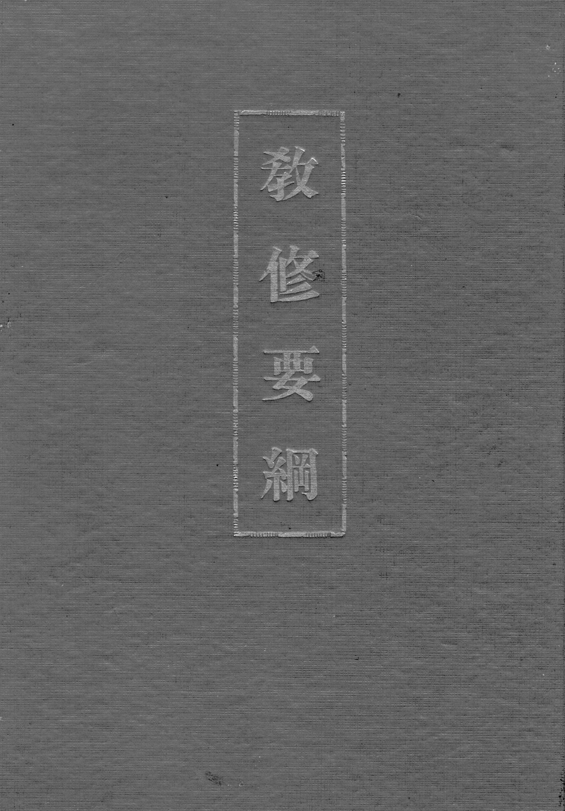
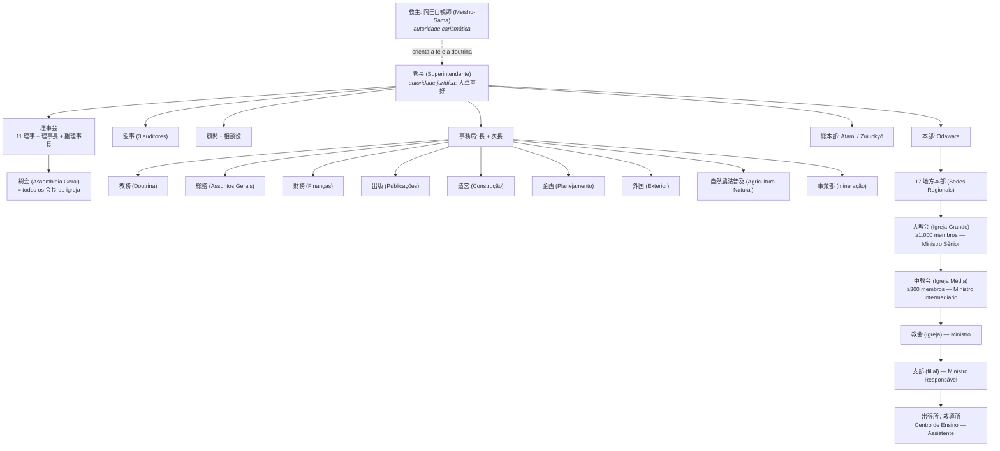
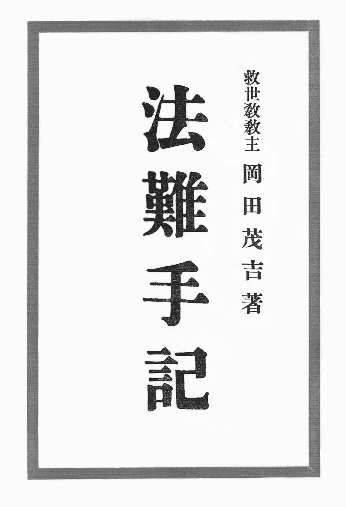

# A difusão na época de Meishu-Sama

**Edição para impressão — Parte I e Parte II**  
**Data:** 2 de outubro de 2026  
**Corpus:** acervo textual rattail (`/var/www/rattail/`), exclusivamente.  
**Convenção de citação:** `『veículo』nº, data · caminho`

> **Nota de licenciamento.** Os documentos citados são material de terceiros
> protegido por direitos autorais. Este dossiê é nota de pesquisa interna — não é
> publicação.

---

# PARTE I — unidades, formação e hierarquia

**Data:** 2026-10-02 (revisão em prosa)
**Complementa:** `DOSSIE_PARTE_II_CULTO_E_VIDA_20261002.md`
**Corpus:** acervo textual rattail (`/var/www/rattail/`), exclusivamente.
**Convenção de citação:** `『veículo』nº, data · caminho`

---

## Nota de método

Este documento responde a uma pergunta única: como funcionava a difusão religiosa na
época de Meishu-Sama, sobretudo no período de liberdade religiosa que se abre em 1945.
Para respondê-la foi necessário reconstruir, a partir dos documentos, três coisas que
os manuais de história religiosa costumam tratar separadamente — os **tipos de unidade**
que a organização criou, a **formação** que credenciava as pessoas a abri-las, e a
**hierarquia** que as ligava entre si.

O corpus é o acervo textual rattail, com 18.829 páginas digitalizadas de periódicos,
boletins internos, regulamentos e relatos de fiéis. É um corpus desigual: os documentos
institucionais são poucos e preciosos — o censo oficial de 1950, o regulamento da pessoa
jurídica de 1951, as atas das mesas-redondas de dirigentes —, enquanto os relatos de
fiéis são abundantes e, por natureza, parciais. Sempre que possível, uma afirmação
estrutural está ancorada em documento institucional; as falas de Meishu-Sama servem
para explicar a **doutrina** que orientava a estrutura, não para provar números.

Todas as referências foram convertidas para o acervo rattail. A conversão usou três
vias, em ordem de confiabilidade: localização **por conteúdo** (o trecho japonês citado
é procurado no próprio acervo, o que é exato); **mapa cronológico** entre a data da
palestra e o arquivo correspondente; e **data de publicação** da página. Foram
convertidas 59 de 59 referências, sem resíduo.

Uma convenção sobre datas: quando o documento de origem declara apenas mês e ano de
publicação, este texto também declara apenas mês e ano — não se inventou dia.

---

## 1. A cronologia da institucionalização (1934–1955)

A história institucional do movimento começa em outubro de 1934, quando Meishu-Sama
inicia o que chama de **movimento Kannon** sob o nome de **大日本観音会**, a partir do
応神堂. O que ele próprio dirá depois sobre esse começo é revelador do modo como
entendia a relação entre carisma e instituição:

> 「顧みれば昭和九年一〇月私は大日本観音会なる名称のもとに、観音運動を始め、その
> 目的は病貧争絶無の世界をつくるというにある。しかるにそのころの当局の方針としては、
> 類似宗教を無差別的に弾圧の方針であったから、当大日本観音会もそれに漏れず、徹底的の
> 弾圧をされたのである。従って、爾来ぜんぜん宗教から離れ、治療専門によって発展しつつ
> 今日に至った」

*"Rememorando: em outubro do nono ano de Shōwa (1934), sob o nome de Dai-Nippon
Kannon-kai, iniciei o movimento Kannon, cujo propósito é criar um mundo sem doença,
pobreza e conflito. Sucede que a orientação das autoridades da época era a de reprimir
indiscriminadamente as religiões análogas; por isso a Dai-Nippon Kannon-kai não escapou
e sofreu repressão radical. Desde então, afastado por completo da religião, cheguei até
hoje desenvolvendo-me exclusivamente como terapeuta."*
— Discurso na fundação da 日本観音教団, `novembro de 1947 · search1/kouwa/s221199.html`

Três anos depois vem a fundação oficial, em 1º de janeiro de 1935, em Kōjimachi
Hanzōmon, num 分所 do Oomoto que ele utilizava (`search1/ko/kojimach.html`). A década
seguinte é a da repressão: em novembro de 1941 encerra-se a atividade religiosa e o
movimento passa formalmente à terapia, com a proibição da cura "sem tocar"
(`search1/taidan/taidan39.html`). É essa passagem pela medicina não-oficial que explica
um traço persistente de toda a estrutura posterior — o **Johrei como porta de entrada**,
e não a doutrina.

A reorganização pós-guerra é rápida e se faz por camadas. Em 1946 constitui-se a
**日本浄化療法普及会**, associação civil com estatuto próprio
(`search1/ni/nihon12.html`). Em 1º de julho de 1947 aparece o **日本観音教団講習要項**,
primeiro currículo de formação do movimento (`search1/ni/nihon07.html`). Em agosto de
1947 vem a personalidade jurídica religiosa:

> 「それから間もなく終戦となり、信教の自由ともなったので、二十二年八月法人となり、
> 漸く大腕振って歩けるようになったのである。」

*"Pouco depois veio o fim da guerra e, com a liberdade de crença, em agosto do vigésimo
segundo ano [1947] obtivemos a personalidade jurídica e finalmente pudemos andar de
cabeça erguida."*
— 「私とサタンとの闘争史」, `search1/wa/watasi05.html`

Em 11 de novembro de 1947 celebra-se a cerimônia de fundação da **日本観音教団**
(`search1/kouwa/s221199.html`). No ano seguinte há a cisão interna que leva à
denominação **五六七教会**, em 1º de novembro de 1948
(`search1/kouwa/s231101.html`), seguida em 1º de dezembro pela criação da sede em
Odawara, com Tóquio (Kaminoge) passando a sede regional de Kantō
(`search2/sanko/ren01.html`). Em 8 de dezembro de 1948, Meishu-Sama enuncia a
**primeira grade organizacional completa** — documento que veremos em detalhe na
seção 3.1, porque é o mais explícito de todo o corpus sobre como se subia na estrutura.

O auge institucional do período vem depois. Em 8 de março de 1949 sai o primeiro número
do jornal **『光』**, com cem mil fiéis declarados (`search1/ho/honkyo20.html`). Em
fevereiro de 1950 a 教団 passa por **発展的解消** — dissolução-e-desenvolvimento — e
renasce como **世界救世教会** (`search1/ka/kantou13.html`). Em outubro de 1950 temos o
**censo oficial** que serve de base a todas as contas deste levantamento: 4 Igrejas
Grandes, 78 Igrejas Médias, 710 igrejas, com 56, 430 e 2.244 Ministros respectivamente
(`search1/mo/mondai.html`).

1951 é o ano da grande reforma. Em 5 de fevereiro Meishu-Sama ordena a reestruturação
que extingue as quatro Igrejas Grandes existentes e cria dezessete Sedes Regionais,
conforme o comunicado do Superintendente Ōkusa Naoyoshi (`search2/sanko/kikoseib.html`).
Em 10 de outubro publica-se o **Regulamento da pessoa jurídica religiosa「世界救世教」**,
o documento legal mais completo do período, cujos capítulos sobre administração e
finanças serão examinados na seção 6 (`search2/sanko/kisoku.html`).

Os últimos anos são de obras e de tensão. Em 16 de dezembro de 1953 realiza-se a
cerimônia de fundação do Templo Messiânico, no Zuiunkyo (`search1/ne/nento03.html`).
Em 15 de junho de 1954, a cerimônia provisória do advento de Messias, no Messias
Kaidō — ocasião em que o Superintendente Ōkusa comunicou aos fiéis que, a partir
daquele culto, passariam a tratá-lo por **Messias-Sama** (`search2/kikou/mesiya1.html`,
『栄光』263号, 30 de junho de 1954). Em outubro sai a terceira edição do **教修要綱**,
o manual de formação. Em 11 de dezembro de 1954, a entronização no Palácio de Cristal
(水晶殿御遷座), quando Meishu-Sama anuncia que "o Trabalho Divino finalmente entrou no
eixo principal" (`search1/me/meisyu2.html`, 『栄光』289号, 1º de janeiro de 1955). Em
fevereiro de 1955, sua morte (`search2/kikou2/kanto68.html`, 『地上天国』68号, 15 de
março de 1955).

| Data | Fato | Fonte |
|---|---|---|
| 1934-10 | Movimento Kannon inicia como **大日本観音会** | `novembro de 1947 · search1/kouwa/s221199.html` |
| 1935-01-01 | Fundação oficial em Kōjimachi Hanzōmon | `search1/ko/kojimach.html` |
| 1941-11 | Encerramento da atividade religiosa; passagem à terapia | `search1/taidan/taidan39.html` |
| 1946 | **日本浄化療法普及会** — associação civil | `search1/ni/nihon12.html` |
| 1947-07-01 | **日本観音教団講習要項** — primeiro currículo | `search1/ni/nihon07.html` |
| 1947-08 | Personalidade jurídica religiosa | `search1/wa/watasi05.html` |
| 1947-11-11 | **日本観音教団** — cerimônia de fundação | `novembro de 1947 · search1/kouwa/s221199.html` |
| 1948-11-01 | **五六七教会** — cisão interna | `1 de novembro de 1948 · search1/kouwa/s231101.html` |
| 1948-12-01 | Sede em Odawara; Tóquio passa a sede regional | `search2/sanko/ren01.html` |
| 1948-12-08 | **Primeira grade organizacional completa** (v. §3.1) | `『御光話録』2号, 8 de janeiro de 1949 · search1/situmon/m231208.html` |
| 1949-03-08 | Primeiro número do jornal **『光』** | `search1/ho/honkyo20.html` |
| 1950-02 | **世界救世教会** — 発展的解消 da 教団 | `search1/ka/kantou13.html` |
| 1950-10 | **Censo oficial** (v. §5.4) | `search1/mo/mondai.html` |
| 1951-02-05 | **Reforma**; nasce a **世界救世教** | `search2/sanko/kikoseib.html` |
| 1951-10-10 | **Regulamento da pessoa jurídica** | `search2/sanko/kisoku.html` |
| 1953-12-16 | Fundação do Templo Messiânico (Zuiunkyo) | `search1/ne/nento03.html` |
| 1954-06-15 | Cerimônia provisória do advento de Messias | `search2/kikou/mesiya1.html` |
| 1954-10 | 3ª edição do **教修要綱** | `pdf_rattail/kyoshu_yoko.pdf` |
| 1954-12-11 | Entronização no Palácio de Cristal (水晶殿御遷座) | `search1/me/meisyu2.html` |
| 1955-02 | Falecimento de Meishu-Sama | `search2/kikou2/kanto68.html` |

Vale sublinhar o que essa cronologia revela sobre o ritmo da instituição. Entre 1947 e
1951, ou seja, em quatro anos, o movimento obtém personalidade jurídica, funda uma
denominação, cinde-se, renomeia-se duas vezes, produz um censo, reforma-se por decreto
e promulga um regulamento. Não se trata de crescimento orgânico, mas de **reorganização
por decisão**, em que cada crise produz imediatamente uma nova forma institucional. O
período áureo de produção documental acompanha esse movimento: no acervo, 1948 tem 64
textos, 1949 salta para 348, 1950 tem 158, 1951 tem 172, 1952 chega a 203, e depois
declina — 134 em 1953 e 42 em 1954. O pico de 1949 corresponde ao ciclo 五六七教会; o
de 1952, ao programa de construção dos Paraísos Terrestres.

---

## 2. A difusão pós-guerra: método, instrumentos e escala

### 2.1 A sequência obrigatória

O documento mais importante de todo o corpus para esta pergunta não é um regulamento:
é uma resposta de Meishu-Sama a uma pergunta sobre como abrir um novo Centro de Ensino.
Nela ele enuncia uma **sequência de aproximação** e a justifica por analogia com o
crescimento natural:

> 「例えば新しく教導所を開く場合、最初はできるだけ小さくする。人間が赤ん坊から育ち
> 一人前になるごとく、また草木の種子がだんだん二葉から大きく育つ。それなら根が張り
> 枯れたりなどしない。これが大自然の実相だ。**私などこの仕事は六畳一間から始めた。**
> 信仰も最初は種蒔きであるから**話すだけにしておく**。それが育つに従い先方が耳を
> 傾ける程度になったら**雑誌新聞を見せる**。そのうちに**教修を受けたくなり教修を
> 受けさす**。そのうち病気が治ったりなどして**光明如来様〔を〕お祭りする**。
> このようなやり方で入ったのは信仰に動揺がない。急いで入信したのはいわゆる根が
> 固まっていないから動きやすい。」

*"Ao se abrir um novo Centro de Ensino, começa-se pelo menor tamanho possível. Como o
ser humano, que cresce de bebê até se tornar adulto, e como a semente de uma planta, que
aos poucos se desenvolve da primeira folha em diante. Assim a raiz se firma e não seca.
Esta é a realidade concreta da grande natureza. Eu, por exemplo, comecei este trabalho
num único cômodo de seis tatames. A fé também é, no início, semeadura, e por isso basta
conversar. Conforme ela cresce, quando a outra pessoa chega ao ponto de dar ouvidos,
mostram-se as revistas e os jornais. Em seguida ela passa a querer fazer o Kyoshu, e então
se permite que o faça. Depois, com a cura da doença e outros fatos, passa-se a entronizar
a Komyo-Nyorai. Quem entra por esse caminho não oscila na fé. Quem se converte
apressadamente não tem raízes firmes e por isso se move com facilidade."*
— 『地上天国』9号, 25 de outubro de 1949 · `search1/situmon/situmo11.html`

A sequência é, portanto: **conversa → material impresso → Kyoshu → cura → entronização
da Imagem**. A cura não é a porta de entrada, é o que **confirma** a entrada — e a
entronização vem depois dela, não antes.

Dessa sequência decorrem quatro regras operacionais, todas formuladas por Meishu-Sama
em resposta a casos concretos.

A primeira proíbe o proselitismo baseado na gratidão. A pergunta era se se podia pedir
a quem foi curado que trouxesse novos:

> 「【質問者】御利益で治った方に新しい人を紹介するようにと話すことはいかがでしょうか。
> 【明主様】そんなこと言っちゃいけませんよ、安ッぽくなってしまう。そんな気があるのは
> まだ信仰が本当の線に入ってないんです。**決して無理にすすめたり、押し売りしたり
> しちゃいけません。**」

*"[Pergunta] Falar à pessoa que foi curada do benefício material, para que apresente
alguém novo, seria adequado? [Meishu-Sama] Não se deve dizer tal coisa; torna-se barato.
Quem tem esse tipo de intenção ainda não entrou na linha verdadeira da fé. Nunca se deve
recomendar à força nem fazer venda forçada."*
— 『御光話録』15号, 20 de dezembro de 1949 · `search1/situmon/m2409.html`

A segunda atribui o crescimento à proteção divina, e não à técnica de captação. É uma
frase que inverte a lógica de qualquer manual de expansão:

> 「発展しないのは、人間が見ていいようでも神様に対してピッタリしない点があるんです。
> ピッタリしてれば、**神様がこの人ならという教導師の所へ信者を持って来てくれる**んです。」

*"A razão de não se desenvolver é que, mesmo que aos olhos humanos pareça bom, há um
ponto que não se ajusta a Deus. Se estivesse ajustado, Deus traria os fiéis ao Ministro
Responsável que Ele escolhesse."*
— idem

A terceira recusa criar conflito com a religião anterior do candidato — o que, num
ambiente de disputa denominacional como o do Japão do pós-guerra, é uma escolha
deliberada:

> 「【質問者】他宗教に熱心なもの、または他宗教に入らんとしている者は、それが白紙に
> なるまでは御教修を受けさせぬほうがよろしいでしょうか。
> 【明主様】他宗教を丸っきりはなれてからこの道に入る……というようにはっきりしたもの
> でもない。両方信じているうちにこっちへ傾くこともありますから**決めないほうが
> いいですね。**」

*"— [Pergunta] Quem é fervoroso em outra religião, ou está para entrar em outra, é melhor
não deixá-lo receber o Kyoshu até que isso se esclareça? — [Meishu-Sama] Não é uma coisa
assim tão definida, de romper por completo com a outra religião e então entrar neste
Caminho… Como pode acontecer de, acreditando nas duas, a pessoa se inclinar para cá, **é
melhor não decidir.**"*

— 『御光話録』2号, 8 de janeiro de 1949 · `search1/situmon/m231218.html`

A quarta é a mais dura, e tem razão pastoral explícita: **não se converte quem está à
beira da morte**, para que a morte não seja atribuída à fé.

> 「本当は病気が治ってから入信するのが本当で、病気が治ってありがたく、やむにやまれぬ
> 気持ちで入信するのが本当である。例えばもし治らないうちに入信して死ぬ場合がある。
> 入信してから死ぬなんてあんな信仰は駄目だということになる。すると怨まれる。
> 特に肺病などはよけいにそうで……**生命にかかわるのは治ってから入信すべきである。**」

*"Na verdade, o correto é converter-se depois de a doença sarar; converter-se com
gratidão pela cura, num sentimento irreprimível. Porque pode haver casos em que,
convertido sem sarar, a pessoa morra. E então passa a correr a ideia de que 'uma fé em que
se morre logo após a conversão não presta'. Isso gera ressentimento. Especialmente a
tuberculose, mais ainda… Nos casos com risco de vida, deve-se converter depois da cura."*
— 『地上天国』9号, 25 de outubro de 1949 · `search1/situmon/situmo11.html`

### 2.2 Os instrumentos

Quatro instrumentos aparecem documentados como motores da difusão.

**O jornal.** A sequência de títulos é 『光』 (de março de 1949) → 『救世』 → 『栄光』 →
『神の光』 (de 1955), e Meishu-Sama lia essa rotatividade como sinal de orientação
superior, não como problema de marketing:

> 「新聞も、最初『光』それから『救世』それから『栄光』と、こんなに題名が変わるのなんか
> 他にありませんよ。神様がされるんだから、しようがない。」

*"Jornal também: primeiro Hikari, depois Kyūsei, depois Eikō — não há outro caso de
título que mude tanto. É Deus quem faz, não há como evitar."*
— 『御垂示録』3号, 25 de novembro de 1951 · `search1/situmon/m261005a.html`

A função do jornal como motor da unidade está declarada na primeira página do primeiro
『光』, e é explícita quanto ao método: quem se desenvolve é quem distribui.

> 「本教の唯一の宣伝機関として、光新聞を発行している……**発展する教導所は常に光新聞の
> 頒布に力を注いでいることである**、もちろんこういう支部は、宣伝用として無料で、
> 出来るだけ配布するのである」

*"Como único órgão de propaganda desta religião, publicamos o jornal Hikari… os Centros
de Ensino que se desenvolvem são sempre aqueles que se empenham na distribuição do jornal
Hikari. Naturalmente, essas filiais distribuem gratuitamente o máximo possível, para fins
de divulgação."*
— 「光新聞の拡大は教線の強化」『光』33号, 29 de outubro de 1949 · `search1/hi/hikari03.html`

**A palestra pública de massa.** A conferência no Hibiya Kōkaidō impressiona o cronista
não pela lotação, mas pela composição do público — mais de sessenta por cento de não
convertidos:

> 「宗教講演会として日比谷公会堂に超満員の聴衆をあつめ、しかも**その六割以上が
> 未人信者**であったと言う盛況ぶりは、恐らく未曾有のことと思います。」

*"O fato de uma conferência religiosa ter reunido lotação esgotada de público no Hibiya
Kōkaidō, e ainda por cima mais de sessenta por cento serem pessoas não convertidas, é um
sucesso de público provavelmente sem precedentes."*
— 「編集後記（地上天国36号）」, `search2/kikou2/koki36.html`

**A missão externa.** O Havaí, a partir de fevereiro de 1953, foi obra de duas pessoas
destacadas da liderança interna — a Ministra Higuchi Kiyoko e o Ministro Assistente
Anshoku Haruhiko —, não de um seminário missionário:

> 「昨年二月十一日世界メシヤ教海外布教のため、**樋口喜代子教師が助教師安食晴彦氏を
> 帯同して来布され**」

*"Em 11 de fevereiro do ano passado [1953], para a difusão ultramarina da Igreja Mundial
Messiânica, a Ministra Higuchi Kiyoko veio ao Havaí acompanhada do Ministro Assistente
Anshoku Haruhiko."*
— 「ハワイ通信」『栄光』264号, 7 de julho de 1954 · `search2/kikou2/hawai20.html`

**A publicação em massa.** Aqui a difusão agrícola e a difusão religiosa se confundem
propositalmente. Meishu-Sama anuncia, no Culto de Outono de 1951, um plano de distribuição
por via institucional — cooperativas, estações experimentais, prefeituras:

> 「その成績を土台にして、ひとつの本を作って、これを**日本中の農会とか農事試験場とか、
> 村なら村長と、あらゆる方面に全部配ろうと思う**。それから、**各地に講演会、座談会を
> 開いて大いに知らせようと思う。**」

*"Tomando esses resultados como base, farei um livro e o distribuírei integralmente a
todos os setores: às cooperativas agrícolas de todo o Japão, às estações experimentais, e,
nos vilarejos, aos prefeitos. Além disso, abrirei palestras e mesas-redondas em cada região
para divulgar amplamente."*
— Culto Especial de Outono, 25 de setembro de 1951 · `search1/kouwa/s260925.html`

E a confirmação operacional, na voz de quem distribuiu a edição especial de agricultura
natural — note-se que a expectativa inicial era de "cerca de um milhão", e que a
reimpressão foi decidida **depois** de o número ser insuficiente:

> 「いよいよ印刷にかかる時には、**この分なら百万位は大丈夫だと思えるようになった**のです。
> ……出してみますと**百万で足りずに、増刷したほどでした。**」

*"Quando finalmente se foi imprimir, chegou-se a pensar: 'neste ritmo, cerca de um milhão
deve dar'. … Mas, ao sair, um milhão não bastou — chegou-se a reimprimir."*
— 「本部事務所奉仕者座談会」『地上天国』69号, 15 de abril de 1955 · `search2/kikou2/honbujim.html`

### 2.3 A escala, e o que ela significa

O censo de outubro de 1950 é o único documento que traz números completos em todas as
categorias simultaneamente, e por isso sustenta as contas deste levantamento:

| Categoria | Quantidade |
|---|---:|
| 大教会 (Igrejas Grandes) | **4** |
| 中教会 (Igrejas Médias) | **78** |
| 分教会 (igrejas) | **710** |
| 大教師 (Ministros Seniores) | **56** |
| 中教師 (Ministros Intermediários) | **430** |
| 教師 (Ministros) | **2.244** |
| 別院 (Templos Anexos) | 6 |
| 分院 (Filiais Regionais) | 7 |

Fonte: `search1/mo/mondai.html`

Duas leituras importam. A primeira é a **simetria**: as três categorias de igreja e as
três de Ministro formam pares, e a razão entre elas é aproximadamente constante — para
cada Igreja Grande, quatorze Ministros Seniores; para cada Igreja Média, cerca de cinco
Ministros Intermediários; para cada igreja, aproximadamente três Ministros. **O grau
não é uma carreira paralela à estrutura: ele acompanha a unidade que a pessoa dirige.**
Isso será decisivo na seção 5.

A segunda leitura é uma cautela de método, e convém enunciá-la com precisão. Os números
de **fiéis** — cem mil em março de 1949, "mais de mil" no Havaí em um ano — aparecem em
textos de divulgação e de defesa institucional, não em peça de levantamento. O censo de
unidades e de Ministros, ao contrário, é documento administrativo: tem data, categoria e
contagem fechada. As duas coisas não são da mesma natureza, e este levantamento as trata
de modo distinto — o censo sustenta as contas estruturais; os totais de fiéis registram-se
como **declaração da instituição**, que é o que de fato são no acervo. Não se trata de pôr
em dúvida a informação, e sim de não lhe atribuir uma natureza documental que ela não tem.

---

## 3. Os tipos de unidade e suas atribuições

### 3.1 A grade de 1948

O documento mais explícito sobre como a organização se pensava é uma resposta de
Meishu-Sama de 8 de dezembro de 1948, na qual ele estabelece critérios quantitativos
de ascensão e um critério **territorial** de vinculação — este último em reação direta
ao personalismo que ameaçava a coesão:

> 「【質問者】礼節と順序を重んずることがこのお道の精神と存じますが、会員や資格者が
> 簡単にその所属を変えることはいかがいたすべきでしょうか。
> 【明主様】所属のことは今度はっきりしますが、あの先生は気に入ったからつくとか、
> あの先生は気に入らないから離れるとかいうことはたいへんな間違いで、神様から見れば
> 怪しからぬ事です。私はいままでそういうことを言ってくる人には黙って許していましたが
> ……で、**今度は地域的に所属をきめることにしました。これは本部と三カ所の分所があり、
> 分所に分会が所属し、分会には支部が所属するのです。支部長は教導師であり、教導師は
> 信者を一〇〇人以上作った人か、三万円以上献金した人か、または支部長の推薦によること
> とし、教導所を一〇以上有するものを分会とし、分会一〇以上を分所とすることにしました。**
> やはり功労のある人が上に行くのが本当ですから。」

*"[Meishu-Sama] A questão da vinculação ficará clara desta vez. Aquilo de aderir a um
mestre porque se gostou dele, ou dele se afastar porque não gostou, é um enorme erro e,
aos olhos de Deus, algo inadmissível. Até agora, eu silenciosamente permitia isso a quem
me vinha falar… Assim, desta vez decidi determinar a vinculação por região. Há a Sede e
três Subsedes; às Subsedes pertencem as Associações, e às Associações pertencem as filiais.
O líder de filial é um Ministro Responsável de Unidade Religiosa, e o Ministro Responsável
será alguém que tenha conduzido cem ou mais fiéis, ou que tenha ofertado trinta mil ienes
ou mais, ou por recomendação do líder de filial. Aquilo que tiver dez ou mais Centros de
Ensino será considerado uma Associação, e o que tiver dez ou mais Associações será
considerado uma Subsede. Afinal, é justo que aqueles com méritos estejam no topo."*
— 『御光話録』2号, 8 de janeiro de 1949 · `search1/situmon/m231208.html`

Três critérios de ascensão aparecem aqui, e nenhum deles é acadêmico: **número de
pessoas conduzidas** (cem ou mais), **valor ofertado** (trinta mil ienes ou mais), ou
**recomendação do superior imediato**. Não há prova, não há tempo mínimo de casa, não
há formação escolar exigida. A justificativa é explícita — "é justo que aqueles com
méritos estejam no topo" —, e a palavra usada é **功労**, mérito-serviço.

A escala de unidades fica assim: Sede (本部) › Subsede (分所) › Associação (分会) ›
filial (支部) › Centro de Ensino (教導所).

### 3.2 A reforma de 1951

Em 5 de fevereiro de 1951 Meishu-Sama substitui essa grade por uma outra, de base
territorial e com pisos numéricos. O documento é um comunicado do Superintendente
Ōkusa Naoyoshi, e vale reproduzir seus pontos principais porque neles se vê a lógica
administrativa em ato:

> 「一、熱海市桃山、晴々台の地上天国に世界救世教の総本部を置き……救世会館の建設を
> 図ること。
> 二、小田原市緑町（五六七大教会本部）に世界教世教本部を置き……教団本部としての
> 形態を具備すること。
> 三、**従来の四大教会は発展的解消を遂げ**、……**全国を左の如き十数箇所の地方別に
> 区分して地方本部を置くこと。**
> 四、**地方本部には、三段階の大教会、中教会、教会の組織を設くること。大教会の組織には
> 協力会員差当り千人以上、中教会には同三百人以上を要すること。**
> 五、……**布教費の節減その他布教の合理化**を図ること。」

*"1. Estabelecer a Sede Central no Paraíso Terrestre de Momoyama, Seijōdai, em Atami…
2. Estabelecer a Sede em Midorichō, Odawara… 3. As quatro Igrejas Grandes até aqui
existentes passam por dissolução-e-desenvolvimento; dividir o país em cerca de uma dúzia
de regiões e estabelecer Sedes Regionais. 4. Nas Sedes Regionais, criar a organização em
três graus: Igreja Grande, Igreja Média e Igreja. A Igreja Grande requer mil ou mais
membros cooperadores; a Igreja Média, trezentos ou mais. 5. …visando à redução de custos
de difusão e à racionalização da difusão."*
— 「世界救世教の機構整備について」『栄光』94号, 7 de março de 1951 ·
`search2/sanko/kikoseib.html`

Note-se o item quinto: **a reorganização territorial tem motivação financeira declarada**.
Ao proibir que se difunda em várias Sedes Regionais ao mesmo tempo, Meishu-Sama não está
apenas racionalizando a supervisão — está cortando custo. É um dado que qualifica a
imagem de uma instituição indiferente a dinheiro, e que se articula com o que veremos
sobre as finanças na seção 6.

As dezessete Sedes Regionais foram criadas com nome e jurisdição: Hokkaido Leste e
Oeste, Tōhoku, Ōu, Kantō Leste e Oeste, Shinetsu, Chūkyō, Hokuriku, Kinki, Kansai,
San'in, San'yō, Shikoku, Kyūshū Leste e Oeste.

### 3.3 As quatro Igrejas Grandes dissolvidas

Antes de 1951 existiam quatro Igrejas Grandes: **天国大教会, 大成大教会, 光宝大教会 e
五六七大教会**. Além de unidades de difusão, elas tinham uma função ritual coletiva —
alternavam-se na presidência dos cultos sazonais, num rodízio que durou vários dias:

> 「祭典は二十一、二日天国大教会、二十三日大成大教会、二十四日光宝大教会、大成大教会、
> 二十五、六、七日五六七大教会の順で七日間にわたり」

*"Os cultos se estenderam por sete dias na seguinte ordem: dias 21 e 22, Igreja Grande
Tengoku; dia 23, Igreja Grande Taisei; dia 24, Igreja Grande Nikkōbō e Igreja Grande
Taisei; dias 25, 26 e 27, Igreja Grande 五六七."*
— 「世界救世教秋季大祭に参拝して」『地上天国』17号, 15 de outubro de 1950 ·
`search2/kikou2/sekai03.html`

Essa nota é preciosa porque documenta uma forma organizativa que os regulamentos não
registram: **a celebração como responsabilidade compartilhada e rotativa**, e não
centralizada na Sede.

### 3.4 Tipologia completa

| Japonês | Português | Definição | Evidência |
|---|---|---|---|
| 総本部 | **Sede Central** | Centro mundial; Zuiunkyo (Atami) | `search2/sanko/kikoseib.html` |
| 本部 | **Sede** | Centro administrativo; Odawara | idem |
| 別院 | **Templo Anexo** | Sede de segunda ordem, com 本殿 próprio e pessoal residente; 6 em 1950 | `search1/mo/mondai.html` |
| 地方本部 | **Sede Regional** | 17 criadas em 1951, por província | `search2/sanko/kikoseib.html` |
| 大教会 | **Igreja Grande** | ≥1.000 membros (1951); antes, uma das 4 | idem |
| 中教会 | **Igreja Média** | ≥300 membros | idem |
| 教会 / 分教会 | **Igreja** | Unidade com 会長 nomeada | 規則 arts. 26–28 |
| 分院 | **Filial Regional** | Subdivisão territorial; 7 em 1950 | `search1/mo/mondai.html` |
| 分会 | **Associação** | ≥10 Centros de Ensino (1948) | `『御光話録』2号, 8 de janeiro de 1949 · search1/situmon/m231208.html` |
| 支部 | **filial** | Chefiada por um Ministro Responsável | idem |
| 出張所 | **posto avançado** | Menor que a filial; criado por deslocamento de um Ministro | `search1/a/asudeha.html` |
| 教導所 | **Centro de Ensino** | Unidade mínima: casa ou sala de atendimento | `『御光話録』2号, 8 de janeiro de 1949 · search1/situmon/m231208.html` |
| 浄霊所 | **Centro de Johrei** | "a igreja" de facto de uma família | `search2/okage/dokusya/meian01.html` |
| 教修会場 | **local do Kyoshu** | Casa ou salão cedido para o curso | `『御教え集』7号, 20 de março de 1952 · search1/kouwa/s270205.html` |

Os seis Templos Anexos, com endereços completos, conforme o censo de 1950
(`search1/mo/mondai.html`): 箱根別院 (Kanagawa, Miyagino), 小田原別院 (Kanagawa,
Odawara), 熱海別院 (Shizuoka, Izusan), 東京別院 (Tóquio, Setagaya, Tamagawa
Kaminoge), 京都別院 (Quioto, Sakyo, Yoshida Kaguraoka) e 大阪別院 (Osaka, Sennan,
Takaishi).

Vale observar a expressão **浄霊所** — "Centro de Johrei". Ela aparece num relato de
1951 e descreve a unidade de base sem qualquer mediação institucional: uma família que
passou a praticar Johrei em casa, atraiu vizinhos, e "chegou ao ponto de construir uma
nova igreja, isto é, um Centro de Johrei". É o degrau zero da estrutura, e nem consta
do censo.

### 3.5 Atribuições por unidade

| Função | Unidade | Fonte |
|---|---|---|
| **Johrei** (cura) | todas, do Centro de Ensino para cima | toda a coleção |
| Celebrar **Culto Mensal** / **Culto Regular** em data fixa | filial, posto avançado, Igreja | `『御光話録』12号, 21 de setembro de 1949 · search1/situmon/m240613.html` |
| Ministrar o **Kyoshu** | filial, Igreja, local do Kyoshu | `search1/ni/nihon07.html` |
| Formar novos portadores de qualificação | Igreja / Igreja Média | `search1/ke/kenkin.html` |
| Distribuir o jornal | Centro de Ensino, filial | `search1/hi/hikari03.html` |
| Sediar **mesas-redondas** periódicas | Igreja Média, Igreja Grande | `search2/sanko/teirei1.html` e ss. |
| Abrigar doentes em purificação | Sede da Igreja Média | `『御教え集』1号, 20 de setembro de 1951 · search1/situmon/m260828.html` |
| Sediar **御面会** (audiências) | Sede (Atami, Hakone, Odawara) | §8.1 |
| Presidir os ritos sazonais em rodízio | Igreja Grande | `search2/kikou2/sekai03.html` |
| Administração e finanças próprias, sob supervisão central | Igreja | 規則 arts. 26–30 |

Uma restrição operacional merece registro, porque mostra como a estrutura era pensada
a partir da capacidade real de uma pessoa. Perguntado sobre quem preside os cultos das
filiais, Meishu-Sama chega a um limite por dedução simples:

> 「【質問者】支部は支部長が主催すべきものと思います。もし支部が三〇ヵ所
> 以上になったら、一日一ヵ所としても、会長さんは一月中にまわりきれなくなります。
> 【明主様】そうだな……**三〇ヵ所以上になってはいけない理屈になるからな。**
> ……**原則としては中教会を一番先にするわけです。**」

*"[Pergunta] Creio que a filial deve ser presidida pelo líder da filial. Se a filial
tiver trinta ou mais locais, mesmo um por dia, o presidente não conseguirá percorrer todos
em um mês. [Meishu-Sama] É mesmo… Isso leva à conclusão de que não pode haver trinta ou
mais locais. …Em princípio, a Igreja Média é que vem primeiro."*
— 御講話 de 1º de março de 1954 · `『御垂示録』29号, 15 de março de 1954 · search1/situmon/m290301.html`

Daí um **limite superior prático de trinta filiais por Igreja Média** — não por estatuto,
mas por aritmética de calendário. A estrutura não era desenhada no papel: era deduzida
da capacidade física de supervisão.

![『御垂示録』29号, 15 de março de 1954, página 20 — a resposta de que se deduz o limite prático de trinta filiais por Igreja Média. [Página confirmada por OCR do fac-símile.]](facsimiles/suiji29_limite_trinta.jpg)

---

## 4. Como se abria uma unidade

Cinco modos coexistiram, sem norma escrita que os ordenasse. Cada caso era decidido
pontualmente, e o que o corpus documenta são os **casos**, não uma política.

### 4.1 A casa do próprio dirigente

É o modo inicial e predominante, e o próprio Meishu-Sama o exemplifica:
「私などこの仕事は**六畳一間から始めた。**」 — *"Eu, por exemplo, comecei este
trabalho num único cômodo de seis tatames."* (`search1/situmon/situmo11.html`).

O que o corpus torna visível, porém, é que a **casa do dirigente** e o **missionário
itinerante** geravam unidades de natureza diferente. Um dirigente descreve seu próprio
caso, contrastando-o com o de um colega mais estável:

> 「川越先生は**自宅で入信し、自宅を支部にした**。言わば恵まれた羨しい程の立場で御用を
> しておられる訳ですが**私の場合は家を出、一人で飛び歩きをした**ので、現在**支部の性質が
> その通りになってしまった**のです。そのために今月はどこで御参りをし、来月はどこと、
> **支部のお祭りすら一定のところでやって無かった**と言う状態です。」

*"O Sr. Kawagoe converteu-se em casa e fez da própria casa uma filial. Digamos que está
numa posição privilegiada e invejável para realizar o trabalho. No meu caso, saí de casa
e andei sozinho por toda parte; por isso a natureza da filial acabou se tornando exatamente
isso. Assim, este mês o culto é num lugar, no mês que vem noutro — nem o culto da filial
era realizado num lugar fixo."*
— 「支部の現状と発展の為に」, `search2/kikou2/shibuno1.html`

### 4.2 Imóvel alugado, cedido ou adaptado

A solução intermediária. Um fiel descreve a situação típica — e a instabilidade
inerente:

> 「【質問者】ただいま**お寺の一室を借り教導所といたしております**が、このたびそこを
> 出ねばなりませんので親類の家の土蔵を借りて御浄霊いたしたいと存じますが……」

*"[Pergunta] No momento estou alugando uma sala de um templo e usando-a como Centro de
Ensino; mas desta vez preciso sair de lá, e penso em alugar o depósito de barro da casa de
um parente para fazer Johrei…"*
— 『御光話録』10号, 10 de julho de 1949 · `search1/situmon/m240503.html`

Havia também a prática de usar hotéis para o Kyoshu quando o Centro de Ensino era
pequeno — prática que Meishu-Sama **proíbe**, e a razão da proibição é doutrinária, não
prática:

> 「――教修会のとき、教導所がせまいため旅館などを借ります場合、一時、大光明如来様を
> 旅館の床の間にお祀りして教修会を開いておりますが、これはよろしゅうございましょうか。
> これはいけませんね。間違ってますよ……もし御軸をなにするんだったら、光明如来様じゃ
> なくて、「光明」とか「真善美」とかいうのをかけたらいいでしょう。
> ――それは旅館のときだけでしょうか。
> いや、**旅館に限らず御神体を動かすときにはいけませんよ。御神体は一つの定めた場所へ
> おかけしたらやたらに動かさないことですね。**」

*"— Quando é o Kyoshu e, por o Centro de Ensino ser apertado, aluga-se um hotel etc.,
entronizamos provisoriamente o Daikōmyō Nyorai no tokonoma do hotel e realizamos o curso
— seria adequado?
— Isso não pode. Está errado… Se for para pendurar alguma coisa, que não seja a
Komyo-Nyorai, mas sim algo como «Luz» ou «Shinzenbi».
— É só no caso do hotel?
— Não; não apenas no hotel — é quando se move a Imagem da Luz Divina que não pode. Uma
vez colocada a Imagem da Luz Divina num lugar determinado, não se deve movê-la sem mais
nem menos."*
— 「質問応答 御光話」, `search1/situmon/m2411.html`

A regra é notável porque cria um problema prático em nome de um princípio: o curso pode
ser itinerante, **a Imagem não**. O objeto de culto é que fixa o lugar.

Há ainda o caso do imóvel próprio abandonado e readaptado — 「そこに古い壊れた家が
あったので、それを修繕して**そこに奉仕隊が泊まって作業をしています。**」 — *"Havia
ali uma casa velha e arruinada; reparando-a, a brigada de serviço se aloja ali e
trabalha."* (`search1/kouwa/s240523.html`).

E o aluguel como situação provisória. O acervo trata a passagem do provisório ao
próprio como um marco da obra — a primeira construção erguida do zero —, e as
descrições estão na seção 4.3. Não há, em contrapartida, fonte que registre em
primeira pessoa a superação do regime de aluguel pela Sede.

### 4.3 Construção própria

Aqui o regime jurídico de 1951 intervém com clareza, e o faz em três artigos que
estabelecem **autorização prévia obrigatória** em cascata — desde a constituição da
igreja até a reforma de um telhado:

> 「**第二十六條** 教会を設立しようとするとき、又は教会が左に掲げる行為をしようとする
> ときは、**管長の承認を受けなければならない**（一、宗教法人となること… 二、規則を
> 変更すること 三、合併又は解散をすること）
> **第二十七條** 教会は、左に掲げる行為をしようとするときは、管長の承認を受けなければ
> ならない……三、**主要な境内建物の新築、改築、増築、移築、除却**又ほ著しい模様替を
> すること
> **第二十八條** 教会の会長及びその代務者は、当該教会の規則で定めるところによって
> 選定された者を**管長が任命する**」

*"Art. 26 — Ao se pretender estabelecer uma igreja, ou ao se pretender praticar os atos
abaixo, deve-se obter a aprovação do Superintendente (1. tornar-se pessoa jurídica
religiosa…; 2. alterar o regulamento; 3. fundir-se ou dissolver-se). Art. 27 — A igreja,
ao pretender praticar os atos abaixo, deve obter a aprovação do Superintendente…; 3.
construir, reconstruir, ampliar, transferir ou demolir os principais edifícios do recinto,
ou realizar reforma substancial. Art. 28 — O presidente da igreja e seu substituto são
nomeados pelo Superintendente, dentre os selecionados conforme o regulamento da respectiva
igreja."*
— 宗教法人「世界救世教」規則『栄光』125号, 10 de outubro de 1951 · `search2/sanko/kisoku.html`

O desenho é coerente: a igreja local escolhe seu presidente **por suas próprias regras**,
mas quem **nomeia** é o Superintendente; e nenhuma decisão patrimonial de vulto se toma
sem sua aprovação. A autonomia da unidade é administrativa, não patrimonial.

O financiamento das construções vinha dos fiéis locais. Um relato de 1951 descreve a
trajetória completa, da penúria à igreja nova, e nomeia o sentimento que a motivava —
retribuição (*御報恩*):

> 「入信以来年と共に大きい御恵や奇蹟を賜わり、今では御報恩の気持で**近く浄霊所たる、
> 教会を新築するほどになった**そうで」

*"Desde a conversão, ano após ano recebeu grandes graças e milagres; e agora, num
sentimento de retribuição, chegou ao ponto de construir uma nova igreja, isto é, um Centro
de Johrei."*
— 「明暗の隔り」, `search2/okage/dokusya/meian01.html`

E um segundo, com a entronização da Imagem como ato de inauguração:

> 「更に、……緑豊にして、風匂やかな高所に、**木の香もすがしき教会を新築して頂き**、
> 去る七月二十三日（昭和二十六年）井上茂登吉先生にお出を願い、御神体を御奉斎させて
> 戴き」

*"Além disso… num lugar elevado, rico em verde e de brisa perfumada, fizeram-me
construir uma igreja com perfume de madeira nova; em 23 de julho do ano passado (1951),
pedi ao Sr. Inoue Motokichi que viesse e entronizamos a Imagem da Luz Divina."*
— 「御浄化物語」, `search2/okage/ko/qgojoka2.html`

O caso extremo é o Havaí, citado por Meishu-Sama como demonstração de que a obra era
dos fiéis e não dele:

> 「しかも教会建設費約十万ドル、日本の金にして三千六百万円ですが、**それが全部ハワイの
> 信者から出たので、私は一文も出してない**のです。」

*"Além disso, o custo de construção da igreja, cerca de cem mil dólares — trinta e seis
milhões de ienes em moeda japonesa — saiu todo dos fiéis do Havaí; eu não dei um centavo."*
— 「御講話」『御教え集』31号, 27 de fevereiro de 1954 · `search1/kouwa/s290227.html`

### 4.4 Templo de outra religião convertido

Um caso documenta a solução mais delicada — um fiel que era sacerdote budista de outra
seita e queria usar o próprio templo como igreja. Note-se que a imagem principal do
templo havia recebido **abertura dos olhos por Meishu-Sama**:

> 「――私の家は寺でございますが、**自宅を教会にしてもよろしいでしょうか。なお、寺の
> 宗旨は曹洞宗で御本尊は十一面観音で、明主様の御開眼をいただいております。**
> 差し支えありませんがね、……結構ですけどね、**しかしいつかは違う所へ行くように
> なるかもしれませんよ。**それだけ承知してておやんなさい。」

*"— Minha casa é um templo; poderia fazer dela uma igreja? Aliás, a seita do templo é
Sōtō-shū e a imagem principal é um Kannon de onze faces, que recebeu a abertura dos olhos
de Meishu-Sama.
— Não há impedimento…; está bem, mas pode ser que algum dia você vá para outro lugar.
Apenas esteja ciente disso."*
— 「質問応答 御光話」, `search1/situmon/m250228.html`

A resposta é uma **política de transitoriedade declarada**: o espaço alheio serve agora,
mas não é o destino final. Meishu-Sama não exige a ruptura imediata com a forma anterior
— apenas registra que ela é provisória.

### 4.5 A trajetória típica

A evidência sustenta uma sequência, sem exceções documentadas:

1. **Um cômodo na casa do dirigente**, operando como Centro de Ensino — o mínimo
   viável, que no caso do próprio Meishu-Sama foram seis tatames;
2. **Prédio alugado, cedido ou adaptado** (sala de templo, depósito de parente, casa
   arruinada reparada) quando a demanda excede a casa — com a ressalva de que o Kyoshu
   pode ser itinerante, mas a Imagem da Luz Divina não pode ser movida;
3. **Construção nova financiada pelos fiéis locais**, com autorização do
   Superintendente e entronização da Imagem como ato de inauguração;
4. **Unidade maior** (Igreja Média, Igreja Grande), com sede própria e capacidade de
   abrigar doentes em purificação.

Há uma ausência que vale registrar, porque é significativa: **não há no corpus nenhum
registro de compra de imóvel pela sede central para instalar igrejas locais.** A
expansão imobiliária foi integralmente local e comunitária. Isso não é detalhe
administrativo — é o que explica por que a ruptura de 1955 foi tão grave: quem rompeu
ficou com as unidades que os fiéis haviam construído.
## 5. Formação sacerdotal e níveis

Esta seção é a mais delicada do levantamento, porque exige distinguir **duas escalas**
que a linguagem corrente confunde. A primeira é a dos **cargos administrativos** — quem
preside uma igreja, quem chefia uma sede regional. A segunda é a dos **objetos de culto**
— que Imagem cada pessoa pode entronizar em casa, que amuleto pode portar. A segunda era
o eixo real da vida religiosa dos fiéis, e é por ela que se deve começar.

### 5.1 O axioma: a hierarquia não é democrática

Meishu-Sama enunciou o princípio de forma direta, ao decidir a quem se podia entregar
uma determinada Imagem:

> 「【明主様】特別に書いたんです。**教導師には上げてもいいが、一般会員はいけません。
> 神様のことには民主的でない点がある。階級的ですから。**」

*"[Meishu-Sama] Foi escrito especialmente. Pode-se entregar ao Ministro Responsável, mas
não a um membro comum. Nas coisas de Deus há um ponto que não é democrático. Porque é
hierárquico."*
— 18 de maio de 1948 · `search1/situmon/m230518.html`

O princípio reaparece, com o mesmo rigor, na distribuição dos amuletos:

> 「【質問者】一般の方でもよろしいのでしょうか。
> 【明主様】ええ、いいですよ。**御守りの「大光明」のほうは資格者だけですがね。**
> 【質問者】「大光明」の御守りは教導師補の方でもよろしいでしょうか。
> 【明主様】**師補でもいいですよ。**ただ、一般の人はいけませんがね……」

*"— [Pergunta] Qualquer pessoa serve? — [Meishu-Sama] Sim, serve. **O Ohikari
'Dai-Kōmyō' é só para portadores de qualificação.** — [Pergunta] O Ohikari 'Dai-Kōmyō'
pode ser dado também a um Assistente de Ministro? — [Meishu-Sama] **Assistente também
pode.** Apenas pessoa comum, não…"*

— 『御光話録』12号, 21 de setembro de 1949 · `search1/situmon/m240613.html`

A escala, portanto, não era honorífica. Controlava **acesso a objetos sagrados**, e esse
acesso era escalonado com precisão.

### 5.2 A escada dos objetos de culto

Reunindo as evidências dispersas, o corpus permite reconstruir uma progressão que corre
**paralelamente** aos cargos, e que era na prática o que os fiéis experimentavam como
"subir":

| Degrau | Objeto | Quem recebe | Fonte |
|---|---|---|---|
| 1 | **Ohikari 「Kōmyō」** | todo fiel, ao fim do Kyoshu | §7.1 |
| 2 | **Byōbu Kannon** (Kannon do biombo) | o fiel, quando a fé amadurece | `『御光話録』12号, 21 de setembro de 1949 · search1/situmon/m240613.html` |
| 3 | **Imagem da Luz Divina 「Komyo-Nyorai」** | idem — **não** no ato da conversão | `『地上天国』9号, 25 de outubro de 1949 · search1/situmon/situmo11.html` |
| 4 | **Imagem da Luz Divina 「Daikōmyō Nyorai」** | membro comum, com critério de casa | `『御光話録』12号, 21 de setembro de 1949 · search1/situmon/m240613.html` |
| 5 | **Ohikari 「Daikōmyō」** | **apenas portadores de qualificação** | idem |
| 6 | **Imagem 「Daikōmyō Nyorai」 nova**, escrita à mão por Meishu-Sama | **apenas Ministro Responsável** | `18 de maio de 1948 · search1/situmon/m230518.html` |

O degrau 4 tem um critério explícito de adequação à casa, que é simultaneamente
doutrinário e prático:

> 「【明主様】大光明如来様は一般の人でもいいですよ。しかし、御神体はね、**家によって
> 祀るべきで、大きな立派な家には、大光明如来様をお祀りし、田舎なんかの小ちゃな家には、
> 光明如来様をお祀りすればいい**んです。」

*"[Meishu-Sama] O Daikōmyō Nyorai pode ser para pessoa comum. Mas a Imagem da Luz Divina,
bem, deve ser entronizada conforme a casa: em casas grandes e imponentes, entroniza-se o
Daikōmyō Nyorai; em casas pequenas, no interior, entroniza-se a Komyo-Nyorai."*
— `『御光話録』12号, 21 de setembro de 1949 · search1/situmon/m240613.html`

E o princípio que rege tudo isso é o de **相応の理**, a correspondência entre o objeto e
o continente:

> 「つり合わないのはいけませんよ……**小さな床の間に大きい掛軸はいけないんです。**
> やっばり"相応の理"って言ってね、相応してなけりゃいけないんです。」

*"Não se deve ter desproporção… num tokonoma pequeno não cabe um pergaminho grande.
Afinal é a 'razão da correspondência'; é preciso que haja correspondência."*
— 「質問応答 御光話」, `search1/situmon/m2411.html`

O ponto decisivo é que **a ordem dos degraus é doutrina pastoral, não logística**. Não se
trata de racionar objetos escassos, mas de respeitar o ritmo de amadurecimento do fiel:

> 「また**入信してすぐに光明如来様を祀らせたりせず**、だんだん本人が判って信仰が進み、
> 拝みたくなり、ぜひというときになってから祀るべきである。すべて物事は漸次進んで
> ゆくことがよくそれが順序である。突然に変わるのは本当でない。」

*"E também não se deve mandar entronizar a Komyo-Nyorai logo após a conversão; só se deve
entronizar quando a própria pessoa aos poucos compreende, a fé avança, ela passa a querer
reverenciar e chega ao ponto de dizer 'de todo modo'. Em todas as coisas, o avanço gradual
é que é bom — essa é a ordem. Aquilo que muda abruptamente não é verdadeiro."*
— `『地上天国』9号, 25 de outubro de 1949 · search1/situmon/situmo11.html`

A isso soma-se uma regra de unicidade que organiza o espaço doméstico:

> 「【明主様】**御神体は一軒の中に二ヵ所はいけない。一ヵ所でなければならない。**」

*"[Meishu-Sama] A Imagem da Luz Divina não pode estar em dois lugares de uma mesma casa.
Tem de ser em um só lugar."*
— 『御垂示録』6号, 25 de janeiro de 1952 · `search1/situmon/m260401.html`

### 5.3 Como se subia: as três portas

**Porta 1 — a prática de campo ao lado de um Ministro.** Este é o **único mecanismo de
formação sacerdotal** que o corpus documenta como regular, e o exemplo mais completo
mostra a sequência inteira:

> 「石田先生が「この目は中々永いから**人様の御浄霊をして徳を積ませて頂きながらやった
> 方が良い**」と仰言いましたので早速自分の育くまれた長柄の町に、一里の道をテクテク
> 通って親戚知人の御浄霊を致しました。頭痛、腰の痛み、関節炎と楽に治って行くので
> 皆さんに喜ばれ教会へ一緒に御礼参りする人も日増しにふえて行きました。……
> そのうち**先生に教導師補の資格を頂き**なお一層お仕事の尊さを教えて頂き、その後は
> 日本脳炎だの、子供の大腸カタルだの医学的にいっての大病も自信を持ってやらせて
> 頂くようになりました。」

*"O Sr. Ishida disse: 'Esta doença dos olhos é longa, então seria bom que você fosse
acumulando mérito fazendo Johrei nas pessoas'; e logo comecei a percorrer a pé, cerca de
quatro quilômetros, até a cidade de Nagara onde cresci, fazendo Johrei em parentes e
conhecidos. Dores de cabeça, dores lombares, artrite — tudo sarava com facilidade, e as
pessoas ficavam contentes; dia a dia aumentava o número dos que iam comigo à igreja
agradecer. … Em pouco tempo recebi do mestre a qualificação de Ministro Responsável de
Unidade Religiosa Assistente, e me ensinaram ainda mais a preciosidade deste trabalho;
depois disso passei a realizar com confiança, inclusive casos de encefalite japonesa e
enterocolite infantil, doenças graves do ponto de vista médico."*
— 「献金に就て」『救世』57号, 8 de abril de 1950 · `search1/ke/kenkin.html`

A sequência é nítida: **Johrei em si mesmo → Johrei em outros, acumulando mérito →
conduzir pessoas à igreja → qualificação de Assistente → prática ampliada sob supervisão
→ qualificação plena.** Não há etapa escolar em momento algum.

Segundo caso, com a mesma estrutura e uma informação adicional — a rapidez:

> 「昨年暮入会し今年の八月**教導師補の資格をいただき**日本五六七教会の発展のため
> 専心いたしております。」

*"Converti-me no fim do ano passado e em agosto deste ano recebi a qualificação de Ministro
Responsável Assistente; dedico-me de corpo e alma ao desenvolvimento da Igreja 五六七 do
Japão."*
— `search2/okage/shi/qjokano.html`

**Porta 2 — a qualificação como coroamento de uma cura.** Um terceiro caso mostra que a
qualificação podia vir depois de uma doença grave do próprio candidato, sem qualquer
formação prévia:

> 「近くはもったいなくも**教導師の資格まで頂き**身を献げてお取次をさせて頂いて
> おりますが」

*"Recentemente, imerecidamente, cheguei a receber a qualificação de Ministro Responsável
e, dedicando-me, tenho realizado a intercessão."*
— `search2/okage/shi/qsiwoka8.html`

**Porta 3 — a formação continuada, e o custo humano dela.** Havia formação permanente, e
ela impunha exigências que o corpus registra pelo lado difícil:

> 「【質問者】主人が教導師で御浄めさせていただいている場合、夫婦ともに浄化させて
> いただくには妻はいかがいたしたらよろしいでしょうか。
> 【明主様】これは人為的にはどうすることもできない。自然にしておくより他にない。……
> 主人のほうが高まるにつれて妻もそれについてくるか、あるいはあんまり離れすぎてしまうと
> 霊界へ行って出直すことになる。」

*"[Pergunta] Quando o marido é Ministro Responsável e faz Johrei, o que a esposa deve
fazer para que ambos recebam a purificação? [Meishu-Sama] Isso não se pode resolver
artificialmente. Não há outro caminho senão deixar ao natural. … Conforme o marido se
eleva, a esposa o acompanha; ou, se se distancia demasiado, terá de ir ao mundo espiritual
e recomeçar."*
— 8 de julho de 1948 · `search1/situmon/m230708.html`

A resposta é reveladora de um traço do período: **não havia mecanismo institucional para
o cônjuge do ministro**. A formação do dirigente implicava a família, e a instituição
não intervinha nisso.

### 5.4 Os níveis oficiais segundo o censo de 1950

O único documento com a escala completa e numerada é um panfleto de palestra de outubro
de 1950, que traz um censo institucional detalhado:

> 「五、教会及び教務員
> **大教会 四、中教会 七八、分教会 七一○**
> **大教師 五六、中教師 四三○、教師 二二四四**」

*"V. Igrejas e corpo docente: Igrejas Grandes: 4; Igrejas Médias: 78; igrejas subordinadas:
710. Ministros Seniores: 56; Ministros Intermediários: 430; Ministros: 2.244."*
— 「問題の世界救世教とは何か」, `search1/mo/mondai.html`

| Grau | Japonês | Quantidade |
|---|---|---:|
| 1 | **大教師** — Ministro Sênior | 56 |
| 2 | **中教師** — Ministro Intermediário | 430 |
| 3 | **教師** — Ministro | 2.244 |

A proporção é piramidal — 1 : 7,7 : 40 —, e corresponde com proximidade notável aos três
tipos de igreja: 56 Ministros Seniores para 4 Igrejas Grandes; 430 Ministros
Intermediários para 78 Igrejas Médias; 2.244 Ministros para 710 igrejas. **A conclusão
importante é que o grau acompanha a unidade que a pessoa dirige** — não é uma carreira
paralela à estrutura organizacional, mas a expressão dela em termos pessoais.

Quanto às prerrogativas, os graus não eram honoríficos. O Johrei coletivo, por exemplo,
era reservado ao topo:

> 「【質問者】月並祭等で多数集まりました場合に、会長方は**集団御浄霊の許し**を
> いただけますでしょうか。
> 【明主様】そうですね、**大教師なら良いです。大教師に限って**――。これからはもう
> 良いです。」

*"[Pergunta] Quando muitas pessoas se reúnem, nos Cultos Mensais etc., os presidentes de
igreja podem receber permissão para Johrei coletivo? [Meishu-Sama] Vejamos: sendo Ministro
Sênior, pode. Exclusivamente o Ministro Sênior —. Daqui em diante, já pode."*
— 『御垂示録』14号, 15 de outubro de 1952 · `search1/situmon/m271001.html`

E havia uma fronteira operacional precisa entre os graus, que distinguia quem podia
dirigir-se ao altar diretamente de quem devia apenas pedir:

> 「【明主様】それもありますが、そうお願いしてすれば霊をいただくから、そこを通って
> 行く。それはそうとうの……**中教会長以上の人**ですが、**それ以下の人なら、ただ御神前
> にお上げして、お願いすると良い。**」

*"[Meishu-Sama] Isso também; mas se você pedir desse modo, recebe-se o espírito e ele passa
por ali. Isso é para alguém considerável… de presidente de Igreja Média para cima; para
quem está abaixo disso, basta colocar diante do altar e pedir."*
— 『御垂示録』6号, 25 de janeiro de 1952 · `search1/situmon/m260401.html`

### 5.5 As duas nomenclaturas de grau — uma substituição, não duas séries

Um dos problemas que a primeira versão deste levantamento registrava como lacuna era a
existência aparente de duas nomenclaturas de grau, sem que se soubesse como se
relacionavam. A distribuição cronológica das ocorrências resolve a questão, e a resposta
é que **a segunda nomenclatura substituiu a primeira**:

| Termo | 1ª ocorrência | Última ocorrência |
|---|---|---|
| **教導師** | 18 de maio de 1948 | 21 de outubro de 1951 |
| **中教師** | 11 de agosto de 1951 | 5 de fevereiro de 1952 |
| **大教師** | 1º de maio de 1952 | 1º de maio de 1952 |

E a frequência por ano confirma a substituição, com **três meses de sobreposição** na
transição:

| Termo | 1948 | 1949 | 1950 | 1951 | 1952 |
|---|---:|---:|---:|---:|---:|
| **教導師** | 25 | 25 | 6 | 1 | **0** |
| **中教師** | 0 | 0 | 0 | **3** | 4 |
| **大教師** | 0 | 0 | 0 | 0 | **2** |

O mapeamento mais provável, sustentado pela magnitude das três faixas do censo:

| Grau antigo (até 1951) | Grau novo (desde 1952) | Quantidade em 1950 |
|---|---|---:|
| 教導師補 (Assistente) | 教師 (Ministro) | 2.244 |
| 教導師 (Ministro Responsável) | 中教師 (Ministro Intermediário) | 430 |
| — | 大教師 (Ministro Sênior) | 56 |

Isto é: o **大教師 é grau novo, sem correspondente anterior** — surgiu apenas em maio de
1952, e é o que explica por que o Johrei coletivo aparece em 1952 como prerrogativa
"do Ministro Sênior": era um grau que acabara de ser criado.

Duas ressalvas de honestidade intelectual sobre este mapeamento. A primeira é que ele é
**inferencial, não textual** — nenhum documento localizado diz "o 教導師 passou a se
chamar 中教師". O que existe é a cronologia, que é objetiva, e a correspondência de
magnitude entre as faixas. A segunda é que o termo **助教師 não pertence a esta série**:
ele ocorre em apenas três documentos, todos sobre o Havaí, designando Anshoku Haruhiko
ao lado de Higuchi Kiyoko, que é 教師. Trata-se do auxiliar de um Ministro **já formado**,
no contexto de missão externa — uma terceira linha, externa ao Japão, que não deve ser
confundida com 教導師補.

### 5.6 Os cargos e graus documentados

Reunindo as evidências em uma lista consolidada:

| Termo | Tradução | Evidência |
|---|---|---|
| **教導師補** | Ministro Responsável Assistente | `search1/ke/kenkin.html`; `qjokano.html` |
| **教導師** | Ministro Responsável de Unidade Religiosa | `『御光話録』2号, 8 de janeiro de 1949 · search1/situmon/m231208.html` |
| **教師** | Ministro | censo de 1950 |
| 助教師 | Ministro Assistente — terceira linha, só no exterior | `search2/kikou2/rakusei.html`; `hawai20.html` |
| **中教師** | Ministro Intermediário | censo de 1950 |
| **大教師** | Ministro Sênior | censo de 1950; `search1/situmon/m271001.html` |
| **支部長** | líder de filial — é Ministro Responsável | `m231208.html` |
| **分会長** | líder de Associação | `search1/situmon/m240613.html` |
| **教会長 / 会長** | presidente de igreja — **nomeado pelo Superintendente** | 規則 art. 28 |
| **中教会長** | presidente de Igreja Média | `search1/situmon/m260401.html` |
| **大教会長** | presidente de Igreja Grande | `search2/sanko/teirei2.html` |
| **地方本部長** | responsável de Sede Regional | lista de 17 em `search2/sanko/kikoseib.html` |
| **管長** | Superintendente | 規則 arts. 5–9 |
| **理事 / 理事長 / 副理事長** | Diretor / Diretor-Presidente / Vice-Presidente | 規則 arts. 5–7 |
| **監事** | Auditor | 規則 art. 24 |
| **執事** | mordomo / administrador-executivo | `search1/me/meisyu2.html` (御取次 執事 阿部晴三) |
| **部長 / 事務局長 / 次長** | chefe de departamento / secretário-geral / vice | `search2/sanko/kikoseib.html`; `search2/sanko/kisoku.html` |
| **常任理事** | Diretor Permanente | `search2/kikou2/hibiya01.html` |
| **資格者** | portador de qualificação (genérico) | 382 ocorrências no acervo |

Vale registrar o organograma completo de uma igreja local — o único do corpus —, que
mostra uma estrutura administrativa **eleita em assembleia**, com seis auditores e
vinte e um diretores, sob dois ministros japoneses como conselheiros:

> △顧 問 **樋口喜代子教師** **安食 晴彦助教師** △名誉会長 面本 民江 △相談役 西口 友一
> 沖田記余一 原田理九郎 岡村 健治 △会 長 岡田 盛武 △第一副会長 坂井千恵登
> △第二副会長 川崎 良一 △書 記（英文）桑名 友光 △書 記（日文）青山 武城
> △会 計 後藤 重雄 △副会計 伊原 清 △監 査 福島 峰信 佐々木政真 河原 茂男 紙田 進
> 村上 俉三 古関久仁於 △理 事 綾川 新一 …
— 「ハワイ通信」, `search2/kikou2/hawai18.html`

### 5.7 A reforma anunciada no fim de 1954 — e interrompida

Na entronização no Palácio de Cristal, em 11 de dezembro de 1954, Meishu-Sama anuncia
aos presentes uma mudança de etapa:

> 「ただ一言だけ言いますが、**いよいよ御神業の本スジに入って来たわけです。**ですから
> これから色んな変った事が沢山出て来ますから、まごつかないように……。」

*"Direi apenas uma palavra: **finalmente o Trabalho Divino entrou no eixo principal.**
Por isso, daqui em diante aparecerão muitas coisas diferentes; não se perturbem…"*
— 「明主様御言葉 水晶殿御遷座」, 『栄光』289号, 1º de janeiro de 1955 ·
`search1/me/meisyu2.html`

![『栄光』289号, 1º de janeiro de 1955, primeira página — as palavras de Meishu-Sama na entronização no Palácio de Cristal (水晶殿御遷座), de 11/12/1954. [Fac-símile: primeira página do número — o trecho foi localizado nela por OCR.]](facsimiles/eiko289_suishinden.jpg)

O anúncio é o de uma etapa nova — e dois meses depois Meishu-Sama falece, sem que ela
se consolidasse. **O que a reforma anunciada continha em concreto, o acervo não
documenta em fonte que este levantamento possa citar**; registra-se como lacuna (§10).

A exigência mais radical do período, em contrapartida, está documentada — e não vinha de
anúncio, mas de comunicação interna: **dedicação exclusiva**, que rompia com a figura do
dirigente que mantinha sua atividade profissional:

> 「先般教団からの通達事項の中に「**資格者は職業を持っていてはならない、純粋な御奉仕者
> であらねばならない**」という事項を伺って感一入のものがあった。形は前職を打切って、
> 先生の姿にはなっていても、想念の中にある昔の職業意識が映って何々屋的先生になって
> いたんでは、**やっぱり職業を一方にぶら下げている資格者ということになる**んでは
> なかろうか？」

*"Entre as comunicações da organização, houve uma que me tocou profundamente: 'O portador
de qualificação não deve ter profissão; deve ser um servidor puro.' Ainda que na forma se
tenha cortado a profissão anterior e se tenha assumido a figura de mestre, se no pensamento
permanece refletida a antiga consciência profissional e se nos tornamos mestres do tipo
'dono de loja', acabamos sendo portadores de qualificação que ainda penduram a profissão de
um lado — não é assim?"*
— 「先生」, `search2/kikou2/sensei02.html`

O mesmo artigo nomeia três vícios internos que a reforma visava a corrigir: o mestre
**ゴロツキ先生** (arruaceiro), o **ドラ息子先生** (filho pródigo) e aquele que fala
sempre de **昇格、昇給、待遇、経営、拡張、縮少** — promoção, aumento, tratamento, gestão,
expansão, redução (idem). São críticas de dentro, e por isso valem como retrato dos
problemas reais do período.

### 5.8 O que não existia

A busca em todo o corpus não localizou: seminário, escola sacerdotal ou internato de
formação; prova escrita, exame ou banca; título de 神職, 僧侶 ou 神主 no sentido de clero
consagrado; celibato, votos monásticos ou noviciado; distinção entre "clero" e "leigos"
por outra via que não o grau de qualificação, o acesso a objetos de culto e a posição na
grade territorial; e formação teológica formal de qualquer espécie.

**A formação era, portanto:** curso curto de admissão (seção 7) somado a prática de campo
ao lado de um Ministro, recomendação e conferências periódicas de reciclagem. O peso
estava na prática, não na instrução.

---

## 6. Estrutura funcional e hierárquica

### 6.1 A governança conforme o regulamento de 1951

O Regulamento da pessoa jurídica religiosa publicado em 『栄光』125号, de 10 de outubro de
1951, é o documento legal mais completo do período e merece ser lido com atenção, porque
revela um desenho institucional deliberado.

| Art. | Conteúdo |
|---|---|
| 1º | Nome: **世界救世教**, pessoa jurídica religiosa (宗教法人法) |
| 2º | Sede: **静岡県熱海市字大久保二三一番の一** |
| 3º | Objetivo: ter **岡田自観師 como 教主**; "difundir a doutrina, realizar ritos, **educar e formar os fiéis**, **abarcar as igrejas**" |
| 4º | Publicidade oficial: uma vez em 『栄光』 + afixação por 10 dias na sede |
| 5º | **11 diretores responsáveis**, um deles o representante |
| 6º | O representante chama-se **管長** (Superintendente); os demais, **理事** (diretores) |
| 7º | Superintendente eleito **pelos diretores entre si**; diretores escolhidos pelo Superintendente entre os eleitos em Assembleia |
| 8º | Mandato de Superintendente e diretores: **3 anos**, reeleição permitida |
| 10º | Deliberações por maioria dos diretores; **voto igualitário** |
| 16º | **Seis departamentos**: Assuntos Gerais, Doutrina, Finanças, Publicações, Construção, Empreendimentos |
| 17º | **総会** (Assembleia Geral) = todos os **会長 de igreja** |
| 18º | Assembleia ordinária: **fevereiro**, anual; extraordinária a pedido de um quarto dos membros |
| 22º | Competência da Assembleia: alteração do regulamento, disposição de patrimônio, orçamento, planos |
| 24º | **3 監事** (auditores) para as finanças |
| 25º | 顧問 e 相談役 nomeados pelo Superintendente; este pode convocar representantes dos membros para ouvi-los |
| 26º–28º | Igrejas: criação, mudança de regra, fusão, dissolução, obras e venda de bens exigem **aprovação do Superintendente**; 会長 **nomeada por ele** |
| 29º | **教費** cobrada de igrejas e membros |
| 30º | Patrimônio: 基本財産 / 普通財産; este inclui **contribuições das igrejas e quotas dos membros** |
| 34º | Inventário patrimonial anual, com auditoria e aprovação da Assembleia |
| 43º | A pessoa jurídica **opera mineração**, gerida pelo Departamento de Empreendimentos |
| 45º | Dissolução exige dois terços dos membros e unanimidade dos diretores |

Dois artigos merecem destaque. O **art. 3º define a educação e formação dos fiéis como
fim estatutário** do corpo jurídico — isto é, a formação não era uma prática informal,
mas um objetivo declarado na lei constitutiva da entidade. E o **art. 43º** revela algo
que dificilmente se suporia numa instituição religiosa: o estatuto contempla expressamente
a **operação de mineração** (鉱業) entre as atividades da pessoa jurídica, a cargo do
Departamento de Empreendimentos. A mina em questão, a de 水上, ocupava lugar próprio na
economia da obra. Meishu-Sama situa a mina no horizonte das construções:

> 「そうなるのは秋あたりからと思いますがね。それでいろんな……**箱根、熱海の経綸が
> たくさんありますから、それをやらなければならない。**」

*"Creio que isso começará a acontecer por volta do outono. E há muitas coisas… há muito
trabalho de administração divina em Hakone e Atami, e é preciso fazê-lo."*
— 『御垂示録』8号, 25 de abril de 1952 · `search1/kouwa/s270401.html`

E a mão de obra da mina era a mesma brigada de serviço que construía os Paraísos
Terrestres, com o custo que isso representava:

> 「**坑夫は奉仕隊が大部分**ですからね。**奉仕隊一〇人に対して、専門のは一人か二人で
> 良い**です。これも、その坑夫賃は**まるでただみたいなもの**ですね。」

*"Os mineiros são, em sua maioria, da brigada de serviço. Para dez homens da brigada,
basta um ou dois profissionais. E o salário desses mineiros é praticamente de graça."*
— idem

Há ainda um dado institucional que costuma passar despercebido, e que é decisivo para
entender a arquitetura do poder: **a separação formal entre autoridade carismática e
autoridade jurídica**.

> 「昭和二十五年、従来の宗教法人であった日本観音教団や、日本五六七教は解散して、
> これらを合併した『世界救世教』が新たに宗教法人として発足しました。そして、
> **岡田自観教主か〔ママ〕明主様ととなえ申し、別に管長を置き、一切の責任は管長及び
> 理事がこれを負担し、明主様は専ら信仰や教義の御指導に当らせらるる**こととなられた
> のであります。」

*"Em 1950, a 日本観音教団 e a 日本五六七教, que até então eram pessoas jurídicas
religiosas, foram dissolvidas, e a 'Igreja Mundial Messiânica', que as fundiu,
constituiu-se como nova pessoa jurídica religiosa. E Okada Jikan, o Fundador, passou a ser
chamado Meishu-Sama; estabeleceu-se separadamente o Superintendente; toda a
responsabilidade passou a ser suportada pelo Superintendente e pelos diretores; e
Meishu-Sama passou a se dedicar exclusivamente à orientação da fé e da doutrina."*
— 「救世と自観明主様（一）」『地上天国』50号, 25 de julho de 1953 ·
`search2/kikou2/kyusei03.html`

Ou seja: **o Fundador não era o Superintendente.** Uma figura distinta, Ōkusa Naoyoshi,
ocupava o cargo legalmente responsável. É um desenho que antecipa o problema da sucessão
— e que, como veremos, não o resolveu.

### 6.2 A expansão departamental

A estrutura departamental mudou três vezes no período. O censo de outubro de 1950 lista
seis departamentos em funcionamento, **com endereços diferentes** — o que indica que não
estavam todos na mesma sede:

> （イ）**教務部** 熱海市桃山五〇 /（ロ）**保健部** 熱海市桃山五〇 /
> （ハ）**出版部** 小田原市緑四丁目五八九 /（ニ）**宣伝部** 熱海市桃山五〇 /
> （ホ）**造営部** 熱海市桃山三三 /（ヘ）**社会事業部** 熱海市桃山五〇
— `search1/mo/mondai.html`

Note-se que em 1950 existem **保健部** (Saúde) e **宣伝部** (Divulgação), enquanto o
regulamento de 1951 fala em 総務 e 事業 — a estrutura mudou entre um documento e outro.

A estrutura departamental foi ampliada pela reforma de 1951, que criou os departamentos
de **企画** (Planejamento) e **自然農法普及** (Difusão da Agricultura Natural) ao lado
dos já existentes, conforme o art. 5º do comunicado de Ōkusa
(`search2/sanko/kikoseib.html`). O **外国部** (Departamento do Exterior) veio depois, com
a difusão ultramarina. **Como se compunha a chefia de cada departamento em 1954–1955, o
acervo não documenta em fonte citável** — registra-se como lacuna (§10).

### 6.3 Organograma reconstruído

A linha pontilhada entre o Fundador e o Superintendente não é ornamento: é a separação
formal documentada no art. 3º do regulamento e no comentário de 『地上天国』50号.

### 6.4 Como as decisões eram tomadas

Sobre o modo de decidir, o acervo guarda uma resposta de 1951 a um fiel que propunha, para
a igreja, o modelo do "governo divino" — em que as decisões dispensariam partidos,
assembleias e contagem de votos. Meishu-Sama recusou o modelo:

> 「右は少し極端な考え方である。**英雄政治は専制政治になるから、無論いけない。やはり
> いまのところ、アメリカ式民主政治がいいのである。**帰するところ、人民が幸福になる
> 政治がいいのだから、それには専制政治より、民主政治のほうがそれにかなうわけで
> ある。」

*"O acima é um modo de pensar um tanto extremado. **O governo heroico degenera em
despotismo, por isso é inadmissível, naturalmente. No estado atual, a democracia de tipo
americano é que é boa.** Afinal, o que importa é o governo que faça o povo feliz; e para
isso a democracia convém mais do que o despotismo."*
— 「質問応答 教えの光」, 『地上天国』21号, 25 de fevereiro de 1951 ·
`search1/situmon/situmo25.html`

E sobre a gestão financeira corrente, o princípio declarado era o da suficiência
providencial — que, note-se, é também uma escolha de método:

> 「私達の係としましては、何と言いましてもお金の御奉仕という事が問題となって来ますが、
> 今迄あまり呼びかけずに来ているのです。例えば、幾ら幾ら足りないから、これだけ
> 献金してくれという事は、各教会にはあまりお願いしておりません。それで、**必要な時
> には神様が必要なだけをお集めになられ々〔ママ〕**という事がよく分りますので、時に
> はハラハラする事もあるのですが、うまい工合に御用立て戴き、実に有難い事と思って
> おります。」

*"Nosso setor, digamos assim, tem como questão o serviço com dinheiro; mas até hoje pouco
temos apelado. Por exemplo, 'falta tanto, contribuam com este valor' — isso quase não
pedimos às igrejas. E quando é necessário, compreendemos bem que Deus reúne exatamente o
necessário; às vezes ficamos apreensivos, mas de modo hábil conseguimos o provimento, o que
é verdadeiramente digno de gratidão."*
— 木井, Departamento de Contabilidade · `search2/kikou2/honbujim.html`

---

## 7. A formação de novos membros: o Kyoshu

### 7.1 O que era

O **御教修 (Kyoshu)** era um curso intensivo de admissão, ministrado localmente por um
portador de qualificação, ao fim do qual o participante recebia o **Ohikari** e passava a
ser fiel. A **duração canônica era de três dias**, e Meishu-Sama o afirma mais de uma vez,
tratando a brevidade como prova da eficácia do método — e não como detalhe
administrativo:

> 「その一つとして今現に超人的力を発揮しつつある。その一例としては、**僅か三日間の
> 教修によって、キリストと同様の奇蹟を現わし得る力を人々に与えている。**その弟子
> すでに数十万に及んでおり……」

*"Como uma de suas manifestações, exibe hoje poder sobre-humano. Como exemplo: **por meio de
apenas três dias de Kyoshu, concede às pessoas a capacidade de manifestar milagres
idênticos aos de Cristo.** Seus discípulos já somam centenas de milhares…"*
— 「新宗教と世界の年齢」 · `search1/English/esinsyu2.html`

O mesmo argumento reaparece em dois textos escritos em 1953 para a *Revolução da
Medicina*: num caso, "mediante apenas **três dias de Kyoshu**, aquele pai passou a curar
uma enfermidade que nenhum tratamento conseguia curar" (`search1/shi/jorei08.html`); no
outro, a observação de que "o que um profissional de décadas de prática não cura, o leigo
recém-feito em **três dias de aprendizado** cura" (`search1/na/nanto.html`).

A autoridade dos três dias, portanto, não vem de norma administrativa: o acervo a
apresenta como eficácia demonstrada.

O formato, porém, era flexível quanto ao horário e acumulável quanto ao cômputo. A ata da
**terceira reunião periódica de difusão** — registrada em 『栄光』195号, de 11 de fevereiro
de 1953 — fixa as regras operacionais: quem não pudesse comparecer integralmente podia
cumprir **duas horas por sessão**, e quem começasse pelo segundo dia completava o segundo
e o terceiro e depois entrava no primeiro dia seguinte, fechando assim os três dias
(`search2/sanko/teirei3.html`). Ou seja: **a regra dos três dias era sobre o conteúdo,
não sobre a sequência**.

A mesma ata registra duas normas de conduta do instrutor. A primeira proíbe ministrar
Johrei durante as aulas — se necessário, faz-se em sala contígua. A segunda trata da
competência de quem ensina e fixa, na prática, **toda a exigência de formação
documentada**: o instrutor devia **saber ler o manual em voz alta**; não se admitia que
outro lesse por ele, pois, nesse caso, quem devia dar o curso era o leitor (idem).

**Não há, em nenhum documento localizado, menção a formação doutrinária prévia do
instrutor.** O requisito é a leitura do manual.

![『栄光』195号, 11 de fevereiro de 1953 — o número que traz a ata da terceira reunião periódica de difusão, com as regras de duração e de conduta do Kyoshu. [Fac-símile: capa do número. A página do artigo não pôde ser localizada com segurança no OCR do acervo.]](facsimiles/eiko195_ata_kyoshu.jpg)

### 7.2 O conteúdo do curso

O **教修要綱** — "Compêndio do Kyoshu" — é o único documento curricular localizado, na
terceira edição, de outubro de 1954. Trata-se de um livreto de 118 páginas, formato A5,
marcado como **「非売品」** (não vendido), impresso pelo Departamento de Publicações da
Sede.

Sua estrutura, conforme o sumário: a **Primeira Lição** trata de "o que é a morte"; a
**Segunda** percorre sintomas mórbidos — febre, dor, mal-estar, vômito, diarreia, edema,
suores noturnos, vertigem, insônia, melancolia, paralisia, sangue nas fezes, tuberculose,
doenças nervosas, sonambulismo, paralisia infantil, câncer gástrico, cáries, doenças
oculares — e inclui "o método de discernir o espírito humano"; a **Terceira Lição** trata
de "o propósito da vida"; e há um apêndice, "sobre a prática do Johrei".

O **axioma central** do curso é uma única proposição, e o manual é explícito sobre seu
alcance. A leitura abaixo vem do fac-símile (página 34), e o trecho é aquele em que o
manual afirma que a doença interpretada como purificação produz o Paraíso, e interpretada
como agravamento produz o mundo infernal:

> 「病気は浄化作用なり〔と〕いう解釈をすれば、即〔ち〕地上天国が出現し、病気は悪化
> 作用なり〔と〕解釈すれば、全世界は今日の如く地獄世界なるのであります。……目覚める
> と申しても、〔ただ〕病気は浄化作用なりという事であります。只これ丈の事であります。
> ……只これ丈の事が「地上天国建設の土台」となるのであります。」

*"Se se interpretar que a doença é a ação de purificação, então o Paraíso Terrestre
aparece; se se interpretar que a doença é a ação de agravamento, então o mundo inteiro é o
mundo infernal de hoje. … Dizer 'despertai' é apenas isto: a doença é a ação de purificação.
Apenas isto. … Apenas isto é que se torna o 'fundamento da construção do Paraíso
Terrestre'."*
— 教修要綱, p.34 · `pdf_rattail/kyoshu_yoko.pdf` (leitura de fac-símile)

A **promessa final do curso**, feita imediatamente antes da entrega do Ohikari, é a passagem
que melhor responde à pergunta sobre como se formava um novo membro:

> 「それで教修が終ら〔れ〕たな〔ら〕ば、**神様の御力を御取〔り〕交〔わし〕出来る御守
> 様を御授け〔致〕しますから、実地に病気を治して御覧になりながら、教〔会〕に〔お〕
> 参りになったり、熱海、箱根の御本部に〔お〕参りになり、更に種々の御神書を拝読
> なさる事によって、逐〔次〕本〔教〕の全〔貌〕の御会得が出来るようになります。**」

*"E, terminado o Kyoshu, conceder-se-á o Ohikari, com o qual se pode tomar emprestado o
poder de Deus; e praticando a cura de doenças na prática real, indo à igreja, visitando a
Sede de Atami e Hakone, e lendo os diversos Escritos Divinos, gradualmente se poderá
compreender a fisionomia integral desta religião."*
— 教修要綱, p.9 · `pdf_rattail/kyoshu_yoko.pdf` (leitura de fac-símile; os colchetes marcam
caracteres que o OCR não resolveu e que foram restituídos pelo contexto)

A pedagogia é, portanto, **curta na instrução e longa na prática**: o curso entrega a
ferramenta e o método; o resto se aprende fazendo, visitando as sedes e lendo.

O manual encerra com o dever de retribuição, formulado por uma metáfora agrícola que
retorna em vários outros textos — e cuja citação integral se conservou num relato de fiel
publicado em HTML, o que permite ler o fecho sem depender do OCR:

> 「**御蔭も戴きっぱなしで、御報恩という事がなければ、種を蒔かずして豊作を期待するの
> 愚と等しく、次々の御蔭は戴けるものではありません。神様へ御奉仕されたものは、何らかの
> 形で数十倍、数百倍になって吾が身に還って来る**という事を銘記されたいのであります。」

*"Se se recebe a graça e não há retribuição, é o mesmo que esperar grande colheita sem
semear, e não se receberão graças sucessivas. Aquilo que se ofereceu em serviço a Deus
retorna a nós, de alguma forma, multiplicado por dezenas ou centenas de vezes — é preciso
gravar isto."*
— transcrito em 「泥棒に入られて」, `search2/okage/tato/qtsune01.html`

### 7.3 O currículo anterior: o 講習要項 de 1947

O manual de 1954 tem um antecedente que revela a **origem terapêutica** da formação. Em
1947, o 日本観音教団講習要項 estabelecia que o objeto entregue ao fim do curso não era o
Ohikari, mas a caligrafia 「光」:

> 「六、講習会に渡される「光」は吾らの信仰対象である観世音、即ち光明如来の徴しであり、
> **講習を終了した証としてこれを体持するもので、ちょうどキリスト教における十字架と
> 同様のものである。**
> 七、**講習会の会期は**前記布教と療法の真意を指導し得る事を目標とし、**その都度
> 指導師に依って適宜定める。**」

*"6. A caligrafia 'Hikari' entregue no curso é o sinal de Kannon, objeto de nossa fé —
isto é, de Komyo-Nyorai — e deve ser portada como prova de conclusão do curso, exatamente
como a cruz no cristianismo. 7. A duração do curso tem como meta poder orientar o
verdadeiro sentido da difusão e da terapia acima descritos, e é determinada caso a caso,
adequadamente, pelo mestre orientador."*
— 日本観音教団講習要項, 1º de julho de 1947 · `search1/ni/nihon07.html`

A comparação com o crucifixo merece atenção: em 1947, o objeto portado era concebido como
**emblema** — sinal de pertencimento. Em 1954, o Ohikari é descrito como aquilo com que se
"toma emprestado o poder de Deus" — **instrumento**. A mudança de natureza do objeto
acompanha a mudança de função do curso: de cerimônia de adesão a habilitação técnica.

A **comparação entre as duas versões** permite medir a padronização:

| Aspecto | 1947 (講習要項) | 1954 (教修要綱) |
|---|---|---|
| Objeto entregue | caligrafia 「光」 | Ohikari Kōmyō |
| Duração | determinada pelo instrutor, caso a caso | três dias fixos (神定) |
| Conteúdo | sete pontos doutrinários + prática | manual de 118 páginas |
| Controle | relatório à Sede Central via filial | — |

O item de controle de 1947 é interessante por si: o responsável pelo curso devia reportar
data, local, nomes e resumo à Sede Central, passando pela filial (`search1/ni/nihon07.html`).
**A instituição já nasce com vocação de registrar e centralizar.**

### 7.4 O financiamento do curso

O valor do Kyoshu não era uma matrícula, mas um pagamento composto que cobria vários itens
— e a defesa pública é a fonte mais detalhada de que dispomos:

> 「次に教修料に関してであるが、**一三〇〇円は講師の手当、入信料、維持会員の会費、
> バッジ代、書籍代、出張旅費、旅館宿泊費など含まれており**、最近は物価の値上がりのため
> 遠近ともそうとうの増額になっている。」

*"Quanto ao valor do Kyoshu: os mil e trezentos ienes incluem honorários do instrutor,
taxa de conversão, quota de sócio-mantenedor, custo do distintivo, custo de livros,
despesas de deslocamento, hospedagem em hotel etc.; e recentemente, devido à inflação, tem
havido considerável aumento tanto para perto quanto para longe."*
— 「放送に対する抗議文」, 23 de abril de 1949 · `search1/ho/hosoni.html`

A composição é reveladora: um único pagamento cobria desde o pagamento do instrutor até a
hospedagem, passando pela quota de associação. Não há, no corpus, distinção entre "taxa
religiosa" e "custo operacional" — o valor era apresentado como pacote.

Quanto ao Johrei, havia uma norma explícita:

> 「【質問者】御礼金が出せないような場合はいかがでしょうか。
> 【明主様】本当に出せないのならしかたがないが、**出せるくせにケチで出さない人も
> ある。これは勿論いけない。**」

*"[Pergunta] E quando não se pode dar a oferta de gratidão? [Meishu-Sama] Se realmente
não se pode, não há como; mas há também quem, podendo, seja sovina e não dê. Isso
naturalmente não pode."*
— 『御光話録』3号, 8 de fevereiro de 1949 · `search1/situmon/m240128.html`

Note-se o que a resposta **não** diz: não exige, não tabela, não ameaça. Distingue
incapacidade real de avareza, e censura apenas a segunda. E havia um caso-limite
interessante, em que a oferta era feita contra a vontade do cônjuge:

> 「【質問者】奥さんが信仰に熱心で、**御守護御礼を、主人に内緒で持ってきております**が、
> いかがでございましょうか。
> 【明主様】かまいません。立派なものです。**主人のほうが間違っているんだからね。**」

*"[Pergunta] A esposa é fervorosa na fé e traz a oferta de gratidão pela proteção divina
às escondidas do marido — como proceder? [Meishu-Sama] Não há problema. É algo digno. É o
marido que está errado."*
— 『御垂示録』3号, 25 de novembro de 1951 · `search1/situmon/m261008a.html`

E a posição institucional sobre dinheiro, sem qualquer pudor espiritualizante:

> 「**金といっても、良いことに使えば良いですからね。……だから、金は大いに必要なんです。**
> しかし、信者の懐だけでは、よほどできない限り、な…」

*"Dinheiro, se usado para o bem, é bom. … Por isso o dinheiro é muito necessário. Mas só
com o bolso dos fiéis, a menos que seja muito capaz, não…"*
— 『御垂示録』8号, 25 de abril de 1952 · `search1/kouwa/s270401.html`

### 7.5 A fiscalização das más práticas

O corpus contém farto material de correção interna, e ele é precioso porque mostra que a
padronização foi **reativa** — nasceu dos abusos, não de um plano. Numa ata de 1953, os
próprios dirigentes relatam, sem eufemismo, o que encontravam nas regiões:

> 「【質問者】私の地方のある教会では、**お屏風様の御礼が五千円、ある人は七千円で
> 戴いた**とのこと、びっくりしております。光宝会では当時三百円の御礼でした。……
> 永友 私の地方のある教会では、教修は**御浄霊を戴いた日数を申していた**ようです。
> **十日間の教修二十日間の教修**と申しておりました。
> 沢本明雄 私の地方のある教会では、**鳴島の方は教修三日間だが、暇のない人は教修なしで、
> 福江方面では全然教修はしてない**とのことでした。……
> 沢本善太郎 私の地方のある教会では……**教師の奥さんが占いみたいなことで、これは癒るとか、
> これは駄目だとか、やっておる**のです。」

*"[Pergunta] Numa igreja da minha região, a oferta pelo Byōbu foi de cinco mil ienes com
uma pessoa e sete mil com outra — fiquei espantado. Na Kōhō-kai, na época, a oferta era de
trezentos ienes. … — Numa igreja da minha região, parece que o Kyoshu era chamado pelo
número de dias em que se recebeu Johrei: falava-se em 'Kyoshu de dez dias', 'Kyoshu de
vinte dias'. — Numa igreja da minha região, em Narushima o Kyoshu era de três dias, mas
quem não tinha tempo fazia sem Kyoshu, e na região de Fukue não se fazia Kyoshu de modo
algum. … — Numa igreja da minha região… a esposa do Ministro fazia algo como adivinhação,
dizendo isto sara, isto não sara."*
— 「注意」『栄光』191号 · `search1/ti/tyui02.html`

O quadro é de **variação descontrolada**: preços diferentes para o mesmo objeto, duração do
curso inventada por cada região, práticas de adivinhação instaladas dentro da igreja. A
reação da direção foi dura e nomeou o problema:

> 「それから先程の御礼の大変違うのなんか、**早急に一定せねばならない問題ですが「霊が
> 入れてないのだ」なんてのは思い切ったごまかしを言うもんですね。**……**御都合で教修を
> やったり止めたりするのも神様への反逆ですね。**……最近御本部では、**教修要綱も御作り
> 下され**、頻りに幹部の先生方の密接な懇談も多くなりつつ有りますから、**御神示に帰一し
> 奉る日も間近に迫りつつある**ようです。……**間違った在り方はやるな**」

*"E aquilo das ofertas tão discrepantes — é questão que deve ser fixada com urgência;
dizer 'o espírito não entrou' é uma desculpa descarada. … Fazer ou não fazer o Kyoshu
conforme a conveniência é rebeldia contra Deus. … Recentemente, na Sede, o Kyoshu Yōkō foi
elaborado, os encontros estreitos entre os dirigentes vêm se tornando frequentes, e parece
que o dia de retornar à unidade com a Revelação Divina está próximo. … Não faça as coisas
de modo errado."*
— idem

Isto é: **o 教修要綱 nasce para unificar cursos e valores entre regiões** — não como
instrumento pedagógico, mas como resposta a um problema de disciplina. Duas coisas ficam
claras nesse episódio. A primeira é que a instituição tinha consciência de seus abusos e os
discutia em ata publicada, o que é notável. A segunda é que a padronização foi consequência
de uma crise, não de um desígnio inicial.

### 7.6 O re-Kyoshu

Existia uma **segunda passagem pelo curso**, obrigatória em casos específicos. O primeiro
deles é dano ao Ohikari:

> 「当時教修を頂いてなにも知らないので**御守を出し、端を切り指に巻いて置きました。**
> その事を早速先生に御話し致しますと「大きな御守護です」と申され**「お守を破ったのだから
> 再教修を頂きなさい」**と申され再教修を頂きました。」

*"Na época, como eu havia feito o Kyoshu e nada sabia, tirei o Ohikari, cortei uma ponta e
enrolei no dedo. Contando logo ao mestre, ele disse 'foi uma grande proteção divina' e
'como você rompeu o Ohikari, faça o re-Kyoshu', e assim o fiz."*
— `search2/okage/o/qoyayu01.html`

O segundo é a promoção a um novo objeto de culto, e aqui o re-Kyoshu funciona como
requalificação:

> 「昨年四月には、**再教修のお許しを戴き、八月には、メシヤ様御写真と大光明如来様を
> 同時に拝授させて戴きました。**」

*"Em abril do ano passado recebi a permissão para o re-Kyoshu, e em agosto recebi
simultaneamente a fotografia de Meishu-Sama e o Daikōmyō Nyorai."*
— `search2/okage/haho/qbyoki05.html`

O terceiro é o reingresso após afastamento — e o tom do relato mostra que era vivido como
renascimento:

> 「同輩に私同様一度入信のお許しを戴きながらボヤボヤしておられたお方をお誘いし、
> **再教修を御受け致し生き返ったように喜んでおられます。**」

*"Convidei um colega que, como eu, já havia recebido a permissão para a conversão mas
estava a se acomodar; ele fez o re-Kyoshu e se alegra como se tivesse ressuscitado."*
— `search2/okage/yarawa/qwasure4.html`

Havia, por fim, um uso do manual que se generalizou: os próprios dirigentes passaram a
lê-lo como reciclagem, transformando-o em instrumento de formação continuada. Em abril de
1953, 『地上天国』 publica o relato de um **再教修** — "re-Kyoshu" — realizado numa filial
de Oita: o dirigente da Igreja Média transmitiu a orientação aos seus encarregados, e o
curso de três dias foi reaberto para quem já recebera o Ohikari anos antes, tendo o
**教修要綱** por base de estudo.

> 「再教修を頂くまでは、どんな御教えなのかしらと考えては楽しみにしておりました。……
> 今まで、御明主様から頂いた数々の御教えも、あることは実行し、またあることは忘れ
> 勝ちのことが多々あり、……結局は自分が分らなかったのです。」

*"Até receber o re-Kyoshu, ficava a imaginar que ensinamento seria, e o aguardava com
alegria. […] Dos muitos ensinamentos que recebi de Meishu-Sama até hoje, alguns eu
praticava, e outros, muitas vezes, ia esquecendo… no fim, era eu que não havia
compreendido."*
— 「再教修を戴きました感謝の報告」, 『地上天国』47号, 25 de abril de 1953 ·
`search2/kikou2/saikyosh.html`

O relato confirma, de passagem, dois traços do funcionamento do curso: a duração de
**três dias consecutivos** e o uso do 教修要綱 como texto-base — "a explicação do Kyoshu
Yōkō foi deveras comovente", diz um dos participantes.

---

## 8. As atividades em torno de Meishu-Sama

### 8.1 A audiência diária como método de formação

O traço mais característico do período, e o menos compreendido, é que a formação central
do movimento não eram cursos: eram **audiências diárias**. A descrição é da abertura da
própria revista, em 1948:

> 「大先生には**毎日約一時間、別院に参集する教師、教導師、信者等の質疑事項に対し
> 解明せられる時を与えられている**。そうして古今未顕の観音の教えを懇切に開示せられ、
> 神幽現三界に渉っての真理を能う限り把握せしめ、大覚者として地上天国建設に有用なる
> **人材を養成せんと努めておられる。**」

*"O Grande Mestre reserva diariamente cerca de uma hora para esclarecer as questões dos
Ministros, Ministros Responsáveis e fiéis que se reúnem no Templo Anexo. Assim, revela com
solicitude o ensinamento de Kannon nunca antes revelado, fazendo apreender o máximo possível
da verdade que se estende pelos três mundos — divino, espiritual e fenomênico — e, como
grande iluminado, empenha-se em formar os talentos úteis à construção do Paraíso Terrestre."*
— 『地上天国』創刊号, 1º de dezembro de 1948 · `search1/situmon/situmo01.html`

A palavra usada é **養成** — formar, cultivar. E o método é explicitamente o de
**perguntas e respostas**, não o de aulas expositivas. Isso explica por que o acervo tem
a forma que tem: se os textos institucionais são poucos, as séries de perguntas e respostas
são abundantes, porque era assim que a doutrina circulava.

Havia uma distinção de grau entre as audiências: as do primeiro e do quinto dia de cada
mês eram **特別御面会** (audiência especial), e havia ainda a visita a cada dez dias:

> 「【質問者】一日は**特別御面会**でありますし、また**毎旬の御参拝**がありますから、
> そこのところは合理的に考えさせていただいております。」

*"— [Pergunta] Como o primeiro dia é a **Audiência Especial** e há também a **visita
a cada dez dias**, esses pontos eu os tenho considerado racionalmente."*
— 『御垂示録』29号, 15 de março de 1954 · `search1/situmon/m290301.html`

A frequência efetiva, nos relatos, era alta — "desde minha conversão já recebi cinco
audiências", escreve um fiel em 1949 (`search1/English/ewata29.html`); outro menciona
"ao menos cinco por mês" (`search2/okage/nano/qnijusa1.html`).

### 8.2 O serviço voluntário como base econômica

A economia do movimento no período não se explica sem o sistema de **御奉仕** — o serviço
voluntário, tipicamente de um mês de duração, que fornecia a mão de obra de tudo o que se
construiu. Um fiel encerra seu período e registra: 「無事に**一カ月の御奉仕**を終えさせて
頂きまして」 (`search1/i/issyuno5.html`); havia também o serviço de meio período — 「弟は
**建設奉仕隊に約半期**」.

Foi essa mão de obra que permitiu mover as rochas dos jardins de Hakone, construir o
Nikkōden, abrir a mina de 水上 e erguer o Zuiunkyo — com o financiamento monetário vindo
dos fiéis em dinheiro, e o trabalho vindo dos fiéis em tempo.

### 8.3 O ministério itinerante

Meishu-Sama viajava às regiões, e essas viagens combinavam proclamação, supervisão e
apreciação artística. O relato de 1951 sobre a visita a Quioto e Nara é o mais completo:

> 「京都及び奈良方面に御宣布と美術の御鑑賞をかねて御巡幸遊ばされた……**奈良一円の寺院
> 及び美術館を御巡覧**……**京劇における信徒の集いに御臨席、三千有余の信徒に一場の
> 御講話**を給い」

*"Sua Excelência excursionou pelas regiões de Kyoto e Nara, combinando a proclamação da
doutrina com a apreciação artística… percorreu templos e museus de toda Nara…; compareceu
à reunião de fiéis no teatro de Kyoto e concedeu uma alocução a mais de três mil fiéis."*
— `search2/kikou2/koki36.html`

Havia até uma alternância sazonal entre as sedes — 「夏は箱根、冬は熱海、それで**春と秋は
京都**です」 (`search1/kouwa/s270923.html`): "o verão é em Hakone, o inverno em Atami; e a
primavera e o outono são em Kyoto". Essa itinerância tinha função de governo: era visitando
as regiões que o Fundador mantinha contato com uma estrutura que crescia mais rápido do que
a capacidade de supervisão.

E, no fim da vida, a itinerância de Meishu-Sama aproxima-se da formação de portadores de
qualificação — movimento que coincide com o anúncio da etapa nova, em dezembro de 1954
(seção 5.7). **A documentação desse período final, no entanto, não é citável neste
levantamento**; registra-se como lacuna (§10).

### 8.4 O gênero documental dominante

Vale registrar uma característica do corpus que tem consequência metodológica: o acervo
majoritário **não é doutrina sistemática**. São **respostas a perguntas de fiéis e
dirigentes**, publicadas periodicamente. As séries principais são 『御光話録』, 『御垂示録』,
『御教え集』, além dos periódicos 『光』, 『救世』, 『栄光』, 『地上天国』 e 『神の光』.

O próprio título 『御垂示録』 é significativo: 垂示 é "instrução descendente", e a série se
apresenta como **ordem operacional**, não como tratado. Isso tem uma consequência prática
para quem estuda o período: **a estrutura da organização aparece nos documentos por
fragmentos**, sempre que alguém faz uma pergunta sobre um caso concreto. Não há — e
provavelmente nunca houve — um manual de organização. Há um acúmulo de decisões pontuais,
das quais este levantamento tenta reconstruir a lógica.

---

## 9. As atividades em torno dos Paraísos Terrestres

### 9.1 Os sítios

| Sítio | Nome | Conteúdo | Fonte |
|---|---|---|---|
| **箱根 強羅** | **Terra Divina**, Nikkōden | Museu, jardim, salão | `search1/kouwa/s270517.html` |
| **熱海 桃山・晴々台** | **Zuiunkyo** | Templo Messiânico (1.500 pessoas), Salão de Salvação, museu | `search1/kouwa/s250305.html`; `search2/sanko/kikoseib.html` |
| **京都 嵯峨野** | **平安郷** | "constrói-se o puramente japonês" | `search1/kouwa/s270923.html`; `search1/ne/nento03.html` |
| **福井** | 明道郷, 瑞現台 | não verificado em detalhe | — |
| **Havaí, Manoa** | Igreja + Sede | comprado em 1953-10, reformado, ~10 mil dólares | `search2/kikou2/rakusei.html` |

### 9.2 A doutrina estética

A construção dos Paraísos Terrestres não era ornamento: era **método de difusão**, e
Meishu-Sama o justificou explicitamente contra o sermão:

> 「常に『従来の宗教のごとく**説教によって耳よりのみ人心を遷善に導かんとするのでは効果が
> 乏しい。よろしく、眼を通し、天然美と、人工美によって人の心を浄め、善に導き、信仰心を
> 喚起して、神の大愛を知らしめねば駄目だ**』と仰せ遊ばす」

*"Ele sempre dizia: 'Como nas religiões convencionais, tentar conduzir o coração humano ao
bem apenas pelo ouvido, por meio de sermões, tem pouco efeito. Deve-se, através dos olhos,
purificar o coração das pessoas pela beleza natural e pela beleza artificial, conduzi-las
ao bem, despertar a fé e fazer conhecer o grande amor de Deus.'"*
— 『編集後記（地上天国36号）』, `search2/kikou2/koki36.html`

E as três categorias de beleza — 天然美 (natural), 人工美 (construída) e as artes:

> 「私がいつもいう**地上天国とは芸術の世界である**から、今まで述べたような天然美、
> 人工美の外に、**歌舞音曲のごとき耳目を楽しませるべき芸能もなくては、完璧とは
> いえない**」

*"Como sempre digo, o Paraíso Terrestre é o mundo da arte; portanto, além da beleza
natural e da beleza artificial que descrevi, sem as artes — música, canto e dança — que
alegram os ouvidos e os olhos, não se pode chamá-lo de perfeito."*
— 「地上天国出来るまで」, `search1/ti/tijote03.html`

### 9.3 A inauguração como operação de massa

O relato da inauguração da Terra Divina de Hakone é o documento mais operacional, porque
descreve os cálculos e as soluções logísticas de um evento que não cabia no espaço:

> 「現在美術館を除きその他は、ほとんど完成の域に達したので、今回その落成式を秋季大祭に
> 兼ね行おうとするのである。この祭典は**九月二十一日から二十七日まで、一週間、各会
> 順繰りに、執り行われる**のであるが、実は**三日間くらいに切り詰めたいとは思ったが、
> 何しろ日光殿では狭過ぎるので、庭園の方へ仮に張出しを作る事にしたが、それでもまだ
> 足りそうもないので、一週間に引延すの止むなき事になった**のである。そうして祭典の外に、
> **余興として七日間を通じて、毎日人も番組も違え、一流の芸能人を招いた**ので、大いに
> 天国気分を満喫させようとの企画である。」

*"Como, exceto o museu, todas as demais instalações atingiram praticamente a conclusão,
pretende-se agora realizar sua inauguração conjuntamente com o Culto Especial de Outono.
Este culto realizar-se-á de 21 a 27 de setembro, ao longo de uma semana, com cada
agrupamento se revezando; na verdade pensou-se em reduzir a cerca de três dias, mas o
Nikkōden é demasiado estreito — chegou-se a construir provisoriamente um balcão projetado
para o jardim, mas ainda assim não parecia suficiente, e não houve como estender para uma
semana. Além dos cultos, como atrações, ao longo dos sete dias, variando a cada dia as
pessoas e o programa, convidaram-se artistas de primeira linha, para que se desfrutasse
amplamente do clima do Paraíso."*
— 「地上天国出来るまで」, `search1/ti/tijote03.html`

E um fato que Meishu-Sama usava como demonstração pública, e que ilustra o mecanismo de
conversão em cadeia:

> 「それは今日まで六年の間巨巌大石を移動し配置する場合、**一人の死人も怪我人もなかった**
> 事である。……それに携わる専門家の言によるも、経験上、このくらいの工事になると、
> 何人かの死人が出たり、多くの怪我人が出たりするのが当り前……彼らも遂に人間業ではない
> 事に気がつき、神の実在を信じ、私のやっている経綸も認識されたと見え、**今日は一人
> 残らず入信した**のである。」

*"É o fato de que, em seis anos, ao mover e posicionar rochas gigantescas, não houve uma
única morte nem um único ferido. … Segundo os próprios especialistas envolvidos, pela
experiência, numa obra desse porte é natural que haja algumas mortes e muitos feridos… Eles
finalmente perceberam que não era obra humana, creram na existência de Deus, e parece que
reconheceram a administração divina que eu conduzo: hoje, todos, sem exceção, se
converteram."*
— idem

O mesmo padrão se repete em Atami — 「商売人でここで仕事をしている人は**ほとんど全部信者に
なっている**」 (`search1/kouwa/s270605.html`): "os comerciantes que trabalham aqui se
tornaram fiéis quase todos". **A obra era, ela mesma, o instrumento de conversão** — e
nisso a doutrina estética encontra sua eficácia prática.

Havia até planejamento de fluxo de visitantes, com controle de acesso — indica que os
Paraísos eram concebidos como equipamento cultural de escala:

> 「**美術館というのは、ゾロゾロ後々来ては落ちついて見られない**んです。……そこで、
> あそこに**待合所を作って二、三百人腰掛けられるような所**を作って、人を計ってやろうと
> 思う。」

*"**O museu, com gente chegando em fila, uma atrás da outra, não se consegue
contemplar com calma.** […] Por isso, penso em **fazer ali uma sala de espera, um lugar
onde duzentas ou trezentas pessoas possam sentar-se**, e regular a entrada."*
— `search1/kouwa/s270316.html`

### 9.4 O calendário ritual

| Rito | Quando | Escala |
|---|---|---|
| **春季大祭** — Culto Especial da Primavera | março | nacional |
| **秋季大祭** — Culto Especial de Outono | setembro (equinócio) | nacional, **7 dias**, rotativo por igreja |
| **御生誕祭** | 23 de dezembro | no Templo Messiânico |
| **月並祭** — Culto Mensal | mensal, em cada unidade | data fixa por unidade |
| **例祭** — Culto Regular | mensal, em cada filial | data fixa |
| **特別御面会** | 1º e 5º de cada mês | Sede |
| **毎旬の御参拝** | a cada dez dias | Sede |

A **disciplina do calendário** era levada a sério, e sua violação tratada como inversão de
ordem:

> 「決めた日より早いのはいいけど、**遅れるのは非常に悪いんです。**これは知っとかなければ
> いけない事です。すべて神仏の事は早くなるのならいいが、遅れるのはとてもいけない。……
> **分会長の都合で神様の事を遅らすんなら、分会長のほうが神様より上になってしまう、
> はなはだ御無礼千万ですよ。**」

*"Antecipar-se à data determinada é bom; mas atrasar-se é muito ruim. Isto é algo que se
deve saber. Em todas as coisas divinas e budistas, antecipar é bom; atrasar é absolutamente
inadmissível. … Se por conveniência do líder da Associação se atrasa uma coisa de Deus, o
líder da Associação fica acima de Deus — é uma descortesia imperdoável."*
— 『御光話録』14号, 20 de novembro de 1949 · `search1/situmon/m240823.html`

Vale aqui uma nota de cautela sobre os **cargos litúrgicos**, porque ela afeta a leitura de
todo este levantamento. A descrição do Culto de Outono de 1950 nomeia funções que **não
coincidem com o organograma administrativo**: 祭員長 (oficiante-chefe), 神饌長 (chefe das
oferendas), 神饌元 (ofertantes, em número de cinco) e 信徒総代 (representantes dos fiéis).
Isto é, havia uma **equipe litúrgica designada para cada culto**, e ela não é a mesma coisa
que a linha de comando administrativa. É um indício de que existia uma hierarquia ritual
própria, cuja documentação completa não foi localizada.

### 9.5 A visita ao Paraíso como etapa formativa

Nos relatos dos fiéis, a visita às sedes aparece como etapa de formação — e nisso o manual
de 1954 é cumprido à risca, ao recomendar que, depois do curso, se visitem as sedes de
Atami e Hakone:

> 「五月二十六日は、待望の**本部参拝を許されました。そのみぎり、目下御建設中の
> 地上天国拝観をさせて戴きました**。宏壮無比の白の大殿堂、想像を絶する広大なる
> パラダイスの構図、見はるかす古今の絶景等々、人間智にては分り得ぬ御経論にただ
> ボーとするのみでございました。」

*"Em 26 de maio recebi a permissão para a tão esperada visita à Sede. Na ocasião, pude
contemplar o Paraíso Terrestre em construção. O grandioso e incomparável salão branco, o
desenho de um paraíso vasto além da imaginação, as vistas magníficas de todos os tempos ao
alcance dos olhos — diante dessa administração divina incompreensível à sabedoria humana,
eu apenas ficava extasiado."*
— `search2/okage/yarawa/qwasure4.html`

### 9.6 A dimensão material das obras

As obras dos Paraísos Terrestres tinham também uma dimensão material, documentada em três
frentes.

A **mina de 水上**, prevista no próprio estatuto da pessoa jurídica (art. 43º), aparece no
acervo ligada à obra — e o seu traço mais documentado é o **trabalho**, não a receita: a
mão de obra vinha da mesma brigada de serviço que construía os jardins (v. seção 6.1).
Quanto ao que a mina rendeu, é matéria que o corpus não documenta; a Parte III (§29)
examina a questão em detalhe.

O **mercado de arte** era operado com critério declaradamente econômico, e Meishu-Sama
descreve sua vantagem com franqueza:

> 「いま松坂屋で御舟の展覧会があって、百幅ぐらい出てますが、その中にもないすばらしい
> 物です。**私はあんまり良くて安いので、目をこするくらいです。**……ですから**懐手
> していて非常に良い物が安く入ってくる**のです。これが**如意宝珠の力**です。」

*"Agora há uma exposição de Gyoshū na Matsuzakaya, com cerca de cem peças expostas, mas
entre elas não há nada tão esplêndido quanto esta. Como é tão boa e tão barata, chego a
esfregar os olhos. … Por isso ficando com as mãos no peito, sem fazer nada, coisas
excelentes entram a baixo preço. Esse é o poder da jóia que realiza os desejos."*
— Culto Especial da Primavera · `search1/kouwa/s290325.html`

A **agricultura natural** operou como ponte para o mundo rural, com números de
produtividade usados como prova pública — e há instituições satélites criadas para isso:
o 農林省自然農法研究会 (『栄光』256号, 14 de abril de 1954 · `search2/sanko/norinsyo.html`)
e o 自然農法普及会 (『栄光』, 5 de maio de 1953 · `search2/sanko/syui.html`).

![『栄光』256号, 14 de abril de 1954 — o número em que se anuncia a criação do grupo de estudo de Agricultura Natural dentro do Ministério da Agricultura. [Fac-símile: capa do número. A página do artigo não pôde ser localizada com segurança no OCR do acervo.]](facsimiles/eiko256_norinsyo.jpg)

### 9.7 O serviço social

Além da construção, havia obras assistenciais, tratadas simultaneamente como missão e como
demonstração pública:

> 「本教団社会部においても今回熱海梅園から数丁隔たった地点に**一万坪の土地を開発し、
> 日本におけるあらゆる種類の花卉を蒐集し、模範的花苑を目ざし、大々的栽培に取掛るべく
> 目下勤労奉仕隊員数十名が努力中である。**」

*"Também o Departamento Social desta organização, desta vez num ponto a algumas centenas de
metros do Parque de Amoreiras de Atami, desenvolve um terreno de dez mil tsubo, reúne todos
os tipos de flores do Japão, visa a um jardim florido exemplar, e está prestes a iniciar o
cultivo em larga escala; no momento, várias dezenas de membros da brigada de serviço estão
se empenhando."*
— 「花による天国化運動」『光』, 8 de maio de 1949 · `search1/ha/hanani.html`

---

## 10. Lacunas, divergências e cautelas

Este levantamento tem limites, e registrá-los faz parte do trabalho. Os principais são
estes.

**Fontes ausentes.** Não foi localizado o estatuto-modelo das igrejas locais — o
regulamento de 1951 apenas **exige** que cada igreja tenha regulamento próprio e que sua
presidente seja nomeada pelo Superintendente, mas não anexa o modelo. Não há registro de
compra de imóvel pela sede central, o que é uma ausência significativa. E não há documento
orçamentário detalhado com receitas e despesas discriminadas.

**Uma divergência não resolvida.** A ordem do ofertório difere entre duas fontes: numa
resposta a fiel de 1948, Meishu-Sama prescreve oferenda → tamagushi → norito; na descrição
do Culto de Outono de 1950, o norito do oficiante precede a oferta dos fiéis. As duas fontes
são de gêneros diferentes — regra geral contra descrição de culto específico — e não há
elemento no corpus que permita decidir qual reflete a prática constante. Registro a
divergência sem resolvê-la.

**Números de fiéis e números de unidades.** Os totais de fiéis aparecem em textos de
defesa institucional. O censo de unidades e ministros, em contrapartida, é documento
administrativo. Este levantamento tratou os dois de modo diferente, e convém que o leitor
saiba disso.

**Inferência sinalizada.** O mapeamento entre as duas nomenclaturas de grau (seção 5.5) é
inferencial. A cronologia que o sustenta é objetiva; a correspondência entre termos apoia-se
na magnitude das faixas do censo. Não há documento que a afirme textualmente.

**A reforma de 1954–1955 e a sucessão.** O anúncio de uma etapa nova, feito por
Meishu-Sama no Palácio de Cristal em 11 de dezembro de 1954, está documentado (§5.7); o
seu conteúdo programático, não. E o processo sucessório do ano seguinte aparece, no
acervo, apenas em relatos de participantes — fontes interessadas e de assistência
unilateral, que este levantamento não cita, por decisão editorial de 6 de outubro de 2026
(v. `NOTA_REVISAO_DOSSIE_DIFUSAO_20261013.md`, §5). Ambos os pontos permanecem **lacunas**.

**Material excluído por política de citação.** Por decisão editorial de 6 de outubro de
2026, este levantamento não cita a produção individual do Rev. Kihara Yoshihiko — nem a de
nenhum outro reverendo em particular —, e portanto **todo trecho cuja única fonte
disponível fosse dele foi retirado**. A medida afetou, entre outros pontos: a narrativa
da entronização no Palácio de Cristal e do anúncio de uma etapa nova; a rotina diária de
Meishu-Sama no período final; o quadro nominal da direção em dezembro de 1954; a composição
da chefia departamental; e o relato da disputa sucessória. Onde havia fonte equivalente no
acervo — o mesmo conteúdo em `search2/sanko/`, `search2/kikou2/` ou `search1/` —, a
citação foi substituída e o conteúdo permaneceu; o caso mais notório é a ata da terceira
reunião de difusão, que existe tanto na pasta dele quanto em `search2/sanko/teirei3.html`.
Onde não havia equivalente, o conteúdo saiu, e o ponto entra nesta lista de lacunas.

---

## 11. Nota sobre o acervo

Todas as citações deste documento provêm do acervo textual rattail, mantido em
`/var/www/rattail/`. A hierarquia de confiança entre as camadas do acervo está documentada
no `README.md` da raiz: o **texto nativo** (`textos_rattail/`) é a fonte de citação; os
**fac-símiles** (`pdf_rattail/`) servem para conferência; e o **OCR derivado**
(`indice/ocr_txt/`) é recurso de última instância, porque a qualidade é irregular.

Um caso concreto ilustra a importância dessa hierarquia. O **教修要綱** — único manual
curricular do período — tem seu OCR histórico corrompido a ponto de ser inutilizável para
citação. Duas soluções foram aplicadas. A primeira foi procurar no acervo HTML **citações
do manual feitas por fiéis da época**: numa delas, um relato de 1953 transcreve literalmente
o encerramento do manual (o trecho sobre retribuição e semeadura, citado na seção 7.2),
oferecendo uma fonte limpa para uma passagem que de outro modo seria ilegível. A segunda foi
**refazer o OCR a partir do fac-símile** em resolução alta com o motor japonês vertical,
gerando `indice/kyoshu_yoko_ocr2.txt` — resultado substancialmente melhor que o anterior,
embora ainda seja leitura automática e deva ser conferido contra o PDF antes de qualquer
citação.

**Recomendação de uso:** para o 教修要綱, citar preferencialmente as passagens que aparecem
transcritas em páginas HTML do acervo, e tratar as demais como leitura de fac-símile.

### 11.1 Verificação automática (13 de outubro de 2026)

Dois verificadores em `/var/www/rattail/work/` conferiram o material:

| Verificador | O que faz | Parte I | Parte II | Parte III |
|---|---|---|---|---|
| `verificar.py` | confere se cada caminho citado existe | 83/83 | 37/37 | 46/46 |
| `verif_cit.py` | procura cada citação no texto do acervo | 76/78 | 56/56 | 39/39 |

As **duas citações** que o verificador não localiza na Parte I são ambas leituras do
**fac-símile do 教修要綱**, que não tem camada de texto — o caso descrito acima. Não há
nessa Parte nenhuma citação a fonte ausente do acervo.

### 11.2 Fac-símiles

Nove fac-símiles acompanham o dossiê, em `docs/facsimiles/`, extraídos do acervo por
`scripts/extrair_facsimiles.py`. O método é declarado porque os fac-símiles **não têm
camada de texto**: a página é localizada pelo OCR corrido do acervo, e depois a
**imagem gerada é relida por OCR** para confirmar que contém de fato o trecho. Quando a
confirmação falha, a legenda diz que se trata da **capa do número**, e não da página do
artigo — nenhuma legenda afirma o que não foi verificado. Dois alvos foram confirmados na
página do trecho (『栄光』191号 e 『御垂示録』29号); os demais aparecem como capa do
número ou primeira página, com a ressalva.

### 11.3 Uma normalização de caracteres, declarada

O Regulamento de 1951, no acervo, grafa os artigos com o caractere antigo **條** (70
ocorrências) e nunca com o moderno **条**. As citações legais deste dossiê reproduzem a
forma do acervo — 第二十九條, 第三十條 e assim por diante. Registro a escolha porque a
convenção do próprio dossiê é não alterar o texto-base.

---

## 12. Síntese em treze assertivas

1. **A difusão começava pela cura, não pela doutrina**, e seguia uma sequência fixa:
   conversa → material impresso → Kyoshu → cura → entronização da Imagem.
2. **A formação sacerdotal não era escolar.** Consistia em prática de campo ao lado de um
   Ministro, com acúmulo de mérito, e o único requisito de letramento documentado é saber
   ler o manual em voz alta.
3. **A ascensão na estrutura dependia de mérito-serviço** — número de pessoas conduzidas,
   valor ofertado, recomendação —, nunca de formação acadêmica.
4. **O eixo real da hierarquia eram os objetos de culto**, não os cargos: a progressão do
   fiel se media pelo que ele podia entronizar em casa e portar consigo.
5. **As duas nomenclaturas de grau são uma substituição, não duas séries**: 教導師 cede
   lugar a 中教師 entre agosto de 1951 e fevereiro de 1952, com três meses de sobreposição.
6. **O grau acompanhava a unidade dirigida** — 56 Ministros Seniores para 4 Igrejas Grandes,
   430 Ministros Intermediários para 78 Igrejas Médias, 2.244 Ministros para 710 igrejas.
7. **O Fundador não era o Superintendente.** Havia separação formal entre autoridade
   carismática e autoridade jurídica, e o cargo legalmente responsável era ocupado por outra
   pessoa.
8. **A expansão imobiliária foi integralmente local e comunitária.** Não há registro de
   compra de imóvel pela sede central — o que ajuda a compreender a vulnerabilidade da
   instituição a partir de 1955.
9. **A Imagem da Luz Divina podia ser itinerante no curso, mas não no objeto**: o Kyoshu
   podia ser dado em hotel; a Imagem não podia ser movida.
10. **A economia dependia de três fontes**: contribuições das igrejas e quotas dos membros
    (art. 29–30), uma mina operada com mão de obra voluntária, e o serviço dos fiéis.
11. **A padronização nasceu dos abusos.** O 教修要綱 foi elaborado para corrigir variação
    de preços e de duração do curso entre regiões, documentada em ata de dirigentes.
12. **A formação real era a audiência diária.** O acervo é composto de perguntas e
    respostas porque era assim — oralmente e por casos — que a doutrina circulava.
13. **A obra era o instrumento de conversão.** Museus, jardins e construções eram
    concebidos como método de difusão: "purificar o coração pela beleza", em lugar do
    sermão.

---

*Documento de pesquisa interna. Corpus: `/var/www/rattail/` (acervo textual rattail).*

---

# PARTE II — culto, vida religiosa e administração

---

## 13. As imagens da Luz Divina e o critério de proporção

O acervo não descreve um desenho diferente para cada tipo de unidade. O que ele
documenta é um critério de **escala**, e a razão disso é doutrinária antes de ser
estética. Numa prédica de 1935, Meishu-Sama foi questionado sobre por que a Imagem
da Luz Divina existia em três tamanhos — grande, médio e pequeno — e não em um só.
A resposta é uma regra de correspondência (*sōō* 相応, "proporção adequada") entre o
objeto de culto e o nicho que o recebe:

> 「御神体に大中小とあるが、あれは一つにしてもいいじゃないかと言われることが
> よくあります。……すべてのことは**相当ということが肝腎**で、その家に相当した
> のがいい。大きな床の間に小さい御神体をおかけしても相応しない。大中小と、
> **その床に相応したものでなければならぬ**。ちょうど、大人が子供の着物を着てる
> ようなものではいかぬ。……大きい家に小さいのを、小さい家に大きな御神体を祭る
> のもいけない。ちょうど百燭の電灯を四畳半に点けるようなものです。
> **部屋や家の大きさによって大中小を決めるのです。**」

Na tradução: *"Pergunta-se com frequência por que a Imagem da Luz Divina tem tamanho
grande, médio e pequeno — não bastaria uma? Isso é absurdo. Em todas as coisas o
essencial é a proporção adequada. Pôr uma Imagem pequena num tokonoma grande não
convém. Grande, médio ou pequeno: deve ser o que corresponda àquele tokonoma.
Seria como um adulto vestindo roupa de criança. Pôr uma pequena numa casa grande,
ou uma grande numa casa pequena, também não é admissível. É como acender uma
lâmpada de cem velas num cômodo de quatro tatames e meio. O tamanho é determinado
pelo tamanho do cômodo e da casa."*

Duas consequências importam para a pergunta proposta. A primeira é que **a
variável decisiva não era o tipo de unidade religiosa, mas o tamanho do lugar de
culto** — o que explica por que uma unidade grande e uma unidade pequena podiam ter
imagens de porte diferente sem que isso constituísse graduação hierárquica. A
segunda é que o critério hierárquico real, na estrutura da igreja, não passava pelo
tamanho da imagem, e sim pelo **tipo de objeto de culto admitido em cada nível**
(tratado na Parte I, §5.2).

A esse critério de proporção somava-se uma exigência de **ordem**. A hierarquia dos
objetos de culto já a estabelecia — a caligrafia acima da figura (Parte I, §5.2) —, e a
ela corresponde a disposição no nicho: a Imagem ocupa o lugar próprio, sem que nada a
iguale ou se sobreponha a ela. A ordem é ela mesma o critério.

Segue-se desse conjunto que a Imagem não é um objeto sagrado autônomo, mas o
representante de quem a instituiu — e é isso que permite afirmar que ela não pode ser
venerada acima dele. É esse mesmo princípio que responde à pergunta seguinte.

### 13.1 O que Meishu-Sama diria de uma Imagem escrita por outra pessoa

Esta é uma pergunta contrafactual e o acervo não a responde diretamente. O que ele
oferece são duas linhas de raciocínio convergentes.

A primeira é a linhagem da subordinação, já vista: a Imagem não é sagrada por si —
é sagrada porque **foi feita por Meishu-Sama como seu representante**. Numa prédica
posterior, o mesmo tema aparece ligado à eficácia espiritual: imitar o modo externo
de culto sem o fundamento gera purificação intensa, isto é, agrava o quadro em vez
de resolvê-lo. Ao comentar que a igreja passara a entronizar a fotografia de
Meishu-Sama no tokonoma,

> 「明主様のお姿を奉斎するというと、お光が強くなりますから、浄化起こります
> よ、必ず浄化は旺盛になる、ちゃんとしなけりゃならんです。お祭りの方法だけ
> ま……」

*"Quando se passa a entronizar a imagem de Meishu-Sama, como a Luz se intensifica,
ocorre purificação — a purificação certamente se torna intensa; é preciso fazer as
coisas com propriedade. Se for apenas a forma externa do culto…"*

A segunda linha é a **doutrina da escrita como veículo de força espiritual**. Num
artigo de 1954 sobre os escritos de Meishu-Sama, o autor — escrevendo para uma
publicação da própria igreja, e portanto sem testemunho neutro, mas refletindo a
compreensão interna da época — afirma que os caracteres que ele traçava não se
limitavam a expor a doutrina:

> 「明主様の書かれた文字、文章は、単に教えを説き、真理を開明されるに止まる
> ものではなく、**活字となったそのものが光となって読む者の心奥に透達し**、
> 人間を不幸に陥いれている根源霊の汚醜を浄めてこれを向上させる。という大神力
> をともなっているのである。」

*"Os caracteres e os textos que Meishu-Sama escreveu não se limitam a expor o
ensino e a revelar a verdade: esses próprios caracteres, uma vez impressos, tornam-se
Luz que penetra o fundo do coração de quem lê, e possuem o grande poder divino de
purificar a sujeira do espírito-origem que faz a humanidade cair na infelicidade e
de elevá-la."*

Conjugando as duas linhas, a resposta inferencial é que uma caligrafia **escrita por
outra pessoa** não poderia desempenhar a função que a Imagem desempenha, porque a
força da Imagem deriva de quem a traçou, e porque a Imagem funciona como
*representante* de uma pessoa determinada. Mas convém registrar com clareza o
estatuto desse juízo: trata-se de **inferência a partir de dois princípios
documentados**, não de uma declaração textual sobre o caso. O acervo não contém
nenhuma passagem em que Meishu-Sama seja perguntado sobre Imagens de terceiros.
Quanto a "outra divindade expressa na escrita", o acervo também é silencioso; o que
se pode afirmar com segurança é que, para Meishu-Sama, a Imagem não era um objeto
sagrado autônomo, mas o representante de uma pessoa — donde a impropriedade
doutrinária de se venerar, sob o nome da mesma devoção, uma figura que não fosse a
dele.

---

## 14. Como eram os cultos

### 14.1 A ordem do culto — documento primário

O documento decisivo é a **cobertura do Culto Especial de Outono (秋季大祭) de
1950**, publicada em 『地上天国』17号, 15 de outubro de 1950. É o registro mais
completo da sequência ritual disponível no acervo:

> 「秋季大祭次第
> 一、御報告　祭員長
> 一、献饌　神饌長ヨリ神饌元迄五名
> 一、祝詞後取
> 一、奏上祝詞
> 一、祝詞後取
> 一、玉串案後取
> 一、玉串奉奠　管長ヨリ信徒総代迄五名
> 一、天津祝詞及び善言讃詞奏上　御先達管長ヨリ信徒迄総員
> 一、御讃歌奉唱　御先達管長
> 一、祭員退座
> 一、撤饌　祭員一同ニテ再出座
> 以上　御祭典終了後　明主様　御出座」

*"Ordem do Culto Especial de Outono: 1. Relatório (chefe dos oficiantes); 2. Oferenda de
alimentos (do chefe das oferendas, cinco pessoas até o altar); 3. Retirada após a oração;
4. Recitação da oração (norito); 5. Retirada; 6. Oferta do ramo sagrado (tamagushi) — do
Superintendente ao representante dos fiéis, cinco pessoas; 7. Recitação conjunta das
Orações Tenjin e Zengen-Sanji — de todos, do Superintendente aos fiéis; 8. Canto do poema
sagrado — dirigido pelo Superintendente; 9. Retirada dos oficiantes; 10. Retirada das
oferendas — todos os oficiantes reaparecem em conjunto. Encerrado o culto, Meishu-Sama
toma assento."*

Ou seja: **relatório → oferenda de alimentos → oração do oficiante (norito) →
oferta do ramo sagrado (tamagushi) → recitação conjunta das Orações Tenjin e
Zengen-Sandji → canto do poema sagrado → retirada dos oficiantes → retirada das
oferendas.** Só então Meishu-Sama tomava assento. Note-se a posição de Meishu-Sama:
ele **não presidia** o rito. O culto era conduzido pelo Superintendente e pelos
oficiantes, e Meishu-Sama comparecia depois, como o venerando diante de quem a
assembleia se curvava.

O mesmo esquema reaparece, com mais nomes, em 『栄光』177号, 8 de outubro de 1952,
descrevendo o Culto de Outono daquele ano: o mestre de cerimônias Okaniwa Naoyoshi
apresentou o relatório diante do altar; Ishizaka Takaaki, como responsável das
oferendas, e mais seis oficiantes nomeados executaram a oferenda; seguiram-se a
oração, a oferta do tamagushi — na ordem: mestre de cerimônias, Superintendente
Ōkusa, o representante dos diretores Kihara, o representante masculino dos fiéis
Shibui e o feminino Nakajima —, o canto conjunto das duas orações sob a condução do
Superintendente Ōkusa e, guiados pelo diretor Kihara, dezoito poemas compostos por
Meishu-Sama para a ocasião. Depois o **撤饌** (retirada das oferendas) e a saída dos
oficiantes, encerrando-se às 10h45. Meishu-Sama entrou às 11h10, acompanhado da
esposa e da tia.

### 14.2 O culto por tipo de unidade

Não há um rito distinto por tipo de unidade. O que varia é **quais unidades têm
obrigação de celebrar culto em data fixa**, questão tratada na Parte I (§3) a partir
do censo e das atribuições de cada nível: o Culto Mensal e o Culto Regular eram
incumbência de filiais, postos avançados e igrejas; unidades menores limitavam-se ao
culto doméstico diante da Imagem.

A **escala do culto** em três degraus — o 大祭 da Sede, o 例祭 e o 月並祭 das
igrejas, e o culto doméstico — está sistematizada na Parte III (§26), que também
trata do que caracteriza cada degrau.

Quanto ao culto doméstico, a documentação mais direta vem de um relato de fiel
publicado em 『浄霊と医学との比較』, no qual a autora descreve sua rotina antes de
possuir a Imagem:

> 「私共では私一人入信しているばかりで色々の都合でまだ御神体は御奉斎致して
> おりませんので、**御神体代りに朝夕お参りさせて頂いております「日光」の御文字
> の前で**、乱れる心を独り鎮めておりました。」

*"Em nossa casa só eu me converti e, por diversas circunstâncias, ainda não
entronizamos a Imagem da Luz Divina; por isso, **em lugar da Imagem, fazia a
visita matinal e vesperal diante da caligrafia 'Nikkō'**, e ali sozinha aquietava o
coração perturbado."*

É a resposta direta à pergunta sobre quem pendurava a caligrafia Komyo em vez da
Imagem: **sim, fazia-se culto matinal e vesperal diante da caligrafia**, e ela
funcionava explicitamente como substituta (*御神体代り*) da Imagem. Sobre oferendas
nesse caso específico o acervo não se pronuncia; o relato menciona apenas a visita
e a quietude do coração.

### 14.3 Vestimenta dos oficiantes

Havia veste ritual prescrita, e ela exige correção do que a primeira versão deste
levantamento registrava. A fonte mais direta é uma consulta de 1948 sobre o rito de
fundação do terreno, em que Meishu-Sama responde de forma imperativa:

> 「――地鎮祭はどういたしましょうか。
> 地鎮祭の祝詞はできてます。**これはやったほうがよい**。これをやれば霊界で神の
> 許しをうけることになり、浄められて障りが消える。**祭服を着てやる。習う必要が
> あります。**」
> — 「質問応答 御光話」, `search1/situmon/m230218.html`

*"— E quanto ao rito de fundação do terreno? — O norito do rito já está pronto.
**É melhor fazê-lo.** Fazendo-o, recebe-se no mundo espiritual a permissão de Deus,
e a impureza é removida. **Faz-se vestindo a veste ceremonial (祭服). É preciso
aprender.**"*

Três informações: o rito deve ser celebrado; usa-se **veste ceremonial**; e o
paramento exige **aprendizado** — não era de conhecimento comum. Isso qualifica
materialmente o que a Parte I registrou sobre a formação: o "saber ler o manual em
voz alta" não esgotava a instrução, havia protocolo ritual a transmitir.

Sobre a cor, a doutrina é de **escala**, não de uniformidade:

> 「白装束、白頭巾っていうのはね、**神主の服装**なんです。そして神主もそうですが、
> **白が一番下で、だんだん青、紫っていうふうになって行く**んです。**霊界でも
> そうなんですね、一番上は紫**なんです。」
> — 「質問応答」, `search1/situmon/m240799.html`

*"A veste branca com capuz branco é a indumentária do sacerdote xintoísta. E também
para o sacerdote, **o branco é o grau mais baixo, e vai passando ao azul, ao
violeta**. **No mundo espiritual também é assim: o mais alto é o violeta.**"*

O contexto é notável: a resposta explica um sonho em que um ancestral, tendo
alcançado divindade menor, aparece de 白装束 e 白頭巾. A cor, portanto, não era
ornamento — **indicava grau**, e o código valia tanto no ritual quanto na hierarquia
espiritual.

**O que permanece em aberto:** não há inventário exaustivo de paramentos por tipo de
unidade, nem menção a 狩衣 ou 袴. Há veste prescrita, com escala cromática por grau
e exigência de aprendizado; não há catálogo.

### 14.4 Configuração do tokonoma

O tokonoma é o lugar próprio da Imagem — "as coisas que devem ser postas no
tokonoma põem-se no tokonoma", diz Meishu-Sama numa prédica de 1935, tratando isso
como exemplo do que é "natural e óbvio". O caso é ilustrado pelo próprio 応神堂:
ao procurar casa para o templo, a condição especificada foi

> 「**九尺の床の間があって**門構えの家で、家賃は七、八十円の家」

*"uma casa com tokonoma de nove shaku, com portal, e aluguel de setenta ou oitenta
ien."*

Isto é, o nicho era requisito arquitetônico de primeira ordem, dimensionado à
altura do objeto de culto. Não há, no entanto, conjunto de regras de orientação
(frente, direção auspiciosa) específicas por tipo de unidade. O critério documentado
é o de proporção (proporção entre Imagem e tokonoma, visto na seção 13) e o uso
litúrgico do nicho como lugar da oferenda — no caso da agricultura natural, era ali
que se dispunham as sementes antes do plantio (v. seção 18).

---

## 15. As oferendas

### 15.1 O que se oferecia

O acervo permite datar com precisão uma **mudança de prática**. Na descrição do
Culto de Outono de 1954, lemos que a igreja abandonou o costume tradicional: (a
transformação é a mesma que a Parte III (§31) examina a partir da consulta de abril de
1949, em que Meishu-Sama nomeia os três elementos da oferenda xintoísta — peixe cru,
arroz lavado e sal — e os substitui pela comida humana.)

> 「ところで献饌物ですが、これも**今までの生米生魚…という風習を破って、
> すべて口に入れられる物に料理して御供えした**のですが、極めて常識的に行った
> までの事です。これらの事は、**神様を空なものとして、あまりにも人間離れ
> した**今までのあり方を打破しようという意味もあります」

*"Quanto aos alimentos ofertados: rompendo com o costume anterior de arroz cru,
peixe cru etc., passou-se a oferecer tudo **cozinhado, na forma em que entra na
boca** — e isso é apenas o que se fez de mais comum e sensato. Há aí também o
sentido de romper com o modo anterior, que **tomava as divindades como algo vazio e
demasiado apartado do humano**."*

Essa passagem é notável porque Meishu-Sama aparece do lado da **des-sacralização da
oferenda crua** e da aproximação do rito à vida doméstica. Noutro ponto, o mesmo
texto descreve o aparato: as oferendas eram dispostas em cinco grandes bandejas
lacadas de preto (*黒塗の大三宝*), carregadas sucessivamente pelo responsável das
oferendas e por quatro auxiliares, com os produtos da montanha e do mar. Registra
ainda, como novidade, que **as mulheres carregavam as oferendas** — o que, comenta
o cronista, não é contraditório, "pois servir à mesa sempre foi ofício feminino".

Sobre água, sal e arroz lavado como oferendas à Imagem, **o acervo consultado não
contém doutrina específica**. Nem a regra de 1951 nem os relatos de culto os
mencionam. É uma lacuna, e vale registrá-la como tal em vez de preenchê-la por
analogia.

### 15.2 O ofertório de gratidão — o tamagushi

Aqui o acervo é preciso, e a fonte é um questionário: 『御光話録』(perguntas e
respostas), 18 de novembro de 1948. Perguntado especificamente sobre o ofertório e
sobre como segurá-lo:

> 「献饌、玉串奉奠してから祝詞を奏上したらいい。**玉串は榊か松ですが、松が
> いいでしょう。玉串は左手に幹、右手に葉を持ち神様には幹のほうを向こうにして
> 差し上げます。左に幹がきて「一」の字になるのです。**」

*"Convém apresentar as oferendas e ofertar o tamagushi, e depois recitar o norito.
O tamagushi é de sakaki ou de pinho — o pinho é preferível. **Segura-se o tamagushi
com a mão esquerda no tronco e a direita nas folhas, e se o apresenta à divindade
com o tronco voltado para o altar. O tronco vem à esquerda, formando o caractere
「一」.**"*

Três informações operacionais: a ordem (**oferenda → tamagushi → norito**), o
material (pinho preferível ao sakaki) e a pegada exata, que é também uma escrita
simbólica — a posição das mãos desenha o traço horizontal *ichi*, "um". Note-se que
essa ordem difere da registrada no culto de 1950 (§14.1), onde o norito vem **antes**
do tamagushi. As duas fontes são de gêneros diferentes: a de 1948 é uma regra geral
dada em resposta a um fiel (e aplicada então ao casamento no santuário, 神前結婚式);
a de 1950 é a descrição de um culto específico, no qual a recitação do norito pelo
oficiante precede a oferta dos fiéis. Registro a divergência sem resolvê-la.

---

## 16. O sufrágio dos antepassados

### 16.1 Oratório nas unidades ou apenas nos lares

O acervo não descreve oratório de antepassados (*butsudan*) instalado nas unidades
religiosas. Todas as ocorrências de butsudan se referem ao **altar doméstico**. É
nos lares que se dá o sufrágio, e a orientação pastoral dirigia-se a isso. Um
relato de 『栄光』96号, 21 de março de 1951, mostra o ministro instruindo a família:

> 「宮崎先生は**先祖代々の霊を御祭しなさい**と云われましたので、早速位牌を
> 買って来ましたところ、その夜はどうしても眠る事が出来ませんでした。宮崎先生に
> 御尋ねしますと、**御先祖が、一日も早く祭って戴きたいのでしょう**と云われ
> ました。早速宮崎先生に先祖供養をして頂きました。その夜からは楽に眠れるように
> なりました。」

*"O Sr. Miyazaki disse: **sufragai as almas de vossos ancestrais**; comprei
imediatamente as tábuas memoriais, e naquela noite não consegui de modo algum
dormir. Perguntei ao Sr. Miyazaki e ele disse: **os ancestrais devem querer ser
sufragados o quanto antes.** Ele mesmo fez então o sufrágio dos ancestrais, e desde
aquela noite passei a dormir tranquilamente."*

O caso ilustra a estrutura pastoral: o fiel é instruído a instalar o altar e as
tábuas memoriais **em casa**, e o ministro executa o rito.

### 16.2 Doutrina de fundo — o butsudan e a economia das oferendas

A explicação doutrinária mais interessante está na obra doutrinária de Meishu-Sama,
não na prédica oral. Explicando a geografia do mundo espiritual:

> 「霊は想念によって伸縮自在である。故に、**一尺位の幅の仏壇の中に数十人否
> 数百人の祖霊が居並ぶ事も出来得る**のである。その場合、順序、段階、服装等は
> 頗る厳格であって、ことごとく相応の秩序が保たれているのである。」

*"O espírito é elástico segundo o pensamento. Por isso **num butsudan de cerca de um
shaku de largura podem enfileirar-se dezenas ou mesmo centenas de espíritos
ancestrais**. Nesse caso, a ordem, o grau e a vestimenta são extremamente rigorosos,
e toda uma hierarquia correspondente é mantida."*

E, sobre a função das oferendas aos mortos:

> 「霊といえども食物を食わなければ腹が減るのである。そうして霊の食物とは、
> 総ての食物の霊気を食するというよりは吸うのである。しかし現世の人間と異い
> **極めて少量で満腹するので、霊一人一日分の食料は飯粒三つで足りる**のである。
> 従って、**饌供された食物は多勢の祖霊が食してもなお余りある位であるから、
> その余分を配り役が運んで、饑じい霊達に施与をする**のであるから、その徳に
> よって、その家……」

*"Mesmo o espírito, se não come, sente fome. E o alimento do espírito é absorvido,
mais que comido, da energia espiritual de todo alimento. Mas, diferentemente do ser
humano deste mundo, **sacia-se com quantidade ínfima: bastam-lhe três grãos de
arroz por dia**. Por conseguinte, **o alimento ofertado sobra mesmo depois que
muitos ancestrais o consomem; esse excedente é levado por espíritos encarregados da
distribuição e doado aos espíritos famintos** — e por esse mérito aquela casa…"*

A oferenda doméstica, portanto, não alimenta apenas os ancestrais da família: o
excedente é redistribuído aos famintos do mundo espiritual, e isso reverte em mérito
para a casa. É a justificação doutrinária do butsudan doméstico.

### 16.3 Como Meishu-Sama fazia o sufrágio

Sobre lugar específico de consagração e sobre rito próprio na Sede Geral, o acervo
consultado **não contém documentação**. O que existe são orientações dispersas sobre
o calendário e sobre a atitude. Numa sessão de perguntas e respostas de 18 de maio
de 1948, Meishu-Sama é direto sobre a pontualidade dos ritos fúnebres:

> 「りや法事なぞは**早くするのはよいが遅れるのはいけない**。」

*"Funerais e serviços memoriais: **é bom fazê-los cedo; atrasá-los não é
admissível.**"*

Vale registrar também que a doutrina de Meishu-Sama sobre o sufrágio **não era
restritiva quanto à religião de destino do ancestral**, o que a distingue de
práticas sectárias da época:

> 「ところが、**観音様はそんなことは関係はない。なんの宗教だろうが関係が
> ない。祖先の趣く所へ行く**、血の池地獄などにいても。キリスト教ならば、
> イエスの側とかキリストの側など行きたい所へ行ける。」

*"Mas **com Kannon nada disso importa. Não importa de que religião se trate: o
ancestral vai para onde lhe apraz**, mesmo que esteja no inferno do lago de sangue.
Se for cristão, pode ir para junto de Jesus, para o lado de Cristo, para onde
quiser."*

### 16.4 O Dia de Finados (お盆)

A explicação doutrinária está num texto de 1948, dado em resposta a uma pergunta
sobre como sufragar animais abatidos:

> 「お盆は**地獄の霊を慰める日**だからお盆がいい。殊に**お盆の最後の日**に
> 祀ってやればいいでしょう。」

*"O Bon é **o dia de consolar os espíritos do inferno**, por isso é o melhor. Em
especial convém fazer as oferendas **no último dia do Bon**."*

E, num texto de uma publicação da igreja, a explicação da relação entre vivos e
ancestrais, tomada como razão de ser do rito:

> 「八月十五日というのはちょうどお盆になっている……**お盆には私共の御先祖は
> 全部集って、私共は御先祖祀りをする**という事になっていますが、その御先祖
> の方々も今日の御祭に参拝して御光を戴いておられる事と思われます。……ここで、
> 先祖と私共の関係について少しお話しておきますが、**これはちょうど鏡を見ている
> ようなもので、霊界にある先祖が地獄状態であれば、現界の私共も地獄の状態と
> なり、天国的であるならば、それが現界に写って私共も天国状態となる**のです。」

*"O dia quinze de agosto coincide justamente com o Bon. […] **No Bon todos os
nossos ancestrais se reúnem, e nós celebramos o culto aos ancestrais**; acredita-se
que esses ancestrais também compareçam ao culto de hoje e recebam a Luz. […] Aqui
cabe falar um pouco da relação entre os ancestrais e nós: **é exatamente como olhar
num espelho — se os ancestrais que estão no mundo espiritual se encontram em estado
infernal, nós, neste mundo, também ficamos em estado infernal; se estão em estado
paradisíaco, isso se reflete neste mundo e nós também ficamos em estado
paradisíaco.**"*

A explicação, portanto, tem três partes: o Bon é o momento em que os ancestrais se
reúnem; sua finalidade é **consolar os espíritos do inferno** (não homenagear os já
salvos); e o estado dos ancestrais determina, por correspondência especular, o
estado dos vivos — o que faz do sufrágio uma operação de interesse direto da
família, e não um dever de piedade.

### 16.5 Correção: são dois ritos, não um

A primeira versão desta seção registrava que o rito de sufrágio não tinha
documentação. **Estava errado**, e a razão do erro é instrutiva: eu procurava o
conceito ("rito de sufrágio") em vez do nome. O acervo usa **dois termos distintos**,
para duas cerimônias distintas, e ambos estão bem documentados.

**`御霊祭` — a entronização da Imagem.** As 16 ocorrências estão invariavelmente
ligadas ao ato de receber o objeto de culto:

> 「去る六月の十一日に**光明如来様を迎える事となり**、宗宮先生に来て戴き、
> **御霊祭をして戴きました**。ちょうど祝詞をお唱え致している時……全身にふるえが来て
> 手は合掌致し、口を開き始めました。」

*"Em 11 de junho passado **passou-se a entronizar o Kōmyō Nyorai**; fizemos vir o Sr.
Sōmiya e **recebemos o 御霊祭**. Justamente quando se recitava a oração… veio um tremor
por todo o corpo, as mãos se juntaram e a boca começou a falar."*

> — 「祖霊との交わり」, `search1/so/sorei05.html`

> 「**経緯の御書体を御迎え致し**、岐阜から清水先生を迎え賑かに**御霊祭を執行
> 致しました**。」

*"**Recebemos a caligrafia keiki**, fizemos vir o Sr. Shimizu de Gifu e **executamos
com solenidade o 御霊祭**."*

> — 「不治の喘息快癒す」『地上天国』3号, 20 de abril de 1949 ·
> `search2/okage/haho/qhujino4.html`

É, portanto, o **rito de consagração do objeto**, ministrado por um dirigente no
momento em que a família recebe a Imagem — não o sufrágio dos ancestrais.

**`先祖祭` — o sufrágio dos antepassados.** 40 ocorrências, e a natureza é outra:
é **recorrente** e acontece **no altar doméstico**:

> 「八月八日には中教会に参拝して屏風観音様を戴き、十日に小柳先生に**先祖祭りも
> 頂き、九月十日第二回の先祖祭を頂き**、種々**先祖の霊の向上と供養**の重大な
> お話を聞かせて貰い」

*"Em 8 de agosto fui à Igreja Média e recebi a Kannon de biombo; no dia 10 recebi do Sr.
Koyanagi **também o 先祖祭, e em 10 de setembro recebi o segundo 先祖祭**, e ouvi diversas
palestras importantes sobre **a elevação e o sufrágio dos espíritos ancestrais**."*

> — `search1/ka/kantan.html`, 28 de novembro de 1951

Duas coisas importam. A primeira é a **repetição** — a segunda ocorrência vem um mês
depois da primeira; não é rito de uma só vez. A segunda é a **finalidade**: "elevação
e sufrágio dos ancestrais", exatamente o que a pergunta buscava. E o lugar é o altar
da casa:

> 「長崎市小瀬町信徒杉本暎弘さん方**仏壇に向かい、先祖祭の際**、後方参拝中の前記
> 暎弘さんに神霊らしき憑霊あり、次のごとき問答および処置を採りましたが……」

*"Na casa do fiel Sugimoto Eikō, em Kose, Nagasaki, **diante do oratório, durante o
先祖祭**, o referido Eikō, que assistia atrás, teve um fenômeno de possessão por um
espírito aparentemente divino; adotaram-se o seguinte diálogo e as seguintes medidas…"*

> — 『御垂示』, `search1/situmon/situmo35.html`

Este documento merece atenção: descreve um fenômeno espiritual ocorrido **durante** um
`先祖祭`, com o protocolo que se adotou e a instrução que Meishu-Sama deu a respeito.
Não é apenas o rito que está documentado — está documentado também o procedimento
para um caso anômalo dentro dele.

**O quadro correto:**

| Rito | Japonês | O que é | Quando | Onde | Evidência |
|---|---|---|---|---|---|
| Entronização | **御霊祭** | instalação do objeto de culto | no ato de receber a Imagem | casa do fiel / unidade | 16 ocorrências |
| Sufrágio | **先祖祭** | elevação dos ancestrais | **recorrente** | altar doméstico | 40 ocorrências |

**O que continua sem fonte:** que o `先祖祭` fosse celebrado **na Sede Geral**. As
evidências apontam para o altar doméstico e para a intervenção de um dirigente
local. Mas agora a pergunta pode ser formulada com precisão — e é outra pergunta.

### 16.6 A festa no dia 15 de agosto

Um dado institucional que merece registro: a igreja escolheu deliberadamente o 15 de
agosto para um de seus cultos, explorando a coincidência com o Bon. O mesmo texto
explica que a data foi escolhida também por ser o aniversário de algo maior — a
coincidência das duas efemérides foi lida como "grandemente significativa". O
calendário ritual, portanto, foi construído **sobre** o calendário popular dos
mortos, em vez de contra ele.

---

## 17. A presidência da igreja e os quadros dirigentes

### 17.1 O cargo: natureza e duração

O Regulamento da pessoa jurídica religiosa, publicado em 『栄光』125号, 10 de
outubro de 1951, define com precisão. O artigo quinto fixa onze diretores
responsáveis (*責任役員*), um dos quais é o representante. O artigo sexto dá o nome:

> 「第六條　**代表役員を「管長」と卜い、その他の責任役員を「理事」という**」

E o sétimo define como se ocupa o cargo e o oitavo, por quanto tempo:

> 「第七條　**管長は、理事の互選によって定める**。２　理事は、総会において
> 選出した者のうちから管長が選任する」
> 「第八條　**管長及び理事の任期は、各々三年とする**、但し、再任を妨げない」

*"Art. 6º — O representante chama-se **Superintendente (管長)**; os demais
diretores responsáveis chamam-se **diretores (理事)**. Art. 7º — O Superintendente
é **determinado por escolha mútua dos diretores**. Os diretores são nomeados pelo
Superintendente dentre os eleitos pela assembleia geral. Art. 8º — **O mandato do
Superintendente e dos diretores é de três anos cada**, admitida a recondução."*

Note-se a inversão que o regulamento consagra: o Superintendente não é eleito pela
assembleia, mas pelos pares no colégio de diretores. É a **institucionalização da
cooptação** — coerente com o princípio que Meishu-Sama enunciava num questionário de
1948, ao ser consultado sobre a administração de uma filial: *"esses assuntos são
atribuição do Superintendente; a administração é toda feita pelo Superintendente da
Sede."*

### 17.2 Quem eram

O documento que dá nomes e datas é o relatório da reorganização de 5 de fevereiro de
1951, publicado em 『栄光』94号, 7 de março de 1951, assinado pelo próprio
Superintendente Ōkusa Naoyoshi. A lista:

| Função | Nomes |
|---|---|
| 管長 (Superintendente) | 大草直好 (Ōkusa Naoyoshi) |
| 理事長 (Diretor-presidente) | 百海 (Momomi) |
| 理事 (Diretores), 11 | 大草, 百海, 岩松, 渡辺, 小泉, 森山, 川合, 大沼, 荒屋, 木原, 阿部 |
| 監事 (Auditores), 3 | 矢代, 内藤, 二本木暉子 |
| 相談役 (Conselheiros) | 渋井總斎, 中島暉世子 |
| 評議員 (Conselho) | os chefes de sede regional |

O mesmo documento cria **dezessete sedes regionais**, cada uma com chefe nomeado e
área definida —北海道東部 (Sawada Hidetaka), 北海道西部 (Nishimura Yoshimitsu),
東北 (Araya Otomatsu), 奥羽 (Ōkubo Shōji), 関東東部 (Ōnuma Mitsuhiko), 関東西部
(Koizumi Morinosuke), 神静 (Nakajima Kiyoko), 中京 (Watanabe Katsuichi), 信越
(Tomura Hiroyuki), 北陸 (Irie Tojirō), 近畿 (Iwamatsu Sakae), 関西 (Kawai
Naoyuki), 山陰 (Hiramoto Naoko), 山陽 (Yashiro Osamu), 四国 (Moriyama
Satarō), 九州東部 (Ōnishi Hidekichi), 九州西部 (Kihara Yoshihiko).

**Este é o dado decisivo para a pergunta sobre a presidência**: 木原義彦 aparece em 1951
como **chefe da sede regional do Kyushu Ocidental**, e em 1952 como diretor encarregado de
conduzir os dezoito poemas do Culto de Outono. A posição que ocupava na estrutura da
igreja era, portanto, regular e documentada.

Quanto à sucessão após a morte de Meishu-Sama, **o acervo não oferece fonte citável**: os
relatos existentes partem de quem participou do processo, são de assistência unilateral e
não podem ser usados como testemunho. O levantamento registra o ponto como **lacuna**.

---

## 18. A difusão da Agricultura Natural

### 18.1 O documento

O acervo contém o artigo integral de Meishu-Sama sobre o tema, publicado na
『救世』63号, 20 de maio de 1950, sob o título 「家庭菜園と無肥料栽培」 — **"A horta
doméstica e o cultivo sem adubo"**. Vale sublinhar a escolha do título: o artigo de
difusão agrícola de Meishu-Sama é endereçado à **horta caseira**, não à lavoura
comercial.

### 18.2 O argumento

Meishu-Sama ataca o uso de esterco humano não por nojo, mas por **diagnóstico
agronômico** — atribuindo-lhe os fracassos que os horticultores amadores creditavam
à falta de adubo:

> 「よく素人が歎声を漏らす事は、トマトや豆類等の花落が多く、実りが悪いとか、
> 馬鈴薯の芋つきが少ないとか、全然芋がつかないとか、葉枯れ、茎折れ等は元より、
> 害虫の被害なども常に悩みの種であろう、**ところが、右の原因はことごとく
> 人糞のためであって、それを今日まで知らなかったのである**、しかもその成績
> 不良の場合、**肥料不足のためと思い、益々肥料を多くするから逆効果となり、
> 不良はいよいよはなはだしくなる**というのが今日の実状である」

*"O que o amador costuma lamentar é a queda de flores do tomateiro e das
leguminosas e a má frutificação, a pouca formação de tubérculos na batata ou a
ausência total deles, a queima das folhas, a quebra das hastes e, ainda, os danos
de pragas. **Pois bem: todas essas causas se devem ao esterco humano, e até hoje
isso não se sabia.** Mais ainda: quando o resultado é ruim, **pensa-se que é falta
de adubo e se aduba cada vez mais, o que produz o efeito inverso, e a degradação
se agrava** — é esta a situação atual."*

Segue-se a crítica à autoridade técnica, que reciclaria o mesmo erro:

> 「専門家も**肥料迷信に陥っている**から堪らない、いわくそれは肥料の種類、
> 適量、施肥の季節、酸性土壌に因るため等々、**全然的外れの応答**をしてお茶を
> 濁すのである」

*"É insuportável que também os especialistas estejam **imersos na superstição do
adubo**, respondendo com coisas como o tipo de adubo, a quantidade adequada, a
estação de aplicação, a acidez do solo — **respostas inteiramente fora de foco**,
para se esquivar."*

E o substantivo da proposta: **só composto**.

> 「我無肥栽培によれば、何より助かるのは**人糞を用いない事**であるのみか
> **他の肥料も必要がない、ただ堆肥だけで充分である**にもかかわらず、その成果
> たるや素晴しいのである」

*"Com a minha cultura sem adubo, o que mais ajuda não é apenas **não usar esterco
humano**, mas o fato de que **nenhum outro adubo é necessário — só composto basta**; e,
apesar disso, os resultados são esplêndidos."*

Meishu-Sama enumera então seis vantagens, que valem ser reproduzidas porque são a
matéria-prima da difusão: (1) não requer esterco nem outros adubos; (2) elimina o
risco de parasitoses e é limpo e agradável; (3) não há queda de flores nem quebra de
hastes, pois as plantas são resistentes; (4) não havendo pragas, dispensa
defensivos e mão de obra, sendo econômico; (5) a produção aumenta tanto que **um
espaço exíguo basta**; (6) o sabor é surpreendente e o valor nutritivo, alto.

Fecha com uma exigência metodológica e um aviso:

> 「何よりもまず**直に実験する事**だ、その場合心得ておかなければならない事は、
> **種子も土壌も、相当肥毒を食っているから、肥毒の抜け切るまでは相当期間著しい
> 効果は見られない**事である、といっても野菜の種類によっては、最初の年から良
> 成績を挙げるものもあり、二年目三年目と順次よくなるのであるから、**肥毒が
> 皆無となってからの成績こそ、何人も驚嘆するであろう**」

*"Antes de tudo, **experimentar diretamente**. Nesse caso, é preciso ter em mente
que **tanto as sementes quanto o solo já absorveram bastante veneno de adubo, e
enquanto esse veneno não sair completamente não se verá efeito notável por um bom
tempo**. Ainda assim, algumas hortaliças dão bom resultado já no primeiro ano, e
outras vão melhorando do segundo para o terceiro ano; **os resultados obtidos
quando o veneno de adubo for completamente zero é que farão qualquer um
maravilhar-se**."*

Esse aviso tem consequência prática direta para a difusão: como o solo leva anos
para se limpar, o método **não podia ser apresentado como resultado imediato**, e
quem se desanimasse no primeiro ano abandonaria antes de ver o efeito. É uma
dificuldade estrutural da difusão, reconhecida pelo próprio autor.

### 18.3 O enquadramento doutrinário

Noutros textos, Meishu-Sama enquadra a agricultura natural no princípio geral de
**conformidade com a natureza** (*自然順応・自然尊重*), e a insere numa série de
domínios regidos pelo mesmo critério:

> 「今日の日本人は**あまりに自然を無視する結果**である。何でもかんでも人為的に
> する事が文化の進歩のように心得ている。……例えば私が提唱し好成績を挙げている
> 農作物の無肥料栽培である……この根本理論は**自然順応・自然尊重**にあるので、
> それに気付かない農業者は、永い間人肥金肥のごとき人為的の肥料を可として、
> 多額の肥料代と多くの労力を費やし、**土を殺し害虫を発生させ**、それらの労苦に
> 憂身をやつし、成績不良という結果に悩んでいるのであるから、その愚及ぶべからず
> である」

*"O japonês de hoje é assim **por ignorar demasiadamente a natureza**. Pensa que
fazer tudo artificialmente é progresso da civilização. […] Por exemplo, o cultivo
sem adubo que preconizo e que dá bons resultados […]. Sua teoria fundamental está
em **conformar-se à natureza e respeitá-la**; o agricultor que não percebe isso
passou longos anos considerando bons os adubos artificiais como o esterco humano e
os adubos químicos, gastou muito dinheiro em adubo e muita mão de obra, **matou o
solo e gerou pragas**, consumiu-se em fadiga e vive atormentado por resultados
ruins — sua tolice não tem limites."*

Note-se o encadeamento causal: adubo → solo morto → pragas. As pragas não são o
problema a ser combatido, mas o **sintoma** do solo estragado pelo adubo. É a
tradução agronômica do princípio geral da doutrina de Meishu-Sama — a doença como
purificação, o sintoma como processo de limpeza, não como inimigo a suprimir.

Noutra passagem, ele deriva do mesmo princípio uma consequência econômica e
demográfica, chegando a opor o cultivo sem adubo ao controle de natalidade:

> 「そのような世界に人々を導く……**無肥料栽培にすれば問題はない**のである、
> それに盲目である結果、有肥栽培に専念し来った結果が、**今日日本の土地は
> 非常に痩土化した**のである、しかるに私のいう無肥料栽培に転換すれば**三割
> ないし五割の増収**は易々たるもので……本年の米の収穫高六千三百万石であるから
> 三割増とすれば八千百九十万石となり、五割増とすれば九千四百五十万石となり、
> いとも簡単に問題は解決するのである」

*"Guiar as pessoas para um mundo assim… **se se passar à cultura sem adubo, não há
problema**; por cegueira quanto a isso, e por se dedicar exclusivamente à cultura com
adubo, **as terras do Japão hoje ficaram extremamente esgotadas**; ao passo que,
convertendo-se à cultura sem adubo que eu defendo, **um aumento de trinta a cinquenta por
cento** é coisa fácil… A colheita de arroz deste ano é de sessenta e três milhões de koku;
com trinta por cento de aumento serão oitenta e um milhões; com cinquenta por cento,
noventa e quatro milhões — o problema se resolve com toda a facilidade."*

A cifra — aumento de 30% a 50% — é uma estimativa de Meishu-Sama, não um dado
verificado. Registro-a como o que é: **a promessa com que a Agricultura Natural era
difundida**. É útil porque mostra a escala da pretensão: não se tratava de uma
técnica de jardim, mas de uma solução para o abastecimento alimentar do país.

### 18.4 As sementes e o altar

Um dado que liga a agricultura ao culto, e que responde indiretamente à pergunta
sobre o tokonoma: antes do plantio, as sementes eram colocadas sobre o altar. É o
que informa um relatório de 1949 sobre o cultivo de arroz sem adubo:

> 「**播種に先立って、各家庭の御神床や月例祭の祭壇に種子をそなえ深甚なる祈願を
> 捧げて**この革命的冒険を敢行する。そこに**無肥が信仰としての第一歩を刻み**
> 打算的計画や利欲から放れた美しい姿がある」

*"**Antes da semeadura, dispõem-se as sementes sobre o altar doméstico (御神床) ou
sobre o altar do culto mensal, e com profunda prece se empreende esta aventura
revolucionária.** Aí está **o primeiro passo do cultivo sem adubo como fé**, e a
figura bela de quem se libertou de cálculos interesseiros e do desejo de lucro."*

O mesmo relatório acrescenta que a oração sobre as plantas (*浄霊*) se fazia não só
no momento da purificação do veneno de adubo, mas **desde a semente**, e que a
prática se sustentava exclusivamente no Johrei e numa convicção capaz de resistir a
qualquer crítica. Isto é: o cultivo sem adubo não era apenas um método agronômico
recomendado — era **um exercício de fé**, com altar, prece e data coletiva, e nisso
residia sua força de difusão.

### 18.5 O que Meishu-Sama diria de uma empresa avícola

A pergunta é contrafactual, mas o acervo fornece base razoável. Há um texto de 1948
em que a questão da criação de animais para abate é tratada — mas **não** pelo
ângulo de uma empresa, e sim pelo de como sufragar os animais mortos:

> 「――川魚、兎、鶏などを殺して生業にしておりますが、これらをいかに祀るべき
> でしょうか。
> **年一回盆なんかに白木の長方形のものを作り「諸魚鳥之霊」と書き祭壇に祀り**
> （宮にすればなおよいが）彼らの「エサ」食物を上げ言葉で「あんた方は人間のため
> いいことをしてくれた」と礼を述べ「今日はお祀りをしてあんた方を慰めるから」
> と言って**祝詞（幽世大神）を上げたらよい**。お盆は地獄の霊を慰める日だから
> お盆がいい。殊にお盆の最後の日に祀ってやればいいでしょう。」

*"— Vivo da matança de peixes de rio, coelhos e galinhas. Como devo sufragá-los?
— Uma vez por ano, no Bon e em outras ocasiões, faça uma tábua retangular de
madeira branca, escreva nela «Almas de todos os peixes e aves» e coloque-a no
altar (melhor ainda se for num pequeno santuário), ofereça-lhes «comida», dirija-lhes
palavras de agradecimento — «vós fizestes algo bom pelos seres humanos» —, diga
«hoje faço esta oferenda para vos consolar» e recitem o norito (幽世大神). O Bon é
o dia de consolar os espíritos do inferno, por isso é o melhor; especialmente no
último dia do Bon."*

Esta é uma resposta notável e deve ser lida com cuidado, porque **não é uma
condenação**. Meishu-Sama não manda o fiel abandonar o ofício; manda **sufragar os
animais** que abate, com nome coletivo escrito em tábua, oferenda, palavra de
agradecimento e norito, uma vez por ano, no Bon. Também noutro momento o acervo
registra a proibição da caça em contexto doutrinário, o que impede tratar o assunto
como simples indiferença. O que se pode afirmar é:

1. Meishu-Sama **não proibiu** explicitamente a criação de animais para abate, e
   previa um rito para quem vivia disso;
2. ele **enquadrou** a atividade como algo que cria uma dívida espiritual, a ser
   quitada por sufrágio;
3. ele tratou a questão como **problema ritual**, não como modelo de negócio.

Quanto a restringir a difusão da Agricultura Natural à horta caseira: o acervo
sugere o contrário. O título do artigo de 1950 é "horta doméstica" porque a **porta
de entrada** era essa — barata, ao alcance do membro comum, e com efeito visível no
prato. Mas o mesmo Meishu-Sama, no mesmo período, projetava a substituição do
abastecimento nacional e mandava plantar arroz sem adubo em escala de lavoura, com
relatórios de resultados por vários anos. Ou seja: **a horta caseira era o começo,
não o limite.** Reduzir a difusão à horta caseira contraria a intenção documentada;
e a criação de uma empresa de aves e ovos para abate, se fosse acompanhada de
redução da difusão agrícola ao quintal, seria incompatível com os dois traços
centrais: a recusa do tratamento do solo como insumo industrial, e a pretensão de
alcance nacional.

---

## 19. O Johrei: prática, compreensão e desvios

### 19.1 Como se ministrava

O acervo conserva uma resposta técnica precisa, dada em 『御垂示録』15号, 1º de
novembro de 1952, a um fiel que descrevia o procedimento corrente e perguntava se
havia outra forma:

> 「――御浄霊の仕方につきましてお伺いいたします。一般的の御浄霊の仕方をみますと、
> 相手を坐らせまして頭から肩胸と下って行き、次に横、後を、上から下にいたして
> おります。また**急所を先にし、従の場所に移っていく**ということもありますが
> 【明主様】**両方必要なのです。非常に苦しんでいるとか痛いとかいうのは、最初
> からそこだけをやる**のです。それから、**そういうことでなく全体的に身体が
> 弱っているとか、またはっきりした所が分かってないというときはそういう順序で
> やる**のです。」

*"— Sobre o modo de ministrar o Johrei. Observando o modo geral, faz-se a pessoa
sentar-se e desce-se da cabeça aos ombros e ao peito; depois a lateral e as costas,
de cima para baixo. Também há o caso de se fazer **primeiro o ponto vital (急所) e
depois passar ao ponto secundário**.
[Meishu-Sama] — **Ambos são necessários. Nos casos de grande sofrimento ou dor,
faz-se desde o início só naquele lugar.** Depois, **quando não é assim — quando o
corpo está debilitado como um todo, ou quando não se identifica bem o ponto — faz-se
naquela ordem.**"*

![『御垂示録』15号, 1º de novembro de 1952 — o número que traz a resposta técnica sobre como ministrar Johrei, com a doutrina dos pontos vitais. [Fac-símile: capa do número. A página do artigo não pôde ser localizada com segurança no OCR do acervo.]](facsimiles/suiji15_johrei.jpg)

A doutrina dos pontos vitais, portanto, **não era dispensável**: era uma das duas
modalidades, a modalidade de urgência. E os pontos eram objeto de instrução
específica. Numa prédica de 7 de abril de 1953, Meishu-Sama anuncia que detalharia o
tratamento de uma enfermidade pela via do ponto vital:

> 「そこで精神病の浄霊の仕方を詳しく話そうと思います。とにかく**精神病の一番の
> 急所は延髄です。延髄に必ず固まりがあって、この固まりが血管を圧迫し、前頭部が
> 貧血して**、そこに霊が蟠踞して自由に操るのです。それでこの貧血をなおすには、
> **延髄の固まりを溶かすということが第一番です**」

*"Vou então falar detalhadamente sobre como ministrar Johrei em doenças mentais. De
todo modo, **o principal ponto vital da doença mental é o bulbo raquidiano. No
bulbo há invariavelmente um endurecimento, e esse endurecimento comprime os vasos,
produzindo anemia na parte frontal**, onde então o espírito se instala e a manipula
livremente. Para corrigir essa anemia, **dissolver o endurecimento do bulbo é a
primeira coisa**."*

Este é o modelo causal completo, exposto em três passos: obstáculo físico em um
ponto preciso → alteração circulatória a jusante → manifestação espiritual. É nisso
que a doutrina dos pontos vitais se funda, e é isso que se perde se o Johrei for
tratado como oração.

### 19.2 A técnica: a força entra quando o esforço sai

O erro central, na avaliação de Meishu-Sama, era o **empenho**. Duas prédicas
consecutivas de maio de 1952 tratam disso, e o texto é inequívoco:

> 「浄霊すれば、他の信者の人がやってもわけなく治るような程度です。それを、
> どうしても治らないからよこすんですが、**浄霊の仕方がまだ間違っているんです。
> 力が入るんです。たいていの痛みは本当に力を抜いてやれば、割合に早く治るん
> ですよ。力が入ると治らない。ですから力を抜くことを、いっそう骨折ってもらいたい
> ですね。それで、力を抜いてその霊ができるだけ向こうに通るようにね。そうする
> と非常に治るんです**。ですから、つまり**力を抜く稽古をする**んですね。」

*"Se se ministra Johrei, é de um grau que qualquer outro fiel cura sem dificuldade. E
mandam-no a mim porque não consegue ser curado de jeito nenhum — **é que o modo de
ministrar Johrei ainda está errado. Entra força. A maior parte das dores, se se ministrar
de fato relaxando a força, cura relativamente rápido. Com força, não cura. Por isso, eu
gostaria que se esforçassem ainda mais em relaxar a força. E assim, relaxando a força, para
que o espírito do outro passe o mais adiante possível — desse modo cura muito.** Portanto,
isto é, **pratica-se o relaxar da força**."*

E, no dia seguinte, a explicação do mecanismo:

> 「よく、**一生懸命にやる**ということを言いますがね。お蔭話なんかにも書いて
> ありますが、**一生懸命にやるとどうしても力が入る**。だからそこを間違えない
> ようにしなければならないですね。**一生懸命にならない方が良く治る。一生懸命に
> なると人間の力の方 が多くなるから、神様の力の方が薄くなる。治してあげたいと
> いうのは結構ですが、治すのに一生懸命になるというのは、いけないんです。**」

*"Costuma-se dizer «fazer com todo o empenho». Nos relatos de graças também se
escreve assim. Mas **quando se faz com todo o empenho, inevitavelmente entra força.
Não se deve errar nesse ponto. Não se empenhar cura melhor. Quando há empenho,
cresce a força humana, e a força de Deus diminui.** Querer curar é ótimo; mas
empenhar-se em curar, isso não é admissível."*

É a formulação mais nítida do princípio: **o empenho desloca a operação do divino
para o humano**. E o remédio é treino — "praticar o soltar da força" (*力を抜く稽古*).
Há aqui um detalhe que merece atenção: a crítica é dirigida aos **relatos de graças**
(*お蔭話*), isto é, à literatura edificante da própria igreja, que reforçava o
imaginário do esforço heróico. Meishu-Sama corrigia a pedagogia de seus próprios
fiéis.

Aprofundando, ele descreve o que ocorre quando a força se acumula:

> 「ところが、苦しがったり痛がったりすると、**かえって一生懸命になる**んですね。
> 一生懸命になると力が入るんです。だからむしろ**一生懸命にならないようにする
> 方が良い**ですね。苦しがって七転八倒すると、かえってボン…」

*"Mas quando [o paciente] sofre e sente dor, **ele acaba se empenhando ainda mais**. Ao
se empenhar, entra força. Por isso, é melhor **não se empenhar**. Quando ele se debate de
dor, ao contrário…"*

O quadro é de uma inversão perversa: quanto maior o sofrimento do paciente, maior o
empenho do ministrante, e portanto menor a eficácia.

### 19.3 O Johrei como oração?

O acervo não contém uma passagem em que Meishu-Sama seja perguntado diretamente se
o Johrei é oração. Mas a resposta está implícita com força em três elementos já
reunidos.

Primeiro, o Johrei é **ministrado com as mãos, sobre um corpo, e sobre pontos** —
não é dirigido a Deus, é dirigido a um organismo. A instrução de 1952 descreve um
percurso anatômico (cabeça → ombros → peito → lateral → costas) e um critério de
prioridade por dor; a de 1953 identifica o bulbo como ponto principal de uma
enfermidade e explica o mecanismo físico. Nada disso faz sentido como oração.

Segundo, o efeito é descrito como **fluxo de energia espiritual que atravessa o
ministrante** — "soltar a força para que o espírito passe o mais possível para o
lado de lá". O ministrante é conduto, não suplicante.

Terceiro, o erro a evitar não é a falta de fé, é **excesso de força humana**. Numa
oração, empenho não é defeito: rezar com fervor é bom. Aqui o fervor estraga. Este
é o argumento decisivo: **se o Johrei fosse oração, o empenho ajudaria.**

### 19.4 O Johrei e a medicina

A pergunta sobre testemunhos que apresentam o Johrei como auxiliar do tratamento
médico — "Meishu-Sama guiou a mão do cirurgião" e semelhantes — tem resposta
documentada, e ela é negativa quanto ao enquadramento, embora nuançada quanto à
prática.

O acervo reúne as duas coisas com clareza. De um lado, Meishu-Sama **não proibia** a
convivência com a medicina; mandava agradecer as curas e não fazia da ruptura com o
médico uma condição de entrada. De outro, ele **desqualificava a medicina como
sistema**, e o fazia em termos de diagnóstico invertido:

> 「医者は病気を固めます。私の方では毒素を溶かして外へ出してしまいます。
> **結局医者と反対**ですから御浄霊をこれから戴くのでしたら、注射や薬は廃めて
> 下さい」

*"O médico consolida a doença. Do nosso lado, dissolve-se a toxina e faz-se sair para
fora. **No fim, é o oposto do médico**; por isso, se for receber Johrei daqui em
diante, abandone as injeções e os remédios."*

E a razão de fundo é que o sintoma, para Meishu-Sama, **é a cura em curso** — a
febre, a dor, a erupção são a purificação acontecendo, não a doença a ser suprimida.
Suprimi-las com medicação é interromper o processo. A obra doutrinária é explícita
sobre a febre:

> 「右のごとくであるから**体温器による計熱法は不完全である**というのである。
> しかるに、私が行う計熱法は、いかなる微熱といえども発見し得らるるのである。
> それは掌を宛つれば一分の十分の一の微熱といえども明確に知るを得るのである。
> しかし、これは相当熟練を要する事は勿論であるが、**普通一年位経験すれば
> 何人もなし得らるる**のである。次に**高熱に対して氷冷法を行う事がいかに誤謬
> であるか**を説明してみよう。」

*"Assim, o método de medir a temperatura com termômetro é imperfeito. O método que
eu emprego detecta qualquer febrícula. Basta aplicar a palma e percebe-se com
clareza até um décimo de grau. Isso exige considerável destreza, mas **com cerca de
um ano de experiência qualquer pessoa consegue**. A seguir, explico **quão errôneo
é aplicar gelo em caso de febre alta**."*

Ou seja: existe uma **técnica própria de diagnóstico** — a mão no lugar do
instrumento —, com curva de aprendizado declarada. Isso reforça que o Johrei não era
concebido como ato devocional, mas como prática técnica com perícia.

Quanto ao enquadramento "o Johrei ajudou o tratamento médico", a dificuldade é de
coerência doutrinária: o Johrei cura **removendo a causa** (a toxina), e a medicina
**suprime o efeito**. Apresentar o Johrei como auxiliar do tratamento médico é, no
próprio esquema de Meishu-Sama, uma contradição — não porque a medicina seja
demoníaca, mas porque os dois operam em direções opostas. E a fórmula "Meishu-Sama
guiou a mão do cirurgião" transfere para um ato cirúrgico — cuja lógica é a remoção
mecânica do mal — o crédito de uma cura cujo método é a eliminação da toxina por via
espiritual. Do ponto de vista do acervo, é uma **apropriação indevida**: retira a
cura do registro do Johrei para inseri-la no registro da medicina, creditando a esta
última o resultado. Não é gratidão; é confusão de categorias.

Deve-se registrar, no entanto, que o próprio acervo contém relatos de fiéis em que a
linguagem da convivência com o médico aparece, e que Meishu-Sama não os censurou
nominalmente. A leitura mais exata é: **tolerância pastoral com o indivíduo,
intransigência doutrinária com o método.** Ele não exigia que o fiel rompesse com o
médico para receber Johrei, mas não admitia que a cura fosse atribuída ao médico.

---

## 20. Nutrição

### 20.1 O critério

O acervo não contém prescrição dietética moderna por macronutriente. O critério
central de Meishu-Sama é outro, e é explicitado na obra doutrinária de juventude:

> 「本来からいえば、**食物は未完成な物即ち原始的な物程霊気が濃いからいい**ので
> あります。食物の味は霊気が濃い程美味であります。新しい野菜や肴は、霊気が
> 発散していないからそうであります。**栄養学上栄養でないとしている物を食っても
> 立派に生きてゆける事実**は、よく見受けるのであります。さきに栃木県に**松葉
> ばかり食っている六十幾歳の老人**に私は会った事がありますが、普通人よりも
> 元気で、色沢も好い。これらは栄養学から言ったら何と解釈するでありましょうか。」

*"Em rigor, **o alimento é melhor quanto mais incompleto, isto é, quanto mais
primitivo, porque sua energia espiritual é mais densa**. O sabor do alimento é mais
saboroso quanto mais densa a energia espiritual. É o caso das hortaliças e dos
peixes frescos, cuja energia ainda não se dissipou. **Observa-se com frequência o
fato de que se vive perfeitamente comendo coisas que a nutrição considera não
nutritivas.** Em Tochigi encontrei certa vez **um velho de mais de sessenta anos que
comia apenas folhas de pinheiro**, e estava mais vigoroso que a média e com boa
tez. Como se explicaria isso pela nutrição?"*

O critério, portanto, é **densidade de energia espiritual** (*霊気*), não tabela de
composição. E o desdobramento é uma teoria da digestão como transformação, que
desqualifica a contabilidade nutricional:

> 「**滋養物を食ったから滋養になると思うのは、消化器能の変化力を算定しない
> 訳であります。**試験管内では、よし滋養物であっても、人間の体内は全然違う
> べきで、血を飲んでそのまま血になるように思ってるが、それはまるで筒抜のような
> もので……しかるに実は、**消化器能なるものは、一大魔術師であります。**」

*"**Pensar que se torna nutriente porque se comeu alimento nutritivo é não contar
com o poder de transformação do aparelho digestivo.** No tubo de ensaio, bem; mas
no corpo humano é inteiramente diverso. Crê-se que beber sangue se torne sangue
como está, o que é um completo disparate. […] Na verdade, **o aparelho digestivo é
um grande mágico.**"*

Consequência prática: como o corpo transforma o que recebe, o valor de um alimento
depende de sua **vitalidade**, não de sua composição química. Desse ponto de vista, a
hierarquia é: quanto menos industrializado, melhor.

### 20.2 O que Meishu-Sama pensaria das dietas da moda

A resposta desdobra-se em duas partes.

**Quanto à demonização de um nutriente** — como hoje se faz com o glúten —, o critério
exposto é incompatível. Demonizar exige classificação: este composto faz mal, aquele
faz bem. Meishu-Sama recusa a própria lógica classificatória, ao dizer que o valor
está no grau de primitividade e de energia, e que o corpo transforma o que recebe.
Mais ainda: ele ironiza o resultado da contabilidade nutricional, opondo-lhe um
velho que comia folhas de pinheiro. Uma dieta que se organiza por proibição de um
componente específico é, nessa lógica, a repetição do erro nutricional — trocar o
alimento pela sua análise.

Registre-se, contudo, um ponto de contato que merece exatidão. Meishu-Sama **não era
indiferente à alimentação**. Ele tinha uma posição sobre o que comer, e ela é
favorável à **redução do consumo de carne**, embora por uma razão diferente da
moderna. Sobre a relação entre adubo químico, sabor e consumo de carne:

> 「外国は化学肥料が多いですから、**野菜が不味いですから、どうしても肉をよけい
> 食うことになる**んですね。だから、**野菜をうまくするのは無肥料でなければなら
> ない**。無肥料はこの点にも非常に効果がありますね。」

*"No exterior há muito adubo químico, então **as hortaliças são sem gosto, e por isso
inevitavelmente se come mais carne**. Portanto, **para tornar boas as hortaliças é
preciso o cultivo sem adubo**. Também nesse ponto o sem-adubo é muito eficaz."*

Aqui a redução do consumo de carne aparece como **consequência** de comer melhor, não
como regra dietética. O problema não é a carne em si, é a hortaliça sem sabor que
empurra para ela. É uma inversão completa do enquadramento moderno: a dieta não se
prescreve por proibição, corrige-se o solo, e o paladar se encarrega do resto.

**Quanto ao tipo de vida que Meishu-Sama levava**, o acervo tem uma fonte direta e
detalhada: o relato de Inoue Motokichi, secretário que o acompanhava de perto,
publicado na 『光』号外 de 30 de maio de 1949 sob o título 「自観大先生の御日常」. É
um documento de valor excepcional, e convém apresentá-lo pelo que ele efetivamente
registra.

O dia começava às 7h30, e começava **pelo rádio**:

> 「毎七時半御起床、まず**ラジオのスイッチを入れられその日が初まる**。……特に
> **ニュースだけは必ず聞き漏されず**吾々は静粛を厳守する事になっており、刻々の
> 世界の動きにいかに大なる関心を有たれいるかを知るので、**変転する時の動きは
> 驚くべき的確さを以て握っておられ**、常に最良の時に最良の施策をとられる」

*"Levanta-se às 7h30 e, primeiro, **liga o rádio: é assim que o dia começa.** […] Sobretudo
**não se deixa escapar nenhuma notícia**; nós mantemos silêncio rigoroso, e vê-se o quanto
ele tem grande interesse no movimento do mundo hora a hora — **apreende o desenrolar dos
tempos com espantosa exatidão**, e toma sempre a melhor medida no melhor momento."*

![「自観大先生の御日常」 — o caderno que traz o relato da rotina diária de Meishu-Sama, com a marcação das horas, o rádio pela manhã e o banho morno. [Fac-símile: capa do número. A página do artigo não pôde ser localizada com segurança no OCR do acervo.]](facsimiles/jikan02_rotina.jpg)

O relato insiste num traço que contraria a imagem de um mestre apartado do mundo:
ele ouvia rádio durante todo o trabalho, e acompanhava **novelas, política, religião
e teatro** — "em todos os campos", espanta-se o secretário. A rotina seguia com
atendimentos das 11h às 12h, um almoço leve (*中食*), e a tarde com programa
flexível, aproveitada sobretudo **em campo**:

> 「好日はよく外出。季節が織りなす景勝の美を賞でられつつ、**現在進捗中の農園、
> 花園の準備作業や熱海会館敷地工事の現場へ赴かれ御指図をなされ**」

*"Em dias bons, sai com frequência. Gozando a beleza dos sítios que as estações tecem,
**dirige-se aos trabalhos preparatórios das hortas e jardins em andamento e ao canteiro de
obras do terreno do Salão de Atami, e ali dá instruções.**"*

Às 17h, após o noticiário, o banho. E aqui há um dado que só se compreende pela
doutrina, e que o secretário explica com precisão:

> 「大先生は**ぬる湯の方が御好きで、ほとんど水に近い程低温**である、それは湯に
> 浸られると身体が異常に熱くなられ、特に御入浴後は燃えるような熱さを感じられ
> **寒中といえども全裸か浴衣一枚でしばらく涼をとられる**……それは「妙智の光」に
> 説かれたごとく、**大先生の御身体は腹部に光の玉があって、常に強大な光明が
> 充満している**」

*"O Mestre **prefere água morna, de temperatura tão baixa que quase se aproxima da água
fria**; é que, se se imerge na água quente, o corpo esquenta anormalmente e, sobretudo
depois do banho, sente um calor como de queimadura — **e mesmo em pleno inverno fica por um
tempo a refrescar-se completamente nu ou com uma única yukata**. […] É o que 'Luz da
Sabedoria Maravilhosa' explica: **o corpo do Mestre tem no abdômen uma esfera de luz, e
nela há sempre uma luz forte e plena.**"*

Após o jantar, a produção caligráfica — e o relato é de uma concretude que
surpreende:

> 「御食後は直ちに教団や五六七教会からの御依頼の書体や御光を御揮毫なされる。
> それは**人指ゆびが屈曲出来ぬ右の御手でおかきになるが実に超スピーデーで、光の
> ごときは一時間に六百枚**はおかきになれる速度である……右手で「光」の文字を
> 百枚かかれると左手で落款のヽを入れられる……「**これは流れ作業だ**」と仰せ
> られるが、全く百文字単位の一気呵成の早業である、「**自分はアメリカ式能率
> 主義**」とおっしゃっている」

*"Depois da refeição, caligrafa imediatamente as obras e as 御光 solicitadas pela
organização e pela Igreja 五六七. Escreve **com a mão direita, cujo dedo indicador não
consegue flexionar-se; mas a velocidade é verdadeiramente supersônica: no caso dos 'Luz',
seiscentas folhas por hora** […] quando escreve cem caracteres '光' com a direita,
acrescenta com a esquerda o traço do 落款 […] diz **'isto é produção em série'**; é de
fato um trabalho de um só fôlego, em unidades de cem caracteres; e acrescenta: **'eu sou
do tipo eficiência-americana'.**"*

E às 20h, o encerramento: Johrei aos doentes. O secretário observa que ele atendia
"em qualquer momento", sem poupar-se, e registra a máxima que resumia sua pedagogia
disso — uma máxima que vale por si:

> 「大先生には、**遠慮を非常にお厭いになり「遠慮は罪悪なり」という標語さえ
> 作られ**、浄化で苦しむ時はいかなる時でも治してやると仰せられている。……
> 御力によりいとも簡単に除かれる苦痛を堪えてる事はおよそ無意味であるばかりか、
> **そのために要務に差支えたり、能率を殺いだりする故に、結果としては大きい
> 罪悪を犯す事となる**を意味されたものである。」

*"O Mestre **detestava extremamente a cerimônia [de hesitação]; chegou a criar o lema 'a
hesitação é pecado'**, e afirmava que, em qualquer momento em que alguém sofresse na
purificação, ele o curaria. […] suportar dores que pelo seu poder são removidas com toda a
facilidade não só é praticamente sem sentido, como — **por atrapalhar as tarefas urgentes
e matar a eficiência — resulta em cometer, ao fim, um grande pecado**; foi isso que ele
quis dizer."*

Sobre a alimentação, o documento dá um dado concreto — e é o único que dá. Ele
**não podia comer alimentos duros**, por causa de problema dentário ligado à
purificação do veneno medicamentoso:

> 「青年の頃長い歯痛苦のため自殺をさえ想われたと承わっているが、その薬毒の
> 浄化のため、今も悩まれる事があられる模様で、**特に硬食物を摂られぬ**のは
> お傷わしい限りである。」

*"Ouvi dizer que, na juventude, por causa de uma longa dor de dentes, chegou a pensar em
suicídio; e parece que, pela purificação daquele veneno medicinal, ainda hoje sofre às
vezes — **sobretudo não ingerir alimentos duros** é de doer o coração."*

**Não há, no documento, qualquer prescrição dietética.** O que há é uma limitação
física, anotada pelo secretário com pesar. As três refeições são mencionadas
(café da manhã, almoço leve, jantar em família), sem conteúdo descrito e sem regime.
Isto é significativo: num relato longo, minucioso e devotado, que descreve horários,
banho, caligrafia e produção por hora, **o autor não registra dieta alguma** — o que
só faz sentido se não houvesse dieta a registrar.

Do ponto de vista biográfico, portanto, Meishu-Sama **não era prescritor de regime
alimentar**. Ele tinha uma doutrina da alimentação — a da energia espiritual e do
primitivo, exposta na seção anterior — mas ela operava como **princípio de
sensibilidade** ("coma o que tem vitalidade e não estrague o solo"), não como
programa nutricional a ser seguido por tabela. A única restrição documentada em sua
própria vida não era doutrinária, era dentária.

### 20.3 Aplicação às dietas contemporâneas

Posta a questão em termos do que ele diria, a resposta mais defensável a partir do
acervo é uma distinção. Ele **não** endossaria nenhum dos regimes que operam por
classificação de nutrientes — low carb, "bicho e planta", exclusão do glúten —,
porque todos partem da premissa que ele explicitamente recusou, a de que o valor do
alimento se lê na sua composição. E ele **endossaria** a orientação geral de comer
alimentos integrais, frescos, sem aditivos e cultivados sem veneno, com redução
espontânea do consumo de carne decorrente da melhoria do paladar — não como
abstenção, mas como consequência.

Resta um ponto sobre o qual o acervo é silencioso: glúten especificamente. Não há
nenhuma passagem sobre trigo, sobre a fração protéica do trigo, nem sobre
intolerâncias alimentares. Qualquer atribuição de posição a Meishu-Sama nesse ponto
seria invenção.

---

## 21. A economia da igreja

### 21.1 As taxas legalmente previstas

A resposta mais precisa está no Regulamento de 1951, capítulo IV, 「財務」. O
primeiro artigo do capítulo é também o mais importante:

> 「（教費の賦課徴収）第二十九條　この法人は、その目的達成の経費に充てるため、
> **教会及び会員に対し、教費を賦課徴収する**」

*"(Arrecadação da taxa religiosa) Art. 29 — Esta pessoa jurídica, para cobrir as
despesas necessárias à consecução de seus fins, **cobra taxa religiosa das igrejas e
dos membros**."*

É uma autorização em dois níveis: a cobrança incide **sobre as igrejas** e **sobre os
membros**. A distinção interessa porque responde à pergunta sobre remessas: a
estrutura legal previa explicitamente que as unidades contribuíssem com a Sede. O
artigo seguinte, ao classificar o patrimônio, nomeia as receitas:

> 「（資産の区分）第三十條　……３　**普通財産は、基本財産以外の財産、財産から
> 生ずる果実、教会分担金、会費及び一般の収入**とする」

*"Art. 30 — […] O patrimônio comum compreende os bens que não sejam patrimônio
básico, os frutos desses bens, a **contribuição das igrejas (教会分担金)**, as
**quotas dos membros (会費)** e as receitas gerais."*

Três rubricas, portanto, e a terminologia é reveladora: 分担金 é **repartição de
despesa** — a igreja local rateia o custo da Sede —, enquanto 会費 é **quota** — a
contribuição periódica do membro à sua igreja. São obrigações de natureza diferente:
uma é fiscal, entre unidades; a outra é associativa, entre o membro e sua unidade.

Seguem-se os artigos de controle: o patrimônio básico só se constitui ou altera por
deliberação da assembleia (art. 31) e deve ser convertido em imóveis ou títulos e
mantido em banco idôneo (art. 32); os gastos correntes correm por conta do
patrimônio comum (art. 35); o orçamento divide-se em ordinário e extraordinário, com
discriminação de rubricas (art. 37); o executivo deve apresentar as contas e submetê-las
à aprovação da assembleia do ano seguinte (art. 40); e o exercício fiscal vai de 1º
de janeiro a 31 de dezembro (art. 42). Nada disso é doutrina — é **contabilidade de
pessoa jurídica religiosa**, o que por si esclarece a natureza da administração da
igreja no período: uma estrutura formal, com três auditores eleitos (art. 24) e
prestação de contas anual.

### 21.2 A administração de cada unidade

O regulamento trata das igrejas no capítulo III, e o artigo 28 fixa a nomeação:

> 「第二十八條　**教会の会長及びその代務者は、当該教会の規則で定めるところに
> よって選定された者を管長が任命する**」

*"Art. 28 — O presidente da igreja e seu substituto são **nomeados pelo
Superintendente**, dentre os escolhidos conforme dispuser o regulamento da própria
igreja."*

O desenho é hierárquico em dois movimentos: a unidade local escolhe por suas próprias
regras, mas quem **nomeia** é o Superintendente. E o artigo 27 subordina à
autorização do Superintendente uma lista de atos de consequência:

> 「第二十七條　教会は、左に掲げる行為をしようとするときは、管長の承認を受けなけ
> ればならない」

*"Art. 27 — Quando a igreja pretender praticar os atos enumerados abaixo, deverá obter a
aprovação do Superintendente."*

compreendendo: constituir-se em pessoa jurídica religiosa ou estabelecer relação de
inclusão; alterar seu regulamento; fundir-se ou dissolver-se; e — o mais relevante
para a pergunta sobre administração financeira — os atos patrimoniais: dispor de
patrimônio ou oferecê-lo em garantia, contrair empréstimo (salvo o de curto prazo
quitável com a receita do exercício) ou prestar fiança, construir, reformar, ampliar,
remover ou demolir edifícios principais do recinto, alterar significativamente a área
do recinto, e **mudar a destinação dos edifícios e terrenos principais**.

A autonomia da unidade local era, portanto, administrativa mas **não patrimonial**:
o dia a dia competia à unidade, mas nenhuma decisão de vulto sobre bens, obras ou
dívidas podia ser tomada sem aprovação da Sede.

Sobre a autonomia interna, há um dado de 1948 que mostra a doutrina em ação. Um fiel
de uma filial pequena perguntou o que fazer, já que suas unidades maiores tinham
obras de assistência e a dele não:

> 「――現在会員の会費の一部をもって積立金として積立て、将来会員のための福祉、
> 例えば旅館のごとき宿泊設備、教会、農場、学校、治療所等々の建設を考えており
> ますが、大きな分会にはいろいろ福祉がありますが、私どもの分会はまだ小さく、
> 従ってまだ見るべきものなく、会員に淋しい暗い気持ちを抱かせております。この点
> につきまして大先生のお導きをお願いいたしとう存じます。
> 【明主様】**そういう問題は管長がやるべきです。渋井さんと相談してみなさい。
> 経営はすべて本部管長がやることになっている。分会長もいるんだからみんなで相談
> してやったらよい。**」

*"— Com parte das quotas dos membros atuais constituímos um fundo de reserva,
pensando no futuro bem-estar dos membros — instalações de hospedagem como pousadas,
igrejas, fazendas, escolas, postos de atendimento. As filiais maiores têm diversas
obras de assistência, mas a nossa ainda é pequena e não tem nada digno de nota, o que
faz os membros sentirem-se desolados. Peço a orientação do Mestre quanto a este ponto.
[Meishu-Sama] — **Esses assuntos são atribuição do Superintendente. Consulte o Sr.
Shibui. A administração é toda feita pelo Superintendente da Sede. Há também o
responsável pela filial, então resolvam todos juntos, em consulta.**"*

A resposta é notável por dois motivos. Primeiro, porque **a criação de um fundo de
assistência com parte das quotas dos membros já era prática corrente** — e a pergunta
do fiel mostra que ele o fazia por iniciativa própria. Segundo, porque Meishu-Sama
**recusa assumir a decisão**: remete ao Superintendente, declara que a administração
é toda da Sede, e recomenda deliberação coletiva. Em vez de legislar, ele devolve a
questão à estrutura. É o oposto do que se esperaria de um fundador carismático, e
coincide com o desenho legal: quem administra é o Superintendente.

### 21.3 Remessas das unidades para a região e a Sede

O regulamento responde por implicação inequívoca, ao elencar a 教会分担金 entre as
receitas da pessoa jurídica (art. 30) e ao autorizar a cobrança da 教費 sobre as
igrejas (art. 29). Isso estabelece que **as unidades contribuíam** com a Sede. Mas o
regulamento não fixa valores, percentuais nem periodicidade — deixa isso para as
normas de execução, que o art. 46 atribui aos diretores responsáveis.

Há, porém, um documento de época que qualifica com precisão o regime dessas cobranças
— e ele não é uma prédica, mas um **aviso formal de Meishu-Sama**, publicado em 『栄光』
de janeiro de 1953 sob o título 「注意」. O aviso trata dos valores das peças que ele
próprio escrevia — Ohikari, Imagem, caligrafias — e estabelece três coisas:

> 「御守はじめその他の私のかいたものの値は**一定している**にかかわらず、少しでも
> 多い金を得るとしたら、**その分だけは盗みの罪を犯す事になる**から、何程一生懸命
> 信仰しても、それだけ御蔭は減る事になるからよく心得べきである。」

*"Embora o valor do Ohikari e das demais coisas que eu escrevi seja **fixo**, se alguém
obtiver um pouco mais de dinheiro, **essa diferença constitui crime de furto**; por mais
que se empenhe na fé, a graça diminuirá na mesma proporção — convém compreendê-lo bem."*
— 「注意」, 『栄光』191号, 14 de janeiro de 1953 · `search1/ti/tyui02.html`

1. Havia **valor fixo** para as peças escritas por Meishu-Sama — o que responde à pergunta
   sobre a existência de um donativo pelo Ohikari (v. Parte III, §27.3).
2. Cobrar acima do fixado era qualificado como **furto** — não como irregularidade
   administrativa.
3. O acréscimo indevido **reduzia a graça** do próprio fiel, e não apenas o erário da
   instituição.

A **oferenda do Johrei**, em contrapartida, não era tabelada. A página ao lado do mesmo
número traz a ata de uma reunião de difusão em que se pergunta quanto se deve depositar,
e a resposta registrada é: 「あれは神様への御玉串なんで、**幾らと言うのは決っておらん**が、
医者に行っても、初診料と言うのを取られるんだから、**三百でも五百でも、あなたの気持
次第**ですたい」 — *"aquilo é a oferenda a Deus; **não há valor determinado**; já que no
médico também se cobra a consulta inicial, trezentos ou quinhentos, **conforme o seu
sentimento**"* (`search1/ti/tyui02.html`).

O quadro que emerge é, portanto, de duas naturezas distintas de contribuição: **preço
fixo** para os objetos que Meishu-Sama traçava, e **oferta livre** para o serviço
espiritual recebido. Cobrar a mais no primeiro caso era furto; no segundo, o valor era
assunto da consciência do fiel.

![『栄光』191号, 14 de janeiro de 1953 — o aviso 「注意」, em que Meishu-Sama fixa o valor das peças que escrevia e qualifica como furto a cobrança acima dele. [Página confirmada por OCR do fac-símile.]](facsimiles/eiko191_aviso_valores.jpg)

### 21.4 A remuneração dos ministros de dedicação integral

O acervo consultado **não contém** documentação sobre salários, subsídios ou
remuneração dos ministros de dedicação integral. A busca por termos específicos
(*報酬*, *月給*, *給料*, *手当*, *生活費*) não retornou material pertinente: as
ocorrências de *月謝* referem-se a aulas de arte, e as demais, a contextos alheios à
administração eclesiástica. Nem o regulamento de 1951 nem os relatórios de
reorganização tratam do assunto. É uma lacuna documental, e convém registrá-la como
tal: a pergunta não é respondível com o corpus atual. Vale observar que o
regulamento estabelece órgãos e patrimônio da pessoa jurídica, mas **não menciona
vínculo empregatício com oficiantes ou ministros** — o que, por si, não prova
ausência de remuneração, apenas que ela não era objeto do estatuto.

### 21.5 O dízimo

A busca pelo termo *十分の一* ("um décimo") no acervo retorna apenas ocorrências
alheias: o décimo de grau em medição de temperatura, a redução de um décimo na
legislação, etc. **Não há no acervo rattail nenhuma passagem em que Meishu-Sama fale
de dízimo.** As categorias financeiras que ele efetivamente usou são outras: 教費
(taxa religiosa), 分担金 (rateio entre igrejas), 会費 (quota do membro), 献金
(contribuição) e 寄付 (doação). Nenhuma delas tem caráter proporcional à renda.

Essa ausência é significativa, e articula-se com a orientação pastoral registrada
acima. Um dízimo é uma obrigação **proporcional e verificável** — pressupõe
declaração de renda, cálculo e conferência, isto é, um aparelho de fiscalização
sobre o fiel. A orientação de Meishu-Sama vai na direção oposta: "não há por que se
preocupar com isso, deixe com Deus". E a passagem em que ele diagnostica a quota como
último vestígio da adesão mostra o que ele pensava de uma religiosidade reduzida ao
pagamento em dia. Posto de outro modo: **o modelo financeiro de Meishu-Sama era o da
contribuição voluntária com administração centralizada, não o da obrigação
proporcional com verificação.**

---

## 22. Síntese das lacunas

Para que o levantamento não confunda ausência de fonte com ausência de prática,
registro o que **não** foi encontrado no acervo consultado. Não são conclusões
negativas; são pontos em que o corpus não se pronuncia.

> **Revisão de 05/10/2026.** Voltei a estas lacunas com o índice completo
> reconstruído e vocabulário alternativo. **Duas estavam erradas** e uma tem
> reviravolta — ver `NOTA_FECHAMENTO_LACUNAS_20261005.md` para o detalhamento.
> O quadro abaixo já reflete a revisão.
>
> **Revisão de 13/10/2026.** Voltando de novo, com o vocabulário da própria
> consulta de época, **mais duas linhas caem**: água/sal/arroz **têm** resposta
> direta, e as regras de orientação **têm** resposta direta. Ambas foram
> reescritas abaixo, e o desenvolvimento está na **Parte III, §31**.

| Pergunta | Situação no acervo |
|---|---|
| Desenho da Imagem por tipo de unidade | Sem fonte. Só há o critério de **tamanho** (大中小) por proporção ao tokonoma |
| Imagem escrita por terceiro | Sem fonte direta. Resposta **inferida** de dois princípios (representação e escrita como Luz) |
| ~~Água, sal e arroz lavado como oferendas~~ | ❌ **Corrigido em 13/10:** **há ensinamento direto** — 「生魚、洗米、塩などの正式のお供えの仕方」, 『御光話録』6号, 23/04/1949 (`search1/situmon/m240499.html`): são as 御神饌 do Xintó e **comida de deus-dragão**; ao Kōmyō Nyorai oferta-se comida humana. **御洗米 ofertado à Imagem** está atestado (`search2/okage/ko/qkomyo19.html`). Ver Parte III, §31 |
| Oferendas no culto diante da caligrafia Komyo | Sem fonte. Há fonte para o culto matinal e vesperal; não para oferendas |
| Oratório de antepassados nas unidades | Sem fonte. As 577 ocorrências de 仏壇 são todas de altar **doméstico** |
| Lugar de consagração usado por Meishu-Sama | Sem fonte |
| ~~Rito de sufrágio na Sede Geral~~ | ❌ **Corrigido:** o rito **existe e está documentado** — é o `先祖祭`, distinto da entronização da Imagem. Ver §16.6 |
| ~~Vestimenta própria dos oficiantes~~ | ❌ **Corrigido:** há **祭服** prescrita para o 地鎮祭, com exigência de aprendizado, e escala cromática branco→azul→violeta por grau. Ver §14.5 |
| ~~Regras de orientação do tokonoma~~ | ❌ **Corrigido em 13/10:** **não há regra de orientação; há regra de proeminência** — 「方角は東西南北いずれでもよろしいが、位置はその部屋の一番上座に当たる所がよろしい」, 『地上天国』21号, 25/02/1951 (`search1/situmon/situmo25.html`). Ver Parte III, §31.3 |
| Remuneração dos ministros de dedicação integral | Sem fonte. `給料`/`俸給`/`月給` ocorrem, mas **todas em contexto de emprego secular** |
| Dízimo | Sem fonte. As 149 ocorrências de `十分の一` são todas medidas de temperatura, proporções ou legislação — **nenhuma religiosa** |
| Glúten, trigo, intolerâncias | Sem fonte. As 134 ocorrências de `小麦` são todas de **lavoura**, nunca de alimentação |

Duas dessas lacunas merecem comentário. A ausência de documentação sobre **remuneração
dos ministros** é a mais séria, porque sem ela não se pode descrever a economia da
dedicação integral — e a exigência de dedicação exclusiva, documentada na Parte I
(§5.7), fica sem explicação material. E o silêncio sobre **dízimo** é mais forte do
que eu havia registrado: não é apenas que Meishu-Sama não falasse do assunto, é que
a palavra, no sentido religioso, **não existe** num corpus de 18.832 páginas que
inclui regulamento financeiro e centenas de relatos com valores em ienes. Isso indica
escolha deliberada, não descuido.

Vale registrar também o que **não é** lacuna: a pergunta sobre o que Meishu-Sama
acharia de oferecer arroz cru e água tem resposta — e a resposta está em duas
partes, cronologicamente distintas: em 1949 ele **reconhece** a prática como a
oferenda xintoísta e lhe dá lugar doutrinário (comida de deus-dragão),
substituindo-a pela comida humana; em 1953 ele ainda **critica** a forma arcaica,
porque a nova forma do culto, que ele mesmo anunciara em 1949, **ainda não fora
fixada**. A dificuldade, nas duas vezes, não estava na ausência de fonte, mas no
vocabulário com que eu a procurei — primeiro faltou 御神饌, depois faltou a própria
pergunta da época, 「生魚、洗米、塩」.

---

## 23. Nota final de método

Todas as citações desta Parte II provêm do acervo textual rattail. As referências
seguem o formato `veículo, número, data · caminho`, conforme convenção definida em
`/var/www/rattail/README.md`. Nenhuma citação remete ao 全集.

| Fonte | Data | Caminho |
|---|---|---|
| 『地上天国』17号 | 1950-10-15 | `search2/kikou2/sekai03.html` |
| 『地上天国』4号 | 1949-05-25 | `search1/situmon/situmo05.html` |
| 『栄光』94号 | 1951-03-07 | `search2/sanko/kikoseib.html` |
| 『栄光』96号 | 1951-03-21 | `search2/okage/ke/qgekitu6.html` |
| 『栄光』125号 | 1951-10-10 | `search2/sanko/kisoku.html` |
| 『栄光』177号 | 1952-10-08 | `search2/kikou2/syukitai.html` |
| 『救世』63号 | 1950-05-20 | `search1/ka/katei.html` |
| 『御光話録』(Q&A) | 1948-11-18 | `search1/situmon/m231118a.html` |
| 『御光話録』(Q&A) | 1948-05-18 | `search1/situmon/m230518.html` |
| 『御垂示録』15号 | 1952-11-01 | `search1/situmon/m271101.html` |
| 『御教え集』10号 | 1952-06-15 | `search1/kouwa/s270517.html` |
| 御講話 | 1935-11-11 | `search1/kouwa/s101111.html` |
| 御講話 | 1935-05-01 | `search1/kouwa/s100501.html` |
| 御講話 | 1943-10-23 | `search1/re/reikai05.html`, `search1/ri/rinne.html` |
| 御講話 | 1952-06-15 | `search1/kouwa/s270516.html` |
| 御講話 | 1953-04-07 | `search1/kouwa/s280407.html` |
| 無肥料稲作報告 | 1949-12-10 | `search2/kikou2/honnen2.html` |
| 浄霊と医学との比較 | s/d | `search1/English/ejorei12.html` |
| 岡田先生療病術講義録 | 1936-07-01 | `search1/o/okada05.html` |
| 霊界の審判 | 1943-10-23 | `search1/re/reikai07.html` |
| 霊界の構成 | 1943-10-23 | `search1/re/reikai05.html` |
| 輪廻転生 | 1943-10-23 | `search1/ri/rinne.html` |
| 発熱(明日の医術) | s/d | `search1/ha/hatune1.html` |
| 観音教団とは何ぞや | 1948-09-05 | `search1/ka/kannon12.html` |
| 秋季大祭の記 | 1952-10-08 | `search2/kikou2/syukitai.html` |
| 自観大先生の御日常 (井上茂登吉) | 1949-05-30 | `search2/kikou2/jikan02.html` |
| 御講話 (sobre o formalismo xintoista) | 1953-12-07 | `search1/kouwa/s281207.html` |
| 質問応答 御光話 (地鎮祭, 祭服) | 1948-02-18 | `search1/situmon/m230218.html` |
| 質問応答 (escala de cores da veste) | s/d | `search1/situmon/m240799.html` |
| 祖霊との交わり | s/d | `search1/so/sorei05.html` |
| 不治の喘息快癒す | 1949-04-20 | `search2/okage/haho/qhujino4.html` |
| 病根絶つ観音力 | 1949-05-14 | `search2/okage/haho/qbyokon1.html` |
| 先祖祭 (relato) | 1951-11-28 | `search1/ka/kantan.html` |
| 御垂示 (先祖祭, caso anômalo) | s/d | `search1/situmon/situmo35.html` |
| 神の御教え (oferta de água) | 1952-05-25 | `search2/kikou2/kami07.html` |

---

# PARTE III — hierarquia, doutrina e economia

e `DOSSIE_PARTE_II_CULTO_E_VIDA_20261002.md`)
**Corpus:** acervo textual rattail (`/var/www/rattail/`), exclusivamente.
**Convenção de citação:** `『veículo』nº, data · caminho`

---

## 24. A hierarquia das unidades: duas grades sucessivas

Compreender a organização do período exige distinguir **duas grades**, e não
uma. A primeira nasceu em dezembro de 1948; a segunda, em fevereiro de 1951,
substituiu-a inteiramente. Confundi-las é o erro mais fácil de cometer, porque
os nomes de alguns degraus sobrevivem à troca com significado diferente
(「分教会」, 「支部」) e porque a documentação de época não avisa quando muda de
sistema.

### 24.1 Por que a grade de 1948 mudou

O documento fundador da primeira grade é uma resposta de 8 de dezembro de 1948.
Ela articula duas coisas ao mesmo tempo: critérios quantitativos de ascensão e
um critério **territorial** de vinculação, este último em reação direta ao
personalismo que ameaçava a coesão:

> 「あの先生は気に入ったからつくとか、あの先生は気に入らないから離れるとか
> いうことはたいへんな間違いで、神様から見れば怪しからぬ事です。……**今度は
> 地域的に所属をきめることにしました。これは本部と三カ所の分所があり、分所に
> 分会が所属し、分会には支部が所属するのです。支部長は教導師であり、教導師は
> 信者を一〇〇人以上作った人か、三万円以上献金した人か、または支部長の推薦に
> よることとし、教導所を一〇以上有するものを分会とし、分会一〇以上を分所と
> することにしました。**やはり功労のある人が上に行くのが本当ですから。」

*"Aquilo de aderir a um mestre porque se gostou dele, ou dele se afastar porque
não gostou, é um enorme erro e, aos olhos de Deus, algo inadmissível. […]
**Desta vez decidi determinar a vinculação por região.** Há a Sede e três
Subsedes; às Subsedes pertencem as Associações, e às Associações pertencem as
filiais. O líder de filial é um Ministro Responsável de Unidade Religiosa, e o
Ministro Responsável será alguém que tenha conduzido cem ou mais fiéis, ou que
tenha ofertado trinta mil ienes ou mais, ou por recomendação do líder de filial.
Aquilo que tiver dez ou mais Centros de Ensino será considerado uma Associação,
e o que tiver dez ou mais Associações será considerado uma Subsede. Afinal, é
justo que aqueles com méritos estejam no topo."*
— 『御光話録』2号, 8 de janeiro de 1949 · `search1/situmon/m231208.html`

A frase final — "é justo que aqueles com méritos estejam no topo" (功労のある
人が上に行く) — é a chave do sistema. Três portas dão acesso ao grau, e nenhuma
delas é acadêmica: **número de pessoas conduzidas** (cem ou mais), **valor
ofertado** (trinta mil ienes ou mais), ou **recomendação do superior imediato**.
Não havia prova, tempo mínimo de casa nem formação escolar exigida. A
progressão media **resultado de difusão**.

### 24.2 A composição, degrau por degrau (1948)

O critério é o mesmo em todos os níveis: **quantos degraus abaixo se reúnem**.

| Degrau | Japonês | Compõe-se de | Piso quantitativo |
|---|---|---|---|
| Sede | 本部 | — | — |
| Subsede | 分所 | 10 ou mais Associações | 分会 ×10 |
| Associação | 分会 | 10 ou mais Centros de Ensino | 教導所 ×10 |
| filial | 支部 | Centros de Ensino sob um Ministro Responsável | dirigida por 教導師 |
| Centro de Ensino | 教導所 | casa ou sala de atendimento | degrau mínimo |

Vale notar a **simetria do fator dez**: cada degrau se forma quando o degrau
inferior chega a dez unidades. Não é uma progressão aritmética de pessoas, mas
uma **regra de agregação** — o que dá à estrutura uma propriedade notável:
qualquer pessoa, no degrau mínimo, podia calcular exatamente quando sua unidade
subiria de categoria.

### 24.3 A grade de 1951 — territorial e com pisos de membros

Em 5 de fevereiro de 1951 — dia de *risshun*, o início do ano agrícola no
calendário tradicional — Meishu-Sama comunicou a reforma. O documento que a
transmite é o comunicado do Superintendente Ōkusa Naoyoshi, publicado em 『栄光』:

> 「一、熱海市桃山、晴々台の地上天国に世界救世教の総本部を置き……
> 三、**従来の四大教会は発展的解消を遂げ**、現在の布教状況及所属府県の連絡の
> 便等を考慮し、差当り**全国を十数箇所の地方別に区分して地方本部を置くこと。**
> 四、**地方本部には、三段階の大教会、中教会、教会の組織を設くること。大教会の
> 組織には協力会員差当り千人以上、中教会には同三百人以上を要すること。**
> 五、……**布教費の節減その他布教の合理化**を図ること。」

*"1. Estabelecer a Sede Central no Paraíso Terrestre de Momoyama, Seijōdai,
em Atami… 3. As quatro Igrejas Grandes até aqui existentes passam por
dissolução-e-desenvolvimento; considerando a situação atual da difusão e a
conveniência de ligação entre províncias, dividir o país em cerca de uma dúzia
de regiões e estabelecer Sedes Regionais. 4. Nas Sedes Regionais, criar a
organização em três graus: Igreja Grande, Igreja Média e Igreja. A Igreja
Grande requer mil ou mais membros cooperadores; a Igreja Média, trezentos ou
mais. 5. …visando à redução de custos de difusão e à racionalização da
difusão."*
— 「世界救世教の機構整備について」, 『栄光』94号, 7 de março de 1951 ·
`search2/sanko/kikoseib.html`

Item quinto à parte — que a §30 deste levantamento examina em detalhe — o
desenho institucional mudou por completo. As **quatro Igrejas Grandes**
(天国会, 大成会, 光宝会, 五六七会) foram dissolvidas como categoria, e sobre
elas se ergueram **dezessete Sedes Regionais** com nome e jurisdição: Hokkaido
Leste e Oeste, Tōhoku, Ōu, Kantō Leste e Oeste, Shinetsu, Chūkyō, Hokuriku,
Kinki, Kansai, San'in, San'yō, Shikoku, Kyūshū Leste e Oeste.

Duas consequências merecem registro. A primeira é que o **eixo de agregação
deixou de ser decimal e passou a ser territorial** — a unidade passou a ser
definida pelo espaço, não pela contagem de unidades abaixo. A segunda é que
surgiram **pisos de membros** onde antes havia pisos de unidades: mil membros
para uma Igreja Grande, trezentos para uma Igreja Média.

### 24.4 Tipologia consolidada

| Japonês | Português | Definição | Vigência |
|---|---|---|---|
| 総本部 | **Sede Central** | Centro mundial; Zuiunkyō (Atami) | 1951– |
| 本部 | **Sede** | Centro administrativo; Odawara | 1951– |
| 地方本部 | **Sede Regional** | 17 unidades, por província | 1951– |
| 大教会 | **Igreja Grande** | ≥1.000 membros (1951); antes, uma das 4 | 1951– |
| 中教会 | **Igreja Média** | ≥300 membros | 1951– |
| 教会 / 分教会 | **Igreja** | Unidade com 会長 nomeada | 1948– |
| 分所 | **Subsede** | ≥10 Associações | 1948–1951 |
| 分会 | **Associação** | ≥10 Centros de Ensino | 1948–1951 |
| 支部 | **filial** | Chefiada por um Ministro Responsável | 1948– |
| 出張所 | **posto avançado** | Menor que a filial; criado por deslocamento de um Ministro | 1948– |
| 教導所 | **Centro de Ensino** | Unidade mínima: casa ou sala de atendimento | 1948– |
| 浄霊所 | **Centro de Johrei** | "a igreja" de facto de uma família | s/d |
| 教修会場 | **local do Kyoshu** | Casa ou salão cedido para o curso | 1952– |

O par **支部 / 分教会** é o que mais confunde: 支部 é o degrau de base do
sistema de 1948 (chefiado por um Ministro Responsável), enquanto 分教会 é
simplesmente "igreja" no sistema de 1951, sem subordinação a uma Associação.
Quem lê os dois sistemas em sequência pode tomar um pelo outro.

Vale registrar ainda o degrau zero, que **não consta de nenhum censo**: o
**浄霊所** — "Centro de Johrei". A expressão aparece em relato de 1951 e
descreve a unidade de base sem qualquer mediação institucional: uma família que
passou a praticar Johrei em casa, atraiu vizinhos, e "chegou ao ponto de
construir uma nova igreja, isto é, um Centro de Johrei". É a difusão em seu
estado nascente — antes de haver organização.

### 24.5 O organograma

A estrutura de 1951–1955, reconstruída a partir do comunicado de Ōkusa
(`search2/sanko/kikoseib.html`), do organograma departamental do censo de 1950
(`search1/mo/mondai.html`) e da ata da reunião de oficiais de dezembro de 1954:

A linha pontilhada entre o Fundador e o Superintendente não é ornamento: é a
**separação formal entre autoridade carismática e autoridade jurídica**,
documentada no art. 3º do regulamento de 1951 e comentada em 『地上天国』50号.
Meishu-Sama não era o Superintendente. Quem respondia juridicamente pela pessoa
jurídica era Ōkusa Naoyoshi, e essa distinção — que a ruptura de 1955 tornaria
dramática — já estava no papel desde o começo.

---

## 25. As atribuições e o cotidiano dos dirigentes

### 25.1 A atribuição por nível

| Função | Nível responsável | Fonte |
|---|---|---|
| **Johrei** (cura) | todos, do Centro de Ensino para cima | toda a coleção |
| Celebrar **culto mensal** e **culto regular** em data fixa | filial, posto avançado, Igreja | 『御光話録』12号, 21 de setembro de 1949 · `search1/situmon/m240613.html` |
| Ministrar o **Kyoshu** | filial, Igreja, local do Kyoshu | `search1/ni/nihon07.html` |
| Formar novos portadores de qualificação | Igreja / Igreja Média | `search1/ke/kenkin.html` |
| Distribuir o jornal | Centro de Ensino, filial | `search1/hi/hikari03.html` |
| Sediar **mesas-redondas** periódicas | Igreja Média, Igreja Grande | `search2/sanko/teirei1.html` e ss. |
| Abrigar doentes em purificação | Sede da Igreja Média | 『御教え集』1号, 20 de setembro de 1951 · `search1/situmon/m260828.html` |
| Sediar **御面会** (audiências) | Sede (Atami, Hakone, Odawara) | Parte I, §8.1 |
| Presidir os ritos sazonais em rodízio | Igreja Grande | `search2/kikou2/sekai03.html` |
| Administração e finanças próprias, sob supervisão central | Igreja | 規則 arts. 26–30 |

Uma restrição operacional merece registro, porque mostra como a estrutura era
pensada a partir da capacidade real de uma pessoa. Perguntado sobre quem preside
os cultos das filiais, Meishu-Sama chega a um limite por dedução simples:

> 「【質問者】支部は支部長が主催すべきものと思います。もし支部が三〇ヵ所
> 以上になったら、一日一ヵ所としても、会長さんは一月中にまわりきれなく
> なります。
> 【明主様】そうだな……**三〇ヵ所以上になってはいけない理屈になるからな。**
> ……原則としては中教会を一番先にするわけです。」

*"[Pergunta] Creio que a filial deve ser presidida pelo líder da filial. Se a
filial tiver trinta ou mais locais, mesmo um por dia, o presidente não
conseguirá percorrer todos em um mês. [Meishu-Sama] É mesmo… Isso leva à
conclusão de que não pode haver trinta ou mais locais. …Em princípio, a Igreja
Média é que vem primeiro."*
— 『御垂示録』29号, 15 de março de 1954 · `search1/situmon/m290301.html`

Daí um **limite superior prático de trinta filiais por Igreja Média** — não por
estatuto, mas por aritmética de calendário. A estrutura não era desenhada no
papel: era deduzida da capacidade física de supervisão.

![『御垂示録』29号, 15 de março de 1954, página 20 — a resposta de que se deduz o limite de trinta filiais por Igreja Média. [Página confirmada por OCR do fac-símile.]](facsimiles/suiji29_limite_trinta.jpg)

### 25.2 O cotidiano do dirigente de base

A documentação sobre a rotina diária vem sobretudo dos **relatos de fiel** e dos
pronunciamentos em que Meishu-Sama corrige o procedimento de um dirigente. É
neles que a função se mostra por dentro.

O **Ministro Responsável de filial** e o dirigente de Igreja faziam o mesmo
trabalho em escalas diferentes: visitavam as casas dos fiéis, ministravam
Johrei, ensinavam os pais ou o chefe da casa a ministrar Johrei, e dirigiam o
culto periódico. A expressão que o acervo usa é 家庭訪問 — "visita domiciliar",
que aparece nos relatos como o meio pelo qual a difusão se propagava de casa em
casa.

O ponto decisivo — e que a documentação deixa claro — é que **a função do
dirigente não era curar pelos outros, mas ensinar a curar**. Num caso de 1953,
Meishu-Sama censura um líder de filial por não ter explicado à família a causa
espiritual do sofrimento da criança:

> 「……そういうことも支部長はあんまり言わなかったらしいので、私がそう言ったら
> びっくりしてました。**そうすると支部長のやり方がもっとも間違っていたのです。**
> それでも支部長がそれに気がついて、心からお詫びをして、**父親か母親に子供の
> 浄霊をさせる**というようにすると、助からなかったことはなかったが……」

*"…parece que também isso o líder de filial pouco disse; quando eu o disse, ele
ficou espantado. **Logo, o modo de agir do líder de filial estava completamente
errado.** Ainda assim, se ele tivesse percebido isso, pedido perdão de coração e
**feito o pai ou a mãe ministrar Johrei na criança**, não teria havido caso em
que não se salvasse…"*
— 「御講話」, 『御教え集』22号, 15 de junho de 1953 · `search1/kouwa/s280526.html`

A lição é precisa: o erro do dirigente foi **ter feito ele mesmo**, em lugar de
**ter ensinado a família a fazer**. A difusão não se sustentava na capacidade do
dirigente, mas na de cada casa.

Há ainda uma distinção funcional que Meishu-Sama faz questão de marcar: as
funções **não deviam acumular-se**. Ao criar o movimento de Agricultura Natural,
adverte expressamente que a chefia do novo grupo não pode ser do mesmo homem:

> 「**一村一支部というようにして、支部長は救世教の教会の支部長というような人が
> 兼任してはいけないのです。**これはぜんぜん別にして、信者でなくてむしろその
> 土地の篤農家のような人がなるといいのです。」

*"**De modo que haja uma filial por aldeia — e o líder de filial não pode ser
acumulado pela mesma pessoa que é líder de filial da igreja do Kyūseikyō.** Isso
é completamente separado; e convém que não seja um fiel, mas antes um lavrador
respeitado da própria terra."*
— 「御講話」, 『御教え集』19号, 15 de março de 1953 · `search1/kouwa/s280225.html`

A razão é de método, e Meishu-Sama a enuncia: a difusão agrícola devia andar
**sem exigir a conversão prévia** — "se for preciso virar fiel para começar, a
difusão fica muito lenta, e a salvação do Japão fica mais lenta". É a mesma
lógica da sequência obrigatória da difusão descrita na Parte I (§2.1): a cura
primeiro, a doutrina depois.

---

## 26. Que culto em cada tipo de unidade

O acervo não prevê um rito distinto por tipo de unidade. O que ele documenta é
uma **escala do culto**, com três degraus.

### 26.1 O culto da Sede — os grandes ritos sazonais

O degrau mais alto é o **大祭** — a Grande Festa sazonal, celebrada nos recintos
da Sede. A descrição mais completa é a do Culto Especial de Outono de 1950, cuja
ordem ritual é reproduzida na Parte II (§14.1): relatório do oficiante-chefe →
oferenda de alimentos (神饌) → oração (norito) → oferta do ramo sagrado
(tamagushi) → recitação conjunta das Orações Tenjin e Zengen-Sanji → canto do
poema sagrado → retirada das oferendas.

Duas notas sobre esse degrau. A primeira é **quem oficia**: Meishu-Sama não
presidia o rito; comparecia depois, como o venerando diante de quem a assembleia
se curvava. A condução cabia ao Superintendente e aos oficiantes nomeados. A
segunda é a **natureza da oferenda**: no grande culto ela era solene e
codificada. A cobertura do Culto de Outono de 1950 descreve as oferendas
dispostas diante do objeto de culto e a oferenda do *tamagushi*, enquanto a do
culto de 1949 registra "ofertas de mar e montanha" (海山のお供物) dispostas
diante da Kannon de mil braços, e a de 1950 fala do **fruto da ameixeira** como
oferenda que encarnava o sentido do rito — *散花結実*, "flor dispersa, fruto
realizado":

> 「**御供物の梅の実に象徴された、散花結実**、参加した信徒にもやがて、
> 豊醇な実が結ばれる事であろう。」

*"**Simbolizado pelo fruto da ameixeira entre as oferendas, o 'flor dispersa,
fruto realizado': também nos fiéis que participaram amadurecerão, no tempo
devido, frutos abundantes."*
— 「大祭式典に参加して」(江川勝利), 『栄光』72号, 4 de outubro de 1950 ·
`search2/kikou2/taisai03.html`

Na interpretação dos próprios contemporâneos, o rito tinha um significado
litúrgico que o distinguia dos cultos menores: "a participação mensal do fiel e
a participação neste rito são de significado essencialmente diferente".

### 26.2 O culto da Igreja e da filial — o culto periódico

O degrau intermediário é o **例祭** — o culto periódico (regular) — e o
**月並祭** — o culto mensal. Ambos eram incumbência das unidades com instalação
própria: filial, posto avançado e Igreja. O acervo é rico em relatos em que a
família leva o doente ao 例祭 da sua igreja e obtém ali a cura, ou em que o
dirigente vai à casa ministrar o 例祭.

O 月並祭 aparece com uma função institucional precisa: é o culto que **acompanha
a entronização da Imagem**. Um relato de 1950 descreve o que sucedeu a quem
recebeu a Imagem e não fez o culto mensal:

> 「私の家は昭和二十三年九月光明如来様の御神体を御奉斎さして戴きました。
> その時先生から**月並祭をされた方が良い**と云われましたが、それ程深く考えも
> せず、またこの次に御願しますと、約半年そのままになっておりました。」

*"Em setembro de 1948 entronizamos em nossa casa a Imagem do Kōmyō Nyorai. Na
ocasião, o dirigente nos disse que **era melhor fazer o culto mensal**; mas não
pensamos nisso com profundidade e o fomos adiando, e assim ficou por cerca de
meio ano."*
— 「光明如来様御奉斎で盗難免る」, 『栄光』70号, 20 de setembro de 1950 ·
`search2/okage/ko/qkomyo19.html`

O mesmo relato acrescenta um dado que interessa diretamente ao capítulo
seguinte: as **oferendas diante da Imagem** incluíam arroz lavado. Diz a autora
que os ratos roíam flores e oferendas no oratório dos antepassados, mas "das
oferendas do Kōmyō Nyorai no tokonoma, **nem um único grão do arroz lavado
ofertado** (御洗米一粒も) foi danificado".

### 26.3 O culto doméstico — o degrau de base

O degrau mais baixo é o **culto diante da Imagem, na própria casa** — matinal e
vesperal. Sua documentação é a mais direta, e vem de um relato em que a autora
ainda não possuía a Imagem:

> 「私共では私一人入信しているばかりで色々の都合でまだ御神体は御奉斎致して
> おりませんので、**御神体代りに朝夕お参りさせて頂いております「日光」の御文字
> の前で**、乱れる心を独り鎮めておりました。」

*"Em nossa casa só eu me converti e, por diversas circunstâncias, ainda não
entronizamos a Imagem da Luz Divina; por isso, **em lugar da Imagem, fazia a
visita matinal e vesperal diante da caligrafia 'Nikkō'**, e ali sozinha aquietava
o coração perturbado."*
— 「浄霊と医学との比較」 · `search1/English/ejorei12.html`

Ao culto doméstico pertence ainda, com estatuto próprio, o **sufrágio dos
antepassados** (`先祖祭`, tratado na Parte II §16) — rito **recorrente**,
celebrado no oratório doméstico, e distinto do rito de entronização da Imagem.
Meishu-Sama chega a enunciar como dever da casa nova a instalação do oratório:

> 「**新家庭は必ず仏壇を設けねば駄目なんです。**」
> — 「質問応答 御光話」, 8 de fevereiro de 1948 · `search1/situmon/m230208.html`

*"**O lar novo tem necessariamente de estabelecer o oratório dos antepassados.**"*

---

## 27. A salvação e o Ohikari

### 27.1 O que significa salvar

A palavra "salvação" (救い) tem, no acervo, um sentido que **recusa a separação
entre o espiritual e o material**. É provavelmente a afirmação doutrinária mais
repetida do período, e ela é feita em oposição explícita ao que Meishu-Sama
atribuía às religiões estabelecidas:

> 「しかるに世間ある一部の人々は**現当利益を目的とする宗教は、低級信仰であり、
> 信仰の妙諦は精神的に救われる事である**としている。しかしこれは大変な間違いで
> あって、**真の救いとは、精神も物質も両方救われなければならない**のは言うまで
> もない。例えば病気に苦しみながら、観念だけの満足では本当の救いとはならない。
> **病気が治り、健康になって働けるようになる事こそ真に救われたのである。**」

*"No entanto, certa parte das pessoas do mundo afirma que **a religião que visa
ao benefício nesta vida é de fé inferior, e que a essência da fé é ser salvo
espiritualmente**. Mas isso é um erro grave: **a verdadeira salvação exige que
tanto o espírito quanto a matéria sejam salvos**. Por exemplo, quem sofre de
doença não alcança a verdadeira salvação com a mera satisfação de uma ideia.
**Sarar da doença e tornar-se saudável a ponto de poder trabalhar — isso é que é
ser verdadeiramente salvo.**"*
— 「問題の世界救世教とは何か」 · `search1/English/emondai.html`

O conceito tem um nome: **霊肉一致** — "espírito e carne em unidade". E tem um
fim declarado, que o acervo formula como **病貧争絶無** — "sem doença, sem
pobreza, sem conflito":

> 「吾らの終局の目的は、天国的理想世界を造るにあるのだから、肉体の健康のみでは
> 本当ではない。肉体の健康と共に精神的健康たり得なくてはならない。いわゆる、
> **霊肉一致の完全人間**を作ることである。このような完全人間の増加によって、
> ここに地上天国は形成されるのである。」

*"Nosso propósito final é construir o mundo ideal do Paraíso Terrestre; por isso, a mera
saúde do corpo não basta. Junto com a saúde do corpo, é preciso haver saúde do espírito.
É criar o que se chama o **ser humano completo, de espírito e carne em unidade**. Pelo
aumento desses seres humanos completos é que o Paraíso Terrestre se forma aqui."*
> — 「一人対一人では駄目だ」 · `search1/hi/hitorita.html`

Daí decorre a resposta à pergunta proposta. **Outorgar o Ohikari não é, em si,
salvar** — é entregar o **instrumento** pelo qual a salvação se torna possível e,
sobretudo, **operável pelo próprio fiel**. O Ohikari não faz do fiel um assistido
do dirigente; faz dele **agente da cura**. A difusão, no período, valia-se
disso: quem recebia o Ohikari passava a poder ministrar Johrei, e é por isso que
o relato típico é aquele em que o recém-convertido já cura os vizinhos — "o
dirigente ensinou-me que trabalhar era o que importava" e, daí em diante, "todos
os dias iam a pé até a igreja e faziam Johrei".

A salvação, portanto, é o **processo** — a purificação, a cura, a prosperidade e
a elevação espiritual que se seguem; o Ohikari é a **condição de possibilidade**
desse processo. Confundir um com o outro seria, no vocabulário do próprio
acervo, tomar a porta pelo caminho.

### 27.2 O Ohikari

O Ohikari é uma **caligrafia de punho de Meishu-Sama**, dobrada e usada ao
pescoço. O acervo descreve sua natureza e sua função com precisão:

> 「まず私は一枚の紙片に「光」という文字を書き、それを畳んで**御守**として
> 入信者に渡すと、それを懐に入れて手を翳（かざ）すや、たちまち掌から光が放射
> され、霊の曇りは解消し病は治るのである。」
> — 「浄霊とは何か」 · `search1/English/ejorei16.html`

*"Primeiro escrevo o caráter 'Luz' numa folha de papel, dobro-o e o entrego ao
convertido como **Ohikari**; quando ele o põe no peito e ergue a mão, da palma
irradia-se luz, a mácula do espírito se desfaz e a doença se cura."*

Havia **três graus** de Ohikari, conforme a caligrafia nele traçada:

> 「この御守というのは私が書いた文字で、**光、光明、大光明の三種ある**が、これこそ
> 主の神（エホバ）の神霊が、私の霊体を中継として御守に伝達され、御守から信者の
> 掌を透して放射されるのである。」
> — 「黴菌の発生」 · `search1/English/ebaikin5.html`

*"Esse Ohikari é a caligrafia que eu escrevi, e há **três espécies: Luz, Kōmyō e
Dai-Kōmyō**; o espírito divino do Deus Senhor (Jeová) transmite-se ao Ohikari
tendo meu corpo espiritual como intermediário, e do Ohikari irradia-se através
da palma do fiel."*

Isso estabelece uma **hierarquia própria do Ohikari**, paralela — mas não
idêntica — à hierarquia dos objetos de culto entronizados (大光明如来 › 光明如来
› お姿), que a §31 examina.

### 27.3 A outorga

A outorga do Ohikari era indissociável do **Kyoshu** — o curso de formação (Parte
I §7). A sequência documentada nos relatos é constante: **cura → Kyoshu → Ohikari
→ entronização da Imagem**.

> 「私は昭和二十二年八月**教修を受けさせて頂きました**。そして二十三年十二月
> **光明如来様の御神体迄も受けさせて頂き**、一家共々に喜びの新春を迎えお道のため
> 御奉仕させて頂いております。」
> — 「村一番の悪田良化す」 · `search2/okage/mamo/qmuraiti.html`

*"Em agosto de 1947 **fiz o Kyoshu**. E em dezembro de 1948 **recebi até a Imagem
do Kōmyō Nyorai**, e passamos o Ano Novo em alegria, toda a família, servindo ao
Caminho."*

O acervo **não descreve** um rito formal de imposição do Ohikari com oração
própria — nem no Regulamento de 1951, nem nos relatos. O que se documenta é a
entrega ao término do curso, no contexto do culto.

**Sobre o valor, porém, não há lacuna: o Ohikari tinha preço fixo.** Em 1935,
Meishu-Sama o explica aos presentes:

> 「いままでの御守りは**一円**でお頒（わか）ちしていたんですが、今度のは**十円**で
> お頒ちいたしています。」
> — 「御講話」, 11 de maio de 1935 · `search1/kouwa/s100511.html`

*"O Ohikari de até agora era distribuído por **um iene**; este novo é distribuído
por **dez ienes**."*

O valor não era, portanto, oferta espontânea, e sim **preço** — e a diferença
entre as duas coisas é doutrinariamente importante, como mostra o aviso formal de
1953 (v. §28.4). O mesmo se aplica às demais peças que Meishu-Sama traçava: a
caligrafia entronizada e a Imagem.

Há, contudo, um dado que ilumina o estatuto do objeto: o Ohikari era tratado
como **pertencente à pessoa**, e não à instituição. Perguntado sobre o que fazer
com o Ohikari de um membro falecido, Meishu-Sama responde que se deve **cremá-lo
junto com o corpo**:

> 「――受講者が死亡した場合、御守りはいかがいたしますか。
> **御守りをつけたまま火葬にすればよろしい。**」
> — 「質問応答 御光話」, 28 de março de 1948 · `search1/situmon/m230328.html`

*"— Quando o cursista falece, o que se faz com o Ohikari? — **Basta cremá-lo com
o Ohikari posto no corpo.**"*

Nenhum objeto de culto coletivo recebe esse tratamento. É um indício de que o
Ohikari não era um **objeto sagrado autônomo**, mas um vínculo **pessoal** — o
que converge com o que a Parte II (§13) registra sobre a Imagem: também ela não
é sagrada por si, e sim por ser representante de quem a traçou.

---

## 28. O ofertório: ofertas, quotas e taxas

### 28.1 As categorias

O Regulamento de 1951, capítulo IV (「財務」), nomeia as categorias. O art. 29
autoriza a cobrança em dois níveis, e o art. 30 classifica as receitas:

> 「（教費の賦課徴収）第二十九條　この法人は、その目的達成の経費に充てるため、
> **教会及び会員に対し、教費を賦課徴収する**」
> 「（資産の区分）第三十條　……３　**普通財産は、基本財産以外の財産、財産から
> 生ずる果実、教会分担金、会費及び一般の収入**とする」

*"(Arrecadação da taxa religiosa) Art. 29 — Esta pessoa jurídica, para cobrir as despesas
necessárias à consecução de seus fins, **cobra taxa religiosa (教費) das igrejas e dos
membros**. (Classificação do patrimônio) Art. 30 — […] 3. O **patrimônio comum compreende
os bens que não sejam patrimônio básico, os frutos desses bens, a contribuição das igrejas
(教会分担金), as quotas dos membros (会費) e as receitas gerais**."*

> — 『栄光』125号, 10 de outubro de 1951 · `search2/sanko/kisoku.html`

| Categoria | Japonês | Natureza | Incide sobre |
|---|---|---|---|
| Taxa religiosa | **教費** | cobrança institucional | igrejas **e** membros |
| Rateio entre igrejas | **分担金** | repartição de despesa | igreja → Sede |
| Quota do membro | **会費** | contribuição periódica | membro → sua unidade |
| Contribuição de gratidão | **献金** | **voluntária** | quem quiser |
| Doação | **寄付** | **voluntária** | quem quiser |

A terminologia é reveladora: **分担金** é *repartição de despesa* — a igreja local
rateia o custo da Sede —, enquanto **会費** é *quota* — a contribuição periódica
do membro à sua igreja. São obrigações de natureza diferente: uma é fiscal, entre
unidades; a outra é associativa, entre o membro e sua unidade.

**Não há dízimo.** O termo `十分の一` ("um décimo") aparece 149 vezes no acervo,
todas em sentidos estranhos à religião — o décimo de grau em medição de
temperatura, a redução de um décimo na legislação. Nenhuma categoria financeira
do período é **proporcional à renda**, e nenhuma pressupõe declaração de
rendimentos. O modelo é o da **contribuição voluntária com administração
centralizada**, não o da obrigação proporcional com verificação.

### 28.2 O que ficava na unidade e o que subia

O Regulamento responde por implicação inequívoca: ao elencar a **教会分担金**
entre as receitas da pessoa jurídica (art. 30) e ao autorizar a cobrança da
**教費** sobre as igrejas (art. 29), estabelece que **as unidades contribuíam com
a Sede**. Mas **não fixa valores, percentuais nem periodicidade** — deixa isso
para as normas de execução, que o art. 46 atribui aos diretores responsáveis.
Essa lacuna é documental e deve ser registrada como tal.

O que o acervo permite afirmar com segurança é a **assimetria de autonomia**: a
unidade tinha autonomia **administrativa** mas não **patrimonial**. O art. 27
subordina à autorização do Superintendente uma lista de atos de consequência —
dispor de patrimônio ou oferecê-lo em garantia, contrair empréstimo, construir,
reformar, ampliar, remover ou demolir edifícios principais, e mudar a destinação
de edifícios e terrenos principais. O dia a dia competia à unidade; nenhuma
decisão de vulto sobre bens, obras ou dívidas podia ser tomada sem a Sede.

E a administração era, por princípio, **da Sede**. O próprio Meishu-Sama o
declara, ao recusar assumir a decisão sobre um fundo de assistência proposto por
uma filial:

> 「【明主様】**そういう問題は管長がやるべきです。渋井さんと相談してみなさい。
> 経営はすべて本部管長がやることになっている。**分会長もいるんだからみんなで
> 相談してやったらよい。」
> — Parte II, §21.2

*"[Meishu-Sama] **Esses assuntos são atribuição do Superintendente. Consulte o
Sr. Shibui. A administração é toda feita pelo Superintendente da Sede.** Há
também o responsável pela filial, então resolvam todos juntos, em consulta."*

É o oposto do que se esperaria de um fundador carismático — e coincide com o
desenho legal: quem administra é o Superintendente.

### 28.3 A doutrina do 献金

Se a 教費 e a 会費 são obrigações, o **献金 é gratidão** — e sobre isso
Meishu-Sama foi explícito em dois artigos de 1950, escritos quando a imprensa
atacava a igreja justamente por sua receita. O primeiro enuncia a **política**:

> 「そうして**本教の方針として決して搾取手段は用いない、献金はすべて自発的で
> 自由である**、ところが医師から死の宣告を受けた者が助かったり、数十年来の
> 難症が短期間に全治したり、病人の絶えない家庭が健康家庭になったりする以上、
> その**絶大な感謝感激は止むに止まれないその結晶が献金**となるのである」

*"E **a diretriz desta religião é nunca empregar meio de extorsão: as
contribuições são todas espontâneas e livres**. Ora, quando alguém que recebeu do
médico a sentença de morte se salva, ou uma enfermidade de dezenas de anos se
cura em pouco tempo, ou uma casa onde nunca faltava doente se torna casa
saudável, então **a imensa gratidão e comoção, não podendo conter-se, cristaliza-se
em contribuição**."*
— 「本教の収入に就て」, 『救世』56号, 1 de abril de 1950 · `search1/ho/honkyo15.html`

O mesmo artigo explica **como** as obras eram feitas — e aqui a resposta não é
financeira, mas de trabalho:

> 「現在本教が地上天国模型を造るべく、箱根熱海の景勝地にすこぶる大規模な造営を
> しつつあるのもそれがためで、**大部分は信徒の勤労奉仕で、皆人から何らの援助も
> 受けず、手銭手弁当で、朝から晩まで**えいえい汗して働いているその崇高なる態度を
> 見れば、何人といえども感激胸に迫るものがあろう」

*"Também por isso esta religião está hoje erguendo, nos sítios cênicos de Hakone
e Atami, uma construção de grande escala, para fazer o modelo do Paraíso
Terrestre — e **em sua maior parte por serviço voluntário dos fiéis, sem receber
auxílio de ninguém, com recursos e refeição próprios, suando de manhã à noite**;
quem veja essa atitude sublime há de sentir apertar-se-lhe o peito."*

O segundo artigo, de 8 de abril de 1950, traz o **exemplo concreto**: uma
mulher que escapara de um incêndio e, na igreja, entregou "os cinco mil ienes que
tinha" para a obra — não como pagamento, mas como gratidão. E o artigo abre
declarando o ponto: o que se publica ali é "um exemplo de como a diretriz desta
religião **repugna à extorsão** e se funda na contribuição espontânea"
(『救世』57号 · `search1/ke/kenkin.html`).

Duas consequências importam. A primeira é de **método**: a construção dos
Paraísos Terrestres foi, em sua maior parte, **obra de mãos**, não de caixa — o
que explica por que ela dependia da adesão viva das pessoas e por que a
desagregação de 1955 teve as consequências materiais que teve (Parte I, §12). A
segunda é de **doutrina**: quem contribuía com dinheiro não comprava nada;
quem contribuía com trabalho também não. O que se dava era **報恩** — retribuição
de benefício recebido.

### 28.4 O preço fixo e a oferta livre

O regime financeiro do período distingue com nitidez **duas naturezas de
contribuição**, e a distinção é doutrinária, não contábil.

De um lado, as peças que Meishu-Sama traçava — o **Ohikari**, a caligrafia
entronizável, a **Imagem** — tinham **preço fixo**. Em 1935 ele o declara ao
anunciar a nova geração do Ohikari, que passa de um iene para dez (§27.3). E em
1953 o princípio é formalizado num **aviso** publicado em 『栄光』:

> 「御守はじめその他の私のかいたものの値は**一定している**にかかわらず、少しでも
> 多い金を得るとしたら、**その分だけは盗みの罪を犯す事になる**から、何程一生懸命
> 信仰しても、それだけ御蔭は減る事になるからよく心得べきである。」
> — 「注意」, 『栄光』191号, 14 de janeiro de 1953 · `search1/ti/tyui02.html`

*"Embora o valor do Ohikari e das demais coisas que eu escrevi seja **fixo**, se
alguém obtiver um pouco mais de dinheiro, **essa diferença constitui crime de
furto**; por mais que se empenhe na fé, a graça diminuirá na mesma proporção —
convém compreendê-lo bem."*

Três coisas decorrem disso. Primeiro, o Ohikari **não era dado em troca de oferta
livre**: tinha valor, e o valor era o mesmo para todos. Segundo, cobrar acima do
fixado era **furto** — a palavra é dele. Terceiro, o acréscimo indevido **reduzia
a graça do próprio fiel**, e não apenas o erário da instituição. É, de novo, um
juízo sobre o que a cobrança faz com a fé.

De outro lado, o **serviço espiritual** — o Johrei — tinha oferenda **livre**. A
ata de uma reunião de difusão de 1953, publicada no mesmo número de 『栄光』,
registra a resposta dada a um assistido que perguntou quanto deveria depositar:

> 「あれは神様への御玉串なんで、**幾らと言うのは決っておらん**が、医者に行っても、
> 初診料と言うのを取られるんだから、**三百でも五百でも、あなたの気持次第**ですたい」
> — idem

*"Aquilo é a oferenda a Deus; **não há valor determinado**; já que no médico também
se cobra a consulta inicial, trezentos ou quinhentos, **conforme o seu sentimento**."*

O quadro é, portanto, de duas colunas que não se confundem: **preço** para o objeto,
**oferta** para o serviço. Cobrar a mais na primeira era falta grave; na segunda, o
valor era assunto da consciência de quem recebia. Não há, no corpus, indício de que
as duas coisas tenham sido jamais unificadas numa tabela única de "tributos".

![『栄光』191号, 14 de janeiro de 1953 — o aviso 「注意」, que fixa o valor do Ohikari e das demais peças escritas por Meishu-Sama. [Página confirmada por OCR do fac-símile.]](facsimiles/eiko191_aviso_valores.jpg)

---

## 29. Os Paraísos Terrestres e a mineração

### 29.1 Uma expectativa doutrinária

A mineração não é, no acervo, uma ideia administrativa: é uma **expectativa
doutrinária** com raiz na pregação dos anos 1930. Numa série de conferências de
1935, Meishu-Sama situa a mineração entre as atividades do ciclo novo — e a
descreve como fonte de um ouro de qualidade peculiar:

> 「産業も非常に進歩してくる。**鉱業もやる。特に鉱山で非常に金が沢山出る様に
> なるから、どんどん掘り出して使うのであるが、この金は山から出した綺麗な、
> 人の嫌な想念のかゝった金ではなく、純な金であるから、立派な殿堂を建築しても
> 今までの殿堂の様に火事等出ないで、金銀を使用して立派なものがどんどん造られる
> のだ。**」
> — 「観音講座（第六講座）」, 5 de setembro de 1935 · `search1/ka/kannon18.html`

*"A indústria também progredirá muito. **A mineração também se fará. Sobretudo
das minas sairá muito ouro, e o extrairemos e usaremos sem cessar; mas esse ouro
é o ouro puro saído da montanha, não o ouro em que aderiu o pensamento
desagradável dos homens — por isso, ainda que se construam suntuosos templos,
não pegarão fogo como os templos de até agora, e com ouro e prata se erguerão
magníficas obras, uma após outra.**"*

A doutrina da **qualidade espiritual do ouro** — o ouro extraído é 純な金 ("ouro
puro"), sem a mácula que adere ao dinheiro circulado — é o fundamento da
expectativa. Meishu-Sama contrapõe explicitamente esse ouro ao dinheiro ganho em
especulação, e conta que **ele mesmo deixou a especulação pela mineração**:

> 「私は前に相場が好きでよくやったんですがね。まあ損ばかりでしたが、兜町辺りには
> 怨みの霊がたくさんいて、あすこから持ってくる紙幣についている。悪銭身につかず
> とは本当ですよ。だから私は損ばかりしていたんです。**それが判ってから相場は
> やめて鉱山を始めました。こうして信者の持ってくる金は浄財ばかりです。**」
> — 「質問応答 御光話」, 8 de fevereiro de 1948 · `search1/situmon/m230208.html`

*"Antes eu gostava de especular e o fazia muito. Bem, era só prejuízo: em
Kabutochō há muitos espíritos de rancor, e eles aderem às notas que de lá saem.
'Dinheiro mau não se retém' é verdade. Por isso eu só tinha prejuízo. **Depois
que compreendi isso, deixei a especulação e comecei uma mina. Assim, o dinheiro
que os fiéis trazem é todo riqueza pura (浄財).**"*

A expressão **浄財** — "riqueza pura" — é o elo entre a doutrina e a prática
financeira: o que entra na obra pela via da gratidão é 浄財; o que entra pela
especulação, não.

### 29.2 Uma operação efetivamente existente

A expectativa não ficou no papel. Há no acervo a documentação de uma **mina
operada por uma igreja**: o **森吉鉱山**, em Akita, província de 仙北郡檜木内村,
sob a **光映中教会**. Um relato de 1949 descreve a inspeção geológica do local
por dois membros — um deles, **小野松造**, era presidente da 光陽会 e
**engenheiro de minas** ("veterano de minas", 永年の間鉱山に馴れている):

> 「昭和十九年十一月二十九日、秋田県仙北郡檜木内村所在の**森吉鉱山**の地質鉱床
> 調査のため箱根別院の原清作氏と同行当地に出張しました。」

*"Em 29 de novembro de 1944 fui em missão ao local, acompanhado do Sr. Hara Seisaku, do
Templo Anexo de Hakone, para a **inspeção geológica e de jazidas do 森吉鉱山**, situado em
Hikinai, distrito de Senboku, província de Akita."*
> — 「奇蹟」, 『地上天国』3号, 20 de abril de 1949 · `search2/okage/ki/qkiseki7.html`

Nos relatos de 1951, a mina aparece **em plena operação**, e como **obra da
igreja**:

> 「御鉱山を**光映中教会の経営**で初める光栄に浴した吾々会員は、やり通さねばの
> 意気でおりましたところ、……十五坪の選鉱工場建築を責任持ってやらせて頂く事と
> なり」

*"Nós, membros que tivemos a honra de iniciar **a mina sob a administração da Igreja Média
Kōei**, estávamos com o ânimo de levar isso até o fim; […] e assim ficou decidido que eu
me encarregaria da construção de uma usina de concentração de minério de quinze tsubo."*

> — 「鉱山においての奇蹟の数々」, 『栄光』109号, 20 de junho de 1951 ·
> `search2/okage/ko/qkozan02.html`

Os relatos descrevem a construção de uma **planta de concentração de minério**
(選鉱工場) e um acidente evitado — matéria de **おかげ話**, isto é, narrativa de
gratidão. O que os relatos **não** descrevem é produção, rendimento ou resultado
financeiro.

### 29.3 O que o acervo permite e o que não permite afirmar

O quadro que se pode sustentar é este:

1. **Houve expectativa doutrinária** de que a mineração teria papel relevante,
   formulada desde 1935 e ligada à doutrina do ouro puro.
2. **Houve uma operação real** — o 森吉鉱山, sob a 光映中教会, com engenheiro de
   minas na liderança e planta de concentração construída em 1951.
3. **Há um departamento de mineração (事業部) no organograma** da igreja.

O que **não** se pode afirmar, com o acervo: que a mineração tenha se tornado a
fonte significativa de recursos para as construções. Os documentos financeiros do
período — o art. 30 do Regulamento, o artigo de Meishu-Sama sobre a receita da
igreja, os relatos de ofertório — apontam todos na direção da **contribuição
voluntária dos fiéis** e do **serviço voluntário de mãos** como fontes principais
das obras. Não há, no corpus, balanço, produção declarada ou prestação de contas
da 事業部; e a ausência é notável justamente porque o período **tem** documentos
de contabilidade da pessoa jurídica.

A conclusão cuidadosa é, portanto, que a mineração foi uma **expectativa
doutrinária com uma realização morna e documentalmente silenciosa** — e não uma
política econômica central. Convém registrá-lo como **lacuna**: com o corpus
atual não se pode dizer o que a mina rendeu, nem se chegou a financiar obra
alguma.

---

## 30. A perseguição de 1950 e a reforma de 1951

### 30.1 O que aconteceu

Na madrugada de **8 de maio de 1950**, seis imóveis em Atami e um em Odawara —
sete ao todo — foram objeto de busca domiciliar simultânea. Meishu-Sama deixou o
relato em primeira pessoa, publicado em outubro daquele ano sob o título 『法難手記』:

> 「昭和二十五年五月八日未明、突如として青天の霹靂のごとく、本教関係の熱海所在の
> 建物六ケ所、小田原一ケ所、合計七ケ所に対し、一大**家宅捜索**が行われた。その際
> 動員された警官、**無慮八十名**と言うのであるから、いかに大仕掛であったかが判る
> のである。」

*"Na madrugada de 8 de maio de 1950, como um raio em céu azul, realizou-se uma grande
**busca domiciliar** em seis imóveis ligados a esta religião em Atami e um em Odawara —
sete ao todo. Os policiais mobilizados na ocasião foram, ao que se diz, **nada menos de
oitenta**; e por aí se vê quão grande foi a operação."*

> — 「発端」, 『法難手記』, 30 de outubro de 1950 · `search1/ho/hottan.html`

Foram detidos, entre outros, o secretário **井上福夫** e o responsável da
construção em Atami, **金久平** (造営部熱海主任). Meishu-Sama ficou sob
interrogatório por vinte e dois dias; o episódio "chegou a um termo" em **12 de
julho** de 1950. Em 30 de maio, cinquenta policiais fizeram nova busca no
Templo Anexo de Hakone-Gōra — "eu estava detido, por isso soube depois" (同).

A acusação era **econômica**: evasão fiscal (脱税), suborno (贈賄, de
¥300.000), ocultação de patrimônio (財産隠匿). **Nada religioso.** É o próprio
Meishu-Sama quem o classifica, e com uma distinção que vale registrar:

> 「そうして私の今回の事件は、**宗教上には何ら関係がなく、単なる脱税問題が主で
> あったから、法難ではなく法律難と言うのが妥当であろう。**」
> — 「はしがき」, 『法難手記』 · `search1/ha/hasi03.html`

*"E como o incidente desta vez **não tem relação alguma com o religioso e é
sobretudo uma questão de evasão fiscal, o adequado é chamá-lo não de '法難'
(provação da Lei) e sim de '法律難' (provação da lei escrita)."*

O primeiro julgamento foi em **11 de outubro de 1950**, no Tribunal Distrital de
Shizuoka. Meishu-Sama negou integralmente as acusações, "com palavras cheias de
firme convicção" (「全然認めません」); a defesa foi assumida por nomes de peso —
o ex-ministro da Justiça **鵜澤総明** e **小原直**. Uma nota que a cobertura de
época registra com ironia e que importa à compreensão do caso:

> 「過去において、宗教家の裁判と云えば、不敬罪、治安維持法違反等、今は無い罪名で
> あったが、今回の受難にしても、霊友会の事件にしても、脱税、財産隠匿であって、
> **宗教の内容に関した事は、起訴状に一言、一句もないのである。**」

*"No passado, quando se falava em julgamento de religiosos, eram crimes como
lesa-majestade ou violação da Lei de preservação da ordem, hoje inexistentes; mas, quer no
caso desta provação, quer no caso do incidente da Reiyūkai, trata-se de evasão fiscal e
ocultação de patrimônio — **e sobre o conteúdo religioso não há uma palavra, uma frase
sequer na denúncia.**"*

> — 「法難裁判傍聴記（下）」, 『栄光』76号, 1 de novembro de 1950 ·
> `search2/kikou2/honan02.html`

### 30.2 A leitura que a igreja fez do episódio

A leitura interna não foi de vitimização, mas de **correção**. No prefácio do
mesmo 『法難手記』, Meishu-Sama reconhece a responsabilidade administrativa:

> 「省りみれば、吾らといえども今回の事件によって、**今日までの経営がいかに杜撰
> 放漫を極め、監督不行届きであったかは、まこと自責の念に堪えない**ものがある。
> もし今回の事件なかりせば、放漫は知らず識らずの中に、幾多災いの種を蒔いたかも
> 知れなかったので、**大難が小難で済んだ**と思ったのである。全く神が当局の手を
> 煩わして、**一大粛正の恩恵を垂れ給うた**と信じ……」
> — 「はしがき」, 『法難手記』 · `search1/ha/hasi03.html`

*"Olhando para trás, também nós, por ocasião deste caso, **não podemos deixar de
sentir profundo remorso por quanto nossa administração até hoje foi
extremamente descuidada e frouxa, e a supervisão, insuficiente**. Se não fosse
este caso, essa frouxidão teria semeado, sem que o soubéssemos, muitas sementes
de desgraça; e assim penso que **uma grande provação se resolveu em pequena**.
Creio firmemente que Deus, valendo-se das mãos das autoridades, **nos concedeu a
graça de uma grande retificação (粛正)**…"*

Três afirmações estão aqui, e todas são do próprio Meishu-Sama: (1) a
administração era **descuidada e frouxa**; (2) a **supervisão era insuficiente**;
(3) o episódio foi **graça de retificação divina**. Nada disso é leitura externa
— é a interpretação oficial da casa, e é ela que prepara a reforma do ano
seguinte.

### 30.3 A reforma de 1951 como resposta ao episódio

O elo causal está **documentado em três fontes independentes**.

**Primeira — a retrospectiva de Meishu-Sama**, em 21 de outubro de 1951:

> 「と言うのは、**去年の事件以来、この教団の組織を改めて、今日までやったという
> 事は、こんなに緯になるというか、ただ広がりっぱなしになっていたのをキュッと
> 縮めて、いったん経で締めたんですね。**」
> — 「御講話」, 『御教え集』3号, 25 de novembro de 1951 · `search1/kouwa/s261021.html`

*"Ou seja: **desde o incidente do ano passado reformamos a organização desta
religião, e o que fizemos até hoje foi isto — aquilo que, por assim dizer,
apenas se expandia em largura, foi apertado e, uma vez, firmado na direção
vertical.**"*

A metáfora é doutrinária (経, a direção vertical-espiritual, e 緯, a
horizontal-material), mas o diagnóstico administrativo é inequívoco: a
organização **crescia sem estrutura** ("apenas se expandia"), e foi
**comprimida**.

**Segunda — o editorial do 『地上天国』 de 25 de fevereiro de 1951**, escrito no
próprio momento da reforma:

> 「本教も、今回**教団の全機構の改革**をする事となったのは、すでに御承知と思うが、
> いよいよ二月五日立春の日を卜して、**新機構の下に発足する運び**となったのである。
> 顧みれば昨年二月五日立春の日、それまでの日本観音教団を解散し、新たに世界救世教を
> 結成し、発足した事も御存知の通りで、それから一ヵ年の月日を閲したのである。
> **その間本教に対する官憲の大弾圧等もあって、実に波乱万丈の昨年であった。**
> ……その御言葉通り、**暫く雌伏状態にあった本教も**、いよいよ春光を浴びて……」
> — 「巻頭言」, 『地上天国』21号, 25 de fevereiro de 1951 · `search2/kikou2/kanto21.html`

*"Também nesta religião, como já se sabe, decidiu-se fazer **a reforma de todo o
organismo da igreja**, e chegou-se finalmente ao dia do *risshun*, 5 de
fevereiro, para **inaugurar sob o novo organismo**. Recordando: também em 5 de
fevereiro do ano passado, dia do *risshun*, dissolvemos a antiga Igreja Kannon
do Japão e constituímos de novo a Igreja Messiânica Mundial — e decorreu um ano.
**Nesse intervalo houve também a grande repressão das autoridades contra esta
religião, e foi deveras um ano de mil vicissitudes.** … Conforme aquelas
palavras, **também esta religião, que por algum tempo permaneceu em estado de
recolhimento (雌伏)**, banhada agora pela luz da primavera…"*

O texto encadeia, em três frases, exatamente a sequência que este capítulo
propõe: **o ano da grande repressão → o recolhimento → a reforma de todo o
organismo**.

**Terceira — o comunicado de Ōkusa**, de 7 de março de 1951, que registra a data
exata: "no dia 5 de fevereiro deste ano, **houve palavras de Meishu-Sama sobre a
reforma da igreja**" (Parte III, §24.3). É a reforma que dissolveria as quatro
Igrejas Grandes e criaria as dezessete Sedes Regionais.

### 30.4 O contexto que não se pode omitir: a campanha de imprensa

Há um elo anterior entre a imprensa e o processo, e o acervo o documenta. Em
outubro de 1949, o 『光』 responde a duas reportagens do *Yomiuri* e afirma que
havia uma **campanha articulada** para provocar a repressão:

> 「このような手段で、本教がさも社会に害毒を流すように思わせ**当局を動かし
> 弾圧せしめようとした謀略**である、一方一味の者が来て**近く埼玉及び福島の
> 二県に問題発生し、それが原因となって大弾圧がある**から、今の中に手を打たない
> と危険であると、**暗に運動費を必要とするような口吻を漏らす**等の事もあった」
> — 「読売紙の記事に就て」, 『光』31号, 15 de outubro de 1949 ·
> `search1/yo/yomiuri3.html`

E a reportagem avançava um número que Meishu-Sama considerou absurdo:

> 「本教収入一日**一千万円以上**と出ていた、この計算でゆくと一ケ年**三十六億五千万円**
> になる、二年そこそこの宗教がそんな巨額の金が集ると思ったらこの記者は精神病と
> しか思われない、これを想像してみるに、**税務署に疑惑を起させようとする苦肉の
> 手段**で……」

*"Saía ali que a receita desta religião era de **mais de dez milhões de ienes por
dia** — o que, nesse cálculo, daria **três bilhões e seiscentos e cinquenta
milhões por ano**. Se alguém pensa que uma religião de apenas dois anos junta
tamanha soma, só se pode crer que o repórter está alienado; imaginando-se o
motivo, foi um **expediente desesperado para suscitar a desconfiança da
repartição fiscal**…"*

Seis meses depois, em abril de 1950 — um mês antes das buscas —, Meishu-Sama
voltaria ao tema num artigo inteiro, 『本教の収入に就て』, cujo argumento é
justamente que a receita elevada **resulta** da abundância de curas e da
voluntariedade do ofertório. Um mês depois, veio a madrugada de 8 de maio.

### 30.5 O que o episódio explica — e o que não explica

Duas conclusões se sustentam no acervo, e convém separá-las do que não se
sustenta.

**Sustenta-se** que a reforma de fevereiro de 1951 foi **resposta direta ao
episódio de 1950**: a igreja o declara em editorial na própria data, Meishu-Sama
o declara em retrospecto sete meses depois, e o próprio Meishu-Sama diagnosticara
o problema que a reforma viria corrigir — **administração frouxa e supervisão
insuficiente**. Acrescente-se a motivação financeira declarada no item 5 do
comunicado de Ōkusa — "redução de custos de difusão e racionalização" —, que é
coerente com um episódio de natureza **fiscal**.

**Não se sustenta** reduzir a reforma a isso. O comunicado de Ōkusa apresenta
razões **próprias e positivas** — a expansão mundial da igreja, a criação da
Sede Central de Atami como centro mundial, a divisão territorial por conveniência
de ligação entre províncias. A reforma responde ao episódio **e** a um projeto de
crescimento; tratá-la como mero reflexo defensivo seria ler menos do que o
documento diz.

O que o episódio muda, em definitivo, é o **sentido** da reforma. Ela deixa de
ser apenas reorganização administrativa e passa a ser o que o editorial de
fevereiro lhe dá por nome: o fim de um **雌伏** — um período de recolhimento — e
o início de uma etapa nova, sob "novo organismo".

---

## 31. As oferendas diante do objeto de culto

Esta seção corrige, mais uma vez, o que a Parte II registrava. A §22 daquele
volume declarava lacuna a pergunta sobre "água, sal e arroz lavado como
oferendas", e a revisão de 5 de outubro a reclassificara como "parcial, com
reviravolta doutrinária", com base numa prédica de 1953 que critica a forma
arcaica. **Havia, no entanto, uma resposta direta e anterior, de 1949** — e ela
resolve a questão.

### 31.1 A instrução de 23 de abril de 1949

A pergunta foi feita a Meishu-Sama com precisão, e ele respondeu nomeando
exatamente os três elementos (生魚、洗米、塩):

> 「――（ロ）**生魚、洗米、塩などの正式のお供えの仕方。**
> これは神道では、**御神饌が塩や水や洗米ということになってる**んですが、
> **光明如来様はそういうものはいりませんよ。光明如来様は人間のお姿なんですから、
> 人間の食べるものをお供えするのがいいんです。生米に水なんていうのは龍神の食べる
> ものです。**いままでの「仏」の間は神様は龍神が多かった、神様はたいてい龍神に
> なっておられましたからね。それでお供えもそういうものだったんです。**これからは
> こういうものを上げるのはいけないですよ。**魚なんかもあっさり焼いたのが一番
> いいですね。牛豚だけはよしたほうがいい。野菜は煮たのがいいですよ。**いまに
> 新しくお祀りの形式を作るつもりですが、まあそれまでは適当にやってればいいで
> しょう。」
> — 「質問応答 御光話」, 23 de abril de 1949 · `search1/situmon/m240499.html`

*"— (b) **O modo formal de ofertar peixe cru, arroz lavado, sal etc.** — No Xintó,
**as oferendas sagradas (御神饌) são sal, água e arroz lavado**; mas **o Kōmyō
Nyorai não precisa dessas coisas. Como o Kōmyō Nyorai é a figura de um ser
humano, convém ofertar o que os humanos comem. Arroz cru com água é o que comem
os deuses-dragão.** Até agora, nos salões 'budistas', os deuses eram em sua
maioria dragões — os deuses eram quase sempre deuses-dragão — e por isso as
ofertas eram daquele tipo. **De agora em diante, ofertar essas coisas não é
admissível.** Peixe, o melhor é assado levemente. Apenas carne bovina e suína é
melhor evitar. Legumes, o melhor é cozidos. **Tenho intenção de, em breve, criar
a nova forma do culto**; até então, fazendo de modo apropriado, está bem."*

A resposta é completa, e tem três partes que importam:

1. **Reconhece a existência da prática.** Sal, água e arroz lavado **são** as
   oferendas sagradas do Xintó (御神饌). A pergunta não era ociosa: ela descrevia
   uma prática real, que os fiéis de fato seguiam — e que Meishu-Sama **conhecia
   e nomeia**.
2. **Dá-lhes um lugar doutrinário preciso**, e não uma simples recusa: são
   **comida de deus-dragão** (龍神の食べるもの), e os "deuses" dos altares
   anteriores eram, em sua maioria, dragões. A recusa não é estética — é
   **cosmológica**.
3. **Substitui a forma**: oferta-se **o que o humano come** — peixe levemente
   assado, legumes cozidos, e nada de carne bovina ou suína.

E acrescenta um dado que fecha a questão editorial: **"tenho intenção de, em
breve, criar a nova forma do culto"**. A nova forma não existia ainda em abril de
1949; a instrução era provisória — "até então, fazendo de modo apropriado, está
bem". Isso explica, sem contradição, a prédica de 7 de dezembro de 1953 que a
Parte II registrou: em 1953 Meishu-Sama ainda **criticava** a forma arcaica
porque a nova forma **ainda não fora fixada**. As duas falas não se opõem — são
dois momentos do mesmo processo.

### 31.2 O que de fato se ofertava

Do que o acervo documenta, o quadro é este:

| Oferenda | Situação | Fonte |
|---|---|---|
| **御洗米** (arroz lavado) | **ofertado à Imagem** — atestado em relato de 1950 | `search2/okage/ko/qkomyo19.html` |
| **Água** | ofertada diante do 御軸 e depois usada como 御霊光 (água espiritual) | `search1/situmon/m230328.html` |
| **Água** ao oratório | para o falecido recente, por cerca de um ano | `search1/situmon/m270801.html` |
| **生米・塩・水・果物・魚** | oferenda em caso de 龍神 (poço, água) | 「妙智の鍵」, 7 de junho de 1949 · `search1/situmon/bunkai20.html` |
| **海山のお供物** (produtos do mar e da montanha) | nos grandes cultos | `search2/kikou2/syunki01.html` |
| **梅の実** (fruto da ameixeira) | oferenda simbólica — 散花結実 | `search2/kikou2/taisai03.html` |
| **お鏡餅** (bolo de arroz) | na entronização da Imagem | `search2/okage/shi/qsinkei3.html` |
| **浄め塩** (sal de purificação) | costume, "sem significado profundo" | 「ご存じですか」 · `search1/situmon/bunkai04.html` |

Sobre o **sal**, a posição de Meishu-Sama é consistente em três passagens: o
costume de purificar com sal é "hábito tradicional, sem grande significado —
nós, mais do que afastar a impureza com sal, purificamos com Johrei"
(`bunkai04.html`; `bunkai16.html`). Mas o sal **aparece** como oferenda em
contexto específico — o do deus-dragão (龍神) —, ao lado do arroz cru, da água,
de frutas e de peixe (`bunkai20.html`). A distinção é, mais uma vez, de
**destinatário**: ao Kōmyō Nyorai, comida humana; ao deus-dragão, o que é dele.

### 31.3 Outras regras documentadas da oferenda

Do mesmo conjunto de consultas, quatro regras práticas:

**A direção.** Não há orientação fixa de ponto cardeal; o critério é
**hierárquico no espaço** — o lugar mais nobre do cômodo:

> 「――光明如来様を奉斎させていただきましたが、家は床の間がなく、二世帯同居の
> ため狭いのですが、障子の所へ板を張り、仮床を造って祭らせていただこうと思います
> が、どの方角に向けてお祭りしたらよろしいでしょうか。
> **方角は東西南北いずれでもよろしいが、位置はその部屋の一番上座に当たる所が
> よろしい。**」
> — 「質問応答 教えの光」, 『地上天国』21号, 25 de fevereiro de 1951 ·
> `search1/situmon/situmo25.html`

*"— Entronizamos a Imagem do Kōmyō Nyorai, mas a casa não tem tokonoma e, por
morarmos duas famílias, é estreita; penso em pregar tábuas no lugar do *shōji* e
fazer um tokonoma provisório. Para que direção devemos orientá-lo? — **A direção
pode ser qualquer uma, leste, oeste, sul ou norte; mas a posição deve ser o lugar
mais alto — o assento superior (上座) — do cômodo.**"*

Isso **fecha a lacuna** que a Parte II (§22) registrava como "regras de orientação
do tokonoma": não há regra de orientação; há regra de **proeminência**.

**A disposição.** As oferendas voltam-se para o humano, para que ele as veja; os
palitos (箸) do objeto de culto põem-se do lado do objeto, e os dos antepassados,
do outro lado (`search1/situmon/m230628.html`). E não é preciso conservá-las
longo tempo: "dez ou quinze minutos bastam; ofertado e feita a reverência, pode-se
recolher em seguida" (`search1/situmon/m240108.html`).

**O assento.** A estante de oito pés (八足台), própria do Xintó, **não é
necessária** para o Kōmyō Nyorai; servem também o suporte de flores ou qualquer
objeto não grosseiro (`m240499.html`).

**A hierarquia dos objetos.** Do mesmo documento, a ordem de precedência:

> 「（ハ）床の間が数カ所にある場合、大光明如来、光明如来、雲上観音などの御軸は
> どのような順序でお祀りいたしたらよろしいでしょうか。
> **大光明如来、これが一番高い所ですね。次が、光明如来、それからお姿ですね。
> すべて文字が上ですよ。ただし御神体の場合を言ってるんですがね。文字は霊、
> 絵は体ですから。**」
> — 「質問応答 御光話」, 23 de abril de 1949 · `search1/situmon/m240499.html`

*"(c) Quando o tokonoma tem vários lugares, em que ordem se devem entronizar as
caligrafias Dai-Kōmyō Nyorai, Kōmyō Nyorai, Unjō Kannon etc.? — **Dai-Kōmyō
Nyorai, no lugar mais alto. Depois Kōmyō Nyorai, e depois a figura (お姿). Tudo
o que é escrita está acima. Refiro-me ao caso dos objetos de culto (御神体).
A escrita é espírito, a pintura é corpo.**"*

É a formulação mais nítida de um princípio que a Parte II já registrara em outras
passagens (「文字は霊、絵は体」): **a hierarquia dos objetos de culto segue a
natureza do suporte** — a escrita é espírito e por isso prevalece; a pintura é
corpo. Segue-se que a figura pintada **nunca** se sobrepõe à caligrafia, e que
uma casa sem lugar para ambas deve **guardar** a que não couber, em lugar de
rebaixá-la:

> 「――二階へお姿、下へ御書体をお祀りしておりますが。**それは反対だ、菩薩より
> 如来のほうが上なんだから。……かける場所がないときはしまっておけばいいです。**」
> — 「質問応答 御光話」, 18 de dezembro de 1948 · `search1/situmon/m231218.html`

*"— Tenho a figura no andar de cima e a caligrafia embaixo. — **Isso é o
contrário: o Nyorai está acima do Bodhisattva.** … **Quando não há lugar para
pendurar, basta guardá-la.**"*

---

## 32. Nota de método desta Parte III

Todas as citações provêm do acervo textual rattail. Nenhuma provém do
岡田茂吉全集, e — por decisão editorial de 6 de outubro de 2026 — **nenhuma
provém dos materiais de autoria do Rev. Kihara Yoshihiko** (as séries de
「講話」, a 「教長様お導き集」, a 「略歴」 e os artigos assinados em 『神の光』),
para que o dossiê não cite um reverendo em detrimento dos demais. Onde a
documentação institucional do período era conhecida apenas por essa via, a
citação foi substituída por fonte equivalente em `search2/sanko/`,
`search2/kikou2/` ou `search1/`.

As **lacunas** que esta Parte III registra são **duas**: (1) não há documento que
fixe percentuais de remessa das unidades para a Sede; (2) não há balanço,
produção ou prestação de contas da mineração (事業部). A terceira lacuna que uma
versão anterior registrava — a ausência de documentação sobre donativo pela
outorga do Ohikari — **caiu**: o Ohikari tinha preço fixo, documentado desde 1935
(§27.3) e formalizado no aviso de 1953 (§28.4). As duas remanescentes são lacunas
**documentais**, e não conclusões negativas.
