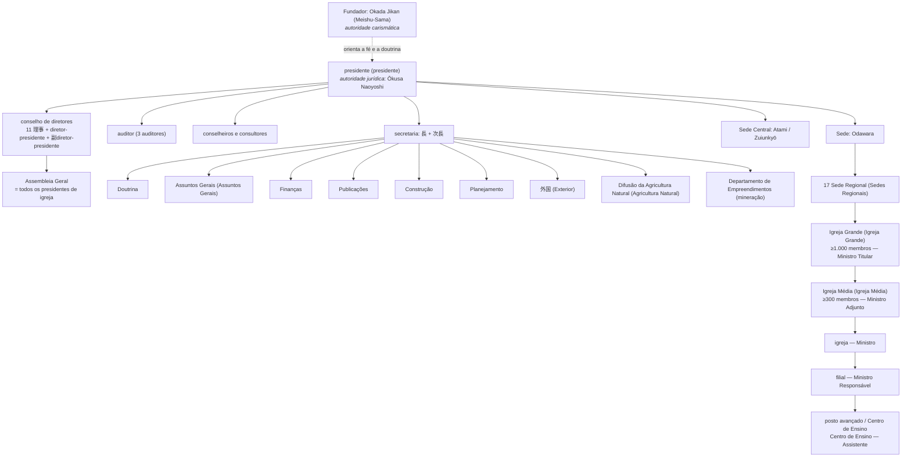

# A difusão na época de Meishu-Sama — Parte III: hierarquia, doutrina e economia

**Data:** 13 de outubro de 2026
**Complementa:** Partes I e II (`LEVANTAMENTO_DIFUSAO_PARTE_I_PROSA_20261002.md`
e `DOSSIE_PARTE_II_CULTO_E_VIDA_20261002.md`)
**Documentação:** documentação textual rattail (`/var/www/rattail/`), exclusivamente.
**Convenção de citação:** `『veículo』nº, data · caminho`

---

## 24. A hierarquia das unidades: duas grades sucessivas

Compreender a organização do período exige distinguir **duas grades**, e não
uma. A primeira nasceu em dezembro de 1948; a segunda, em fevereiro de 1951,
substituiu-a inteiramente. Confundi-las é o erro mais fácil de cometer, porque
os nomes de alguns degraus sobrevivem à troca com significado diferente
(«Igreja Filial» e «filial») e porque a documentação de época não avisa quando muda de
sistema.

### 24.1 Por que a grade de 1948 mudou

O documento fundador da primeira grade é uma resposta de 8 de dezembro de 1948.
Ela articula duas coisas ao mesmo tempo: critérios quantitativos de ascensão e
um critério **territorial** de vinculação, este último em reação direta ao
personalismo que ameaçava a coesão:

> 「あの先生は気に入ったからつくとか、あの先生は気に入らないから離れるとか
> いうことはたいへんな間違いで、神様から見れば怪しからぬ事です。……**今度は
> 地域的に所属をきめることにしました。これは本部と三カ所の分所があり、分所に
> 分会が所属し、分会には支部が所属するのです。支部長は教導師であり、教導師は
> 信者を一〇〇人以上作った人か、三万円以上献金した人か、または支部長の推薦に
> よることとし、教導所を一〇以上有するものを分会とし、分会一〇以上を分所と
> することにしました。**やはり功労のある人が上に行くのが本当ですから。」

*"Aquilo de aderir a um mestre porque se gostou dele, ou dele se afastar porque
não gostou, é um enorme erro e, aos olhos de Deus, algo inadmissível. […]
**Desta vez decidi determinar a vinculação por região.** Há a Sede e três
Subsedes; às Subsedes pertencem as Associações, e às Associações pertencem as
filiais. O líder de filial é um Ministro Responsável de Unidade Religiosa, e o
Ministro Responsável será alguém que tenha conduzido cem ou mais fiéis, ou que
tenha ofertado trinta mil ienes ou mais, ou por recomendação do líder de filial.
Aquilo que tiver dez ou mais Centros de Ensino será considerado uma Associação,
e o que tiver dez ou mais Associações será considerado uma Subsede. Afinal, é
justo que aqueles com méritos estejam no topo."*
— Gokōwa-roku nº 2, 8 de janeiro de 1949 · `search1/situmon/m231208.html`

A frase final — "é justo que aqueles com méritos estejam no topo" (功労のある
人が上に行く) — é a chave do sistema. Três portas dão acesso ao grau, e nenhuma
delas é acadêmica: **número de pessoas conduzidas** (cem ou mais), **valor
ofertado** (trinta mil ienes ou mais), ou **recomendação do superior imediato**.
Não havia prova, tempo mínimo de casa nem formação escolar exigida. A
progressão media **resultado de difusão**.

### 24.2 A composição, degrau por degrau (1948)

O critério é o mesmo em todos os níveis: **quantos degraus abaixo se reúnem**.

| Degrau | Japonês | Compõe-se de | Piso quantitativo |
|---|---|---|---|
| Sede | 本部 | — | — |
| Subsede | 分所 | 10 ou mais Associações | 分会 ×10 |
| Associação | 分会 | 10 ou mais Centros de Ensino | 教導所 ×10 |
| filial | 支部 | Centros de Ensino sob um Ministro Responsável | dirigida por 教導師 |
| Centro de Ensino | 教導所 | casa ou sala de atendimento | degrau mínimo |

Vale notar a **simetria do fator dez**: cada degrau se forma quando o degrau
inferior chega a dez unidades. Não é uma progressão aritmética de pessoas, mas
uma **regra de agregação** — o que dá à estrutura uma propriedade notável:
qualquer pessoa, no degrau mínimo, podia calcular exatamente quando sua unidade
subiria de categoria.

### 24.3 A grade de 1951 — territorial e com pisos de membros

Em 5 de fevereiro de 1951 — dia de *risshun*, o início do ano agrícola no
calendário tradicional — Meishu-Sama comunicou a reforma. O documento que a
transmite é o comunicado do presidente Ōkusa Naoyoshi, publicado em Eikō:

> 「一、熱海市桃山、晴々台の地上天国に世界救世教の総本部を置き……
> 三、**従来の四大教会は発展的解消を遂げ**、現在の布教状況及所属府県の連絡の
> 便等を考慮し、差当り**全国を十数箇所の地方別に区分して地方本部を置くこと。**
> 四、**地方本部には、三段階の大教会、中教会、教会の組織を設くること。大教会の
> 組織には協力会員差当り千人以上、中教会には同三百人以上を要すること。**
> 五、……**布教費の節減その他布教の合理化**を図ること。」

*"1. Estabelecer a Sede Central no Paraíso Terrestre de Momoyama, Seijōdai,
em Atami… 3. As quatro Igrejas Grandes até aqui existentes passam por
dissolução-e-desenvolvimento; considerando a situação atual da difusão e a
conveniência de ligação entre províncias, dividir o país em cerca de uma dúzia
de regiões e estabelecer Sedes Regionais. 4. Nas Sedes Regionais, criar a
organização em três graus: Igreja Grande, Igreja Média e Igreja. A Igreja
Grande requer mil ou mais membros cooperadores; a Igreja Média, trezentos ou
mais. 5. …visando à redução de custos de difusão e à racionalização da
difusão."*
— *Sobre a organização da estrutura da Igreja Messiânica Mundial*, Eikō nº 94, 7 de março de 1951 ·
`search2/sanko/kikoseib.html`

Item quinto à parte — que a §30 deste levantamento examina em detalhe — o
desenho institucional mudou por completo. As **quatro Igrejas Grandes** — Tengoku,
Taisei, Kōhō e Miroku — foram dissolvidas como categoria, e sobre
elas se ergueram **dezessete Sedes Regionais** com nome e jurisdição: Hokkaido
Leste e Oeste, Tōhoku, Ōu, Kantō Leste e Oeste, Shinetsu, Chūkyō, Hokuriku,
Kinki, Kansai, San'in, San'yō, Shikoku, Kyūshū Leste e Oeste.

Duas consequências merecem registro. A primeira é que o **eixo de agregação
deixou de ser decimal e passou a ser territorial** — a unidade passou a ser
definida pelo espaço, não pela contagem de unidades abaixo. A segunda é que
surgiram **pisos de membros** onde antes havia pisos de unidades: mil membros
para uma Igreja Grande, trezentos para uma Igreja Média.

### 24.4 Tipologia consolidada

| Japonês | Português | Definição | Vigência |
|---|---|---|---|
| 総本部 | **Sede Central** | Centro mundial; Zuiunkyō (Atami) | 1951– |
| 本部 | **Sede** | Centro administrativo; Odawara | 1951– |
| 地方本部 | **Sede Regional** | 17 unidades, por província | 1951– |
| 大教会 | **Igreja Grande** | ≥1.000 membros (1951); antes, uma das 4 | 1951– |
| 中教会 | **Igreja Média** | ≥300 membros | 1951– |
| 教会 / 分教会 | **Igreja** | Unidade com 会長 nomeada | 1948– |
| 分所 | **Subsede** | ≥10 Associações | 1948–1951 |
| 分会 | **Associação** | ≥10 Centros de Ensino | 1948–1951 |
| 支部 | **filial** | Chefiada por um Ministro Responsável | 1948– |
| 出張所 | **posto avançado** | Menor que a filial; criado por deslocamento de um Ministro | 1948– |
| 教導所 | **Centro de Ensino** | Unidade mínima: casa ou sala de atendimento | 1948– |
| 浄霊所 | **Centro de Johrei** | "a igreja" de facto de uma família | s/d |
| 教修会場 | **local do Kyoshu** | Casa ou salão cedido para o curso | 1952– |

O par **filial / Igreja Filial** é o que mais confunde: filial é o degrau de base do
sistema de 1948 (chefiado por um Ministro Responsável), enquanto Igreja Filial é
simplesmente "igreja" no sistema de 1951, sem subordinação a uma Associação.
Quem lê os dois sistemas em sequência pode tomar um pelo outro.

Vale registrar ainda o degrau zero, que **não consta de nenhum censo**: o
**浄霊所** — "Centro de Johrei". A expressão aparece em relato de 1951 e
descreve a unidade de base sem qualquer mediação institucional: uma família que
passou a praticar Johrei em casa, atraiu vizinhos, e "chegou ao ponto de
construir uma nova igreja, isto é, um Centro de Johrei". É a difusão em seu
estado nascente — antes de haver organização.

### 24.5 O organograma

A estrutura de 1951–1955, reconstruída a partir do comunicado de Ōkusa
(`search2/sanko/kikoseib.html`), do organograma departamental do censo de 1950
(`search1/mo/mondai.html`) e da ata da reunião de oficiais de dezembro de 1954:

A linha pontilhada entre o Fundador e o presidente não é ornamento: é a
**separação formal entre autoridade carismática e autoridade jurídica**,
documentada no art. 3º do regulamento de 1951 e comentada em Tijotengoku nº 50.
Meishu-Sama não era o presidente. Quem respondia juridicamente pela pessoa
jurídica era Ōkusa Naoyoshi, e essa distinção — que a ruptura de 1955 tornaria
dramática — já estava no papel desde o começo.

---

## 25. As atribuições e o cotidiano dos dirigentes

### 25.1 A atribuição por nível

| Função | Nível responsável | Fonte |
|---|---|---|
| **Johrei** (cura) | todos, do Centro de Ensino para cima | toda a coleção |
| Celebrar **culto mensal** e **culto regular** em data fixa | filial, posto avançado, Igreja | `Gokōwa-roku nº 12, 21 de setembro de 1949 · search1/situmon/m240613.html` |
| Ministrar o **Kyoshu** | filial, Igreja, local do Kyoshu | `*Programa do Curso da Igreja Kannon do Japão*, 1 de julho de 1947 (Anexo B) · search1/ni/nihon07.html` |
| Formar novos portadores de qualificação | Igreja / Igreja Média | `*Sobre a contribuição*, Kyūsei nº 57, 8 de abril de 1950 · search1/ke/kenkin.html` |
| Distribuir o jornal | Centro de Ensino, filial | `*Ampliar o jornal Hikari é fortalecer a linha da fé*, Hikari nº 33, 29 de outubro de 1949 · search1/hi/hikari03.html` |
| Sediar **mesas-redondas** periódicas | Igreja Média, Igreja Grande | `*Mesa-redonda periódica de difusão*, Tijotengoku nº 42 e ss. · search2/sanko/teirei1.html` |
| Abrigar doentes em purificação | Sede da Igreja Média | `Mioshie-shū nº 1, 20 de setembro de 1951 · search1/situmon/m260828.html` |
| Sediar **audiência** (audiências) | Sede (Atami, Hakone, Odawara) | — (v. capítulo 18.1) |
| Presidir os ritos sazonais em rodízio | Igreja Grande | `*Visitando o Grande Culto de Outono da Igreja Messiânica Mundial*, Tijotengoku nº 17, 15 de outubro de 1950 · search2/kikou2/sekai03.html` |
| Administração e finanças próprias, com os atos sujeitos a **aprovação prévia** da Sede | Igreja | 規則 arts. 26–30 |

A última linha tem uma contrapartida que convém não deixar implícita: a auditoria
instituída pelo Regulamento corre na direção contrária — quem audita é a Sede, mas
quem examina e aprova as contas da Sede é a assembleia dos presidentes de igreja.
O ponto está desenvolvido no **capítulo 24.1**.

Uma restrição operacional merece registro, porque mostra como a estrutura era
pensada a partir da capacidade real de uma pessoa. Perguntado sobre quem preside
os cultos das filiais, Meishu-Sama chega a um limite por dedução simples:

> 「【質問者】支部は支部長が主催すべきものと思います。もし支部が三〇ヵ所
> 以上になったら、一日一ヵ所としても、会長さんは一月中にまわりきれなく
> なります。
> 【明主様】そうだな……**三〇ヵ所以上になってはいけない理屈になるからな。**
> ……原則としては中教会を一番先にするわけです。」

*"[Pergunta] Creio que a filial deve ser presidida pelo líder da filial. Se a
filial tiver trinta ou mais locais, mesmo um por dia, o presidente não
conseguirá percorrer todos em um mês. [Meishu-Sama] É mesmo… Isso leva à
conclusão de que não pode haver trinta ou mais locais. …Em princípio, a Igreja
Média é que vem primeiro."*
— Gosuiji-roku nº 29, 15 de março de 1954 · `search1/situmon/m290301.html`

Daí um **limite superior prático de trinta filiais por Igreja Média** — não por
estatuto, mas por aritmética de calendário. A estrutura não era desenhada no
papel: era deduzida da capacidade física de supervisão.

![Gosuiji-roku 2 9号, 15 de março de 1954, página 20 — a resposta de que se deduz o limite de trinta filiais por Igreja Média. [Página confirmada por OCR do fac-símile.]](facsimiles/suiji29_limite_trinta.jpg)

### 25.2 O cotidiano do dirigente de base

A documentação sobre a rotina diária vem sobretudo dos **relatos de fiel** e dos
pronunciamentos em que Meishu-Sama corrige o procedimento de um dirigente. É
neles que a função se mostra por dentro.

O **Ministro Responsável de filial** e o dirigente de Igreja faziam o mesmo
trabalho em escalas diferentes: visitavam as casas dos fiéis, ministravam
Johrei, ensinavam os pais ou o chefe da casa a ministrar Johrei, e dirigiam o
culto periódico. A expressão que a documentação usa é «visita domiciliar», e ela
aparece nos relatos como o meio pelo qual a difusão se propagava de casa em
casa.

O ponto decisivo — e que a documentação deixa claro — é que **a função do
dirigente não era curar pelos outros, mas ensinar a curar**. Num caso de 1953,
Meishu-Sama censura um líder de filial por não ter explicado à família a causa
espiritual do sofrimento da criança:

> 「……そういうことも支部長はあんまり言わなかったらしいので、私がそう言ったら
> びっくりしてました。**そうすると支部長のやり方がもっとも間違っていたのです。**
> それでも支部長がそれに気がついて、心からお詫びをして、**父親か母親に子供の
> 浄霊をさせる**というようにすると、助からなかったことはなかったが……」

*"…parece que também isso o líder de filial pouco disse; quando eu o disse, ele
ficou espantado. **Logo, o modo de agir do líder de filial estava completamente
errado.** Ainda assim, se ele tivesse percebido isso, pedido perdão de coração e
**feito o pai ou a mãe ministrar Johrei na criança**, não teria havido caso em
que não se salvasse…"*
— *Palestra*, Mioshie-shū nº 22, 15 de junho de 1953 · `search1/kouwa/s280526.html`

A lição é precisa: o erro do dirigente foi **ter feito ele mesmo**, em lugar de
**ter ensinado a família a fazer**. A difusão não se sustentava na capacidade do
dirigente, mas na de cada casa.

Há ainda uma distinção funcional que Meishu-Sama faz questão de marcar: as
funções **não deviam acumular-se**. Ao criar o movimento de Agricultura Natural,
adverte expressamente que a chefia do novo grupo não pode ser do mesmo homem:

> 「**一村一支部というようにして、支部長は救世教の教会の支部長というような人が
> 兼任してはいけないのです。**これはぜんぜん別にして、信者でなくてむしろその
> 土地の篤農家のような人がなるといいのです。」

*"**De modo que haja uma filial por aldeia — e o líder de filial não pode ser
acumulado pela mesma pessoa que é líder de filial da igreja do Kyūseikyō.** Isso
é completamente separado; e convém que não seja um fiel, mas antes um lavrador
respeitado da própria terra."*
— *Palestra*, Mioshie-shū nº 19, 15 de março de 1953 · `search1/kouwa/s280225.html`

A razão é de método, e Meishu-Sama a enuncia: a difusão agrícola devia andar
**sem exigir a conversão prévia** — "se for preciso virar fiel para começar, a
difusão fica muito lenta, e a salvação do Japão fica mais lenta". É a mesma
lógica da sequência obrigatória da difusão descrita na Parte I (§2.1): a cura
primeiro, a doutrina depois.

### 25.3 O que a Sede examinava, e o que apenas autorizava

A pergunta admite três respostas, e a primeira inverte a intuição.

**O Regulamento manda auditar a Sede, não as igrejas.** A palavra auditoria aparece
duas vezes no texto integral do Regulamento de 1951 — e nos dois casos quem é
examinado é a própria pessoa jurídica:

> 「（監事）第二十四條　この法人に三人の監事を置き、**財務を監査させる**」
> 「（財産目録の作成）第三十四條　財産目録は、毎会計年度終了後一月以内に、
> 前年度末現在によって作成し、**監事の監査を経て、総会の承認を受けなければ
> ならない**」

*"(Auditores) Art. 24 — Esta pessoa jurídica terá três auditores e fará com que
**auditem as finanças**. (Elaboração do inventário patrimonial) Art. 34 — O
inventário patrimonial será elaborado dentro de um mês após o término de cada
exercício fiscal, com base na posição no fim do exercício anterior, e **deverá
passar pela auditoria dos auditores e receber a aprovação da Assembleia**."*
— Regulamento da pessoa jurídica religiosa Sekai Kyūseikyō, Eikō nº 125, 10 de outubro
de 1951 · `search2/sanko/kisoku.html`

O art. 17 define quem compõe essa Assembleia, e a definição é decisiva:

> 「（議員）第十七條　**総会は、議員で組織し、議員は、教会の会長たる者を
> もって充てる**」

*"(Membros) Art. 17 — A Assembleia é composta de membros, e são membros
**precisamente os que são presidentes de igreja**."*
— idem

A Assembleia que aprova o inventário da Sede é, portanto, **o colégio dos
presidentes de igreja**. Some-se o art. 23, que obriga o presidente a
reportar à Assembleia as matérias de 「事務及び経理」 — administração e
contabilidade —, e o desenho fica claro: **o estatuto prevê as igrejas
examinando e aprovando as contas da Sede**, não o contrário. A auditoria
instituída é garantia dos membros contra a direção, e não instrumento da direção
sobre os membros.

**O que a Sede controlava era o ato, não o livro.** O capítulo III (arts. 26–28)
não institui fiscalização contábil: institui **regime de autorização prévia**. A
igreja depende de aprovação do presidente para uma lista fechada de atos:

| Art. | Ato sujeito à **aprovação prévia** do presidente |
|---|---|
| 26 | tornar-se pessoa jurídica religiosa; **alterar o próprio regulamento**; fundir-se ou dissolver-se |
| 27 | alienar ou dar em garantia imóveis e bens do inventário; tomar empréstimo ou prestar fiança; obra maior na sede da igreja; alteração do uso dos edifícios |
| 28 | o presidente da igreja — ainda que **escolhido pelas regras da própria igreja** — é **nomeado** pelo presidente |

O art. 27 abre exceções estreitas: o ato de **necessidade urgente** ou o de
**pequena monta** dispensa a aprovação.
Não há, em contrapartida, nenhum artigo que mande a Sede examinar caixa, livro ou
conta de uma igreja.

**A forma que de fato existia: reunião periódica, taquigrafada e publicada.** A
documentação não guarda formulário de inspeção, mas guarda as atas — e elas são
abundantes, porque saíam impressas em Eikō e Tijotengoku. O instrumento real
de acompanhamento era a **reunião de dirigentes**, presidida ou orientada por um
diretor da Sede:

| Série e data | Veículo | Composição |
|---|---|---|
| *Mesa-redonda periódica de difusão*(1ª) · 04/09/1952 | Tijotengoku nº 42 · `search2/sanko/teirei1.html` | **um diretor da Sede** e quatro presidentes de Igreja Média; sem limite de participantes, com inscrição recolhida **no escritório da Sede** |
| *Mesa-redonda periódica de difusão*(3ª) · 05/01/1953 | Eikō nº 195 | **orientação do diretor-presidente**; seis presidentes de Igreja Média |
| *Mesa-redonda de difusão* · 03/10/1952 | Eikō nº 191 · `search2/sanko/hukyo.html` | presidente da igreja local e cerca de vinte dirigentes e fiéis |
| *Encontro de líderes de filial* — reunião de presidentes de filial · 28/04/1952 | Tijotengoku nº 37 · `search2/kikou2/shibuno1.html` | presidentes de filial, **dez minutos cada um** |

A natureza das atas diz o que nelas se tratava. Não é contabilidade: é
procedimento, preço e conduta. É numa delas que os próprios dirigentes relatam,
sem eufemismo, as variações que encontravam nas regiões — a oferta de cinco e de
sete mil ienes pelo mesmo Byōbu, o "Kyoshu de dez dias" que era apenas o número
de dias de Johrei recebidos, a região em que não se fazia Kyoshu de modo algum, a
esposa do ministro que adivinhava se o caso sarava. O quadro completo está
transcrito no capítulo 11. E depois da reunião vinha **a norma escrita**: o
aviso *Aviso*, publicado na mesma Eikō nº 191, começa exatamente por
「別項座談会にもあるごとく……」 — *"conforme a mesa-redonda em outra seção"*.

A própria direção descreve o método como duas coisas somadas:

> 「最近御本部では、**教修要綱も御作り下され**、頻りに**幹部の先生方の密接な
> 懇談**も多くなりつつ有りますから、御神示に帰一し奉る日も間近に迫りつつある
> ようです。」

*"Ultimamente, na Sede, **o Kyoshu Yōkō foi elaborado**e os **encontros
estreitos entre os dirigentes** vêm se multiplicando; parece aproximar-se o dia
de retornar à unidade com a Revelação Divina."*
— Sakai Takao, presidente de igreja, *Mesa-redonda de difusão*, Eikō nº 191, 14 de janeiro de
1953 ·
`search2/sanko/hukyo.html`

Padronizar por documento escrito e multiplicar reuniões: eis a resposta à
variação regional — não a auditoria.

A isso soma-se, em 1951, a **grade territorial**. O comunicado do presidente
Ōkusa de 7 de março de 1951 dissolve
as quatro grandes igrejas e divide o país em dezessete sedes regionais, com
titulares nomeados um a um:

| Sede regional | Províncias |
|---|---|
| Leste de Hokkaidō · Oeste de Hokkaidō | Leste e Oeste de Hokkaidō |
| Tōhoku · Ōu | Iwate, Miyagi, Fukushima · Aomori, Akita, Yamagata |
| Leste de Kantō · Oeste de Kantō | Tōkyō, Ibaraki, Chiba, Saitama, Yamanashi · Tochigi, Gunma |
| Tōkai (nome a confirmar) | Kanagawa, Shizuoka |
| Chūkyō | Aichi, Gifu, Mie |
| Shinetsu | Niigata, Nagano |
| Hokuriku | Toyama, Ishikawa, Fukui |
| Kinki · Kansai | Shiga, Kyōto, Nara · Ōsaka, Hyōgo, Wakayama |
| San'in · San'yō | Tottori, Shimane, Yamaguchi (Suō) · Okayama, Hiroshima, Yamaguchi (Nagato) |
| Shikoku | Tokushima, Kagawa, Ehime, Kōchi |
| Leste de Kyūshū · Oeste de Kyūshū | Ōita, Miyazaki, Kagoshima · Fukuoka, Saga, Nagasaki, Kumamoto |

O mesmo comunicado cria o **sistema de conselho de assessores** — 「評議員制を設け、**地方本部長等を以って
これに充てる**」, isto é, os responsáveis regionais passam a formar um colégio
consultivo — e restringe a difusão à própria jurisdição:

> 「数地方本部に渉っての布教は**当分（一年間）は許さるる**も、出来るだけ早く
> 同一の地方本部内においてのみ布教する様にし、**布教費の節減その他布教の合理化
> を図ること**」

*"A difusão que abranja várias sedes regionais fica **permitida por ora (um
ano)**; mas, o quanto antes, que se difunda somente dentro da mesma sede regional,
para **reduzir a despesa de difusão e racionalizar a difusão**."*
— `search2/sanko/kikoseib.html`

O que aí se controla é o circuito — quem difunde onde, e a que custo —, não a
escrituração.

**O que não existe na documentação.** Não há procedimento de exame de contas de igreja
pela Sede; não há formulário, periodicidade nem regulamento de auditoria. E há uma
razão documental precisa para essa ausência: o art. 46 do Regulamento remete os
procedimentos aos **regulamentos internos** — 「この規則の施行に関する細則は、**責任役員が
定める**」 —, e os regulamentos internos **não estão na documentação**. É ali que qualquer rotina de
fiscalização estaria escrita. A ausência é, portanto, **lacuna documental
declarada**, e não conclusão negativa: não se pode afirmar que não havia
fiscalização; pode-se afirmar que a documentação não a documenta.

Vale registrar onde a palavra "fiscalização" aparece na documentação, porque o achado é
significativo: **inspeção**, a forma corrente de inspeção de contas no período, é
sempre do Estado, nunca da igreja — 「税務査察官」, 「**査察部**の脱税摘発で気が
立っている」, 「弁護士に査察景気」. A única "auditoria" que a documentação descreve
como ameaça à instituição é a do fisco, e foi por ali que veio a persecução de
1950 (capítulo 26).

Uma última nota, sobre a direção da auditoria *dentro* das igrejas. A auditoria
interna que a documentação registra é a **da própria unidade sobre si mesma**: no
organograma da igreja do Havaí (capítulo 16) há **seis auditores** ao lado do tesoureiro, e a
assembleia anual aprova o **relatório contábil** do exercício
(`search2/kikou2/hawai18.html`). O padrão é antigo: já no estatuto da Associação de Difusão
da Terapêutica de Purificação, 「監事は会の財務を監査す」 — "os auditores auditam as
finanças da associação" (`search1/ni/nihon12.html`). A igreja auditava
as próprias contas e as submetia à sua assembleia; a Sede aprovava seus atos.

---

## 26. Que culto em cada tipo de unidade

A documentação não prevê um rito distinto por tipo de unidade. O que ele documenta é
uma **escala do culto**, com três degraus.

### 26.1 O culto da Sede — os grandes ritos sazonais

O degrau mais alto é o **大祭** — a Grande Festa sazonal, celebrada nos recintos
da Sede. A descrição mais completa é a do Culto Especial de Outono de 1950, cuja
ordem ritual é reproduzida na Parte II (§14.1): relatório do oficiante-chefe →
oferenda de alimentos (shinsen) → oração (norito) → oferta do ramo sagrado
(tamagushi) → recitação conjunta das Orações Tenjin e Zengen-Sanji → canto do
poema sagrado → retirada das oferendas.

Duas notas sobre esse degrau. A primeira é **quem oficia**: Meishu-Sama não
presidia o rito; comparecia depois, como o venerando diante de quem a assembleia
se curvava. A condução cabia ao presidente e aos oficiantes nomeados. A
segunda é a **natureza da oferenda**: no grande culto ela era solene e
codificada. A cobertura do Culto de Outono de 1950 descreve as oferendas
dispostas diante da Imagem da Luz Divina e a oferenda do *tamagushi*, enquanto a do
culto de 1949 registra "ofertas de mar e montanha" dispostas
diante da Kannon de mil braços, e a de 1950 fala do **fruto da ameixeira** como
oferenda que encarnava o sentido do rito — *sanka-kekijitsu*, "flor dispersa, fruto
realizado":

> 「**御供物の梅の実に象徴された、散花結実**、参加した信徒にもやがて、
> 豊醇な実が結ばれる事であろう。」

*"**Simbolizado pelo fruto da ameixeira entre as oferendas, o 'flor dispersa,
fruto realizado': também nos fiéis que participaram amadurecerão, no tempo
devido, frutos abundantes."*
— *Participando da cerimônia do Grande Culto*, Eikō nº 72, 4 de outubro de 1950 ·
`search2/kikou2/taisai03.html`

Na interpretação dos próprios contemporâneos, o rito tinha um significado
litúrgico que o distinguia dos cultos menores: "a participação mensal do fiel e
a participação neste rito são de significado essencialmente diferente".

### 26.2 O culto da Igreja e da filial — o culto periódico

O degrau intermediário é o **Culto Regular** — o culto periódico (regular) — e o
**Culto Mensal** — o culto mensal. Ambos eram incumbência das unidades com instalação
própria: filial, posto avançado e Igreja. A documentação é rico em relatos em que a
família leva o doente ao Culto Regular da sua igreja e obtém ali a cura, ou em que o
dirigente vai à casa ministrar o Culto Regular.

O Culto Mensal aparece com uma função institucional precisa: é o culto que **acompanha
a entronização da Imagem**. Um relato de 1950 descreve o que sucedeu a quem
recebeu a Imagem e não fez o culto mensal:

> 「私の家は昭和二十三年九月光明如来様の御神体を御奉斎さして戴きました。
> その時先生から**月並祭をされた方が良い**と云われましたが、それ程深く考えも
> せず、またこの次に御願しますと、約半年そのままになっておりました。」

*"Em setembro de 1948 entronizamos em nossa casa a Imagem da Komyo-Nyorai. Na
ocasião, o dirigente nos disse que **era melhor fazer o culto mensal**; mas não
pensamos nisso com profundidade e o fomos adiando, e assim ficou por cerca de
meio ano."*
— *Livre de um roubo pela entronização da Komyo-Nyorai*, Eikō nº 70, 20 de setembro de 1950 ·
`search2/okage/ko/qkomyo19.html`

O mesmo relato acrescenta um dado que interessa diretamente ao capítulo
seguinte: as **oferendas diante da Imagem** incluíam arroz lavado. Diz a autora
que os ratos roíam flores e oferendas no oratório dos antepassados, mas "das
oferendas da Komyo-Nyorai no tokonoma, **nem um único grão do arroz lavado
ofertado** foi danificado".

### 26.3 O culto doméstico — o degrau de base

O degrau mais baixo é o **culto diante da Imagem, na própria casa** — matinal e
vesperal. Sua documentação é a mais direta, e vem de um relato em que a autora
ainda não possuía a Imagem:

> 「私共では私一人入信しているばかりで色々の都合でまだ御神体は御奉斎致して
> おりませんので、**御神体代りに朝夕お参りさせて頂いております「日光」の御文字
> の前で**、乱れる心を独り鎮めておりました。」

*"Em nossa casa só eu me converti e, por diversas circunstâncias, ainda não
entronizamos a Imagem da Luz Divina; por isso, **em lugar da Imagem, fazia a
visita matinal e vesperal diante da caligrafia 'Nikkō'**, e ali sozinha aquietava
o coração perturbado."*
— *O Johrei comparado à medicina*, Eikō nº 194, 4 de fevereiro de 1953 · `search1/shi/jorei12.html`

Ao culto doméstico pertence ainda, com estatuto próprio, o **sufrágio dos
antepassados** — rito **recorrente**,
celebrado no oratório doméstico, e distinto do rito de entronização da Imagem.
Meishu-Sama chega a enunciar como dever da casa nova a instalação do oratório:

> 「**新家庭は必ず仏壇を設けねば駄目なんです。**」
> — 「質問応答 御光話」, 8 de fevereiro de 1948 · `search1/situmon/m230208.html`

*"**O lar novo tem necessariamente de estabelecer o oratório dos antepassados.**"*

---

## 27. A salvação e o Ohikari

### 27.1 O que significa salvar

A palavra "salvação" tem, na documentação, um sentido que **recusa a separação
entre o espiritual e o material**. É provavelmente a afirmação doutrinária mais
repetida do período, e ela é feita em oposição explícita ao que Meishu-Sama
atribuía às religiões estabelecidas:

> 「しかるに世間ある一部の人々は**現当利益を目的とする宗教は、低級信仰であり、
> 信仰の妙諦は精神的に救われる事である**としている。しかしこれは大変な間違いで
> あって、**真の救いとは、精神も物質も両方救われなければならない**のは言うまで
> もない。例えば病気に苦しみながら、観念だけの満足では本当の救いとはならない。
> **病気が治り、健康になって働けるようになる事こそ真に救われたのである。**」

*"No entanto, certa parte das pessoas do mundo afirma que **a religião que visa
ao benefício nesta vida é de fé inferior, e que a essência da fé é ser salvo
espiritualmente**. Mas isso é um erro grave: **a verdadeira salvação exige que
tanto o espírito quanto a matéria sejam salvos**. Por exemplo, quem sofre de
doença não alcança a verdadeira salvação com a mera satisfação de uma ideia.
**Sarar da doença e tornar-se saudável a ponto de poder trabalhar — isso é que é
ser verdadeiramente salvo.**"*
— *Que é, afinal, a Igreja Messiânica Mundial?* · `search1/English/emondai.html`

O conceito tem um nome: **unidade de espírito e corpo** — "espírito e carne em unidade". E tem um
fim declarado, que a documentação formula como **mundo sem doença, pobreza nem conflito** — "sem doença, sem
pobreza, sem conflito":

> 「吾らの終局の目的は、天国的理想世界を造るにあるのだから、肉体の健康のみでは
> 本当ではない。肉体の健康と共に精神的健康たり得なくてはならない。いわゆる、
> **霊肉一致の完全人間**を作ることである。このような完全人間の増加によって、
> ここに地上天国は形成されるのである。」

*"Nosso propósito final é construir o mundo ideal do Paraíso Terrestre; por isso, a mera
saúde do corpo não basta. Junto com a saúde do corpo, é preciso haver saúde do espírito.
É criar o que se chama o **ser humano completo, de espírito e carne em unidade**. Pelo
aumento desses seres humanos completos é que o Paraíso Terrestre se forma aqui."*
> — 「一人対一人では駄目だ」 · `search1/hi/hitorita.html`

Daí decorre a resposta à pergunta proposta. **Outorgar o Ohikari não é, em si,
salvar** — é entregar o **instrumento** pelo qual a salvação se torna possível e,
sobretudo, **operável pelo próprio fiel**. O Ohikari não faz do fiel um assistido
do dirigente; faz dele **agente da cura**. A difusão, no período, valia-se
disso: quem recebia o Ohikari passava a poder ministrar Johrei, e é por isso que
o relato típico é aquele em que o recém-convertido já cura os vizinhos — "o
dirigente ensinou-me que trabalhar era o que importava" e, daí em diante, "todos
os dias iam a pé até a igreja e faziam Johrei".

A salvação, portanto, é o **processo** — a purificação, a cura, a prosperidade e
a elevação espiritual que se seguem; o Ohikari é a **condição de possibilidade**
desse processo. Confundir um com o outro seria, no vocabulário da própria casa,
tomar a porta pelo caminho.

### 27.2 O Ohikari

O Ohikari é uma **caligrafia de punho de Meishu-Sama**, dobrada e usada ao pescoço. A
documentação descreve a sua natureza e a sua função com precisão:

> 「まず私は一枚の紙片に「光」という文字を書き、それを畳んで**御守**として
> 入信者に渡すと、それを懐に入れて手を翳（かざ）すや、たちまち掌から光が放射
> され、霊の曇りは解消し病は治るのである。」
> — 「浄霊とは何か」 · `search1/English/ejorei16.html`

*"Primeiro escrevo o caractere **Hikari** numa folha de papel, dobro-o e o entrego ao
convertido como **Ohikari**; quando ele o põe no peito e ergue a mão, da palma
irradia-se luz, a mácula do espírito se desfaz e a doença se cura."*

Havia **três graus** de Ohikari, conforme a caligrafia nele traçada:

> 「この御守というのは私が書いた文字で、**光、光明、大光明の三種ある**が、これこそ
> 主の神（エホバ）の神霊が、私の霊体を中継として御守に伝達され、御守から信者の
> 掌を透して放射されるのである。」
> — 「黴菌の発生」 · `search1/English/ebaikin5.html`

*"Esse Ohikari é a caligrafia que eu escrevi, e há **três espécies: Hikari, Kōmyō e
Daikōmyō**; o espírito divino do Deus Senhor (Jeová) transmite-se ao Ohikari
tendo meu corpo espiritual como intermediário, e do Ohikari irradia-se através
da palma do fiel."*

Isso estabelece uma **hierarquia própria do Ohikari**, que é preciso ler na ordem
certa, porque é aqui que a terminologia corrente mais se confunde. O primeiro
Ohikari que a pessoa recebe é o Ohikari propriamente dito — a caligrafia **Hikari**;
o **Kōmyō** vem depois, e é a ele que corresponde a designação **Ohikari Kōmyō**;
o **Daikōmyō** é o terceiro, e é o único reservado a
portadores de qualificação. Dizer que «o Ohikari Kōmyō é recebido quando a pessoa
ingressa na fé» é, portanto, duplo erro: o que se recebe no ingresso é o Ohikari
**Hikari**, e o Kōmyō não é o primeiro, e sim o segundo grau.

Essa hierarquia do Ohikari é **distinta** da hierarquia das Imagens entronizadas, que o
§3.2 examina: são dois objetos diferentes, com duas escadas diferentes. E o grau do Ohikari não é apenas
honorífico — ele mede proteção, como Meishu-Sama responde a quem perguntou se um
portador do Ohikari comum podia fazer Johrei em um portador do Daikōmyō:

> 「――弟子が先生を、またふつうの御守りの人が「大光明」の御守りの人を御浄め
> してもよろしいでしょうか。
> **差し支えありません。されるほうが霊的に変わってしまう。御浄めするほうが
> 御守護が上になるのです。**それからいかなる場合でも御守りを外してはいけませんよ。」
> — 『御光話録』, 8 de julho de 1948

*"— Um discípulo pode fazer Johrei no mestre, ou quem tem o Ohikari comum pode
fazer Johrei em quem tem o Ohikari 'Daikōmyō'? — **Não há impedimento. O que
recebe é que muda espiritualmente. Quem faz o Johrei é que fica com a proteção
maior.** E, em qualquer caso, não se deve tirar o Ohikari."*

### 27.3 A outorga

A outorga do Ohikari era indissociável do **Kyoshu** — o curso de formação (§11). A
sequência documentada nos relatos é constante: **cura → Kyoshu → Ohikari → entronização da
Imagem**.

> 「私は昭和二十二年八月**教修を受けさせて頂きました**。そして二十三年十二月
> **光明如来様の御神体迄も受けさせて頂き**、一家共々に喜びの新春を迎えお道のため
> 御奉仕させて頂いております。」
> — 「村一番の悪田良化す」 · `search2/okage/mamo/qmuraiti.html`

*"Em agosto de 1947 **fiz o Kyoshu**. E em dezembro de 1948 **recebi até a Imagem
da Komyo-Nyorai**, e passamos o Ano Novo em alegria, toda a família, servindo ao
Caminho."*

A documentação **não descreve** um rito formal de imposição do Ohikari com oração
própria — nem no Regulamento de 1951, nem nos relatos. O que se documenta é a
entrega ao término do curso, no contexto do culto.

**O que se cobrava, e a quem.** A questão do valor do Ohikari não se resolve
com uma cifra, porque o objeto não era vendido: era conferido ao fim de um
curso, e o que se pagava era o curso. É o que a própria instituição explica, em
1949, ao responder a uma acusação de rádio:

> 「次に教修料に関してであるが、**千三百円は講師の手当、入信料、維持会員の会費、
> バッジ代、書籍代、出張旅費、旅館宿泊費等含まれており**、最近は物価の値上りの
> ため遠近共相当の増額になっている。」
> — 「放送に対する抗議文」, 23 de abril de 1949 · `search1/ho/hosoni.html`

*"Quanto à taxa do curso: os mil e trezentos ienes **compreendem o honorário do
instrutor, a taxa de admissão, a quota de membro mantenedor, o distintivo, os
livros, as despesas de deslocamento e a hospedagem**, e ultimamente, com a alta
dos preços, tanto perto quanto longe o valor subiu consideravelmente."*

**A pergunta que isso não resolve, e o que a documentação permite dizer.** Pergunta-se,
com razão, se o valor do Ohikari estava **incluído** na taxa do Kyoshu, e depois repassado à
Sede, ou se era **donativo oferecido à parte** pelo fiel. A documentação responde por
indícios convergentes, e não por uma norma única:

1. **Não há dois pagamentos nos relatos.** O que os fiéis descrevem é um único desembolso no
 momento do curso — «por mil ienes de oferta se recebe o Ohikari» —, e não um valor pelo
 curso mais outro pelo objeto.
2. **A lista de 1949 não separa o objeto**, mas também não o isenta: enumera instrutor,
 admissão, quota, distintivo, livros, viagem e pousada, e diz que o total «subiu
 consideravelmente com a alta dos preços». Um valor fixo do objeto, ainda que embutido,
 não apareceria nessa enumeração, porque a enumeração responde a outra acusação — a de que
 se cobrava caro pelo curso.
3. **O aviso de 1953 fala do «valor do Ohikari e dos demais escritos» como valor fixo** — o
 que mostra que o objeto tinha preço próprio, conhecido e uniforme, e não uma oferta livre.
4. **Quem fixa o valor é a Sede.** O mesmo aviso pune quem cobra acima do fixado, e a
 fixação se dá por comunicado da direção: logo, o valor era da instituição, e não do
 dirigente local.

A lista é decisiva: o Ohikari **não aparece como item**. O que se cobrava era a realização
do curso — o instrutor, o material, o distintivo, a viagem e a pousada —, e o Ohikari vinha
ao fim, como conclusão. É por isso que os relatos dizem «por mil ienes de oferta se recebe o
Ohikari»: o valor é do curso, e o Ohikari é o que se recebe ao completá-lo.

> 「お話を伺ってみると**千円のお礼でお守様が頂ける**、しかもたったそれだけで
> 自分の病気も治せると聞き、それなら一万円でも安いことだと思って」

*"Ao ouvir a explicação, soube que **por mil ienes de oferta se recebe o
Ohikari**, e que só com isso a própria doença se pode curar; achei que, mesmo por
dez mil ienes, seria barato."*
— *Cura de uma miosite grave*, Hikari nº 6, 25 de abril de 1949

O mesmo valor aparece, distorcido, na acusação de um pregador adversário, que fala em
«dois mil ienes» pelo amuleto — cifra de fonte hostil, registrada apenas como indício da
ordem de grandeza (`search2/kikou2/sekkyo01.html`).

A leitura mais ajustada é, portanto: **um único pagamento, no ato do curso, com valor fixo
do objeto determinado pela Sede e embutido no montante que o fiel entregava** — e não uma
taxa de curso repassada à parte, mais um donativo separado. O que a documentação **não**
permite dizer é a composição interna desse montante, isto é, quanto do total correspondia ao
objeto e quanto ao curso: nenhum documento do período decompõe a cifra.

**A doutrina: a oferta é de quem transmite, não de Deus.** Perguntado, no mesmo
período, sobre o que fazer quando alguém nada tem a oferecer, Meishu-Sama
responde com a distinção que resolve a questão:

> 「教導師が人を浄霊してあげた場合、生活に費用がかかるんだから、御礼をもらうの
> はあたりまえです。そして余裕があれば神様にお上げするのが本当ですよ。……
> 以前、**ただで治療しろって言う人がいましたが、勿論、観音様は御礼なんかいら
> ないが、取り次ぎする人は家に住んでいるんだし、まさかカスミを食って生きる
> わけには行かない**ですからね。……金持ちはうんと御礼を出したらいいんです。」
> — 『御光話録』15号, 20 de dezembro de 1949 · `search1/situmon/m2409.html`

*"Quando o ministro faz Johrei em alguém, há despesas de vida, e é natural que
receba a oferta. E, se houver folga, o certo é oferecê-la a Deus. […] Antes
havia quem dissesse que se devia tratar de graça; **naturalmente, Kannon não
precisa de oferta alguma, mas quem intercede mora numa casa, e não vai viver
comendo névoa**."*

A frase é a chave: **a divindade não cobra; quem cobra é o homem que intercede,
e cobra para viver.** A oferta não é preço de uma graça — é sustento de quem a
transmite.

O princípio tem formulação doutrinária anterior. Num texto de 1943 sobre os
falsos deuses, Meishu-Sama diz por que a venda da graça é sinal de falsidade:

> 「金を上げれば病気を治すという事は**一種の交換条件**であって、いわば**神対人間
> の取引**のようなもので**御利益を売る**訳であり、実に浅間しき限りである。……
> 正神は、人間からの報酬や条件などに関わらず、**無我愛に**救わせ給う」
> — 「神と悪魔」, 23 de outubro de 1943 · `search1/ka/kami08.html`

*"Aquilo de 'se der dinheiro, curo a doença' é **uma espécie de condição de
troca**uma **transação entre Deus e o homem**é **vender a graça**, e é de uma
baixeza extrema. […] O deus verdadeiro salva por **amor sem eu**,
independentemente de recompensa ou condição vinda do homem."*

**O que não se faz com o objeto: comércio de troco exato.** O objeto tinha valor
de referência, mas tratá-lo como mercadoria era falta grave — nos dois sentidos.
O aviso de 1953 fixa o princípio no capítulo 23: o valor é certo, e cobrar acima dele é
furto. E há o caso inverso, que Meishu-Sama relata como erro:

> 「以前、ある熱心な婦人で人を大勢やってたんですが、その**御札が一円のところを
> 二、三円多いからって返しに行った**んだそうです。……しかし、これなんか
> **とんでもない間違い**ですよ。**神様を侮辱することはなはだしい**。」
> — 『御光話録』15号, 20 de dezembro de 1949

*"Antes, uma senhora dedicada, que atendia muita gente, foi devolver dois ou três
ienes que recebera a mais, porque **o papel sagrado era de um iene**. […] Isso é
um **erro completo**: é **insultar gravemente a Deus**."*

Devolver o troco é tratar a coisa como compra e venda — e é justamente o que não
se pode fazer com o que é de Deus.

**O quadro, em resumo.**

| Questão | O que a documentação mostra |
|---|---|
| O Ohikari tinha valor de referência? | **Sim** — unitário e uniforme: em 1935, um iene e depois dez (cem para o modelo do terapeuta); em 1953, "o valor é fixo" |
| O Ohikari era vendido? | **Não** — cobrar acima do valor é furto; devolver o troco é insulto a Deus |
| O que se cobrava no pós-guerra? | A **realização do curso** (kyōshu): 1.300 ienes em 1949, com instrutor, material, distintivo, viagem e pousada — e o Ohikari não é item da lista |
| A quem pertence a oferta? | Ao **homem que transmite**, não à divindade: "Kannon não precisa de oferta alguma" |

**A leitura que se sustenta, portanto, é esta.** No pós-guerra, o que se cobrava
era o **Kyoshu** — a taxa do curso, com rubricas explícitas e finalidade
declarada —, e não o objeto; e a doutrina afirma que a divindade não cobra nada,
cabendo a oferta a quem intercede. Mas não é exato dizer que o Ohikari passou a
ser gratuito: ele manteve **valor de referência fixo**, e em 1953 Meishu-Sama
ainda fala desse valor. O que mudou não foi a gratuidade do objeto, e sim **a
natureza da cobrança** — do preço da peça para a taxa do curso, e do pagamento à
divindade para o sustento do intermediário. O valor numérico de 1953 continua
não documentado: o aviso daquele ano fixa o princípio, não a quantia.

Há, contudo, um dado que ilumina o estatuto do objeto: o Ohikari era tratado
como **pertencente à pessoa**, e não à instituição. Perguntado sobre o que fazer
com o Ohikari de um membro falecido, Meishu-Sama responde que se deve **cremá-lo
junto com o corpo**:

> 「――受講者が死亡した場合、御守りはいかがいたしますか。
> **御守りをつけたまま火葬にすればよろしい。**」
> — 「質問応答 御光話」, 28 de março de 1948 · `search1/situmon/m230328.html`

*"— Quando o cursista falece, o que se faz com o Ohikari? — **Basta cremá-lo com
o Ohikari posto no corpo.**"*

Nenhuma Imagem coletiva recebe esse tratamento. É um indício de que o
Ohikari não era um **objeto de sacralidade autônoma**mas um vínculo **pessoal** — o
que converge com o que o capítulo 4.1 registra sobre a Imagem: também ela não
é sagrada por si, e sim por ser representante de quem a traçou.

### 27.4 A doutrina do preço: Deus não cobra, e o que se cobra não é o objeto

Esta é a pergunta que mais confusão produz, e ela se resolve com uma distinção que
a documentação faz com precisão: **há um valor, e não um preço**. O objeto tem
valor fixo — mas o que se paga não é o objeto, e o que a divindade concede não tem
equivalente em dinheiro. As quatro afirmações abaixo são as que sustentam a
doutrina, e vêm de quatro lugares diferentes.

**Primeira: a divindade não precisa de oferta alguma.** A frase é de Meishu-Sama,
e é a formulação mais direta do princípio:

> 「以前、ただで治療しろって言う人がいましたが、**勿論、観音様は御礼なんか
> いらない**が、**取り次ぎする人は家に住んでいるんだし、まさかカスミを食って
> 生きるわけには行かない**ですからね。……金持ちはうんと御礼を出したらいいんです。」
> — 『御光話録』15号, 20 de dezembro de 1949

*"Antes havia quem dissesse que se devia tratar de graça; **naturalmente, Kannon não
precisa de oferta alguma**mas **quem intercede mora numa casa, e não vai viver
comendo névoa**. […] Os ricos podem dar bastante oferta."*

A estrutura da frase é decisiva. Há **dois sujeitos** e **duas economias**: a
divindade, que não cobra nada; e o homem que intercede, que precisa viver. A oferta
pertence ao segundo, não ao primeiro. Cobrar *para Deus* é impossível, porque Deus
não recebe; cobrar *para o intermediário* é legítimo, porque o intermediário come.

**Segunda: vender a graça é próprio dos falsos deuses.** A formulação doutrinária é
de 1943, e é ainda mais severa:

> 「金を上げれば病気を治すという事は**一種の交換条件**であって、いわば**神対人間
> の取引**のようなもので**御利益を売る**訳であり、実に浅間しき限りである。……
> 正神は、人間からの報酬や条件などに関わらず、**無我愛に**救わせ給う。」
> — 「神と悪魔」, 23 de outubro de 1943

*"Aquilo de 'se der dinheiro, curo a doença' é **uma espécie de condição de troca**,
uma **transação entre Deus e o homem**é **vender a graça**, e é de uma baixeza
extrema. […] O deus verdadeiro salva por **amor sem eu**, independentemente de
recompensa ou condição vinda do homem."*

Aqui está o que se quer dizer quando se diz que «Deus não tem preço»: o
estabelecimento de uma equivalência entre dinheiro e graça **converte a relação
religiosa em comércio**, e é isso que define o falso. Não é a existência de uma
oferenda que é condenada; é a sua transformação em **contraprestação**.

**Terceira: o que dinheiro nenhum pode pagar.** A consequência prática está
enunciada na mesa-redonda de difusão de 1953, ao tratar da oferta pelo Johrei:

> 「**浄霊の御礼というものは、過去現在未来の悪縁を許して幸福に転換して戴くと
> いう、これは金で出来るものではない。**」
> — 布教座談会, 『栄光』191号, 14 de janeiro de 1953

*"**A oferta de gratidão pelo Johrei — o perdoar as más afinidades do passado,
presente e futuro e convertê-las em felicidade — isso não é algo que se possa fazer
com dinheiro.**"*

É a frase que faltava: o que se recebe **não tem preço possível**, porque não há
operação financeira que produza o seu equivalente. A oferta não compra a graça;
reconhece-a. Quem confunde as duas coisas não está sendo generoso — está
subestimando o que recebeu.

**Quarta: o valor é fixo, e passar dele é furto.** A contrapartida indispensável —
e é ela que impede que a gratuidade de Deus se converta em arbítrio do homem:

> 「別項座談会にもあるごとく、**御守はじめその他の私のかいたものの値は一定して
> いる**にかかわらず、**少しでも多い金を得るとしたら、その分だけは盗みの罪を
> 犯す事になる**から、何程一生懸命信仰しても、それだけ御蔭は減る事になるから
> よく心得べきである。」
> — 「注意」, 『栄光』191号, 14 de janeiro de 1953 (Anexo G)

*"Como se vê na mesa-redonda publicada em outra seção, **embora o valor do Ohikari e
dos demais escritos meus seja fixo**, se alguém obtiver um pouco mais de dinheiro,
**essa quantia constitui o pecado de furto**; portanto, por mais que se empenhe na
fé, a graça diminuirá na mesma proporção."*

O aviso estabelece os dois lados de uma mesma regra. **De um lado**, o valor é
fixo — não é preço de mercado, não se negocia, não varia com a condição do
comprador. **De outro**, cobrar acima dele é furto — e o critério do furto é
exatamente o excesso sobre o valor fixado. Não há, portanto, «preço» do Ohikari:
há **um valor fixo**, que não é o preço da graça, e cujo excesso é crime.

**A síntese, e por que a formulação corrente está errada.** Dizer que «o Ohikari é
vendido» é falso: vender supõe preço livre e lucro, e aqui há valor fixo e o
excesso é furto. Dizer que «o Ohikari é gratuito» também é falso: há um valor, ele
é cobrado, e Meishu-Sama o mantém em 1953. A formulação exata é a terceira: **o
Ohikari tem valor fixo, que não é preço; a graça que ele transmite não tem preço
algum; e a oferta que se faz não é pagamento, é reconhecimento.** É por isso que
devolver o troco — como fez a senhora do relato de 1949 — é insulto a Deus: o gesto
trata como compra e venda o que não é comércio. E é por isso que cobrar a mais é
furto: o gesto trata como mercadoria o que tem valor determinado.

**Uma precisão sobre a história, que o estudo não pode omitir.** Em 1935, Meishu-Sama
diz, em prédica, que os Ohikari «se vendem» por cem ienes — «そういうものを一つ
百円で売ります». A palavra está lá. O que muda,
entre 1935 e 1953, não é a existência de um valor cobrado, e sim **o regime da
cobrança**: do preço da peça, com o vocabulário do comércio, para o valor fixo dos
escritos, cujo excesso é furto. Quem cita 1935 para justificar a venda do Ohikari
cita a etapa que a própria instituição superou; quem cita 1953 para afirmar a
gratuidade ignora que o aviso pressupõe valor cobrado. O estudo sustenta as duas
coisas ao mesmo tempo, porque as duas estão documentadas.

### 27.5 A outorga a quem ainda não fez o curso

A sequência que os relatos mostram — **cura → Kyoshu → Ohikari → Imagem** — é a
praxe documentada, e não a doutrina da outorga. Confundir as duas coisas é o erro
que produz a pergunta: se o Ohikari só se entrega a quem fez o curso, então a
instrução passa a ser condição do dom. A doutrina não diz isso, e diz o contrário
em três pontos.

**Primeiro: o curso ensina o método, não confere o poder.** É a formulação mais
direta que existe sobre o que o Kyoshu é:

> 「つまりね、**人を助ける最善の方法を教わるのが教修なんですからね、教修を
> 受けただけで、人を助けなければなんにもなりませんよ。**」
> — 『御光話録』7号, 23 de abril de 1949

*"Quer dizer: **o Kyoshu é onde se aprende o melhor método de ajudar as pessoas;
e só ter recebido o Kyoshu, sem ajudar ninguém, não é nada.**"*

O que se aprende no curso é **como usar**. O que se recebe com o Ohikari é **o
que usar**. São duas coisas distintas, e a primeira não é a causa da segunda.

**Segundo: o efeito não depende da fé nem da instrução do recipiente.** Perguntado
diretamente se a cura exige crer, Meishu-Sama responde:

> 「**いや、信じなくても治ります。**ところが神様のほうは、信仰にはいらないうちは
> 信じなくても治るわけです。」
> — 『御垂示録』23号, 15 de agosto de 1953

*"**Não — cura-se mesmo sem crer.** Do lado de Deus, enquanto a pessoa ainda não
entrou na fé, ela cura ainda que não creia."*

Se a cura não depende nem da fé, com maior razão não depende de um curso. E a
mesma lógica aparece quanto a quem não é membro: 「信者じゃなくてもいい行いをして
正しい心の人は救われますよ」 — *"mesmo quem não é fiel, se faz o bem e tem o
coração reto, é salvo"*. A salvação não é
privilégio de instruídos.

**Terceiro: o Ohikari é dado para que a pessoa salve outras — e é nisso que ele
se completa.** É o que o capítulo 12.1 estabeleceu: o Ohikari não faz do fiel um
assistido do dirigente, faz dele agente da cura. Ora, se a razão de ser da outorga
é tornar a pessoa capaz de ajudar, **reter o Ohikari até o curso é reter a
capacidade de ajudar** — e é precisamente o que o próprio Meishu-Sama censura em
quem recebeu o curso e não ajuda: «só ter recebido o Kyoshu, sem ajudar ninguém,
não é nada».

**Quarto — e este ponto corrige a conclusão que uma leitura apenas dos três
primeiros produziria: a instituição tratava a omissão do curso como falta grave.** Na
mesma ata de 1953 em que se fixam preços e durações, a direção nomeia o problema em
termos que não deixam margem:

> 「**御都合で教修をやったり止めたりするのも神様への反逆ですね。**」
> — 「注意」 (Aviso), ata de dirigentes, 『栄光』191号, 14 de janeiro de 1953

*"**Fazer ou não fazer o Kyoshu conforme a conveniência é rebeldia contra Deus.**"*

A frase não é sobre o fiel que não pôde fazer o curso: é sobre o dirigente que o
ministra ou o omite por conveniência — e o caso concreto que a ata registra é
exatamente esse, o das regiões onde «quem não tinha tempo fazia sem Kyoshu» e onde «não se
fazia Kyoshu de modo algum» (capítulo 11.5). A norma, portanto, existe, é conhecida e é
cobrada.

**O que se pode concluir, e com que estatuto.** Há duas proposições verdadeiras, e é
preciso sustentá-las juntas, sem confundi-las:

1. **Quanto ao efeito**, o poder não depende do curso. Quem recebe o Ohikari recebe o
 mesmo objeto e a mesma capacidade; o que lhe falta é o aprendizado do uso, e isso se
 supre depois (§27.5, pontos 1 a 3).
2. **Quanto à norma**, o curso é obrigatório, e ministrar ou omitir por conveniência é
 falta — «rebeldia contra Deus» —, como a direção declarou em 1953.

A formulação correta não é, pois, «não há problema em receber sem o curso», e sim esta:
**a outorga sem curso é eficaz e é irregular** — eficaz porque a doutrina separa o
método do poder; irregular porque a disciplina da casa nunca a autorizou e a censurou
onde a encontrou. Quem hoje a pratica não pode invocar a doutrina para justificá-la: a
doutrina só diz que o efeito não depende da instrução; não diz que a instrução seja
facultativa. E quem a proíbe em absoluto também não pode invocar a doutrina para negar o
Ohikari a quem tem necessidade e fé: a doutrina só diz que o curso é o meio normal, não
que seja a porta da graça.

**O acompanhamento posterior é, aliás, prática documentada, e não expediente de
emergência.** A instituição o fazia de três modos, todos registrados neste volume:
o **re-Kyoshu**, para quem rompia o Ohikari ou precisava de requalificação
(capítulo 11.6); as **conferências periódicas de difusão**, que reuniam os
dirigentes para corrigir rumos (capítulo 25); e a **audiência e a visita do
dirigente**, que eram o instrumento ordinário de formação continuada (capítulo
17.1). Nada disso, porém, pode ser **vendido como se fosse o objeto**: o que tem
valor fixo são os escritos, e cobrar acima do fixado é furto (capítulo 23.4); o
acompanhamento é serviço, e o serviço se sustenta por oferta, não por preço.

**A ressalva de honestidade.** Não há, na documentação consultada, passagem em que
Meishu-Sama **autorize** expressamente a outorga sem curso. Há o contrário: a censura de
1953 à omissão por conveniência. E há, de outro lado, os três princípios que mostram que o
efeito não deriva do curso. A conclusão acima — eficaz e irregular — é o que resulta de
ambos, e é apresentada como **conclusão**, não como texto. O que não se pode fazer é citar
um dos lados como se o outro não existisse: foi o defeito da versão anterior deste
capítulo, que afirmava não haver problema na outorga sem curso e omitia a censura de
1953.

---

## 28. O ofertório: ofertas, quotas e taxas

### 28.1 As categorias

O Regulamento de 1951, capítulo IV, nomeia as categorias. O art. 29
autoriza a cobrança em dois níveis, e o art. 30 classifica as receitas:

> 「（教費の賦課徴収）第二十九條　この法人は、その目的達成の経費に充てるため、
> **教会及び会員に対し、教費を賦課徴収する**」
> 「（資産の区分）第三十條　……３　**普通財産は、基本財産以外の財産、財産から
> 生ずる果実、教会分担金、会費及び一般の収入**とする」

*"(Arrecadação da taxa religiosa) Art. 29 — Esta pessoa jurídica, para cobrir as despesas
necessárias à consecução de seus fins, **cobra taxa religiosa (kyōhi) das igrejas e dos
membros**. (Classificação do patrimônio) Art. 30 — […] 3. O **patrimônio comum compreende
os bens que não sejam patrimônio básico, os frutos desses bens, a contribuição das igrejas, as quotas dos membros (kaihi) e as receitas gerais**."*

> — 『栄光』125号, 10 de outubro de 1951 · `search2/sanko/kisoku.html`

| Categoria | Japonês | Natureza | Incide sobre |
|---|---|---|---|
| Taxa religiosa | **教費** | cobrança institucional | igrejas **e** membros |
| Rateio entre igrejas | **分担金** | repartição de despesa | igreja → Sede |
| Quota do membro | **会費** | contribuição periódica | membro → sua unidade |
| Oferta pela graça recebida | **御守護御礼** | oferta interna, pela prática | fiel → quem ministrou |
| Oferta por Johrei a terceiros | **御奉謝金** | oferta interna, pela prática | beneficiado → quem ministrou |
| Contribuição de gratidão | **献金** | **voluntária** | quem quiser |
| Doação | **寄付** | **voluntária** | quem quiser |

As duas rubricas de natureza **interna à prática** merecem registro, porque não
decorrem do Regulamento e só aparecem nas atas. A primeira é a **oferta de gratidão pela proteção**, a
oferta pela graça recebida; a segunda é a **oferta por Johrei ministrado**, definida na própria fonte
com o seu âmbito exato:

> 「最近は目立って**御守護御礼**も、**御奉謝金（信者さんが他人を御浄霊した
> 場合に受ける御礼及び家族を御浄霊させて戴いた場合の御礼）**も増えて来ました
> が、ある中教会長が『**御守護御礼を、自分で使わして戴いても宜敷う御座いま
> しょうか**』と御伺いしたと聞きましたが、まるで世界が違うような気がします
> ね。」

*"Ultimamente têm aumentado visivelmente tanto a **oferta de gratidão pela proteção** quanto a
**oferta por Johrei ministrado (a oferta recebida quando o fiel ministra Johrei a outra pessoa, e a
oferta quando faz ministrar Johrei a um familiar)**; ouvi dizer que certo
presidente de Igreja Média perguntou: **'a oferta de gratidão pela proteção, posso usá-la para mim?'**
— é como se fosse outro mundo."*
— Sakai Takao, presidente de igreja, *Mesa-redonda de difusão*, Eikō nº 191, 14 de janeiro de 1953 ·
`search2/sanko/hukyo.html`

A pergunta é precisa, e a resposta do próprio presidente da igreja que a ouviu
fixa o critério. O que o dirigente não podia era vender a graça como mercadoria:

> 「それはできない、高い安いの売物買物ではないので、事実に御蔭を戴き、解ら
> して戴く毎に、その尊さ有難さが身にしみその御礼が高いと言う事は、決してな
> いのですが、だからと言っておきめ戴いたことは、そのまま御取次さして戴けば
> 良いことなんで、**教師が中間搾取する事は、品物として扱ったも同然で、それ
> は先生に相応のお裁きが必ずあることなんです**。」

*"Isso não se pode; não é mercadoria de alto e baixo preço. Cada vez que se
recebe de fato a graça e se compreende, a preciosidade e a gratidão se gravam no
corpo, e a oferta nunca é alta. Mas, uma vez recebido, basta transmitir tal e
qual: **que o ministro retenha parte no meio é o mesmo que tratar a coisa como
mercadoria, e por isso haverá certamente para o senhor o julgamento
correspondente**."*
— idem

Fica assim uma terceira natureza de contribuição, ao lado do **preço fixo** dos
objetos (capítulo 19) e da **oferta livre** pelo serviço espiritual: a **oferta
interna à unidade**, que circulava entre o fiel e quem o atendia, e cujo destino
— retê-la ou repassá-la — era objeto de correção expressa.

A terminologia é reveladora: **rateio entre igrejas** é *repartição de despesa* — a igreja local
rateia o custo da Sede —, enquanto **quota do membro** é *quota* — a contribuição periódica
do membro à sua igreja. São obrigações de natureza diferente: uma é fiscal, entre
unidades; a outra é associativa, entre o membro e sua unidade.

**Não há dízimo.** O termo `十分の一` ("um décimo") aparece 149 vezes na documentação,
todas em sentidos estranhos à religião — o décimo de grau em medição de
temperatura, a redução de um décimo na legislação. Nenhuma categoria financeira
do período é **proporcional à renda**, e nenhuma pressupõe declaração de
rendimentos. O modelo é o da **contribuição voluntária com administração
centralizada**, não o da obrigação proporcional com verificação.

### 28.2 O que ficava na unidade e o que subia

O Regulamento responde por implicação inequívoca: ao elencar a **igrejarateio entre igrejas**
entre as receitas da pessoa jurídica (art. 30) e ao autorizar a cobrança da
**taxa religiosa** sobre as igrejas (art. 29), estabelece que **as unidades contribuíam com
a Sede**. Mas **não fixa valores, percentuais nem periodicidade** — deixa isso
para as normas de execução, que o art. 46 atribui aos diretores responsáveis.
Essa lacuna é documental e deve ser registrada como tal.

O que a documentação permite afirmar com segurança é a **assimetria de autonomia**: a
unidade tinha autonomia **administrativa** mas não **patrimonial**. O art. 27
subordina à autorização do presidente uma lista de atos de consequência —
dispor de patrimônio ou oferecê-lo em garantia, contrair empréstimo, construir,
reformar, ampliar, remover ou demolir edifícios principais, e mudar a destinação
de edifícios e terrenos principais. O dia a dia competia à unidade; nenhuma
decisão de vulto sobre bens, obras ou dívidas podia ser tomada sem a Sede.

E a administração era, por princípio, **da Sede**. O próprio Meishu-Sama o
declara, ao recusar assumir a decisão sobre um fundo de assistência proposto por
uma filial:

> 「【明主様】**そういう問題は管長がやるべきです。渋井さんと相談してみなさい。
> 経営はすべて本部管長がやることになっている。**分会長もいるんだからみんなで
> 相談してやったらよい。」
> — Parte II, §21.2

*"[Meishu-Sama] **Esses assuntos são atribuição do presidente. Consulte o
Sr. Shibui. A administração é toda feita pelo presidente da Sede.** Há
também o responsável pela filial, então resolvam todos juntos, em consulta."*

É o oposto do que se esperaria de um fundador carismático — e coincide com o
desenho legal: quem administra é o presidente.

### 28.3 A doutrina do 献金

Se a taxa religiosa e a quota do membro são obrigações, o **contribuição é gratidão** — e sobre isso
Meishu-Sama foi explícito em dois artigos de 1950, escritos quando a imprensa
atacava a igreja justamente por sua receita. O primeiro enuncia a **política**:

> 「そうして**本教の方針として決して搾取手段は用いない、献金はすべて自発的で
> 自由である**、ところが医師から死の宣告を受けた者が助かったり、数十年来の
> 難症が短期間に全治したり、病人の絶えない家庭が健康家庭になったりする以上、
> その**絶大な感謝感激は止むに止まれないその結晶が献金**となるのである」

*"E **a diretriz desta religião é nunca empregar meio de extorsão: as
contribuições são todas espontâneas e livres**. Ora, quando alguém que recebeu do
médico a sentença de morte se salva, ou uma enfermidade de dezenas de anos se
cura em pouco tempo, ou uma casa onde nunca faltava doente se torna casa
saudável, então **a imensa gratidão e comoção, não podendo conter-se, cristaliza-se
em contribuição**."*
— *Sobre a receita desta religião*, Kyūsei nº 56, 1 de abril de 1950 · `search1/ho/honkyo15.html`

O mesmo artigo explica **como** as obras eram feitas — e aqui a resposta não é
financeira, mas de trabalho:

> 「現在本教が地上天国模型を造るべく、箱根熱海の景勝地にすこぶる大規模な造営を
> しつつあるのもそれがためで、**大部分は信徒の勤労奉仕で、皆人から何らの援助も
> 受けず、手銭手弁当で、朝から晩まで**えいえい汗して働いているその崇高なる態度を
> 見れば、何人といえども感激胸に迫るものがあろう」

*"Também por isso esta religião está hoje erguendo, nas paragens de grande beleza natural de Hakone
e Atami, uma construção de grande escala, para fazer o modelo do Paraíso
Terrestre — e **em sua maior parte por serviço voluntário dos fiéis, sem receber
auxílio de ninguém, com recursos e refeição próprios, suando de manhã à noite**;
quem veja essa atitude sublime há de sentir apertar-se-lhe o peito."*

O segundo artigo, de 8 de abril de 1950, traz o **exemplo concreto**: uma
mulher que escapara de um incêndio e, na igreja, entregou "os cinco mil ienes que
tinha" para a obra — não como pagamento, mas como gratidão. E o artigo abre
declarando o ponto: o que se publica ali é "um exemplo de como a diretriz desta
religião **repugna à extorsão** e se funda na contribuição espontânea".

Duas consequências importam. A primeira é de **método**: a construção dos
Paraísos Terrestres foi, em sua maior parte, **obra de mãos**, não de caixa — o
que explica por que ela dependia da adesão viva das pessoas e por que a
desagregação de 1955 teve as consequências materiais que teve (Parte I, §12). A
segunda é de **doutrina**: quem contribuía com dinheiro não comprava nada;
quem contribuía com trabalho também não. O que se dava era **報恩** — retribuição
de benefício recebido.

### 28.4 O preço fixo e a oferta livre

O regime financeiro do período distingue com nitidez **duas naturezas de
contribuição**, e a distinção é doutrinária, não contábil.

De um lado, as peças que Meishu-Sama traçava — o **Ohikari**, a caligrafia
entronizável, a **Imagem** — tinham **preço fixo**. O valor, no período pós-guerra, era da ordem de milhares de ienes
(capítulo 20). E em 1953 o princípio é formalizado num **aviso** publicado em Eikō:

> 「御守はじめその他の私のかいたものの値は**一定している**にかかわらず、少しでも
> 多い金を得るとしたら、**その分だけは盗みの罪を犯す事になる**から、何程一生懸命
> 信仰しても、それだけ御蔭は減る事になるからよく心得べきである。」
> — 「注意」, 『栄光』191号, 14 de janeiro de 1953 · `search1/ti/tyui02.html`

*"Embora o valor do Ohikari e das demais coisas que eu escrevi seja **fixo**, se
alguém obtiver um pouco mais de dinheiro, **essa diferença constitui crime de
furto**; por mais que se empenhe na fé, a graça diminuirá na mesma proporção —
convém compreendê-lo bem."*

Três coisas decorrem disso. Primeiro, o Ohikari **não era dado em troca de oferta
livre**: tinha valor, e o valor era o mesmo para todos. Segundo, cobrar acima do
fixado era **furto** — a palavra é dele. Terceiro, o acréscimo indevido **reduzia
a graça do próprio fiel**, e não apenas o erário da instituição. É, de novo, um
juízo sobre o que a cobrança faz com a fé.

De outro lado, o **serviço espiritual** — o Johrei — tinha oferenda **livre**. A
ata de uma reunião de difusão de 1953, publicada no mesmo número de Eikō,
registra a resposta dada a um assistido que perguntou quanto deveria depositar:

> 「あれは神様への御玉串なんで、**幾らと言うのは決っておらん**が、医者に行っても、
> 初診料と言うのを取られるんだから、**三百でも五百でも、あなたの気持次第**ですたい」
> — idem

*"Aquilo é a oferenda a Deus; **não há valor determinado**; já que no médico também
se cobra a consulta inicial, trezentos ou quinhentos, **conforme o seu sentimento**."*

O quadro é, portanto, de duas colunas que não se confundem: **preço** para o objeto,
**oferta** para o serviço. Cobrar a mais na primeira era falta grave; na segunda, o
valor era assunto da consciência de quem recebia. Não há, na documentação, indício de que
as duas coisas tenham sido jamais unificadas numa tabela única de "tributos".

![Eikō 1 9 1号, 14 de janeiro de 1953 — o aviso *Aviso*, que fixa o valor do Ohikari e das demais peças escritas por Meishu-Sama. [Página confirmada por OCR do fac-símile.]](facsimiles/eiko191_aviso_valores.jpg)

---

## 29. Os Paraísos Terrestres e a mineração

### 29.1 Uma expectativa doutrinária

A mineração não é, na documentação, uma ideia administrativa: é uma **expectativa
doutrinária** com raiz na pregação dos anos 1930. Numa série de conferências de
1935, Meishu-Sama situa a mineração entre as atividades do ciclo novo — e a
descreve como fonte de um ouro de qualidade peculiar:

> 「産業も非常に進歩してくる。**鉱業もやる。特に鉱山で非常に金が沢山出る様に
> なるから、どんどん掘り出して使うのであるが、この金は山から出した綺麗な、
> 人の嫌な想念のかゝった金ではなく、純な金であるから、立派な殿堂を建築しても
> 今までの殿堂の様に火事等出ないで、金銀を使用して立派なものがどんどん造られる
> のだ。**」
> — 「観音講座（第六講座）」, 5 de setembro de 1935 · `search1/ka/kannon18.html`

*"A indústria também progredirá muito. **A mineração também se fará. Sobretudo
das minas sairá muito ouro, e o extrairemos e usaremos sem cessar; mas esse ouro
é o ouro puro saído da montanha, não o ouro em que aderiu o pensamento
desagradável dos homens — por isso, ainda que se construam suntuosos templos,
não pegarão fogo como os templos de até agora, e com ouro e prata se erguerão
magníficas obras, uma após outra.**"*

A doutrina da **qualidade espiritual do ouro** — o ouro extraído é ouro puro ("ouro
puro"), sem a mácula que adere ao dinheiro circulado — é o fundamento da
expectativa. Meishu-Sama contrapõe explicitamente esse ouro ao dinheiro ganho em
especulação, e conta que **ele mesmo deixou a especulação pela mineração**:

> 「私は前に相場が好きでよくやったんですがね。まあ損ばかりでしたが、兜町辺りには
> 怨みの霊がたくさんいて、あすこから持ってくる紙幣についている。悪銭身につかず
> とは本当ですよ。だから私は損ばかりしていたんです。**それが判ってから相場は
> やめて鉱山を始めました。こうして信者の持ってくる金は浄財ばかりです。**」
> — 「質問応答 御光話」, 8 de fevereiro de 1948 · `search1/situmon/m230208.html`

*"Antes eu gostava de especular e o fazia muito. Bem, era só prejuízo: em
Kabutochō há muitos espíritos de rancor, e eles aderem às notas que de lá saem.
'Dinheiro mau não se retém' é verdade. Por isso eu só tinha prejuízo. **Depois
que compreendi isso, deixei a especulação e comecei uma mina. Assim, o dinheiro
que os fiéis trazem é todo riqueza pura.**"*

A expressão usada é **jōzai** — «riqueza pura» —, e é o elo entre a doutrina e a prática
financeira: o que entra na obra pela via da gratidão é riqueza pura; o que entra pela
especulação, não.

### 29.2 Uma operação efetivamente existente

A expectativa não ficou no papel. Há na documentação o registo de uma **mina operada por uma
igreja**: a **mina de Moriyoshi** (森吉鉱山), em Hinokinai, distrito de Senboku, província de
Akita, sob a **Igreja Média Kōei**. Um relato de 1949 descreve a inspeção geológica do local
por dois membros — um deles, **Ono Matsuzō**era presidente da Kōyō-kai e **engenheiro de
minas**, «veterano de minas» na expressão do próprio relato:

> 「昭和十九年十一月二十九日、秋田県仙北郡檜木内村所在の**森吉鉱山**の地質鉱床
> 調査のため箱根別院の原清作氏と同行当地に出張しました。」

*"Em 29 de novembro de 1944 fui em missão ao local, acompanhado do Sr. Hara Seisaku, do
Templo Anexo de Hakone, para a **inspeção geológica e de jazidas da mina de Moriyoshi**, situado em
Hikinai, distrito de Senboku, província de Akita."*
— *Milagre*, Tijotengoku nº 3, 20 de abril de 1949 · `search2/okage/ki/qkiseki7.html`

Nos relatos de 1951, a mina aparece **em plena operação**e como **obra da
igreja**:

> 「御鉱山を**光映中教会の経営**で初める光栄に浴した吾々会員は、やり通さねばの
> 意気でおりましたところ、……十五坪の選鉱工場建築を責任持ってやらせて頂く事と
> なり」

*"Nós, membros que tivemos a honra de iniciar **a mina sob a administração da Igreja Média
Kōei**, estávamos com o ânimo de levar isso até o fim; […] e assim ficou decidido que eu
me encarregaria da construção de uma usina de concentração de minério de cerca de 50 m²."*

— *Os muitos milagres na mina*, Eikō nº 109, 20 de junho de 1951 ·
`search2/okage/ko/qkozan02.html`

Os relatos descrevem a construção de uma **planta de concentração de minério** (選鉱工場,
*senshō kōjō*) e um acidente evitado — matéria de **relato de graça**, isto é, narrativa de
gratidão. O que os relatos **não** descrevem é produção, rendimento ou resultado
financeiro.

### 29.3 O que a documentação permite e o que não permite afirmar

O quadro que se pode sustentar é este:

1. **Houve expectativa doutrinária** de que a mineração teria papel relevante,
 formulada desde 1935 e ligada à doutrina do ouro puro.
2. **Houve uma operação real** — a mina de Moriyoshi, sob a Igreja Média Kōei, com engenheiro de
 minas na liderança e planta de concentração construída em 1951.
3. **Há um departamento de mineração no organograma** da igreja.

O que **não** se pode afirmar, com a documentação: que a mineração tenha se tornado a
fonte significativa de recursos para as construções. Os documentos financeiros do
período — o art. 30 do Regulamento, o artigo de Meishu-Sama sobre a receita da
igreja, os relatos de ofertório — apontam todos na direção da **contribuição
voluntária dos fiéis** e do **serviço voluntário de mãos** como fontes principais
das obras. Não há, na documentação, balanço, produção declarada ou prestação de contas do Departamento
de Empreendimentos; e a ausência é notável justamente porque o período **tem** documentos de
contabilidade da pessoa jurídica.

A conclusão cuidadosa é, portanto, que a mineração foi uma **expectativa
doutrinária com uma realização morna e documentalmente silenciosa** — e não uma
política econômica central. Convém registrá-lo como **lacuna**: com a documentação
atual não se pode dizer o que a mina rendeu, nem se chegou a financiar obra
alguma.

---

## 30. A perseguição de 1950 e a reforma de 1951

### 30.1 O que aconteceu

Na madrugada de **8 de maio de 1950**, seis imóveis em Atami e um em Odawara —
sete ao todo — foram objeto de busca domiciliar simultânea. Meishu-Sama deixou o
relato em primeira pessoa, publicado em outubro daquele ano sob o título Hōnan Shuki
(Hōnan Shuki, Notas da Perseguição):

> 「昭和二十五年五月八日未明、突如として青天の霹靂のごとく、本教関係の熱海所在の
> 建物六ケ所、小田原一ケ所、合計七ケ所に対し、一大**家宅捜索**が行われた。その際
> 動員された警官、**無慮八十名**と言うのであるから、いかに大仕掛であったかが判る
> のである。」

*"Na madrugada de 8 de maio de 1950, como um raio em céu azul, realizou-se uma grande
**busca domiciliar** em seis imóveis ligados a esta religião em Atami e um em Odawara —
sete ao todo. Os policiais mobilizados na ocasião foram, ao que se diz, **nada menos de
oitenta**; e por aí se vê quão grande foi a operação."*

> — 「発端」, 『法難手記』, 30 de outubro de 1950 · `search1/ho/hottan.html`

Foram detidos, entre outros, o secretário **Inoue Motokichi** e o responsável da
construção em Atami, cujo nome a fonte grafa em kanji. Meishu-Sama ficou sob
interrogatório por vinte e dois dias; o episódio "chegou a um termo" em **12 de
julho** de 1950. Em 30 de maio, cinquenta policiais fizeram nova busca no
Templo Anexo de Hakone-Gōra — "eu estava detido, por isso soube depois".

**Nota sobre o nome.** O mesmo secretário aparece na documentação com duas
grafias: **Inoue Motokichi**, editor de Eikō preso em 8 de maio de 1950, e
**Inoue Fukuo**, "meu secretário", preso na onda de outubro do mesmo ano. Não há
documento que declare tratar-se da mesma pessoa, mas a coincidência de função,
de casa e de período é total, e a hipótese de duas pessoas distintas com o mesmo
cargo no mesmo ano é implausível. Adota-se aqui a forma **Inoue Motokichi**, que é a
que assina os textos da época, registando-se a variante
tal como aparece em Hōnan Shuki.

![11 de outubro de 1950 — abertura da primeira audiência de julgamento no Tribunal Distrital de Shizuoka (*Shizuoka Chihō Saibansho*). [Fotografia
da época; data e local conforme a legenda original.]](fotografias/kohann_shizuoka_1950.jpg)

A acusação era **econômica**: evasão fiscal, suborno (de ¥300.000) e ocultação de
patrimônio. **Nada religioso.** É o próprio
Meishu-Sama quem o classifica, e com uma distinção que vale registrar:

> 「そうして私の今回の事件は、**宗教上には何ら関係がなく、単なる脱税問題が主で
> あったから、法難ではなく法律難と言うのが妥当であろう。**」
> — 「はしがき」, 『法難手記』 · `search1/ha/hasi03.html`

*"E como o incidente desta vez **não tem relação alguma com o religioso e é
sobretudo uma questão de evasão fiscal, o adequado é chamá-lo não de "provação da Lei"
(*hōnan*) e sim de "provação da lei escrita" (*hōritsunan*)."*

O primeiro julgamento foi em **11 de outubro de 1950**, no Tribunal Distrital de
Shizuoka. Meishu-Sama negou integralmente as acusações, "com palavras cheias de
firme convicção"; a defesa foi assumida por nomes de peso —
o ex-ministro da Justiça **Uzawa Sōmei** e **Obara Tadashi**. Uma nota que a cobertura de
época registra com ironia e que importa à compreensão do caso:

> 「過去において、宗教家の裁判と云えば、不敬罪、治安維持法違反等、今は無い罪名で
> あったが、今回の受難にしても、霊友会の事件にしても、脱税、財産隠匿であって、
> **宗教の内容に関した事は、起訴状に一言、一句もないのである。**」

*"No passado, quando se falava em julgamento de religiosos, eram crimes como
lesa-majestade ou violação da Lei de preservação da ordem, hoje inexistentes; mas, quer no
caso desta provação, quer no caso do incidente da Reiyūkai, trata-se de evasão fiscal e
ocultação de patrimônio — **e sobre o conteúdo religioso não há uma palavra, uma frase
sequer na denúncia.**"*

— *Crônica das audiências do processo (II)*, Eikō nº 76, 1 de novembro de 1950 ·
`search2/kikou2/honan02.html`

### 30.2 A leitura que a igreja fez do episódio

A leitura interna não foi de vitimização, mas de **correção**. No prefácio do
mesmo Hōnan Shuki, Meishu-Sama reconhece a responsabilidade administrativa:

> 「省りみれば、吾らといえども今回の事件によって、**今日までの経営がいかに杜撰
> 放漫を極め、監督不行届きであったかは、まこと自責の念に堪えない**ものがある。
> もし今回の事件なかりせば、放漫は知らず識らずの中に、幾多災いの種を蒔いたかも
> 知れなかったので、**大難が小難で済んだ**と思ったのである。全く神が当局の手を
> 煩わして、**一大粛正の恩恵を垂れ給うた**と信じ……」
> — 「はしがき」, 『法難手記』 · `search1/ha/hasi03.html`

*"Olhando para trás, também nós, por ocasião deste caso, **não podemos deixar de
sentir profundo remorso por quanto nossa administração até hoje foi
extremamente descuidada e frouxa, e a supervisão, insuficiente**. Se não fosse
este caso, essa frouxidão teria semeado, sem que o soubéssemos, muitas sementes
de desgraça; e assim penso que **uma grande provação se resolveu em pequena**.
Creio firmemente que Deus, valendo-se das mãos das autoridades, **nos concedeu a
graça de uma grande retificação**…"*

Três afirmações estão aqui, e todas são do próprio Meishu-Sama: (1) a
administração era **descuidada e frouxa**; (2) a **supervisão era insuficiente**;
(3) o episódio foi **graça de retificação divina**. Nada disso é leitura externa
— é a interpretação oficial da casa, e é ela que prepara a reforma do ano
seguinte.

### 30.3 A reforma de 1951 como resposta ao episódio

O elo causal está **documentado em três fontes independentes**.

**Primeira — a retrospectiva de Meishu-Sama**, em 21 de outubro de 1951:

> 「と言うのは、**去年の事件以来、この教団の組織を改めて、今日までやったという
> 事は、こんなに緯になるというか、ただ広がりっぱなしになっていたのをキュッと
> 縮めて、いったん経で締めたんですね。**」
> — 「御講話」, 『御教え集』nº 3, 25 de novembro de 1951 · `search1/kouwa/s261021.html`

*"Ou seja: **desde o incidente do ano passado reformamos a organização desta
religião, e o que fizemos até hoje foi isto — aquilo que, por assim dizer,
apenas se expandia em largura, foi apertado e, uma vez, firmado na direção
vertical.**"*

A metáfora é doutrinária (a direção vertical-espiritual e a horizontal-material), mas o diagnóstico administrativo é inequívoco: a
organização **crescia sem estrutura** ("apenas se expandia"), e foi
**comprimida**.

**Segunda — o editorial do Tijotengoku de 25 de fevereiro de 1951**, escrito no
próprio momento da reforma:

> 「本教も、今回**教団の全機構の改革**をする事となったのは、すでに御承知と思うが、
> いよいよ二月五日立春の日を卜して、**新機構の下に発足する運び**となったのである。
> 顧みれば昨年二月五日立春の日、それまでの日本観音教団を解散し、新たに世界救世教を
> 結成し、発足した事も御存知の通りで、それから一ヵ年の月日を閲したのである。
> **その間本教に対する官憲の大弾圧等もあって、実に波乱万丈の昨年であった。**
> ……その御言葉通り、**暫く雌伏状態にあった本教も**、いよいよ春光を浴びて……」
> — 「巻頭言」, 『地上天国』nº 21, 25 de fevereiro de 1951 · `search2/kikou2/kanto21.html`

*"Também nesta religião, como já se sabe, decidiu-se fazer **a reforma de todo o
organismo da igreja**e chegou-se finalmente ao dia do *risshun*, 5 de
fevereiro, para **inaugurar sob o novo organismo**. Recordando: também em 5 de
fevereiro do ano passado, dia do *risshun*, dissolvemos a antiga Igreja Kannon
do Japão e constituímos de novo a Igreja Messiânica Mundial — e decorreu um ano.
**Nesse intervalo houve também a grande repressão das autoridades contra esta
religião, e foi deveras um ano de mil vicissitudes.** … Conforme aquelas
palavras, **também esta religião, que por algum tempo permaneceu em estado de
recolhimento**banhada agora pela luz da primavera…"*

O texto encadeia, em três frases, exatamente a sequência que este capítulo
propõe: **o ano da grande repressão → o recolhimento → a reforma de todo o
organismo**.

**Terceira — o comunicado de Ōkusa**, de 7 de março de 1951, que registra a data
exata: "no dia 5 de fevereiro deste ano, **houve palavras de Meishu-Sama sobre a
reforma da igreja**" (capítulo 21). É a reforma que dissolveria as quatro
Igrejas Grandes e criaria as dezessete Sedes Regionais.

### 30.4 O contexto que não se pode omitir: a campanha de imprensa

Há um elo anterior entre a imprensa e o processo, e a documentação o documenta. Em
outubro de 1949, o Hikari responde a duas reportagens do *Yomiuri* e afirma que
havia uma **campanha articulada** para provocar a repressão:

> 「このような手段で、本教がさも社会に害毒を流すように思わせ**当局を動かし
> 弾圧せしめようとした謀略**である、一方一味の者が来て**近く埼玉及び福島の
> 二県に問題発生し、それが原因となって大弾圧がある**から、今の中に手を打たない
> と危険であると、**暗に運動費を必要とするような口吻を漏らす**等の事もあった」
> — 「読売紙の記事に就て」, 『光』nº 31, 15 de outubro de 1949 ·
> `search1/yo/yomiuri3.html`

*"Por esses meios, era um conluio para fazer crer que esta religião espalha
veneno pela sociedade, mover as autoridades e provocar a repressão; e, ao mesmo
tempo, vinha gente do mesmo grupo dizer que em breve surgiriam problemas em duas
províncias — Saitama e Fukushima —, e que disso resultaria uma grande repressão,
e que era perigoso não agir logo, deixando escapar, com esse tom, a ideia de que
seriam necessárias despesas de movimento."*

E a reportagem avançava um número que Meishu-Sama considerou absurdo:

> 「本教収入一日**一千万円以上**と出ていた、この計算でゆくと一ケ年**三十六億五千万円**
> になる、二年そこそこの宗教がそんな巨額の金が集ると思ったらこの記者は精神病と
> しか思われない、これを想像してみるに、**税務署に疑惑を起させようとする苦肉の
> 手段**で……」

*"Saía ali que a receita desta religião era de **mais de dez milhões de ienes por
dia** — o que, nesse cálculo, daria **três bilhões e seiscentos e cinquenta
milhões por ano**. Se alguém pensa que uma religião de apenas dois anos junta
tamanha soma, só se pode crer que o repórter está alienado; imaginando-se o
motivo, foi um **expediente desesperado para suscitar a desconfiança da
repartição fiscal**…"*

**Que grupo era esse.** A documentação o nomeia, e a resposta é menos confortável do que
a fórmula genérica «campanha da imprensa». O próprio Meishu-Sama lhe dá o nome técnico no
título do artigo de setembro de 1949: **extorsão premeditada**. O texto
descreve o mecanismo completo, e o descreve com o nome dos lugares e a função dos agentes:

> 「近来、主に**埼玉県及び福島県を中心として**本教浄霊に関しての**虚構と捏造の記事**を
> 作製しその地方の各新聞に掲載すると共に、一方**官憲を動かし、本教信者を留置取調べる**
> 等の手段をもって本教の信用を傷つけ、……**ある人物を通じて近く本教に対し当局の大弾圧
> がある**によって、その対策を講ぜざるべからずとなし、**暗に多額の運動費を支出せしむる
> よう申来る**等、その手段の悪辣なる驚くべきものがある」
> — 「謀略的ユスリ」, 『光』nº 28, 24 de setembro de 1949 · `search1/hi/hikari02.html`
> (aviso impresso enviado às polícias e aos jornais das duas províncias)

*"Ultimamente, sobretudo **em torno das províncias de Saitama e Fukushima**, fabricam-se
**artigos fictícios e forjados** sobre o Johrei desta religião e publicam-se nos jornais
locais; ao mesmo tempo, **movem as autoridades e fazem deter e interrogar fiéis desta
religião**e por esses meios arranham a reputação da igreja […] e — dizendo, **por
intermédio de certa pessoa, que em breve haverá contra esta religião uma grande repressão
das autoridades** e que é preciso tomar providências — **insinuam que se devem despender
vultosas «despesas de movimento»**. Os meios são de uma vilania espantosa."*

E o artigo seguinte, de outubro, aponta o órgão que a igreja considerava o agente mais
ativo: «a **agência de Urawa do jornal Yomiuri** parece ser o principal sujeito da
atividade», e nomeia dois indivíduos — **Fukamachi**em Saitama, e **Magara**, em Fukushima
— como os nomes que a reportagem do jornal apresentava para transferir responsabilidade. A acusação da igreja, portanto,
não é contra «a imprensa» em abstrato: é contra **um grupo de extorsão que usava a imprensa
local e a ameaça de repressão policial como instrumento de cobrança**, e contra a agência
de Urawa do Yomiuri, que, segundo ela, lhe deu cobertura.

Convém registrar o estatuto da afirmação: é a versão da instituição, publicada em seu
órgão e distribuída como aviso às autoridades. O que se pode dizer com segurança é que
**existiu uma armação local, com fins econômicos, na qual a difamação era o meio e a
extorsão, o fim** — e que a instituição a identificou com estes nomes. O que não se pode
dizer é que ela explique, sozinha, o processo de 1950: a acusação que veio a juízo foi
fiscal, e o inquérito foi conduzido pela promotoria de Shizuoka, não pela agência de
Urawa.

Seis meses depois, em abril de 1950 — um mês antes das buscas —, Meishu-Sama
voltaria ao tema num artigo inteiro, *Sobre a receita desta religião*, cujo argumento é
justamente que a receita elevada **resulta** da abundância de curas e da
voluntariedade do ofertório. Um mês depois, veio a madrugada de 8 de maio.

### 30.5 O que o episódio explica — e o que não explica

Duas conclusões se sustentam na documentação, e convém separá-las do que não se
sustenta.

**Sustenta-se** que a reforma de fevereiro de 1951 foi **resposta direta ao
episódio de 1950**: a igreja o declara em editorial na própria data, Meishu-Sama
o declara em retrospecto sete meses depois, e o próprio Meishu-Sama diagnosticara
o problema que a reforma viria corrigir — **administração frouxa e supervisão
insuficiente**. Acrescente-se a motivação financeira declarada no item 5 do
comunicado de Ōkusa — "redução de custos de difusão e racionalização" —, que é
coerente com um episódio de natureza **fiscal**.

**Não se sustenta** reduzir a reforma a isso. O comunicado de Ōkusa apresenta
razões **próprias e positivas** — a expansão mundial da igreja, a criação da
Sede Central de Atami como centro mundial, a divisão territorial por conveniência
de ligação entre províncias. A reforma responde ao episódio **e** a um projeto de
crescimento; tratá-la como mero reflexo defensivo seria ler menos do que o
documento diz.

O que o episódio muda, em definitivo, é o **sentido** da reforma. Ela deixa de
ser apenas reorganização administrativa e passa a ser, no nome que o editorial de
fevereiro lhe dá, o fim do **recolhimento** e o início de uma etapa nova, sob «novo
organismo».

---

## 31. As oferendas diante da Imagem da Luz Divina

Água, sal e arroz lavado são as três oferendas que a tradição xintoísta coloca
diante do altar. A pergunta que se fez a Meishu-Sama foi se elas valiam também
para a Imagem da Luz Divina, e a resposta — de 23 de abril de 1949 — é direta, e
distingue dois destinatários: o deus-dragão e o ser humano.

### 31.1 A instrução de 23 de abril de 1949

A pergunta foi feita a Meishu-Sama com precisão, e ele respondeu nomeando
exatamente os três elementos:

> 「――（ロ）**生魚、洗米、塩などの正式のお供えの仕方。**
> これは神道では、**御神饌が塩や水や洗米ということになってる**んですが、
> **光明如来様はそういうものはいりませんよ。光明如来様は人間のお姿なんですから、
> 人間の食べるものをお供えするのがいいんです。生米に水なんていうのは龍神の食べる
> ものです。**いままでの「仏」の間は神様は龍神が多かった、神様はたいてい龍神に
> なっておられましたからね。それでお供えもそういうものだったんです。**これからは
> こういうものを上げるのはいけないですよ。**魚なんかもあっさり焼いたのが一番
> いいですね。牛豚だけはよしたほうがいい。野菜は煮たのがいいですよ。**いまに
> 新しくお祀りの形式を作るつもりですが、まあそれまでは適当にやってればいいで
> しょう。」
> — 「質問応答 御光話」, 23 de abril de 1949 · `search1/situmon/m240499.html`

*"— (b) **O modo formal de ofertar peixe cru, arroz lavado, sal etc.** — No Xintó,
**as oferendas sagradas (go-shinsen) são sal, água e arroz lavado**; mas **a Komyo-Nyorai
não precisa dessas coisas. Como a Komyo-Nyorai é a figura de um ser humano, convém ofertar
o que os humanos comem. Arroz cru com água é o que comem os deuses-dragão.** Até agora, nos salões 'budistas', os deuses eram em sua
maioria dragões — os deuses eram quase sempre deuses-dragão — e por isso as
ofertas eram daquele tipo. **De agora em diante, ofertar essas coisas não é
admissível.** Peixe, o melhor é assado levemente. Apenas carne bovina e suína é
melhor evitar. Legumes, o melhor é cozidos. **Tenho intenção de, em breve, criar
a nova forma do culto**; até então, fazendo de modo apropriado, está bem."*

A resposta é completa, e tem três partes que importam:

1. **Reconhece a existência da prática.** Sal, água e arroz lavado **são** as
 oferendas sagradas do Xintó (go-shinsen). A pergunta não era ociosa: ela descrevia
 uma prática real, que os fiéis de fato seguiam — e que Meishu-Sama **conhecia
 e nomeia**.
2. **Dá-lhes um lugar doutrinário preciso**, e não uma simples recusa: são
 **comida de deus-dragão** (龍神の食べるもの — «o que o deus-dragão come»; 龍神,
 Ryūjin), e os "deuses" dos altares
 anteriores eram, em sua maioria, dragões. A recusa não é estética — é
 **cosmológica**.
3. **Substitui a forma**: oferta-se **o que o humano come** — peixe levemente
 assado, legumes cozidos, e nada de carne bovina ou suína.

E acrescenta um dado que fecha a questão editorial: **"tenho intenção de, em
breve, criar a nova forma do culto"**. A nova forma não existia ainda em abril de
1949; a instrução era provisória — "até então, fazendo de modo apropriado, está
bem". Isso explica, sem contradição, a prédica de 7 de dezembro de 1953: em 1953
Meishu-Sama ainda **criticava** a forma arcaica porque a nova forma **ainda não
fora fixada**. As duas falas não se opõem — são dois momentos do mesmo processo.

### 31.2 O que de fato se ofertava

Do que a documentação registra, o quadro é este:

| Oferenda | Situação | Fonte |
|---|---|---|
| **arroz lavado** (洗米) | **ofertado à Imagem** — atestado em relato de 1950 | `search2/okage/ko/qkomyo19.html` |
| **Água** | ofertada diante da caligrafia sagrada e depois usada como água espiritual | `search1/situmon/m230328.html` |
| **Água** ao oratório | para o falecido recente, por cerca de um ano | `search1/situmon/m270801.html` |
| **生米・塩・水・果物・魚** | oferenda em caso de 龍神 (poço, água) | *A chave da sabedoria sutil*, 7 de junho de 1949 · `search1/situmon/bunkai20.html` |
| **海山のお供物** (produtos do mar e da montanha) | nos grandes cultos | `search2/kikou2/syunki01.html` |
| **梅の実** (fruto da ameixeira) | oferenda simbólica — sanka-kekijitsu | `search2/kikou2/taisai03.html` |
| **お鏡餅** (bolo de arroz) | na entronização da Imagem | `search2/okage/shi/qsinkei3.html` |
| **浄め塩** (sal de purificação) | costume, "sem significado profundo" | *Sabia disto?* · `search1/situmon/bunkai04.html` |

Sobre o **sal**, a posição de Meishu-Sama é consistente em três passagens: o
costume de purificar com sal é "hábito tradicional, sem grande significado —
nós, mais do que afastar a impureza com sal, purificamos com Johrei". Mas o sal **aparece** como oferenda em
contexto específico — o do deus-dragão —, ao lado do arroz cru, da água,
de frutas e de peixe. A distinção é, mais uma vez, de
**destinatário**: à Komyo-Nyorai, comida humana; ao deus-dragão, o que é dele.

### 31.3 Outras regras documentadas da oferenda

Do mesmo conjunto de consultas, quatro regras práticas:

**A direção.** Não há orientação fixa de ponto cardeal; o critério é
**hierárquico no espaço** — o lugar mais nobre do cômodo:

> 「――光明如来様を奉斎させていただきましたが、家は床の間がなく、二世帯同居の
> ため狭いのですが、障子の所へ板を張り、仮床を造って祭らせていただこうと思います
> が、どの方角に向けてお祭りしたらよろしいでしょうか。
> **方角は東西南北いずれでもよろしいが、位置はその部屋の一番上座に当たる所が
> よろしい。**」
> — 「質問応答 教えの光」, 『地上天国』21号, 25 de fevereiro de 1951 ·
> `search1/situmon/situmo25.html`

*"— Entronizamos a Imagem da Komyo-Nyorai, mas a casa não tem tokonoma e, por
morarmos duas famílias, é estreita; penso em pregar tábuas no lugar do *shōji* e
fazer um tokonoma provisório. Para que direção devemos orientá-lo? — **A direção
pode ser qualquer uma, leste, oeste, sul ou norte; mas a posição deve ser o lugar
mais alto — o assento superior — do cômodo.**"*

Isso **fecha a questão** das "regras de orientação do tokonoma": não há regra de
orientação; há regra de **proeminência**.

**A disposição.** As oferendas voltam-se para o humano, para que ele as veja; os
palitos da Imagem da Luz Divina põem-se do lado da Imagem, e os dos antepassados,
do outro lado (`search1/situmon/m230628.html`). E não é preciso conservá-las
longo tempo: "dez ou quinze minutos bastam; ofertado e feita a reverência, pode-se
recolher em seguida" (`search1/situmon/m240108.html`).

**O assento.** A estante de oito pés, própria do Xintó, **não é
necessária** para a Komyo-Nyorai; servem também o suporte de flores ou qualquer
objeto não grosseiro.

**A hierarquia dos objetos.** Do mesmo documento, a ordem de precedência:

> 「（ハ）床の間が数カ所にある場合、大光明如来、光明如来、雲上観音などの御軸は
> どのような順序でお祀りいたしたらよろしいでしょうか。
> **大光明如来、これが一番高い所ですね。次が、光明如来、それからお姿ですね。
> すべて文字が上ですよ。ただし御神体の場合を言ってるんですがね。文字は霊、
> 絵は体ですから。**」
> — 「質問応答 御光話」, 23 de abril de 1949 · `search1/situmon/m240499.html`

*"(c) Quando o tokonoma tem vários lugares, em que ordem se devem entronizar as
caligrafias Daikōmyō Nyorai, Komyo-Nyorai, Unjō Kannon etc.? — **Daikōmyō Nyorai, no
lugar mais alto. Depois Komyo-Nyorai, e depois a figura. Tudo
o que é escrita está acima. Refiro-me ao caso da Imagem da Luz Divina (goshintai).
A escrita é espírito, a pintura é corpo.**"*

É a formulação mais nítida de um princípio já registrado em outras passagens: **a hierarquia das Imagens da Luz Divina segue a natureza do
suporte** — a escrita é espírito e por isso prevalece; a pintura é corpo. Segue-se que a figura pintada **nunca** se sobrepõe à caligrafia, e que
uma casa sem lugar para ambas deve **guardar** a que não couber, em lugar de
rebaixá-la:

> 「――二階へお姿、下へ御書体をお祀りしておりますが。**それは反対だ、菩薩より
> 如来のほうが上なんだから。……かける場所がないときはしまっておけばいいです。**」
> — 「質問応答 御光話」, 18 de dezembro de 1948 · `search1/situmon/m231218.html`

*"— Tenho a figura no andar de cima e a caligrafia embaixo. — **Isso é o
contrário: o Nyorai está acima do Bodhisattva.** … **Quando não há lugar para
pendurar, basta guardá-la.**"*

---

## 32. Nota de método desta Parte III

Todas as citações provêm da documentação textual do acervo. Nenhuma provém da
『岡田茂吉全集』 e — por decisão editorial de 6 de outubro de 2026 — **nenhuma
provém dos materiais de autoria do Rev. Kihara Yoshihiko** (as séries de
「講話」, a 「教長様お導き集」, a 「略歴」 e os artigos assinados em Kami no Hikari),
para que o dossiê não cite um reverendo em detrimento dos demais. Onde a
documentação institucional do período era conhecida apenas por essa via, a
citação foi substituída por fonte equivalente em `search2/sanko/`,
`search2/kikou2/` ou `search1/`.

As **lacunas** que esta Parte III registra são **duas**: (1) não há documento que
fixe percentuais de remessa das unidades para a Sede; (2) não há balanço,
produção ou prestação de contas da mineração. A terceira lacuna que uma
versão anterior registrava — a ausência de documentação sobre donativo pela
outorga do Ohikari — **caiu**: o Ohikari tinha preço fixo, documentado desde 1935
(§27.3) e formalizado no aviso de 1953 (§28.4). As duas remanescentes são lacunas
**documentais**, e não conclusões negativas.
