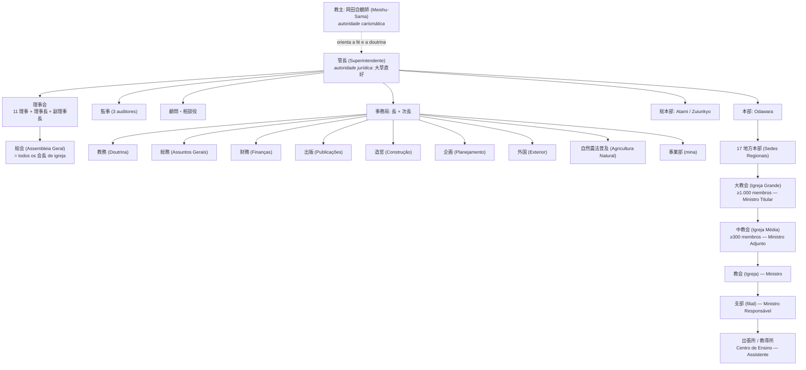
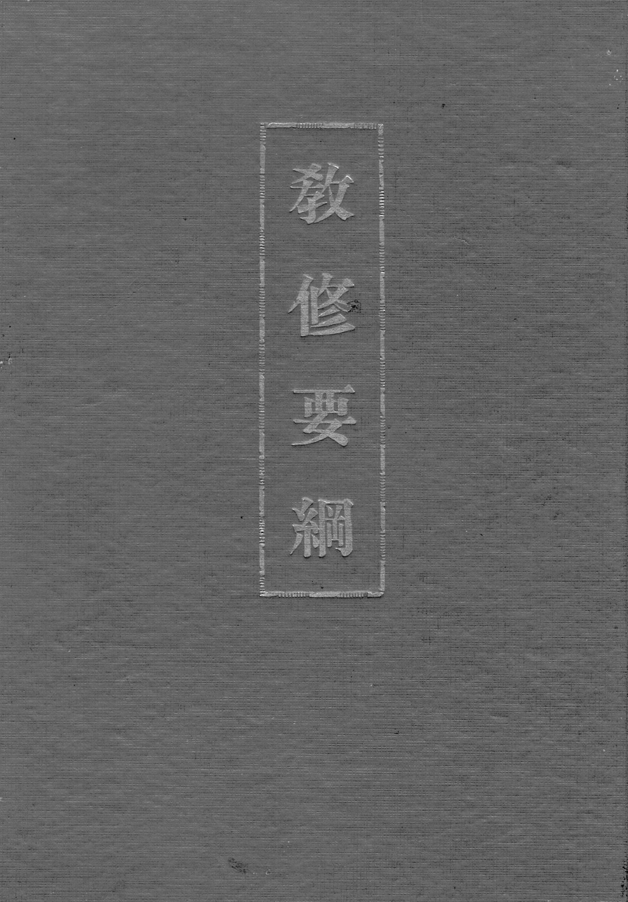

# A difusão na época de Meishu-Sama — Parte I: unidades, formação e hierarquia

**Data:** 2026-10-02 (revisão em prosa)
**Complementa:** `DOSSIE_PARTE_II_CULTO_E_VIDA_20261002.md`
**Corpus:** acervo textual rattail (`/var/www/rattail/`), exclusivamente.
**Convenção de citação:** `『veículo』nº, data · caminho`

---

## Nota de método

Este documento responde a uma pergunta única: como funcionava a difusão religiosa na
época de Meishu-Sama, sobretudo no período de liberdade religiosa que se abre em 1945.
Para respondê-la foi necessário reconstruir, a partir dos documentos, três coisas que
os manuais de história religiosa costumam tratar separadamente — os **tipos de unidade**
que a organização criou, a **formação** que credenciava as pessoas a abri-las, e a
**hierarquia** que as ligava entre si.

O corpus é o acervo textual rattail, com 18.829 páginas digitalizadas de periódicos,
boletins internos, regulamentos e relatos de fiéis. É um corpus desigual: os documentos
institucionais são poucos e preciosos — o censo oficial de 1950, o regulamento da pessoa
jurídica de 1951, as atas das mesas-redondas de dirigentes —, enquanto os relatos de
fiéis são abundantes e, por natureza, parciais. Sempre que possível, uma afirmação
estrutural está ancorada em documento institucional; as falas de Meishu-Sama servem
para explicar a **doutrina** que orientava a estrutura, não para provar números.

Todas as referências foram convertidas para o acervo rattail. A conversão usou três
vias, em ordem de confiabilidade: localização **por conteúdo** (o trecho japonês citado
é procurado no próprio acervo, o que é exato); **mapa cronológico** entre a data da
palestra e o arquivo correspondente; e **data de publicação** da página. Foram
convertidas 59 de 59 referências, sem resíduo.

Uma convenção sobre datas: quando o documento de origem declara apenas mês e ano de
publicação, este texto também declara apenas mês e ano — não se inventou dia.

---

## 1. A cronologia da institucionalização (1934–1955)

A história institucional do movimento começa em outubro de 1934, quando Meishu-Sama
inicia o que chama de **movimento Kannon** sob o nome de **大日本観音会** (Dai-Nippon Kannon-kai, Associação Kannon do Grande Japão), a partir do 応神堂 (Ōjin-dō). O que ele próprio dirá depois sobre esse começo é revelador do modo como
entendia a relação entre carisma e instituição:

> 「顧みれば昭和九年一〇月私は大日本観音会なる名称のもとに、観音運動を始め、その
> 目的は病貧争絶無の世界をつくるというにある。しかるにそのころの当局の方針としては、
> 類似宗教を無差別的に弾圧の方針であったから、当大日本観音会もそれに漏れず、徹底的の
> 弾圧をされたのである。従って、爾来ぜんぜん宗教から離れ、治療専門によって発展しつつ
> 今日に至った」

*"Rememorando: em outubro do nono ano de Shōwa (1934), sob o nome de Dai-Nippon
Kannon-kai, iniciei o movimento Kannon, cujo propósito é criar um mundo sem doença,
pobreza e conflito. Sucede que a orientação das autoridades da época era a de reprimir
indiscriminadamente as religiões análogas; por isso a Dai-Nippon Kannon-kai não escapou
e sofreu repressão radical. Desde então, afastado por completo da religião, cheguei até
hoje desenvolvendo-me exclusivamente como terapeuta."*
— Discurso na fundação da 日本観音教団 (Igreja Kannon do Japão), `novembro de 1947 · search1/kouwa/s221199.html`

![大日本観音会の仮発会式, 23 de dezembro de 1934, no 応神堂 — a cerimônia que antecede em nove dias a fundação oficial de 1º de janeiro de 1935. [Fotografia da época; data e local conforme a legenda original.]](fotografias/karihakkai_1934.jpg)

Três meses depois vem a fundação oficial, em 1º de janeiro de 1935, em Kōjimachi
Hanzōmon, num 分所 (subsede) do Oomoto que ele utilizava (`search1/ko/kojimach.html`). A década
seguinte é a da repressão: em novembro de 1941 encerra-se a atividade religiosa e o
movimento passa formalmente à terapia, com a proibição da cura "sem tocar"
(`search1/taidan/taidan39.html`). É essa passagem pela medicina não-oficial que explica
um traço persistente de toda a estrutura posterior — o **Johrei como porta de entrada**,
e não a doutrina.

A reorganização pós-guerra é rápida e se faz por camadas. Em 1946 constitui-se a
**日本浄化療法普及会** (Nihon Jōka Ryōhō Fukyū-kai), associação civil com estatuto próprio
(`search1/ni/nihon12.html`). Em 1º de julho de 1947 aparece o **日本観音教団講習要項**,
primeiro currículo de formação do movimento (`search1/ni/nihon07.html`). Em agosto de
1947 vem a personalidade jurídica religiosa:

> 「それから間もなく終戦となり、信教の自由ともなったので、二十二年八月法人となり、
> 漸く大腕振って歩けるようになったのである。」

*"Pouco depois veio o fim da guerra e, com a liberdade de crença, em agosto do vigésimo
segundo ano [1947] obtivemos a personalidade jurídica e finalmente pudemos andar de
cabeça erguida."*
— 「私とサタンとの闘争史」, `search1/wa/watasi05.html`

Em 11 de novembro de 1947 celebra-se a cerimônia de fundação da **日本観音教団** (Nihon Kannon Kyōdan)
(`search1/kouwa/s221199.html`). No ano seguinte há a cisão interna que leva à
denominação **五六七教会**, em 1º de novembro de 1948
(`search1/kouwa/s231101.html`), seguida em 1º de dezembro pela criação da sede em
Odawara, com Tóquio (Kaminoge) passando a sede regional de Kantō
(`search2/sanko/ren01.html`). Em 8 de dezembro de 1948, Meishu-Sama enuncia a
**primeira grade organizacional completa** — documento que veremos em detalhe no
capítulo 19, porque é o mais explícito de todo o corpus sobre como se subia na estrutura.

O auge institucional do período vem depois. Em 8 de março de 1949 sai o primeiro número
do jornal **『光』**, com cem mil fiéis declarados (`search1/ho/honkyo20.html`). Em
fevereiro de 1950 a instituição (教団) passa por **発展的解消** e renasce como
**世界救世教会** (Igreja Messiânica Mundial) (`search1/ka/kantou13.html`). Em outubro de 1950 temos o
**censo oficial** que serve de base a todas as contas deste levantamento: 4 Igrejas
Grandes, 78 Igrejas Médias, 710 igrejas, com 56, 430 e 2.244 Ministros respectivamente
(`search1/mo/mondai.html`).

1951 é o ano da grande reforma. Em 5 de fevereiro Meishu-Sama ordena a reestruturação
que extingue as quatro Igrejas Grandes existentes e cria dezessete Sedes Regionais,
conforme o comunicado do Superintendente Ōkusa Naoyoshi (`search2/sanko/kikoseib.html`).
Em 10 de outubro publica-se o **Regulamento da pessoa jurídica religiosa「世界救世教」**,
o documento legal mais completo do período, cujos capítulos sobre administração e
finanças serão examinados no capítulo 23 (`search2/sanko/kisoku.html`).

Os últimos anos são de obras e de tensão. Em 16 de dezembro de 1953 realiza-se a
cerimônia de fundação do Templo Messiânico, no Zuiunkyo (`search1/ne/nento03.html`).
Em 15 de junho de 1954, a cerimônia provisória do advento de Messias, no Messias
Kaidō — ocasião em que o Superintendente Ōkusa comunicou aos fiéis que, a partir
daquele culto, passariam a tratá-lo por **Messias-Sama** (`search2/kikou/mesiya1.html`,
『栄光』263号, 30 de junho de 1954). Em outubro sai a terceira edição do **教修要綱**,
o manual de formação. Em 11 de dezembro de 1954, a entronização no Palácio de Cristal
(水晶殿御遷座), quando Meishu-Sama anuncia que "o Trabalho Divino finalmente entrou no
eixo principal" (`search1/me/meisyu2.html`, 『栄光』289号, 1º de janeiro de 1955). Em
fevereiro de 1955, sua morte (`search2/kikou2/kanto68.html`, 『地上天国』68号, 15 de
março de 1955).

| Data | Fato | Fonte |
|---|---|---|
| 1934-10 | Movimento Kannon inicia como **大日本観音会** | `novembro de 1947 · search1/kouwa/s221199.html` |
| 1935-01-01 | Fundação oficial em Kōjimachi Hanzōmon | `search1/ko/kojimach.html` |
| 1941-11 | Encerramento da atividade religiosa; passagem à terapia | `search1/taidan/taidan39.html` |
| 1946 | **日本浄化療法普及会** — associação civil | `search1/ni/nihon12.html` |
| 1947-07-01 | **日本観音教団講習要項** — primeiro currículo | `search1/ni/nihon07.html` |
| 1947-08 | Personalidade jurídica religiosa | `search1/wa/watasi05.html` |
| 1947-11-11 | **日本観音教団** — cerimônia de fundação | `novembro de 1947 · search1/kouwa/s221199.html` |
| 1948-11-01 | **五六七教会** — cisão interna | `1 de novembro de 1948 · search1/kouwa/s231101.html` |
| 1948-12-01 | Sede em Odawara; Tóquio passa a sede regional | `search2/sanko/ren01.html` |
| 1948-12-08 | **Primeira grade organizacional completa** (v. capítulo 19) | `『御光話録』2号, 8 de janeiro de 1949 · search1/situmon/m231208.html` |
| 1949-03-08 | Primeiro número do jornal **『光』** | `search1/ho/honkyo20.html` |
| 1950-02 | **世界救世教会** — 発展的解消 da 教団 | `search1/ka/kantou13.html` |
| 1950-10 | **Censo oficial** (v. §5.4) | `search1/mo/mondai.html` |
| 1951-02-05 | **Reforma**; nasce a **世界救世教** (Kyūseikyō) | `search2/sanko/kikoseib.html` |
| 1951-10-10 | **Regulamento da pessoa jurídica** | `search2/sanko/kisoku.html` |
| 1953-12-16 | Fundação do Templo Messiânico (Zuiunkyo) | `search1/ne/nento03.html` |
| 1954-06-15 | Cerimônia provisória do advento de Messias | `search2/kikou/mesiya1.html` |
| 1954-10 | 3ª edição do **教修要綱** | `pdf_rattail/kyoshu_yoko.pdf` |
| 1954-12-11 | Entronização no Palácio de Cristal (水晶殿御遷座) | `search1/me/meisyu2.html` |
| 1955-02 | Falecimento de Meishu-Sama | `search2/kikou2/kanto68.html` |

Vale sublinhar o que essa cronologia revela sobre o ritmo da instituição. Entre 1947 e
1951, ou seja, em quatro anos, o movimento obtém personalidade jurídica, funda uma
denominação, cinde-se, renomeia-se duas vezes, produz um censo, reforma-se por decreto
e promulga um regulamento. Não se trata de crescimento orgânico, mas de **reorganização
por decisão**, em que cada crise produz imediatamente uma nova forma institucional. O
período áureo de produção documental acompanha esse movimento: no acervo, 1948 tem 64
textos, 1949 salta para 348, 1950 tem 158, 1951 tem 172, 1952 chega a 203, e depois
declina — 134 em 1953 e 42 em 1954. O pico de 1949 corresponde ao ciclo 五六七教会; o
de 1952, ao programa de construção dos Paraísos Terrestres.

---

## 2. A difusão pós-guerra: método, instrumentos e escala

### 2.1 A sequência obrigatória

O documento mais importante de todo o corpus para esta pergunta não é um regulamento:
é uma resposta de Meishu-Sama a uma pergunta sobre como abrir um novo Centro de Ensino.
Nela ele enuncia uma **sequência de aproximação** e a justifica por analogia com o
crescimento natural:

> 「例えば新しく教導所を開く場合、最初はできるだけ小さくする。人間が赤ん坊から育ち
> 一人前になるごとく、また草木の種子がだんだん二葉から大きく育つ。それなら根が張り
> 枯れたりなどしない。これが大自然の実相だ。**私などこの仕事は六畳一間から始めた。**
> 信仰も最初は種蒔きであるから**話すだけにしておく**。それが育つに従い先方が耳を
> 傾ける程度になったら**雑誌新聞を見せる**。そのうちに**教修を受けたくなり教修を
> 受けさす**。そのうち病気が治ったりなどして**光明如来様〔を〕お祭りする**。
> このようなやり方で入ったのは信仰に動揺がない。急いで入信したのはいわゆる根が
> 固まっていないから動きやすい。」

*"Ao se abrir um novo Centro de Ensino, começa-se pelo menor tamanho possível. Como o
ser humano, que cresce de bebê até se tornar adulto, e como a semente de uma planta, que
aos poucos se desenvolve da primeira folha em diante. Assim a raiz se firma e não seca.
Esta é a realidade concreta da grande natureza. Eu, por exemplo, comecei este trabalho
num único cômodo de seis tatames. A fé também é, no início, semeadura, e por isso basta
conversar. Conforme ela cresce, quando a outra pessoa chega ao ponto de dar ouvidos,
mostram-se as revistas e os jornais. Em seguida ela passa a querer fazer o Kyoshu, e então
se permite que o faça. Depois, com a cura da doença e outros fatos, passa-se a entronizar
a Komyo-Nyorai. Quem entra por esse caminho não oscila na fé. Quem se converte
apressadamente não tem raízes firmes e por isso se move com facilidade."*
— 『地上天国』9号, 25 de outubro de 1949 · `search1/situmon/situmo11.html`

A sequência é, portanto: **conversa → material impresso → Kyoshu → cura → entronização
da Imagem**. A cura não é a porta de entrada, é o que **confirma** a entrada — e a
entronização vem depois dela, não antes.

Dessa sequência decorrem quatro regras operacionais, todas formuladas por Meishu-Sama
em resposta a casos concretos.

A primeira proíbe o proselitismo baseado na gratidão. A pergunta era se se podia pedir
a quem foi curado que trouxesse novos:

> 「【質問者】御利益で治った方に新しい人を紹介するようにと話すことはいかがでしょうか。
> 【明主様】そんなこと言っちゃいけませんよ、安ッぽくなってしまう。そんな気があるのは
> まだ信仰が本当の線に入ってないんです。**決して無理にすすめたり、押し売りしたり
> しちゃいけません。**」

*"[Pergunta] Falar à pessoa que foi curada do benefício material, para que apresente
alguém novo, seria adequado? [Meishu-Sama] Não se deve dizer tal coisa; torna-se barato.
Quem tem esse tipo de intenção ainda não entrou na linha verdadeira da fé. Nunca se deve
recomendar à força nem fazer venda forçada."*
— 『御光話録』15号, 20 de dezembro de 1949 · `search1/situmon/m2409.html`

A segunda atribui o crescimento à proteção divina, e não à técnica de captação. É uma
frase que inverte a lógica de qualquer manual de expansão:

> 「発展しないのは、人間が見ていいようでも神様に対してピッタリしない点があるんです。
> ピッタリしてれば、**神様がこの人ならという教導師の所へ信者を持って来てくれる**んです。」

*"A razão de não se desenvolver é que, mesmo que aos olhos humanos pareça bom, há um
ponto que não se ajusta a Deus. Se estivesse ajustado, Deus traria os fiéis ao Ministro
Responsável que Ele escolhesse."*
— idem

A terceira recusa criar conflito com a religião anterior do candidato — o que, num
ambiente de disputa denominacional como o do Japão do pós-guerra, é uma escolha
deliberada:

> 「【質問者】他宗教に熱心なもの、または他宗教に入らんとしている者は、それが白紙に
> なるまでは御教修を受けさせぬほうがよろしいでしょうか。
> 【明主様】他宗教を丸っきりはなれてからこの道に入る……というようにはっきりしたもの
> でもない。両方信じているうちにこっちへ傾くこともありますから**決めないほうが
> いいですね。**」

*"— [Pergunta] Quem é fervoroso em outra religião, ou está para entrar em outra, é melhor
não deixá-lo receber o Kyoshu até que isso se esclareça? — [Meishu-Sama] Não é uma coisa
assim tão definida, de romper por completo com a outra religião e então entrar neste
Caminho… Como pode acontecer de, acreditando nas duas, a pessoa se inclinar para cá, **é
melhor não decidir.**"*

— 『御光話録』2号, 8 de janeiro de 1949 · `search1/situmon/m231218.html`

A quarta é a mais dura, e tem razão pastoral explícita: **não se converte quem está à
beira da morte**, para que a morte não seja atribuída à fé.

> 「本当は病気が治ってから入信するのが本当で、病気が治ってありがたく、やむにやまれぬ
> 気持ちで入信するのが本当である。例えばもし治らないうちに入信して死ぬ場合がある。
> 入信してから死ぬなんてあんな信仰は駄目だということになる。すると怨まれる。
> 特に肺病などはよけいにそうで……**生命にかかわるのは治ってから入信すべきである。**」

*"Na verdade, o correto é converter-se depois de a doença sarar; converter-se com
gratidão pela cura, num sentimento irreprimível. Porque pode haver casos em que,
convertido sem sarar, a pessoa morra. E então passa a correr a ideia de que 'uma fé em que
se morre logo após a conversão não presta'. Isso gera ressentimento. Especialmente a
tuberculose, mais ainda… Nos casos com risco de vida, deve-se converter depois da cura."*
— 『地上天国』9号, 25 de outubro de 1949 · `search1/situmon/situmo11.html`

### 2.2 Os instrumentos

Quatro instrumentos aparecem documentados como motores da difusão.

**O jornal.** A sequência de títulos é 『光』 (de março de 1949) → 『救世』 → 『栄光』 →
『神の光』 (de 1955), e Meishu-Sama lia essa rotatividade como sinal de orientação
superior, não como problema de marketing:

> 「新聞も、最初『光』それから『救世』それから『栄光』と、こんなに題名が変わるのなんか
> 他にありませんよ。神様がされるんだから、しようがない。」

*"Jornal também: primeiro Hikari, depois Kyūsei, depois Eikō — não há outro caso de
título que mude tanto. É Deus quem faz, não há como evitar."*
— 『御垂示録』3号, 25 de novembro de 1951 · `search1/situmon/m261005a.html`

A função do jornal como motor da unidade está declarada na primeira página do primeiro
『光』, e é explícita quanto ao método: quem se desenvolve é quem distribui.

> 「本教の唯一の宣伝機関として、光新聞を発行している……**発展する教導所は常に光新聞の
> 頒布に力を注いでいることである**、もちろんこういう支部は、宣伝用として無料で、
> 出来るだけ配布するのである」

*"Como único órgão de propaganda desta religião, publicamos o jornal Hikari… os Centros
de Ensino que se desenvolvem são sempre aqueles que se empenham na distribuição do jornal
Hikari. Naturalmente, essas filiais distribuem gratuitamente o máximo possível, para fins
de divulgação."*
— 「光新聞の拡大は教線の強化」『光』33号, 29 de outubro de 1949 · `search1/hi/hikari03.html`

**A palestra pública de massa.** A conferência no Hibiya Kōkaidō impressiona o cronista
não pela lotação, mas pela composição do público — mais de sessenta por cento de não
convertidos:

> 「宗教講演会として日比谷公会堂に超満員の聴衆をあつめ、しかも**その六割以上が
> 未人信者**であったと言う盛況ぶりは、恐らく未曾有のことと思います。」

*"O fato de uma conferência religiosa ter reunido lotação esgotada de público no Hibiya
Kōkaidō, e ainda por cima mais de sessenta por cento serem pessoas não convertidas, é um
sucesso de público provavelmente sem precedentes."*
— 「編集後記（地上天国36号）」 (Nota da Redação, 『地上天国』36号), `search2/kikou2/koki36.html`

![Conferência no 日比谷公会堂 (Hibiya Kōkaidō) sobre a civilização verdadeira, 22 de maio de 1951 — a palestra pública de massa de que trata esta seção. [Fotografia da época; data e local conforme a legenda original.]](fotografias/hibiya_1951.jpg)

**A missão externa.** O Havaí, a partir de fevereiro de 1953, foi obra de duas pessoas
destacadas da liderança interna — a Ministra Higuchi Kiyoko e o Ministro Assistente
Ajiki Haruhiko —, não de um seminário missionário:

> 「昨年二月十一日世界メシヤ教海外布教のため、**樋口喜代子教師が助教師安食晴彦氏を
> 帯同して来布され**」

*"Em 11 de fevereiro do ano passado [1953], para a difusão ultramarina da Igreja Mundial
Messiânica, a Ministra Higuchi Kiyoko veio ao Havaí acompanhada do Ministro Assistente
Ajiki Haruhiko."*
— 「ハワイ通信」『栄光』264号, 7 de julho de 1954 · `search2/kikou2/hawai20.html`

**A publicação em massa.** Aqui a difusão agrícola e a difusão religiosa se confundem
propositalmente. Meishu-Sama anuncia, no Culto de Outono de 1951, um plano de distribuição
por via institucional — cooperativas, estações experimentais, prefeituras:

> 「その成績を土台にして、ひとつの本を作って、これを**日本中の農会とか農事試験場とか、
> 村なら村長と、あらゆる方面に全部配ろうと思う**。それから、**各地に講演会、座談会を
> 開いて大いに知らせようと思う。**」

*"Tomando esses resultados como base, farei um livro e o distribuírei integralmente a
todos os setores: às cooperativas agrícolas de todo o Japão, às estações experimentais, e,
nos vilarejos, aos prefeitos. Além disso, abrirei palestras e mesas-redondas em cada região
para divulgar amplamente."*
— Culto Especial de Outono, 25 de setembro de 1951 · `search1/kouwa/s260925.html`

E a confirmação operacional, na voz de quem distribuiu a edição especial de agricultura
natural — note-se que a expectativa inicial era de "cerca de um milhão", e que a
reimpressão foi decidida **depois** de o número ser insuficiente:

> 「いよいよ印刷にかかる時には、**この分なら百万位は大丈夫だと思えるようになった**のです。
> ……出してみますと**百万で足りずに、増刷したほどでした。**」

*"Quando finalmente se foi imprimir, chegou-se a pensar: 'neste ritmo, cerca de um milhão
deve dar'. … Mas, ao sair, um milhão não bastou — chegou-se a reimprimir."*
— 「本部事務所奉仕者座談会」『地上天国』69号, 15 de abril de 1955 · `search2/kikou2/honbujim.html`

### 2.3 A escala, e o que ela significa

O censo de outubro de 1950 é o único documento que traz números completos em todas as
categorias simultaneamente, e por isso sustenta as contas deste levantamento:

| Categoria | Quantidade |
|---|---:|
| 大教会 (Igrejas Grandes) | **4** |
| 中教会 (Igrejas Médias) | **78** |
| 分教会 (igrejas) | **710** |
| 大教師 (Ministros Titulares) | **56** |
| 中教師 (Ministros Adjuntos) | **430** |
| 教師 (Ministros) | **2.244** |
| 別院 (Templos Anexos) | 6 |
| 分院 (Filiais Regionais) | 7 |

Fonte: `search1/mo/mondai.html`

Duas leituras importam. A primeira é a **simetria**: as três categorias de igreja e as
três de Ministro formam pares, e a razão entre elas é aproximadamente constante — para
cada Igreja Grande, quatorze Ministros Titulares; para cada Igreja Média, cerca de cinco
Ministros Adjuntos; para cada igreja, aproximadamente três Ministros. **O grau
não é uma carreira paralela à estrutura: ele acompanha a unidade que a pessoa dirige.**
Isso será decisivo no capítulo 14.

A segunda leitura é uma cautela de método, e convém enunciá-la com precisão. Os números
de **fiéis** — cem mil em março de 1949, "mais de mil" no Havaí em um ano — aparecem em
textos de divulgação e de defesa institucional, não em peça de levantamento. O censo de
unidades e de Ministros, ao contrário, é documento administrativo: tem data, categoria e
contagem fechada. As duas coisas não são da mesma natureza, e este levantamento as trata
de modo distinto — o censo sustenta as contas estruturais; os totais de fiéis registram-se
como **declaração da instituição**, que é o que de fato são no acervo. Não se trata de pôr
em dúvida a informação, e sim de não lhe atribuir uma natureza documental que ela não tem.

---

## 3. Os tipos de unidade e suas atribuições

### 3.1 A grade de 1948

O documento mais explícito sobre como a organização se pensava é uma resposta de
Meishu-Sama de 8 de dezembro de 1948, na qual ele estabelece critérios quantitativos
de ascensão e um critério **territorial** de vinculação — este último em reação direta
ao personalismo que ameaçava a coesão:

> 「【質問者】礼節と順序を重んずることがこのお道の精神と存じますが、会員や資格者が
> 簡単にその所属を変えることはいかがいたすべきでしょうか。
> 【明主様】所属のことは今度はっきりしますが、あの先生は気に入ったからつくとか、
> あの先生は気に入らないから離れるとかいうことはたいへんな間違いで、神様から見れば
> 怪しからぬ事です。私はいままでそういうことを言ってくる人には黙って許していましたが
> ……で、**今度は地域的に所属をきめることにしました。これは本部と三カ所の分所があり、
> 分所に分会が所属し、分会には支部が所属するのです。支部長は教導師であり、教導師は
> 信者を一〇〇人以上作った人か、三万円以上献金した人か、または支部長の推薦によること
> とし、教導所を一〇以上有するものを分会とし、分会一〇以上を分所とすることにしました。**
> やはり功労のある人が上に行くのが本当ですから。」

*"[Meishu-Sama] A questão da vinculação ficará clara desta vez. Aquilo de aderir a um
mestre porque se gostou dele, ou dele se afastar porque não gostou, é um enorme erro e,
aos olhos de Deus, algo inadmissível. Até agora, eu silenciosamente permitia isso a quem
me vinha falar… Assim, desta vez decidi determinar a vinculação por região. Há a Sede e
três Subsedes; às Subsedes pertencem as Associações, e às Associações pertencem as filiais.
O líder de filial é um Ministro Responsável de Unidade Religiosa, e o Ministro Responsável
será alguém que tenha conduzido cem ou mais fiéis, ou que tenha ofertado trinta mil ienes
ou mais, ou por recomendação do líder de filial. Aquilo que tiver dez ou mais Centros de
Ensino será considerado uma Associação, e o que tiver dez ou mais Associações será
considerado uma Subsede. Afinal, é justo que aqueles com méritos estejam no topo."*
— 『御光話録』2号, 8 de janeiro de 1949 · `search1/situmon/m231208.html`

Três critérios de ascensão aparecem aqui, e nenhum deles é acadêmico: **número de
pessoas conduzidas** (cem ou mais), **valor ofertado** (trinta mil ienes ou mais), ou
**recomendação do superior imediato**. Não há prova, não há tempo mínimo de casa, não
há formação escolar exigida. A justificativa é explícita — "é justo que aqueles com
méritos estejam no topo" —, e a palavra usada é **功労** (mérito-serviço), mérito-serviço.

A escala de unidades fica assim: Sede (本部) › Subsede (分所) › Associação (分会) ›
filial (支部) › Centro de Ensino (教導所).

Lida com cuidado, porém, a frase não descreve três degraus de agregação, e sim
**quatro**, e a diferença importa para não se ler a grade como uma escada de
pessoas. A célula é o **Centro de Ensino (教導所)**. Os Centros de Ensino
reunidos sob um mesmo Ministro Responsável formam a **filial (支部)** — que não é
contada, é o agrupamento natural de centros sob um ministro. A **Associação
(分会)** é a unidade que *possui dez ou mais Centros de Ensino*; a ela pertencem
as filiais, como o próprio texto diz. A **Subsede (分所)** reúne dez ou mais
Associações. Acima de todas, a Sede (本部).

Duas consequências se seguem, e as duas corrigem leituras correntes. A primeira:
**a Associação compõe-se de filiais, e não de centros avulsos** — o fator dez
conta Centros de Ensino, mas a vinculação administrativa passa pela filial, que é
o nível a que o fiel pertence e a que o Ministro Responsável dirige. A segunda: a
grade é **territorial desde 1948**, e não apenas a partir da reforma de 1951; o
que 1951 muda é a *base* do território (a região, em lugar da rede de centros) e
a extinção das quatro Igrejas Grandes, não a natureza territorial da vinculação.

### 3.2 A reforma de 1951

Em 5 de fevereiro de 1951 Meishu-Sama substitui essa grade por uma outra, de base
territorial e com pisos numéricos. O documento é um comunicado do Superintendente
Ōkusa Naoyoshi, e vale reproduzir seus pontos principais porque neles se vê a lógica
administrativa em ato:

> 「一、熱海市桃山、晴々台の地上天国に世界救世教の総本部を置き……救世会館の建設を
> 図ること。
> 二、小田原市緑町（五六七大教会本部）に世界教世教本部を置き……教団本部としての
> 形態を具備すること。
> 三、**従来の四大教会は発展的解消を遂げ**、……**全国を左の如き十数箇所の地方別に
> 区分して地方本部を置くこと。**
> 四、**地方本部には、三段階の大教会、中教会、教会の組織を設くること。大教会の組織には
> 協力会員差当り千人以上、中教会には同三百人以上を要すること。**
> 五、……**布教費の節減その他布教の合理化**を図ること。」

*"1. Estabelecer a Sede Central no Paraíso Terrestre de Momoyama, Seijōdai, em Atami…
2. Estabelecer a Sede em Midorichō, Odawara… 3. As quatro Igrejas Grandes até aqui
existentes passam por dissolução-e-desenvolvimento; dividir o país em cerca de uma dúzia
de regiões e estabelecer Sedes Regionais. 4. Nas Sedes Regionais, criar a organização em
três graus: Igreja Grande, Igreja Média e Igreja. A Igreja Grande requer mil ou mais
membros cooperadores; a Igreja Média, trezentos ou mais. 5. …visando à redução de custos
de difusão e à racionalização da difusão."*
— 「世界救世教の機構整備について」『栄光』94号, 7 de março de 1951 ·
`search2/sanko/kikoseib.html`

Note-se o item quinto: **a reorganização territorial tem motivação financeira declarada**.
Ao proibir que se difunda em várias Sedes Regionais ao mesmo tempo, Meishu-Sama não está
apenas racionalizando a supervisão — está cortando custo. É um dado que qualifica a
imagem de uma instituição indiferente a dinheiro, e que se articula com o que veremos
sobre as finanças na seção 6.

As dezessete Sedes Regionais foram criadas com nome e jurisdição: Hokkaido Leste e
Oeste, Tōhoku, Ōu, Kantō Leste e Oeste, Shinetsu, Chūkyō, Hokuriku, Kinki, Kansai,
San'in, San'yō, Shikoku, Kyūshū Leste e Oeste.

### 3.3 As quatro Igrejas Grandes dissolvidas

Antes de 1951 existiam quatro Igrejas Grandes: **天国大教会, 大成大教会, 光宝大教会 e
五六七大教会**. Além de unidades de difusão, elas tinham uma função ritual coletiva —
alternavam-se na presidência dos cultos sazonais, num rodízio que durou vários dias:

> 「祭典は二十一、二日天国大教会、二十三日大成大教会、二十四日光宝大教会、大成大教会、
> 二十五、六、七日五六七大教会の順で七日間にわたり」

*"Os cultos se estenderam por sete dias na seguinte ordem: dias 21 e 22, Igreja Grande
Tengoku; dia 23, Igreja Grande Taisei; dia 24, Igreja Grande Nikkōbō e Igreja Grande
Taisei; dias 25, 26 e 27, Igreja Grande 五六七."*
— 「世界救世教秋季大祭に参拝して」『地上天国』17号, 15 de outubro de 1950 ·
`search2/kikou2/sekai03.html`

Essa nota é preciosa porque documenta uma forma organizativa que os regulamentos não
registram: **a celebração como responsabilidade compartilhada e rotativa**, e não
centralizada na Sede.

### 3.4 Tipologia completa

| Japonês | Português | Definição | Evidência |
|---|---|---|---|
| 総本部 | **Sede Central** | Centro mundial; Zuiunkyo (Atami) | `search2/sanko/kikoseib.html` |
| 本部 | **Sede** | Centro administrativo; Odawara | idem |
| 別院 | **Templo Anexo** | Sede de segunda ordem, com 本殿 próprio e pessoal residente; 6 em 1950 | `search1/mo/mondai.html` |
| 地方本部 | **Sede Regional** | 17 criadas em 1951, por província | `search2/sanko/kikoseib.html` |
| 大教会 | **Igreja Grande** | ≥1.000 membros (1951); antes, uma das 4 | idem |
| 中教会 | **Igreja Média** | ≥300 membros | idem |
| 教会 / 分教会 | **Igreja** | Unidade com 会長 nomeada | 規則 arts. 26–28 |
| 分院 | **Filial Regional** | Subdivisão territorial; 7 em 1950 | `search1/mo/mondai.html` |
| 分会 | **Associação** | ≥10 Centros de Ensino (1948) | `『御光話録』2号, 8 de janeiro de 1949 · search1/situmon/m231208.html` |
| 支部 | **filial** | Chefiada por um Ministro Responsável | idem |
| 出張所 | **posto avançado** | Menor que a filial; criado por deslocamento de um Ministro | `search1/a/asudeha.html` |
| 教導所 | **Centro de Ensino** | Unidade mínima: casa ou sala de atendimento | `『御光話録』2号, 8 de janeiro de 1949 · search1/situmon/m231208.html` |
| 浄霊所 | **Centro de Johrei** | "a igreja" de facto de uma família | `search2/okage/dokusya/meian01.html` |
| 教修会場 | **local do Kyoshu** | Casa ou salão cedido para o curso | `『御教え集』7号, 20 de março de 1952 · search1/kouwa/s270205.html` |

Os seis Templos Anexos, com endereços completos, conforme o censo de 1950
(`search1/mo/mondai.html`): 箱根別院 (Kanagawa, Miyagino), 小田原別院 (Kanagawa,
Odawara), 熱海別院 (Shizuoka, Izusan), 東京別院 (Tóquio, Setagaya, Tamagawa
Kaminoge), 京都別院 (Quioto, Sakyo, Yoshida Kaguraoka) e 大阪別院 (Osaka, Sennan,
Takaishi).

Vale observar a expressão **浄霊所** — "Centro de Johrei". Ela aparece num relato de
1951 e descreve a unidade de base sem qualquer mediação institucional: uma família que
passou a praticar Johrei em casa, atraiu vizinhos, e "chegou ao ponto de construir uma
nova igreja, isto é, um Centro de Johrei". É o degrau zero da estrutura, e nem consta
do censo.

### 3.5 Atribuições por unidade

| Função | Unidade | Fonte |
|---|---|---|
| **Johrei** (cura) | todas, do Centro de Ensino para cima | toda a coleção |
| Celebrar **Culto Mensal** / **Culto Regular** em data fixa | filial, posto avançado, Igreja | `『御光話録』12号, 21 de setembro de 1949 · search1/situmon/m240613.html` |
| Ministrar o **Kyoshu** | filial, Igreja, local do Kyoshu | `search1/ni/nihon07.html` |
| Formar novos portadores de qualificação | Igreja / Igreja Média | `search1/ke/kenkin.html` |
| Distribuir o jornal | Centro de Ensino, filial | `search1/hi/hikari03.html` |
| Sediar **mesas-redondas** periódicas | Igreja Média, Igreja Grande | `search2/sanko/teirei1.html` e ss. |
| Abrigar doentes em purificação | Sede da Igreja Média | `『御教え集』1号, 20 de setembro de 1951 · search1/situmon/m260828.html` |
| Sediar **御面会** (audiências) | Sede (Atami, Hakone, Odawara) | §8.1 |
| Presidir os ritos sazonais em rodízio | Igreja Grande | `search2/kikou2/sekai03.html` |
| Administração e finanças próprias, com os atos sujeitos a **aprovação prévia** da Sede | Igreja | 規則 arts. 26–30 |

Uma restrição operacional merece registro, porque mostra como a estrutura era pensada
a partir da capacidade real de uma pessoa. Perguntado sobre quem preside os cultos das
filiais, Meishu-Sama chega a um limite por dedução simples:

> 「【質問者】支部は支部長が主催すべきものと思います。もし支部が三〇ヵ所
> 以上になったら、一日一ヵ所としても、会長さんは一月中にまわりきれなくなります。
> 【明主様】そうだな……**三〇ヵ所以上になってはいけない理屈になるからな。**
> ……**原則としては中教会を一番先にするわけです。**」

*"[Pergunta] Creio que a filial deve ser presidida pelo líder da filial. Se a filial
tiver trinta ou mais locais, mesmo um por dia, o presidente não conseguirá percorrer todos
em um mês. [Meishu-Sama] É mesmo… Isso leva à conclusão de que não pode haver trinta ou
mais locais. …Em princípio, a Igreja Média é que vem primeiro."*
— 御講話 de 1º de março de 1954 · `『御垂示録』29号, 15 de março de 1954 · search1/situmon/m290301.html`

Daí um **limite superior prático de trinta filiais por Igreja Média** — não por estatuto,
mas por aritmética de calendário. A estrutura não era desenhada no papel: era deduzida
da capacidade física de supervisão.

![『御垂示録』29号, 15 de março de 1954, página 20 — a resposta de que se deduz o limite prático de trinta filiais por Igreja Média. [Página confirmada por OCR do fac-símile.]](facsimiles/suiji29_limite_trinta.jpg)

---

## 4. Como se abria uma unidade

Cinco modos coexistiram, sem norma escrita que os ordenasse. Cada caso era decidido
pontualmente, e o que o corpus documenta são os **casos**, não uma política.

### 4.1 A casa do próprio dirigente

É o modo inicial e predominante, e o próprio Meishu-Sama o exemplifica:
「私などこの仕事は**六畳一間から始めた。**」 — *"Eu, por exemplo, comecei este
trabalho num único cômodo de seis tatames."* (`search1/situmon/situmo11.html`).

O que o corpus torna visível, porém, é que a **casa do dirigente** e o **missionário
itinerante** geravam unidades de natureza diferente. Um dirigente descreve seu próprio
caso, contrastando-o com o de um colega mais estável:

> 「川越先生は**自宅で入信し、自宅を支部にした**。言わば恵まれた羨しい程の立場で御用を
> しておられる訳ですが**私の場合は家を出、一人で飛び歩きをした**ので、現在**支部の性質が
> その通りになってしまった**のです。そのために今月はどこで御参りをし、来月はどこと、
> **支部のお祭りすら一定のところでやって無かった**と言う状態です。」

*"O Sr. Kawagoe converteu-se em casa e fez da própria casa uma filial. Digamos que está
numa posição privilegiada e invejável para realizar o trabalho. No meu caso, saí de casa
e andei sozinho por toda parte; por isso a natureza da filial acabou se tornando exatamente
isso. Assim, este mês o culto é num lugar, no mês que vem noutro — nem o culto da filial
era realizado num lugar fixo."*
— 「支部の現状と発展の為に」, `search2/kikou2/shibuno1.html`

### 4.2 Imóvel alugado, cedido ou adaptado

A solução intermediária. Um fiel descreve a situação típica — e a instabilidade
inerente:

> 「【質問者】ただいま**お寺の一室を借り教導所といたしております**が、このたびそこを
> 出ねばなりませんので親類の家の土蔵を借りて御浄霊いたしたいと存じますが……」

*"[Pergunta] No momento estou alugando uma sala de um templo e usando-a como Centro de
Ensino; mas desta vez preciso sair de lá, e penso em alugar o depósito de barro da casa de
um parente para fazer Johrei…"*
— 『御光話録』10号, 10 de julho de 1949 · `search1/situmon/m240503.html`

Havia também o uso de hotéis para o Kyoshu quando o Centro de Ensino era pequeno.
**O hotel não é o que Meishu-Sama proíbe.** O que ele proíbe é o deslocamento da
Imagem da Luz Divina, e a distinção é a chave do trecho: alugar o salão para o curso é
lícito; entronizar nele, ainda que provisoriamente, a Imagem que não pode ser movida,
não é.

> 「――教修会のとき、教導所がせまいため旅館などを借ります場合、一時、大光明如来様を
> 旅館の床の間にお祀りして教修会を開いておりますが、これはよろしゅうございましょうか。
> これはいけませんね。間違ってますよ……もし御軸をなにするんだったら、光明如来様じゃ
> なくて、「光明」とか「真善美」とかいうのをかけたらいいでしょう。
> ――それは旅館のときだけでしょうか。
> いや、**旅館に限らず御神体を動かすときにはいけませんよ。御神体は一つの定めた場所へ
> おかけしたらやたらに動かさないことですね。**」

*"— Quando é o Kyoshu e, por o Centro de Ensino ser apertado, aluga-se um hotel etc.,
entronizamos provisoriamente o Daikōmyō Nyorai no tokonoma do hotel e realizamos o curso
— seria adequado?
— Isso não pode. Está errado… Se for para pendurar alguma coisa, que não seja a
Komyo-Nyorai, mas sim algo como «Luz» ou «Shinzenbi».
— É só no caso do hotel?
— Não; não apenas no hotel — é quando se move a Imagem da Luz Divina que não pode. Uma
vez colocada a Imagem da Luz Divina num lugar determinado, não se deve movê-la sem mais
nem menos."*
— 「質問応答 御光話」, `search1/situmon/m2411.html`

A regra é notável porque cria um problema prático em nome de um princípio: o curso pode
ser itinerante, **a Imagem não**. É a Imagem da Luz Divina que fixa o lugar.

Há ainda o caso do imóvel próprio abandonado e readaptado — 「そこに古い壊れた家が
あったので、それを修繕して**そこに奉仕隊が泊まって作業をしています。**」 — *"Havia
ali uma casa velha e arruinada; reparando-a, a brigada de serviço se aloja ali e
trabalha."* (`search1/kouwa/s240523.html`).

E o aluguel como situação provisória. O acervo trata a passagem do provisório ao
próprio como um marco da obra — a primeira construção erguida do zero —, e as
descrições estão no capítulo 18.3. Não há, em contrapartida, fonte que registre em
primeira pessoa a superação do regime de aluguel pela Sede.

### 4.3 Construção própria

Aqui o regime jurídico de 1951 intervém com clareza, e o faz em três artigos que
estabelecem **autorização prévia obrigatória** em cascata — desde a constituição da
igreja até a reforma de um telhado:

> 「**第二十六條** 教会を設立しようとするとき、又は教会が左に掲げる行為をしようとする
> ときは、**管長の承認を受けなければならない**（一、宗教法人となること… 二、規則を
> 変更すること 三、合併又は解散をすること）
> **第二十七條** 教会は、左に掲げる行為をしようとするときは、管長の承認を受けなければ
> ならない……三、**主要な境内建物の新築、改築、増築、移築、除却**又ほ著しい模様替を
> すること
> **第二十八條** 教会の会長及びその代務者は、当該教会の規則で定めるところによって
> 選定された者を**管長が任命する**」

*"Art. 26 — Ao se pretender estabelecer uma igreja, ou ao se pretender praticar os atos
abaixo, deve-se obter a aprovação do Superintendente (1. tornar-se pessoa jurídica
religiosa…; 2. alterar o regulamento; 3. fundir-se ou dissolver-se). Art. 27 — A igreja,
ao pretender praticar os atos abaixo, deve obter a aprovação do Superintendente…; 3.
construir, reconstruir, ampliar, transferir ou demolir os principais edifícios do recinto,
ou realizar reforma substancial. Art. 28 — O presidente da igreja e seu substituto são
nomeados pelo Superintendente, dentre os selecionados conforme o regulamento da respectiva
igreja."*
— 宗教法人「世界救世教」規則『栄光』125号, 10 de outubro de 1951 · `search2/sanko/kisoku.html`

O desenho é coerente: a igreja local escolhe seu presidente **por suas próprias regras**,
mas quem **nomeia** é o Superintendente; e nenhuma decisão patrimonial de vulto se toma
sem sua aprovação. A autonomia da unidade é administrativa, não patrimonial.

O financiamento das construções vinha dos fiéis locais. Um relato de 1951 descreve a
trajetória completa, da penúria à igreja nova, e nomeia o sentimento que a motivava —
retribuição (*御報恩*):

> 「入信以来年と共に大きい御恵や奇蹟を賜わり、今では御報恩の気持で**近く浄霊所たる、
> 教会を新築するほどになった**そうで」

*"Desde a conversão, ano após ano recebeu grandes graças e milagres; e agora, num
sentimento de retribuição, chegou ao ponto de construir uma nova igreja, isto é, um Centro
de Johrei."*
— 「明暗の隔り」, `search2/okage/dokusya/meian01.html`

E um segundo, com a entronização da Imagem como ato de inauguração:

> 「更に、……緑豊にして、風匂やかな高所に、**木の香もすがしき教会を新築して頂き**、
> 去る七月二十三日（昭和二十六年）井上茂登吉先生にお出を願い、御神体を御奉斎させて
> 戴き」

*"Além disso… num lugar elevado, rico em verde e de brisa perfumada, fizeram-me
construir uma igreja com perfume de madeira nova; em 23 de julho do ano passado (1951),
pedi ao Sr. Inoue Motokichi que viesse e entronizamos a Imagem da Luz Divina."*
— 「御浄化物語」, `search2/okage/ko/qgojoka2.html`

O caso extremo é o Havaí, citado por Meishu-Sama como demonstração de que a obra era
dos fiéis e não dele:

> 「しかも教会建設費約十万ドル、日本の金にして三千六百万円ですが、**それが全部ハワイの
> 信者から出たので、私は一文も出してない**のです。」

*"Além disso, o custo de construção da igreja, cerca de cem mil dólares — trinta e seis
milhões de ienes em moeda japonesa — saiu todo dos fiéis do Havaí; eu não dei um centavo."*
— 「御講話」『御教え集』31号, 27 de fevereiro de 1954 · `search1/kouwa/s290227.html`

### 4.4 Templo de outra religião convertido

Um caso documenta a solução mais delicada — um fiel que era sacerdote budista de outra
seita e queria usar o próprio templo como igreja. Note-se que a imagem principal do
templo havia recebido **abertura dos olhos por Meishu-Sama**:

> 「――私の家は寺でございますが、**自宅を教会にしてもよろしいでしょうか。なお、寺の
> 宗旨は曹洞宗で御本尊は十一面観音で、明主様の御開眼をいただいております。**
> 差し支えありませんがね、……結構ですけどね、**しかしいつかは違う所へ行くように
> なるかもしれませんよ。**それだけ承知してておやんなさい。」

*"— Minha casa é um templo; poderia fazer dela uma igreja? Aliás, a seita do templo é
Sōtō-shū e a imagem principal é um Kannon de onze faces, que recebeu a abertura dos olhos
de Meishu-Sama.
— Não há impedimento…; está bem, mas pode ser que algum dia você vá para outro lugar.
Apenas esteja ciente disso."*
— 「質問応答 御光話」, `search1/situmon/m250228.html`

A resposta é uma **política de transitoriedade declarada**: o espaço alheio serve agora,
mas não é o destino final. Meishu-Sama não exige a ruptura imediata com a forma anterior
— apenas registra que ela é provisória.

### 4.5 A trajetória típica

A evidência sustenta uma sequência, sem exceções documentadas:

1. **Um cômodo na casa do dirigente**, operando como Centro de Ensino — o mínimo
   viável, que no caso do próprio Meishu-Sama foram seis tatames;
2. **Prédio alugado, cedido ou adaptado** (sala de templo, depósito de parente, casa
   arruinada reparada) quando a demanda excede a casa — com a ressalva de que o Kyoshu
   pode ser itinerante, mas a Imagem da Luz Divina não pode ser movida;
3. **Construção nova financiada pelos fiéis locais**, com autorização do
   Superintendente e entronização da Imagem como ato de inauguração;
4. **Unidade maior** (Igreja Média, Igreja Grande), com sede própria e capacidade de
   abrigar doentes em purificação.

Há uma ausência que vale registrar, porque é significativa: **não há no corpus nenhum
registro de compra de imóvel pela sede central para instalar igrejas locais.** A
expansão imobiliária foi integralmente local e comunitária. Isso não é detalhe
administrativo — é o que explica por que a ruptura de 1955 foi tão grave: quem rompeu
ficou com as unidades que os fiéis haviam construído.
## 5. Formação sacerdotal e níveis

Esta seção é a mais delicada do levantamento, porque exige distinguir **duas escalas**
que a linguagem corrente confunde. A primeira é a dos **cargos administrativos** — quem
preside uma igreja, quem chefia uma sede regional. A segunda é a das **Imagens da Luz
Divina e dos amuletos** — que Imagem cada pessoa pode entronizar em casa, que Ohikari
pode portar. A segunda era
o eixo real da vida religiosa dos fiéis, e é por ela que se deve começar.

### 5.1 O axioma: a hierarquia não é democrática

Meishu-Sama enunciou o princípio de forma direta, ao decidir a quem se podia entregar
uma determinada Imagem:

> 「【明主様】特別に書いたんです。**教導師には上げてもいいが、一般会員はいけません。
> 神様のことには民主的でない点がある。階級的ですから。**」

*"[Meishu-Sama] Foi escrito especialmente. Pode-se entregar ao Ministro Responsável, mas
não a um membro comum. Nas coisas de Deus há um ponto que não é democrático. Porque é
hierárquico."*
— 18 de maio de 1948 · `search1/situmon/m230518.html`

O princípio reaparece, com o mesmo rigor, na distribuição dos amuletos:

> 「【質問者】一般の方でもよろしいのでしょうか。
> 【明主様】ええ、いいですよ。**御守りの「大光明」のほうは資格者だけですがね。**
> 【質問者】「大光明」の御守りは教導師補の方でもよろしいでしょうか。
> 【明主様】**師補でもいいですよ。**ただ、一般の人はいけませんがね……」

*"— [Pergunta] Qualquer pessoa serve? — [Meishu-Sama] Sim, serve. **O Ohikari
'Dai-Kōmyō' é só para portadores de qualificação.** — [Pergunta] O Ohikari 'Dai-Kōmyō'
pode ser dado também a um Assistente de Ministro? — [Meishu-Sama] **Assistente também
pode.** Apenas pessoa comum, não…"*

— 『御光話録』12号, 21 de setembro de 1949 · `search1/situmon/m240613.html`

A escala, portanto, não era honorífica. Controlava **acesso às Imagens e aos amuletos**,
e esse acesso era escalonado com precisão.

### 5.2 As duas escadas: o Ohikari e a Imagem

Reunindo as evidências dispersas, o corpus permite reconstruir não uma, mas **duas
progressões paralelas**, que a linguagem corrente confunde porque ambas usam os mesmos
nomes divinos. A primeira é a do **Ohikari**, a caligrafia portátil que se leva ao
pescoço; a segunda é a da **Imagem da Luz Divina**, o pergaminho que se entroniza no
tokonoma. Elas não são o mesmo objeto, não se recebem no mesmo ato e não seguem a mesma
ordem.

**Primeira escada — o Ohikari.** Há três graus, e a ordem é fixa: primeiro o 「光」
(Hikari), que é *o* Ohikari propriamente dito; depois o 「光明」 (Kōmyō); por último o
「大光明」 (Daikōmyō). A sequência é a que Meishu-Sama enuncia ao descrever as três
caligrafias, e é a que os relatos confirmam: ninguém recebe o Kōmyō antes do Hikari.

| Grau | Ohikari | Quem recebe |
|---|---|---|
| 1 | **「光」 (Hikari)** — o Ohikari | todo convertido, no ato da conversão ou ao fim do Kyoshu |
| 2 | **「光明」 (Kōmyō)** — o Ohikari Kōmyō | o fiel, quando a fé amadurece |
| 3 | **「大光明」 (Daikōmyō)** — o Ohikari Daikōmyō | **apenas portadores de qualificação** |

**Segunda escada — a Imagem entronizada.** Também tem três degraus, mas o critério não
é a qualificação do portador, e sim a **casa** que recebe a Imagem:

| Degrau | Imagem | Quem recebe |
|---|---|---|
| 1 | **御屏風観音 (Byōbu Kannon)** — a Kannon do biombo | o fiel, quando a fé amadurece |
| 2 | **Imagem da Luz Divina 「Kōmyō Nyorai」** | idem — **não** no ato da conversão |
| 3 | **Imagem da Luz Divina 「Daikōmyō Nyorai」** | membro comum, com critério de casa |
| — | **Imagem 「Daikōmyō Nyorai」 nova**, escrita à mão por Meishu-Sama | **apenas Ministro Responsável** |

O degrau 4 tem um critério explícito de adequação à casa, que é simultaneamente
doutrinário e prático:

> 「【明主様】大光明如来様は一般の人でもいいですよ。しかし、御神体はね、**家によって
> 祀るべきで、大きな立派な家には、大光明如来様をお祀りし、田舎なんかの小ちゃな家には、
> 光明如来様をお祀りすればいい**んです。」

*"[Meishu-Sama] O Daikōmyō Nyorai pode ser para pessoa comum. Mas a Imagem da Luz Divina,
bem, deve ser entronizada conforme a casa: em casas grandes e imponentes, entroniza-se o
Daikōmyō Nyorai; em casas pequenas, no interior, entroniza-se a Komyo-Nyorai."*
— `『御光話録』12号, 21 de setembro de 1949 · search1/situmon/m240613.html`

E o princípio que rege tudo isso é o de **相応の理**, a correspondência entre o objeto e
o continente:

> 「つり合わないのはいけませんよ……**小さな床の間に大きい掛軸はいけないんです。**
> やっばり"相応の理"って言ってね、相応してなけりゃいけないんです。」

*"Não se deve ter desproporção… num tokonoma pequeno não cabe um pergaminho grande.
Afinal é a 'razão da correspondência'; é preciso que haja correspondência."*
— 「質問応答 御光話」, `search1/situmon/m2411.html`

O ponto decisivo é que **a ordem dos degraus é doutrina pastoral, não logística**. Não se
trata de racionar objetos escassos, mas de respeitar o ritmo de amadurecimento do fiel:

> 「また**入信してすぐに光明如来様を祀らせたりせず**、だんだん本人が判って信仰が進み、
> 拝みたくなり、ぜひというときになってから祀るべきである。すべて物事は漸次進んで
> ゆくことがよくそれが順序である。突然に変わるのは本当でない。」

*"E também não se deve mandar entronizar a Komyo-Nyorai logo após a conversão; só se deve
entronizar quando a própria pessoa aos poucos compreende, a fé avança, ela passa a querer
reverenciar e chega ao ponto de dizer 'de todo modo'. Em todas as coisas, o avanço gradual
é que é bom — essa é a ordem. Aquilo que muda abruptamente não é verdadeiro."*
— `『地上天国』9号, 25 de outubro de 1949 · search1/situmon/situmo11.html`

A isso soma-se uma regra de unicidade que organiza o espaço doméstico:

> 「【明主様】**御神体は一軒の中に二ヵ所はいけない。一ヵ所でなければならない。**」

*"[Meishu-Sama] A Imagem da Luz Divina não pode estar em dois lugares de uma mesma casa.
Tem de ser em um só lugar."*
— 『御垂示録』6号, 25 de janeiro de 1952 · `search1/situmon/m260401.html`

### 5.3 Como se subia: as três portas

**Porta 1 — a prática de campo ao lado de um Ministro.** Este é o **único mecanismo de
formação sacerdotal** que o corpus documenta como regular, e o exemplo mais completo
mostra a sequência inteira:

> 「石田先生が「この目は中々永いから**人様の御浄霊をして徳を積ませて頂きながらやった
> 方が良い**」と仰言いましたので早速自分の育くまれた長柄の町に、一里の道をテクテク
> 通って親戚知人の御浄霊を致しました。頭痛、腰の痛み、関節炎と楽に治って行くので
> 皆さんに喜ばれ教会へ一緒に御礼参りする人も日増しにふえて行きました。……
> そのうち**先生に教導師補の資格を頂き**なお一層お仕事の尊さを教えて頂き、その後は
> 日本脳炎だの、子供の大腸カタルだの医学的にいっての大病も自信を持ってやらせて
> 頂くようになりました。」

*"O Sr. Ishida disse: 'Esta doença dos olhos é longa, então seria bom que você fosse
acumulando mérito fazendo Johrei nas pessoas'; e logo comecei a percorrer a pé, cerca de
quatro quilômetros, até a cidade de Nagara onde cresci, fazendo Johrei em parentes e
conhecidos. Dores de cabeça, dores lombares, artrite — tudo sarava com facilidade, e as
pessoas ficavam contentes; dia a dia aumentava o número dos que iam comigo à igreja
agradecer. … Em pouco tempo recebi do mestre a qualificação de Ministro Responsável de
Unidade Religiosa Assistente, e me ensinaram ainda mais a preciosidade deste trabalho;
depois disso passei a realizar com confiança, inclusive casos de encefalite japonesa e
enterocolite infantil, doenças graves do ponto de vista médico."*
— 「献金に就て」『救世』57号, 8 de abril de 1950 · `search1/ke/kenkin.html`

A sequência é nítida: **Johrei em si mesmo → Johrei em outros, acumulando mérito →
conduzir pessoas à igreja → qualificação de Assistente → prática ampliada sob supervisão
→ qualificação plena.** Não há etapa escolar em momento algum.

Segundo caso, com a mesma estrutura e uma informação adicional — a rapidez:

> 「昨年暮入会し今年の八月**教導師補の資格をいただき**日本五六七教会の発展のため
> 専心いたしております。」

*"Converti-me no fim do ano passado e em agosto deste ano recebi a qualificação de Ministro
Responsável Assistente; dedico-me de corpo e alma ao desenvolvimento da Igreja Miroku
do Japão."*
— `search2/okage/shi/qjokano.html`

**Porta 2 — a qualificação como coroamento de uma cura.** Um terceiro caso mostra que a
qualificação podia vir depois de uma doença grave do próprio candidato, sem qualquer
formação prévia:

> 「近くはもったいなくも**教導師の資格まで頂き**身を献げてお取次をさせて頂いて
> おりますが」

*"Recentemente, imerecidamente, cheguei a receber a qualificação de Ministro Responsável
e, dedicando-me, tenho realizado a intercessão."*
— `search2/okage/shi/qsiwoka8.html`

**Porta 3 — a formação continuada, e o custo humano dela.** Havia formação permanente, e
ela impunha exigências que o corpus registra pelo lado difícil:

> 「【質問者】主人が教導師で御浄めさせていただいている場合、夫婦ともに浄化させて
> いただくには妻はいかがいたしたらよろしいでしょうか。
> 【明主様】これは人為的にはどうすることもできない。自然にしておくより他にない。……
> 主人のほうが高まるにつれて妻もそれについてくるか、あるいはあんまり離れすぎてしまうと
> 霊界へ行って出直すことになる。」

*"[Pergunta] Quando o marido é Ministro Responsável e faz Johrei, o que a esposa deve
fazer para que ambos recebam a purificação? [Meishu-Sama] Isso não se pode resolver
artificialmente. Não há outro caminho senão deixar ao natural. … Conforme o marido se
eleva, a esposa o acompanha; ou, se se distancia demasiado, terá de ir ao mundo espiritual
e recomeçar."*
— 8 de julho de 1948 · `search1/situmon/m230708.html`

A resposta é reveladora de um traço do período: **não havia mecanismo institucional para
o cônjuge do ministro**. A formação do dirigente implicava a família, e a instituição
não intervinha nisso.

### 5.4 Os níveis oficiais segundo o censo de 1950

O único documento com a escala completa e numerada é um panfleto de palestra de outubro
de 1950, que traz um censo institucional detalhado:

> 「五、教会及び教務員
> **大教会 四、中教会 七八、分教会 七一○**
> **大教師 五六、中教師 四三○、教師 二二四四**」

*"V. Igrejas e corpo docente: Igrejas Grandes: 4; Igrejas Médias: 78; igrejas subordinadas:
710. Ministros Titulares: 56; Ministros Adjuntos: 430; Ministros: 2.244."*
— 「問題の世界救世教とは何か」, `search1/mo/mondai.html`

| Grau | Japonês | Quantidade |
|---|---|---:|
| 1 | **大教師** — Ministro Titular | 56 |
| 2 | **中教師** — Ministro Adjunto | 430 |
| 3 | **教師** — Ministro | 2.244 |

A proporção é piramidal — 1 : 7,7 : 40 —, e corresponde com proximidade notável aos três
tipos de igreja: 56 Ministros Titulares para 4 Igrejas Grandes; 430 Ministros
Adjuntos para 78 Igrejas Médias; 2.244 Ministros para 710 igrejas. **A conclusão
importante é que o grau acompanha a unidade que a pessoa dirige** — não é uma carreira
paralela à estrutura organizacional, mas a expressão dela em termos pessoais.

Quanto às prerrogativas, os graus não eram honoríficos. O Johrei coletivo, por exemplo,
era reservado ao topo:

> 「【質問者】月並祭等で多数集まりました場合に、会長方は**集団御浄霊の許し**を
> いただけますでしょうか。
> 【明主様】そうですね、**大教師なら良いです。大教師に限って**――。これからはもう
> 良いです。」

*"[Pergunta] Quando muitas pessoas se reúnem, nos Cultos Mensais etc., os presidentes de
igreja podem receber permissão para Johrei coletivo? [Meishu-Sama] Vejamos: sendo Ministro
Titular, pode. Exclusivamente o Ministro Titular —. Daqui em diante, já pode."*
— 『御垂示録』14号, 15 de outubro de 1952 · `search1/situmon/m271001.html`

E havia uma fronteira operacional precisa entre os graus, que distinguia quem podia
dirigir-se ao altar diretamente de quem devia apenas pedir:

> 「【明主様】それもありますが、そうお願いしてすれば霊をいただくから、そこを通って
> 行く。それはそうとうの……**中教会長以上の人**ですが、**それ以下の人なら、ただ御神前
> にお上げして、お願いすると良い。**」

*"[Meishu-Sama] Isso também; mas se você pedir desse modo, recebe-se o espírito e ele passa
por ali. Isso é para alguém considerável… de presidente de Igreja Média para cima; para
quem está abaixo disso, basta colocar diante do altar e pedir."*
— 『御垂示録』6号, 25 de janeiro de 1952 · `search1/situmon/m260401.html`

### 5.5 As duas nomenclaturas de grau — uma substituição, não duas séries

Um dos problemas que a primeira versão deste levantamento registrava como lacuna era a
existência aparente de duas nomenclaturas de grau, sem que se soubesse como se
relacionavam. A distribuição cronológica das ocorrências resolve a questão, e a resposta
é que **a segunda nomenclatura substituiu a primeira**:

| Termo | 1ª ocorrência | Última ocorrência |
|---|---|---|
| **教導師** | 18 de maio de 1948 | 21 de outubro de 1951 |
| **中教師** | 11 de agosto de 1951 | 5 de fevereiro de 1952 |
| **大教師** | 1º de maio de 1952 | 1º de maio de 1952 |

E a frequência por ano confirma a substituição, com **três meses de sobreposição** na
transição:

| Termo | 1948 | 1949 | 1950 | 1951 | 1952 |
|---|---:|---:|---:|---:|---:|
| **教導師** | 25 | 25 | 6 | 1 | **0** |
| **中教師** | 0 | 0 | 0 | **3** | 4 |
| **大教師** | 0 | 0 | 0 | 0 | **2** |

O mapeamento mais provável, sustentado pela magnitude das três faixas do censo:

| Grau antigo (até 1951) | Grau novo (desde 1952) | Quantidade em 1950 |
|---|---|---:|
| 教導師補 (Assistente) | 教師 (Ministro) | 2.244 |
| 教導師 (Ministro Responsável) | 中教師 (Ministro Adjunto) | 430 |
| — | 大教師 (Ministro Titular) | 56 |

Isto é: o **大教師 é grau novo, sem correspondente anterior** — surgiu apenas em maio de
1952, e é o que explica por que o Johrei coletivo aparece em 1952 como prerrogativa
"do Ministro Titular": era um grau que acabara de ser criado.

Duas ressalvas de honestidade intelectual sobre este mapeamento. A primeira é que ele é
**inferencial, não textual** — nenhum documento localizado diz "o 教導師 passou a se
chamar 中教師". O que existe é a cronologia, que é objetiva, e a correspondência de
magnitude entre as faixas. A segunda é que o termo **助教師 não pertence a esta série**:
ele ocorre em apenas três documentos, todos sobre o Havaí, designando Ajiki Haruhiko
ao lado de Higuchi Kiyoko, que é 教師. Trata-se do auxiliar de um Ministro **já formado**,
no contexto de missão externa — uma terceira linha, externa ao Japão, que não deve ser
confundida com 教導師補.

### 5.6 Os cargos e graus documentados

Reunindo as evidências em uma lista consolidada:

| Termo | Tradução | Evidência |
|---|---|---|
| **教導師補** | Ministro Responsável Assistente | `search1/ke/kenkin.html`; `qjokano.html` |
| **教導師** | Ministro Responsável de Unidade Religiosa | `『御光話録』2号, 8 de janeiro de 1949 · search1/situmon/m231208.html` |
| **教師** | Ministro | censo de 1950 |
| 助教師 | Ministro Assistente — terceira linha, só no exterior | `search2/kikou2/rakusei.html`; `hawai20.html` |
| **中教師** | Ministro Adjunto | censo de 1950 |
| **大教師** | Ministro Titular | censo de 1950; `search1/situmon/m271001.html` |
| **支部長** | líder de filial — é Ministro Responsável | `m231208.html` |
| **分会長** | líder de Associação | `search1/situmon/m240613.html` |
| **教会長 / 会長** | presidente de igreja — **nomeado pelo Superintendente** | 規則 art. 28 |
| **中教会長** | presidente de Igreja Média | `search1/situmon/m260401.html` |
| **大教会長** | presidente de Igreja Grande | `search2/sanko/teirei2.html` |
| **地方本部長** | responsável de Sede Regional | lista de 17 em `search2/sanko/kikoseib.html` |
| **管長** | Superintendente | 規則 arts. 5–9 |
| **理事 / 理事長 / 副理事長** | Diretor / Diretor-Presidente / Vice-Presidente | 規則 arts. 5–7 |
| **監事** | Auditor | 規則 art. 24 |
| **執事** | mordomo / administrador-executivo | `search1/me/meisyu2.html` (御取次 執事 阿部晴三) |
| **部長 / 事務局長 / 次長** | chefe de departamento / secretário-geral / vice | `search2/sanko/kikoseib.html`; `search2/sanko/kisoku.html` |
| **常任理事** | Diretor Permanente | `search2/kikou2/hibiya01.html` |
| **資格者** | portador de qualificação (genérico) | 382 ocorrências no acervo |

Vale registrar o organograma completo de uma igreja local — o único do corpus —, que
mostra uma estrutura administrativa **eleita em assembleia**, com seis auditores e
vinte e um diretores, sob dois ministros japoneses como conselheiros:

> △顧 問 **樋口喜代子教師** **安食 晴彦助教師** △名誉会長 面本 民江 △相談役 西口 友一
> 沖田記余一 原田理九郎 岡村 健治 △会 長 岡田 盛武 △第一副会長 坂井千恵登
> △第二副会長 川崎 良一 △書 記（英文）桑名 友光 △書 記（日文）青山 武城
> △会 計 後藤 重雄 △副会計 伊原 清 △監 査 福島 峰信 佐々木政真 河原 茂男 紙田 進
> 村上 俉三 古関久仁於 △理 事 綾川 新一 …
— 「ハワイ通信」, `search2/kikou2/hawai18.html`

### 5.7 A reforma anunciada no fim de 1954 — e interrompida

Na entronização no Palácio de Cristal (水晶殿), em 11 de dezembro de 1954, Meishu-Sama
anuncia aos presentes uma mudança de etapa:

> 「ただ一言だけ言いますが、**いよいよ御神業の本スジに入って来たわけです。**ですから
> これから色んな変った事が沢山出て来ますから、まごつかないように……。」

*"Direi apenas uma palavra: **finalmente o Trabalho Divino entrou no eixo principal.**
Por isso, daqui em diante aparecerão muitas coisas diferentes; não se perturbem…"*
— 「明主様御言葉 水晶殿御遷座」, 『栄光』289号, 1º de janeiro de 1955 ·
`search1/me/meisyu2.html`

![『栄光』289号, 1º de janeiro de 1955, primeira página — as palavras de Meishu-Sama na entronização no Palácio de Cristal (水晶殿御遷座), de 11/12/1954. [Fac-símile: primeira página do número — o trecho foi localizado nela por OCR.]](facsimiles/eiko289_suishinden.jpg)

**O conteúdo da reforma, no mesmo número.** A palavra pública foi breve; o conteúdo foi
transmitido pelo secretário-executivo, e é ele que diz o que a reforma era. O texto tem
três partes, e as três importam:

> 「本日、明主様が水晶殿に御入りになられますにつきまして、仰せられました「御言葉」を
> 御取次させて戴きます。……**水晶殿は地上天国の一部の雛形として、神様が御造りになる
> ようさせられたものであって、これを神様はメシヤ教に造らせるようになされたもので
> ある。**また、**今後教団の組織にも多少の変革があるものと思う。**」

*"Hoje, a respeito da entrada de Meishu-Sama no Palácio de Cristal, transmito as
palavras que ele pronunciou. […] **O Palácio de Cristal é, como modelo de uma parte do
Paraíso Terrestre, aquilo que Deus fez construir; e Deus fez com que a Igreja Messiânica
o construísse.** Além disso, **penso que daqui em diante haverá também alguma
transformação na organização da igreja.**"*
— 御取次 de 阿部晴三 (Abe Seizō), 『栄光』289号, 1º de janeiro de 1955 ·
`search1/o/otori.html`

O mesmo texto registra o sentido público da obra e, logo depois, o critério da
reorganização que viria:

> 「『**この水晶殿は決して独占的のものではないので、一人でも多くの人々に天与の
> 景勝地を楽しんでもらいたい**』と仰せられてますので……　また教団の組織の事に
> つきましては、明主様には、**段階――階級を設けられるような御模様**でございました。
> その標準としましては、一つには、**最も御浄霊の優れた人**、また、**信者を沢山
> お導きになられた方**、また、**神様に対して非常に御奉仕の強い方**、こういった点を
> 考えまして教団で決めるように、という意味の御言葉を仰言っておられました。」

*"'**Este Palácio de Cristal não é de modo algum algo exclusivo; quer que o maior
número possível de pessoas desfrute da paisagem que Deus deu**' — assim disse ele […]
E quanto à organização da igreja, Meishu-Sama dava mostras de querer **instituir
graus — uma hierarquia**. E o critério seria: primeiro, **quem tem o Johrei mais
excelente**; segundo, **quem conduziu muitas pessoas à fé**; terceiro, **quem tem o
serviço mais forte diante de Deus** — que a igreja decidisse considerando esses pontos."*
— idem

A reforma, portanto, não é um vazio documental: ela é **a passagem de uma hierarquia
administrativa a uma hierarquia de realização espiritual**, medida por três provas — a
eficácia do Johrei, a capacidade de conduzir pessoas e a dedicação ao serviço divino —,
e decidida pela própria igreja. É o oposto exato do critério que a grade de 1948
aplicava, em que o grau decorria do número de membros da unidade. Dois meses depois
Meishu-Sama falece, e a reforma não se consolida.

**O que a reforma queria corrigir.** A exigência mais radical do período não vinha do
anúncio, mas de comunicação interna: **dedicação exclusiva**, que rompia com a figura do
dirigente que mantinha sua atividade profissional:

> 「先般教団からの通達事項の中に「**資格者は職業を持っていてはならない、純粋な御奉仕者
> であらねばならない**」という事項を伺って感一入のものがあった。形は前職を打切って、
> 先生の姿にはなっていても、想念の中にある昔の職業意識が映って何々屋的先生になって
> いたんでは、**やっぱり職業を一方にぶら下げている資格者ということになる**んでは
> なかろうか？」

*"Entre as comunicações da organização, houve uma que me tocou profundamente: 'O portador
de qualificação não deve ter profissão; deve ser um servidor puro.' Ainda que na forma se
tenha cortado a profissão anterior e se tenha assumido a figura de mestre, se no pensamento
permanece refletida a antiga consciência profissional e se nos tornamos mestres do tipo
'dono de loja', acabamos sendo portadores de qualificação que ainda penduram a profissão de
um lado — não é assim?"*
— 「先生」, 『地上天国』54号, 25 de novembro de 1953 · `search2/kikou2/sensei02.html`

O mesmo artigo nomeia **três tipos de mestre** que a reforma visava a extirpar, e não são
adjetivos soltos: são três modos concretos de a instituição se corromper por dentro.

| Tipo | Japonês | O que é |
|---|---|---|
| **O mestre-dono de loja** | 何々屋的先生 | Aquele que transferiu para o cargo a mentalidade do comércio anterior: pensa a igreja como empresa e a si mesmo como proprietário dela. É o vício de origem, e o artigo o aponta primeiro — foi cortada a profissão na forma, mas não no desejo. |
| **O mestre-arruaceiro** | ゴロツキ先生 | Aquele que, a qualquer problema, responde com voz alta, punho na mesa e manga arregaçada. O autor observa que não são os iletrados que o fazem, mas sobretudo os que escrevem e discursam — os «intelectuais» do clero. |
| **O mestre-filho pródigo** | ドラ息子先生 | Aquele que parece bom e é o mais difícil de resolver: vive do que a instituição lhe dá, sem contrapartida de trabalho espiritual. |

O vocabulário que o artigo põe na boca do primeiro tipo é o diagnóstico do conjunto —
**昇格、昇給、待遇、経営、拡張、縮少** — "promoção, aumento de salário, tratamento,
gestão, expansão, redução". É a linguagem de quem administra uma empresa, não de quem
serve a Deus; e o texto acrescenta que foi essa mentalidade que levou a instituição, no
período, a acabar nas mãos do fisco. As três figuras são críticas feitas de dentro, por
um dirigente, e por isso valem como retrato dos problemas reais do período.

### 5.8 O que não existia

A busca em todo o corpus não localizou: seminário, escola sacerdotal ou internato de
formação; prova escrita, exame ou banca; título de 神職, 僧侶 ou 神主 no sentido de clero
consagrado; celibato, votos monásticos ou noviciado; distinção entre "clero" e "leigos"
por outra via que não o grau de qualificação, o acesso às Imagens e aos amuletos e a
posição na grade territorial; e formação teológica formal de qualquer espécie.

**A formação era, portanto:** curso curto de admissão (seção 7) somado a prática de campo
ao lado de um Ministro, recomendação e conferências periódicas de reciclagem. O peso
estava na prática, não na instrução.

---

## 6. Estrutura funcional e hierárquica

### 6.1 A governança conforme o regulamento de 1951

O Regulamento da pessoa jurídica religiosa publicado em 『栄光』125号, de 10 de outubro de
1951, é o documento legal mais completo do período e merece ser lido com atenção, porque
revela um desenho institucional deliberado.

| Art. | Conteúdo |
|---|---|
| 1º | Nome: **世界救世教**, pessoa jurídica religiosa (宗教法人法) |
| 2º | Sede: **静岡県熱海市字大久保二三一番の一** |
| 3º | Objetivo: ter **岡田自観師 como 教主**; "difundir a doutrina, realizar ritos, **educar e formar os fiéis**, **abarcar as igrejas**" |
| 4º | Publicidade oficial: uma vez em 『栄光』 + afixação por 10 dias na sede |
| 5º | **11 diretores responsáveis**, um deles o representante |
| 6º | O representante chama-se **管長** (Superintendente); os demais, **理事** (diretores) |
| 7º | Superintendente eleito **pelos diretores entre si**; diretores escolhidos pelo Superintendente entre os eleitos em Assembleia |
| 8º | Mandato de Superintendente e diretores: **3 anos**, reeleição permitida |
| 10º | Deliberações por maioria dos diretores; **voto igualitário** |
| 16º | **Seis departamentos**: Assuntos Gerais, Doutrina, Finanças, Publicações, Construção, Empreendimentos |
| 17º | **総会** (Assembleia Geral) = todos os **会長 de igreja** |
| 18º | Assembleia ordinária: **fevereiro**, anual; extraordinária a pedido de um quarto dos membros |
| 22º | Competência da Assembleia: alteração do regulamento, disposição de patrimônio, orçamento, planos |
| 24º | **3 監事** (auditores) para as finanças |
| 25º | 顧問 e 相談役 nomeados pelo Superintendente; este pode convocar representantes dos membros para ouvi-los |
| 26º–28º | Igrejas: criação, mudança de regra, fusão, dissolução, obras e venda de bens exigem **aprovação do Superintendente**; 会長 **nomeada por ele** |
| 29º | **教費** cobrada de igrejas e membros |
| 30º | Patrimônio: 基本財産 / 普通財産; este inclui **contribuições das igrejas e quotas dos membros** |
| 34º | Inventário patrimonial anual, com auditoria e aprovação da Assembleia |
| 43º | A pessoa jurídica **opera mineração**, gerida pelo Departamento de Empreendimentos |
| 45º | Dissolução exige dois terços dos membros e unanimidade dos diretores |

Uma advertência de leitura, antes dos destaques: **o capítulo III (arts. 26–28)
não institui fiscalização das igrejas pela Sede, e os arts. 24 e 34 mandam auditar
a própria pessoa jurídica** — cuja assembleia aprovadora, pelo art. 17, é o
colégio dos presidentes de igreja. O que a Sede exerce sobre as unidades é
**aprovação prévia de atos**, além dos ritos e das reuniões periódicas de
dirigentes. O exame do que existia disso, do que não existia e da lacuna que
explica a ausência está na **Parte III, §25.3**.

Dois artigos merecem destaque. O **art. 3º define a educação e formação dos fiéis como
fim estatutário** do corpo jurídico — isto é, a formação não era uma prática informal,
mas um objetivo declarado na lei constitutiva da entidade. E o **art. 43º** revela algo
que dificilmente se suporia numa instituição religiosa: o estatuto contempla expressamente
a **operação de mineração** (鉱業) entre as atividades da pessoa jurídica, a cargo do
Departamento de Empreendimentos. A mina em questão, a de 水上, ocupava lugar próprio na
economia da obra. Meishu-Sama situa a mina no horizonte das construções:

> 「そうなるのは秋あたりからと思いますがね。それでいろんな……**箱根、熱海の経綸が
> たくさんありますから、それをやらなければならない。**」

*"Creio que isso começará a acontecer por volta do outono. E há muitas coisas… há muito
trabalho de administração divina em Hakone e Atami, e é preciso fazê-lo."*
— 『御垂示録』8号, 25 de abril de 1952 · `search1/kouwa/s270401.html`

E a mão de obra da mina era a mesma brigada de serviço que construía os Paraísos
Terrestres, com o custo que isso representava:

> 「**坑夫は奉仕隊が大部分**ですからね。**奉仕隊一〇人に対して、専門のは一人か二人で
> 良い**です。これも、その坑夫賃は**まるでただみたいなもの**ですね。」

*"Os mineiros são, em sua maioria, da brigada de serviço. Para dez homens da brigada,
basta um ou dois profissionais. E o salário desses mineiros é praticamente de graça."*
— idem

Há ainda um dado institucional que costuma passar despercebido, e que é decisivo para
entender a arquitetura do poder: **a separação formal entre autoridade carismática e
autoridade jurídica**.

> 「昭和二十五年、従来の宗教法人であった日本観音教団や、日本五六七教は解散して、
> これらを合併した『世界救世教』が新たに宗教法人として発足しました。そして、
> **岡田自観教主か〔ママ〕明主様ととなえ申し、別に管長を置き、一切の責任は管長及び
> 理事がこれを負担し、明主様は専ら信仰や教義の御指導に当らせらるる**こととなられた
> のであります。」

*"Em 1950, a 日本観音教団 e a 日本五六七教, que até então eram pessoas jurídicas
religiosas, foram dissolvidas, e a 'Igreja Mundial Messiânica', que as fundiu,
constituiu-se como nova pessoa jurídica religiosa. E Okada Jikan, o Fundador, passou a ser
chamado Meishu-Sama; estabeleceu-se separadamente o Superintendente; toda a
responsabilidade passou a ser suportada pelo Superintendente e pelos diretores; e
Meishu-Sama passou a se dedicar exclusivamente à orientação da fé e da doutrina."*
— 「救世と自観明主様（一）」『地上天国』50号, 25 de julho de 1953 ·
`search2/kikou2/kyusei03.html`

Ou seja: **o Fundador não era o Superintendente.** Uma figura distinta, Ōkusa Naoyoshi,
ocupava o cargo legalmente responsável. É um desenho que antecipa o problema da sucessão
— e que, como veremos, não o resolveu.

### 6.2 A expansão departamental

A estrutura departamental mudou três vezes no período. O censo de outubro de 1950 lista
seis departamentos em funcionamento, **com endereços diferentes** — o que indica que não
estavam todos na mesma sede:

> （イ）**教務部** 熱海市桃山五〇 /（ロ）**保健部** 熱海市桃山五〇 /
> （ハ）**出版部** 小田原市緑四丁目五八九 /（ニ）**宣伝部** 熱海市桃山五〇 /
> （ホ）**造営部** 熱海市桃山三三 /（ヘ）**社会事業部** 熱海市桃山五〇
— `search1/mo/mondai.html`

Note-se que em 1950 existem **保健部** (Saúde) e **宣伝部** (Divulgação), enquanto o
regulamento de 1951 fala em 総務 e 事業 — a estrutura mudou entre um documento e outro.

A estrutura departamental foi ampliada pela reforma de 1951, que criou os departamentos
de **企画** (Planejamento) e **自然農法普及** (Difusão da Agricultura Natural) ao lado
dos já existentes, conforme o art. 5º do comunicado de Ōkusa
(`search2/sanko/kikoseib.html`). O **外国部** (Departamento do Exterior) veio depois, com
a difusão ultramarina. **Como se compunha a chefia de cada departamento em 1954–1955, o
acervo não documenta em fonte citável** — registra-se como ponto não documentado.

### 6.3 Organograma reconstruído

A linha pontilhada entre o Fundador e o Superintendente não é ornamento: é a separação
formal documentada no art. 3º do regulamento e no comentário de 『地上天国』50号.

### 6.4 Como as decisões eram tomadas

Sobre o modo de decidir, o acervo guarda uma resposta de 1951 a um fiel que propunha, para
a igreja, o modelo do "governo divino" — em que as decisões dispensariam partidos,
assembleias e contagem de votos. Meishu-Sama recusou o modelo:

> 「右は少し極端な考え方である。**英雄政治は専制政治になるから、無論いけない。やはり
> いまのところ、アメリカ式民主政治がいいのである。**帰するところ、人民が幸福になる
> 政治がいいのだから、それには専制政治より、民主政治のほうがそれにかなうわけで
> ある。」

*"O acima é um modo de pensar um tanto extremado. **O governo heroico degenera em
despotismo, por isso é inadmissível, naturalmente. No estado atual, a democracia de tipo
americano é que é boa.** Afinal, o que importa é o governo que faça o povo feliz; e para
isso a democracia convém mais do que o despotismo."*
— 「質問応答 教えの光」, 『地上天国』21号, 25 de fevereiro de 1951 ·
`search1/situmon/situmo25.html`

E sobre a gestão financeira corrente, o princípio declarado era o da suficiência
providencial — que, note-se, é também uma escolha de método:

> 「私達の係としましては、何と言いましてもお金の御奉仕という事が問題となって来ますが、
> 今迄あまり呼びかけずに来ているのです。例えば、幾ら幾ら足りないから、これだけ
> 献金してくれという事は、各教会にはあまりお願いしておりません。それで、**必要な時
> には神様が必要なだけをお集めになられ々〔ママ〕**という事がよく分りますので、時に
> はハラハラする事もあるのですが、うまい工合に御用立て戴き、実に有難い事と思って
> おります。」

*"Nosso setor, digamos assim, tem como questão o serviço com dinheiro; mas até hoje pouco
temos apelado. Por exemplo, 'falta tanto, contribuam com este valor' — isso quase não
pedimos às igrejas. E quando é necessário, compreendemos bem que Deus reúne exatamente o
necessário; às vezes ficamos apreensivos, mas de modo hábil conseguimos o provimento, o que
é verdadeiramente digno de gratidão."*
— 木井, Departamento de Contabilidade · `search2/kikou2/honbujim.html`

---

## 7. A formação de novos membros: o Kyoshu

### 7.1 O que era

O **御教修 (Kyoshu)** era um curso intensivo de admissão, ministrado localmente por um
portador de qualificação, ao fim do qual o participante recebia o **Ohikari** e passava a
ser fiel. A **duração canônica era de três dias**, e Meishu-Sama o afirma mais de uma vez,
tratando a brevidade como prova da eficácia do método — e não como detalhe
administrativo:

> 「その一つとして今現に超人的力を発揮しつつある。その一例としては、**僅か三日間の
> 教修によって、キリストと同様の奇蹟を現わし得る力を人々に与えている。**その弟子
> すでに数十万に及んでおり……」

*"Como uma de suas manifestações, exibe hoje poder sobre-humano. Como exemplo: **por meio de
apenas três dias de Kyoshu, concede às pessoas a capacidade de manifestar milagres
idênticos aos de Cristo.** Seus discípulos já somam centenas de milhares…"*
— 「新宗教と世界の年齢」 · `search1/English/esinsyu2.html`

O mesmo argumento reaparece em dois textos escritos em 1953 para a *Revolução da
Medicina*: num caso, "mediante apenas **três dias de Kyoshu**, aquele pai passou a curar
uma enfermidade que nenhum tratamento conseguia curar" (`search1/shi/jorei08.html`); no
outro, a observação de que "o que um profissional de décadas de prática não cura, o leigo
recém-feito em **três dias de aprendizado** cura" (`search1/na/nanto.html`).

A autoridade dos três dias, portanto, não vem de norma administrativa: o acervo a
apresenta como eficácia demonstrada.

O formato, porém, era flexível quanto ao horário e acumulável quanto ao cômputo. A ata da
**terceira reunião periódica de difusão** — registrada em 『栄光』195号, de 11 de fevereiro
de 1953 — fixa as regras operacionais: quem não pudesse comparecer integralmente podia
cumprir **duas horas por sessão**, e quem começasse pelo segundo dia completava o segundo
e o terceiro e depois entrava no primeiro dia seguinte, fechando assim os três dias
(`search2/sanko/teirei3.html`). Ou seja: **a regra dos três dias era sobre o conteúdo,
não sobre a sequência**.

A mesma ata registra duas normas de conduta do instrutor. A primeira proíbe ministrar
Johrei durante as aulas — se necessário, faz-se em sala contígua. A segunda trata da
competência de quem ensina e fixa, na prática, **toda a exigência de formação
documentada**: o instrutor devia **saber ler o manual em voz alta**; não se admitia que
outro lesse por ele, pois, nesse caso, quem devia dar o curso era o leitor (idem).

**Não há, em nenhum documento localizado, menção a formação doutrinária prévia do
instrutor.** O requisito é a leitura do manual.

![『栄光』195号, 11 de fevereiro de 1953 — o número que traz a ata da terceira reunião periódica de difusão, com as regras de duração e de conduta do Kyoshu. [Fac-símile: capa do número. A página do artigo não pôde ser localizada com segurança no OCR do acervo.]](facsimiles/eiko195_ata_kyoshu.jpg)

### 7.2 O conteúdo do curso

O **教修要綱** (Kyōshu Yōkō) — "Compêndio do Kyoshu" — é o único documento curricular localizado, na
terceira edição, de outubro de 1954. Trata-se de um livreto de 118 páginas, formato A5,
marcado como **「非売品」** (não vendido), impresso pelo Departamento de Publicações da
Sede.

Sua estrutura, conforme o sumário: a **Primeira Lição** trata de "o que é a morte"; a
**Segunda** percorre sintomas mórbidos — febre, dor, mal-estar, vômito, diarreia, edema,
suores noturnos, vertigem, insônia, melancolia, paralisia, sangue nas fezes, tuberculose,
doenças nervosas, sonambulismo, paralisia infantil, câncer gástrico, cáries, doenças
oculares — e inclui "o método de discernir o espírito humano"; a **Terceira Lição** trata
de "o propósito da vida"; e há um apêndice, "sobre a prática do Johrei".

O **axioma central** do curso é uma única proposição, e o manual é explícito sobre seu
alcance. A leitura abaixo vem do fac-símile (página 34), e o trecho é aquele em que o
manual afirma que a doença interpretada como purificação produz o Paraíso, e interpretada
como agravamento produz o mundo infernal:

> 「病気は浄化作用なり〔と〕いう解釈をすれば、即〔ち〕地上天国が出現し、病気は悪化
> 作用なり〔と〕解釈すれば、全世界は今日の如く地獄世界なるのであります。……目覚める
> と申しても、〔ただ〕病気は浄化作用なりという事であります。只これ丈の事であります。
> ……只これ丈の事が「地上天国建設の土台」となるのであります。」

*"Se se interpretar que a doença é a ação de purificação, então o Paraíso Terrestre
aparece; se se interpretar que a doença é a ação de agravamento, então o mundo inteiro é o
mundo infernal de hoje. … Dizer 'despertai' é apenas isto: a doença é a ação de purificação.
Apenas isto. … Apenas isto é que se torna o 'fundamento da construção do Paraíso
Terrestre'."*
— 教修要綱, p.34 · `pdf_rattail/kyoshu_yoko.pdf` (leitura de fac-símile)

A **promessa final do curso**, feita imediatamente antes da entrega do Ohikari, é a passagem
que melhor responde à pergunta sobre como se formava um novo membro:

> 「それで教修が終ら〔れ〕たな〔ら〕ば、**神様の御力を御取〔り〕交〔わし〕出来る御守
> 様を御授け〔致〕しますから、実地に病気を治して御覧になりながら、教〔会〕に〔お〕
> 参りになったり、熱海、箱根の御本部に〔お〕参りになり、更に種々の御神書を拝読
> なさる事によって、逐〔次〕本〔教〕の全〔貌〕の御会得が出来るようになります。**」

*"E, terminado o Kyoshu, conceder-se-á o Ohikari, com o qual se pode tomar emprestado o
poder de Deus; e praticando a cura de doenças na prática real, indo à igreja, visitando a
Sede de Atami e Hakone, e lendo os diversos Escritos Divinos, gradualmente se poderá
compreender a fisionomia integral desta religião."*
— 教修要綱, p.9 · `pdf_rattail/kyoshu_yoko.pdf` (leitura de fac-símile; os colchetes marcam
caracteres que o OCR não resolveu e que foram restituídos pelo contexto)

A pedagogia é, portanto, **curta na instrução e longa na prática**: o curso entrega a
ferramenta e o método; o resto se aprende fazendo, visitando as sedes e lendo.

O manual encerra com o dever de retribuição, formulado por uma metáfora agrícola que
retorna em vários outros textos — e cuja citação integral se conservou num relato de fiel
publicado em HTML, o que permite ler o fecho sem depender do OCR:

> 「**御蔭も戴きっぱなしで、御報恩という事がなければ、種を蒔かずして豊作を期待するの
> 愚と等しく、次々の御蔭は戴けるものではありません。神様へ御奉仕されたものは、何らかの
> 形で数十倍、数百倍になって吾が身に還って来る**という事を銘記されたいのであります。」

*"Se se recebe a graça e não há retribuição, é o mesmo que esperar grande colheita sem
semear, e não se receberão graças sucessivas. Aquilo que se ofereceu em serviço a Deus
retorna a nós, de alguma forma, multiplicado por dezenas ou centenas de vezes — é preciso
gravar isto."*
— transcrito em 「泥棒に入られて」, `search2/okage/tato/qtsune01.html`

### 7.3 O currículo anterior: o 講習要項 de 1947

O manual de 1954 tem um antecedente que revela a **origem terapêutica** da formação. Em
1947, o 日本観音教団講習要項 estabelecia que o objeto entregue ao fim do curso não era o
Ohikari, mas a caligrafia 「光」:

> 「六、講習会に渡される「光」は吾らの信仰対象である観世音、即ち光明如来の徴しであり、
> **講習を終了した証としてこれを体持するもので、ちょうどキリスト教における十字架と
> 同様のものである。**
> 七、**講習会の会期は**前記布教と療法の真意を指導し得る事を目標とし、**その都度
> 指導師に依って適宜定める。**」

*"6. A caligrafia 'Hikari' entregue no curso é o sinal de Kannon, objeto de nossa fé —
isto é, de Komyo-Nyorai — e deve ser portada como prova de conclusão do curso, exatamente
como a cruz no cristianismo. 7. A duração do curso tem como meta poder orientar o
verdadeiro sentido da difusão e da terapia acima descritos, e é determinada caso a caso,
adequadamente, pelo mestre orientador."*
— 日本観音教団講習要項, 1º de julho de 1947 · `search1/ni/nihon07.html`

A comparação com o crucifixo merece atenção: em 1947, o objeto portado era concebido como
**emblema** — sinal de pertencimento. Em 1954, o Ohikari é descrito como aquilo com que se
"toma emprestado o poder de Deus" — **instrumento**. A mudança de natureza do objeto
acompanha a mudança de função do curso: de cerimônia de adesão a habilitação técnica.

A **comparação entre as duas versões** permite medir a padronização:

| Aspecto | 1947 (講習要項) | 1954 (教修要綱) |
|---|---|---|
| Objeto entregue | caligrafia 「光」 | Ohikari Kōmyō |
| Duração | determinada pelo instrutor, caso a caso | três dias fixos (神定) |
| Conteúdo | sete pontos doutrinários + prática | manual de 118 páginas |
| Controle | relatório à Sede Central via filial | — |

O item de controle de 1947 é interessante por si: o responsável pelo curso devia reportar
data, local, nomes e resumo à Sede Central, passando pela filial (`search1/ni/nihon07.html`).
**A instituição já nasce com vocação de registrar e centralizar.**

### 7.4 O financiamento do curso

O valor do Kyoshu não era uma matrícula, mas um pagamento composto que cobria vários itens
— e a defesa pública é a fonte mais detalhada de que dispomos:

> 「次に教修料に関してであるが、**一三〇〇円は講師の手当、入信料、維持会員の会費、
> バッジ代、書籍代、出張旅費、旅館宿泊費など含まれており**、最近は物価の値上がりのため
> 遠近ともそうとうの増額になっている。」

*"Quanto ao valor do Kyoshu: os mil e trezentos ienes incluem honorários do instrutor,
taxa de conversão, quota de sócio-mantenedor, custo do distintivo, custo de livros,
despesas de deslocamento, hospedagem em hotel etc.; e recentemente, devido à inflação, tem
havido considerável aumento tanto para perto quanto para longe."*
— 「放送に対する抗議文」, 23 de abril de 1949 · `search1/ho/hosoni.html`

A composição é reveladora: um único pagamento cobria desde o pagamento do instrutor até a
hospedagem, passando pela quota de associação. Não há, no corpus, distinção entre "taxa
religiosa" e "custo operacional" — o valor era apresentado como pacote.

Quanto ao Johrei, havia uma norma explícita:

> 「【質問者】御礼金が出せないような場合はいかがでしょうか。
> 【明主様】本当に出せないのならしかたがないが、**出せるくせにケチで出さない人も
> ある。これは勿論いけない。**」

*"[Pergunta] E quando não se pode dar a oferta de gratidão? [Meishu-Sama] Se realmente
não se pode, não há como; mas há também quem, podendo, seja sovina e não dê. Isso
naturalmente não pode."*
— 『御光話録』3号, 8 de fevereiro de 1949 · `search1/situmon/m240128.html`

Note-se o que a resposta **não** diz: não exige, não tabela, não ameaça. Distingue
incapacidade real de avareza, e censura apenas a segunda. E havia um caso-limite
interessante, em que a oferta era feita contra a vontade do cônjuge:

> 「【質問者】奥さんが信仰に熱心で、**御守護御礼を、主人に内緒で持ってきております**が、
> いかがでございましょうか。
> 【明主様】かまいません。立派なものです。**主人のほうが間違っているんだからね。**」

*"[Pergunta] A esposa é fervorosa na fé e traz a oferta de gratidão pela proteção divina
às escondidas do marido — como proceder? [Meishu-Sama] Não há problema. É algo digno. É o
marido que está errado."*
— 『御垂示録』3号, 25 de novembro de 1951 · `search1/situmon/m261008a.html`

E a posição institucional sobre dinheiro, sem qualquer pudor espiritualizante:

> 「**金といっても、良いことに使えば良いですからね。……だから、金は大いに必要なんです。**
> しかし、信者の懐だけでは、よほどできない限り、な…」

*"Dinheiro, se usado para o bem, é bom. … Por isso o dinheiro é muito necessário. Mas só
com o bolso dos fiéis, a menos que seja muito capaz, não…"*
— 『御垂示録』8号, 25 de abril de 1952 · `search1/kouwa/s270401.html`

### 7.5 A fiscalização das más práticas

O corpus contém farto material de correção interna, e ele é precioso porque mostra que a
padronização foi **reativa** — nasceu dos abusos, não de um plano. Numa ata de 1953, os
próprios dirigentes relatam, sem eufemismo, o que encontravam nas regiões:

> 「【質問者】私の地方のある教会では、**お屏風様の御礼が五千円、ある人は七千円で
> 戴いた**とのこと、びっくりしております。光宝会では当時三百円の御礼でした。……
> 永友 私の地方のある教会では、教修は**御浄霊を戴いた日数を申していた**ようです。
> **十日間の教修二十日間の教修**と申しておりました。
> 沢本明雄 私の地方のある教会では、**鳴島の方は教修三日間だが、暇のない人は教修なしで、
> 福江方面では全然教修はしてない**とのことでした。……
> 沢本善太郎 私の地方のある教会では……**教師の奥さんが占いみたいなことで、これは癒るとか、
> これは駄目だとか、やっておる**のです。」

*"[Pergunta] Numa igreja da minha região, a oferta pelo Byōbu foi de cinco mil ienes com
uma pessoa e sete mil com outra — fiquei espantado. Na Kōhō-kai, na época, a oferta era de
trezentos ienes. … — Numa igreja da minha região, parece que o Kyoshu era chamado pelo
número de dias em que se recebeu Johrei: falava-se em 'Kyoshu de dez dias', 'Kyoshu de
vinte dias'. — Numa igreja da minha região, em Narushima o Kyoshu era de três dias, mas
quem não tinha tempo fazia sem Kyoshu, e na região de Fukue não se fazia Kyoshu de modo
algum. … — Numa igreja da minha região… a esposa do Ministro fazia algo como adivinhação,
dizendo isto sara, isto não sara."*
— 「注意」『栄光』191号 · `search1/ti/tyui02.html`

O quadro é de **variação descontrolada**: preços diferentes para o mesmo objeto, duração do
curso inventada por cada região, práticas de adivinhação instaladas dentro da igreja. A
reação da direção foi dura e nomeou o problema:

> 「それから先程の御礼の大変違うのなんか、**早急に一定せねばならない問題ですが「霊が
> 入れてないのだ」なんてのは思い切ったごまかしを言うもんですね。**……**御都合で教修を
> やったり止めたりするのも神様への反逆ですね。**……最近御本部では、**教修要綱も御作り
> 下され**、頻りに幹部の先生方の密接な懇談も多くなりつつ有りますから、**御神示に帰一し
> 奉る日も間近に迫りつつある**ようです。……**間違った在り方はやるな**」

*"E aquilo das ofertas tão discrepantes — é questão que deve ser fixada com urgência;
dizer 'o espírito não entrou' é uma desculpa descarada. … Fazer ou não fazer o Kyoshu
conforme a conveniência é rebeldia contra Deus. … Recentemente, na Sede, o Kyoshu Yōkō foi
elaborado, os encontros estreitos entre os dirigentes vêm se tornando frequentes, e parece
que o dia de retornar à unidade com a Revelação Divina está próximo. … Não faça as coisas
de modo errado."*
— idem

Isto é: **o 教修要綱 nasce para unificar cursos e valores entre regiões** — não como
instrumento pedagógico, mas como resposta a um problema de disciplina. Duas coisas ficam
claras nesse episódio. A primeira é que a instituição tinha consciência de seus abusos e os
discutia em ata publicada, o que é notável. A segunda é que a padronização foi consequência
de uma crise, não de um desígnio inicial.

### 7.6 O re-Kyoshu

Existia uma **segunda passagem pelo curso**, obrigatória em casos específicos. O primeiro
deles é dano ao Ohikari:

> 「当時教修を頂いてなにも知らないので**御守を出し、端を切り指に巻いて置きました。**
> その事を早速先生に御話し致しますと「大きな御守護です」と申され**「お守を破ったのだから
> 再教修を頂きなさい」**と申され再教修を頂きました。」

*"Na época, como eu havia feito o Kyoshu e nada sabia, tirei o Ohikari, cortei uma ponta e
enrolei no dedo. Contando logo ao mestre, ele disse 'foi uma grande proteção divina' e
'como você rompeu o Ohikari, faça o re-Kyoshu', e assim o fiz."*
— `search2/okage/o/qoyayu01.html`

O segundo é a promoção a uma nova Imagem, e aqui o re-Kyoshu funciona como
requalificação:

> 「昨年四月には、**再教修のお許しを戴き、八月には、メシヤ様御写真と大光明如来様を
> 同時に拝授させて戴きました。**」

*"Em abril do ano passado recebi a permissão para o re-Kyoshu, e em agosto recebi
simultaneamente a fotografia de Meishu-Sama e o Daikōmyō Nyorai."*
— `search2/okage/haho/qbyoki05.html`

O terceiro é o reingresso após afastamento — e o tom do relato mostra que era vivido como
renascimento:

> 「同輩に私同様一度入信のお許しを戴きながらボヤボヤしておられたお方をお誘いし、
> **再教修を御受け致し生き返ったように喜んでおられます。**」

*"Convidei um colega que, como eu, já havia recebido a permissão para a conversão mas
estava a se acomodar; ele fez o re-Kyoshu e se alegra como se tivesse ressuscitado."*
— `search2/okage/yarawa/qwasure4.html`

Havia, por fim, um uso do manual que se generalizou: os próprios dirigentes passaram a
lê-lo como reciclagem, transformando-o em instrumento de formação continuada. Em abril de
1953, 『地上天国』 publica o relato de um **再教修** — "re-Kyoshu" — realizado numa filial
de Oita: o dirigente da Igreja Média transmitiu a orientação aos seus encarregados, e o
curso de três dias foi reaberto para quem já recebera o Ohikari anos antes, tendo o
**教修要綱** por base de estudo.

> 「再教修を頂くまでは、どんな御教えなのかしらと考えては楽しみにしておりました。……
> 今まで、御明主様から頂いた数々の御教えも、あることは実行し、またあることは忘れ
> 勝ちのことが多々あり、……結局は自分が分らなかったのです。」

*"Até receber o re-Kyoshu, ficava a imaginar que ensinamento seria, e o aguardava com
alegria. […] Dos muitos ensinamentos que recebi de Meishu-Sama até hoje, alguns eu
praticava, e outros, muitas vezes, ia esquecendo… no fim, era eu que não havia
compreendido."*
— 「再教修を戴きました感謝の報告」, 『地上天国』47号, 25 de abril de 1953 ·
`search2/kikou2/saikyosh.html`

O relato confirma, de passagem, dois traços do funcionamento do curso: a duração de
**três dias consecutivos** e o uso do 教修要綱 como texto-base — "a explicação do Kyoshu
Yōkō foi deveras comovente", diz um dos participantes.

---

## 8. As atividades em torno de Meishu-Sama

### 8.1 A audiência diária como método de formação

O traço mais característico do período, e o menos compreendido, é que a formação central
do movimento não eram cursos: eram **audiências diárias**. A descrição é da abertura da
própria revista, em 1948:

> 「大先生には**毎日約一時間、別院に参集する教師、教導師、信者等の質疑事項に対し
> 解明せられる時を与えられている**。そうして古今未顕の観音の教えを懇切に開示せられ、
> 神幽現三界に渉っての真理を能う限り把握せしめ、大覚者として地上天国建設に有用なる
> **人材を養成せんと努めておられる。**」

*"O Grande Mestre reserva diariamente cerca de uma hora para esclarecer as questões dos
Ministros, Ministros Responsáveis e fiéis que se reúnem no Templo Anexo. Assim, revela com
solicitude o ensinamento de Kannon nunca antes revelado, fazendo apreender o máximo possível
da verdade que se estende pelos três mundos — divino, espiritual e fenomênico — e, como
grande iluminado, empenha-se em formar os talentos úteis à construção do Paraíso Terrestre."*
— 『地上天国』創刊号, 1º de dezembro de 1948 · `search1/situmon/situmo01.html`

A palavra usada é **養成** — formar, cultivar. E o método é explicitamente o de
**perguntas e respostas**, não o de aulas expositivas. Isso explica por que o acervo tem
a forma que tem: se os textos institucionais são poucos, as séries de perguntas e respostas
são abundantes, porque era assim que a doutrina circulava.

Havia uma distinção de grau entre as audiências: as do primeiro e do quinto dia de cada
mês eram **特別御面会** (audiência especial), e havia ainda a visita a cada dez dias:

> 「【質問者】一日は**特別御面会**でありますし、また**毎旬の御参拝**がありますから、
> そこのところは合理的に考えさせていただいております。」

*"— [Pergunta] Como o primeiro dia é a **Audiência Especial** e há também a **visita
a cada dez dias**, esses pontos eu os tenho considerado racionalmente."*
— 『御垂示録』29号, 15 de março de 1954 · `search1/situmon/m290301.html`

A frequência efetiva, nos relatos, era alta — "desde minha conversão já recebi cinco
audiências", escreve um fiel em 1949 (`search1/English/ewata29.html`); outro menciona
"ao menos cinco por mês" (`search2/okage/nano/qnijusa1.html`).

![A caminho da audiência aos fiéis no 神仙郷 de Hakone, setembro de 1950. [Fotografia da época; data e local conforme a legenda original.]](fotografias/mennkai_sinsenkyo_1950.jpg)

### 8.2 O serviço voluntário como base econômica

A economia do movimento no período não se explica sem o sistema de **御奉仕** — o serviço
voluntário, tipicamente de um mês de duração, que fornecia a mão de obra de tudo o que se
construiu. Um fiel encerra seu período e registra: 「無事に**一カ月の御奉仕**を終えさせて
頂きまして」 (`search1/i/issyuno5.html`); havia também o serviço de meio período — 「弟は
**建設奉仕隊に約半期**」.

Foi essa mão de obra que permitiu mover as rochas dos jardins de Hakone, construir o
Nikkōden, abrir a mina de 水上 (Minakami) e erguer o Zuiunkyo — com o financiamento monetário vindo
dos fiéis em dinheiro, e o trabalho vindo dos fiéis em tempo.

### 8.3 O ministério itinerante

Meishu-Sama viajava às regiões, e essas viagens combinavam proclamação, supervisão e
apreciação artística. O relato de 1951 sobre a visita a Quioto e Nara é o mais completo:

> 「京都及び奈良方面に御宣布と美術の御鑑賞をかねて御巡幸遊ばされた……**奈良一円の寺院
> 及び美術館を御巡覧**……**京劇における信徒の集いに御臨席、三千有余の信徒に一場の
> 御講話**を給い」

*"Sua Excelência excursionou pelas regiões de Kyoto e Nara, combinando a proclamação da
doutrina com a apreciação artística… percorreu templos e museus de toda Nara…; compareceu
à reunião de fiéis no teatro de Kyoto e concedeu uma alocução a mais de três mil fiéis."*
— `search2/kikou2/koki36.html`

![No 法然院, em Quioto, 30 de maio de 1951 — a primeira excursão de proclamação ao Kansai. [Fotografia da época; data e local conforme a legenda original.]](fotografias/honenin_1951.jpg)

Havia até uma alternância sazonal entre as sedes — 「夏は箱根、冬は熱海、それで**春と秋は
京都**です」 (`search1/kouwa/s270923.html`): "o verão é em Hakone, o inverno em Atami; e a
primavera e o outono são em Kyoto". Essa itinerância tinha função de governo: era visitando
as regiões que o Fundador mantinha contato com uma estrutura que crescia mais rápido do que
a capacidade de supervisão.

E, no fim da vida, a itinerância de Meishu-Sama aproxima-se da formação de portadores de
qualificação — movimento que coincide com o anúncio da etapa nova, em dezembro de 1954
(capítulo 15.5). **A documentação desse período final, no entanto, não é citável neste
levantamento**; registra-se como ponto não documentado.

### 8.4 O gênero documental dominante

Vale registrar uma característica do corpus que tem consequência metodológica: o acervo
majoritário **não é doutrina sistemática**. São **respostas a perguntas de fiéis e
dirigentes**, publicadas periodicamente. As séries principais são 『御光話録』, 『御垂示録』,
『御教え集』, além dos periódicos 『光』, 『救世』, 『栄光』, 『地上天国』 e 『神の光』.

O próprio título 『御垂示録』 é significativo: 垂示 é "instrução descendente", e a série se
apresenta como **ordem operacional**, não como tratado. Isso tem uma consequência prática
para quem estuda o período: **a estrutura da organização aparece nos documentos por
fragmentos**, sempre que alguém faz uma pergunta sobre um caso concreto. Não há — e
provavelmente nunca houve — um manual de organização. Há um acúmulo de decisões pontuais,
das quais este levantamento tenta reconstruir a lógica.

---

## 9. As atividades em torno dos Paraísos Terrestres

**Por que as obras importam para este estudo.** É fácil ler a construção dos
Paraísos Terrestres como obra de prestígio, ou como cenário para a difusão. Para
Meishu-Sama ela era outra coisa: era **o Plano Divino tomando corpo**. E a chave
dessa leitura está na distinção que ele mesmo faz entre o espírito e o corpo do
projeto, e entre o modelo e a cópia:

> 「いつも言うとおり、**箱根は霊で熱海は体**ですから、熱海ができあがるということは
> 体的に大きくなるというわけです。**御神業というものは、すべて型でやってゆく**
> のですから、本元ができ、また形が大きくなるということは、全体的にそうなる
> わけです。」
> — 『御教え集』29号, 15 de janeiro de 1954 (prédica de 27 de dezembro de 1953)

*"Como sempre digo, **Hakone é o espírito e Atami é o corpo**; portanto, Atami
ficar pronto significa que se cresce corporalmente. **O Trabalho Divino se faz
todo por tipos** — o original se estabelece, e a forma crescer significa que o
conjunto cresce."*

Dessa lógica se seguem três consequências que o estudo não pode omitir.

**Primeira: as obras são «tipo» (型), e não ornamento.** O que se constrói num
lugar é modelo do que deve ocorrer no mundo. É o que ele diz do Paraíso de Atami:

> 「**熱海の地上天国ができるということは、世界的の地上天国のごく根本の型**なのです
> から、これができると霊界ではたいへんなことになるのです。」
> — 『御教え集』32号, 15 de abril de 1954 (Grande Culto da Primavera, 25 de março de 1954)

*"**O Paraíso Terrestre de Atami ficar pronto é o tipo fundamental do Paraíso
Terrestre mundial**; por isso, quando ele se completa, no mundo espiritual
acontece algo enorme."*

**Segunda: a sequência das obras é doutrinária, e não cronológica por acaso.**
Primeiro Hakone — o espírito: o jardim, o 日光殿 (Nikkōden, «Palácio da Luz
Solar»), que servia de salão de audiência e de Johrei, e o museu. Depois Atami — o
corpo: o メシヤ会館 (Templo Messiânico), o Salão da Salvação e, no alto do mirante,
o 水晶殿 (Palácio de Cristal), que ele mesmo descreve antes de existir:

> 「来年は会館と展望台ですが、**展望台のガラスの家は「水晶殿」という名前をつけた**
> のです。……これは予定よりか大きくして、百人ぐらいが一度に腰掛けて景色の鑑賞が
> できるわけです。……**美術館のほうは箱根のちょうど倍の大きさに**して、いろいろな
> 点において箱根の経験でよく分かりましたから、すばらしいものを造るつもりです。」
> — 『御教え集』29号, 15 de janeiro de 1954

*"No ano que vem, o Salão e o mirante; **à casa de vidro do mirante dei o nome de
«Palácio de Cristal»**. […] Fiz maior do que o previsto, e cerca de cem pessoas
podem sentar-se de uma vez para contemplar a paisagem. […] **O museu, faço com o
dobro exato do tamanho do de Hakone**, e, como a experiência de Hakone me
ensinou muito em vários pontos, pretendo construir algo esplêndido."*

**Terceira: o museu não é ornamento cultural, é instrumento de elevação.** A
finalidade declarada é a formação do gosto como via de aperfeiçoamento humano:

> 「**日本美術のすばらしい芸術的効果を、多くの人に見せて楽しませて品性を向上
> させる**ということと、今の文明というものは……美によって文明に役立つという
> ことが、今まで非常に閑却されていたわけです。……**欠点を補うという意味で
> 立派なものを造る**ということが根本ですから」
> — 『御教え集』29号, 15 de janeiro de 1954

*"**Mostrar a muitas pessoas o maravilhoso efeito artístico da arte japonesa,
fazê-las desfrutar e elevar o caráter** — e, quanto à civilização atual […] o
fato de a beleza servir à civilização foi até hoje extremamente negligenciado.
[…] A raiz é **construir coisas excelentes no sentido de suprir essa falta**."*

É essa a razão pela qual as obras de Hakone e de Atami entram num estudo sobre a
**difusão**: elas são, no esquema de Meishu-Sama, o próprio conteúdo do que se
difunde — o Paraíso Terrestre que se mostra antes de se pregar. Quem lê a década de
1950 sem elas perde o eixo: vê uma instituição construindo sedes, quando o que se
construía era o **modelo do mundo**.

### 9.1 Os sítios

| Sítio | Nome | Conteúdo | Fonte |
|---|---|---|---|
| **箱根 強羅** | **Terra Divina**, Nikkōden | Museu, jardim, salão | `search1/kouwa/s270517.html` |
| **熱海 桃山・晴々台** | **Zuiunkyo** | Templo Messiânico (1.500 pessoas), Salão de Salvação, museu | `search1/kouwa/s250305.html`; `search2/sanko/kikoseib.html` |
| **京都 嵯峨野** | **平安郷** | "constrói-se o puramente japonês" | `search1/kouwa/s270923.html`; `search1/ne/nento03.html` |
| **福井** | 明道郷, 瑞現台 | não verificado em detalhe | — |
| **Havaí, Manoa** | Igreja + Sede | comprado em 1953-10, reformado, ~10 mil dólares | `search2/kikou2/rakusei.html` |

### 9.2 A doutrina estética

A construção dos Paraísos Terrestres não era ornamento: era **método de difusão**, e
Meishu-Sama o justificou explicitamente contra o sermão:

> 「常に『従来の宗教のごとく**説教によって耳よりのみ人心を遷善に導かんとするのでは効果が
> 乏しい。よろしく、眼を通し、天然美と、人工美によって人の心を浄め、善に導き、信仰心を
> 喚起して、神の大愛を知らしめねば駄目だ**』と仰せ遊ばす」

*"Ele sempre dizia: 'Como nas religiões convencionais, tentar conduzir o coração humano ao
bem apenas pelo ouvido, por meio de sermões, tem pouco efeito. Deve-se, através dos olhos,
purificar o coração das pessoas pela beleza natural e pela beleza artificial, conduzi-las
ao bem, despertar a fé e fazer conhecer o grande amor de Deus.'"*
— 『編集後記（地上天国36号）』 (Nota da Redação, 『地上天国』36号), `search2/kikou2/koki36.html`

E as três categorias de beleza — 天然美 (natural), 人工美 (construída) e as artes:

> 「私がいつもいう**地上天国とは芸術の世界である**から、今まで述べたような天然美、
> 人工美の外に、**歌舞音曲のごとき耳目を楽しませるべき芸能もなくては、完璧とは
> いえない**」

*"Como sempre digo, o Paraíso Terrestre é o mundo da arte; portanto, além da beleza
natural e da beleza artificial que descrevi, sem as artes — música, canto e dança — que
alegram os ouvidos e os olhos, não se pode chamá-lo de perfeito."*
— 「地上天国出来るまで」, `search1/ti/tijote03.html`

### 9.3 A inauguração como operação de massa

O relato da inauguração da Terra Divina de Hakone é o documento mais operacional, porque
descreve os cálculos e as soluções logísticas de um evento que não cabia no espaço:

> 「現在美術館を除きその他は、ほとんど完成の域に達したので、今回その落成式を秋季大祭に
> 兼ね行おうとするのである。この祭典は**九月二十一日から二十七日まで、一週間、各会
> 順繰りに、執り行われる**のであるが、実は**三日間くらいに切り詰めたいとは思ったが、
> 何しろ日光殿では狭過ぎるので、庭園の方へ仮に張出しを作る事にしたが、それでもまだ
> 足りそうもないので、一週間に引延すの止むなき事になった**のである。そうして祭典の外に、
> **余興として七日間を通じて、毎日人も番組も違え、一流の芸能人を招いた**ので、大いに
> 天国気分を満喫させようとの企画である。」

*"Como, exceto o museu, todas as demais instalações atingiram praticamente a conclusão,
pretende-se agora realizar sua inauguração conjuntamente com o Culto Especial de Outono.
Este culto realizar-se-á de 21 a 27 de setembro, ao longo de uma semana, com cada
agrupamento se revezando; na verdade pensou-se em reduzir a cerca de três dias, mas o
Nikkōden é demasiado estreito — chegou-se a construir provisoriamente um balcão projetado
para o jardim, mas ainda assim não parecia suficiente, e não houve como estender para uma
semana. Além dos cultos, como atrações, ao longo dos sete dias, variando a cada dia as
pessoas e o programa, convidaram-se artistas de primeira linha, para que se desfrutasse
amplamente do clima do Paraíso."*
— 「地上天国出来るまで」, `search1/ti/tijote03.html`

E um fato que Meishu-Sama usava como demonstração pública, e que ilustra o mecanismo de
conversão em cadeia:

> 「それは今日まで六年の間巨巌大石を移動し配置する場合、**一人の死人も怪我人もなかった**
> 事である。……それに携わる専門家の言によるも、経験上、このくらいの工事になると、
> 何人かの死人が出たり、多くの怪我人が出たりするのが当り前……彼らも遂に人間業ではない
> 事に気がつき、神の実在を信じ、私のやっている経綸も認識されたと見え、**今日は一人
> 残らず入信した**のである。」

*"É o fato de que, em seis anos, ao mover e posicionar rochas gigantescas, não houve uma
única morte nem um único ferido. … Segundo os próprios especialistas envolvidos, pela
experiência, numa obra desse porte é natural que haja algumas mortes e muitos feridos… Eles
finalmente perceberam que não era obra humana, creram na existência de Deus, e parece que
reconheceram a administração divina que eu conduzo: hoje, todos, sem exceção, se
converteram."*
— idem

O mesmo padrão se repete em Atami — 「商売人でここで仕事をしている人は**ほとんど全部信者に
なっている**」 (`search1/kouwa/s270605.html`): "os comerciantes que trabalham aqui se
tornaram fiéis quase todos". **A obra era, ela mesma, o instrumento de conversão** — e
nisso a doutrina estética encontra sua eficácia prática.

Havia até planejamento de fluxo de visitantes, com controle de acesso — indica que os
Paraísos eram concebidos como equipamento cultural de escala:

> 「**美術館というのは、ゾロゾロ後々来ては落ちついて見られない**んです。……そこで、
> あそこに**待合所を作って二、三百人腰掛けられるような所**を作って、人を計ってやろうと
> 思う。」

*"**O museu, com gente chegando em fila, uma atrás da outra, não se consegue
contemplar com calma.** […] Por isso, penso em **fazer ali uma sala de espera, um lugar
onde duzentas ou trezentas pessoas possam sentar-se**, e regular a entrada."*
— `search1/kouwa/s270316.html`

### 9.4 O calendário ritual

| Rito | Quando | Escala |
|---|---|---|
| **春季大祭** — Culto Especial da Primavera | março | nacional |
| **秋季大祭** — Culto Especial de Outono | setembro (equinócio) | nacional, **7 dias**, rotativo por igreja |
| **御生誕祭** | 23 de dezembro | no Templo Messiânico |
| **月並祭** — Culto Mensal | mensal, em cada unidade | data fixa por unidade |
| **例祭** — Culto Regular | mensal, em cada filial | data fixa |
| **特別御面会** | 1º e 5º de cada mês | Sede |
| **毎旬の御参拝** | a cada dez dias | Sede |

A **disciplina do calendário** era levada a sério, e sua violação tratada como inversão de
ordem:

> 「決めた日より早いのはいいけど、**遅れるのは非常に悪いんです。**これは知っとかなければ
> いけない事です。すべて神仏の事は早くなるのならいいが、遅れるのはとてもいけない。……
> **分会長の都合で神様の事を遅らすんなら、分会長のほうが神様より上になってしまう、
> はなはだ御無礼千万ですよ。**」

*"Antecipar-se à data determinada é bom; mas atrasar-se é muito ruim. Isto é algo que se
deve saber. Em todas as coisas divinas e budistas, antecipar é bom; atrasar é absolutamente
inadmissível. … Se por conveniência do líder da Associação se atrasa uma coisa de Deus, o
líder da Associação fica acima de Deus — é uma descortesia imperdoável."*
— 『御光話録』14号, 20 de novembro de 1949 · `search1/situmon/m240823.html`

Vale aqui uma nota de cautela sobre os **cargos litúrgicos**, porque ela afeta a leitura de
todo este levantamento. A descrição do Culto de Outono de 1950 nomeia funções que **não
coincidem com o organograma administrativo**: 祭員長 (oficiante-chefe), 神饌長 (chefe das
oferendas), 神饌元 (ofertantes, em número de cinco) e 信徒総代 (representantes dos fiéis).
Isto é, havia uma **equipe litúrgica designada para cada culto**, e ela não é a mesma coisa
que a linha de comando administrativa. É um indício de que existia uma hierarquia ritual
própria, cuja documentação completa não foi localizada.

### 9.5 A visita ao Paraíso como etapa formativa

Nos relatos dos fiéis, a visita às sedes aparece como etapa de formação — e nisso o manual
de 1954 é cumprido à risca, ao recomendar que, depois do curso, se visitem as sedes de
Atami e Hakone:

> 「五月二十六日は、待望の**本部参拝を許されました。そのみぎり、目下御建設中の
> 地上天国拝観をさせて戴きました**。宏壮無比の白の大殿堂、想像を絶する広大なる
> パラダイスの構図、見はるかす古今の絶景等々、人間智にては分り得ぬ御経論にただ
> ボーとするのみでございました。」

*"Em 26 de maio recebi a permissão para a tão esperada visita à Sede. Na ocasião, pude
contemplar o Paraíso Terrestre em construção. O grandioso e incomparável salão branco, o
desenho de um paraíso vasto além da imaginação, as vistas magníficas de todos os tempos ao
alcance dos olhos — diante dessa administração divina incompreensível à sabedoria humana,
eu apenas ficava extasiado."*
— `search2/okage/yarawa/qwasure4.html`

### 9.6 A dimensão material das obras

As obras dos Paraísos Terrestres tinham também uma dimensão material, documentada em três
frentes.

![Inspeção do canteiro de obras do 瑞雲郷, em Atami, em 1953 — a área do atual 水晶殿, o Palácio de Cristal. [Fotografia da época; data e local conforme a legenda original.]](fotografias/zuisenkyo_1953.jpg)

A **mina de 水上**, prevista no próprio estatuto da pessoa jurídica (art. 43º), aparece no
acervo ligada à obra — e o seu traço mais documentado é o **trabalho**, não a receita: a
mão de obra vinha da mesma brigada de serviço que construía os jardins (v. capítulo
17.2).
Quanto ao que a mina rendeu, é matéria que o corpus não documenta; a Parte III (§29)
examina a questão em detalhe.

O **mercado de arte** era operado com critério declaradamente econômico, e Meishu-Sama
descreve sua vantagem com franqueza:

> 「いま松坂屋で御舟の展覧会があって、百幅ぐらい出てますが、その中にもないすばらしい
> 物です。**私はあんまり良くて安いので、目をこするくらいです。**……ですから**懐手
> していて非常に良い物が安く入ってくる**のです。これが**如意宝珠の力**です。」

*"Agora há uma exposição de Gyoshū na Matsuzakaya, com cerca de cem peças expostas, mas
entre elas não há nada tão esplêndido quanto esta. Como é tão boa e tão barata, chego a
esfregar os olhos. … Por isso ficando com as mãos no peito, sem fazer nada, coisas
excelentes entram a baixo preço. Esse é o poder da jóia que realiza os desejos."*
— Culto Especial da Primavera · `search1/kouwa/s290325.html`

A **agricultura natural** operou como ponte para o mundo rural, com números de
produtividade usados como prova pública — e há instituições satélites criadas para isso:
o 農林省自然農法研究会 (Nōrinshō Shizen Nōhō Kenkyū-kai, Grupo de Estudo de
Agricultura Natural do Ministério da Agricultura e Florestas; 『栄光』256号,
14 de abril de 1954 · `search2/sanko/norinsyo.html`)
e o 自然農法普及会 (Shizen Nōhō Fukyū-kai, Associação de Difusão da Agricultura
Natural; 『栄光』, 5 de maio de 1953 · `search2/sanko/syui.html`).

![『栄光』256号, 14 de abril de 1954 — o número em que se anuncia a criação do grupo de estudo de Agricultura Natural dentro do Ministério da Agricultura. [Fac-símile: capa do número. A página do artigo não pôde ser localizada com segurança no OCR do acervo.]](facsimiles/eiko256_norinsyo.jpg)

### 9.7 O serviço social

Além da construção, havia obras assistenciais, tratadas simultaneamente como missão e como
demonstração pública:

> 「本教団社会部においても今回熱海梅園から数丁隔たった地点に**一万坪の土地を開発し、
> 日本におけるあらゆる種類の花卉を蒐集し、模範的花苑を目ざし、大々的栽培に取掛るべく
> 目下勤労奉仕隊員数十名が努力中である。**」

*"Também o Departamento Social desta organização, desta vez num ponto a algumas centenas de
metros do Parque de Amoreiras de Atami, desenvolve um terreno de cerca de 33 mil m², reúne todos
os tipos de flores do Japão, visa a um jardim florido exemplar, e está prestes a iniciar o
cultivo em larga escala; no momento, várias dezenas de membros da brigada de serviço estão
se empenhando."*
— 「花による天国化運動」『光』, 8 de maio de 1949 · `search1/ha/hanani.html`

---

## 10. Lacunas, divergências e cautelas

Este levantamento tem limites, e registrá-los faz parte do trabalho. Os principais são
estes.

**Fontes ausentes.** Não foi localizado o estatuto-modelo das igrejas locais — o
regulamento de 1951 apenas **exige** que cada igreja tenha regulamento próprio e que sua
presidente seja nomeada pelo Superintendente, mas não anexa o modelo. Não há registro de
compra de imóvel pela sede central, o que é uma ausência significativa. E não há documento
orçamentário detalhado com receitas e despesas discriminadas.

**Uma divergência não resolvida.** A ordem do ofertório difere entre duas fontes: numa
resposta a fiel de 1948, Meishu-Sama prescreve oferenda → tamagushi → norito; na descrição
do Culto de Outono de 1950, o norito do oficiante precede a oferta dos fiéis. As duas fontes
são de gêneros diferentes — regra geral contra descrição de culto específico — e não há
elemento no corpus que permita decidir qual reflete a prática constante. Registro a
divergência sem resolvê-la.

**Números de fiéis e números de unidades.** Os totais de fiéis aparecem em textos de
defesa institucional. O censo de unidades e ministros, em contrapartida, é documento
administrativo. Este levantamento tratou os dois de modo diferente, e convém que o leitor
saiba disso.

**Inferência sinalizada.** O mapeamento entre as duas nomenclaturas de grau (seção 5.5) é
inferencial. A cronologia que o sustenta é objetiva; a correspondência entre termos apoia-se
na magnitude das faixas do censo. Não há documento que a afirme textualmente.

**A reforma de 1954–1955 e a sucessão.** O anúncio de uma etapa nova, feito por
Meishu-Sama no Palácio de Cristal em 11 de dezembro de 1954, está documentado (§5.7); o
seu conteúdo programático, não. E o processo sucessório do ano seguinte aparece, no
acervo, apenas em relatos de participantes — fontes interessadas e de assistência
unilateral, que este levantamento não cita, por decisão editorial de 6 de outubro de 2026
(v. `NOTA_REVISAO_DOSSIE_DIFUSAO_20261013.md`, §5). Ambos os pontos permanecem **lacunas**.

**Material excluído por política de citação.** Por decisão editorial de 6 de outubro de
2026, este levantamento não cita a produção individual do Rev. Kihara Yoshihiko — nem a de
nenhum outro reverendo em particular —, e portanto **todo trecho cuja única fonte
disponível fosse dele foi retirado**. A medida afetou, entre outros pontos: a narrativa
da entronização no Palácio de Cristal e do anúncio de uma etapa nova; a rotina diária de
Meishu-Sama no período final; o quadro nominal da direção em dezembro de 1954; a composição
da chefia departamental; e o relato da disputa sucessória. Onde havia fonte equivalente no
acervo — o mesmo conteúdo em `search2/sanko/`, `search2/kikou2/` ou `search1/` —, a
citação foi substituída e o conteúdo permaneceu; o caso mais notório é a ata da terceira
reunião de difusão, que existe tanto na pasta dele quanto em `search2/sanko/teirei3.html`.
Onde não havia equivalente, o conteúdo saiu, e o ponto entra nesta lista de lacunas.

---

## 11. Nota sobre o acervo

Todas as citações deste documento provêm do acervo textual rattail, mantido em
`/var/www/rattail/`. A hierarquia de confiança entre as camadas do acervo está documentada
no `README.md` da raiz: o **texto nativo** (`textos_rattail/`) é a fonte de citação; os
**fac-símiles** (`pdf_rattail/`) servem para conferência; e o **OCR derivado**
(`indice/ocr_txt/`) é recurso de última instância, porque a qualidade é irregular.

Um caso concreto ilustra a importância dessa hierarquia. O **教修要綱** — único manual
curricular do período — tem seu OCR histórico corrompido a ponto de ser inutilizável para
citação. Duas soluções foram aplicadas. A primeira foi procurar no acervo HTML **citações
do manual feitas por fiéis da época**: numa delas, um relato de 1953 transcreve literalmente
o encerramento do manual (o trecho sobre retribuição e semeadura, citado na seção 7.2),
oferecendo uma fonte limpa para uma passagem que de outro modo seria ilegível. A segunda foi
**refazer o OCR a partir do fac-símile** em resolução alta com o motor japonês vertical,
gerando `indice/kyoshu_yoko_ocr2.txt` — resultado substancialmente melhor que o anterior,
embora ainda seja leitura automática e deva ser conferido contra o PDF antes de qualquer
citação.

**Recomendação de uso:** para o 教修要綱, citar preferencialmente as passagens que aparecem
transcritas em páginas HTML do acervo, e tratar as demais como leitura de fac-símile.

### 11.1 Verificação automática (13 de outubro de 2026)

Dois verificadores em `/var/www/rattail/work/` conferiram o material:

| Verificador | O que faz | Parte I | Parte II | Parte III |
|---|---|---|---|---|
| `verificar.py` | confere se cada caminho citado existe | 83/83 | 37/37 | 46/46 |
| `verif_cit.py` | procura cada citação no texto do acervo | 76/78 | 56/56 | 39/39 |

As **duas citações** que o verificador não localiza na Parte I são ambas leituras do
**fac-símile do 教修要綱**, que não tem camada de texto — o caso descrito acima. Não há
nessa Parte nenhuma citação a fonte ausente do acervo.

### 11.2 Fac-símiles

Nove fac-símiles acompanham o dossiê, em `docs/facsimiles/`, extraídos do acervo por
`scripts/extrair_facsimiles.py`. O método é declarado porque os fac-símiles **não têm
camada de texto**: a página é localizada pelo OCR corrido do acervo, e depois a
**imagem gerada é relida por OCR** para confirmar que contém de fato o trecho. Quando a
confirmação falha, a legenda diz que se trata da **capa do número**, e não da página do
artigo — nenhuma legenda afirma o que não foi verificado. Dois alvos foram confirmados na
página do trecho (『栄光』191号 e 『御垂示録』29号); os demais aparecem como capa do
número ou primeira página, com a ressalva.

### 11.3 Uma normalização de caracteres, declarada

O Regulamento de 1951, no acervo, grafa os artigos com o caractere antigo **條** (70
ocorrências) e nunca com o moderno **条**. As citações legais deste dossiê reproduzem a
forma do acervo — 第二十九條, 第三十條 e assim por diante. Registro a escolha porque a
convenção do próprio dossiê é não alterar o texto-base.

---

## 12. Síntese em treze assertivas

1. **A difusão começava pela cura, não pela doutrina**, e seguia uma sequência fixa:
   conversa → material impresso → Kyoshu → cura → entronização da Imagem.
2. **A formação sacerdotal não era escolar.** Consistia em prática de campo ao lado de um
   Ministro, com acúmulo de mérito, e o único requisito de letramento documentado é saber
   ler o manual em voz alta.
3. **A ascensão na estrutura dependia de mérito-serviço** — número de pessoas conduzidas,
   valor ofertado, recomendação —, nunca de formação acadêmica.
4. **O eixo real da hierarquia eram as Imagens e os amuletos**, não os cargos: a progressão do
   fiel se media pelo que ele podia entronizar em casa e portar consigo.
5. **As duas nomenclaturas de grau são uma substituição, não duas séries**: 教導師 cede
   lugar a 中教師 entre agosto de 1951 e fevereiro de 1952, com três meses de sobreposição.
6. **O grau acompanhava a unidade dirigida** — 56 Ministros Titulares para 4 Igrejas Grandes,
   430 Ministros Adjuntos para 78 Igrejas Médias, 2.244 Ministros para 710 igrejas.
7. **O Fundador não era o Superintendente.** Havia separação formal entre autoridade
   carismática e autoridade jurídica, e o cargo legalmente responsável era ocupado por outra
   pessoa.
8. **A expansão imobiliária foi integralmente local e comunitária.** Não há registro de
   compra de imóvel pela sede central — o que ajuda a compreender a vulnerabilidade da
   instituição a partir de 1955.
9. **A Imagem da Luz Divina podia ser itinerante no curso, mas não no objeto**: o Kyoshu
   podia ser dado em hotel; a Imagem não podia ser movida.
10. **A economia dependia de três fontes**: contribuições das igrejas e quotas dos membros
    (art. 29–30), uma mina operada com mão de obra voluntária, e o serviço dos fiéis.
11. **A padronização nasceu dos abusos.** O 教修要綱 foi elaborado para corrigir variação
    de preços e de duração do curso entre regiões, documentada em ata de dirigentes.
12. **A formação real era a audiência diária.** O acervo é composto de perguntas e
    respostas porque era assim — oralmente e por casos — que a doutrina circulava.
13. **A obra era o instrumento de conversão.** Museus, jardins e construções eram
    concebidos como método de difusão: "purificar o coração pela beleza", em lugar do
    sermão.

---

*Documento de pesquisa interna. Corpus: `/var/www/rattail/` (acervo textual rattail).*
