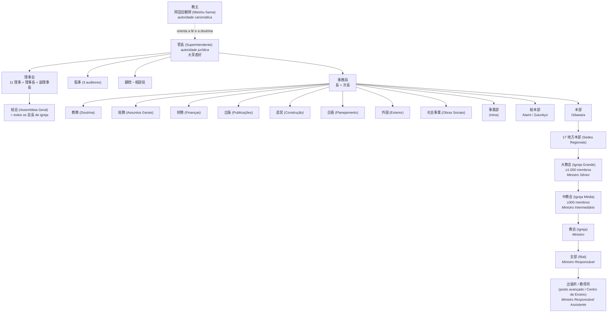

# A difusão na época de Meishu-Sama — estrutura das unidades, formação e hierarquia

> ## ⚠️ DOCUMENTO SUPERADO — REGISTRO HISTÓRICO
>
> **Esta é a primeira versão do levantamento, mantida apenas como histórico do
> desenvolvimento do trabalho.** Ela foi escrita em formato de tópicos e com
> referências ao 岡田茂吉全集, o que contraria a orientação de direitos autorais
> adotada depois.
>
> **Para uso atual, consulte:**
> - **Parte I** — `LEVANTAMENTO_DIFUSAO_PARTE_I_PROSA_20261002.md`
> - **Parte II** — `DOSSIE_PARTE_II_CULTO_E_VIDA_20261002.md`
> - **Volume único para impressão** — `DOSSIE_DIFUSAO_COMPLETO_20261002.pdf`
> - **Índice geral** — `DOSSIE_DIFUSAO_INDICE.md`
>
> A Parte I preserva todo o conteúdo factual verificado nesta versão,
> converteu as 59 referências do 全集 para o acervo rattail, reescreveu o texto
> em prosa e corrigiu três erros de transcrição. As seções de método e corpus
> abaixo (seção 0) foram substituídas — ver a Parte I, "Nota de método".
>
> **O que só existe aqui:** o percurso da pesquisa — as hipóteses que se
> mostraram erradas, as lacunas que depois se resolveram (a substituição das
> duas nomenclaturas de grau) e as que permanecem. É útil para entender *por
> que* o levantamento final tem a forma que tem.

**Data:** 2026-09-30 (primeira versão)
**Pergunta de pesquisa:** como era a difusão na época de Meishu-Sama, sobretudo no
pós-guerra (período de liberdade religiosa); como abriam e se estruturavam as unidades
religiosas (próprias, alugadas, casa de fiéis); quais os tipos de unidade e suas
atribuições; como era a formação sacerdotal e quais níveis existiam; como era a
estrutura funcional e hierárquica; como se formavam novos membros; e como eram as
atividades em torno de Meishu-Sama e dos Paraísos Terrestres.

> **Aviso de licenciamento.** Os documentos citados são material de terceiros
> protegido por direitos autorais. Este levantamento é **nota de pesquisa interna**
> — não é publicação.

---

## 0. Corpus, método e terminologia

### 0.1 Corpus pesquisado

| Corpus | Caminho | Extensão | Uso aqui |
|---|---|---|---|
| 岡田茂吉全集 講話篇 (1ª–12ª) | `goshinsho/referencia_zenshu_rokkan_.../kowa_full.txt` | 683 seções datadas, 11 MB | Fala direta de Meishu-Sama |
| 岡田茂吉全集 著述篇 (1ª–12ª) | `.../chosaku_full.txt` | 3.160 seções, 11,6 MB | Verificação (pouquíssimo material institucional) |
| Acervo textual www.rattail.org | `filme_meishu_sama/fontes/textos_rattail/` | 18.829 páginas HTML | **Documentos institucionais primários**: regulamento, atas, censos, boletins internos, manuais |
| 教修要綱 (3ª ed., 1954) | `filme_meishu_sama/fontes/ocr_rattail/txt/kyoshu_yoko.txt` | 118 páginas | Único manual de formação (OCR ruidoso — ver §7.3) |
| Publicações já traduzidas do projeto | `goshinsho/livros_publicacao_pt_revisado/` | 200+ volumes | **Terminologia oficial** e traduções consagradas |

**Índices criados nesta sessão** (persistidos em
`filme_meishu_sama/fontes/ocr_rattail/work/`):
`kowa.json` (Zenshu), `rattail.json` (acervo), `lib.py` e `h.py` (buscadores).

### 0.2 Terminologia — conforme o glossário oficial do projeto

Todas as traduções deste documento seguem `glossario_traducao.json`,
`glossario.json` e o uso consagrado nos volumes já publicados em
`livros_publicacao_pt_revisado/`. Encontros feitos nesta sessão:

| Japonês | Português (oficial) | Onde foi verificado |
|---|---|---|
| 御浄霊 / 浄霊 | **Johrei** | glossário |
| 御守り / 御守 | **Ohikari** | glossário (984 ocorrências) |
| 大光明 (御守り) | **Daikōmyō** (amuleto superior) | glossário |
| 光明如来 | **Komyo-Nyorai** | glossário (847 ocorrências) |
| 大光明如来 | **Daikōmyō Nyorai** | glossário |
| 御屏風観音 | **Byōbu Kannon** (Kannon do biombo) | glossário (254) |
| 御神体 / 御軸 | **Imagem da Luz Divina** | glossário (457) |
| 明主様 | **Meishu-Sama** | glossário |
| 地上天国 | **Paraíso Terrestre** | glossário |
| 浄化 | **purificação** | glossário |
| 御守護 | **proteção divina** / graça divina | glossário |
| 御神書 | **Escritos Divinos** | glossário |
| 善言讃詞 | **Oração Zengen-Sandji** | glossário |
| 祝詞 | **norito** | glossário |
| 御利益 | **benefício(s) material(is)** / graça(s) | glossário |
| 信者 | **fiel** | glossário |
| 会員 | **membro** (da igreja) | glossário |
| 入信 | **conversão** | glossário |
| 教修 / 御教修 | **Kyoshu** — curso de preparação para receber o Ohikari | glossário |
| 支部 | **filial** | glossário (474) |
| 教導師 | **Ministro Responsável de Unidade Religiosa** (1ª menção) → **Ministro Responsável** | glossário |
| 教導師補 | **Ministro Responsável de Unidade Religiosa Assistente** | glossário |
| 教師 | **Ministro** | glossário |
| 大教会 | **Igreja Grande** | glossário (73) |
| 中教会 | **Igreja Média** | glossário (522) |
| 月並祭 | **Culto Mensal** | glossário |
| 例祭 | **Culto Regular** | glossário |
| 大祭 | **Culto Especial** | glossário |
| 春季大祭 / 秋季大祭 | **Culto Especial da Primavera / de Outono** | glossário |
| メシヤ会館 | **Templo Messiânico** | glossário (88) |
| 瑞雲郷 | **Zuiunkyo** | glossário |
| 神仙郷 | **Terra Divina** | glossário (130) |
| 日光殿 | **Nikkōden** (Palácio da Luz Solar) | glossário |
| 水晶殿 | **Palácio de Cristal** | glossário |
| 栄光 | **Eikō** | glossário |

**Convenções adicionais derivadas da prática tradutória do projeto** (não estão no
glossário, mas o uso nos volumes publicados é inequívoco — 3 ocorrências de
「Subsede」, 19 de 「Centro de Ensino」, 116 de 「Associação」, 55 de 「Sede」):

| Japonês | Português | Fonte da convenção |
|---|---|---|
| 分所 | **Subsede** | Gokōwa-roku nº 2 |
| 分会 | **Associação** | Gokōwa-roku nº 2 |
| 教導所 | **Centro de Ensino** | Gokōwa-roku nº 2 |
| 本部 | **Sede** | Gokōwa-roku nº 2 |
| 総本部 | **Sede Central** | 規則; uso corrente |
| 管長 | **Superintendente** | `glossario`: "presidente ou líder"; o uso nos volumes consagra o cargo |
| 大教師 / 中教師 / 教師 | **Ministro Sênior / Ministro Intermediário / Ministro** — a nomenclatura que **substituiu** 教導師/教導師補 em 1951–52 (ver §5.5) | `mondai.html` — escala oficial |
| 別院 | **Templo Anexo** | uso corrente; ver §3.4 |
| 分院 | **Filial Regional** | uso corrente; ver §3.4 |

---

## 1. Cronologia da institucionalização (1934–1955)

| Data | Fato | Fonte |
|---|---|---|
| 1934-10 | Meishu-Sama inicia o movimento como **大日本観音会**, a partir do 応神堂 | `19471100`, 講話篇一 p279 |
| 1935-01-01 | Fundação oficial em 麹町半蔵門, num 分所 do Oomoto que ele usava | `search1/ko/kojimach.html` |
| 1941-11 | Encerramento da atividade religiosa; passagem à terapia (proibida a cura "sem tocar") | `search1/taidan/taidan39.html` |
| 1946 | **日本浄化療法普及会** — associação civil, com estatuto próprio | `search1/ni/nihon12.html` |
| 1947-07-01 | **日本観音教団講習要項** — primeiro currículo de formação | `search1/ni/nihon07.html` |
| 1947-08 | **Personalidade jurídica religiosa** obtida sob o novo regime de liberdade religiosa | `search1/wa/watasi05.html` |
| 1947-11-11 | **日本観音教団** — cerimônia de fundação | `19471100`, 講話篇一 p279 |
| 1948-11-01 | **五六七教会** — cisão interna; nova denominação | `19481101`, 講話篇一 p285–288 |
| 1948-12-01 | Criação da 五六七教会本部 em 小田原; Tóquio (上野毛) passa a 関東本部 | `search2/sanko/ren01.html` |
| 1948-12-08 | **Primeira grade organizacional completa** — ver §3.1 | `19481208`, 講話篇一 p328 |
| 1949-03-08 | Primeiro número do jornal **『光』**; 100 mil fiéis declarados | `search1/ho/honkyo20.html` |
| 1950-02 | **世界救世教会** — a 教団 sofre 発展的解消 e renasce sob este nome | `search1/ka/kantou13.html` |
| 1950-10 | **Censo oficial**: 4 Igrejas Grandes, 78 Igrejas Médias, 710 igrejas; 56/430/2.244 Ministros — ver §5.4 | `search1/mo/mondai.html` |
| 1951-02-05 | **Reforma do 教団**; nasce a **世界救世教** — ver §3.2 | `search2/sanko/kikoseib.html` |
| 1951-10-10 | **Regulamento da 宗教法人「世界救世教」** — ver §6.1 | `search2/sanko/kisoku.html` |
| 1953-12-16 | 地鎮祭 do Templo Messiânico (Zuiunkyo) | `search1/ne/nento03.html` |
| 1954-06-15 | Cerimônia provisória do advento de Messias | `search2/kihara/bunsyo/honnen29.html` |
| 1954-10-10 | 3ª edição do **Kyoshu Yōkō** (manual de formação) | `kyoshu_yoko.txt` p.118 |
| 1954-10-24 | Início das **conferências de Ministros** itinerantes — ver §5.6 | `search2/kihara/bunsyo/honnen29.html` |
| 1954-12-11 | Entronização de Meishu-Sama no Palácio de Cristal; anúncio dos **níveis** | `search2/kihara/kikouwa/301011.html` |
| 1955-02-09/10 | **御昇天** (falecimento) de Meishu-Sama | `search2/kihara/bunsyo/omichi1.html` |
| 1955-03-01 | Ruptura: Kihara Yoshihiko demite-se; funda depois a **世界明主教** | `search2/kihara/ryakurek.html` |

Sobre a repressão pré-1945 e a retomada, nas palavras de Meishu-Sama:

> 「顧みれば昭和九年一〇月私は大日本観音会なる名称のもとに、観音運動を始め、その目的は
> 病貧争絶無の世界をつくるというにある。しかるにそのころの当局の方針としては、類似宗教を
> 無差別的に弾圧の方針であったから、当大日本観音会もそれに漏れず、徹底的の弾圧をされたのである。
> 従って、爾来ぜんぜん宗教から離れ、治療専門によって発展しつつ今日に至った」
>
> Rememorando: em outubro do nono ano de Shōwa (1934), sob o nome de **Dai-Nippon Kannon-kai**,
> iniciei o movimento Kannon, cujo propósito é criar um mundo sem doença, pobreza e conflito.
> Sucede que a orientação das autoridades da época era a de reprimir indiscriminadamente as
> religiões análogas; por isso a Dai-Nippon Kannon-kai não escapou e sofreu repressão radical.
> Desde então, afastado por completo da religião, cheguei até hoje desenvolvendo-me
> exclusivamente como terapeuta.
> — Discurso na fundação da 日本観音教団, `19471100`, 講話篇一 p279

E sobre a liberdade religiosa como marco jurídico:

> 「それから間もなく終戦となり、信教の自由ともなったので、二十二年八月法人となり、
> 漸く大腕振って歩けるようになったのである。」
>
> Pouco depois veio o fim da guerra e, com a liberdade de crença, em agosto do vigésimo segundo
> ano [1947] obtivemos a personalidade jurídica e finalmente pudemos andar de cabeça erguida.
> — 「私とサタンとの闘争史」, `search1/wa/watasi05.html`

---

## 2. A difusão pós-guerra: método, instrumentos e escala

### 2.1 O axioma metodológico: a cura precede a doutrina

Meishu-Sama estabeleceu uma **sequência obrigatória de aproximação** e proibia
atalhos. É a passagem mais importante de todo o corpus para esta pergunta:

> 「例えば新しく教導所を開く場合、最初はできるだけ小さくする。人間が赤ん坊から育ち
> 一人前になるごとく、また草木の種子がだんだん二葉から大きく育つ。それなら根が張り
> 枯れたりなどしない。これが大自然の実相だ。**私などこの仕事は六畳一間から始めた。**
> 信仰も最初は種蒔きであるから**話すだけにしておく**。それが育つに従い先方が耳を
> 傾ける程度になったら**雑誌新聞を見せる**。そのうちに**教修を受けたくなり教修を
> 受けさす**。そのうち病気が治ったりなどして**光明如来様〔を〕お祭りする**。
> このようなやり方で入ったのは信仰に動揺がない。急いで入信したのはいわゆる根が
> 固まっていないから動きやすい。」
>
> Por exemplo, ao se abrir um novo **Centro de Ensino**, começa-se pelo menor tamanho
> possível. Como o ser humano, que cresce de bebê até se tornar adulto, e como a semente de
> uma planta, que aos poucos se desenvolve da primeira folha em diante. Assim a raiz se firma
> e não seca. Esta é a realidade concreta da grande natureza. **Eu, por exemplo, comecei este
> trabalho num único cômodo de seis tatames.** A fé também é, no início, semeadura, e por isso
> **basta conversar**. Conforme ela cresce, quando a outra pessoa chega ao ponto de dar ouvidos,
> **mostram-se as revistas e os jornais**. Em seguida ela **passa a querer fazer o Kyoshu, e
> então se permite que o faça**. Depois, com a cura da doença e outros fatos, **passa-se a
> entronizar a Komyo-Nyorai**. Quem entra por esse caminho não oscila na fé. Quem se converte
> apressadamente não tem raízes firmes e por isso se move com facilidade.
> — 『妙智之光』『地上天国』9号, `19491025`, 講話篇三 p75–76

Os três pontos operacionais que decorrem daí:

**(a) Proibição de proselitismo a partir da gratidão.** A pergunta é direta e a resposta
é uma recusa:

> 「【質問者】御利益で治った方に新しい人を紹介するようにと話すことはいかがでしょうか。
> 【明主様】そんなこと言っちゃいけませんよ、安ッぽくなってしまう。そんな気があるのは
> まだ信仰が本当の線に入ってないんです。**決して無理にすすめたり、押し売りしたり
> しちゃいけません。**」
>
> [Pergunta] Falar à pessoa que foi curada do benefício material, para que apresente
> alguém novo, seria adequado?
> [Meishu-Sama] Não se deve dizer tal coisa; torna-se barato. Quem tem esse tipo de
> intenção ainda não entrou na linha verdadeira da fé. **Nunca se deve recomendar à força
> nem fazer venda forçada.**
> — 『御光話録』15号, `19491220`, 講話篇二 p428–429

**(b) O crescimento é atribuído à proteção divina, não à técnica de captação.**

> 「発展しないのは、人間が見ていいようでも神様に対してピッタリしない点があるんです。
> ピッタリしてれば、**神様がこの人ならという教導師の所へ信者を持って来てくれる**んです。」
>
> A razão de não se desenvolver é que, mesmo que aos olhos humanos pareça bom, há um ponto
> que não se ajusta a Deus. Se estivesse ajustado, **Deus traria os fiéis ao Ministro
> Responsável que Ele escolhesse**.
> — idem

**(c) Recusa de entrar em conflito com a religião anterior do candidato.**

> 「【質問者】他宗教に熱心なもの、または他宗教に入らんとしている者は、それが白紙に
> なるまでは御教修を受けさせぬほうがよろしいでしょうか。
> 【明主様】他宗教を丸っきりはなれてからこの道に入る……というようにはっきりしたもの
> でもない。両方信じているうちにこっちへ傾くこともありますから**決めないほうが
> いいですね。**」
>
> [Pergunta] Quem é fervoroso em outra religião, ou está prestes a entrar em outra, seria
> melhor que não fizesse o Kyoshu enquanto não estiver em branco?
> [Meishu-Sama] Não é algo tão definido, de deixar inteiramente a outra religião para só
> então entrar neste Caminho. Durante o tempo em que crê em ambas, pode inclinar-se para cá;
> **é melhor não decidir isso.**
> — 『御光話録』2号, `19481218`, 講話篇一 p339–340

**(d) A saúde física como pré-condição para casos graves.** Regra pastoral explícita:
não converter quem está à beira da morte, para que a morte não seja atribuída à fé.

> 「本当は病気が治ってから入信するのが本当で、病気が治ってありがたく、やむにやまれぬ
> 気持ちで入信するのが本当である。例えばもし治らないうちに入信して死ぬ場合がある。
> 入信してから死ぬなんてあんな信仰は駄目だということになる。すると怨まれる。
> 特に肺病などはよけいにそうで……**生命にかかわるのは治ってから入信すべきである。**」
>
> Na verdade, o correto é converter-se depois de a doença sarar; converter-se com gratidão
> pela cura, num sentimento irreprimível. Porque pode haver casos em que, convertido sem
> sarar, a pessoa morra. E então passa a correr a ideia de que "uma fé em que se morre logo
> após a conversão não presta". Isso gera ressentimento. Especialmente a tuberculose, mais
> ainda… **Nos casos com risco de vida, deve-se converter depois da cura.**
> — 『妙智之光』『地上天国』9号, `19491025`, 講話篇三 p75–76

### 2.2 Instrumentos de difusão

**Jornal.** 『光』 (1949-03) → 『救世』 → 『栄光』 → 『神の光』 (1955). Meishu-Sama
leu a rotatividade dos títulos como sinal de orientação superior:

> 「新聞も、最初『光』それから『救世』それから『栄光』と、こんなに題名が変わるのなんか
> 他にありませんよ。神様がされるんだから、しようがない。」
>
> Jornal também: primeiro 「Hikari」, depois 「Kyūsei」, depois 「Eikō」 — não há outro caso
> de título que mude tanto. É Deus quem faz, não há como evitar.
> — 『御垂示録』3号, `19511005`, 講話篇四 p218–220

A função do jornal como motor da unidade, na primeira página do primeiro 『光』:

> 「本教の唯一の宣伝機関として、光新聞を発行している……**発展する教導所は常に光新聞の
> 頒布に力を注いでいることである**、もちろんこういう支部は、宣伝用として無料で、
> 出来るだけ配布するのである」
>
> Como único órgão de propaganda desta religião, publicamos o jornal Hikari… **os Centros de
> Ensino que se desenvolvem são sempre aqueles que se empenham na distribuição do jornal
> Hikari.** Naturalmente, essas filiais distribuem gratuitamente o máximo possível, para fins
> de divulgação.
> — 「光新聞の拡大は教線の強化」『光』33号, `1949-10-29`, `search1/hi/hikari03.html`

**Palestras públicas de massa.** A conferência no 日比谷公会堂, com casa cheia e
**mais de 60% de não convertidos**:

> 「宗教講演会として日比谷公会堂に超満員の聴衆をあつめ、しかも**その六割以上が
> 未人信者**であったと言う盛況ぶりは、恐らく未曾有のことと思います。」
>
> O fato de uma conferência religiosa ter reunido lotação esgotada de público no Hibiya
> Kōkaidō, e ainda por cima **mais de sessenta por cento serem pessoas não convertidas**,
> é um sucesso de público provavelmente sem precedentes.
> — 「編集後記（地上天国36号）」, `search2/kikou2/koki36.html`

**Missão externa.** Havaí, a partir de fevereiro de 1953, com **樋口喜代子 (Ministra)** e
**安食晴彦 (Ministro Assistente)** — recrutados da liderança interna, não de um seminário:

> 「昨年二月十一日世界メシヤ教海外布教のため、**樋口喜代子教師が助教師安食晴彦氏を
> 帯同して来布され**」
>
> Em 11 de fevereiro do ano passado [1953], para a difusão ultramarina da Igreja Mundial
> Messiânica, **a Ministra Higuchi Kiyoko veio ao Havaí acompanhada do Ministro Assistente
> Anshoku Haruhiko**.
> — 「ハワイ通信」『栄光』264号, `1954-07-07`, `search2/kikou2/hawai20.html`

**Publicações em massa.** A edição especial de agricultura (自然農法) com tiragem de
**um milhão de exemplares**, distribuída a 農会, 農事試験場 e prefeituras:

> 「その成績を土台にして、ひとつの本を作って、これを**日本中の農会とか農事試験場とか、
> 村なら村長と、あらゆる方面に全部配ろうと思う**。それから、**各地に講演会、座談会を
> 開いて大いに知らせようと思う。**」
>
> Tomando esses resultados como base, farei um livro e o **distribuirei integralmente a
> todos os setores: às cooperativas agrícolas de todo o Japão, às estações experimentais,
> e, nos vilarejos, aos prefeitos**. Além disso, **abrirei palestras e mesas-redondas em
> cada região para divulgar amplamente.**
> — Culto Especial de Outono, `1951-09-25`, `search1/kouwa/s260925.html`

E a confirmação operacional, na voz de quem distribuiu:

> 「この時の特集号は……**百万で足りずに、増刷したほどでした。**」
>
> A edição especial daquele momento… **um milhão não bastou; cheguei a reimprimir.**
> — 「本部事務所奉仕者座談会」『地上天国』69号, `1955-04-15`, `search2/kikou2/honbujim.html`

### 2.3 Escala verificável

**Censo oficial de outubro de 1950** — o único documento com números completos em
todas as categorias (`search1/mo/mondai.html`):

| Categoria | Quantidade |
|---|---:|
| 大教会 (Igrejas Grandes) | **4** |
| 中教会 (Igrejas Médias) | **78** |
| 分教会 (igrejas) | **710** |
| 大教師 (Ministros Seniores) | **56** |
| 中教師 (Ministros Intermediários) | **430** |
| 教師 (Ministros) | **2.244** |
| 別院 (Templos Anexos) | 6 |
| 分院 (Filiais Regionais) | 7 |
| 部 (Departamentos) | 6 |

**Nota metodológica sobre os números.** O censo acima é consistente internamente
(as três categorias de igreja e as três de Ministro formam pares). Os números de
*fiéis* são de outra ordem: 100 mil em março de 1949 (`search1/ho/honkyo20.html`),
e "mais de mil" no Havaí em um ano (`search1/kouwa/s290227.html`). Os números
globais de fiéis aparecem sempre em textos de propaganda ou de defesa e **devem ser
tratados como declarações, não como estatística**.

Distribuição da produção documental por ano no acervo rattail (≥1945) — o pico de
1949 corresponde ao ciclo 五六七教会 e o de 1952 ao programa de construção:

| 1948 | 1949 | 1950 | 1951 | 1952 | 1953 | 1954 |
|---|---|---|---|---|---|---|
| 64 | 348 | 158 | 172 | 203 | 134 | 42 |

---

## 3. Tipos de unidade religiosa e suas atribuições

### 3.1 A grade de 1948 — o documento mais explícito

Meishu-Sama descreve aqui a **primeira grade completa**, com critérios quantitativos
de ascensão e critério territorial de vinculação:

> 「【質問者】礼節と順序を重んずることがこのお道の精神と存じますが、会員や資格者が
> 簡単にその所属を変えることはいかがいたすべきでしょうか。
> 【明主様】所属のことは今度はっきりしますが、あの先生は気に入ったからつくとか、
> あの先生は気に入らないから離れるとかいうことはたいへんな間違いで、神様から見れば
> 怪しからぬ事です。私はいままでそういうことを言ってくる人には黙って許していましたが
> ……で、**今度は地域的に所属をきめることにしました。これは本部と三カ所の分所があり、
> 分所に分会が所属し、分会には支部が所属するのです。支部長は教導師であり、教導師は
> 信者を一〇〇人以上作った人か、三万円以上献金した人か、または支部長の推薦によること
> とし、教導所を一〇以上有するものを分会とし、分会一〇以上を分所とすることにしました。**
> やはり功労のある人が上に行くのが本当ですから。」
>
> [Pergunta] Reverenciar a etiqueta e a ordem é o espírito deste Caminho, creio. Mas um
> membro ou um portador de qualificação mudar de vinculação com facilidade — como se deve
> proceder?
> [Meishu-Sama] A questão da vinculação ficará clara desta vez. Aquilo de aderir a um
> mestre porque se gostou dele, ou dele se afastar porque não gostou, é um enorme erro e,
> aos olhos de Deus, algo inadmissível. Até agora, eu silenciosamente permitia isso a quem
> me vinha falar… **Assim, desta vez decidi determinar a vinculação por região. Há a Sede e
> três Subsedes; às Subsedes pertencem as Associações, e às Associações pertencem as filiais.
> O líder de filial é um Ministro Responsável de Unidade Religiosa, e o Ministro Responsável
> será alguém que tenha conduzido cem ou mais fiéis, ou que tenha ofertado trinta mil ienes
> ou mais, ou por recomendação do líder de filial. Aquilo que tiver dez ou mais Centros de
> Ensino será considerado uma Associação, e o que tiver dez ou mais Associações será
> considerado uma Subsede.** Afinal, é justo que aqueles com méritos estejam no topo.
> — 『御光話録』2号, `19481208`, 講話篇一 p328

**Escala de unidades:** 本部 (Sede) › 分所 (Subsede) › 分会 (Associação) › 支部 (filial)
› 教導所 (Centro de Ensino, a unidade mínima).

**Critérios de ascensão, em ordem de prioridade:** (1) **功労** — número de pessoas
conduzidas (100+) ou valor ofertado (30 mil ienes+); (2) recomendação do líder de filial.
**Não há formação acadêmica, prova ou tempo mínimo de casa.**

### 3.2 A grade de 1951 — reforma de 5 de fevereiro

Meishu-Sama substitui a grade acima por **地方本部 → 大教会 → 中教会 → 教会**, com
pisos numéricos. O documento-chave é o comunicado do Superintendente 大草直好:

> 「一、熱海市桃山、晴々台の地上天国に世界救世教の総本部を置き、世界的中心地として
> 出来るだけ速かに、救世会館の建設を図ること。
> 二、小田原市緑町（五六七大教会本部）に世界教世教本部を置き、逐次教団本部としての
> 形態を具備すること。
> ……
> 三、**従来の四大教会は発展的解消を遂げ**、現在の布教状況及所属府県の連絡の便等を
> 考慮し、差当り**全国を左の如き十数箇所の地方別に区分して地方本部を置くこと。**
> ……
> 四、**地方本部には、三段階の大教会、中教会、教会の組織を設くること。大教会の組織には
> 協力会員差当り千人以上、中教会には同三百人以上を要すること。**
> ……大教会、中教会は将来各府県毎に組織する様漸次整備すること。
> 五、現在の布教状況及教会の発展等を考慮し、数地方本部に渉っての布教は当分（一年間）は
> 許さるるも、出来るっだけ早く同一の地方本部円においてのみ布教する様にし、**布教費の
> 節減その他布教の合理化**を図ること。」
>
> 1. Estabelecer a Sede Central da Igreja Mundial Messiânica no Paraíso Terrestre de
> Momoyama, Seijōdai, em Atami, e providenciar a construção do Salão de Salvação o mais
> rápido possível, como centro mundial.
> 2. Estabelecer a Sede da Igreja Mundial Messiânica em Midorichō, Odawara (sede da Igreja
> Grande 五六七), dotando-a gradualmente da forma de sede da organização.
> …
> 3. **As quatro Igrejas Grandes até aqui existentes passam por dissolução-e-desenvolvimento**;
> considerando a situação atual da difusão e a conveniência de contato entre as províncias de
> jurisdição, dividir o país, por ora, **em cerca de uma dúzia de regiões e estabelecer Sedes
> Regionais.**
> …
> 4. **Nas Sedes Regionais, criar a organização em três graus: Igreja Grande, Igreja Média e
> Igreja. A Igreja Grande requer, por ora, mil ou mais membros cooperadores; a Igreja Média,
> trezentos ou mais.**
> …As Igrejas Grandes e Médias deverão ser gradualmente organizadas por província no futuro.
> 5. Considerando a situação atual da difusão e o desenvolvimento das igrejas, a difusão que
> abranja várias Sedes Regionais será permitida por ora (um ano); mas o quanto antes se deve
> difundir apenas dentro de uma mesma Sede Regional, visando **à redução de custos de difusão
> e à racionalização da difusão.**
> — 「世界救世教の機構整備について」Superintendente 大草直好『栄光』94号, `1951-03-07`,
>   `search2/sanko/kikoseib.html`

**Criaram-se 17 Sedes Regionais**, cada uma com nome do responsável e as províncias de
jurisdição listadas uma a uma: Hokkaido Leste/Oeste, Tōhoku, Ōu, Kantō Leste/Oeste,
Shinetsu, Chūkyō, Hokuriku, Kinki, Kansai, San'in, San'yō, Shikoku, Kyūshū Leste/Oeste.

### 3.3 As quatro Igrejas Grandes dissolvidas

Antes de 1951 existiam **quatro 大教会**, nominalmente citadas: **天国大教会, 大成大教会,
光宝大教会, 五六七大教会**. Elas se alternavam na presidência dos ritos sazonais — o que
mostra que eram simultaneamente unidades de difusão e **"quem celebra"** nos grandes ritos,
numa atribuição coletiva e rotativa:

> 「祭典は二十一、二日天国大教会、二十三日大成大教会、二十四日光宝大教会、大成大教会、
> 二十五、六、七日五六七大教会の順で七日間にわたり」
>
> Os cultos se estenderam por sete dias na seguinte ordem: dias 21 e 22, Igreja Grande
> Tengoku; dia 23, Igreja Grande Taisei; dia 24, Igreja Grande Nikkōbō e Igreja Grande
> Taisei; dias 25, 26 e 27, Igreja Grande 五六七.
> — 「世界救世教秋季大祭に参拝して」『地上天国』17号, `1950-10-15`, `search2/kikou2/sekai03.html`

### 3.4 Tipologia completa das unidades

| Japonês | Português | Definição | Evidência |
|---|---|---|---|
| 総本部 | **Sede Central** | Centro mundial; Zuiunkyo (Atami) | `search2/sanko/kikoseib.html` |
| 本部 | **Sede** | Centro administrativo; Odawara | idem |
| 別院 | **Templo Anexo** | Sede de segunda ordem, com 本殿 próprio e pessoal residente. Havia 6 em 1950: 箱根, 小田原, 熱海, 東京 (上野毛), 京都, 大阪 | `search1/mo/mondai.html` |
| 地方本部 | **Sede Regional** | 17 criadas em 1951, por província | `search2/sanko/kikoseib.html` |
| 大教会 | **Igreja Grande** | ≥1.000 membros (1951); antes, uma das 4 | idem |
| 中教会 | **Igreja Média** | ≥300 membros | idem |
| 教会 / 分教会 | **Igreja** | Unidade com 会長 nomeada | 規則 art. 26–28 |
| 分院 | **Filial Regional** | Subdivisão territorial; 7 em 1950 (札幌, 岩手, 富山, 名古屋, 香川, 別府, 佐賀) | `search1/mo/mondai.html` |
| 分会 | **Associação** | ≥10 Centros de Ensino (1948) | `19481208`, 講話篇一 p328 |
| 支部 | **filial** | Chefiada por um Ministro Responsável | idem |
| 出張所 | **posto avançado** | Unidade menor que a filial, criada por deslocamento de um Ministro | `search1/a/asudeha.html` |
| 教導所 | **Centro de Ensino** | Unidade mínima: uma casa ou sala de atendimento | `19481208`; Gokōwa-roku nº 2 |
| 浄霊所 | **Centro de Johrei** | "a igreja" de facto de uma família | `search2/okage/dokusya/meian01.html` |
| 教修会場 | **local do Kyoshu** | Casa ou salão cedido para o curso | `19520205`, 講話篇七 p7 |

Os 6 Templos Anexos, com endereços completos, conforme o censo de 1950:

> 箱根別院 神奈川県足柄下郡宮城野村 / 小田原別院 神奈川県小田原市緑 / 熱海別院
> 静岡県熱海市伊豆山 / 東京別院 東京都世田谷区玉川上野毛 / 京都別院 京都府京都市
> 左京区吉田神楽岡 / 大阪別院 大阪府泉北郡高石町
> — `search1/mo/mondai.html`

### 3.5 Atribuições — o que se fazia em cada unidade

| Função | Unidade | Fonte |
|---|---|---|
| **Johrei** (cura) | todas, do Centro de Ensino para cima | toda a coleção |
| Celebrar **Culto Mensal** / **Culto Regular** em data fixa | filial, posto avançado, Igreja | `19490613`, 講話篇二 p406–409 |
| Ministrar o **Kyoshu** | filial, Igreja, local do Kyoshu | `search1/ni/nihon07.html` |
| Formar novos portadores de qualificação | Igreja / Igreja Média | `search1/ke/kenkin.html` |
| Distribuir o jornal | Centro de Ensino, filial | `search1/hi/hikari03.html` |
| Sediar **mesas-redondas** periódicas | Igreja Média, Igreja Grande | `search2/sanko/teirei1..6.html` |
| Abrigar doentes em purificação | Sede da Igreja Média | `19510828`, 講話篇四 p462–463 |
| Sediar **御面会** (audiências) | Sede (Atami/Hakone/Odawara) | §8.1 |
| Presidir os ritos sazonais em rodízio | Igreja Grande | `search2/kikou2/sekai03.html` |
| Administração e finanças próprias, sob supervisão central | Igreja | 規則 arts. 26–30 |

**Regra de precedência ritual.** A ordem de celebração entre unidades é matéria de
governo interno:

> 「【質問者】支部のお祭りというのは、中教会、大教会の者が主催する建前のもので
> ございましょうか。……支部は支部長が主催すべきものと思います。もし支部が三〇ヵ所
> 以上になったら、一日一ヵ所としても、会長さんは一月中にまわりきれなくなります。
> 【明主様】そうだな……**三〇ヵ所以上になってはいけない理屈になるからな。**
> ……**原則としては中教会を一番先にするわけです。**」
>
> [Pergunta] Os cultos da filial, na estrutura formal, são presididos por pessoas da Igreja
> Média ou da Igreja Grande? …Creio que a filial deve ser presidida pelo líder da filial.
> Se a filial tiver trinta ou mais locais, mesmo um por dia, o presidente não conseguirá
> percorrer todos em um mês.
> [Meishu-Sama] É mesmo… **Isso leva à conclusão de que não pode haver trinta ou mais
> locais.** …**Em princípio, a Igreja Média é que vem primeiro.**
> — 御講話 de 1º de março de 1954, `19540301`, 講話篇十二 p50–54

Daí um **limite superior prático de 30 filiais por Igreja Média** — não por estatuto,
mas por restrição operacional.

---

## 4. Como se abria uma unidade: próprio, alugado, casa do fiel

Cinco modos coexistiram, sem norma escrita — cada caso era decidido pontualmente.

### (a) Casa do próprio dirigente — o modo inicial e predominante

> 「私などこの仕事は**六畳一間から始めた。**」
> Eu, por exemplo, **comecei este trabalho num único cômodo de seis tatames.**
> — `19491025`, 講話篇三 p75–76

O contraste entre dois modelos — a casa que se torna igreja (estável) e o missionário
itinerante que **não tem sede fixa**:

> 「川越先生は**自宅で入信し、自宅を支部にした**。言わば恵まれた羨しい程の立場で御用を
> しておられる訳ですが**私の場合は家を出、一人で飛び歩きをした**ので、現在**支部の性質が
> その通りになってしまった**のです。そのために今月はどこで御参りをし、来月はどこと、
> **支部のお祭りすら一定のところでやって無かった**と言う状態です。」
>
> O Sr. Kawagoe converteu-se **em casa e fez da própria casa uma filial**. Digamos que
> está numa posição privilegiada e invejável para realizar o trabalho. **No meu caso, saí
> de casa e andei sozinho por toda parte**; por isso **a natureza da filial acabou se
> tornando exatamente isso**. Assim, este mês o culto é num lugar, no mês que vem noutro —
> **nem o culto da filial era realizado num lugar fixo.**
> — 「支部の現状と発展の為に」, `search2/kikou2/shibuno1.html`

Casos de igreja instalada na casa do dirigente local:

> 「昭和二十五年暮より**当地に世界救世教の教会を設置せられました土子勇先生**の御浄霊を頂き」
> — `search1/ko/konoki02.html` (1951-08-08)

### (b) Imóvel alugado ou cedido

**Sala de templo budista alugada como Centro de Ensino** — e a necessidade de sair:

> 「【質問者】ただいま**お寺の一室を借り教導所といたしております**が、このたびそこを
> 出ねばなりませんので親類の家の土蔵を借りて御浄霊いたしたいと存じますが……」
>
> [Pergunta] No momento **estou alugando uma sala de um templo e usando-a como Centro de
> Ensino**; mas desta vez preciso sair de lá, e penso em alugar o depósito de barro da casa
> de um parente para fazer Johrei…
> — 『御光話録』10号, `19490730`, 講話篇二 p215–216

**Hotel/ryokan como local do Kyoshu quando o Centro de Ensino é pequeno** — prática que
Meishu-Sama **corrige** por causa da Imagem da Luz Divina:

> 「――教修会のとき、教導所がせまいため旅館などを借ります場合、一時、大光明如来様を
> 旅館の床の間にお祀りして教修会を開いておりますが、これはよろしゅうございましょうか。
> これはいけませんね。間違ってますよ……もし御軸をなにするんだったら、光明如来様じゃ
> なくて、「光明」とか「真善美」とかいうのをかけたらいいでしょう。
> ――それは旅館のときだけでしょうか。
> いや、**旅館に限らず御神体を動かすときにはいけませんよ。御神体は一つの定めた場所へ
> おかけしたらやたらに動かさないことですね。**」
>
> — Quando é o Kyoshu e, por o Centro de Ensino ser apertado, aluga-se um hotel etc.,
> entronizamos provisoriamente o Daikōmyō Nyorai no tokonoma do hotel e realizamos o curso
> — seria adequado?
> Isso não pode. Está errado… Se for para pendurar alguma coisa, que não seja a Komyo-Nyorai,
> mas sim algo como 「Luz」 ou 「Shinzenbi」.
> — É só no caso do hotel?
> Não; **não apenas no hotel — é quando se move a Imagem da Luz Divina que não pode. Uma vez
> colocada a Imagem da Luz Divina num lugar determinado, não se deve movê-la sem mais nem menos.**
> — 「質問応答 御光話」, `search1/situmon/m2411.html`

**Imóvel de família em ruínas readaptado:**

> 「そこに古い壊れた家があったので、それを修繕して**そこに奉仕隊が泊まって作業を
> しています。**」
> Havia ali uma casa velha e arruinada; reparando-a, **a brigada de serviço se aloja ali e
> trabalha.**
> — `19490730`, 講話篇二

**Prédio alugado como sede administrativa**, inclusive com a conotação depreciativa
「借りもの」 (coisa emprestada, não definitiva):

> 「新年の御祭りが福岡市地行東町で行われております。これが**本部としての"借りもの"
> （借家という意）の最後**になったようでありますが」
> O culto de Ano Novo foi realizado em Jigyo-Higashimachi, Fukuoka. Parece que este foi
> **o último "empréstimo" (isto é, imóvel alugado) como Sede**…
> — 「座談会『革新を語る』」, `search2/kihara/bunsyo/ken26.html`

E o momento em que isso se supera: 「六月十五日には、地上に初めて、**借りものでない、
本もの**の"みろく大神様"の祭典が……行われ」 — "Em 15 de junho, pela primeira vez na face
da terra, realizou-se o culto do 'Miroku Ōkami-sama' **não emprestado, mas verdadeiro**"
(idem).

### (c) Construção própria nova

**Autorização prévia obrigatória** — o regulamento é explícito:

> 「**第二十六條** 教会を設立しようとするとき、又は教会が左に掲げる行為をしようとする
> ときは、**管長の承認を受けなければならない**（一、宗教法人となること… 二、規則を
> 変更すること 三、合併又は解散をすること）
> **第二十七條** 教会は、左に掲げる行為をしようとするときは、管長の承認を受けなければ
> ならない……三、**主要な境内建物の新築、改築、増築、移築、除却**又ほ著しい模様替を
> すること
> **第二十八條** 教会の会長及びその代務者は、当該教会の規則で定めるところによって
> 選定された者を**管長が任命する**」
>
> Art. 26 — Ao se pretender estabelecer uma igreja, ou ao se pretender praticar os atos
> abaixo, **deve-se obter a aprovação do Superintendente** (1. tornar-se pessoa jurídica
> religiosa…; 2. alterar o regulamento; 3. fundir-se ou dissolver-se).
> Art. 27 — A igreja, ao pretender praticar os atos abaixo, deve obter a aprovação do
> Superintendente…; 3. **construir, reconstruir, ampliar, transferir ou demolir os principais
> edifícios do recinto**, ou realizar reforma substancial.
> Art. 28 — O presidente da igreja e seu substituto são **nomeados pelo Superintendente**,
> dentre os selecionados conforme o regulamento da respectiva igreja.
> — 宗教法人「世界救世教」規則『栄光』125号, `1951-10-10`, `search2/sanko/kisoku.html`

**Contribuição obrigatória da igreja para o centro:**

> 「**第二十九條** この法人は、その目的達成の経費に充てるため、**教会及び会員に対し、
> 教費を賦課徴収する**
> **第三十條** ３ 普通財産は、基本財産以外の財産、財産から生ずる果実、**教会分担金、
> 会費**及び一般の収入とする」
> Art. 29 — Esta pessoa jurídica, para custear as despesas de consecução de seu objetivo,
> **cobra taxas religiosas das igrejas e dos membros.**
> Art. 30, §3 — O patrimônio comum é composto de bens que não sejam o patrimônio fundamental,
> dos frutos gerados por bens, das **contribuições das igrejas e das quotas dos membros**, e
> da receita em geral.
> — idem

**Construções por iniciativa e financiamento dos fiéis locais.** Exemplo de ascensão
completa, da miséria à igreja construída:

> 「入信以来年と共に大きい御恵や奇蹟を賜わり、今では御報恩の気持で**近く浄霊所たる、
> 教会を新築するほどになった**そうで」
> Desde a conversão, ano após ano recebeu grandes graças e milagres; e agora, num sentimento
> de retribuição, **chegou ao ponto de construir uma nova igreja, isto é, um Centro de Johrei.**
> — 「明暗の隔り」, `search2/okage/dokusya/meian01.html`

> 「更に、――"月雪に花に鳥の音虫の声 あかぬ眺めの玉川の里"にもまごう、緑豊にして、
> 風匂やかな高所に、**木の香もすがしき教会を新築して頂き**、去る七月二十三日
> （昭和二十六年）井上茂登吉先生にお出を願い、御神体を御奉斎させて戴き」
> Além disso — num lugar elevado, rico em verde e de brisa perfumada, que se confunde com
> o "Vilarejo de Tamagawa", onde a lua, a neve, as flores, o canto dos pássaros e a voz dos
> insetos nunca cansam a vista —, **fizeram-me construir uma igreja com perfume de madeira
> nova**; em 23 de julho do ano passado (1951), pedi ao Sr. Inoue Motokichi que viesse e
> entronizamos a Imagem da Luz Divina.
> — 「御浄化物語」, `search2/okage/ko/qgojoka2.html`

**O caso extremo: o Havaí**, com a construção de ~10 mil dólares integralmente coberta
pelos fiéis locais.

> 「しかも教会建設費約十万ドル、日本の金にして三千六百万円ですが、**それが全部ハワイの
> 信者から出たので、私は一文も出してない**のです。」
> Além disso, o custo de construção da igreja, cerca de cem mil dólares — trinta e seis
> milhões de ienes em moeda japonesa — **saiu todo dos fiéis do Havaí; eu não dei um
> centavo.**
> — 「御講話 s290227」『御教え集』31号, `1954-02-27`, `search1/kouwa/s290227.html`

### (d) Templo de outra religião convertido

Caso do templo Sōtō-shū com a imagem principal sendo um Kannon de onze faces,
**consagrado por Meishu-Sama**, usado como igreja da Igreja Messiânica:

> 「――私の家は寺でございますが、**自宅を教会にしてもよろしいでしょうか。なお、寺の
> 宗旨は曹洞宗で御本尊は十一面観音で、明主様の御開眼をいただいております。**
> 差し支えありませんがね、……結構ですけどね、**しかしいつかは違う所へ行くように
> なるかもしれませんよ。**それだけ承知してておやんなさい。」
>
> — Minha casa é um templo; **poderia fazer dela uma igreja? Aliás, a seita do templo é
> Sōtō-shū e a imagem principal é um Kannon de onze faces, que recebeu a abertura dos olhos
> de Meishu-Sama.**
> Não há impedimento…; está bem, mas **pode ser que algum dia você vá para outro lugar.**
> Apenas esteja ciente disso.
> — 「質問応答 御光話」, `search1/situmon/m250228.html`

A resposta é uma **política de transitoriedade**: o espaço alheio serve, mas não é o
destino final.

### (e) Síntese: a trajetória típica

A evidência sustenta a seguinte sequência, sem exceções documentadas:

1. **Sala/cômodo na casa do dirigente**, atuando como **Centro de Ensino** (mínimo
   viável: seis tatames, no caso do próprio Meishu-Sama);
2. **Prédio alugado ou cedido** (sala de templo, casa de parente, ryokan para o Kyoshu)
   quando a demanda excede a casa;
3. **Construção nova financiada pelos fiéis locais**, com a Imagem da Luz Divina
   entronizada na inauguração e autorização do Superintendente;
4. **Unidade maior** (Igreja Média / Igreja Grande), com sede, 道場 e capacidade para
   hospedar doentes em purificação.

**O que não aparece no corpus:** compra de imóvel pela sede central para instalar
igrejas locais. Não há registro de tal operação.

---

## 5. Formação sacerdotal e níveis

Esta é a seção decisiva, e ela tem **duas escalas distintas** que o corpus separa com
nitidez: a escala dos **cargos administrativos** (§5.4) e a escala **devocional**, que
era o eixo real da vida dos fiéis (§5.2).

### 5.1 O axioma: a hierarquia não é democrática

> 「【明主様】特別に書いたんです。**教導師には上げてもいいが、一般会員はいけません。
> 神様のことには民主的でない点がある。階級的ですから。**」
>
> [Meishu-Sama] Foi escrito especialmente. **Pode-se entregar ao Ministro Responsável, mas
> não a um membro comum. Nas coisas de Deus há um ponto que não é democrático. Porque é
> hierárquico.**
> — sobre a Imagem 「Daikōmyō Nyorai」, `19480518`, 講話篇一 p405–406

O "grau" aqui não é cargo administrativo: é **acesso a objetos de culto**. Na mesma
lógica:

> 「【質問者】一般の方でもよろしいのでしょうか。
> 【明主様】ええ、いいですよ。**御守りの「大光明」のほうは資格者だけですがね。**
> 【質問者】「大光明」の御守りは教導師補の方でもよろしいでしょうか。
> 【明主様】**師補でもいいですよ。**ただ、一般の人はいけませんがね……」
>
> [Pergunta] Mesmo uma pessoa comum pode?
> [Meishu-Sama] Sim, pode. **O Ohikari 「Daikōmyō」, esse é apenas para portadores de
> qualificação.**
> [Pergunta] O Ohikari 「Daikōmyō」 pode ser dado também ao Ministro Responsável Assistente?
> [Meishu-Sama] **Mesmo ao Assistente pode.** Só que a pessoa comum não pode…
> — 『御光話録』12号, `19490613`, 講話篇二 p325–326

### 5.2 A escada dos objetos de culto — o eixo real da hierarquia

O corpus permite reconstruir uma progressão **paralela** aos cargos:

| Degrau | Objeto (tradução oficial) | Quem recebe | Fonte |
|---|---|---|---|
| 1 | **Ohikari 「Kōmyō」** | todo fiel, ao fim do Kyoshu | §7.1 |
| 2 | **Byōbu Kannon** (Kannon do biombo) | o fiel, quando a fé amadurece | `19490613`, 講話篇二 p406–409 |
| 3 | **Imagem da Luz Divina 「Komyo-Nyorai」** | idem — **não** no ato da conversão | `19491025`, 講話篇三 p75–76 |
| 4 | **Imagem da Luz Divina 「Daikōmyō Nyorai」** | membro comum, com critério de casa | `19490613`, 講話篇二 p325–326 |
| 5 | **Ohikari 「Daikōmyō」** | **apenas portadores de qualificação**, inclusive o Assistente | idem |
| 6 | **Imagem 「Daikōmyō Nyorai」 nova**, escrita à mão por Meishu-Sama | **apenas Ministro Responsável** | `19480518`, 講話篇一 p405–406 |

O critério de adequação da casa à imagem:

> 「【明主様】大光明如来様は一般の人でもいいですよ。しかし、御神体はね、**家によって
> 祀るべきで、大きな立派な家には、大光明如来様をお祀りし、田舎なんかの小ちゃな家には、
> 光明如来様をお祀りすればいい**んです。」
>
> [Meishu-Sama] O Daikōmyō Nyorai pode ser para pessoa comum. Mas a Imagem da Luz Divina,
> bem, **deve ser entronizada conforme a casa: em casas grandes e imponentes, entroniza-se
> o Daikōmyō Nyorai; em casas pequenas, no interior, entroniza-se a Komyo-Nyorai.**
> — `19490613`, 講話篇二 p325–326

E o princípio do **「相応の理」** — a correspondência entre o objeto e o continente:

> 「つり合わないのはいけませんよ……**小さな床の間に大きい掛軸はいけないんです。**
> やっばり"相応の理"って言ってね、相応してなけりゃいけないんです。」
> Não se deve ter desproporção… **num tokonoma pequeno não cabe um pergaminho grande.**
> Afinal é a "razão da correspondência"; é preciso que haja correspondência.
> — 「質問応答 御光話」, `search1/situmon/m2411.html`

**A ordem é doutrina pastoral**, não logística:

> 「また**入信してすぐに光明如来様を祀らせたりせず**、だんだん本人が判って信仰が進み、
> 拝みたくなり、ぜひというときになってから祀るべきである。すべて物事は漸次進んで
> ゆくことがよくそれが順序である。突然に変わるのは本当でない。」
>
> E também **não se deve mandar entronizar a Komyo-Nyorai logo após a conversão**; só se
> deve entronizar quando a própria pessoa aos poucos compreende, a fé avança, ela passa a
> querer reverenciar e chega ao ponto de dizer "de todo modo". Em todas as coisas, o avanço
> gradual é que é bom — essa é a ordem. Aquilo que muda abruptamente não é verdadeiro.
> — `19491025`, 講話篇三 p75–76

E o princípio de **uma casa, um altar**:

> 「【明主様】**御神体は一軒の中に二カ所はいけない。一カ所でなければならない。**」
> [Meishu-Sama] **A Imagem da Luz Divina não pode estar em dois lugares de uma mesma casa.
> Tem de ser em um só lugar.**
> — 『御垂示録』6号, `19510401`, 講話篇四 p31

### 5.3 Como se subia: três portas documentadas

**Porta 1 — da cura à prática, com entrega do Ohikari:**

> 「【質問者】主人が解らなくなり、御写真をほおり投げ……お祀りしてございますが、穢して
> あるかと思われますが。
> 【明主様】いずれは後悔して、お詫びに来るかもしれませんから……また欲しいと言うかも
> しれないから、あなたのほうにしまって、とっておくと良い。」
> [Pergunta] Meu marido perdeu o juízo e atirou a fotografia [de Meishu-Sama]…; está
> entronizada, mas creio que ficou profanada.
> [Meishu-Sama] Provavelmente ele se arrependerá e virá se desculpar…; pode ser que ele
> queira de novo, então guarde com você.
> — 『御垂示録』6号, `19510401`, 講話篇四 p36–37

**Porta 2 — da prática à qualificação, com formação prática ao lado de um Ministro.**
Este é o **único mecanismo de formação sacerdotal** que o corpus documenta como regular.
O exemplo mais completo:

> 「石田先生が「この目は中々永いから**人様の御浄霊をして徳を積ませて頂きながらやった
> 方が良い**」と仰言いましたので早速自分の育くまれた長柄の町に、一里の道をテクテク
> 通って親戚知人の御浄霊を致しました。頭痛、腰の痛み、関節炎と楽に治って行くので
> 皆さんに喜ばれ教会へ一緒に御礼参りする人も日増しにふえて行きました。……
> そのうち**先生に教導師補の資格を頂き**なお一層お仕事の尊さを教えて頂き、その後は
> 日本脳炎だの、子供の大腸カタルだの医学的にいっての大病も自信を持ってやらせて
> 頂くようになりました。」
>
> O Sr. Ishida disse: "Esta doença dos olhos é longa, então **seria bom que você fosse
> acumulando mérito fazendo Johrei nas pessoas**"; e logo comecei a percorrer a pé, cerca de
> quatro quilômetros, até a cidade de Nagara onde cresci, fazendo Johrei em parentes e
> conhecidos. Dores de cabeça, dores lombares, artrite — tudo sarava com facilidade, e as
> pessoas ficavam contentes; dia a dia aumentava o número dos que iam comigo à igreja
> agradecer. … Em pouco tempo **recebi do mestre a qualificação de Ministro Responsável
> de Unidade Religiosa Assistente**, e me ensinaram ainda mais a preciosidade deste trabalho;
> depois disso passei a realizar com confiança, inclusive casos de encefalite japonesa e
> enterocolite infantil, doenças graves do ponto de vista médico.
> — 「献金に就て」『救世』57号, `1950-04-08`, `search1/ke/kenkin.html`

**A sequência completa é:** Johrei em si mesmo → Johrei em outros (acúmulo de mérito) →
conduzir pessoas à igreja → **qualificação de Assistente** → prática ampliada sob
supervisão → qualificação plena.

Um segundo caso, com a mesma estrutura:

> 「昨年暮入会し今年の八月**教導師補の資格をいただき**日本五六七教会の発展のため
> 専心いたしております。」
> Converti-me no fim do ano passado e em agosto deste ano **recebi a qualificação de
> Ministro Responsável Assistente**; dedico-me de corpo e alma ao desenvolvimento da
> Igreja 五六七 do Japão.
> — `search2/okage/shi/qjokano.html`

E um terceiro, que mostra a qualificação vinda **após** a cura de doença grave:

> 「近くはもったいなくも**教導師の資格まで頂き**身を献げてお取次をさせて頂いて
> おりますが」
> Recentemente, imerecidamente, **cheguei a receber a qualificação de Ministro Responsável**
> e, dedicando-me, tenho realizado a intercessão.
> — `search2/okage/shi/qsiwoka8.html`

**Porta 3 — a formação continuada obrigatória.** A demanda de tempo era real:

> 「【質問者】主人が教導師で御浄めさせていただいている場合、夫婦ともに浄化させて
> いただくには妻はいかがいたしたらよろしいでしょうか。
> 【明主様】これは人為的にはどうすることもできない。自然にしておくより他にない。……
> 主人のほうが高まるにつれて妻もそれについてくるか、あるいはあんまり離れすぎてしまうと
> 霊界へ行って出直すことになる。」
> [Pergunta] Quando o marido é Ministro Responsável e faz Johrei, o que a esposa deve fazer
> para que ambos recebam a purificação?
> [Meishu-Sama] Isso não se pode resolver artificialmente. Não há outro caminho senão deixar
> ao natural. … Conforme o marido se eleva, a esposa o acompanha; ou, se se distancia
> demasiado, terá de ir ao mundo espiritual e recomeçar.
> — `19480708`, 講話篇一 p435–436

### 5.4 Os níveis oficiais — o censo de 1950

O **único documento com a escala completa e numerada**. É um panfleto de palestra
(講演会チラシ) de outubro de 1950, que traz um censo institucional detalhado:

> 「五、教会及び教務員
> **大教会 四、中教会 七八、分教会 七一○**
> **大教師 五六、中教師 四三○、教師 二二四四**」
>
> V. Igrejas e corpo docente:
> **Igrejas Grandes: 4; Igrejas Médias: 78; igrejas subordinadas: 710**
> **Ministros Seniores: 56; Ministros Intermediários: 430; Ministros: 2.244**
> — 「問題の世界救世教とは何か」, `search1/mo/mondai.html`

**Portanto, a escala oficial de 1950 era:**

| Grau | Japonês | Quantidade |
|---|---|---:|
| 1 | **大教師** — Ministro Sênior | 56 |
| 2 | **中教師** — Ministro Intermediário | 430 |
| 3 | **教師** — Ministro | 2.244 |

Nota-se a **proporção piramidal** — 1 : 7,7 : 40 — e sua correspondência aproximada com
os três tipos de igreja (56 Ministros Seniores para 4 Igrejas Grandes; 430 Ministros
Intermediários para 78 Igrejas Médias; 2.244 Ministros para 710 igrejas). **O grau
acompanha a unidade que a pessoa dirige.**

Confirmação das prerrogativas dos graus:

> 「【質問者】月並祭等で多数集まりました場合に、会長方は**集団御浄霊の許し**を
> いただけますでしょうか。
> 【明主様】そうですね、**大教師なら良いです。大教師に限って**――。これからはもう
> 良いです。」
>
> [Pergunta] Quando muitas pessoas se reúnem, nos Cultos Mensais etc., os presidentes
> de igreja podem receber **permissão para Johrei coletivo**?
> [Meishu-Sama] Vejamos: **sendo Ministro Sênior, pode. Exclusivamente o Ministro Sênior** —.
> Daqui em diante, já pode.
> — 「質問応答 御垂示録」, `19511001`, `search1/situmon/m271001.html`

Ou seja: **o Johrei coletivo era prerrogativa exclusiva do grau máximo.** A escala não
era apenas honorífica — tinha **funções rituais reservadas por grau**.

**A fronteira operacional entre graus**, formulada por Meishu-Sama:

> 「【明主様】それもありますが、そうお願いしてすれば霊をいただくから、そこを通って
> 行く。それはそうとうの……**中教会長以上の人**ですが、**それ以下の人なら、ただ御神前
> にお上げして、お願いすると良い。**」
>
> [Meishu-Sama] Isso também; mas se você pedir desse modo, recebe-se o espírito e ele passa
> por ali. Isso é para alguém considerável… **de presidente de Igreja Média para cima**;
> **para quem está abaixo disso, basta colocar diante do altar e pedir.**
> — 『御垂示録』6号, `19510401`, 講話篇四 p31

A fronteira entre "quem pode fazer X diretamente" e "quem deve fazê-lo por intercessão
do altar" está traçada **entre o presidente de Igreja e o presidente de Igreja Média**.

### 5.5 As duas nomenclaturas de grau — a substituição de 1951–1952

**Antes de tudo, um achado que resolve a maior lacuna deste dossiê: as duas
nomenclaturas de grau não são paralelas — a segunda SUBSTITUIU a primeira.**

A distribuição cronológica das ocorrências nos dois corpora é inequívoca:

| Termo | 1948 | 1949 | 1950 | 1951 | 1952 |
|---|---:|---:|---:|---:|---:|
| **教導師** | 25 | 25 | 6 | 1 | 0 |
| **教導師補** | 0 | 2 | 2 | 1 | 0 |
| **中教師** | 0 | 0 | 0 | 3 | 4 |
| **大教師** | 0 | 0 | 0 | 0 | 2 |
| 助教師 | 0 | 0 | 0 | 0 | 0 |

E as datas extremas são ainda mais precisas:

| Termo | Primeira ocorrência | Última ocorrência |
|---|---|---|
| **教導師** | `19480518` | `19511021` |
| **中教師** | `19510811` | `19520205` |
| **大教師** | `19520501` | `19520501` |

**A leitura é esta:** o par antigo **教導師 / 教導師補** (Ministro Responsável /
Assistente) vigora até **outubro de 1951**; o par novo **中教師 / 大教師**
(Ministro Intermediário / Sênior) surge em **agosto de 1951** e o substitui até
**maio de 1952**. Há **três meses de sobreposição** — as duas nomenclaturas
conviveram durante a transição.

**O mapeamento mais provável:**

| Grau antigo (até 1951) | Grau novo (desde 1952) | Equivalente | Quantidade em 1950 |
|---|---|---|---:|
| 教導師補 (Assistente) | 教師 (Ministro) | 1º grau | 2.244 |
| 教導師 (Ministro Responsável) | 中教師 (Ministro Intermediário) | 2º grau | 430 |
| — | 大教師 (Ministro Sênior) | 3º grau | 56 |

O **大教師 é grau novo sem correspondente antigo** — surgiu apenas em maio de 1952.
Os pisos numéricos do censo de 1950 (2.244 / 430 / 56) sustentam a proporção
piramidal e a correspondência com os três tipos de unidade (710 igrejas / 78 Igrejas
Médias / 4 Igrejas Grandes).

**Duas ressalvas sobre este mapeamento:**

1. **Ele é inferencial, não textual.** Nenhum documento localizado diz "o 教導師 passou
   a se chamar 中教師". O que existe é (a) a cronologia acima, que é objetiva, e (b) a
   correspondência de magnitude entre as três faixas do censo e os três tipos de igreja.
2. **O termo 助教師 é uma terceira linha, externa ao Japão.** Ele ocorre apenas em três
   documentos, todos sobre o **Havaí** (`rakusei.html`, `hawai18.html`, `hawai20.html`),
   designando **安食晴彦** ao lado de 樋口喜代子, que é 教師. Ou seja: 助教師
   (Ministro Assistente) era o auxiliar **de um 教師 já formado**, no contexto de missão
   externa — não o mesmo que 教導師補 (Assistente de unidade religiosa). Não confundir
   os dois.

**Os graus em uso no Havaí, 1954** (`hawai18.html`, ata da assembleia anual):

> △顧 問 **樋口喜代子教師** **安食 晴彦助教師** △名誉会長 面本 民江 △相談役 西口 友一
> 沖田記余一 原田理九郎 岡村 健治 △会 長 岡田 盛武 △第一副会長 坂井千恵登
> △第二副会長 川崎 良一 △書 記（英文）桑名 友光 △書 記（日文）青山 武城
> △会 計 後藤 重雄 △副会計 伊原 清 △監 査 福島 峰信 佐々木政真 河原 茂男 紙田 進
> 村上 俉三 古関久仁於 △理 事 綾川 新一 … （21 nomes）
>
> △Conselheiro **Ministra Higuchi Kiyoko** / **Ministro Assistente Anshoku Haruhiko**
> △Presidente honorário Menmoto Tamie △Consultores … △Presidente Okada Moritake
> △1º Vice-Presidente … △2º Vice-Presidente … △Secretário (inglês) … △Secretário
> (japonês) … △Tesoureiro … △Vice-Tesoureiro … △Auditores (6) … △Diretores (21)

Este é o **organograma completo de uma igreja local** — o único documento do corpus
que o traz. Note-se que a igreja do Havaí tinha **estrutura administrativa própria,
eleita em assembleia**, com 6 auditores e 21 diretores, sob dois ministros japoneses
como conselheiros.

### 5.6 Os cargos e graus documentados — lista consolidada
| Termo | Tradução (oficial ou consagrada) | Evidência |
|---|---|---|
| **教導師補** | Ministro Responsável Assistente | `search1/ke/kenkin.html`; `search2/okage/shi/qjokano.html` |
| **教導師** | Ministro Responsável de Unidade Religiosa | requisito em `19481208`, 講話篇一 p328 |
| **教師** | Ministro | censo de 1950 |
| 助教師 | **Ministro Assistente** — terceira linha, só no contexto de missão externa (ver §5.5) | 安食晴彦, `search2/kikou2/rakusei.html`; `hawai18.html` |
| **中教師** | Ministro Intermediário | censo de 1950 |
| **大教師** | Ministro Sênior | censo de 1950; `search1/situmon/m271001.html` |
| **支部長** | líder de filial — *é* Ministro Responsável | `19481208`, 講話篇一 p328 |
| **分会長** | líder de Associação | `19490613`, 講話篇二 p406–409 |
| **教会長 / 会長** | presidente de igreja — **nomeado pelo Superintendente** | 規則 art. 28 |
| **中教会長** | presidente de Igreja Média | `19510401`, 講話篇四 p31 |
| **大教会長** | presidente de Igreja Grande | 坂井多賀男, `search2/kikou2/teirei2.html` |
| **地方本部長** | responsável de Sede Regional | lista de 17 em `search2/sanko/kikoseib.html` |
| **管長** | Superintendente | 規則 art. 5–9 |
| **理事 / 理事長 / 副理事長** | Diretor / Diretor-Presidente / Vice-Presidente | 規則 art. 5–7 |
| **監事** | Auditor | 規則 art. 24 |
| **執事** | mordomo / administrador | 阿部晴三, `search2/kihara/bunsyo/honnen29.html` |
| **部長** | chefe de departamento | idem |
| **事務局長 / 次長** | secretário-geral / vice | 百海聖一, 水取実, idem |
| **常任理事** | Diretor Permanente | idem |
| **資格者** | portador de qualificação (genérico) | 382 ocorrências no acervo |

### 5.7 Os níveis anunciados em dezembro de 1954 — e abortados

Este é o **único documento** em que Meishu-Sama anuncia publicamente uma estruturação
formal de níveis, e ela **não chegou a ser implementada**, porque ele faleceu dois meses
depois:

> 「それはこの二十九年の末に、水晶殿の出来上がった時……その時の御言葉に「いよいよ
> 御神業も本筋に入ってきた」というお言葉があった。その時の御言葉に、**資格者、それから
> 幹部を、段階を定めると、たとえばたくさんお導きができた方とか、あるいは非常に
> 御奉仕が強かった方とか、神様のことが良く分かる人とかというふうに、段階を定める**
> というお言葉もあったんです。
> そういうお言葉を戴いた後で、**突然にも御昇天に吾々は遭遇した**んですが」
>
> Foi no fim do vigésimo nono ano [1954], quando o Palácio de Cristal ficou pronto… Naquelas
> palavras havia esta: "Finalmente o Trabalho Divino entrou no eixo principal". Nessas
> palavras também estava: **determinar níveis — para os portadores de qualificação e para os
> dirigentes — por exemplo, aqueles que conduziram muitas pessoas, ou aqueles cujo serviço foi
> muito intenso, ou aqueles que compreendem bem as coisas de Deus; assim, determinar níveis.**
> Após recebermos essas palavras, **de repente nos deparamos com a Ascensão**…
> — 「講話 昭和30年10月11日」, `search2/kihara/kikouwa/301011.html`

**Os três critérios anunciados:** (1) número de pessoas conduzidas (お導き); (2) intensidade
de serviço (御奉仕); (3) compreensão da doutrina (神様のことが良く分かる). É a mesma
lógica de **功労** vigente desde 1948 — não há meritocracia acadêmica.

**A preparação que de fato ocorreu**, nos dois meses finais: as **conferências de
Ministros** itinerantes, iniciadas em 24 de outubro de 1954, conduzidas pelo
Diretor-Presidente 木原義彦 por todo o país, com o objetivo declarado de **preparar
interiormente os portadores de qualificação**:

> 「理事長先生が地方をお廻りになられて**資格者の心の準備ができつつある**事は、非常に
> 喜ばしい事と思います。」
> Considero extremamente auspicioso que o Diretor-Presidente esteja percorrendo as regiões
> e **a preparação interior dos portadores de qualificação esteja se completando.**
> — 中村海老治, chefe do Departamento de Construção, `search2/kihara/bunsyo/honnen29.html`

> 「司会 **資格者の懇談会は十月二十四日から始った**のでありますが、内面的に対する
> 心構えと申しますか、本教の中心が生まれ育ってゆくわけで、今後この会は益々意義ある
> ものになって行くと思われます。」
> **As conferências de portadores de qualificação começaram em 24 de outubro**; digamos que
> é a postura interior — o centro desta religião nasce e cresce aí, e creio que daqui em
> diante esta reunião se tornará cada vez mais significativa.
> — idem

> 「川合 この事につきましては、メシヤ教はこれから段々大きくなるというのに**内面的に
> 見て、何かバラバラなものがあるようにも思われ**、また時期いよいよ迫って来た今日、
> **何としても我々の心の改革をしなければならない**という事も痛感しましてお願いした
> わけであります。」
> Quanto a isso: embora a Igreja Messiânica vá se tornar cada vez maior, **visto por dentro
> parece haver algo disperso**; e hoje, com o momento se aproximando, **temos de realizar de
> qualquer modo a reforma de nosso coração** — foi sentindo isso intensamente que fiz o pedido.
> — 川合尚行, chefe do Departamento de Doutrina, idem

E a formulação mais explícita do que o novo modelo de Ministro exigia — **dedicação
exclusiva**:

> 「先般教団からの通達事項の中に「**資格者は職業を持っていてはならない、純粋な御奉仕者
> であらねばならない**」という事項を伺って感一入のものがあった。形は前職を打切って、
> 先生の姿にはなっていても、想念の中にある昔の職業意識が映って何々屋的先生になって
> いたんでは、**やっぱり職業を一方にぶら下げている資格者ということになる**んでは
> なかろうか？」
>
> Entre as comunicações da organização, houve uma que me tocou profundamente: "**O portador
> de qualificação não deve ter profissão; deve ser um servidor puro.**" Ainda que na forma se
> tenha cortado a profissão anterior e se tenha assumido a figura de mestre, se no pensamento
> permanece refletida a antiga consciência profissional e se nos tornamos mestres do tipo
> "dono de loja", **acabamos sendo portadores de qualificação que ainda penduram a profissão
> de um lado** — não é assim?
> — 「先生」, `search2/kikou2/sensei02.html`

Três críticas internas documentadas no mesmo artigo, que mostram os vícios que a
reforma visava a corrigir: o mestre **「ゴロツキ先生」** (arruaceiro), o **「ドラ息子先生」**
(filho pródigo) e o mestre que fala sempre de **「昇格、昇給、待遇、経営、拡張、縮少」**
(promoção, aumento, tratamento, gestão, expansão, redução) — idem.

### 5.8 O que **não** existia

Busca em todo o corpus (講話篇, 著述篇, acervo rattail) **não localizou**:

- seminário, escola sacerdotal ou internato de formação;
- prova escrita, exame, banca ou currículo com carga horária;
- título de 神職, 僧侶, 神主 no sentido de clero consagrado;
- celibato, votos monásticos, ordenação ritual ou noviciado;
- distinção entre "clero" e "leigos" por outra via que não **grau de qualificação +
  acesso a objetos de culto + posição na grade territorial**;
- formação teológica formal de qualquer espécie.

**A formação era:** curso curto de admissão (§7) + prática de campo ao lado de um
Ministro + recomendação + conferências periódicas de reciclagem.

---

## 6. Estrutura funcional e hierárquica

### 6.1 Governança conforme o regulamento de 1951

| Art. | Conteúdo |
|---|---|
| 1º | Nome: **世界救世教**, pessoa jurídica religiosa (宗教法人法) |
| 2º | Sede: **静岡県熱海市字大久保二三一番の一** (Atami, Shizuoka) |
| 3º | Objetivo: ter **岡田自観師 como 教主**; "difundir a doutrina, realizar ritos, **educar e formar os fiéis** (信者を教化育成し), **abarcar as igrejas** (教会を包括し)" |
| 4º | Publicidade oficial: uma vez em 『栄光』 + afixação por 10 dias na sede |
| 5º | **11 責任役員** (diretores responsáveis), um deles 代表役員 |
| 6º | 代表役員 chama-se **管長** (Superintendente); os demais, **理事** (diretores) |
| 7º | Superintendente eleito pelos diretores entre si; diretores escolhidos pelo Superintendente entre os eleitos em Assembleia |
| 8º | Mandato de Superintendente e diretores: **3 anos**, reeleição permitida |
| 10º | Deliberações por maioria dos diretores; **voto igualitário** |
| 15º | Casos de conflito de interesse: suplentes designados pelo Conselho |
| 16º | **Seis departamentos**: **総務 (Assuntos Gerais)・教務 (Doutrina)・財務 (Finanças)・出版 (Publicações)・造営 (Construção)・事業 (Empreendimentos)**; funcionários nomeados pelo Superintendente |
| 17º | **総会** (Assembleia Geral) = todos os **会長 de igreja**; mandato coincide com o de 会長 |
| 18º | Assembleia ordinária: **fevereiro**, anual, convocada pelo Superintendente; extraordinária a pedido de 1/4 dos membros |
| 19º–21º | Mesa diretora; quórum de metade; decisões por maioria simples |
| 22º | Competência da Assembleia: alteração do regulamento, disposição de patrimônio, orçamento, planos de empreendimento |
| 24º | **3 監事** (auditores) para as finanças |
| 25º | 顧問 e 相談役 — nomeados pelo Superintendente entre "pessoas de saber e experiência"; o Superintendente pode convocar representantes dos membros para ouvi-los |
| 26º–28º | Igrejas: criação, mudança de regra, fusão, dissolução, obras e venda de bens exigem **aprovação do Superintendente**; 会長 **nomeada pelo Superintendente** |
| 29º | **教費** (taxa religiosa) cobrada de igrejas e membros |
| 30º | Patrimônio: 基本財産 / 普通財産; este inclui **contribuições das igrejas e quotas dos membros** |
| 34º | Inventário patrimonial anual, com auditoria e aprovação da Assembleia |
| 43º | A pessoa jurídica **opera mineração (鉱山業)** — gerida pelo Departamento de Empreendimentos, com contabilidade separada |
| 45º | Dissolução exige 2/3 dos membros e unanimidade dos diretores + homologação ministerial |

**O art. 3º e o art. 43º merecem destaque.**

O art. 3º define a **educação e formação dos fiéis** como um dos fins estatutários do
corpo jurídico — ou seja, **a formação não era uma prática informal; era um fim
institucional declarado**.

O art. 43º (mineração) é notável: a principal fonte de recursos do 教団 era uma **mina**
(水上鉱山), não a coleta de ofertas. O próprio Meishu-Sama explicou o motivo:

> 「そうなるのは秋あたりからと思いますがね。それでいろんな……**箱根、熱海の経綸が
> たくさんありますから、それをやらなければならない。**」
> Creio que isso começará a acontecer por volta do outono. E há muitas coisas… **há muito
> trabalho de administração divina em Hakone e Atami, e é preciso fazê-lo.**
> — `19520401`, 講話篇六 p99

E a mão-de-obra da mina era a mesma brigada de serviço que construía os Paraísos
Terrestres:

> 「**坑夫は奉仕隊が大部分**ですからね。**奉仕隊一〇人に対して、専門のは一人か二人で
> 良い**です。これも、その坑夫賃は**まるでただみたいなもの**ですね。」
> **Os mineiros são, em sua maioria, da brigada de serviço.** **Para dez homens da brigada,
> basta um ou dois profissionais.** E o salário desses mineiros é **praticamente de graça**.
> — `19520401`, 講話篇六 p86

**A separação entre o Fundador e a função administrativa.** Documento explícito de 1953
sobre a arquitetura de governança:

> 「昭和二十五年、従来の宗教法人であった日本観音教団や、日本五六七教は解散して、
> これらを合併した『世界救世教』が新たに宗教法人として発足しました。そして、
> **岡田自観教主か〔ママ〕明主様ととなえ申し、別に管長を置き、一切の責任は管長及び
> 理事がこれを負担し、明主様は専ら信仰や教義の御指導に当らせらるる**こととなられた
> のであります。」
>
> Em 1950, a 日本観音教団 e a 日本五六七教, que até então eram pessoas jurídicas religiosas,
> foram dissolvidas, e a 'Igreja Mundial Messiânica', que as fundiu, constituiu-se como nova
> pessoa jurídica religiosa. E **Okada Jikan, o Fundador, passou a ser chamado Meishu-Sama;
> estabeleceu-se separadamente o Superintendente; toda a responsabilidade passou a ser
> suportada pelo Superintendente e pelos diretores; e Meishu-Sama passou a se dedicar
> exclusivamente à orientação da fé e da doutrina.**
> — 「救世と自観明主様（一）」『地上天国』50号, `1953-07-25`,
>   `search2/kikou2/kyusei03.html`

Isso é uma **separação formal entre autoridade carismática e autoridade jurídica**: o
Fundador não era o Superintendente. Uma figura distinta (大草直好) ocupava o cargo
legalmente responsável.

### 6.2 A expansão departamental (1950 → 1954)

O regulamento de 1951 previa **6 departamentos** (art. 16). O censo de outubro de 1950
lista os seis em funcionamento, **com endereços separados** — indicando que não estavam
todos na mesma sede:

> 事務所 静岡県熱海市桃山五〇
> （イ）**教務部** 静岡県熱海市桃山五〇
> （ロ）**保健部** 静岡県熱海市桃山五〇
> （ハ）**出版部** 神奈川県小田原市緑四丁目五八九
> （ニ）**宣伝部** 静岡県熱海市桃山五〇
> （ホ）**造営部** 静岡県熱海市桃山三三
> （ヘ）**社会事業部** 静岡県熱海市桃山五〇
> — `search1/mo/mondai.html`

Note-se que aqui aparecem **保健部** (Saúde) e **宣伝部** (Divulgação), enquanto o
regulamento fala em 総務 e 事業 — a estrutura **mudou entre 1950 e 1951**.

Em dezembro de 1954 a estrutura já era maior. A lista de participantes da reunião de
diretores fornece o **organograma de fato** daquele momento:

> 出席者 （順序不同・敬称略）
> **管長** 大草直好 / **理事長** 木原義彦 / **副理事長** 藤枝 茂 / **執事** 阿部晴三
> **財務部長** 坂井多賀男 / **自然農法普及部長** 渡辺勝市 / **総務部長** 石原幸作 /
> **造営部長** 中村海老治 / **企画部長** 竹田光生 / **出版部長** 森山実太郎 /
> **教務部長** 川合尚行 / **常任理事** 荒屋乙松・大沼光彦・岩松 栄 /
> **事務局長** 百海聖一 / **事務局次長** 水取 実
> — 「本年を顧みて『役員による座談会』」『栄光』288号, `1954-12-22`,
>   `search2/kihara/bunsyo/honnen29.html`

**Departamentos identificados em 1954:** 財務, 自然農法普及, 総務, 造営, **企画 (novo,
criado em dezembro)**, 出版, 教務, 外国 (criado em 1954), mais os 常任理事 e o 事務局.

Cargos adicionais documentados nessa lista: **副理事長** (vice-presidente), **執事**
(mordomo/administrador-executivo), **事務局長 / 事務局次長** (secretário-geral e
vice), **常任理事** (diretor permanente).

> 「教団内部でも**外国部が設立され**、阿部先生から藤枝先生にバトンが引継がれ、邦文和文の
> 両海外版の栄光紙が新たに発行された事も、本年の特筆すべき事と存じます。」
> Dentro da organização também **se estabeleceu o Departamento do Exterior**, o bastão
> passou do Sr. Abe para o Sr. Fujieda, e passaram a ser publicadas novas edições
> ultramarinas em japonês e em inglês do jornal Eikō — creio que este também é um fato
> digno de nota deste ano.
> — `search2/kihara/bunsyo/honnen29.html`

E sobre a **substituição do Fundador nas funções editoriais**, que até 1954 eram
exercidas por ele pessoalmente:

> 「よくも今日まで**長年の間、繁忙を極める編集を明主様御一人でおやり遊ばされた**という
> 事であります。突然の御使命ではありましたが、諸先生方から非常なる御後援を戴きまして、
> どうやら務めさせて戴けて参りました。」
> É de espantar que, **até hoje, por tantos anos, Meishu-Sama sozinho tenha realizado a
> edição, que era de extrema intensidade**. Foi uma incumbência súbita, mas com o enorme
> apoio dos senhores consegui de algum modo desempenhá-la.
> — 森山実太郎, chefe do Departamento de Publicações, idem

### 6.3 Organograma reconstruído (1951–1955)

### 6.4 Como as decisões eram tomadas

Meishu-Sama descreve o método — e critica explicitamente o modelo parlamentar:

> 「**役員会というものは、今の議会のように頭数でいくのではない、それが道理に添えば
> 勝つのです。それが神様の世界であります。**……馬鹿ばかり千人寄っても馬鹿が千になる
> だけ、一人の利口者がいなければ石垣積みとは違いますから……」
>
> **O conselho de diretores não funciona por contagem de cabeças, como o parlamento atual;
> aquele que se conforma à razão vence. Esse é o mundo de Deus.** … Ainda que mil tolos se
> reúnam, mil tolos serão apenas mil; sem um sábio no meio é diferente de empilhar pedras
> de muro…
> — 「教長様お導き集第１集」, `search2/kihara/bunsyo/omichi1.html`

E sobre a gestão financeira, o princípio da suficiência providencial:

> 「私達の係としましては、何と言いましてもお金の御奉仕という事が問題となって来ますが、
> 今迄あまり呼びかけずに来ているのです。例えば、幾ら幾ら足りないから、これだけ
> 献金してくれという事は、各教会にはあまりお願いしておりません。それで、**必要な時
> には神様が必要なだけをお集めになられ々〔ママ〕**という事がよく分りますので、時に
> はハラハラする事もあるのですが、うまい工合に御用立て戴き、実に有難い事と思って
> おります。」
> Nosso setor, digamos assim, tem como questão o serviço com dinheiro; mas até hoje pouco
> temos apelado. Por exemplo, "falta tanto, contribuam com este valor" — isso quase não
> pedimos às igrejas. E **quando é necessário, compreendemos bem que Deus reúne exatamente
> o necessário**; às vezes ficamos apreensivos, mas de modo hábil conseguimos o provimento,
> o que é verdadeiramente digno de gratidão.
> — 木井, Departamento de Contabilidade, `search2/kikou2/honbujim.html`

---

## 7. Formação de novos membros: o Kyoshu

### 7.1 O que era

O **御教修 (Kyoshu)** era um **curso intensivo de admissão**, ministrado localmente por
um portador de qualificação, ao fim do qual o participante recebia o **Ohikari** e
passava a ser fiel (信者). Era também o **local da experiência decisiva**: os relatos
descrevem invariavelmente a cura de um doente trazido ao curso, no meio das sessões.

> 「一月二十一日から二十六日迄**教修を受け入信さして頂きました**、二十六日午後
> 教修会より帰り」
> De 21 a 26 de janeiro **fiz o Kyoshu e me converti**; em 26 de janeiro à tarde, voltando
> do local do Kyoshu…
> — 『地上天国』2号, `search1/shi/jokasayo.html`

> 「二十六年七月八日から**三日間の御教修を戴き十日に有難い御守様を拝受致しました。**
> 家内も十二日に御守様を拝受致し入信させて戴きました。」
> A partir de 8 de julho de 1951 **fiz três dias de Kyoshu e, no dia 10, recebi o
> precioso Ohikari.** Minha esposa também recebeu o Ohikari no dia 12 e se converteu.
> — 「確実な結核の治り方」, `1953-07-08`, `search1/ka/kakuji.html`

> 「三日目には自信たっぷりで有難い御守様を戴きました」
> No terceiro dia recebi o precioso Ohikari, com plena confiança.
> — 「この事実を見よ」, `1951-06-06`, `search1/ko/konoji12.html`

> 「十一月二十日より**三日間にわたる御教修**を御願い申し上げお守様を拝受さして戴き」
> A partir de 20 de novembro pedi **um Kyoshu de três dias** e recebi o Ohikari.
> — `search2/okage/a/qankok11.html`

### 7.2 Formato e duração

**Duração canônica: três dias**, e isso era **determinação divina**, não decisão
administrativa. Há registro de repreensão a quem encurtou o curso:

> 「その一つとして耳にした事で、**御神力様御取次（当時は"教修"と言った）は三日間
> 行われるという神定**にもかかわらず、**一日で済ませ信者にして回っている人がある**
> というのである。……それから間もなく『明主様』に御伺いする機会を賜わったので、
> その事を申し上げたところ、**きつい御叱責を戴いた**のである。そうして――
> 『そんな事を私に聞くなんて……**あなたが一日教修をしているのだろう。**私に聞く以上は、
> そう言われても仕方がない事になる……**なぜ、そんな事は絶対にないと、はっきり
> 言えなかったのだ。**私はそんな事は教えてないはずじゃないか』
> 『**間違った事、嘘をすると、後になって良い結果にはならないから、決して嘘をするん
> じゃないよ。私が教えた通りに実行していれば、絶対に大丈夫だから**……』」
>
> Entre as coisas que ouvi, havia isto: **embora o rito de intercessão (na época chamado de
> "Kyoshu") fosse determinação divina realizada em três dias**, havia quem **o completasse
> em um dia e saísse convertendo fiéis**… Pouco depois recebi a oportunidade de perguntar a
> Meishu-Sama e relatei o caso, e **recebi severa repreensão**. E assim:
> — "Ouvir de mim uma coisa dessas… **é você que está fazendo Kyoshu de um dia.** Se pergunta
> a mim, a conclusão é essa… **Por que você não disse claramente que tal coisa absolutamente
> não existe?** Não fui eu que ensinei isso."
> — "**Quando se faz o errado, quando se mente, depois não dá bom resultado; nunca minta. Se
> executar exatamente o que eu ensinei, absolutamente não haverá problema.**"
> — 「宗教即正義」『神の光』11号, `search2/kihara/bunsyo/kami14.html`

**Horário flexível, formato modular.** Do encontro dos Ministros de difusão:

> 「木原 それは**忙がしい人もあるでしょうから、どうしても来れないという人は二時間でも
> 結構**でしょう。
> 湯本 午前と午後にわけても宜しいものでございましょうか。
> 木原 午前と午後に一回ずつ済まして二日分とするのでなければいいでしょうそれで
> **二日目から坐った人は、二日目三日目と済まして、次の第一日目にはいって三日間を
> 済ませる**といいでしょうね。」
>
> — Como há pessoas ocupadas, **para quem de modo algum pode vir, duas horas também serve.**
> — Dividir entre manhã e tarde também é válido?
> — Se não for para cumprir dois dias fazendo uma sessão pela manhã e outra à tarde, está
> bem; e assim **quem começa a assistir a partir do segundo dia completa o segundo e o
> terceiro, e depois entra no primeiro dia seguinte, cumprindo assim os três dias.**
> — 「定例布教座談会（第三回）」, `search2/kihara/bunsyo/teirei3.html`

Ou seja: o curso era **acumulável e emendável** — quem faltava podia completar os dias
em ordem diversa.

**Grupos pequenos.** Registros de turmas de cinco a dez pessoas:

> 「八月の十五日より三日間西沢先生をお迎え致し、**当地にて教修会が開かれるように
> なり、五人の方々が入信**なさいました。」
> A partir de 15 de agosto, convidando o Sr. Nishizawa por três dias, **passou a se realizar
> o Kyoshu no local, e cinco pessoas se converteram.**
> — `search1/ko/konoki04.html` (1953-01-21)

> 「六月十八日には私が再教修外四人が入信させて頂きましたので**都合九人**となりました。」
> Em 18 de junho eu fiz o re-Kyoshu e quatro outros se converteram, totalizando **nove pessoas**.
> — `search2/okage/i/qikka19.html`

**Não se fazia Johrei durante as aulas** — orientação explícita:

> 「木原 私は**御浄霊しながら教修をするという事はやめた方がいい**と思います。もし
> 御浄霊をさせていただくとすれば**隣の部屋でいい**でしょう。」
> Penso que é melhor **não fazer Johrei enquanto se conduz o Kyoshu**. Se for para fazer
> Johrei, que seja **na sala ao lado**.
> — `search2/kihara/bunsyo/teirei3.html`

**O instrutor tinha de ler por si.** Sem leitura, sem qualificação:

> 「【質問者】教修をさせていただく先生が字を読めないとか、上手に読めないという場合には
> 読ませるだけを代理の人にというのはいかがでございましょうか。
> 木原 **あのくらい読めないなら教修させていただく資格はありませんよ。**大体代理に
> 読ませるという性質のものではありません。**代理の人が読むなら、その人が教修させて
> いただけばいい**です。」
>
> [Pergunta] Quando o mestre que conduz o Kyoshu não sabe ler, ou lê mal, seria o caso de
> deixar a leitura por conta de um substituto?
> — **Se não consegue ler nem isso, não tem qualificação para conduzir o Kyoshu.** De todo
> modo, não é da natureza disso fazer-se por substituto. **Se o substituto lê, então que ele
> mesmo conduza o Kyoshu.**
> — idem

### 7.3 O conteúdo: o Kyoshu Yōkō (3ª ed., 1954)

O **教修要綱** é o único documento curricular localizado. Livreto de **118 páginas**,
formato A5, **「非売品」** (não vendido), impresso por 熱海商事 e publicado pelo
Departamento de Publicações da 世界救世教:

> 「教修要綱 昭和二十九年十月|日印吊(非売遇)| 昭和二十九年十月十日牙 計版発行 上下編朝
> 世界救世教本部 発行人森山笑太即 熱海市田原町一二 印刷所熱海商事株式会社」
> Kyoshu Yōkō — impresso em outubro de 1954 (não vendido); publicado em 10 de outubro de
> 1954; [edições] superior e inferior; Sede da Igreja Mundial Messiânica; editor 森山実太郎;
> Atami, Tahara-machi 12; gráfica Atami Shoji K.K.
> — `kyoshu_yoko.txt`, p.118 (colofão)

**Estrutura, conforme o sumário (p.4–5):**

- **第一講** — 「死とは何か」 (O que é a morte)
- **第二講** — sintomas mórbidos: febre, dor, mal-estar, vômito, diarreia, edema, suores
  noturnos, vertigem, insônia, melancolia, paralisia, sensação de frio, sangue nas fezes,
  tuberculose, doenças nervosas, sonambulismo, paralisia infantil, câncer gástrico,
  cáries, doenças oculares… (p.4, apesar do OCR corrompido, é claramente a lista de
  doenças do 浄霊法講座)
- 「人間の霊を判別する法」 (O método de discernir o espírito humano)
- **第三講** — 「人生の目的」 (O propósito da vida)
- (附録) 「浄霊の実際に就いて」 (Sobre a prática do Johrei)

**Abertura do curso (第一講)**, reconstruída do OCR:

> 「これから教修を始めさせて戴きます。**世界救世教は物質文明の進歩に伴って宗教的文明の
> 建設を促進し、造物主の御目的であり、又吾々人類の理想世界である地上天国建設を目的と
> する団体であります。**」
>
> Vamos começar o Kyoshu. **A Igreja Mundial Messiânica, acompanhando o progresso da
> civilização material, promove a construção da civilização religiosa, e é uma organização
> cujo objetivo é a construção do Paraíso Terrestre, que é o propósito do Criador e o mundo
> ideal de nós, a humanidade.**
> — `kyoshu_yoko.txt`, p.6

**O axioma central do curso** — a lição que fundamentava toda a difusão:

> 「**病気は浄化作用なり**と解釈をすれば、即ち地上天国が出現し、**病気は悪化作用なり**と
> 解すれば、全世界は今日の如き地獄世界なるのであります。……目覚めると申しても、
> 只略**病気は浄化作用なり**という事であります。只これ丈の事であります。……**只これ丈
> の事が「地上天国建設の土台」となる**のであります。」
>
> Se se interpretar que **a doença é a ação de purificação**, então o Paraíso Terrestre
> aparece; se se interpretar que **a doença é a ação de agravamento**, então o mundo inteiro
> é o mundo infernal de hoje. … Dizer "despertai" é apenas isto: **a doença é a ação de
> purificação.** Apenas isto. … **Apenas isto é que se torna o "fundamento da construção do
> Paraíso Terrestre".**
> — `kyoshu_yoko.txt`, p.34

**A promessa final do curso, antes da entrega do Ohikari** — a passagem que melhor
responde a "como se formava um novo membro":

> 「それで教修が終られましたならば、**神様の御力を拝借出来る御守様を御授け致しますから、
> 実地に病気を治して御覧になりながら、教会にお参りになったり、熱海、箱根の御本部に
> お参りになり、更に種々の御神書を拝読なさる事によって、逐次本教の全貌の御会得が
> 出来るようになります。**」
>
> E, terminado o Kyoshu, **conceder-se-á o Ohikari, com o qual se pode tomar emprestado o
> poder de Deus; e praticando a cura de doenças na prática real, indo à igreja, visitando a
> Sede de Atami e Hakone, e lendo os diversos Escritos Divinos, gradualmente se poderá
> compreender a fisionomia integral desta religião.**
> — `kyoshu_yoko.txt`, p.9

**A formação é curta na instrução e longa na prática:** o curso entrega a ferramenta
(o Ohikari) e o método (Johrei); o resto se aprende **fazendo**, visitando as sedes e
lendo.

**A hierarquia dos "ares espirituais"** — um dos raros pontos em que o manual expõe a
escala de valor da organização:

> 「食べ物にも善いのと悪いのとがあり、空気にも善い悪いのがあるのと同様に、**霊気にも
> 上級と下級とがあります。例えば——明主様の御側が霊気は一番高く、総本部、教会、一般
> 家庭内に光明如来様を御祀りをしてある部屋、という風に上中下の段階がある**もので
> あります。」
>
> Assim como nos alimentos há bons e maus, e no ar há bom e mau, **também na energia
> espiritual há graus superiores e inferiores. Por exemplo: o lado de Meishu-Sama é o de
> energia espiritual mais elevada; depois, a Sede Central; a igreja; e, nas casas comuns,
> o cômodo onde está entronizada a Komyo-Nyorai — assim há graus superiores, médios e
> inferiores.**
> — `kyoshu_yoko.txt`, p.40

**O dever de retribuição, com a metáfora agrícola** — a lição que fecha o curso:

> 「**御蔭も戴きっぱなしで、御報恩という事がなければ、種を蒔かずして豊作を期待するの
> 愚と等しく、次々の御蔭は戴けるものではありません。神様へ御奉仕されたものは、何らかの
> 形で数十倍、数百倍になって吾が身に還って来る**という事を銘記されたいのであります。
> これを以て、救世教信徒としての教修の全課程を終了致します。」
>
> **Se se recebe a graça e não há retribuição, é o mesmo que esperar grande colheita sem
> semear, e não se receberão graças sucessivas. Aquilo que se ofereceu em serviço a Deus
> retorna a nós, de alguma forma, multiplicado por dezenas ou centenas de vezes** — é preciso
> gravar isto. Com isto, encerramos o curso completo do Kyoshu como fiel da Igreja Messiânica.
> — `kyoshu_yoko.txt`, p.68

### 7.4 O 日本観音教団講習要項 (1947) — o primeiro currículo

Documento anterior, que mostra a **origem terapêutica** da formação. Aqui ainda não há
o Ohikari — o objeto entregue é o **「光」** (Hikari):

> 「六、講習会に渡される「光」は吾らの信仰対象である観世音、即ち光明如来の徴しであり、
> **講習を終了した証としてこれを体持するもので、ちょうどキリスト教における十字架と
> 同様のものである。**
> 七、**講習会の会期は**前記布教と療法の真意を指導し得る事を目標とし、**その都度指導師に
> 依って適宜定める。**」
>
> 6. O "Hikari" entregue no curso é o sinal de Kannon, objeto de nossa fé — isto é, de
> Komyo-Nyorai — e **deve ser portado como prova de conclusão do curso, exatamente como a
> cruz no cristianismo.**
> 7. **A duração do curso** tem como meta poder orientar o verdadeiro sentido da difusão e
> da terapia acima descritos, e **é determinada caso a caso, adequadamente, pelo mestre
> orientador.**
> — 日本観音教団講習要項, `1947-07-01`, `search1/ni/nihon07.html`

**Conteúdo programático em 1947:** (1) **布教講演** — sete pontos doutrinários (o objeto
de fé é 観世音, com base no 妙法蓮華経普門品第二十五; o extermínio dos três flagelos;
a fé no Paraíso Terrestre); (2) **療法指導及研究** — a prática.

**Responsabilidade administrativa:**

> 「二、講習会はその都度**講習会責任者及指導教師を定める**。……講習会責任者は開催後
> 直ちに左記に従い**分教会又は教団支部を経て教団総本部に報告**せねばならない。
> （イ、開催月日及場所 ロ、講習会責任者及指導教師氏名 ハ、講習会の概況）」
>
> 2. Para cada curso **designam-se um responsável pelo curso e um mestre orientador**. …
> O responsável deve relatar imediatamente após a realização, conforme abaixo, **à Sede
> Central, passando pela igreja subordinada ou pela filial**: (a) data e local; (b) nomes
> do responsável e do mestre orientador; (c) resumo do curso.
> — idem

**Comparação 1947 → 1954:** o objeto entregue passa de 「Hikari」 a **Ohikari Kōmyō**; a
duração passa de "definida pelo instrutor conforme o caso" a **três dias fixos**; e o
conteúdo se codifica num manual de 118 páginas. **A direção da mudança é padronização.**

### 7.5 Financiamento do curso

O valor não era uma matrícula, mas um **pagamento composto**. A defesa pública é a
fonte mais detalhada:

> 「次に教修料に関してであるが、**一三〇〇円は講師の手当、入信料、維持会員の会費、
> バッジ代、書籍代、出張旅費、旅館宿泊費など含まれており**、最近は物価の値上がりのため
> 遠近ともそうとうの増額になっている。」
>
> Quanto ao valor do Kyoshu: **os mil e trezentos ienes incluem honorários do instrutor,
> taxa de conversão, quota de sócio-mantenedor, custo do distintivo, custo de livros,
> despesas de deslocamento, hospedagem em hotel etc.**; e recentemente, devido à inflação,
> tem havido considerável aumento tanto para perto quanto para longe.
> — 「放送に対する抗議文」, `19490423`, 講話篇二 p141–142

**O Johrei, porém, não era vendido:**

> 「【質問者】御礼金が出せないような場合はいかがでしょうか。
> 【明主様】本当に出せないのならしかたがないが、**出せるくせにケチで出さない人も
> ある。これは勿論いけない。**」
>
> [Pergunta] E quando não se pode dar a oferta de gratidão?
> [Meishu-Sama] Se realmente não se pode, não há como; mas **há também quem, podendo, seja
> sovina e não dê. Isso naturalmente não pode.**
> — 『御光話録』3号, `19490128`, 講話篇二 p38–39

E a visão institucional sobre dinheiro, inequívoca:

> 「**金といっても、良いことに使えば良いですからね。……だから、金は大いに必要なんです。**
> しかし、信者の懐だけでは、よほどできない限り、な……」
> **Dinheiro, se usado para o bem, é bom. … Por isso o dinheiro é muito necessário.** Mas
> só com o bolso dos fiéis, a menos que seja muito capaz, não…
> — `19520401`, 講話篇六 p86

**A oferta de gratidão feita à revelia do cônjuge:**

> 「【質問者】奥さんが信仰に熱心で、**御守護御礼を、主人に内緒で持ってきております**が、
> いかがでございましょうか。
> 【明主様】かまいません。立派なものです。**主人のほうが間違っているんだからね。**」
>
> [Pergunta] A esposa é fervorosa na fé e **traz a oferta de gratidão pela proteção divina
> às escondidas do marido** — como proceder?
> [Meishu-Sama] Não há problema. É algo digno. **É o marido que está errado.**
> — 『御垂示録』3号, `19511008`, 講話篇四 p243

### 7.6 Fiscalização das más práticas

O corpus contém material de **correção interna** — relevante porque mostra que a
padronização foi **reativa**:

> 「【質問者】私の地方のある教会では、**お屏風様の御礼が五千円、ある人は七千円で
> 戴いた**とのこと、びっくりしております。光宝会では当時三百円の御礼でした。……
> 永友 私の地方のある教会では、教修は**御浄霊を戴いた日数を申していた**ようです。
> **十日間の教修二十日間の教修**と申しておりました。
> 沢本明雄 私の地方のある教会では、**鳴島の方は教修三日間だが、暇のない人は教修なしで、
> 福江方面では全然教修はしてない**とのことでした。……
> 沢本善太郎 私の地方のある教会では……**教師の奥さんが占いみたいなことで、これは癒るとか、
> これは駄目だとか、やっておる**のです。」
>
> [Pergunta] Numa igreja da minha região, **a oferta pelo Byōbu foi de cinco mil ienes com
> uma pessoa e sete mil com outra** — fiquei espantado. Na Kōhō-kai, na época, a oferta era
> de trezentos ienes. …
> — Numa igreja da minha região, parece que o Kyoshu **era chamado pelo número de dias em
> que se recebeu Johrei**: falava-se em **"Kyoshu de dez dias", "Kyoshu de vinte dias"**.
> — Numa igreja da minha região, **em Narushima o Kyoshu era de três dias, mas quem não tinha
> tempo fazia sem Kyoshu, e na região de Fukue não se fazia Kyoshu de modo algum.** …
> — Numa igreja da minha região… **a esposa do Ministro fazia algo como adivinhação, dizendo
> isto sara, isto não sara.**
> — 「注意」『栄光』191号, `search1/ti/tyui02.html`

E a reação da direção:

> 「それから先程の御礼の大変違うのなんか、**早急に一定せねばならない問題ですが「霊が
> 入れてないのだ」なんてのは思い切ったごまかしを言うもんですね。**……**御都合で教修を
> やったり止めたりするのも神様への反逆ですね。**……最近御本部では、**教修要綱も御作り
> 下され**、頻りに幹部の先生方の密接な懇談も多くなりつつ有りますから、**御神示に帰一し
> 奉る日も間近に迫りつつある**ようです。……**間違った在り方はやるな**」
>
> E aquilo das ofertas tão discrepantes — **é questão que deve ser fixada com urgência; dizer
> "o espírito não entrou" é uma desculpa descarada.** … **Fazer ou não fazer o Kyoshu conforme
> a conveniência é rebeldia contra Deus.** … Recentemente, na Sede, **o Kyoshu Yōkō foi
> elaborado**, os encontros estreitos entre os dirigentes vêm se tornando frequentes, e
> parece que **o dia de retornar à unidade com a Revelação Divina está próximo**. …
> **Não faça as coisas de modo errado.**
> — idem

Ou seja: **o Kyoshu Yōkō nasce justamente para unificar cursos e valores entre regiões.**

### 7.7 Re-Kyoshu (再教修)

Existia uma **segunda passagem pelo curso**, obrigatória em certos casos:

- **Perda ou dano do Ohikari:**
  > 「当時教修を頂いてなにも知らないので**御守を出し、端を切り指に巻いて置きました。**
  > その事を早速先生に御話し致しますと「大きな御守護です」と申され**「お守を破ったのだから
  > 再教修を頂きなさい」**と申され再教修を頂きました。」
  > Na época, como eu havia feito o Kyoshu e nada sabia, **tirei o Ohikari, cortei uma ponta e
  > enrolei no dedo.** Contando logo ao mestre, ele disse "foi uma grande proteção divina" e
  > **"como você rompeu o Ohikari, faça o re-Kyoshu"**, e assim o fiz.
  > — `search2/okage/o/qoyayu01.html`

- **Novo objeto de culto:**
  > 「昨年四月には、**再教修のお許しを戴き、八月には、メシヤ様御写真と大光明如来様を
  > 同時に拝授させて戴きました。**」
  > Em abril do ano passado **recebi a permissão para o re-Kyoshu, e em agosto recebi
  > simultaneamente a fotografia de Meishu-Sama e o Daikōmyō Nyorai.**
  > — `search2/okage/haho/qbyoki05.html`

- **Retorno e reingresso:**
  > 「同輩に私同様一度入信のお許しを戴きながらボヤボヤしておられたお方をお誘いし、
  > **再教修を御受け致し生き返ったように喜んでおられます。**」
  > Convidei um colega que, como eu, já havia recebido a permissão para a conversão mas
  > estava a se acomodar; **ele fez o re-Kyoshu e se alegra como se tivesse ressuscitado.**
  > — `search2/okage/yarawa/qwasure4.html`

Havia ainda a prática de os **próprios dirigentes** lerem o Kyoshu Yōkō como reciclagem:

> 「また、今度**教修要綱も戴きましたからには、私共も再教修のつもりで読まして頂く**と
> 同時に、ただ読むばかりでなく**行いに現し**「さすがは救世教の信者さんは違う」と
> いわれるようにならなければいけないと強く感じたのでございます。」
>
> E, já que recebemos **o Kyoshu Yōkō desta vez, que o leiamos nós mesmos com a intenção de
> um re-Kyoshu**; e ao mesmo tempo senti fortemente que, não apenas lendo, devemos
> **manifestá-lo na conduta**, de modo que se diga "de fato os fiéis da Igreja Messiânica
> são diferentes".
> — 「地方の『座談会』に随行して」, `search2/kihara/bunsyo/tihono.html`

---

## 8. Atividades em torno de Meishu-Sama

### 8.1 御面会 (audiências) — o centro da vida do movimento

**Frequência declarada pelo fiel:** 「私は入信以来すでに**五回の御面会**をいただいて
おります」 (`19490730`, 講話篇二 p196) — "desde minha conversão já recebi **cinco
audiências**". Outro: 「月に少くとも**五回**は頂け」 (`search2/okage/nano/qnijusa1.html`).

**Formato:** havia uma **特別御面会** (audiência especial) pela manhã e outra à tarde,
com sessão de perguntas respondidas por Meishu-Sama, às vezes com 御讃歌. Os registros
de julho de 1951 indicam que ocorriam na **神和会**, em Hakone/Atami:

> 「■■S26/07/08 特別御面会御光話 午前の部■■ — 『特別御面会御光話』神和会, 昭和二六年
> 七月八日, `19510708`, 講話篇五 p455–457」
> 「■■S26/07/08 特別御面会御光話 午後の部(30)■■ …… 午後の部(32)」 — idem, p467–468

**A audiência era também objeto de oferta e hierarquia:** o 1º e o 5º de cada mês eram
「特別御面会」; havia ainda a 「毎旬の御参拝」 (visita a cada dez dias):

> 「【質問者】一日は**特別御面会**でありますし、また**毎旬の御参拝**がありますから、
> そこのところは合理的に考えさせていただいております。」
> [Pergunta] O dia primeiro é **audiência especial**, e há também a **visita a cada dez
> dias**; quanto a isso temos procurado pensar de forma racional.
> — `19540301`, 講話篇十二 p50–54

**A prática era diária** e constituía o **método real de formação**, como descreve a
abertura da própria revista:

> 「大先生には**毎日約一時間、別院に参集する教師、教導師、信者等の質疑事項に対し
> 解明せられる時を与えられている**。そうして古今未顕の観音の教えを懇切に開示せられ、
> 神幽現三界に渉っての真理を能う限り把握せしめ、大覚者として地上天国建設に有用なる
> **人材を養成せんと努めておられる。**」
>
> O Grande Mestre reserva **diariamente cerca de uma hora para esclarecer as questões dos
> Ministros, Ministros Responsáveis e fiéis que se reúnem no Templo Anexo**. Assim, revela
> com solicitude o ensinamento de Kannon nunca antes revelado, fazendo apreender o máximo
> possível da verdade que se estende pelos três mundos — divino, espiritual e fenomênico —
> e, como grande iluminado, **empenha-se em formar os talentos úteis à construção do Paraíso
> Terrestre.**
> — 『地上天国』創刊号, `19481201`, 講話篇一 p581–582

**Esta é a descrição explícita do método de formação: perguntas e respostas diárias, não
aulas.** O "curso" formal era curto; a formação real, longa e oral.

### 8.2 御奉仕 (serviço voluntário) — a base econômica inteira

O sistema de **御奉仕** explica como o movimento construiu tudo o que construiu com
pouquíssimo dinheiro.

- **Duração típica: um mês.** 「無事に**一カ月の御奉仕**を終えさせて頂きまして」
  (`search1/i/issyuno5.html`); podia ser **meio período**: 「弟は**建設奉仕隊に約半期**」
  (`19510818`, 講話篇四 p436–437).

- **Trabalho medido e competido.** Registro de competição de produtividade com recorde:
  > 「百回から百二十回平均だったと聞いておりましたが……百三十回の記録を作ったそうで
  > ございますが私達は四日目に**百五十回**運び……**二百三回の新記録**を作らせて戴き
  > ました。」
  > Ouvi dizer que a média era de cem a cento e vinte vezes… e que [outra brigada] havia
  > estabelecido o recorde de cento e trinta; nós, no quarto dia, transportamos **cento e
  > cinquenta**, e … estabelecemos o **novo recorde de duzentas e três**.
  > — 「熱海会館建設奉仕に奇蹟」『救世』50号, `1950-02-18`, `search2/okage/a/qatami3.html`

- **Dormitórios no canteiro:** 「そこに古い壊れた家があったので、それを修繕して
  **そこに奉仕隊が泊まって作業**をしています」 (`19490730`, 講話篇二).

- **Revezamento por unidade:** 「八月二十六日より九月五日まで**日光分会の御奉仕隊員として**
  熱海会館建設の御奉仕を無事終了して帰郷させて戴きました」 (idem).

- **Especialização:** 「奉仕隊の人に手伝ってもらおうというわけで、聞いてみると、
  **洋裁の経験があるという人が七、八人**おり、ミシンも借りられまして、直ぐに
  始められた」 (`search2/kikou2/honbujim.html`).

- **Efeito nos prazos:** 「商売人でここで仕事をしている人は**ほとんど全部信者になって
  いる**。それからまた**奉仕隊が一生懸命にやる**というようなわけで、早いのがあたりまえ」
  (`search1/kouwa/s270605.html`) — "os profissionais que trabalham aqui **quase todos se
  tornaram fiéis**; e a **brigada de serviço se empenha de corpo e alma**; por isso é
  natural que seja rápido".

- **Uso na mina** — o caso extremo: 「**坑夫は奉仕隊が大部分**ですからね。**奉仕隊一〇人に
  対して、専門のは一人か二人で良い**です。これも、その坑夫賃は**まるでただみたいな
  もの**ですね」 (`19520401`, 講話篇六 p86).

- **Grandes contingentes na construção:** 「奉仕十余名」 (`search2/okage/i/qitamu01.html`),
  「勤労奉仕隊員数十名」 (`search1/ha/hanani.html`), 「瑞雲山奉仕者一同」.

- **Hospedagem na Sede como modo de vida:** 「二十三年正月より**天国楽土小田原本部で
  楽しい感謝の生活を過させて頂く事一年有半**」 (`search2/okage/nano/qnijusa1.html`) —
  "desde janeiro de 1948, passei **um ano e meio na Sede de Odawara, na Terra de Bênção
  do Paraíso, levando uma agradável vida de gratidão**".

- **A orientação espiritual da brigada** era objeto de instrução formal, em três artigos
  publicados em 『栄光』 (jun/jul/set de 1954) sob o título 「奉仕隊に対する御導き」,
  conduzidos pelo Diretor-Presidente 木原. Deles se extrai a ética do trabalhador:
  > 「**明主様の御手伝いをさせて戴くことが我々の命だ**、という事……私は、それ自体が命だ
  > と言った方がよいと思うのです。**そのためにみんな新しい命を戴いている**のです。」
  > **Servir como mãos de Meishu-Sama é a nossa vida**… creio ser melhor dizer que isso em
  > si é a vida. **Para isso todos recebemos uma vida nova.**
  > — 「奉仕隊に対する御導きより（一）」『栄光』262号, `1954-06-23`,
  >   `search2/kihara/bunsyo/housi1.html`
  >
  > 「**教導師というのは、人が来なければどうにもならない**のです。……**"信仰は信用なり"**
  > の御教えの実行者であれば、これは自然に寄って来るようになるものです。」
  > **O Ministro Responsável, se as pessoas não vêm, de nada adianta.** … Se se for
  > praticante do ensinamento **"a fé é crédito"**, naturalmente as pessoas passarão a se
  > achegar.
  > — idem

E a proibição de bajulação, dirigida aos dirigentes:

> 「**"御神徳の泥棒をさせないようにする**事です。それが指導者の役目でもあります。」
> **Não deixar que se roube a virtude divina** — esse também é o papel do dirigente.
> — 「定例布教座談会（第五回）」, `search2/sanko/teirei5.html`

### 8.3 座談会 (mesas-redondas) como método

- **Mesa-redonda de difusão com não convertidos** — o principal ponto de entrada:
  > 「座談会では、初めに「メシヤ教とはこの世から病貧争を無くして、この世の地上天国を
  > 造る団体だ」と前置きして、**信者の一人々々から自己の入信動機やおかげ話の発表が
  > あり**、初めて聞く私共には、余りにも偉大なる奇蹟に茫然自失、半信半疑で聞いて
  > おりました」
  > Na mesa-redonda, começou-se com a introdução "a Igreja Messiânica é a organização que
  > elimina deste mundo a doença, a pobreza e o conflito e constrói o Paraíso Terrestre
  > aqui"; e **cada um dos fiéis apresentou seu motivo de conversão e seus relatos de graça**;
  > para nós que ouvíamos pela primeira vez, ficamos atônitos diante de milagres demasiado
  > grandiosos, e escutávamos com meia descrença.
  > — `search2/okage/a/qankok11.html`

- **定例布教座談会** — institucionalizada como reunião periódica dos presidentes de
  Igreja Média, presidida pelo Diretor 木原, em sua casa (箱根強羅 晴山荘), com ata
  taquigrafada e publicada. Note-se que era **aberta a qualquer dirigente**:
  > 「（註）本布教定例座談会は**メンバーに制限はございませんので、有志の中教会長先生は
  > ふるって御参加の程**」
  > (Nota) Esta mesa-redonda periódica de difusão **não tem restrição de membros, de modo que
  > os presidentes de Igreja Média interessados devem participar ativamente.**
  > — 「布教定例座談会（第一回）」『地上天国』42号, `1952-11-25`, `search2/sanko/teirei1.html`

- **座談会 locais** com dirigentes da Sede deslocados:
  「木原先生御講話（昭和二十七年十一月二十日）……また、今度**教修要綱も戴きましたからには**」
  (`search2/kihara/bunsyo/tihono.html`).

- **座談会 com médicos** — encontro formal entre a direção e médicos, transcrito e
  publicado, com nomes e títulos de ambos os lados:
  > 「宗教と科学を超越しての会合 …… 出席者 …… **理事長 木原 義彦** …… **医師側（イロハ順）
  > 皮膚科、皮尿科医、池田病院院長 医学博士 池 田 清** …… **厚生技官、国立東京第一病院
  > 二ノ宮分院長 医学博士 中 鉢 不 二 郎**」
  > — 『栄光』227号, `1953-09-23`, `search1/shi/syukyo12.html`

  Os 支部長 小島英男, 宿輪博 e 宿輪卓志 também constam como participantes — mostrando
  que **lidar com o mundo médico era atribuição também do nível de filial**.

### 8.4 Ministério itinerante (巡教)

Meishu-Sama viajava às regiões. Documentado:

- **関西巡教** — `search1/kouwa/s271020.html`
- **Kyoto, Nara, Ōmi** (abril de 1953):
  > 「京都及び奈良方面に御宣布と美術の御鑑賞をかねて御巡幸遊ばされた……**奈良一円の寺院
  > 及び美術館を御巡覧**……**京劇における信徒の集いに御臨席、三千有余の信徒に一場の
  > 御講話**を給い」
  > Sua Excelência excursionou pelas regiões de Kyoto e Nara, combinando a proclamação da
  > doutrina com a apreciação artística… **percorreu templos e museus de toda Nara**…;
  > **compareceu à reunião de fiéis no teatro de Kyoto e concedeu uma alocução a mais de três
  > mil fiéis.**
  > — `search2/kikou2/koki36.html`
- **Nara** (abril de 1954) — discurso no Nara Kōkaidō, cujo áudio está no acervo de voz
  (`S290412_nara_kokaido.mp3`, 38 min)
- **Alternância sazonal entre as sedes:** 「夏は箱根、冬は熱海、それで**春と秋は京都**です」
  (`search1/kouwa/s270923.html`) — "o verão é em Hakone, o inverno em Atami; e **a primavera
  e o outono são em Kyoto**".
- **Habilitação itinerante de dirigentes** (1954-55):
  > 「昭和29年-30年 (1954-5年) **世界救世教幹部を伴なわれ、全国各地で資格者を教導さる。**」
  > Anos 29–30 de Shōwa (1954-55): **acompanhado dos dirigentes da Igreja Mundial
  > Messiânica, orientou os portadores de qualificação por todo o país.**
  > — `search2/kihara/ryakurek.html`

  Esta é a única referência a uma **formação itinerante de portadores de qualificação por
  Meishu-Sama em pessoa**, no fim da vida — e coincide com o anúncio dos níveis (§5.6).

### 8.5 O gênero documental dominante: 御光話

O acervo majoritário **não** é doutrina sistemática: são **respostas a perguntas de fiéis
e dirigentes**, publicadas periodicamente. As séries: 『御光話録』(24+ números),
『御垂示録』(29+ números), 『御教え集』(31+ números), 『光』/『救世』/『栄光』/
『地上天国』/『神の光』.

O título do programa interno — 『御垂示録』 — significa literalmente "registro de
instruções (垂示)" — gênero documental de **ordem operacional**, não de tratado.

---

## 9. Atividades em torno dos Paraísos Terrestres

### 9.1 Os sítios e seus nomes

| Sítio | Nome (tradução oficial) | Conteúdo | Fonte |
|---|---|---|---|
| **箱根 強羅** | **Terra Divina** (神仙郷), Nikkōden | Museu, jardim, salão; concluído em 15/6/1951 | `search1/kouwa/s270517.html` |
| **熱海 桃山・晴々台** | **Zuiunkyo** (瑞雲郷) | Templo Messiânico (1.500 pessoas), Salão de Salvação, mirante, museu | `19500305`, 講話篇三 p347; `search2/sanko/kikoseib.html` |
| **京都 嵯峨野** | **平安郷** (Heiankyō), edifício 春秋庵 | "constrói-se o puramente japonês" (Hakone = japonês, Atami = ocidental) | `search1/kouwa/s270923.html`; `search1/ne/nento03.html` |
| **福井** | 明道郷 e 瑞現台 | não verificado em detalhe | — |
| **Havaí, Manoa** | Igreja + Sede | comprado em 1953-10, reformado, ~10 mil dólares, 2.300 sq ft, capacidade ~1.000 | `search2/kikou2/rakusei.html` |

### 9.2 A doutrina estética — por que construir Paraísos em vez de pregar

Justificativa explícita de Meishu-Sama para a **centralidade do belo na difusão**:

> 「常に『従来の宗教のごとく**説教によって耳よりのみ人心を遷善に導かんとするのでは効果が
> 乏しい。よろしく、眼を通し、天然美と、人工美によって人の心を浄め、善に導き、信仰心を
> 喚起して、神の大愛を知らしめねば駄目だ**』と仰せ遊ばす」
>
> Ele sempre dizia: "Como nas religiões convencionais, **tentar conduzir o coração humano ao
> bem apenas pelo ouvido, por meio de sermões, tem pouco efeito. Deve-se, através dos olhos,
> purificar o coração das pessoas pela beleza natural e pela beleza artificial, conduzi-las
> ao bem, despertar a fé e fazer conhecer o grande amor de Deus.**"
> — 『編集後記（地上天国36号）』, `search2/kikou2/koki36.html`

E as três categorias de beleza do Paraíso Terrestre — **天然美** (paisagem natural),
**人工美** (edifícios, jardins, acervo) e **芸術** (artes performáticas):

> 「私がいつもいう**地上天国とは芸術の世界である**から、今まで述べたような天然美、
> 人工美の外に、**歌舞音曲のごとき耳目を楽しませるべき芸能もなくては、完璧とは
> いえない**」
> Como sempre digo, **o Paraíso Terrestre é o mundo da arte**; portanto, além da beleza
> natural e da beleza artificial que descrevi, **sem as artes — música, canto e dança — que
> alegram os ouvidos e os olhos, não se pode chamá-lo de perfeito.**
> — 「地上天国出来るまで」, `search1/ti/tijote03.html`

### 9.3 A inauguração como operação de massa

O relato da inauguração da Terra Divina de Hakone / museu (setembro de 1951) é o
documento mais operacional — descreve uma semana de celebrações rotativas por igreja,
com os cálculos de capacidade e a solução logística:

> 「現在美術館を除きその他は、ほとんど完成の域に達したので、今回その落成式を秋季大祭に
> 兼ね行おうとするのである。この祭典は**九月二十一日から二十七日まで、一週間、各会
> 順繰りに、執り行われる**のであるが、実は**三日間くらいに切り詰めたいとは思ったが、
> 何しろ日光殿では狭過ぎるので、庭園の方へ仮に張出しを作る事にしたが、それでもまだ
> 足りそうもないので、一週間に引延すの止むなき事になった**のである。そうして祭典の外に、
> **余興として七日間を通じて、毎日人も番組も違え、一流の芸能人を招いた**ので、大いに
> 天国気分を満喫させようとの企画である。」
>
> Como, exceto o museu, todas as demais [instalações] atingiram praticamente a conclusão,
> pretende-se agora realizar sua inauguração conjuntamente com o Culto Especial de Outono.
> Este culto **realizar-se-á de 21 a 27 de setembro, ao longo de uma semana, com cada
> agrupamento se revezando**; na verdade **pensou-se em reduzir a cerca de três dias, mas o
> Nikkōden é demasiado estreito — chegou-se a construir provisoriamente um balcão projetado
> para o jardim, mas ainda assim não parecia suficiente, e não houve como estender para uma
> semana.** Além dos cultos, **como atrações, ao longo dos sete dias, variando a cada dia as
> pessoas e o programa, convidaram-se artistas de primeira linha**, para que se desfrutasse
> amplamente do clima do Paraíso.
> — 「地上天国出来るまで」, `search1/ti/tijote03.html`

E um fato que Meishu-Sama usava como demonstração pública:

> 「それは今日まで六年の間巨巌大石を移動し配置する場合、**一人の死人も怪我人もなかった**
> 事である。……それに携わる専門家の言によるも、経験上、このくらいの工事になると、
> 何人かの死人が出たり、多くの怪我人が出たりするのが当り前……彼らも遂に人間業ではない
> 事に気がつき、神の実在を信じ、私のやっている経綸も認識されたと見え、**今日は一人
> 残らず入信した**のである。」
>
> É o fato de que, em seis anos, ao mover e posicionar rochas gigantescas, **não houve uma
> única morte nem um único ferido.** … Segundo os próprios especialistas envolvidos, pela
> experiência, numa obra desse porte é natural que haja algumas mortes e muitos feridos…
> Eles finalmente perceberam que não era obra humana, creram na existência de Deus, e parece
> que reconheceram a administração divina que eu conduzo: **hoje, todos, sem exceção, se
> converteram.**
> — idem

**Mecanismo de difusão em cadeia:** o pessoal técnico contratado (não-crente) **entra no
movimento** ao longo da obra. O mesmo padrão se repete em Atami: 「商売人でここで仕事を
している人は**ほとんど全部信者になっている**」 (`search1/kouwa/s270605.html`).

O detalhamento mais técnico da operação dos Paraísos como **equipamento cultural** — com
controle de fluxo e sala de espera:

> 「**美術館というのは、ゾロゾロ後々来ては落ちついて見られない**んです。……そこで、
> あそこに**待合所を作って二、三百人腰掛けられるような所**を作って、人を計ってやろうと
> 思う。」
> **Museu: se as pessoas vêm em fila contínua, não se pode ver com calma.** … Por isso
> pretendo **construir ali uma sala de espera onde duzentas ou trezentas pessoas possam
> sentar-se** e controlar o número de pessoas.
> — `search1/kouwa/s270316.html`

### 9.4 O calendário ritual

| Rito (tradução oficial) | Quando | Escala |
|---|---|---|
| **春季大祭** — Culto Especial da Primavera | março | nacional; até 1954 em Hakone, "no ano que vem no salão novo" |
| **秋季大祭** — Culto Especial de Outono | setembro (equinócio) | nacional, **7 dias**, rotativo por igreja |
| **御生誕祭** | 23 de dezembro | no Templo Messiânico (1954) |
| **月並祭** — Culto Mensal | mensal, em cada unidade | data fixa por unidade |
| **例祭** — Culto Regular | mensal, em cada filial/posto avançado | data fixa |
| **特別御面会** | 1º e 5º de cada mês | Sede |
| **毎旬の御参拝** | a cada dez dias | Sede |

**Disciplina do calendário** — Meishu-Sama é taxativo quanto ao atraso:

> 「決めた日より早いのはいいけど、**遅れるのは非常に悪いんです。**これは知っとかなければ
> いけない事です。すべて神仏の事は早くなるのならいいが、遅れるのはとてもいけない。……
> **分会長の都合で神様の事を遅らすんなら、分会長のほうが神様より上になってしまう、
> はなはだ御無礼千万ですよ。**」
>
> Antecipar-se à data determinada é bom; mas **atrasar-se é muito ruim.** Isto é algo que
> se deve saber. Em todas as coisas divinas e budistas, antecipar é bom; atrasar é
> absolutamente inadmissível. … **Se por conveniência do líder da Associação se atrasa uma
> coisa de Deus, o líder da Associação fica acima de Deus — é uma descortesia imperdoável.**
> — `19490613`, 講話篇二 p406–409

**Programa e escala dos grandes cultos**, com os **cargos litúrgicos**:

> 「式典は……**連日午前十時から厳粛に行われた**が、早朝からつめかける参拝者で八時には
> 早くも、日光殿の百畳余の大広間を埋めつくし、九時をすぎる頃には会場両側に急設された
> 張出し座席に溢れ出た信徒たちで**立錐の余地なく**、全参拝者に配布された自親著
> 「地上天国出来るまで」を拝読しつつ静かに祭典の始まるのを待つ……**まず岡庭祭員長神前に
> 進み**、恭々しく今日の佳典を迎えまつる御報告が行われた後、**神饌長以下神饌元まで
> 五名**によって次々に奉持された黒塗の大三宝には、豊かな山の幸海の幸が盛られて**豪華な
> 献饌の儀**が終った。次いで岡庭祭員長再び御前に参進して**祝詞を奏上、大草管長以下
> 信徒総代の玉串奉奠**があって式典は高潮に達し、**大草管長以下総員の天津祝詞及び
> 善言讃詞奏上**の和声は箱根の最高峰神山に谺し」
>
> As cerimônias… **foram realizadas com solenidade diariamente a partir das dez da manhã**;
> já às oito, os fiéis que se aglomeravam desde cedo lotavam o grande salão de mais de cem
> tatames do Nikkōden, e passadas as nove, os fiéis transbordavam para os assentos
> provisórios erguidos de ambos os lados do recinto, **sem espaço nem para a ponta de um
> furador**; aguardavam serenamente o início do culto, lendo "Até o Paraíso Terrestre se
> Formar", distribuído a todos os presentes… **Primeiro, o oficiante-chefe Okuniwa avança
> ao altar**, e após o solene relatório de acolhida deste fausto dia, **o chefe das oferendas
> e, abaixo dele, até o quinto ofertante** — cinco pessoas — apresentaram sucessivamente os
> três grandes pratos negros repletos de abundantes produtos do mar e da montanha,
> concluindo-se o **suntuoso rito de oferendas**. Em seguida, o oficiante-chefe Okuniwa
> avança novamente ao altar e **entoam o norito; segue-se a oferta de ramos sagrados pelo
> Superintendente Ōkusa e pelos representantes dos fiéis**, e a cerimônia atinge seu auge;
> **a harmonia dos noritos de Amatsu e da Oração Zengen-Sandji, entoados por todos, do
> Superintendente Ōkusa abaixo**, ecoa pelos picos do Monte Kami, o mais alto de Hakone.
> — 「世界救世教秋季大祭に参拝して」『地上天国』17号, `1950-10-15`, `search2/kikou2/sekai03.html`

**Cargos litúrgicos identificados, distintos dos administrativos:** **祭員長** (oficiante-chefe),
**神饌長** (chefe das oferendas), **神饌元** (ofertantes, 5 pessoas), **信徒総代**
(representantes dos fiéis). É a única evidência de uma **equipe litúrgica formalmente
designada**, e ela **não coincide** com o organograma administrativo — indício de uma
hierarquia ritual própria.

### 9.5 A inauguração do Paraíso como etapa formativa

Nos relatos dos fiéis, a **visita** às sedes é tratada como etapa de formação. A sequência
do Kyoshu Yōkō (curso → ferramenta → "**visitar a Sede de Atami e Hakone**") cumpre-se na
prática:

> 「五月二十六日は、待望の**本部参拝を許されました。そのみぎり、目下御建設中の
> 地上天国拝観をさせて戴きました**。宏壮無比の白の大殿堂、想像を絶する広大なる
> パラダイスの構図、見はるかす古今の絶景等々、人間智にては分り得ぬ御経論にただ
> ボーとするのみでございました。」
>
> Em 26 de maio **recebi a permissão para a tão esperada visita à Sede. Na ocasião, pude
> contemplar o Paraíso Terrestre em construção.** O grandioso e incomparável salão branco,
> o desenho de um paraíso vasto além da imaginação, as vistas magníficas de todos os tempos
> ao alcance dos olhos — diante dessa administração divina incompreensível à sabedoria
> humana, eu apenas ficava extasiado.
> — `search2/okage/yarawa/qwasure4.html`

> 「二十三日午前熱海につき、小憩の後**メシヤ会館新築の様子を拝見させて戴きました**。」
> Chegando a Atami na manhã do dia 23, após breve descanso, **fui ver o estado da nova
> construção do Templo Messiânico.**
> — `search2/okage/shi/qsyunki2.html`

### 9.6 O Paraíso Terrestre como projeto econômico

A construção dos Paraísos não era apenas simbólica — tinha financiamento e retorno
operacional.

**A mina de 水上** — receita destinada à construção:

> 「そうなるのは秋あたりからと思いますがね。それでいろんな……**箱根、熱海の経綸が
> たくさんありますから、それをやらなければならない。**」
> — `19520401`, 講話篇六 p99

**O mercado de arte** — aquisição de acervo com função econômica e de atração:

> 「いま松坂屋で御舟の展覧会があって、百幅ぐらい出てますが、その中にもないすばらしい
> 物です。**私はあんまり良くて安いので、目をこするくらいです。**……ですから**懐手
> していて非常に良い物が安く入ってくる**のです。これが**如意宝珠の力**です。」
>
> Agora há uma exposição de Gyoshū na Matsuzakaya, com cerca de cem peças expostas, mas
> entre elas não há nada tão esplêndido [quanto esta]. **Como é tão boa e tão barata, chego
> a esfregar os olhos.** … Por isso **ficando com as mãos no peito [sem fazer nada], coisas
> excelentes entram a baixo preço.** Esse é o poder da **jóia que realiza os desejos**
> (nyoi hōju).
> — Culto Especial da Primavera, `search1/kouwa/s290325.html`

**A agricultura como difusão de massa** — o 自然農法 operou como ponte para o mundo rural,
com números de produtividade usados como prova:

> 「自然農法にして**五年経てば五割増産**です。……その成績を土台にして、ひとつの本を作って、
> これを**日本中の農会とか農事試験場とか、村なら村長と、あらゆる方面に全部配ろう**と
> 思う。それから、**各地に講演会、座談会を開いて大いに知らせようと思う。**」
> — `search1/kouwa/s260925.html`

E a criação de instituições satélites com estatuto próprio:
> 農林省自然農法研究会趣意書『栄光』256号, `1954-04-14`, `search2/sanko/norinsyo.html`
> 自然農法普及会趣意書, チラシ折込, `1953-05-05`, `search2/sanko/syui.html`

### 9.7 Os setores de serviço social

Além da construção, o 教団 mantinha atividades de bem-estar, que aparecem como **obra
missionária** e como **prova pública**:

> 「本教団社会部においても今回熱海梅園から数丁隔たった地点に**一万坪の土地を開発し、
> 日本におけるあらゆる種類の花卉を蒐集し、模範的花苑を目ざし、大々的栽培に取掛るべく
> 目下勤労奉仕隊員数十名が努力中である。**」
>
> Também o Departamento Social desta organização, desta vez num ponto a algumas centenas de
> metros do Parque de Amoreiras de Atami, **desenvolve um terreno de dez mil tsubo, reúne
> todos os tipos de flores do Japão, visa a um jardim florido exemplar, e está prestes a
> iniciar o cultivo em larga escala; no momento, várias dezenas de membros da brigada de
> serviço estão se empenhando.**
> — 「花による天国化運動」『光』, `1949-05-08`, `search1/ha/hanani.html`

---

## 10. Lacunas, divergências e cautelas

### 10.1 O que não se pôde confirmar

1. ~~Não há um estatuto das igrejas locais~~ **PARCIALMENTE RESOLVIDO.** O estatuto-modelo
   das igrejas locais continua não localizado: o regulamento de 1951 (arts. 26–28) apenas
   **exige** que cada igreja tenha regulamento próprio e que a 会長 seja nomeada. **Mas a
   segunda metade da lacuna caiu** — a relação entre as duas nomenclaturas de grau
   (教導師/教導師補 de um lado, 大/中/教師 do outro) **é uma substituição**, datada em
   1951–52, e não um sistema paralelo. Ver a demonstração completa em **§5.5**.
   O que falta agora: o **documento que anunciou** a mudança — a cronologia prova o fato,
   mas nenhum texto localizado diz "a partir de tal data, os graus passam a se chamar X".

2. **Não há lista oficial de valores** (valor do Kyoshu, oferta por objeto, quotas). Os
   valores aparecem sempre em textos de defesa ou de denúncia de abusos — 1.300 ienes
   (1949), 300 ienes de oferta pelo Byōbu em Kōhō-kai, 5.000–7.000 ienes em outra igreja.
   **Não usar como tabela.**

3. **Ausência de qualquer norma sobre imóvel próprio x alugado.** Meishu-Sama respondia
   caso a caso. Não há política escrita.

4. **A estrutura pós-1955.** O acervo contém material de 1956–1961 da linhagem
   **世界明主教** (Kihara), que **não é** a continuação institucional majoritária. Usar com
   cautela — separou-se por ruptura em 1955-03-01:
   > 「明主様を神様と信じられる教長様と、神様のお取次者といただく世界救世教側との
   > 根本の相違により、役員の辞表を提出され」
   > Devido à diferença fundamental entre o Superintendente, que crê em Meishu-Sama como
   > Deus, e o lado da Igreja Mundial Messiânica, que o recebe como intercessor de Deus,
   > apresentou sua carta de demissão do cargo de diretor.
   > — `search2/kihara/ryakurek.html`

5. **O Kyoshu Yōkō tem OCR muito corrompido** (ver §7.3). As passagens citadas foram
   reconstruídas a partir de trechos legíveis; **o texto integral deve ser verificado
   contra o PDF fac-símile** antes de qualquer uso em roteiro ou publicação.

6. **Os manuais contemporâneos** (`referencia_manuais/Manual Litúrgico - Igreja, Difusão
   e Johrei Center.pdf`, `Manual do Sorei Saishi 2023.pdf`) descrevem a organização
   **atual**, com nomenclatura moderna (Johrei Center, Igreja, Difusão). **Não são fonte
   para 1945–1955.**

### 10.2 Divergências internas relevantes

- **Hierarquia de gêneros.** Meishu-Sama afirma a primazia masculina explicitamente:
  「男女同権と言っても男は霊であり女は体ですから、やはり男のほうが上です」 — "mesmo
  falando em igualdade entre homens e mulheres, o homem é espírito e a mulher é corpo; logo
  o homem está acima" (`19481208`, 講話篇一 p328). **E ao mesmo tempo** mulheres ocupam
  postos de primeira linha: **中島暉世子** (responsável de Sede Regional de 神静 e membro
  do órgão consultivo — `search2/sanko/kikoseib.html`); **樋口喜代子** (fundadora da
  missão do Havaí, Ministra, e depois **顧問** daquela igreja —
  `search2/kikou2/hawai18.html`); **内藤らく** e **二本木タカ** (auditoras — idem);
  **平本直子** (responsável de Sede Regional de 山陰 — idem). **A prática contradiz a
  formulação doutrinária; o corpus não explica a acomodação.**

- **O papel do objeto de culto como grau.** A organização dos "níveis" foi, na prática,
  **mais devocional que administrativa**: subia-se na escala ao obter acesso a um objeto de
  culto. Isso torna a pergunta "quais níveis existiam" respondida por §5.2 e §5.4 em
  conjunto, e não por um organograma de cargos isolado.

- **A "democracia" da Assembleia Geral.** O 総会 era composto pelos 会長 — isto é,
  **nomeados pelo Superintendente**. Estes eram eleitos pelo Superintendente dentre os
  eleitos pela Assembleia (art. 7º). É uma estrutura hierárquica com forma representativa —
  e Meishu-Sama rejeitava explicitamente o modelo parlamentar (§6.4).

### 10.3 Confiabilidade das fontes, por tópico

| Tópico | Fonte | Confiança |
|---|---|---|
| Como abria uma unidade (do tatame à igreja) | `19491025`, 講話篇三 p75–76 | **alta** (palavras de Meishu-Sama) |
| O que era o Kyoshu e como se entrava | §7.1–7.2 (múltiplos relatos concordantes) | **alta** |
| Duração canônica de três dias | `kami14.html` (repreensão documentada) | **alta** |
| Conteúdo programático do curso | `kyoshu_yoko.txt` | **média** (OCR) |
| Estrutura de 1948 (Sede/Subsedes/Associações/filiais/Centros) | `19481208`, 講話篇一 p328 | **alta** |
| Estrutura de 1951 (17 Sedes Regionais, Igrejas Grande/Média/Igreja) | `search2/sanko/kikoseib.html` | **alta** (documento oficial) |
| **Níveis de Ministro (56/430/2.244)** | `search1/mo/mondai.html` | **alta** (censo oficial) |
| Estrutura de governança (Superintendente, 11 diretores, 6 departamentos) | `search2/sanko/kisoku.html` | **alta** (texto legal) |
| Organograma de fato em 1954 | `search2/kihara/bunsyo/honnen29.html` | **alta** (lista nominal) |
| Anúncio dos níveis de 1954 | `search2/kihara/kikouwa/301011.html` | **alta** |
| Atividades (audiências, serviço, mesas-redondas) | §8.1–8.3 | **alta** |
| Cargos litúrgicos | `search2/kikou2/sekai03.html` | **alta** |
| Valores de contribuição | §7.5 | **média** — usar com cautela |
| Números de fiéis | §2.3 | **baixa** — material de propaganda |

**Não usar** as quantidades de membros nem valores de contribuição como dados
históricos precisos — os números no corpus são divulgados com finalidade de propaganda
ou de defesa e variam de fonte para fonte. O **censo de outubro de 1950**, porém, tem
consistência interna e pode ser citado como levantamento oficial da organização.

---

## 11. Nota sobre o acervo rattail

O acervo `textos_rattail/` contém **18.829 páginas HTML**. Estrutura:

- `search1/` — artigos por tema/silabário: `kouwa/` (palestras datadas), `situmon/`
  (perguntas e respostas), `taidan/` (diálogos), `English/` (traduções),
  `shinko/`, `shizen/`, `igaku/` etc.
- `search2/` — materiais de referência: `sanko/` (**regulamento, comunicados
  oficiais**), `kihara/` (**boletins internos, atas, organogramas**), `kikou2/`
  (**revistas, censos, relatórios**), `okage/` (relatos de graça), `jorei/`.
- `paginas/` — espelho de `search1/`.

O índice `indice_metadados.json` cobre 1.969 páginas com data; as demais foram datadas
nesta sessão pela menção de 昭和/N na primeira página.

**Os documentos de maior valor institucional estão em `search2/sanko/` e
`search2/kihara/bunsyo/`** — e a maior parte deles **não tem data no índice**,
exigindo busca sem filtro temporal.

Índices pesquisáveis persistidos em `fontes/ocr_rattail/work/`:
`rattail.json`, `kowa.json`, `lib.py`, `h.py`.

---

## 12. Resumo em doze assertivas

1. A liberdade religiosa de 1947 permitiu o registro (agosto), mas a organização nasceu
   em **1934** e funcionou de 1941 a 1947 como **clínica**, não como igreja —
   intermediada por uma associação civil (日本浄化療法普及会, 1946).
2. A difusão tinha **sequência obrigatória**: cura (Johrei) → jornal → Kyoshu → Ohikari →
   Imagem da Luz Divina → igreja. Meishu-Sama **proibia** inverter a ordem.
3. **Proselitismo por gratidão era proibido**; conversão de outras religiões não era
   forçada; quem estava à beira da morte devia converter-se **só depois** da cura.
4. A unidade **mínima era um cômodo na casa do dirigente** ("seis tatames"); passava a
   casa alugada ou cedida, depois a prédio construído com dinheiro dos próprios fiéis.
5. **Não havia compra de imóveis locais pela Sede:** até a igreja do Havaí foi 100%
   financiada pelos fiéis locais. Toda construção exigia **aprovação do Superintendente**.
6. A **hierarquia de 1948** era: Sede › Subsede › Associação › filial › Centro de Ensino,
   com promoção por **功労** (pessoas conduzidas / valor ofertado / recomendação).
7. A **hierarquia de 1951** era: Sede Central › Sede › 17 Sedes Regionais › Igreja Grande
   (≥1.000) › Igreja Média (≥300) › Igreja › filial › posto avançado, com as quatro
   antigas Igrejas Grandes dissolvidas.
8. **Os níveis oficiais em 1950 eram três: 大教師 (56), 中教師 (430), 教師 (2.244)** —
   acompanhando os três tipos de igreja (4 / 78 / 710). O **Johrei coletivo** era
   prerrogativa exclusiva do grau máximo. E as duas nomenclaturas de grau que aparecem no
   corpus **não são paralelas: a segunda substituiu a primeira** — 教導師/教導師補 vigoram
   até outubro de 1951, 中教師/大教師 surgem em agosto de 1951 e os substituem até maio de
   1952, com três meses de sobreposição (§5.5).
9. A **hierarquia real, para o fiel**, era a **escada dos objetos de culto**: Ohikari
   Kōmyō → Byōbu Kannon → Imagem Komyo-Nyorai → Imagem Daikōmyō Nyorai → **Ohikari
   Daikōmyō (só portadores de qualificação)** → **Imagem Daikōmyō (só Ministro
   Responsável)**.
10. **A formação era curta na instrução e longa na prática:** três dias de Kyoshu,
    manual de 118 páginas, entrega do Ohikari, e depois formação contínua por audiências
    diárias, mesas-redondas, serviço voluntário e leitura. **Não havia seminário, prova,
    votos, celibato ou ordenação.**
11. O **governo** tinha **duas autoridades distintas**: o Fundador (autoridade carismática,
    dedicado "exclusivamente à orientação da fé e da doutrina") e o **Superintendente**
    (autoridade jurídica, com 11 diretores, 3 auditores e Assembleia dos presidentes de
    igreja). A estrutura cresceu de 6 para ~10 departamentos entre 1950 e 1954.
12. Os **Paraísos Terrestres** eram simultaneamente obra espiritual, equipamento cultural
    (museu, jardim, auditório, sala de espera), **fonte de ingresso de novos membros**
    (os operários da obra se convertiam) e — via mina e agricultura — **base econômica**
    do conjunto.

---

*Elaborado em 2026-09-30. Fontes primárias citadas com referência verificável.
Próximo passo sugerido: verificar as passagens do Kyoshu Yōkō contra o PDF fac-símile e
tentar localizar, nos PDFs de `pdf_rattail/`, o modelo de 規則 das igrejas locais e
qualquer tabela de correlação entre 教導師/教導師補 e 大/中/教師.*
